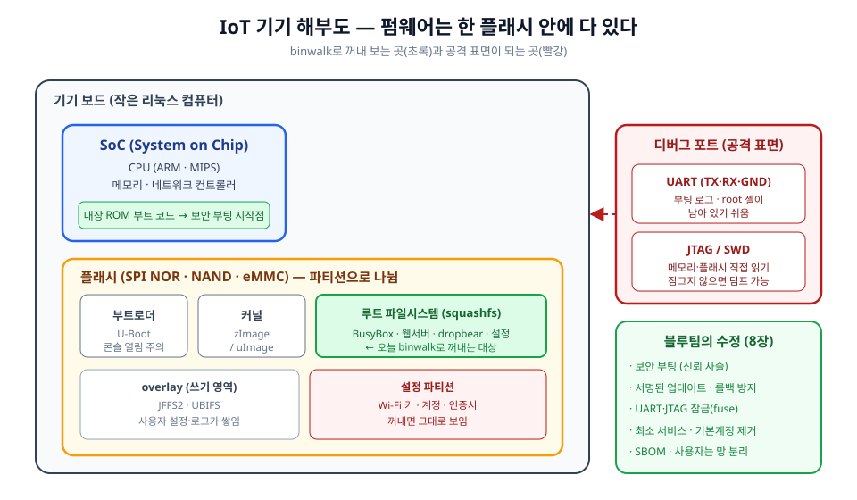
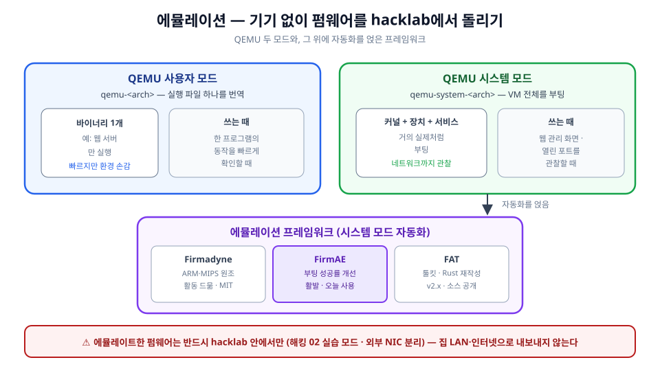
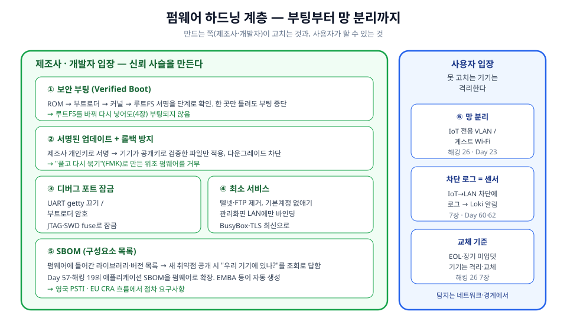

> **해킹 트랙 · 레드팀·블루팀 체험** | 난이도 ★★★☆☆ | 예상 소요 3 ~ 3.5시간

> ⚠️ **실습 전 반드시 읽으세요.** 오늘의 대상은 세 가지뿐입니다. ① **내가 소유한 기기**, ② **공개적으로 배포되는 연습용 펌웨어**(제조사가 공개한 펌웨어 이미지, OWASP IoTGoat처럼 의도적으로 취약하게 만든 교육용 펌웨어), ③ 그 펌웨어를 **`hacklab` 안에서 띄운 에뮬레이션 대상**. 아파트 월패드, 회사·학교의 카메라, 이웃의 공유기처럼 **남의 기기·서비스는 같은 망에 있어도 대상이 아닙니다.** 허가 없는 접근은 **정보통신망법 등으로 처벌**될 수 있습니다. 또 펌웨어는 저작물입니다. 제조사 펌웨어를 받기 전에 **라이선스·이용 약관(리버스 엔지니어링·재배포 금지 조항)** 을 확인하고, 추출한 파일을 공개 저장소에 올리지 않습니다. 이 글은 단계별 익스플로잇, 백도어·변조 펌웨어 제작, 탐지 회피를 다루지 않습니다. 목적은 **"무엇이 열려 있는지 알고, 어떻게 닫는지"** 입니다.

## 🎯 오늘의 목표

- 레드팀이 왜 월패드·카메라 같은 IoT를 **공격 표면**으로 보는지, 기기 구성(SoC, 플래시, 부트로더, 리눅스 펌웨어, UART·JTAG)으로 설명할 수 있다
- 합법적인 경로로 펌웨어를 얻고, **binwalk v3**로 구조를 보고 파일시스템을 꺼낼 수 있다
- 꺼낸 파일시스템에서 **기본 계정·오래된 구성요소·불필요한 서비스**가 왜 위험한지 알고, 각각의 수정안을 적을 수 있다
- QEMU 사용자 모드·시스템 모드와 FirmAE 같은 프레임워크의 차이를 알고, 에뮬레이션 대상을 **`hacklab` 안에서만** 띄울 수 있다
- 네트워크에서 IoT 이상 징후를 **탐지**하고(해킹 21, Day 72), 제조사·사용자 입장의 **하드닝**(보안 부팅, 서명된 업데이트, 디버그 포트, 최소 서비스, SBOM, 망 분리)을 정리할 수 있다

---

## 0. "레드팀·블루팀 체험" 미니 시리즈

해킹 28까지는 "내 앱·내 인프라를 점검하고 고친다"였습니다. 해킹 29~31은 **같은 대상을 공격자 눈과 방어자 눈으로 번갈아 보는** 짧은 시리즈입니다.

| 편 | 관점 | 내용 |
|---|---|---|
| **29 (오늘)** | 레드팀의 시선 → 블루팀의 수정 | IoT·펌웨어: 무엇이 노출되는지 보고, 어떻게 막는지 |
| 30 | 블루팀 | Wazuh로 내 실습 흔적을 탐지하고 룰 만들기 |
| 31 | 둘을 잇기 | 이어지는 미니 시리즈 마무리 |

> 💡 해킹 26에서는 **사용자**로서 내 공유기·IoT 기기의 설정을 점검했습니다(인벤토리, 범위 가드, UPnP·WPS, VLAN 분리). 오늘은 한 겹 안으로 들어가 **기기 안의 소프트웨어(펌웨어)** 를 봅니다. 해킹 26의 내용은 반복하지 않고 링크로 잇습니다.

---

## 1. 원리 ① — 왜 레드팀은 IoT부터 보는가

모의해킹 의뢰를 받은 레드팀이 아파트 단지의 **월패드(세대 단말)** 를 점검한다고 해 봅시다. 계약서에 범위가 정해진 정식 점검입니다. 레드팀이 IoT에 주목하는 이유는 대개 다음과 같습니다.

| 특성 | 웹 서버 | 월패드 같은 IoT |
|---|---|---|
| 업데이트 | 운영팀이 주기적으로 | 설치 후 수년간 그대로인 경우가 많음 |
| 소프트웨어 | 최신 런타임 | 출시 당시 버전에 고정된 BusyBox·OpenSSL·웹 서버 |
| 계정 | 개인별 계정 | 설치 기사용 **공통 계정**, 펌웨어 안의 고정 비밀번호 |
| 망 위치 | DMZ, 방화벽 뒤 | 세대 망과 **단지 서버 망에 동시에** 연결 |
| 물리 접근 | 데이터센터 | 누구나 만질 수 있는 벽에 붙어 있음 |
| 감시 | EDR·로그 | 에이전트를 설치할 수 없음, 로그가 거의 없음 |

이런 점검에서 흔히 보고되는 결과는 특정 회사의 문제가 아니라 **구조의 문제**입니다. 세대 간 망이 분리되지 않아 한 세대의 단말에서 다른 세대·단지 서버가 보이거나, 모든 단말이 같은 관리 비밀번호를 쓰거나, 펌웨어 업데이트에 서명이 없어 위조 업데이트를 막을 수 없는 식입니다. 국내에서도 이런 문제가 사회적으로 알려진 뒤 공동주택 홈네트워크의 **세대 간 망 분리**를 요구하도록 관련 기준이 강화되었습니다.

> 💡 레드팀 보고서의 핵심은 "뚫었다"가 아니라 **"어떤 약점이 어떤 경로로 이어지고, 무엇을 고치면 끊기는가"** 입니다(해킹 11 보고서 양식). 오늘 실습도 같은 구조로, 찾은 것마다 탐지와 수정을 짝으로 적습니다.

---

## 2. 원리 ② — IoT 기기의 구성



대부분의 IoT 기기는 작은 리눅스 컴퓨터입니다. 데스크톱과 다른 점은 **모든 것이 한 칩과 한 플래시 안에 들어 있다**는 것입니다.

| 구성 | 역할 | 보안 관점 |
|---|---|---|
| **SoC** (System on Chip) | CPU(ARM·MIPS가 흔함) + 메모리 컨트롤러 + 네트워크·USB 등 주변장치를 한 칩에 | 칩에 내장된 **ROM 부트 코드**가 보안 부팅의 출발점(8장) |
| **플래시** (SPI NOR / NAND / eMMC) | 부트로더·커널·루트 파일시스템·설정을 파티션으로 나눠 저장 | 꺼내면 펌웨어 전체가 보임. 설정 파티션에 비밀번호·Wi-Fi 키 |
| **부트로더** (U-Boot가 흔함) | 전원이 들어오면 커널을 플래시에서 읽어 실행 | 부팅 중 키 입력으로 **부트로더 콘솔**이 열리면 부팅 인자 변경 가능 |
| **리눅스 커널 + 루트 파일시스템** | 읽기 전용 압축 파일시스템(**squashfs**가 흔함) + 쓰기용 overlay(JFFS2·UBIFS) | 오늘 binwalk로 꺼내 보는 대상 |
| **사용자 공간** | BusyBox(셸·기본 명령 묶음), 웹 서버(uhttpd·lighttpd), dropbear(SSH), 텔넷 데몬 | 오래된 버전, 불필요한 서비스, 기본 계정 |
| **UART** | 시리얼 콘솔(TX·RX·GND 핀). 부팅 로그와 셸이 나오는 경우가 많음 | 개발 편의로 남겨 둔 **root 셸**이 흔한 약점 |
| **JTAG / SWD** | 칩 디버그 인터페이스. 메모리 읽기·쓰기, 실행 중단 | 잠그지 않으면 플래시·메모리를 직접 읽을 수 있음 |

> 💡 펌웨어 파일 하나는 보통 **[헤더][커널][squashfs 루트 파일시스템]** 이 이어 붙은 구조입니다. binwalk가 하는 일은 이 파일 안에서 "여기부터 squashfs", "여기부터 gzip"처럼 **알려진 형식의 시작 표시(시그니처)** 를 찾아 잘라 내는 것입니다.

---

## 3. 펌웨어 획득 — 합법적인 경로부터

| 경로 | 설명 | 오늘 사용 |
|---|---|---|
| **제조사 공개 다운로드** | 고객지원 페이지의 펌웨어 업데이트 파일 | ✅ 내 기기의 펌웨어, 라이선스 확인 후 |
| **교육용 취약 펌웨어** | OWASP **IoTGoat**(OpenWrt 18.06.2 기반, MIT 라이선스, GitHub Releases에 v1.0 이미지 공개), DVRF(MIPS·Linksys E1550 기반 교육용, 2024-04에 보관(archived) 처리됨) | ✅ 주 실습 대상: IoTGoat |
| **업데이트 트래픽·앱** | 기기가 업데이트 서버에서 받는 파일 | ⚠️ 내 기기 + 약관 확인. 오늘은 다루지 않음 |
| **하드웨어 덤프** | UART 부트로더, SPI 플래시 칩 직접 읽기, JTAG | ⚠️ 개념만. **내 기기에 한정** |

### 3-1. 하드웨어에서 덤프한다는 것 (개념만)

펌웨어를 공개하지 않는 기기는 플래시 칩을 직접 읽는 방법이 있습니다. 클립으로 SPI 플래시 칩에 연결해 플래시 프로그래머로 읽거나, UART로 부트로더 콘솔에 들어가 메모리를 출력하는 방식입니다.

- **내 기기에만** 합니다. 케이스를 여는 순간 보증이 사라질 수 있고, 전압을 잘못 걸면 기기가 영구히 고장 납니다(벽돌).
- 덤프에는 **내 Wi-Fi 비밀번호, 클라우드 계정 토큰** 같은 개인 정보가 들어 있으니 해시를 남기고 암호화해 보관합니다(해킹 27의 증거 보존과 같은 습관).
- 오늘 실습은 공개 이미지로 충분합니다. 하드웨어 쪽은 **"UART·JTAG가 왜 막혀 있어야 하는가"** 를 이해하는 데 씁니다(8-3).

### 3-2. 실습 이미지 받기 (업데이트 모드)

해킹 02의 **업데이트 모드**(Kali NAT 케이블 연결)에서 받습니다.

```bash
# Kali — 작업 폴더
mkdir -p ~/hacklab/fw/iotgoat ~/hacklab/fw/notes && cd ~/hacklab/fw/iotgoat
# 브라우저로 https://github.com/OWASP/IoTGoat/releases 의 v1.0 자산 중
#   IoTGoat-raspberry-pi2-sysupgrade.img   ← 정적 분석용 (ARM)
#   IoTGoat-x86.vmdk                        ← 시스템 에뮬레이션용 (VirtualBox)
# 을 받아 이 폴더에 둔다. 받은 직후 해시를 기록한다.
sha256sum IoTGoat-* | tee ../notes/iotgoat-sha256.txt
```

> 💡 제조사 펌웨어도 같은 방식으로 `~/hacklab/fw/<제조사-모델>/`에 두고, **어디서 언제 받았는지, 라이선스 조항**을 `notes/`에 적습니다. 보고서(해킹 11)의 "대상" 칸이 됩니다.

---

## 4. 내 환경 실습 ① — binwalk v3로 구조 보고 꺼내기

### 4-1. binwalk v3 — Rust로 다시 쓴 버전

binwalk는 2024년 10월 **v3.1.0**으로 **Rust로 새로 작성**되었습니다(이전 2.x는 Python). 속도와 정확도가 좋아졌고, 옵션 일부가 바뀌었습니다. Kali에서는 이름이 다른 별도 패키지입니다.

| 항목 | binwalk 2.x (Python) | binwalk v3 (Rust) |
|---|---|---|
| Kali 패키지 / 명령 | `binwalk` | **`binwalk3`** |
| 추출 | `-e` | `-e` (`--extract`) |
| 재귀 추출 | `-M` | `-M` (`--matryoshka`) |
| 엔트로피 | `-E` | `-E` (`--entropy`, `-e`와 함께 못 씀) |
| 출력 폴더 | `-C` | `-C` (`--directory`, 기본 `extractions`) |
| JSON 로그 | — | `-l <파일>` (`--log`) |
| 다른 설치 방법 | pip | `cargo install binwalk`, 공식 Dockerfile |

```bash
# Kali (업데이트 모드)
sudo apt install -y binwalk3 squashfs-tools
binwalk3 -V
# binwalk 3.1.0
```

### 4-2. 구조 보기 (스캔만)

이후는 **실습 모드**(NAT 분리)에서 해도 됩니다.

```bash
cd ~/hacklab/fw/iotgoat
binwalk3 IoTGoat-raspberry-pi2-sysupgrade.img
```

```
# 예시 출력 — 오프셋·크기는 이미지마다 다름
DECIMAL     HEXADECIMAL   DESCRIPTION
------------------------------------------------------------------------
...         ...           DOS Master Boot Record ...
...         ...           Linux kernel ARM boot executable zImage ...
...         ...           SquashFS file system, little endian, version 4.0, compression: xz ...
```

| 보이는 것 | 의미 |
|---|---|
| MBR / 파티션 | 라즈베리파이용 디스크 이미지라 파티션 표가 있음 |
| `zImage` / `uImage` | 커널. `uImage`는 U-Boot용 헤더 |
| **SquashFS** | 루트 파일시스템 — 오늘의 주 대상 |
| 높은 엔트로피 구간 | 압축 또는 **암호화**. 암호화된 펌웨어는 시그니처가 거의 안 보임(8장의 "펌웨어 암호화") |

```bash
# 엔트로피 그래프 생성 (추출과 동시에는 못 함)
binwalk3 -E IoTGoat-raspberry-pi2-sysupgrade.img
```

### 4-3. 파일시스템 꺼내기

```bash
binwalk3 -e -C ~/hacklab/fw/iotgoat/extractions IoTGoat-raspberry-pi2-sysupgrade.img
ROOTFS=$(find ~/hacklab/fw/iotgoat/extractions -maxdepth 4 -type d -name 'squashfs-root' | head -1)
echo "export ROOTFS=$ROOTFS" >> ~/hacklab/fw/notes/env.sh
ls "$ROOTFS"
# bin  dev  etc  lib  mnt  overlay  proc  rom  root  sbin  sys  tmp  usr  var  www
cat "$ROOTFS/etc/openwrt_release"
# DISTRIB_ID='OpenWrt'
# DISTRIB_RELEASE='18.06.2'   ← 의도적으로 오래된 기반
```

> ⚠️ 추출된 파일은 **신뢰할 수 없는 데이터**입니다. 안의 스크립트를 Kali에서 그대로 실행하지 않습니다. 실행이 필요하면 5장의 정적 확인으로 끝내고, 동작 확인은 6장의 격리된 에뮬레이션에서만 합니다. 심볼릭 링크가 `/etc/passwd`처럼 **Kali 자신의 절대 경로**를 가리킬 수 있으니, 아래 확인은 항상 `$ROOTFS` 안에서 상대 경로로 봅니다(`cat etc/..` 형태, 맨 앞 `/` 금지).

### 4-4. firmware-mod-kit은?

**firmware-mod-kit(FMK)** 은 펌웨어를 풀고(`extract-firmware.sh`) 다시 묶는(`build-firmware.sh`) 오래된 스크립트 모음입니다. 원래 Google Code 프로젝트였고, 지금은 GitHub 포크에서 2026년 초에도 컴파일 오류 수정 정도의 커밋이 있지만, 문서는 Python 2 시절 binwalk 2.1.1을 기준으로 하고 있어 **사실상 유지보수 모드**입니다.

- 오늘은 **다시 묶는 단계**가 필요 없습니다. 변조 펌웨어를 만드는 것은 이 글의 범위가 아닙니다.
- 개념만 기억하세요: 서명이 없으면 "풀기 → 수정 → 다시 묶기"가 쉽다는 것 자체가, 제조사가 **서명된 업데이트**(8-2)를 해야 하는 이유입니다.

---

## 5. 내 환경 실습 ② — 파일시스템 점검 관점

레드팀이 펌웨어를 받으면 가장 먼저 하는 일은 실행이 아니라 **읽기**입니다. 아래 표는 "무엇이 왜 위험하고, 블루팀은 무엇을 고치는가"의 지도입니다. 각 항목은 **정해진 파일 하나를 열어 상태를 확인**하는 것으로 충분합니다.

### 5-1. 점검 체크리스트 (왜 위험한가 → 수정)

| # | 보는 것 | 어디를 | 왜 위험한가 | 수정(8장) |
|---|---|---|---|---|
| 1 | **기본 계정** | `etc/passwd` | 모든 기기가 같은 계정이면 하나만 알아도 전부 적용 | 기기별 고유 비밀번호, 첫 부팅 시 설정 강제 |
| 2 | **고정된 비밀/키의 존재** | `etc/`, `etc/config/` | 펌웨어에 들어 있는 비밀은 더 이상 비밀이 아님 | 비밀은 펌웨어 밖에서 기기별 프로비저닝 |
| 3 | **동일 기기 공통 인증서** | `etc/ssl/`, `*.pem` | 모든 기기가 같은 키 → 하나 노출되면 전부 위험 | 기기별 키, 보안 저장소(8-1) |
| 4 | **텔넷·디버그 서비스** | `etc/inittab`, `etc/init.d/`, `etc/rc.d/` | 평문 원격 셸, 공격 표면 확대 | 빌드에서 제거, 최소 서비스(8-4) |
| 5 | **SSH 설정** | `etc/config/dropbear` | 비밀번호·root 로그인 허용 | 키 인증, LAN 인터페이스만 |
| 6 | **BusyBox 버전** | `bin/busybox` | 오래된 버전엔 알려진 CVE | 최신 버전, 필요한 애플릿만 |
| 7 | **TLS 라이브러리 버전** | `usr/lib/libssl*`·`libcrypto*`(mbedTLS·wolfSSL일 수도) | 지원 종료 버전 | 지원 중인 버전, SBOM으로 추적(8-5) |
| 8 | **웹 관리 코드** | `www/`, `usr/lib/lua/luci/` | 입력을 셸로 넘기면 명령 주입(해킹 05) | 입력 검증, 셸 호출 금지 |
| 9 | **업데이트 검증 여부** | `sbin/sysupgrade`, `etc/opkg/keys/` | 서명이 없으면 위조 업데이트 수용 | 서명 검증(8-2) |

### 5-2. 항목 하나를 확인하는 모습

점검은 "전부 긁어모으기"가 아니라, **표의 한 줄씩 해당 파일을 열어 눈으로 보는 것**입니다. 예를 들어 6번(구성요소 버전)은 버전 문자열 하나만 확인하면 됩니다.

```bash
source ~/hacklab/fw/notes/env.sh    # $ROOTFS
cd "$ROOTFS"

# (6) BusyBox가 어떤 버전인지 — 버전 배너만 확인
strings bin/busybox | grep -m1 'BusyBox v'
# BusyBox v1.28.4 (2019-...)   ← 기반 OpenWrt 18.06의 버전. 지원 종료 여부를 공식 배포처에서 확인

# (7) TLS 라이브러리 파일이 무엇이고 몇 버전인지
ls usr/lib/ | grep -E 'libssl|libcrypto|mbedtls|wolfssl'
```

확인한 버전이 **지금도 지원되는지**는 각 프로젝트의 공개 보안 공지에서 봅니다. 이 단계의 결과물은 "취약점 목록"이 아니라 **"이 기기는 OpenWrt 18.06.2 + BusyBox 1.28 세대이고, 이 계열은 지원이 끝났다"** 같은 **버전·구성요소 현황**입니다. 그것만으로도 교체·격리 판단(해킹 26 7장)에 충분합니다.

> 💡 사람이 하나씩 보는 대신 **전용 분석기**를 쓰면 같은 체크리스트를 자동으로 돌려 줍니다. 오픈소스 **EMBA**(GPL-3.0, 최신 v2.0.5)는 펌웨어를 풀고 구성요소·알려진 취약점·약한 설정을 찾아 **HTML 보고서와 SBOM**까지 냅니다. 상용·오픈소스 도구 모두 "펌웨어 → 구성요소 인벤토리 → 알려진 취약점" 흐름은 같습니다.

> ⚠️ 무엇을 찾든, 그것으로 **다른 기기를 공격하는 절차**로 넘어가지 않습니다. 오늘은 "있다/없다"를 확인하고 6~8장에서 **탐지·수정**으로 바로 갑니다. 발견은 보고서(해킹 11)에 "증거 + 조치 권고"로만 적습니다.

---

## 6. 에뮬레이션 — 기기 없이 펌웨어를 `hacklab`에서 돌리기

실물 기기가 없어도, 꺼낸 파일시스템이나 펌웨어 이미지를 **에뮬레이터로 띄워** 웹 관리 화면 같은 동작을 안전하게 관찰할 수 있습니다. 중요한 전제: **에뮬레이션 대상은 반드시 `hacklab` 안에서만** 띄웁니다(인터넷·집 LAN과 분리, 해킹 02).



### 6-1. QEMU 두 가지 모드

| 모드 | 무엇을 | 쓰는 때 |
|---|---|---|
| **사용자 모드** (`qemu-<arch>`) | 다른 CPU용 **실행 파일 하나**를 번역해 실행 | 펌웨어 안의 바이너리 하나(예: 웹 서버)의 동작을 빠르게 보기 |
| **시스템 모드** (`qemu-system-<arch>`) | 커널·장치까지 **가상 머신 전체**를 에뮬레이트 | 펌웨어를 거의 실제처럼 부팅해 네트워크 서비스까지 관찰 |

```bash
# 사용자 모드 준비 (업데이트 모드에서 설치)
sudo apt install -y qemu-user-static
qemu-arm-static --version   # 설치 확인
# → 사용자 모드는 아키텍처가 섞인 루트FS·동적 라이브러리 경로 때문에 손이 많이 간다.
#   그래서 "펌웨어 전체"는 아래 프레임워크에 맡기는 것이 현실적이다.
```

> 💡 QEMU 자체는 활발히 유지되는 프로젝트입니다(최신 안정판 11.1.x 계열, 2026년 하반기 기준 — 공식 다운로드 페이지에서 확인). 아래 프레임워크들은 이 QEMU를 바탕으로 **"펌웨어를 알아서 부팅해 주는" 자동화**를 얹은 것입니다.

### 6-2. 에뮬레이션 프레임워크

실제로 쓰이는, 공개된 프레임워크들입니다.

| 도구 | 성격 | 상태(2026 기준) | 라이선스 |
|---|---|---|---|
| **Firmadyne** | ARM·MIPS 펌웨어 시스템 에뮬레이션의 원조 | 유지되지만 저장소 활동은 드묾(최근 커밋 2024) | MIT |
| **FirmAE** | Firmadyne를 개선해 **부팅 성공률**을 크게 높인 자동화(여러 보정 기법) | 활발(2026년에도 커밋) | MIT |
| **FAT**(Firmware Analysis Toolkit) | 에뮬레이션·추출·분석을 묶은 툴킷. 최근 **Rust로 재작성**(v2.x, 2026) | 활발 | 2.x는 소스 공개(FSL-1.1-ALv2) |

오늘은 **FirmAE**로 IoTGoat 같은 이미지를 띄워 봅니다. FirmAE는 `check`(부팅되는지), `run`(서비스 띄우기), `analyze`(자체 분석) 모드를 제공합니다.

```bash
# hacklab 안의 분석용 VM(docker-targets 또는 전용 VM)에서, 공식 안내대로 설치
git clone --recursive https://github.com/pr0v3rbs/FirmAE
cd FirmAE
sudo ./download.sh && sudo ./install.sh   # 의존성·커널·이미지 준비 (오래 걸림)
sudo ./init.sh

# (1) 부팅되는지 확인
sudo ./run.sh -c iotgoat ~/hacklab/fw/iotgoat/<펌웨어이미지>
# [*] ... Emulation is successful!  (성공 시 할당된 IP를 알려 줌)

# (2) 서비스 띄우기 — 웹 관리 화면을 관찰
sudo ./run.sh -r iotgoat ~/hacklab/fw/iotgoat/<펌웨어이미지>
# → 안내된 IP(예: 192.168.0.x 가상 탭)로 브라우저 접속해 로그인 화면·배너 확인
```

> ⚠️ FirmAE는 자체 가상 네트워크 탭을 만듭니다. 이 네트워크가 **집 LAN·인터넷으로 나가지 않도록** 분석 VM을 해킹 02의 실습 모드(외부 NIC 분리)로 두고 띄웁니다. 에뮬레이트된 펌웨어는 "신뢰할 수 없는 소프트웨어"로 취급합니다.

> 💡 에뮬레이션이 좋은 이유: 실제 기기를 **벽돌로 만들 위험 없이**, 웹 UI·열린 포트·로그를 반복해서 볼 수 있고, 7장의 탐지 센서를 그 앞에 세워 "이 기기가 네트워크에서 어떻게 보이는가"를 그대로 연습할 수 있습니다.

---

## 7. 탐지 — IoT를 네트워크에서 "보이게" 만들기

기기 안에 에이전트를 넣을 수 없으니, IoT는 **네트워크와 경계에서** 봅니다. 해킹 10의 원칙(❌ 보이지 않음 → ✅ 알림)을 그대로 씁니다.

| 무엇을 | 어떻게 | 연결 |
|---|---|---|
| 기기가 **어떤 포트·서비스를 여는지** | 에뮬레이션(6장) 앞에서, 또는 내 기기를 해킹 26의 범위 가드로 1회 점검 | 해킹 26 |
| 기기가 **누구와 통신하는지** | 패킷 캡처로 목적지·평문 여부 확인 | 해킹 21 |
| **평문 인증·텔넷**이 오가는지 | Wireshark 디스플레이 필터 | 해킹 21 |
| IoT가 **내부망을 두드리는 순간** | IoT→LAN 차단 규칙의 로그(nftables) → Loki 알림 | 해킹 26 5장, Day 60·62 |
| 호스트/에뮬레이터에서 **예상 밖 프로세스·접속** | Falco 개념 | Day 72 |

### 7-1. 평문·목적지 관찰 (해킹 21 재사용)

에뮬레이트한 IoT, 또는 IoT VLAN의 트래픽을 캡처 지점에서 봅니다. 새 캡처 명령을 만들지 않고 해킹 21의 방식을 그대로 씁니다.

```bash
# 캡처 지점(해킹 21)에서 — 대상 IoT의 IP만
tshark -i eth1 -f "host <IoT_IP>" -w ~/hacklab/pcap/hack29-iot.pcapng
```

| 디스플레이 필터 | 보는 것 |
|---|---|
| `telnet` | 평문 텔넷 세션(열려 있으면 이것부터 닫기) |
| `http.authorization` | 평문 HTTP 관리 로그인 |
| `dns.qry.name` | 기기가 부르는 **외부 도메인** — 모르는 곳이면 조사 |
| `tls.handshake.extensions_server_name` | 어떤 클라우드에 붙는지 |

> 💡 집이라면 Pi-hole·AdGuard Home의 질의 로그가 "어느 IoT가 어느 도메인을 부르는지"를 그대로 보여 줍니다(해킹 26 3-5). IoT가 갑자기 **새로운 외부 주소**를 부르기 시작하는 것은 좋은 탐지 신호입니다.

### 7-2. Falco로 에뮬레이터·호스트 관점 (Day 72 개념)

펌웨어를 컨테이너나 VM에서 돌린다면, 호스트의 **Falco**(Day 72)가 "예상치 못한 프로세스 실행"이나 "낯선 바깥 연결"을 커널 수준에서 볼 수 있습니다. 규칙은 Day 72에서 만든 것을 재사용하고, 새 룰은 다음 편(해킹 30, Wazuh)에서 본격적으로 다룹니다.

> ⚠️ Falco 룰을 쓸 때 오래된 예제의 `evt.dir=<` 같은 **방향(direction) 조건**은 최근 버전에서 사용 중단(deprecated) 되었습니다(0.42 이후 경고, 이후 제거 예정). 최신 문법은 Day 72와 Falco 공식 문서를 기준으로 하세요.

---

## 8. 수정·하드닝 — 제조사/개발자 입장과 사용자 입장



오늘 본 약점은 대부분 **만드는 쪽에서** 고쳐야 합니다. 그래서 수정은 두 층으로 나눕니다.

### 8-1. 보안 부팅 (Secure Boot / Verified Boot)

전원이 들어오면 **칩 안의 ROM 코드**가 부트로더의 서명을 확인하고, 부트로더가 커널의 서명을, 커널이 루트 파일시스템의 무결성을 확인하는 **신뢰 사슬**을 만듭니다. 한 단계라도 서명이 맞지 않으면 부팅을 멈춥니다. 이렇게 하면 4장처럼 **루트 파일시스템을 바꿔 다시 넣어도 부팅되지 않습니다.**

### 8-2. 서명된 업데이트

업데이트 파일에 제조사 개인 키로 **서명**을 붙이고, 기기는 **공개 키로 검증**한 뒤에만 적용합니다. 버전을 되돌리는 **롤백 방지**(다운그레이드 차단)도 함께 둡니다. 4-4에서 FMK로 "풀고 다시 묶기"가 쉬웠던 것은, 서명이 없으면 누구나 그렇게 할 수 있다는 뜻이었습니다.

### 8-3. 디버그 포트 비활성화

- **UART**: 양산 펌웨어에서는 시리얼 콘솔 로그인(getty)을 끄거나, 최소한 부트로더 콘솔에 비밀번호를 겁니다.
- **JTAG/SWD**: 양산 단계에서 디버그 인터페이스를 잠급니다(fuse). 이것이 3-1의 "하드웨어 덤프"를 어렵게 만드는 방어입니다.

### 8-4. 최소 서비스 (공격 표면 줄이기)

| 원칙 | 구체적으로 |
|---|---|
| 필요 없는 서비스 제거 | 텔넷·FTP·디버그 데몬을 빌드에서 뺌 |
| 기본 계정 없애기 | 공통 비밀번호 대신 첫 부팅 시 사용자 설정 강제 |
| 관리 화면 범위 제한 | WAN에서 접근 불가, LAN 인터페이스에만 바인딩 |
| 최신 구성요소 | BusyBox·TLS 라이브러리를 지원 중인 버전으로 |

### 8-5. SBOM — 무엇이 들었는지 아는 것

**SBOM**(Software Bill of Materials)은 펌웨어에 들어간 **구성요소와 버전의 목록**입니다. SBOM이 있으면 새 취약점이 공개됐을 때 "우리 기기에 이 라이브러리가 있나?"를 **목록 조회로** 답할 수 있습니다. Day 57(공급망)·해킹 19(SCA)에서 본 애플리케이션 SBOM과 같은 개념을 펌웨어로 확장한 것이고, 7장에서 소개한 EMBA 같은 도구가 펌웨어에서 SBOM을 뽑아 줍니다. 앞서 말한 영국 PSTI·EU CRA(해킹 26 7장) 흐름에서 SBOM 제공은 점점 요구사항이 되고 있습니다.

### 8-6. 사용자 입장 — 망 분리 (해킹 26, Day 23)

만드는 쪽을 내가 바꿀 수 없을 때, 사용자가 할 수 있는 가장 효과적인 방어는 **격리**입니다. 해킹 26에서 한 것을 그대로 적용합니다.

- IoT를 **전용 VLAN 또는 게스트 Wi-Fi**로 분리해 내부망·홈랩과 끊습니다(해킹 26 5장, Day 23 VLAN).
- 그 경계에 **차단 로그**를 달면 예방이자 탐지 센서가 됩니다(해킹 26 5장, 7-1).
- 업데이트가 끊긴(EOL) 기기는 **교체 기준**에 따라 격리·교체합니다(해킹 26 7장).

---

## 9. 트러블슈팅

| 증상 | 원인 | 해결 |
|---|---|---|
| `binwalk3`가 없다고 나옴 | Kali 패키지 이름이 다름(`binwalk`는 2.x) | `sudo apt install binwalk3`, 명령도 `binwalk3` |
| `binwalk3 -e`가 squashfs를 안 풂 | `squashfs-tools`(unsquashfs) 미설치 또는 특이한 압축 | `sudo apt install squashfs-tools`, `-M`로 재귀 추출 시도 |
| 추출물이 거의 없고 전부 고엔트로피 | 펌웨어가 **암호화**됨 | 공개 이미지로 연습, 내 기기는 복호화 키 없이는 중단(합법 범위) |
| 추출한 스크립트를 Kali에서 실행했더니 이상 동작 | 신뢰할 수 없는 코드 실행 | 실행은 6장 에뮬레이션(격리)에서만, 정적 확인은 읽기만 |
| FirmAE `run`은 되는데 네트워크가 집 LAN에 보임 | 분석 VM이 실습 모드가 아님 | 외부 NIC 분리(해킹 02), `hacklab` 안에서만 |
| FirmAE 부팅 실패(`not successful`) | 해당 아키텍처·기기 보정이 안 됨 | 다른 공개 이미지로, 또는 `-d` 디버그 로그 확인. 모든 펌웨어가 에뮬레이트되지는 않음 |
| 버전은 찾았는데 취약한지 모르겠음 | 버전 → 취약점 매핑 필요 | 공식 보안 공지·EMBA 보고서로 확인, 단정 말고 "현황"으로 기록 |

---

## 10. 핵심 정리

- IoT는 **업데이트·계정·로그·물리 접근**의 약점이 겹쳐 레드팀의 좋은 출발점이 된다. 문제는 대개 특정 제품이 아니라 **구조**(평평한 망, 공통 비밀번호, 서명 없는 업데이트)다
- 구성(SoC·플래시·부트로더·squashfs·UART/JTAG)을 알면 **어디를 봐야 하는지** 보인다
- 펌웨어는 **합법 경로**(내 기기, 제조사 공개, IoTGoat 같은 교육용)로만 얻고 **라이선스를 확인**한다
- **binwalk v3(`binwalk3`)** 로 구조를 보고 squashfs를 꺼낸 뒤, 체크리스트로 **기본 계정·오래된 구성요소·불필요한 서비스**가 있는지 **읽어서** 확인한다(공격이 아니라 현황 파악)
- 기기가 없으면 **QEMU + FirmAE** 로 `hacklab` 안에서 에뮬레이트해 안전하게 관찰한다
- 탐지는 **네트워크·경계**에서(해킹 21 캡처, 해킹 26 차단 로그, Day 72 Falco), 수정은 **보안 부팅·서명된 업데이트·디버그 포트 잠금·최소 서비스·SBOM**(제조사)과 **망 분리**(사용자)로 짝지어 둔다

---

## 11. 셀프 체크

<details>
<summary>Q1. 오늘 실습 대상으로 허용되는 세 가지는? 아파트 월패드를 "같은 망에 있으니" 점검해도 되나?</summary>

허용 대상은 ① 내가 소유한 기기, ② 공개 배포되는 연습용 펌웨어(제조사 공개 이미지, OWASP IoTGoat 등 교육용 취약 펌웨어), ③ 그것을 `hacklab`에서 띄운 에뮬레이션 대상뿐입니다. 아파트 월패드는 **내 소유가 아니므로** 같은 망에 있어도 대상이 아닙니다. 정식 점검은 계약으로 범위가 정해졌을 때만 합니다.
</details>

<details>
<summary>Q2. 펌웨어 파일을 binwalk로 열면 보통 어떤 구조가 보이고, 그중 오늘의 주 대상은 무엇인가?</summary>

보통 **[헤더][커널(zImage/uImage)][루트 파일시스템(squashfs)]** 이 이어 붙어 있습니다. 오늘의 주 대상은 **squashfs 루트 파일시스템**으로, `-e`로 꺼내 `squashfs-root` 안의 설정·구성요소·웹 코드를 읽습니다.
</details>

<details>
<summary>Q3. binwalk v3가 2.x와 달라진 점 두 가지는?</summary>

① **Rust로 새로 작성**되어 속도·정확도가 개선되었고(2.x는 Python), ② Kali에서 **패키지·명령 이름이 `binwalk3`** 으로 분리되었습니다(기존 `binwalk`는 2.x). 추출 `-e`, 재귀 `-M`, 엔트로피 `-E`, 출력 폴더 `-C` 같은 핵심 옵션은 이어집니다.
</details>

<details>
<summary>Q4. QEMU 사용자 모드와 시스템 모드의 차이, 그리고 FirmAE로 에뮬레이트할 때 가장 중요한 안전 조건은?</summary>

사용자 모드(`qemu-<arch>`)는 **실행 파일 하나**를 번역해 돌리고, 시스템 모드(`qemu-system-<arch>`)는 커널·장치까지 **VM 전체**를 에뮬레이트해 네트워크 서비스까지 관찰할 수 있습니다. FirmAE 같은 프레임워크는 시스템 모드 자동화입니다. 안전 조건은 **`hacklab` 안(해킹 02 실습 모드, 외부 NIC 분리)에서만** 띄워, 에뮬레이트된 펌웨어가 집 LAN·인터넷으로 나가지 않게 하는 것입니다.
</details>

<details>
<summary>Q5. "서명 없는 업데이트"가 왜 문제이고, 보안 부팅·서명된 업데이트는 각각 무엇을 막나?</summary>

서명이 없으면 누구나 펌웨어를 풀어 수정하고 다시 넣을 수 있어 **위조 펌웨어**가 설치될 수 있습니다. **서명된 업데이트**는 기기가 공개 키로 검증한 파일만 적용해 이를 막고(롤백 방지까지 두면 다운그레이드도 차단), **보안 부팅**은 전원이 켜질 때 부트로더→커널→루트FS의 서명을 단계로 확인해 **변조된 이미지로는 부팅 자체가 안 되게** 합니다. 사용자 입장에서는 그래도 못 고치는 기기를 **망 분리**로 격리합니다.
</details>

---

## ⏭️ 다음 예고 — 해킹 30. 블루팀 실습 — Wazuh로 내 공격 탐지하고 룰 만들기

오늘은 레드팀의 시선으로 펌웨어를 열어 보고, 찾은 것마다 수정으로 닫았습니다. 다음 편에서는 자리를 바꿔 **블루팀**이 됩니다. 오픈소스 SIEM·XDR인 **Wazuh**를 실습장에 세우고, 에이전트로 호스트·로그를 모아, 해킹 29에서 만든 실습 흔적(이상한 접속, 평문 로그인, 에뮬레이터의 낯선 동작)을 **탐지 규칙으로 잡습니다.** 기본 룰셋을 보고, 내 환경에 맞는 **커스텀 룰과 알림**을 직접 작성해, "공격을 해 봤으니 이제 그것이 어떻게 보이는지"를 레드팀·블루팀 체험의 두 번째 조각으로 잇습니다.
