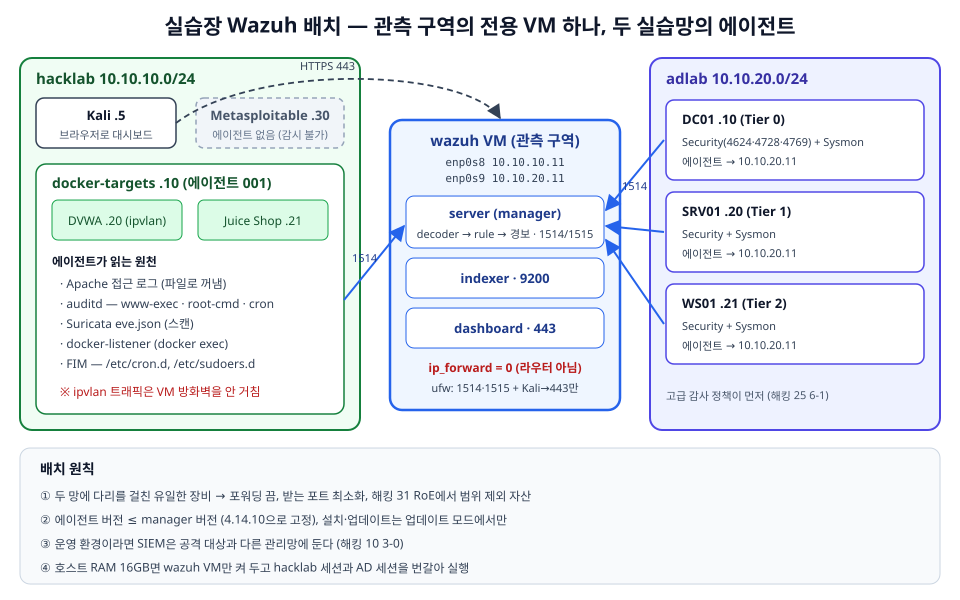
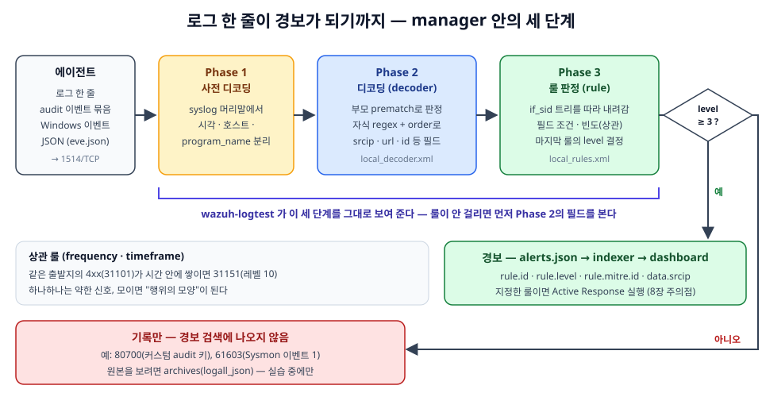
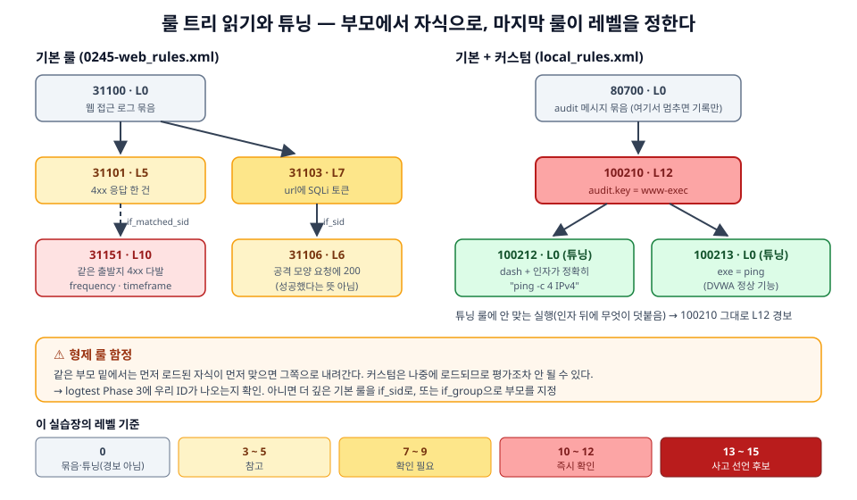

> **해킹 트랙 · 레드팀·블루팀 체험** | 난이도 ★★★★☆ | 예상 소요 4 ~ 5시간 (Wazuh 설치·에이전트 배포 포함)

> ⚠️ **실습 전 반드시 읽을 것**
> 실습은 **본인 소유의 격리된 실습장**(해킹 02의 `hacklab`, 해킹 25의 `adlab`)에서만 합니다. 오늘 다시 일으키는 행위는 모두 **앞 편에서 이미 한 실습**이고, 새 공격 기법은 다루지 않습니다. 회사·학교 네트워크에 SIEM 에이전트를 설치하거나 로그를 수집하는 것도 **관리 책임자의 허가 없이는 하면 안 됩니다**(개인정보·업무 로그가 포함됩니다). 허가 없는 타인 시스템 대상 스캔·공격은 **정보통신망법 등으로 처벌**될 수 있습니다. 이 글은 **탐지를 늘리는 쪽**만 다루며, 탐지를 피하는 방법은 다루지 않습니다.

## 🎯 오늘의 목표

- 블루팀이 하는 일(로그 분석, 악성코드 분석, 포렌식, 탐지 룰 작성, 침해 대응, 내부 이동 추적)과 **SIEM·EDR**의 자리를 설명할 수 있다
- 실습장 관측 구역에 **Wazuh 4.14**(all-in-one 또는 Docker)를 올리고, 리눅스 VM과 AD 랩의 **Windows + Sysmon**에 에이전트를 붙일 수 있다
- 해킹 03~07에서 한 행위를 다시 일으키고, 대시보드에서 찾은 경보가 **어떤 기본 룰의 어떤 조건으로** 걸렸는지 읽을 수 있다
- `local_decoder.xml`·`local_rules.xml`로 **커스텀 decoder·rule**을 쓰고, 오탐을 튜닝하고, `wazuh-logtest`로 검증할 수 있다
- 룰에 **MITRE ATT&CK**를 붙이고, **Active Response**의 함정을 알고, 오늘의 **탐지 공백**을 정리할 수 있다

---

## 1. 블루팀은 무엇을 하나

해킹 10에서 "퍼플팀"을 일하는 방식으로 소개했습니다. 오늘은 그중 **블루 쪽 자리**에 앉습니다. 블루팀은 한 가지 직무가 아니라 여러 일의 묶음입니다.

| 업무 | 하는 일 | 주로 쓰는 것 | 이 시리즈에서 |
|---|---|---|---|
| **로그 분석·보안관제** | 경보를 분류(정탐/오탐), 이상 징후를 확인하고 올림 | SIEM 대시보드, 검색 쿼리 | Day 60 Loki, 해킹 10, **오늘** |
| **탐지 룰 작성** (탐지 엔지니어링) | 새 위협·공백에 맞춰 룰을 쓰고, 오탐을 줄이고, 커버리지를 관리 | SIEM 룰, Falco 룰, Sigma, ATT&CK | Day 72, 해킹 10, **오늘 5~6장** |
| **EDR 운영** | 엔드포인트 프로세스·파일·네트워크 행위를 보고, 필요하면 격리 | EDR 콘솔, Sysmon, auditd | 해킹 25 Sysmon, 해킹 06 auditd |
| **침해 대응 (IR)** | 사고 선언, 격리, 제거, 복구, 보고 | 런북, 플레이북 | Day 65, 해킹 27 |
| **포렌식** | 증거 보존, 타임라인, 원인 분석 | 디스크·메모리 이미지, plaso | 해킹 27 |
| **악성코드 분석** | 의심 파일의 행위·지표(IOC) 파악 | 샌드박스, 정적 분석 도구 | (이 시리즈 범위 밖, 개념만) |
| **위협 헌팅·APT 추적** | 경보가 없어도 가설을 세우고 찾아다님. 특히 **Lateral Movement(내부 이동)** 의 흔적 | SIEM 검색, ATT&CK | **해킹 31** |

> 💡 **SIEM**(Security Information and Event Management)은 여러 곳의 로그를 모아 상관 분석·경보를 만드는 시스템이고, **EDR**(Endpoint Detection and Response)은 엔드포인트에 에이전트를 두고 행위를 보고 대응까지 하는 도구입니다. 상용 SIEM의 대표 예가 **Splunk**이고, 오늘 쓰는 **Wazuh**는 SIEM과 엔드포인트 에이전트(파일 무결성, 로그 수집, Active Response)를 함께 가진 **오픈 소스** 플랫폼입니다. 개념(로그 → 정규화 → 룰 → 경보 → 대응)은 어느 제품이든 같습니다.

### 1-1. Loki·Falco가 있는데 왜 Wazuh인가

| | 해킹 10의 구성 (Loki + Falco) | Wazuh |
|---|---|---|
| 기본 성격 | 범용 로그 저장소 + 런타임 탐지 | **보안 전용** 로그 분석 + 엔드포인트 에이전트 |
| 룰 | LogQL 알림, Falco 룰을 직접 작성 | **수천 개의 기본 룰**(웹, sshd, sudo, auditd, Windows, Sysmon, Suricata, Docker …) + 커스텀 |
| Windows | Alloy로 수집은 가능, 룰은 직접 | 에이전트가 이벤트 로그·Sysmon을 수집하고 **기본 룰로 해석** |
| ATT&CK | 룰 태그로 직접 | 룰에 `<mitre>` 매핑, 대시보드에 ATT&CK 화면 |
| 대응 | Falcosidekick → 알림(대응은 개념) | **Active Response**(차단 스크립트 실행) 내장 |

둘은 경쟁이 아니라 보는 층이 다릅니다. 오늘은 **"기본 룰이 이미 무엇을 알고 있나"** 를 Wazuh로 확인하고, 모자란 곳을 커스텀 룰로 채웁니다.

---

## 2. Wazuh 구조와 오늘의 배치



### 2-1. 구성 요소 (2026-11-19 확인)

| 구성 요소 | 하는 일 | 포트 |
|---|---|---|
| **Wazuh agent** | 엔드포인트에서 로그 수집, 파일 무결성(FIM), 보안 설정 점검, Active Response 실행 | (manager로 연결) |
| **Wazuh server (manager)** | 에이전트 등록·통신, **decoder로 필드를 뽑고 rule로 판정**해 경보 생성 | 1514/TCP 통신, 1515/TCP 등록, 55000 API |
| **Wazuh indexer** | 경보 저장·검색 (OpenSearch 기반) | 9200 |
| **Wazuh dashboard** | 웹 화면 — 검색, ATT&CK, FIM, 에이전트 관리 | 443 |

| 항목 | 값 |
|---|---|
| 최신 안정판 | **4.14.10** (2026-11-09 릴리스). 오늘 글은 이 버전 기준 |
| 다음 메이저 | 5.0.0은 아직 **RC(릴리스 후보)** 단계 — 실습장에는 안정판을 씁니다 |
| all-in-one 권장 사양 | 에이전트 1~25대: **4 vCPU, 8GiB RAM, 50GB**(90일 경보 기준) |
| 지원 OS (중앙 구성 요소) | Ubuntu 24.04 포함 64비트 리눅스 |

> 💡 버전 규칙: **에이전트 버전은 manager보다 높으면 안 됩니다.** 그래서 에이전트를 설치할 때 버전을 고정하고, 설치 후 저장소 자동 업데이트를 끕니다(4장).

### 2-2. 관측 구역에 Wazuh VM 하나 추가

해킹 10은 docker-targets VM(`10.10.10.10`) 안에 Loki·Grafana로 **관측 구역**을 만들었습니다. 그 VM은 RAM 3GB라 Wazuh가 들어갈 자리가 없으므로, 관측 구역에 **Wazuh 전용 VM**을 하나 더 둡니다.

| VM | NIC | 주소 | 역할 |
|---|---|---|---|
| **wazuh** (Ubuntu Server 24.04, 4 vCPU / 8GB / 60GB) | NIC1 NAT (업데이트 모드에서만 연결) | — | 패키지 받기 |
| | NIC2 intnet `hacklab` | **10.10.10.11** | hacklab 에이전트 수신, Kali에서 대시보드 접속 |
| | NIC3 intnet `adlab` | **10.10.20.11** | AD 랩(DC01·SRV01·WS01) 에이전트 수신 |

> ⚠️ 이 VM은 **두 실습망에 동시에 발을 걸친 유일한 장비**입니다. 해킹 25에서 `adlab`을 `hacklab`과 분리한 이유가 무너지지 않도록 ① **IP 포워딩 끔**(라우터가 되지 않음) ② 방화벽으로 **1514·1515만** 받고 대시보드는 Kali에서만 ③ 해킹 31의 RoE에서 **범위 제외 자산**으로 지정합니다. 운영 환경이라면 SIEM은 공격 대상과 다른 **관리망**에 둡니다(해킹 10 3-0).

| 호스트 RAM | 운영 방법 |
|---|---|
| 32GB 이상 | 모든 VM을 동시에 |
| 16GB | **세션을 나눔** — hacklab 세션(Kali·docker-targets·wazuh), AD 세션(DC01·WS01·wazuh). wazuh VM만 계속 켜 두고 나머지를 바꿔 켬 |

---

## 3. 실습 ① Wazuh 설치

### 3-1. VM 준비 (호스트 PC)

```powershell
VBoxManage createvm --name wazuh --ostype Ubuntu_64 --register
VBoxManage modifyvm wazuh --memory 8192 --cpus 4 `
  --nic1 nat --nic2 intnet --intnet2 hacklab --nic3 intnet --intnet3 adlab
```

Ubuntu Server 24.04를 Homelab 01 방식으로 설치한 뒤(디스크 60GB), 실습망 주소를 줍니다. 게이트웨이는 넣지 않습니다.

```bash
sudo tee /etc/netplan/60-labs.yaml > /dev/null <<'EOF'
network:
  version: 2
  ethernets:
    enp0s8: { dhcp4: false, addresses: [10.10.10.11/24] }   # hacklab
    enp0s9: { dhcp4: false, addresses: [10.10.20.11/24] }   # adlab
EOF
sudo chmod 600 /etc/netplan/60-labs.yaml && sudo netplan apply
ip -br addr | grep -E 'enp0s(8|9)'
sysctl net.ipv4.ip_forward          # net.ipv4.ip_forward = 0 이어야 함
```

### 3-2. 방법 A — all-in-one 설치 스크립트 (권장)

**업데이트 모드**(NIC1 케이블 연결)에서 실행합니다. 설치 스크립트가 indexer·server·dashboard를 한 VM에 올리고 인증서까지 만듭니다.

```bash
curl -sO https://packages.wazuh.com/4.14/wazuh-install.sh
sudo bash ./wazuh-install.sh -a
# ...
# INFO: --- Summary ---
# INFO: You can access the web interface https://<wazuh-dashboard-ip>:443
#     User: admin
#     Password: <설치 시 생성된 값>
# INFO: Installation finished.
```

| 설치 후 할 일 | 방법 |
|---|---|
| 비밀번호 보관 | 요약에 나온 `admin` 비밀번호를 비밀번호 관리자로. 다른 내부 사용자 비밀번호는 `wazuh-install-files.tar` 안의 `wazuh-passwords.txt`에 있음 → 옮긴 뒤 tar 파일은 VM 밖으로 빼거나 지움 |
| 버전 고정 | `/etc/apt/sources.list.d/wazuh.list`가 있으면 `sudo sed -i "s/^deb /#deb/" /etc/apt/sources.list.d/wazuh.list` |
| 상태 확인 | `sudo systemctl status wazuh-manager wazuh-indexer wazuh-dashboard --no-pager` |

### 3-3. 방법 B — Docker single-node (참고)

같은 VM에 Docker Engine(Day 01)을 설치했다면 공식 `wazuh-docker` 저장소로도 올릴 수 있습니다.

```bash
git clone https://github.com/wazuh/wazuh-docker.git -b v4.14.10
cd wazuh-docker/single-node/
echo "vm.max_map_count=262144" | sudo tee /etc/sysctl.d/99-wazuh-max-map-count.conf
sudo sysctl --system
docker compose -f generate-indexer-certs.yml run --rm generator   # 자체 서명 인증서
docker compose up -d
```

> ⚠️ Docker 방식의 기본 대시보드 계정은 문서에 공개된 **고정 비밀번호**입니다. 첫 로그인 직후 바꾸세요. 또 `docker-compose.yml`의 `ports:`가 `443`, `1514`, `55000` 등을 **모든 인터페이스**에 공개합니다. 해킹 02 원칙대로 필요한 포트만 남기고 `"10.10.10.11:443:5601"`처럼 **실습망 주소에 묶으세요**(Homelab 01의 "Docker 공개 포트는 ufw를 우회한다"). 이 글의 이후 명령은 방법 A(패키지) 경로 기준입니다. Docker라면 `docker exec -it single-node-wazuh.manager-1 ...`로 manager 컨테이너 안에서 실행합니다.

### 3-4. 방화벽 — 받을 것만 받기

```bash
sudo ufw default deny incoming
sudo ufw allow from 10.10.10.0/24 to any port 1514,1515 proto tcp   # hacklab 에이전트
sudo ufw allow from 10.10.20.0/24 to any port 1514,1515 proto tcp   # adlab 에이전트
sudo ufw allow from 10.10.10.5 to any port 443 proto tcp            # Kali 브라우저 → 대시보드
sudo ufw enable && sudo ufw status numbered
```

**실습 모드**로 돌아가(NAT 케이블 분리) Kali 브라우저에서 `https://10.10.10.11`에 접속합니다. 자체 서명 인증서 경고는 정상입니다.

---

## 4. 실습 ② 에이전트 배포

### 4-1. 리눅스 — docker-targets VM (`10.10.10.10`)

업데이트 모드에서 설치합니다. **버전을 manager와 맞춰 고정**합니다.

```bash
sudo apt-get install -y gnupg apt-transport-https curl
curl -s https://packages.wazuh.com/key/GPG-KEY-WAZUH \
  | sudo gpg --no-default-keyring --keyring gnupg-ring:/usr/share/keyrings/wazuh.gpg --import
sudo chmod 644 /usr/share/keyrings/wazuh.gpg
echo "deb [signed-by=/usr/share/keyrings/wazuh.gpg] https://packages.wazuh.com/4.x/apt/ stable main" \
  | sudo tee /etc/apt/sources.list.d/wazuh.list
sudo apt-get update
sudo WAZUH_MANAGER="10.10.10.11" WAZUH_AGENT_NAME="docker-targets" apt-get install -y wazuh-agent=4.14.10-1
sudo sed -i "s/^deb /#deb/" /etc/apt/sources.list.d/wazuh.list && sudo apt-get update
sudo systemctl daemon-reload && sudo systemctl enable --now wazuh-agent
```

### 4-2. 무엇을 수집할지 — 앞 편의 원천을 그대로

해킹 10에서 정리한 "원천마다 보는 층이 다르다"를 Wazuh 에이전트 설정으로 옮깁니다.

| 원천 | 앞 편 | Wazuh 수집 방법 |
|---|---|---|
| DVWA Apache 접근 로그 | 해킹 03·04 | 파일 `log_format apache` (아래 4-3에서 파일로 꺼냄) |
| auditd (`root-cmd`, `perm_mod`, `cron`, `www-exec` …) | 해킹 05 5-3, 06 6-1, 10 4-4 | `/var/log/audit/audit.log`, `log_format audit` |
| Suricata `eve.json` | 해킹 03 8장 | `log_format json` |
| Docker 이벤트 (`docker exec` 등) | 해킹 07 | `docker-listener` 모듈 |
| cron·sudoers 파일 변경 | 해킹 06 | FIM(`syscheck`) 실시간 감시 |

### 4-3. DVWA 접근 로그를 파일로

DVWA 이미지는 접근 로그를 **표준 출력**으로 보냅니다(해킹 10). Wazuh의 웹 룰은 Apache 형식의 **한 줄**을 기대하는데, Docker가 표준 출력을 JSON으로 감싸 저장하므로 그대로는 웹 룰이 걸리지 않습니다. 해킹 02의 `compose.yaml`에서 DVWA에 로그 디렉터리를 붙여 **파일로** 남기게 합니다.

```yaml
  dvwa:
    # ... 해킹 02 설정 그대로 ...
    volumes:
      - /var/log/hacklab/dvwa:/var/log/apache2   # 이미지의 stdout 링크를 가리고 실제 파일로 기록
```

```bash
sudo mkdir -p /var/log/hacklab/dvwa
cd ~/hacklab && docker compose up -d dvwa
ls -l /var/log/hacklab/dvwa/          # access.log, error.log 가 생기면 성공
```

> ⚠️ 이렇게 바꾸면 `docker logs`에 접근 로그가 더 이상 나오지 않으므로, 해킹 10의 Alloy `loki.source.docker`도 DVWA 접근 로그를 못 받습니다. 두 시스템을 함께 쓰려면 Alloy에 `local.file_match`로 `/var/log/hacklab/dvwa/access.log`를 추가하세요(해킹 10 3-2의 auditd 수집과 같은 모양).

### 4-4. 에이전트 설정 추가

`/var/ossec/etc/ossec.conf` **끝에** 블록을 하나 더 붙입니다(`<ossec_config>` 블록은 여러 개 둘 수 있습니다).

```xml
<ossec_config>
  <localfile>
    <log_format>apache</log_format>
    <location>/var/log/hacklab/dvwa/access.log</location>
  </localfile>

  <localfile>
    <log_format>audit</log_format>               <!-- 같은 이벤트 ID의 여러 줄을 한 이벤트로 묶음 -->
    <location>/var/log/audit/audit.log</location>
  </localfile>

  <localfile>
    <log_format>json</log_format>
    <location>/var/log/suricata/eve.json</location>
  </localfile>

  <wodle name="docker-listener">
    <disabled>no</disabled>
  </wodle>

  <syscheck>
    <directories realtime="yes" check_all="yes">/etc/cron.d,/etc/sudoers.d</directories>
  </syscheck>
</ossec_config>
```

`docker-listener`는 Python `docker` 라이브러리가 필요합니다. Ubuntu 24.04는 Python 3.12라 공식 문서대로 시스템 환경에 설치하는 옵션을 붙입니다(업데이트 모드에서).

```bash
sudo apt-get install -y python3-pip
sudo pip3 install docker==7.1.0 urllib3==1.26.20 requests==2.32.2 --break-system-packages
sudo systemctl restart wazuh-agent
```

> ⚠️ `docker-listener`는 root로 Docker 소켓을 읽습니다. 해킹 07·10에서 본 대로 **소켓 = 호스트 root**이므로, 탐지 도구 자체가 공격 표면이 됩니다. 시스템 Python을 건드리기 싫다면 문서가 안내하는 가상 환경 방식을 쓰세요.

### 4-5. Windows — AD 랩 (DC01, SRV01, WS01)

해킹 25에서 만든 `adlab`의 Windows들은 manager의 **두 번째 주소 `10.10.20.11`** 로 붙습니다. 업데이트 모드(각 VM의 NAT NIC 연결)에서 관리자 PowerShell로:

```powershell
Invoke-WebRequest -Uri https://packages.wazuh.com/4.x/windows/wazuh-agent-4.14.10-1.msi `
  -OutFile $env:TEMP\wazuh-agent-4.14.10-1.msi
msiexec.exe /i $env:TEMP\wazuh-agent-4.14.10-1.msi /q WAZUH_MANAGER="10.10.20.11" WAZUH_AGENT_NAME="$env:COMPUTERNAME"
Start-Service wazuhsvc
```

Windows 에이전트는 기본으로 **Application·Security·System** 채널을 수집합니다. 해킹 25 6-3에서 설치한 **Sysmon** 채널은 직접 추가합니다. `C:\Program Files (x86)\ossec-agent\ossec.conf`의 `<ossec_config>` 안에:

```xml
  <localfile>
    <location>Microsoft-Windows-Sysmon/Operational</location>
    <log_format>eventchannel</log_format>
  </localfile>
```

```powershell
Restart-Service wazuhsvc
```

> 💡 Sysmon 설치와 설정 파일(SwiftOnSecurity `sysmon-config` 등)은 해킹 25 6-3을 그대로 따릅니다. **고급 감사 정책**(해킹 25 6-1)이 꺼져 있으면 4769·4728 같은 이벤트가 애초에 생기지 않으므로 Wazuh도 볼 수 없습니다. 수집기보다 **감사 설정이 먼저**입니다.

### 4-6. 연결 확인 (manager)

```bash
sudo /var/ossec/bin/agent_control -l
# Wazuh agent_control. List of available agents:
#    ID: 000, Name: wazuh (server), IP: 127.0.0.1, Active/Local
#    ID: 001, Name: docker-targets, IP: any, Active
#    ID: 002, Name: DC01, IP: any, Active
#    ID: 003, Name: WS01, IP: any, Active
```

대시보드의 **Agents** 화면에서도 `Active`로 보여야 합니다. Windows 쪽 연동은 해킹 25 4-4의 "일부러 만든 실수"(예: 스냅샷 `ad-baseline-mistakes`로 되돌려 그룹 변경을 다시 적용)로 **4728 그룹 변경 이벤트**가 경보로 올라오는지 확인합니다.

---

## 5. 실습 ③ 내 공격을 다시 일으키고 대시보드에서 찾기

### 5-1. 재현할 행위 (명령은 각 편 그대로)

공격 명령은 새로 쓰지 않습니다. 각 편의 해당 절을 **그대로** 다시 실행하고, Kali의 `~/hacklab/notes/hack30.md`에 **UTC 시각**을 적어 둡니다(해킹 01 6-3, 해킹 27의 "모두 UTC로").

| # | 행위 | 다시 할 절 | 실행 위치 |
|---|---|---|---|
| A | 포트 스캔·서비스 식별 | 해킹 03 4~5장 (대상 DVWA `10.10.10.20`) | Kali |
| B | 디렉터리 탐색 | 해킹 03 7-2 (gobuster, DVWA) | Kali |
| C | SQLi·XSS 시도 | 해킹 04 4-1·7장 (DVWA, 보안 수준 Low) | Kali 브라우저/Burp |
| D | 명령 주입 시도 | 해킹 05 6-2 (DVWA Command Injection) | Kali 브라우저 |
| E | 권한 상승 점검 흔적 | 해킹 06 2-2·3-2 점검 + 6-1 탐지 확인용 변경(실습 계정) | docker-targets |
| F | 컨테이너 셸 | 해킹 07의 일회용 컨테이너 + `docker exec`로 DVWA 컨테이너에 셸 | docker-targets |

### 5-2. 대시보드에서 찾기

**Threat Hunting**(경보 검색) 화면에서 기간을 실습 시간으로 좁히고 DQL로 거릅니다. 메뉴 이름은 버전마다 조금씩 바뀌니, 핵심은 **필드 이름**입니다.

| 찾는 것 | DQL 예 |
|---|---|
| 이 에이전트의 중요 경보 | `agent.name: "docker-targets" and rule.level >= 7` |
| 웹 스캔·공격 | `rule.groups: "web_scan" or rule.groups: "attack"` |
| 특정 출발지 | `data.srcip: "10.10.10.5"` |
| ATT&CK 기법으로 | `rule.mitre.id: "T1190"` |
| 우리 커스텀 룰 | `rule.id >= 100000` |

### 5-3. 오늘의 결과 — 무엇이 기본 룰로 걸렸나

| # | 행위 | 걸린 기본 룰 (4.14.10) | 레벨 | 판정 |
|---|---|---|---|---|
| A | 포트 스캔 | Suricata 경보 → **86601** `Suricata: Alert - <시그니처>` | 3 | ✅ (단 레벨이 낮음 → 6장에서 올림) |
| B | 디렉터리 탐색 | **31101** `Web server 400 error code` 다수 → **31151** `Multiple web server 400 error codes from same source ip` (T1595.002) | 5 → **10** | ✅ |
| C | SQLi (GET) | **31103** `SQL injection attempt` (T1190) / 응답이 200이면 **31106** | 7 / 6 | ✅ |
| C | XSS (GET) | **31105** `XSS (Cross Site Scripting) attempt` (T1059.007) | 6 | ✅ |
| D | 명령 주입 (POST) | — 접근 로그에 POST 본문이 없음 | — | ❌ → 6장 커스텀 룰 |
| E | sudo 사용 | sshd·sudo 기본 룰(auth.log) | 3 | 🟡 정상 관리와 구별 안 됨 |
| E | cron·sudoers 변경 | FIM `Integrity checksum changed` / 파일 추가 | 7 | ✅ |
| E | auditd 커스텀 키 | **80700** `Audit: Messages grouped` | **0** | ❌ 경보 없음 → 6장 |
| F | `docker exec`로 셸 | **87907** 명령 실행 → **87908** `Shell session started in a container` | 3 → 5 | ✅ |

> 💡 **레벨 0은 "기록됐지만 경보는 아님"** 입니다. manager는 기본적으로 레벨 3 이상만 경보로 저장(`log_alert_level`)하므로, 레벨 0으로 끝난 이벤트는 대시보드의 경보 검색에 **아예 나오지 않습니다.** "Wazuh가 받았는데 안 보인다"의 가장 흔한 이유입니다. 원본 이벤트까지 보려면 manager의 archives(`logall_json`)를 켜야 하는데, 용량이 크게 늘므로 실습 중에만 잠깐 켭니다.

### 5-4. 기본 룰이 왜 걸렸는지 읽기



경보 하나를 열면 `rule.id`가 보입니다. 그 룰의 원문을 찾아 **조건을 한 줄씩** 읽습니다.

```bash
sudo grep -n -A10 'id="31151"' /var/ossec/ruleset/rules/0245-web_rules.xml
```

```xml
<rule id="31151" level="10" frequency="14" timeframe="90">
  <if_matched_sid>31101</if_matched_sid>
  <same_source_ip />
  <description>Multiple web server 400 error codes from same source ip.</description>
  <mitre>
    <id>T1595.002</id>
  </mitre>
  <group>web_scan,recon,...</group>
</rule>
```

| 조건 | 읽는 법 |
|---|---|
| `if_matched_sid 31101` | 앞서 **31101(4xx 응답)** 이 걸린 이벤트들을 센다 |
| `frequency="14" timeframe="90"` | 90초 안에 그런 이벤트가 **기준 횟수만큼** 쌓이면 |
| `same_source_ip` | 단, **같은 출발지 IP**에서 온 것만 |
| `level="10"` | 하나하나는 5지만, 모이면 10 — **행위의 모양**(해킹 10의 원칙)을 룰로 표현 |

같은 방법으로 한 줄짜리 로그를 `wazuh-logtest`에 넣으면 **어떤 decoder가 어떤 필드를 뽑았고 어떤 룰 사슬을 탔는지** 보입니다. 아래는 해킹 10 4-2에서 본 것과 같은 **교과서 시그니처 문자열**이 든 접근 로그 한 줄입니다.

```bash
sudo /var/ossec/bin/wazuh-logtest
```

```
10.10.10.5 - - [19/Nov/2026:10:14:02 +0900] "GET /vulnerabilities/sqli/?id=1+union+select+null&Submit=Submit HTTP/1.1" 200 4182 "-" "Mozilla/5.0"

**Phase 1: Completed pre-decoding.
	full event: '10.10.10.5 - - [19/Nov/2026:10:14:02 +0900] "GET /vulnerabilities/...'

**Phase 2: Completed decoding.
	name: 'web-accesslog'
	id: '200'
	protocol: 'GET'
	srcip: '10.10.10.5'
	url: '/vulnerabilities/sqli/?id=1+union+select+null&Submit=Submit'

**Phase 3: Completed filtering (rules).
	id: '31106'
	level: '6'
	description: 'A web attack returned code 200 (success).'
	groups: '["web", "accesslog", "attack"]'
	mitre.id: '["T1190"]'
	...
**Alert to be generated.
```

| 읽을 거리 | 해석 |
|---|---|
| Phase 2 `name: 'web-accesslog'` | Apache 형식을 기본 decoder가 알아봄. `id`(상태 코드)·`url`·`srcip`가 **필드로** 뽑힘 |
| 룰 사슬 | 31100(웹 로그 묶음) → **31103**(url에 `union+` 등) → **31106**(그 공격의 응답이 200) |
| 31106의 의미 | "공격이 **성공했다**"가 아니라 "공격 모양의 요청에 **200이 돌아왔다**". DVWA는 실패해도 200을 주므로 확인은 사람이 함 |

> 💡 출력의 필드 이름과 그룹 목록은 버전마다 조금 다를 수 있습니다. 중요한 것은 **Phase 2(무엇을 뽑았나)와 Phase 3(어느 룰로 끝났나)** 를 따로 읽는 습관입니다. 룰이 안 걸리면 대개 Phase 2에서 필드가 안 뽑힌 것입니다.

---

## 6. 실습 ④ 커스텀 decoder와 rule



### 6-1. 규칙과 위치

| 항목 | 값 |
|---|---|
| 커스텀 룰 파일 | `/var/ossec/etc/rules/local_rules.xml` (큰 묶음은 같은 폴더에 새 파일) |
| 커스텀 decoder 파일 | `/var/ossec/etc/decoders/local_decoder.xml` |
| 커스텀 룰 ID | **100000 ~ 120000** (기본 룰과 겹치지 않게) |
| 절대 고치지 말 곳 | `/var/ossec/ruleset/` — 업그레이드 때 **덮어쓰임** |
| 기본 룰 수정 | 원문을 `local_rules.xml`로 복사하고 `overwrite="yes"` (단 `if_sid` 등 부모 지정은 바꿀 수 없음) |
| 검증 → 반영 | 저장만 해도 `wazuh-logtest`에서 시험 가능, 실제 경보는 `sudo systemctl restart wazuh-manager` 후 |

### 6-2. 경보 수준 정하기

Wazuh 레벨은 0~15입니다. 실습장에서는 아래처럼 **의미를 정해 두고** 룰마다 근거를 붙입니다.

| 레벨 | 이 실습장의 뜻 | 예 |
|---|---|---|
| 0 | 묶음·기록용(경보 아님), 또는 튜닝으로 **조용히** 만든 정상 행위 | 80700, 아래 100212 |
| 3~5 | 참고 — 혼자서는 판단 안 함 | 4xx 한 건, 포트 스캔 한 건 |
| 7~9 | 확인 필요 — 근무 시간 안에 사람이 봄 | SQLi 시도, 권한 변경 |
| 10~12 | 즉시 확인 — 정상에서 거의 안 일어남 | 웹 서버 계정의 셸 실행, 같은 출발지 반복 공격 |
| 13~15 | 사고 선언 후보 | (오늘은 쓰지 않음 — 해킹 31에서 상관 룰로) |

### 6-3. 커스텀 decoder — 앱 보안 이벤트 로그

해킹 13·15에서 Spring 앱이 `login_failed`, `access_denied` 같은 **이름 있는 보안 이벤트**를 남기게 했습니다. 이 형식은 Wazuh 기본 decoder가 모르므로, decoder를 직접 씁니다. 앱을 띄우지 않아도 `wazuh-logtest`로 검증할 수 있습니다.

검증용 로그 한 줄(Spring Boot 기본 로그 형식):

```
2026-11-19T10:20:31.512+09:00  WARN 1 --- [demo-app] [nio-8080-exec-3] c.e.demo.security.AuthEvents : login_failed user=alice reason=bad_password client=10.10.10.5
```

```xml
<!-- /var/ossec/etc/decoders/local_decoder.xml -->
<decoder name="hacklab-secevent">
  <prematch type="pcre2">^\d{4}-\d{2}-\d{2}T\S+\s+(?:WARN|INFO)\s+\d+ --- \[</prematch>
</decoder>

<decoder name="hacklab-secevent-fields">
  <parent>hacklab-secevent</parent>
  <regex type="pcre2">: (login_failed|access_denied|validation_failed) user=(\S+) reason=(\S+) client=(\S+)$</regex>
  <order>event, user, reason, srcip</order>
</decoder>
```

| 요소 | 뜻 |
|---|---|
| 부모 decoder의 `prematch` | "이 줄은 우리 앱 로그다"를 **싸게** 판정(이후 단계를 탈지 결정) |
| 자식 decoder의 `regex` + `order` | 괄호로 잡은 값을 순서대로 필드에 넣음. `srcip`는 Wazuh **고정 필드**라 `same_source_ip` 같은 상관 조건에 쓸 수 있음 |
| `type="pcre2"` | 익숙한 PCRE2 문법 사용. 생략하면 Wazuh 고유의 간단한 정규식(OS_Regex) |

### 6-4. 커스텀 rule 전체 — `local_rules.xml`

오늘 표의 ❌·🟡를 메우는 룰입니다. 기존 예제 룰 아래에 붙입니다.

```xml
<!-- /var/ossec/etc/rules/local_rules.xml -->
<group name="hacklab,">

  <!-- (1) 앱 보안 이벤트 (6-3 decoder) -->
  <rule id="100200" level="0">
    <decoded_as>hacklab-secevent</decoded_as>
    <description>hacklab app security event.</description>
  </rule>

  <rule id="100201" level="5">
    <if_sid>100200</if_sid>
    <field name="event">^login_failed$</field>
    <description>hacklab: login failed for $(user) from $(srcip).</description>
    <group>authentication_failed,</group>
  </rule>

  <rule id="100202" level="10" frequency="10" timeframe="120">
    <if_matched_sid>100201</if_matched_sid>
    <same_source_ip />
    <description>hacklab: 10+ login failures from $(srcip) in 2 minutes.</description>
    <mitre><id>T1110</id></mitre>
    <group>authentication_failures,</group>
  </rule>

  <!-- (2) 웹 서버 계정(uid 33)의 프로그램 실행 — auditd key www-exec (해킹 05 5-3) -->
  <rule id="100210" level="12">
    <if_sid>80700</if_sid>
    <field name="audit.key">^www-exec$</field>
    <description>hacklab: web server account executed $(audit.exe).</description>
    <mitre><id>T1059.004</id><id>T1190</id></mitre>
    <group>hacklab_web_rce,</group>
  </rule>

  <!-- (3) 권한 상승·지속성 흔적 — auditd key (해킹 06 6-1, 해킹 10 4-4) -->
  <rule id="100220" level="8">
    <if_sid>80700</if_sid>
    <field name="audit.key">^root-cmd$|^setuid_exec$</field>
    <description>hacklab: command run with root privileges by auid $(audit.auid): $(audit.exe).</description>
    <mitre><id>T1548</id></mitre>
  </rule>

  <rule id="100221" level="10">
    <if_sid>80700</if_sid>
    <field name="audit.key">^perm_mod$|^cron$|^sudoers$</field>
    <description>hacklab: permission/cron/sudoers change ($(audit.key)) by auid $(audit.auid).</description>
    <mitre><id>T1548.001</id><id>T1053.003</id></mitre>
  </rule>

  <!-- (4) 포트 스캔 시그니처(해킹 03 8-2의 sid 9000001)를 참고 → 확인 필요로 올림 -->
  <rule id="100230" level="7">
    <if_sid>86601</if_sid>
    <field name="alert.signature_id">^9000001$</field>
    <description>hacklab: possible TCP port scan from $(src_ip).</description>
    <mitre><id>T1595.001</id></mitre>
  </rule>

  <!-- (5) 실습 대상 컨테이너에 셸이 붙음 (87908의 자식으로 범위를 좁혀 레벨 상향) -->
  <rule id="100240" level="10">
    <if_sid>87908</if_sid>
    <field name="docker.Actor.Attributes.name">^hacklab-targets-</field>
    <description>hacklab: shell started inside target container $(docker.Actor.Attributes.name).</description>
    <mitre><id>T1609</id></mitre>
  </rule>

</group>
```

| 룰 | 메우는 공백 | 레벨 근거 |
|---|---|---|
| 100201·100202 | 앱 로그는 기본 decoder가 모름 | 한 건은 흔함(5), **같은 출발지 반복**은 무차별 대입 모양(10) |
| **100210** | 명령 주입이 POST라 웹 로그에 안 보임(D) → **결과**(웹 계정이 프로그램 실행)를 커널 층에서 봄 | 정상 웹 서버는 외부 프로그램을 거의 안 띄움(해킹 05) → 12 |
| 100220·100221 | 커스텀 audit 키가 80700(레벨 0)에서 멈춤 | 상태가 **바뀌는 순간**(해킹 10 4-4) |
| 100230 | 86601이 모든 Suricata 경보를 레벨 3으로 묶음 | 우리가 쓴 시그니처만 골라 7 |
| 100240 | 87908은 모든 컨테이너에 대해 5 | 실습 대상 컨테이너로 범위를 좁혀 10 |

> ⚠️ **형제 룰의 함정** — Wazuh는 부모 룰이 맞으면 자식 룰을 **로드된 순서대로** 시험하고, **먼저 맞은 자식으로 내려갑니다.** 커스텀 룰은 기본 룰보다 나중에 로드되므로, 같은 부모 밑에 같은 이벤트를 잡는 기본 자식 룰이 있으면 우리 룰은 **평가조차 되지 않습니다.** 룰을 쓴 뒤 `wazuh-logtest`의 Phase 3에서 **우리 ID가 나오는지** 꼭 확인하고, 안 나오면 더 깊은 기본 룰을 `if_sid`로 잡거나 `if_group`을 씁니다(해킹 31 5-1의 Windows 룰이 그 예).

> 💡 auditd 키를 경보로 만드는 다른 방법도 있습니다. 기본 룰 80792 등은 `etc/lists/audit-keys` 목록을 조회하므로, 그 목록에 `root-cmd:command`처럼 키를 추가하면 기본 룰(레벨 3)이 걸립니다. 레벨과 ATT&CK를 직접 정하고 싶으면 오늘처럼 커스텀 룰이 낫습니다.

### 6-5. 오탐 튜닝 — DVWA의 정상 기능

100210을 켜고 DVWA Command Injection 페이지에 **정상 값**(IP 주소 하나)만 넣어도 경보가 뜹니다. DVWA의 이 기능은 원래 **셸을 통해 `ping`을 실행**하기 때문입니다. 즉 "웹 계정의 셸 실행" 중에는 **앱이 설계상 하는 일**이 섞여 있습니다.

튜닝의 원칙은 "**넓게 끄지 말고, 정상의 모양을 정확히 기술해 그것만 내린다**"입니다.

```bash
# 먼저 정상 이벤트가 실제로 어떤 필드로 디코딩되는지 확인 (실제 audit 줄을 logtest에 붙여 넣기)
sudo ausearch -k www-exec -i --start recent | tail -n 20
```

```xml
  <!-- (2-1) 튜닝: DVWA가 설계상 실행하는 "sh -c ping -c 4 <IPv4>" 정확히 그 모양만 내림 -->
  <rule id="100212" level="0">
    <if_sid>100210</if_sid>
    <field name="audit.exe">^/usr/bin/dash$|^/bin/dash$</field>
    <field name="audit.execve.a2" type="pcre2">^ping\s+-c\s+4\s+\d{1,3}(\.\d{1,3}){3}$</field>
    <description>hacklab: expected DVWA ping via shell (tuned).</description>
  </rule>

  <rule id="100213" level="0">
    <if_sid>100210</if_sid>
    <field name="audit.exe">^/usr/bin/ping$|^/bin/ping$</field>
    <description>hacklab: expected DVWA ping binary (tuned).</description>
  </rule>
```

| 튜닝 방식 | 결과 |
|---|---|
| ❌ 100210을 통째로 끄기 | 진짜 명령 주입도 같이 사라짐 |
| ❌ `audit.exe`가 dash면 모두 내리기 | 주입된 명령도 결국 셸이 실행하므로 전부 놓침 |
| ✅ **인자 전체가 "ping + IPv4 하나"일 때만** 내리기 | 정상 입력은 조용해지고, 그 뒤에 무엇이 덧붙은 실행은 그대로 100210(12) |

> ⚠️ `audit.execve.a2` 같은 필드 이름은 auditd 레코드 구성과 Wazuh 버전에 따라 다를 수 있습니다. **위 `ausearch` 결과 줄을 `wazuh-logtest`에 넣어 Phase 2의 실제 필드 이름을 확인한 뒤** 맞추세요. 튜닝 룰은 반드시 **정상 이벤트로 한 번, 비정상 이벤트로 한 번** 시험합니다.

### 6-6. `wazuh-logtest`로 검증

```bash
sudo /var/ossec/bin/wazuh-logtest
```

```
2026-11-19T10:20:31.512+09:00  WARN 1 --- [demo-app] [nio-8080-exec-3] c.e.demo.security.AuthEvents : login_failed user=alice reason=bad_password client=10.10.10.5

**Phase 1: Completed pre-decoding.
	full event: '2026-11-19T10:20:31.512+09:00  WARN 1 --- [demo-app] ...'

**Phase 2: Completed decoding.
	name: 'hacklab-secevent'
	event: 'login_failed'
	reason: 'bad_password'
	srcip: '10.10.10.5'
	user: 'alice'

**Phase 3: Completed filtering (rules).
	id: '100201'
	level: '5'
	description: 'hacklab: login failed for alice from 10.10.10.5.'
	groups: '["hacklab", "authentication_failed"]'
	firedtimes: '1'
**Alert to be generated.
```

같은 줄을 열 번 넘게 붙여 넣으면 `firedtimes`가 쌓이다가 **100202**(레벨 10)로 바뀝니다. 상관 룰(frequency)도 logtest 세션 안에서 시험할 수 있습니다.

| 검증 체크리스트 | 확인 |
|---|---|
| Phase 2에서 우리 decoder 이름과 필드가 나온다 | ☐ |
| Phase 3에서 **우리 룰 ID**가 나온다(형제 룰 함정 아님) | ☐ |
| 정상 로그를 넣으면 튜닝 룰(레벨 0)에서 멈춘다 | ☐ |
| `sudo systemctl restart wazuh-manager` 후 `/var/ossec/logs/ossec.log`에 룰·decoder 오류가 없다 | ☐ |
| 5-1의 행위를 다시 하면 대시보드에 `rule.id >= 100000` 경보가 뜬다 | ☐ |

```bash
sudo systemctl restart wazuh-manager
sudo grep -iE "error|critical" /var/ossec/logs/ossec.log | tail -n 5     # 비어 있어야 정상
```

> 💡 룰 파일도 **코드**입니다(해킹 10 8장). `local_rules.xml`·`local_decoder.xml`을 Git으로 관리하고, 변경마다 "넣은 로그 → 기대 룰 ID" 쌍을 테스트 데이터로 같이 남기면, 다음 변경 때 logtest로 한꺼번에 회귀 시험을 할 수 있습니다.

---

## 7. MITRE ATT&CK 매핑

룰에 `<mitre><id>…</id></mitre>`를 넣으면 경보에 `rule.mitre.id`·`rule.mitre.tactic`·`rule.mitre.technique`가 붙고, 대시보드의 **MITRE ATT&CK** 화면에서 기법별로 모아 볼 수 있습니다.

| 행위 (편) | 기법 | 오늘의 룰 |
|---|---|---|
| 포트 스캔 (03) | T1595.001 Scanning IP Blocks | 100230 |
| 디렉터리 탐색 (03) | T1595.002 Vulnerability Scanning (기본 룰의 매핑) / 해킹 10은 T1595.003 | 31151 |
| SQLi·명령 주입 (04·05) | T1190 Exploit Public-Facing Application | 31103, 100210 |
| 웹 계정의 셸 실행 (05) | T1059.004 Unix Shell | 100210 |
| sudo·SUID (06) | T1548.003 / T1548.001 | 100220, 100221 |
| cron 변경 (06) | T1053.003 Cron | 100221, FIM |
| 컨테이너 셸 (07) | T1609 Container Administration Command | 87908, 100240 |
| 로그인 반복 실패 (13·15 앱) | T1110 Brute Force | 100202 |

> ⚠️ **기본 룰의 매핑을 그대로 믿지 마세요.** 위 표처럼 디렉터리 탐색을 기본 룰은 T1595.002로, 해킹 10은 T1595.003으로 붙였습니다. 매핑은 사람의 판단입니다. 또 ATT&CK은 2026-11 현재 **v20**(2026-10 공개)이며, v19에서 **Defense Evasion 전술이 Stealth와 Defense Impairment로 나뉘는** 큰 변화가 있었습니다. Wazuh가 내장한 ATT&CK 데이터의 전술 이름이 최신과 다를 수 있으니, 보고서에는 **사용한 ATT&CK 버전**과 [attack.mitre.org](https://attack.mitre.org/)에서 확인한 현재 이름을 함께 적습니다(해킹 10 6장).

---

## 8. Active Response — 차단 자동화와 주의점

**Active Response(AR)** 는 특정 룰이 걸리면 에이전트에서 스크립트를 실행합니다. 대표 예가 출발지 IP를 방화벽으로 막는 `firewall-drop`입니다. manager의 `/var/ossec/etc/ossec.conf`에:

```xml
<ossec_config>
  <!-- 기본 설정에 firewall-drop command 블록이 이미 있으면 이 블록은 생략 -->
  <command>
    <name>firewall-drop</name>
    <executable>firewall-drop</executable>
    <timeout_allowed>yes</timeout_allowed>
  </command>

  <active-response>
    <disabled>no</disabled>
    <command>firewall-drop</command>
    <location>local</location>          <!-- 경보를 만든 그 에이전트에서만 실행 -->
    <rules_id>100202</rules_id>         <!-- 오탐이 적은 룰만 -->
    <timeout>600</timeout>              <!-- 10분 뒤 자동 해제 -->
  </active-response>

  <global>
    <white_list>10.10.10.11</white_list>   <!-- manager 자신 등은 절대 차단하지 않음 -->
  </global>
</ossec_config>
```

```bash
sudo systemctl restart wazuh-manager
# 에이전트 쪽에서 실행 기록 확인
sudo tail -f /var/ossec/logs/active-responses.log      # docker-targets
```

| 주의점 | 왜 | 실습장에서의 대응 |
|---|---|---|
| **오탐 = 자기 서비스 차단(self-DoS)** | 오탐 많은 룰에 AR을 걸면 정상 사용자를 막음 | 레벨이 높고 튜닝이 끝난 룰만, 반드시 `timeout` |
| **출발지 위조** | 공격자가 출발지를 속일 수 있는 신호(UDP, 로그 내용 속 IP)에 걸면, 공격자가 **우리 손으로 관리자 IP를 막게** 할 수 있음 | TCP 연결이 성립된 이벤트 기반 룰에만, `white_list`에 관리 주소 |
| **막는 위치가 맞나** | docker-targets의 DVWA·Juice Shop은 **ipvlan**이라 VM의 방화벽을 거치지 않음(해킹 10 4-1). `firewall-drop`이 VM 방화벽에 규칙을 넣어도 **컨테이너로 가는 트래픽은 그대로** 통과 | AR 후 Kali에서 대상에 다시 접속해 **정말 막혔는지** 확인. 컨테이너 격리는 해킹 31 5-3의 수동 절차로 |
| **증거 훼손** | 자동 격리·삭제 스크립트가 해킹 27의 "격리 → 보존 → 제거" 순서를 깰 수 있음 | 자동화는 **차단(봉쇄)** 까지만, 삭제·재시작은 사람이 |
| `location`을 `all`로 | 모든 에이전트에서 실행됨 | 쓰지 않음 |

> 💡 실무의 순서는 대개 **경보만(알림) → 사람이 버튼을 눌러 실행 → 충분히 검증된 룰만 자동**입니다. "자동 차단이 있다"보다 "**자동 차단이 틀렸을 때 얼마나 빨리 알고 되돌릴 수 있나**"가 더 중요합니다.

---

## 9. 탐지 공백 분석

해킹 10 7장의 방법(수집 / 룰 / 라우팅 / 품질)으로 오늘의 결과를 정리합니다.

| # | 공백 | 분류 | 오늘 조치 | 남은 일 |
|---|---|---|---|---|
| 1 | POST 본문의 SQLi·명령 주입이 웹 로그에 없음 | 수집 | 결과 쪽(웹 계정 프로세스 실행, 100210)으로 우회 탐지 | 앱 보안 로그(해킹 13) 또는 WAF 감지 모드 로그를 Wazuh로 |
| 2 | 앱 취약점으로 컨테이너 안에서 뜬 셸은 `docker-listener`에 안 보임(`docker exec`만 보임) | 수집 | auditd `www-exec`로 보완 | docker-targets에 Falco 추가(해킹 10 공백 #3) |
| 3 | 커스텀 audit 키가 레벨 0 | 룰 | 100220·100221 | — |
| 4 | Juice Shop 로그 미수집, 로그인 등이 POST | 수집 | — | Juice Shop 로그 경로 확인 후 수집, 앱 로그 decoder |
| 5 | Metasploitable(`10.10.10.30`) 내부 활동 | 수집 | — | 오래된 OS라 에이전트 불가 → **감시 불가 자산** 목록 유지, 네트워크 쪽(Suricata)만 |
| 6 | Sysmon 이벤트 1(프로세스 생성) 등이 기본 레벨 0 | 룰 | — | 해킹 31에서 내부 이동 관련 커스텀 룰 |
| 7 | 포트 스캔이 Suricata가 보는 구간에서만 보임 | 수집 | 100230 | Suricata를 두는 위치(해킹 03 8장) 재검토 |
| 8 | 경보가 대시보드에만 있음 — 해킹 27의 **라우팅 공백** 재발 | 라우팅 | — | Wazuh 통합(이메일·웹훅)으로 보안 채널 연결, 실습망 밖으로 나가지 않는 경로로 |
| 9 | AR이 ipvlan 컨테이너를 못 막음 | 품질(대응) | 수동 격리 절차로 | 해킹 31 |

> ⚠️ 공백을 0으로 만드는 것은 목표가 아닙니다. **알고 있는 공백**은 위험 관리이고, **모르는 공백**은 운입니다(해킹 10). 이 표가 해킹 31의 "레드가 어디로 오면 블루가 놓칠까"의 출발점입니다.

---

## 10. 트러블슈팅

| 증상 | 원인 | 해결 |
|---|---|---|
| 설치 스크립트가 사양 부족으로 멈춤 | RAM·CPU가 권장보다 적음 | VM을 4 vCPU / 8GB로. 호스트가 작으면 2장의 "세션 나누기" |
| 에이전트가 `Never connected` / `Disconnected` | 방화벽에서 1514·1515 차단, 잘못된 manager 주소(adlab 에이전트에 10.10.10.11을 줌) | `ufw status`, Windows는 `C:\Program Files (x86)\ossec-agent\ossec.log`, 리눅스는 `/var/ossec/logs/ossec.log` |
| 에이전트 등록 거부 | 에이전트 버전 > manager 버전 | 에이전트를 `4.14.10-1`로 고정해 재설치 |
| 웹 공격이 전혀 경보로 안 옴 | DVWA 로그가 여전히 stdout(JSON)으로만 감 | 4-3의 볼륨 마운트, `ls /var/log/hacklab/dvwa/` |
| audit 이벤트가 안 보임 | `log_format`을 `syslog`로 둠, 또는 레벨 0에서 멈춤 | `log_format audit`, 6-4 커스텀 룰 |
| `docker-listener` 오류 | Python `docker` 패키지 없음·버전 불일치 | 4-4의 pip 명령, `/var/ossec/logs/ossec.log`에서 `docker-listener` 검색 |
| 커스텀 룰이 logtest에서 안 걸림 | Phase 2 필드 이름 불일치, 또는 **형제 룰 함정** | Phase 2 출력의 필드 이름으로 수정, 더 깊은 부모로 `if_sid` |
| manager 재시작 실패 | XML 문법 오류, 중복 룰 ID | `sudo /var/ossec/bin/wazuh-analysisd -t`로 설정 검사, `ossec.log` 확인 |
| Windows Sysmon 경보가 없음 | 채널 이름 오타, Sysmon 기본 룰은 대부분 레벨 0 | `localfile` 채널 이름 확인, 경보가 필요하면 커스텀 룰 |
| AR이 실행됐는데 DVWA에 계속 접속됨 | ipvlan 컨테이너는 VM 방화벽을 우회 | 8장 표 — 컨테이너는 수동 격리 |

---

## 11. 핵심 정리

- 블루팀은 **로그 분석·탐지 룰 작성·EDR·침해 대응·포렌식·악성코드 분석·위협 헌팅**의 묶음이다. SIEM(상용 대표 Splunk, 오늘은 오픈 소스 Wazuh)은 그 중심 도구
- Wazuh 4.14.10을 **관측 구역의 전용 VM**(hacklab `.11`, adlab `.11`)에 올리고, **IP 포워딩 끔 + 1514·1515만 허용**으로 두 실습망의 분리를 지킨다
- 원천은 앞 편 그대로: **Apache 로그(파일로) · auditd · Suricata · docker-listener · FIM · Windows 보안 로그 + Sysmon**
- 경보를 보면 **룰 원문**을 읽고, 한 줄을 **`wazuh-logtest`** 에 넣어 Phase 2(필드)·Phase 3(룰 사슬)를 따로 확인한다. **레벨 0은 경보가 아니다**
- 커스텀은 `local_decoder.xml`·`local_rules.xml`, ID 100000~120000. 튜닝은 **정상의 모양을 정확히** 기술해 그것만 내린다. **형제 룰 함정**은 logtest로 잡는다
- ATT&CK 매핑은 사람의 판단 — 버전(현재 v20)과 함께 적는다. **Active Response**는 오탐·출발지 위조·차단 위치(ipvlan)·증거 훼손을 먼저 따진다

---

## 12. 셀프 체크

<details>
<summary>Q1. 디렉터리 탐색이 31101(레벨 5)로 하나하나 찍히다가 31151(레벨 10)이 된 이유를 룰 조건으로 설명하라.</summary>

31151은 `if_matched_sid 31101`, `frequency`·`timeframe`, `same_source_ip` 조건을 가집니다. 즉 **같은 출발지 IP**에서 4xx 응답(31101)이 **정해진 시간 안에 기준 횟수만큼** 쌓이면 상관 룰이 걸려 레벨 10 경보가 됩니다. 한 건의 404는 흔하지만, 짧은 시간에 한 IP에서 몰리는 **모양**이 스캔의 신호입니다.
</details>

<details>
<summary>Q2. DVWA 명령 주입은 웹 로그 기반 기본 룰에 안 걸렸다. 왜이고, 오늘은 무엇으로 잡았나?</summary>

DVWA의 명령 주입 폼은 **POST**로 값을 보내고, Apache 접근 로그에는 요청 줄만 남아 본문이 없습니다. 그래서 웹 룰이 볼 문자열이 없습니다. 오늘은 공격의 **결과**, 즉 웹 서버 계정(uid 33)이 프로그램을 실행한 사실을 auditd `www-exec` 키로 기록하고 커스텀 룰 100210으로 경보를 만들었습니다.
</details>

<details>
<summary>Q3. 100210의 오탐을 "dash 실행이면 무시"로 튜닝하면 안 되는 이유는?</summary>

주입된 명령도 결국 웹 앱이 부른 **셸(dash)** 이 실행합니다. 실행 파일 이름만으로 내리면 진짜 공격까지 모두 사라집니다. 정상 기능의 **인자 전체 모양**(ping + IPv4 하나)이 정확히 일치할 때만 내리고, 그 뒤에 무엇이 덧붙은 실행은 원래 레벨로 남겨야 합니다.
</details>

<details>
<summary>Q4. 커스텀 룰을 저장하고 manager도 재시작했는데 logtest Phase 3에 기본 룰 ID만 나온다. 가장 먼저 의심할 것은?</summary>

**형제 룰 함정**입니다. 같은 부모 아래에서 기본 자식 룰이 먼저 로드되어 이벤트를 가져가면, 나중에 로드된 커스텀 룰은 평가되지 않습니다. Phase 3에 나온 기본 룰 ID를 `if_sid`로 잡아 그 **자식**으로 붙이거나, `if_group`으로 부모를 지정합니다. 그 전에 Phase 2에서 조건에 쓴 필드가 실제로 뽑혔는지도 확인합니다.
</details>

<details>
<summary>Q5. docker-targets에서 firewall-drop이 Kali IP를 막았는데 DVWA 접속이 계속된다. 이유와 대응은?</summary>

DVWA는 **ipvlan** 네트워크로 실습망에 직접 붙어 있어, 트래픽이 VM의 방화벽 체인을 거치지 않고 컨테이너 네트워크 네임스페이스로 바로 들어갑니다. AR이 VM 방화벽에 넣은 규칙은 VM 자신의 서비스(SSH 등)만 막습니다. 컨테이너는 해킹 27의 원칙대로 **증거를 보존하면서 네트워크에서 떼어 내는 수동 절차**로 격리하고, AR을 걸었다면 "정말 막혔는지"를 반드시 확인합니다.
</details>

---

## ⏭️ 다음 예고 — 해킹 31. 레드 vs 블루 종합 시나리오

이제 무기(레드)와 눈(블루)이 다 갖춰졌습니다. 다음 편은 **본인 실습장 안에서 하루짜리 퍼플팀 연습**을 합니다. 해킹 01의 RoE로 범위와 규칙을 정하고, 레드는 앞 편의 실습장 약점만으로 **초기 침투 → 권한 상승 → 내부 이동 → 목표 도달**을 시나리오 카드대로 진행합니다. 블루는 오늘 만든 Wazuh 룰로 각 단계를 잡아 해킹 27 방식의 **타임라인**을 쓰고 격리·차단·복구까지 갑니다. 마지막에 해킹 11 양식의 **레드 보고서와 블루 사고 보고서**, 그리고 "탐지 / 기록만 / 미탐" **커버리지 표**로 한 라운드를 닫고, 레드·블루 직무와 성장 경로를 정리합니다.
