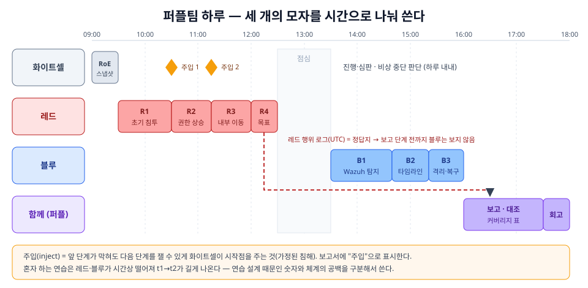
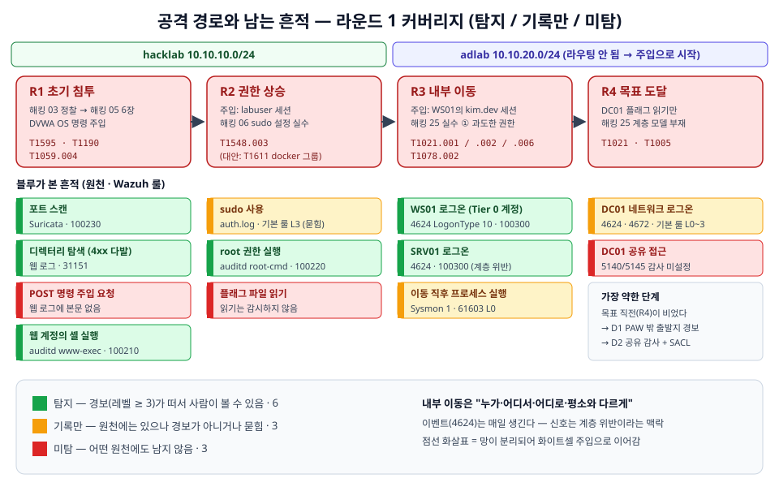
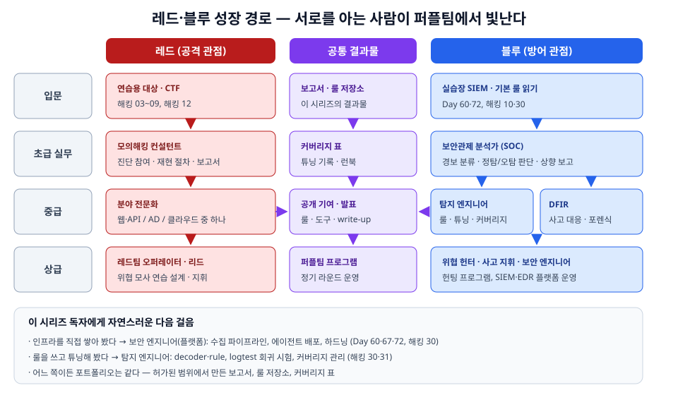

> **해킹 트랙 · 레드팀·블루팀 체험** | 난이도 ★★★★★ | 예상 소요 하루 (준비 1시간 + 연습 4시간 + 보고·회고 2시간)

> ⚠️ **실습 전 반드시 읽을 것**
> 오늘의 연습은 **본인 소유의 격리된 실습장**(해킹 02의 `hacklab`, 해킹 25의 `adlab`) 안에서만, **아래 2장의 RoE에 적은 자산에만** 합니다. 레드 단계는 **앞 편에서 이미 실습한 약점**을 어떤 순서로 이었는지만 카드로 적으며, 단계별 공격 명령·자격 증명 탈취 절차·탐지 회피 기법은 다루지 않습니다. 회사에서 레드팀 연습을 하려면 **서면 승인, 범위, 비상 연락 체계**가 먼저입니다(해킹 01). 허가 없는 타인 시스템 대상 스캔·공격은 **정보통신망법 등으로 처벌**될 수 있습니다.

## 🎯 오늘의 목표

- 해킹 01의 RoE로 **하루짜리 퍼플팀 연습**의 범위·규칙·중단 조건·역할(레드·블루·화이트셀)을 정할 수 있다
- 레드 단계(초기 침투 → 권한 상승 → 내부 이동 → 목표 도달)를 **앞 편의 실습장 약점을 참조하는 시나리오 카드**로 설계하고, 내부 이동을 **ATT&CK 기법 이름과 남는 흔적**으로 설명할 수 있다
- 블루 단계에서 해킹 30의 Wazuh로 각 단계를 탐지하고, 해킹 27 방식의 **타임라인**과 **격리·차단·복구**를 수행할 수 있다
- 해킹 11 양식으로 **레드 보고서**와 **블루 사고 보고서** 요약을 쓰고, **탐지 / 기록만 / 미탐 커버리지 표**로 라운드를 닫을 수 있다
- 다음 라운드의 **탐지 룰·하드닝 개선 목록**을 만들고, 레드·블루 직무와 성장 경로를 실무 업무와 연결할 수 있다

---

## 1. 오늘의 연습 — 퍼플팀 하루



해킹 10에서 퍼플팀을 "행위 하나마다 보였나를 확인하는 방식"으로 배웠습니다. 오늘은 그것을 **하루짜리 시나리오**로 묶습니다. 혼자 하더라도 **세 개의 모자**를 번갈아 씁니다.

| 역할 | 하는 일 | 오늘 지킬 것 |
|---|---|---|
| **레드** | 시나리오 카드대로 목표까지 진행. 행위마다 **UTC 시각**을 기록(정답지) | 카드 밖 기법 금지, 중단 조건이면 즉시 멈춤 |
| **블루** | Wazuh 경보만 보고 탐지·분석·대응. 레드 기록은 **보고 단계 전까지 보지 않음** | 증거 보존 순서(해킹 27) |
| **화이트셀** (통제) | 연습 진행·심판. 시작점 제공, 막혔을 때 다음 단계로 넘기는 **주입(inject)** 결정, 비상 중단 | 목표는 "누가 이기나"가 아니라 **커버리지 측정** |

> 💡 혼자라면 레드 시간과 블루 시간을 **나눠서** 하세요. 오전에 레드를 끝까지 진행하며 기록만 하고, 오후에 블루로 Wazuh만 보며 처음부터 추적합니다. 레드 기록을 덮어 두고 블루를 하면 "몰랐던 척"이 아니라 **실제로 무엇이 보이는지**가 드러납니다.

| 시간 (예) | 단계 | 산출물 |
|---|---|---|
| 09:00 | RoE 서명, 스냅샷, 사전 점검 | `ROE-hack31.md`, 스냅샷 `hack31-before` |
| 09:30 ~ 12:30 | 레드 R1~R4 | 레드 행위 로그(UTC) |
| 13:30 ~ 16:00 | 블루 B1~B3 (탐지 → 타임라인 → 대응) | 경보 목록, 타임라인, 대응 기록 |
| 16:00 ~ 17:30 | 보고·대조 | 레드 보고서 요약, 블루 사고 보고서 요약, 커버리지 표 |
| 17:30 ~ 18:00 | 회고 | 다음 라운드 액션 아이템 |

---

## 2. RoE — 해킹 01 템플릿으로 시작

해킹 01 5-1의 템플릿을 복사해 `~/hacklab/ROE-hack31.md`로 채웁니다. 오늘 값만 표로 보입니다.

| 항목 | 오늘의 값 |
|---|---|
| 승인권자 / 레드 / 블루 / 화이트셀 | 나 (역할별로 시간을 나눔) |
| 목적 | 해킹 30 탐지 체계의 **커버리지 측정**과 대응 절차 연습 |
| 범위 (In-Scope) | `hacklab`: DVWA `10.10.10.20`, docker-targets `10.10.10.10` / `adlab`: WS01 `10.10.20.21`, SRV01 `10.10.20.20`, DC01 `10.10.20.10` |
| 범위 제외 | **Wazuh VM**(`10.10.10.11` / `10.10.20.11`), Juice Shop `10.10.10.21`, Metasploitable `10.10.10.30`(오늘 시나리오에 없음), 호스트 PC, 집 LAN, **인터넷 전체** |
| 허용 기법 | 해킹 03~07에서 실습한 행위, 해킹 25 4-4의 "일부러 만든 실수"를 이용한 이동 |
| 금지 기법 | **탐지 회피**(로그 삭제, 에이전트·Sysmon 중지, 감사 정책 변경), 자격 증명 덤프 도구, 데이터 파괴·변조, 서비스 중단, 실습망 밖으로 나가는 모든 트래픽 |
| 목표 증명 방식 | 화이트셀이 심어 둔 **플래그 파일을 읽을 수 있음**을 보이는 것까지(복사·수정·삭제 없음) |
| 시간 | 레드 09:30~12:30 KST. 시간 밖 행위 금지 |
| 비상 중단 | 실습망이 인터넷에 닿음(해킹 02 체크리스트 실패), 범위 밖 주소로 트래픽, Wazuh VM 장애, 실제 데이터 손상 |
| 기록 | 레드: `~/hacklab/notes/hack31-red.md`(UTC), 블루: `~/hacklab/notes/hack31-blue.md` |

> ⚠️ **SIEM은 범위 제외**입니다. Wazuh VM은 두 실습망에 다리를 걸친 장비라(해킹 30 2-2), 레드가 이것을 건드리면 연습의 측정 도구가 망가지고 두 망의 분리도 깨집니다. 실무 레드팀에서도 "탐지 도구를 끄는 행위"는 별도 승인 없이는 금지 기법인 경우가 많습니다.

### 2-1. 사전 준비 체크리스트 (화이트셀)

| # | 항목 | 확인 |
|---|---|---|
| 1 | 해킹 02 격리 체크리스트 통과(실습 모드, NAT 케이블 분리) | ☐ |
| 2 | 모든 VM 스냅샷 `hack31-before` (AD는 해킹 25의 `ad-baseline-mistakes` 상태에서) | ☐ |
| 3 | Wazuh 에이전트 전부 `Active`(`agent_control -l`), 해킹 30의 커스텀 룰 로드 | ☐ |
| 4 | **시계 맞추기** — 실습망에 NTP가 없으므로 VirtualBox 게스트 추가 기능의 시간 동기화를 켜거나 VM마다 시각 확인(리눅스 `timedatectl`, Windows `w32tm /query /status`) | ☐ |
| 5 | 플래그 파일 배치: docker-targets `/root/flag-hack31.txt`, DC01의 관리자 전용 폴더 `C:\Flags\crown.txt` (내용은 임의 문자열) | ☐ |
| 6 | 레드 시작점 준비(아래 카드의 "시작 조건") | ☐ |
| 7 | Windows 고급 감사 정책(해킹 25 6-1)에 **Logon, Special Logon, File Share** 포함 | ☐ |

---

## 3. 레드 단계 — 시나리오 카드



카드에는 **무엇을 쓰는지**만 적습니다. 실제 동작은 각 편의 해당 절에서 이미 실습했습니다. 각 단계에 **시작 조건**을 둔 것은 실무 퍼플팀의 흔한 방식입니다. 앞 단계가 막혀도 화이트셀이 시작점을 주입해 다음 단계를 측정할 수 있습니다(**가정된 침해**, assumed breach).

### R1. 초기 침투

| 항목 | 내용 |
|---|---|
| 목표 | 실습장 웹 앱을 통해 **웹 서버 계정으로 명령이 실행**되는 지점 확보 |
| 시작 조건 | Kali `10.10.10.5`, 실습망 접속만 |
| 사용하는 약점 | 해킹 03의 정보 수집(포트·디렉터리) → 해킹 05 6장 **DVWA OS 명령 주입**(보안 수준 Low) |
| ATT&CK | T1595 Active Scanning → T1190 Exploit Public-Facing Application → T1059.004 Unix Shell |
| 예상 흔적 | Suricata 스캔 시그니처, 웹 4xx 다발, auditd `www-exec`(웹 계정의 프로그램 실행) |
| 성공 기준 | 컨테이너 안에서 `id` 결과가 `www-data`임을 확인(읽기만) |
| 중단 조건 | 컨테이너 밖 시스템에 변경을 일으키는 동작이 필요해짐 |

### R2. 권한 상승

| 항목 | 내용 |
|---|---|
| 목표 | docker-targets VM에서 **root 권한** 획득 → 플래그 `/root/flag-hack31.txt` 읽기 |
| 시작 조건 | 화이트셀 주입: docker-targets의 일반 사용자 `labuser` 세션(해킹 27 시나리오와 같은 실습 계정). R1의 컨테이너 셸에서 VM으로 넘어가는 경로는 오늘 범위에 넣지 않음 |
| 사용하는 약점 | 해킹 06 3장 **sudo 설정 실수**(화이트셀이 실습 계정에 일부러 넣어 둔 것) 또는 해킹 07 5장의 "`docker` 그룹 = root" |
| ATT&CK | T1548.003 Sudo and Sudo Caching / T1611 Escape to Host(docker 그룹 경로) |
| 예상 흔적 | auth.log의 sudo 기록, auditd `root-cmd`, Docker 이벤트(새 컨테이너 생성·실행) |
| 성공 기준 | 플래그 파일 내용을 읽음 |
| 중단 조건 | 커널 취약점 같은 **카드에 없는 경로**가 필요해짐 |

### R3. 내부 이동 (Lateral Movement)

| 항목 | 내용 |
|---|---|
| 목표 | `adlab`에서 Tier 2 PC(WS01)로부터 Tier 1 서버(SRV01)로 이동 |
| 시작 조건 | 화이트셀 주입: WS01의 도메인 사용자 `kim.dev` 로그온 세션. 두 실습망은 라우팅되지 않으므로 이 단계는 **AD 랩 안에서 새로 시작**하는 가정된 침해 |
| 사용하는 약점 | 해킹 25 4-4 실수 ① — **일반 직원 계정이 Domain Admins**. 별도의 자격 증명 탈취 없이, 과도한 권한 그 자체로 원격 관리 경로가 열림 |
| ATT&CK | T1078.002 Domain Accounts + T1021 Remote Services (화이트셀이 허용한 경로 하나: .001 RDP / .002 SMB·관리 공유 / .006 WinRM) |
| 예상 흔적 | 4장의 표 |
| 성공 기준 | SRV01에서 로그온 세션 확인(`whoami`) |
| 중단 조건 | 도구 설치·자격 증명 수집이 필요해짐 |

### R4. 목표 도달

| 항목 | 내용 |
|---|---|
| 목표 | Tier 0 자산 **DC01의 플래그**(`C:\Flags\crown.txt`)를 읽을 수 있음을 증명 |
| 사용하는 약점 | 같은 계정(Domain Admins)이 DC01까지 원격 접근 가능 — 해킹 25 7-1의 **계층 모델 부재** |
| ATT&CK | T1021 Remote Services, (목표) T1005 Data from Local System — **읽기만** |
| 예상 흔적 | DC01의 4624·4672, 공유 접근 5140/5145(감사 설정 시) |
| 성공 기준 | 플래그 문자열을 레드 기록에 적음 → 레드 단계 종료 |

> 💡 실제 공격 그룹은 R3·R4에서 자격 증명 탈취와 회피를 섞지만, 오늘의 질문은 "**그 길에 무엇이 남는가**"입니다. 과도한 권한이라는 **설정 실수 하나만으로도** Tier 2에서 Tier 0까지 갈 수 있다는 것이 해킹 25가 말한 핵심이고, 블루는 그 이동을 흔적으로 따라가야 합니다.

---

## 4. Lateral Movement — 기법 이름과 남는 흔적

내부 이동은 블루가 가장 놓치기 쉬운 단계입니다. 정상 관리 작업(관리자의 원격 접속)과 **같은 프로토콜, 같은 이벤트**를 쓰기 때문입니다. 그래서 "무엇을 했나"보다 **"누가, 어디서, 어디로, 평소와 다르게"** 를 봅니다.

| ATT&CK 기법 | 무엇인가 | 대상 쪽에 남는 흔적 | 출발지 쪽에 남는 흔적 |
|---|---|---|---|
| **T1021.001** Remote Desktop Protocol | RDP로 대화형 로그온 | 4624 **LogonType 10**, 4672(관리자면), RDP 관련 운영 로그 | 4648(명시적 자격 증명 사용), Sysmon 1 `mstsc.exe`, Sysmon 3 → 3389 |
| **T1021.002** SMB/Windows Admin Shares | `C$`·`ADMIN$` 같은 관리 공유 접근, 원격 서비스 생성 | 4624 **LogonType 3**, 5140/5145 공유 접근, 7045(새 서비스 설치, System 로그) | Sysmon 3 → 445 |
| **T1021.006** Windows Remote Management | WinRM/PowerShell 원격 | 4624 LogonType 3, Sysmon 1 부모가 **`wsmprovhost.exe`**, PowerShell 운영 로그(4103·4104, 스크립트 블록 로깅 설정 시) | Sysmon 3 → 5985/5986 |
| **T1021.004** SSH | 리눅스 간 SSH | auth.log `Accepted publickey/password for ...`, 새 세션 | 출발지 `~/.ssh/known_hosts` 변화 |
| **T1078.002** Domain Accounts | 정상 도메인 계정 사용 | 위 로그온 이벤트의 **계정 이름이 그 호스트에 평소 안 오는 계정** | — |
| **T1550.002 / .003** Pass the Hash / Ticket | 비밀번호 대신 해시·티켓으로 인증 | NTLM 4624(인증 패키지 NTLM)·4776, 비정상 4769 | (오늘 시나리오 범위 밖 — 이름과 방어만: 해킹 25의 Protected Users·NTLM 감사) |
| **T1570** Lateral Tool Transfer | 도구를 다른 호스트로 복사 | 5145 쓰기, Sysmon 11 파일 생성 | — |

| 블루의 질문 | 쓰는 필드 |
|---|---|
| 이 계정이 **이 호스트에** 로그온한 적이 있나? | `win.eventdata.targetUserName` × `win.system.computer` 기준선 |
| **어디서** 왔나? | `win.eventdata.ipAddress`, `win.eventdata.workstationName` |
| **계층을 거슬렀나?** (Tier 0 계정이 Tier 1·2 기기에) | 해킹 25 7-1 계층 표 + 계정 목록 |
| 이동 **직후에 무엇이** 실행됐나? | 같은 호스트의 Sysmon 1, 부모 프로세스 |

---

## 5. 블루 단계

### B1. Wazuh에서 단계별로 탐지

해킹 30의 룰로 R1·R2는 대부분 잡힙니다. R3·R4는 Windows 기본 룰이 로그온을 **정상 로그온**으로만 해석하므로, 오늘 연습 전에 **내부 이동용 룰 두 개**를 `local_rules.xml`에 추가합니다.

```bash
# Tier 0 계정 목록 (해킹 25 5-1의 Domain Admins 점검 결과로 채움) — CDB 목록 형식 "키:값"
sudo tee /var/ossec/etc/lists/hacklab-tier0-accounts > /dev/null <<'EOF'
Administrator:tier0
kim.dev:tier0
svc-sql:tier0
EOF
sudo chown root:wazuh /var/ossec/etc/lists/hacklab-tier0-accounts
```

manager의 `/var/ossec/etc/ossec.conf`의 `<ruleset>` 안에 목록을 등록합니다.

```xml
    <list>etc/lists/hacklab-tier0-accounts</list>
```

```xml
<!-- /var/ossec/etc/rules/local_rules.xml 에 추가 -->
<group name="hacklab,windows,lateral_movement,">

  <!-- (1) Tier 0 계정이 DC가 아닌 호스트에 네트워크(3)·RDP(10) 로그온 — 계층 위반 -->
  <rule id="100300" level="10">
    <if_group>authentication_success</if_group>
    <field name="win.system.eventID">^4624$</field>
    <field name="win.eventdata.logonType">^3$|^10$</field>
    <list field="win.eventdata.targetUserName" lookup="match_key">etc/lists/hacklab-tier0-accounts</list>
    <field name="win.system.computer" negate="yes">^DC01\.</field>
    <description>hacklab: Tier 0 account $(win.eventdata.targetUserName) logon type $(win.eventdata.logonType) on $(win.system.computer) from $(win.eventdata.ipAddress).</description>
    <mitre><id>T1078.002</id><id>T1021</id></mitre>
  </rule>

  <!-- (2) WinRM 원격 세션에서 프로세스 실행 (Sysmon 1, 기본 레벨 0을 확인 필요로) -->
  <rule id="100310" level="8">
    <if_group>sysmon_event1</if_group>
    <field name="win.eventdata.parentImage" type="pcre2">(?i)\\wsmprovhost\.exe$</field>
    <description>hacklab: process $(win.eventdata.image) started from a WinRM session on $(win.system.computer).</description>
    <mitre><id>T1021.006</id></mitre>
  </rule>

</group>
```

| 룰 | 왜 이렇게 | 검증 |
|---|---|---|
| 100300 `if_group authentication_success` | 4624는 기본 Windows 룰이 먼저 받습니다. 같은 부모 아래 **형제 룰로 붙이면 평가되지 않으므로**(해킹 30 6-4) 그 기본 룰의 그룹을 부모로 지정 | 4624 이벤트 한 건을 `wazuh-logtest`에 넣어 Phase 3에 100300이 나오는지 |
| 100300의 목록 조회 | 계정 이름을 룰에 박지 않고 **목록으로** — Domain Admins가 바뀌면 목록만 갱신 | 해킹 25 5-1 결과와 목록을 비교 |
| 100310 | 정상 관리자도 WinRM을 쓰므로 8(확인 필요). 100300과 **같은 시간대에 겹치면** 해석이 달라짐 | 화이트셀이 허용한 경로가 WinRM일 때만 |

> 💡 Windows 이벤트를 logtest에 넣을 때는 대시보드 경보의 `full_log`(JSON 한 줄)를 그대로 복사해 붙이면 됩니다. Phase 3에 우리 룰이 아니라 다른 ID가 나오면, 그 ID의 그룹을 확인해 `if_group`을 맞춥니다.

블루는 경보 목록을 단계별로 정리합니다. 아래는 이번 라운드의 결과 예시입니다.

| 단계 | 기대한 경보 | 실제 |
|---|---|---|
| R1 | 100230(스캔), 31151(4xx 다발), **100210**(웹 계정 실행) | 셋 다 발생. 100210이 **첫 고신뢰 경보** |
| R2 | sudo 기본 룰, 100220(`root-cmd`), 87903(새 컨테이너, docker 그룹 경로일 때) | sudo·100220 발생. 단 sudo 기본 룰은 레벨 3이라 묻힘 |
| R3 | **100300**(Tier 0 계정이 WS01·SRV01에 로그온), 100310(WinRM일 때) | 100300 발생. 레드가 RDP를 골라 100310은 해당 없음 |
| R4 | 100300 해당 없음(DC01이라 제외) → DC01 4624·4672, 5140 | 4624·4672는 경보 없이 **기록만**(레벨 0·3). 5145는 감사 미설정으로 **없음** |

### B2. 타임라인 — 해킹 27 방식으로

해킹 27의 원칙 그대로 **모두 UTC**, 고정점에서 거슬러 올라갑니다. Wazuh 경보는 manager의 `alerts.json`에서 꺼내 해킹 27의 `timeline.py`에 원천 하나로 더합니다.

```bash
# manager에서 — 오늘 경보만 CSV로 (timestamp는 manager 시간대 오프셋이 붙어 있음 → timeline.py에서 UTC 변환)
EVD=/root/evidence/INC-hack31 ; sudo mkdir -p $EVD
sudo jq -r 'select(.rule.level >= 3) |
  [.timestamp, .agent.name, .rule.id, .rule.level, .rule.description, (.rule.mitre.id // [] | join(";"))] | @csv' \
  /var/ossec/logs/alerts/alerts.json | sudo tee $EVD/wazuh-alerts.csv > /dev/null
sudo sha256sum $EVD/wazuh-alerts.csv | sudo tee -a $EVD/SHA256SUMS
```

```python
# timeline.py (해킹 27 3-4)에 추가할 원천 — timestamp 예: 2026-11-20T10:31:45.120+0900
for r in csv.reader(open("wazuh-alerts.csv", encoding="utf-8")):
    ts = datetime.strptime(r[0], "%Y-%m-%dT%H:%M:%S.%f%z")
    add(ts, "wazuh", r[1], f"rule {r[2]} (L{r[3]})", f"{r[4]} [{r[5]}]")
```

정리된 타임라인 예시(UTC):

| 시각 | 원천 | 사건 | 해석 / ATT&CK |
|---|---|---|---|
| 00:31:10 | wazuh 100230 | 10.10.10.5 → 10.10.10.20 포트 스캔 시그니처 | 정찰 T1595 — **t0 후보** |
| 00:36:42 | wazuh 31151 | 같은 출발지 4xx 다발 | 정찰 T1595 |
| 00:52:05 | wazuh **100210** | docker-targets에서 uid 33이 `dash` 실행(튜닝 룰에 안 걸린 인자) | 초기 침투 T1190·T1059.004 — **t1 최초 고신뢰 탐지** |
| 01:20:30 | wazuh 5402(L3) | `labuser` sudo 실행 | 권한 상승 시도 |
| 01:20:31 | wazuh 100220 | auid 1001 → root 실행 | 권한 상승 T1548.003 |
| 02:05:12 | wazuh **100300** | `kim.dev` LogonType 10 on WS01 → 02:11:40 SRV01 | 내부 이동 T1021.001·T1078.002 |
| 02:24:03 | (기록만) DC01 4624·4672 | `kim.dev` 네트워크 로그온 | 목표 접근 — **경보 없음** |
| 04:31:00 | 블루 | 경보 검토 시작, SEV2 선언 | **t2 인지** |
| 04:50:00 | 블루 | 격리 완료(아래 B3) | **t3 봉쇄** |

> ⚠️ 혼자 하는 연습이라 t1(00:52)과 t2(04:31) 사이가 길게 나왔습니다. 오전에 레드, 오후에 블루를 했기 때문입니다. 보고서에는 이것을 **연습 설계 때문**이라고 적고, 실제 지표로는 "경보가 사람에게 **전달되는 경로가 없다**"(해킹 30 공백 #8)를 따로 적습니다. 숫자가 연습 방식 때문인지, 탐지 체계 때문인지 **구분해서 쓰는 것**이 정직한 보고입니다.

### B3. 격리 · 차단 · 복구

해킹 27의 순서 **격리 → 보존 → 제거·복구**를 지킵니다. Active Response는 해킹 30 8장의 주의점 때문에 오늘은 **수동**으로 합니다.

| 대상 | 격리 (지우지 않고 떼어 내기) | 보존 | 제거·복구 |
|---|---|---|---|
| DVWA 컨테이너 | `docker network disconnect hacklab hacklab-targets-dvwa-1` — 실습망에서만 분리, 컨테이너·쓰기 레이어는 유지 | `docker inspect`·`diff`·`export`(해킹 27 5-3), 해시 | 명령 주입 코드 수정(해킹 05 6장의 조치), 깨끗한 이미지로 재생성 |
| docker-targets VM | 호스트에서 `VBoxManage controlvm docker-targets setlinkstate2 off` — **케이블만 뽑아** 메모리·프로세스 유지 | 라이브 응답(해킹 27 3-1), `--live` 스냅샷 | `labuser`의 sudoers 실수 제거(해킹 06 3-3), 비밀번호 교체, SSH 비밀번호 로그인 끔(Day 67) |
| `kim.dev` 계정 | `Disable-ADAccount kim.dev` → 새 세션 차단 | DC01·SRV01·WS01 보안 로그와 Sysmon을 `wevtutil epl`로 내보내고 해시 | Domain Admins에서 제거, 관리용 `adm-` 계정 분리, Protected Users, 계층 로그온 제한 GPO(해킹 25 7-1·7-2) |
| 도메인 전체 | Tier 0 계정이 Tier 2 PC에 로그온했으므로 **자격 증명이 노출됐다고 가정** | — | 노출 가정 계정 비밀번호 교체, 범위가 크면 krbtgt 두 번 교체 절차 검토(해킹 25) |
| 복구 확인 | — | — | 스냅샷 `hack31-before`로 되돌린 뒤 **조치를 적용한 상태**에서 R1~R4 카드를 다시 시도 → 막히는지(재점검, 해킹 11 8장) |

```powershell
# DC01 — 증거 내보내기 (원본 채널은 그대로 두고 사본)
New-Item -ItemType Directory -Force C:\evidence\INC-hack31 | Out-Null
wevtutil epl Security C:\evidence\INC-hack31\DC01-Security.evtx
wevtutil epl Microsoft-Windows-Sysmon/Operational C:\evidence\INC-hack31\DC01-Sysmon.evtx
Get-FileHash C:\evidence\INC-hack31\*.evtx -Algorithm SHA256 |
  Export-Csv C:\evidence\INC-hack31\SHA256SUMS.csv -NoTypeInformation
```

> 💡 "계정 비활성화"는 **이미 열린 세션**을 끊지 않습니다. 세션이 남아 있는 호스트는 VM 수준 격리(케이블 분리)를 함께 쓰고, 비활성화 시각을 타임라인에 적어 그 뒤의 활동을 따로 봅니다.

---

## 6. 보고

### 6-1. 레드 보고서 요약 (해킹 11 양식)

```markdown
# 레드팀 연습 결과 — hacklab/adlab 퍼플 라운드 1 (학습용)
| 문서 등급 | 대외비 (학습용) | 버전 | v1.0 (2026-11-20) | 배포 | 실습장 소유자 |

## 1. 경영진 요약
전체 위험 수준: **매우 높음**. 외부에서 접근 가능한 웹 앱의 입력 검증 누락과, 일반 직원
계정에 부여된 도메인 관리자 권한이 이어져 **도메인 컨트롤러의 보호 데이터까지 도달**했습니다.
잘 된 점: 웹 서버에서의 명령 실행과 계층을 거스른 관리자 로그온은 탐지 체계가 경보를 냈습니다.
권고: ① 도메인 관리자 권한 정리와 계층 모델(7일) ② 웹 앱 명령 주입 수정(7일)
③ 경보 전달 경로와 DC 접근 탐지 보강(30일).

## 2. 범위
- 대상: ROE-hack31.md의 In-Scope 5개 자산 / 제외: Wazuh VM, Juice Shop, Metasploitable, 외부 전체
- 기간: 2026-11-20 09:30~12:30 KST / 방식: 가정된 침해 주입을 포함한 시나리오 기반

## 4. 발견 사항 요약
| ID | 제목 | 위험도 | CVSS v4.0 | 단계 |
|---|---|---|---|---|
| F-01 | DVWA 명령 주입으로 웹 서버 계정 명령 실행 | High | 8.7 (B) `AV:N/AC:L/AT:N/PR:L/UI:N/VC:H/VI:H/VA:H/SC:N/SI:N/SA:N` | R1 |
| F-02 | docker-targets 실습 계정의 sudo 설정으로 root 획득 | High | 8.5 (B) `AV:L/AC:L/AT:N/PR:L/UI:N/VC:H/VI:H/VA:H/SC:N/SI:N/SA:N` | R2 |
| F-03 | 일반 직원 계정의 Domain Admins 멤버십 → Tier 0까지 원격 접근 | Critical 후보 | 계산기로 산출 `AV:N/AC:L/AT:N/PR:L/UI:N/VC:H/VI:H/VA:H/SC:H/SI:H/SA:H` | R3·R4 |

(상세는 해킹 11 4장 템플릿. 재현 절차는 "해당 편 실습 노트" 참조로만 적고 본문에 단계별 입력은 넣지 않음)

## 부록 B. 탐지 커버리지 — 6-3 표
```

> 💡 F-03은 하나의 소프트웨어 결함이 아니라 **설정·운영 실수**라 CVSS가 잘 맞지 않습니다. 이런 발견은 점수보다 **공격 경로(어떤 실수들이 이어졌나)** 로 설명하는 편이 경영진에게 정확합니다. 점수를 붙인다면 반드시 FIRST 계산기로 산출하고 근거를 함께 적습니다(해킹 11 3-3).

### 6-2. 블루 사고 보고서 요약 (해킹 27 7-2 + Day 65)

```markdown
# 사고 보고 — INC-hack31 (연습)
## 1. 요약
외부 출발지(10.10.10.5)가 DVWA의 명령 주입으로 웹 서버 계정 실행을 얻었고(확인), 별도 경로로
docker-targets root 권한이 사용됐으며(확인), adlab에서 Domain Admins 소속 일반 계정이
WS01 → SRV01 → DC01로 이동했다(확인: SRV01까지 경보, DC01은 기록만). 확인 못 한 범위: DC01에서의
파일 접근 세부(5145 감사 미설정).
## 3. 시간 지표
t0 00:31 (첫 흔적) · t1 00:52 (첫 고신뢰 경보) · t2 04:31 (인지, 연습 설계상 지연) · t3 04:50 · t4 06:10
## 5. 원인
예방: 입력 검증 누락(F-01), 과도한 권한(F-02, F-03), 계층 모델 부재
탐지: DC 로그온·공유 접근 룰 없음, 경보가 사람에게 가는 경로 없음
## 7. 액션 아이템 — 7장
## 부록: IOC(출발지 IP, 계정), 증거 목록·해시, ATT&CK 매핑, 보지 못한 구간
```

### 6-3. 탐지 커버리지 표

레드 기록(정답지)과 블루 경보를 **한 줄씩 대조**합니다. 판정은 세 가지로 단순화합니다(해킹 10의 네 단계와 대응: 탐지 = ✅, 기록만 = 🟡·🟠, 미탐 = ❌).

| 단계 | 레드 행위 | ATT&CK | 원천 | Wazuh 룰 | 판정 |
|---|---|---|---|---|---|
| R1 | 포트 스캔 | T1595.001 | Suricata | 100230 | **탐지** |
| R1 | 디렉터리 탐색 | T1595 | 웹 로그 | 31151 | **탐지** |
| R1 | 명령 주입 요청 (POST) | T1190 | 웹 로그 | — (본문 없음) | **미탐** |
| R1 | 웹 계정의 셸 실행 | T1059.004 | auditd | 100210 | **탐지** |
| R2 | sudo 사용 | T1548.003 | auth.log | 기본 sudo 룰(L3) | **기록만** (정상 관리와 구별 안 됨) |
| R2 | root 권한 실행 | T1548.003 | auditd | 100220 | **탐지** |
| R2 | 플래그 읽기 | T1005 | — | — | **미탐** (읽기는 감시 안 함) |
| R3 | WS01 RDP 로그온(Tier 0 계정) | T1021.001, T1078.002 | Security 4624 | 100300 | **탐지** |
| R3 | SRV01 로그온 | T1021 | Security 4624 | 100300 | **탐지** |
| R3 | 이동 직후 프로세스 실행 | T1059.001 등 | Sysmon 1 | 61603(L0) | **기록만** (원본은 archives에만) |
| R4 | DC01 네트워크 로그온 | T1021, T1078.002 | Security 4624·4672 | 기본 룰(L0~3) | **기록만** |
| R4 | DC01 공유 접근 | T1021.002 | Security 5140/5145 | — (감사 미설정) | **미탐** |

| 집계 | 탐지 | 기록만 | 미탐 |
|---|---|---|---|
| 12개 행위 | 6 | 3 | 3 |

> 💡 이 표를 ATT&CK Navigator 레이어로 저장해 두면(해킹 10 7-1) 다음 라운드와 **같은 그림으로 비교**할 수 있습니다. 숫자 자체보다 "어느 단계가 비었나"가 중요합니다. 이번 라운드는 **목표 직전(R4)이 가장 약했습니다.**

---

## 7. 회고 — 다음 라운드에서 고칠 것

Day 65의 비난 없는 회고 형식으로, 액션 아이템을 **탐지 / 하드닝 / 대응**으로 나눕니다.

### 7-1. 탐지 룰 개선

| # | 개선 | 메우는 칸 | 방법 |
|---|---|---|---|
| D1 | DC01의 **Tier 0 외 출발지 로그온** 경보 | R4 기록만 → 탐지 | 100300을 확장: DC01 로그온의 `ipAddress`가 PAW(관리 전용 PC) 목록에 없으면 레벨 12 |
| D2 | 파일 공유 감사 켜기(5140/5145) + 플래그 폴더 SACL | R4 미탐 → 탐지 | 해킹 25 6-1 감사 정책에 File Share·Detailed File Share 추가, 민감 폴더에 감사 항목 |
| D3 | 내부 이동 **상관 룰** — 같은 계정이 30분 안에 서로 다른 호스트 3곳 이상에 LogonType 3/10 | R3 패턴 | `frequency` + `same_field`(계정)로 100300 묶음 |
| D4 | sudo 사용을 계정별 기준선과 비교 | R2 기록만 | 실습 계정(`labuser`)의 sudo는 레벨 상향, 관리자 계정은 유지 |
| D5 | 경보 전달 경로 | t1 → t2 지연 | Wazuh 통합(웹훅)으로 보안 채널, 실습망 밖으로 나가지 않는 경로로 |
| D6 | POST 본문 공백 | R1 미탐 | 앱 보안 로그(해킹 13) + 해킹 30의 앱 decoder |

### 7-2. 하드닝 항목

| # | 하드닝 | 끊는 단계 | 연결 |
|---|---|---|---|
| H1 | `kim.dev` Domain Admins 제거, 관리자 계정 분리, Protected Users | R3·R4 | 해킹 25 7-2 |
| H2 | Tier 0 계정의 Tier 1·2 로그온 거부 GPO, 인증 정책 사일로 | R3 | 해킹 25 7-1 |
| H3 | DVWA 명령 주입 수정(허용 목록 검증, 셸 미사용) | R1 | 해킹 05 6장, 해킹 13 |
| H4 | 실습 계정 sudoers 최소화, `docker` 그룹 정리 | R2 | 해킹 06 3-3, 해킹 07 |
| H5 | RDP·WinRM을 관리 전용 PC에서만 허용(호스트 방화벽) | R3 | 해킹 25, Day 67 |

### 7-3. 다음 라운드 설계

| 원칙 | 예 |
|---|---|
| **한 번에 하나만 바꿔** 효과를 측정 | 라운드 2는 H1만 적용 → R3·R4 카드가 막히는지 |
| 같은 카드로 재시도해 **표를 갱신** | 6-3 표의 같은 줄이 바뀌었는지 |
| 막힌 단계는 **다른 허용 경로**로 바꿔 탐지 범위 확인 | R3 경로를 RDP → WinRM으로 바꿔 100310 검증 |
| 시간 지표를 실제처럼 | 레드·블루를 **같은 시간대**에 진행(타이머로 블루 확인 주기 설정) |

---

## 8. 레드·블루 직무와 성장 경로



오늘 하루 한 일이 실무에서는 여러 직무로 나뉩니다.

### 8-1. 실무에서의 레드팀·블루팀

| 오늘 한 일 | 실무 레드 쪽 | 실무 블루 쪽 |
|---|---|---|
| RoE 작성 | 연습 계획·범위 협의, 승인권자·비상 연락 체계, 목표(왕관 보석) 합의 | 연습 중 일반 대응 절차와 **충돌 방지(deconfliction)** 창구 |
| 시나리오 카드 | 위협 정보를 바탕으로 **특정 공격 그룹의 행위 흐름을 모사**(adversary emulation) | 같은 위협 정보로 **탐지 가설**을 미리 세움 |
| 레드 실행·기록 | 운영자(operator)가 실행, 모든 행위를 시각과 함께 로그 | 관제(SOC)가 경보 분류, 헌팅 |
| 블루 탐지·타임라인 | — | 분석가가 상관 분석, IR이 범위 파악·증거 보존 |
| 보고·커버리지 | 공격 경로 중심 보고서, 리플레이 세션 | 사고 보고서, 탐지 룰 백로그 |
| 회고 | 다음 연습 시나리오 | 탐지 엔지니어가 룰 개선, 하드닝은 운영팀과 |

### 8-2. 직무와 성장 경로

| 직무 | 하는 일 | 오늘과 연결된 역량 | 이 시리즈에서 |
|---|---|---|---|
| **모의해킹 컨설턴트** | 계약된 대상의 취약점 진단·보고 | 범위 지키기, 재현 절차, 보고서 | 해킹 03~09, 11, 28 |
| **레드팀 오퍼레이터** | 목표 기반 장기 연습, 탐지 체계 검증 | 시나리오 설계, ATT&CK, AD | 해킹 25, 오늘 3~4장 |
| **보안관제 분석가 (SOC)** | 경보 분류·1차 분석, 상향 보고 | Wazuh 검색, 룰 원문 읽기 | 해킹 10, 30 |
| **탐지 엔지니어** | 룰 작성·튜닝·커버리지 관리, Detection-as-Code | decoder·rule, logtest, 공백 분석 | 해킹 30 6~9장, 오늘 7-1 |
| **침해 대응·포렌식 (DFIR)** | 사고 대응, 증거, 타임라인, 보고 | 격리→보존→제거, UTC 타임라인 | 해킹 27, 오늘 B2·B3 |
| **위협 헌터** | 경보 없이 가설로 탐색, 특히 내부 이동 | 로그온 기준선, 계층 위반 | 오늘 4장 |
| **보안 엔지니어 (플랫폼)** | SIEM·EDR 운영, 수집 파이프라인, 하드닝 | 에이전트 배포, 감사 정책 | Day 60·67·72, 해킹 30 2~4장 |

| 단계 | 레드 쪽 | 블루 쪽 | 공통 결과물 (포트폴리오) |
|---|---|---|---|
| 입문 (지금) | 연습용 대상 실습, CTF(해킹 12) | 실습장 SIEM, 기본 룰 읽기 | 이 시리즈의 보고서·룰 저장소 |
| 초급 실무 | 진단 프로젝트 참여, 보고서 담당 | SOC 경보 분류, 런북 | 커버리지 표, 튜닝 기록 |
| 중급 | 웹·AD·클라우드 중 한 분야 깊이 | 탐지 엔지니어링 또는 DFIR 전문화 | 공개 가능한 룰·도구 기여, 발표 |
| 상급 | 위협 모사 연습 설계·리드 | 헌팅 프로그램, 사고 지휘 | 퍼플팀 프로그램 운영 |

> 💡 인프라를 처음부터 쌓아 온 이 시리즈의 독자에게는 **탐지 엔지니어**와 **보안 엔지니어(플랫폼)** 가 특히 자연스러운 다음 걸음입니다. 레드를 해 본 블루, 블루를 아는 레드가 퍼플팀에서 가장 빛납니다. 자격증·학습 플랫폼 정보는 해킹 12와 자격증 탭(정보보안기사 등)을 참고하세요.

---

## 9. 트러블슈팅

| 증상 | 원인 | 해결 |
|---|---|---|
| 100300이 전혀 안 걸림 | 형제 룰 함정, CDB 목록 미등록, 계정 이름 대소문자 | logtest Phase 3 확인, `<ruleset>`의 `<list>` 등록 후 manager 재시작, 목록에 실제 표기대로 |
| 4624는 오는데 `logonType` 조건이 안 맞음 | 필드 이름 차이 | 경보의 JSON에서 실제 필드 이름(`win.eventdata.logonType`) 확인 |
| DC01 이벤트가 하나도 없음 | DC01 에이전트가 10.10.10.11로 설정됨 | adlab 에이전트는 `10.10.20.11`로, `ossec.log` 확인 |
| 타임라인 순서가 뒤집힘 | KST·UTC 혼합, VM 시계 차이 | 모든 원천 UTC 변환, 2-1 체크리스트 4번 |
| 레드 행위 시각과 경보 시각이 몇 분씩 어긋남 | 상관 룰(frequency)은 **기준 횟수가 찬 시각**에 걸림 | 대조할 때 "첫 이벤트 시각"과 "경보 시각"을 구분 |
| 격리 후에도 컨테이너가 응답 | 다른 네트워크(`backend`)는 붙어 있음, 또는 잘못된 컨테이너 이름 | `docker inspect`로 네트워크 목록 확인 — 실습망(`hacklab`)만 끊으면 됨 |
| `Disable-ADAccount` 후에도 활동이 보임 | 이미 열린 세션·발급된 티켓은 유지 | VM 격리 병행, 세션 로그오프, 티켓 만료 고려 |
| 연습이 단계 중간에서 막힘 | 카드의 시작 조건 미준비 | 화이트셀이 주입(가정된 침해)하고 기록에 "주입" 표시 |

---

## 10. 핵심 정리

- 퍼플팀 연습은 **RoE(해킹 01) → 레드 → 블루 → 대조 → 회고**의 하루. 목표는 승패가 아니라 **커버리지 측정**
- 레드는 **앞 편 약점을 참조하는 시나리오 카드**로만 진행하고, 단계마다 **시작 조건**을 둬 막혀도 측정을 이어 간다(가정된 침해)
- Lateral Movement는 정상 관리와 같은 프로토콜·이벤트를 쓴다 → **누가·어디서·어디로·평소와 다르게**(4624 LogonType, 4672, Sysmon 부모 프로세스, 계층 위반)로 본다
- 블루는 Wazuh 경보를 **UTC 타임라인**으로 합치고, **격리 → 보존 → 제거·복구** 순서로 대응한다. 계정 비활성화는 열린 세션을 끊지 않는다
- 보고는 해킹 11 양식의 **레드 보고서**와 해킹 27 형식의 **사고 보고서**, 그리고 **탐지 / 기록만 / 미탐** 표. 연습 설계 때문에 생긴 숫자와 체계의 공백을 구분해 쓴다
- 회고 결과는 **탐지 룰·하드닝·대응** 액션 아이템으로, 다음 라운드에서는 **한 번에 하나만** 바꿔 같은 카드로 다시 잰다

---

## 11. 셀프 체크

<details>
<summary>Q1. 시나리오 카드마다 "시작 조건"을 둔 이유는?</summary>

앞 단계가 막히면 뒤 단계의 탐지를 전혀 측정하지 못하기 때문입니다. 화이트셀이 시작점을 **주입**(가정된 침해)하면 R1이 실패해도 R2~R4의 커버리지를 잴 수 있습니다. 실무 퍼플팀도 "침입이 성공했다고 가정하고" 내부 단계를 집중 점검하는 방식을 많이 씁니다. 주입한 사실은 기록에 남겨 보고서에서 구분합니다.
</details>

<details>
<summary>Q2. 내부 이동 탐지가 어려운 이유와, 오늘 100300 룰이 기댄 신호는?</summary>

내부 이동은 RDP·SMB·WinRM 같은 **정상 관리 경로와 정상 계정**을 쓰므로 이벤트 자체(4624)는 매일 수없이 생깁니다. 100300은 이벤트가 아니라 **맥락**, 즉 "Tier 0 계정이 DC가 아닌 호스트에 네트워크·RDP 로그온"이라는 **계층 위반**에 기댔습니다. 계정 목록을 CDB로 따로 관리해 Domain Admins가 바뀌어도 룰은 그대로 둡니다.
</details>

<details>
<summary>Q3. R4의 DC01 로그온이 "기록만"이 된 이유와 개선 방법은?</summary>

DC01 로그온은 기본 룰이 정상 로그온으로 해석해 레벨 0~3에 머물렀고, 100300은 DC를 제외했습니다(DC에는 관리자가 원래 로그온하므로). 개선은 "DC 로그온 자체"가 아니라 **DC에 로그온한 출발지가 관리 전용 PC(PAW) 목록 밖인가**를 보는 룰(D1)과, 공유 접근 감사(D2)를 켜는 것입니다.
</details>

<details>
<summary>Q4. 침해된 DVWA 컨테이너를 <code>docker rm</code> 대신 <code>docker network disconnect</code>로 격리하는 이유는?</summary>

삭제하면 쓰기 레이어(공격자가 남긴 파일), 프로세스, 컨테이너 메타데이터가 함께 사라집니다(해킹 27). 실습망에서만 떼어 내면 피해 확산은 막으면서 `docker inspect`·`diff`·`export`로 증거를 보존할 수 있고, 제거는 그 뒤에 깨끗한 이미지로 합니다.
</details>

<details>
<summary>Q5. 사고 보고서의 t1(00:52)과 t2(04:31) 사이 시간을 그대로 "탐지가 3.5시간 늦었다"고 쓰면 안 되는 이유는?</summary>

혼자 하는 연습이라 레드(오전)와 블루(오후)를 시간으로 나눴기 때문에 생긴 **연습 설계상의 지연**입니다. 이것을 탐지 체계의 성능으로 쓰면 잘못된 결론과 잘못된 액션 아이템이 나옵니다. 대신 체계의 실제 공백인 "경보가 사람에게 전달되는 경로가 없음"을 따로 적고, 다음 라운드에서는 레드·블루를 같은 시간대에 진행해 측정합니다.
</details>

---

## ⏭️ 다음 시즌 예고

레드팀·블루팀 체험 미니 시리즈를 마칩니다. 한 라운드를 돌아 보니 **룰은 쓸 수 있지만, 그 룰을 계속 늘리고 검증하고 고치는 일**이 진짜 일이라는 것이 보입니다. 다음 시즌에는 그 일을 체계로 만듭니다.

- **탐지 엔지니어링 심화** — 벤더 중립 룰 형식(Sigma)으로 룰을 쓰고 Wazuh·Loki용으로 변환하기, 룰 저장소에 "로그 → 기대 경보" 테스트를 붙여 CI(Day 51)에서 자동 검증하는 **Detection-as-Code**
- **자동화된 공격 모사와 회귀 시험** — 오늘 손으로 한 카드를 공개 테스트 라이브러리 수준의 **원자 단위 행위**로 나눠 실습장에서 반복 실행하고, ATT&CK Navigator 레이어로 라운드별 커버리지를 비교하기
- **클라우드와 ID로 넓히기** — 클라우드 감사 로그(클라우드 탭의 CloudTrail)와 Entra ID·Keycloak(Day 73) 로그인 기록을 SIEM에 붙여, 온프레미스 AD에서 본 내부 이동이 **클라우드 ID로 이어지는 경로**를 탐지 관점에서 보기

도구와 버전은 그때 다시 확인합니다. 그리고 언제나 — **허가된 곳에서만.**
