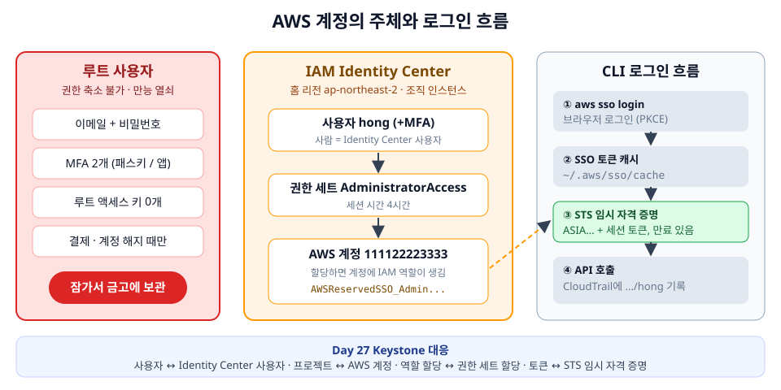
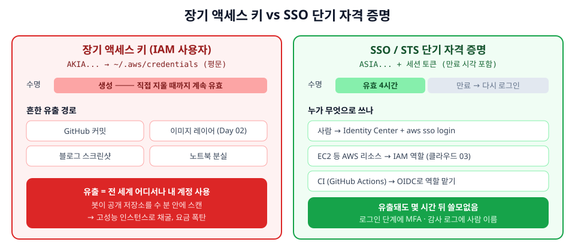
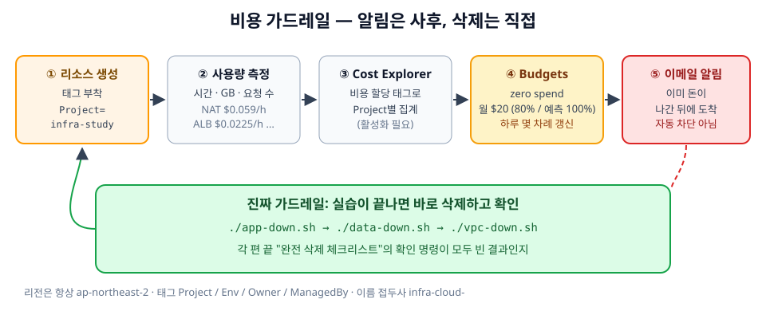

> **클라우드 · AWS** | 난이도 ★★☆☆☆ | 예상 소요 1.5 ~ 2시간 | 💰 예상 비용 $0 (계정 설정·Budgets 알림·Identity Center 무료)

> 💰 **비용 경고 — 실습 전 반드시 읽으세요.**
> - 이 탭의 실습은 **본인 소유 AWS 계정(또는 회사가 허락한 개인 샌드박스 계정)에서만** 합니다. 회사 운영 계정, 남의 계정, 공용 계정에서 하지 마세요.
> - 오늘 편 자체는 **과금 리소스를 만들지 않습니다.** IAM Identity Center와 AWS Organizations는 추가 요금이 없고, AWS Budgets의 예산 모니터링·알림은 무료입니다(액션 연동 예산은 2개까지 무료, 이후 예산당 $0.10/일, Budgets 보고서는 건당 $0.01 — 2026-11-19 기준, 변동 가능).
> - 하지만 다음 편(VPC의 NAT Gateway)부터는 **켜 두기만 해도 시간당 돈이 나가는 리소스**가 등장합니다. 그래서 오늘 **예산 알림을 먼저** 걸어 둡니다.
> - 리전은 이 탭 전체에서 **서울 `ap-northeast-2`** 를 씁니다. 콘솔 오른쪽 위 리전이 서울인지 매번 확인하세요.
> - 실습 후 정리: 오늘 만든 것은 남겨 둡니다(이후 편에서 계속 사용). 탭을 끝낼 때의 정리는 맨 아래 "완전 삭제 체크리스트"와 클라우드 11편을 따르세요.

## 🎯 오늘의 목표

- 루트 사용자가 **왜 위험한지** 설명하고, MFA를 걸고 **일상 사용에서 잠글** 수 있다
- **IAM Identity Center**로 관리자 사용자를 만들고, AWS CLI v2에서 `aws configure sso`로 **단기 자격 증명**만 쓰도록 설정할 수 있다
- **AWS Budgets** 예산 알림과 **프리 티어(2025-07-15 이후 개편)** 구조를 이해한다
- 이 탭 전체에서 쓸 **태그 규칙과 이름 규칙**을 정하고, 그 이유를 설명할 수 있다
- **장기 액세스 키를 쓰지 않는 이유**를 사고 사례 관점에서 설명할 수 있다

---

## 1. 왜 "계정 준비"부터 하는가?

Chapter 4에서 DevStack을 설치했을 때를 떠올려 봅시다(Day 26·27). `admin` 비밀번호가 `openrc`에 평문으로 있었고, 실수로 VM을 100개 띄워도 **내 노트북 전기세**만 나갔습니다.

AWS는 다릅니다.

| 홈랩(OpenStack) | AWS |
|---|---|
| 실수해도 피해는 내 서버 안 | 실수하면 **카드로 청구** (시간당·GB당) |
| `admin` 비밀번호가 털려도 내 LAN 안 | 자격 증명이 털리면 **전 세계 어디서나** 내 계정으로 채굴 서버를 띄울 수 있음 |
| 리소스를 지우는 걸 잊어도 전원 끄면 끝 | 지우기 전까지 **24시간 과금** |

그래서 클라우드 학습의 첫날은 서비스가 아니라 **"사고가 나도 피해가 작게"** 만드는 가드레일입니다.

1. **루트 사용자 잠금** — 가장 강한 열쇠는 금고에
2. **사람은 IAM Identity Center로** — 매번 만료되는 단기 자격 증명
3. **비용 알림** — 돈이 새면 이메일이 먼저 온다
4. **태그** — 무엇이 실습용인지, 지울 대상인지 한눈에

### 홈랩 대응표 — 오늘 등장하는 것

| 본편 Day (홈랩) | AWS 서비스 | 공통점 / 차이 |
|---|---|---|
| Day 27 Keystone — 도메인·프로젝트·사용자·역할 | **IAM / IAM Identity Center** | 둘 다 "누가(주체) 무엇을(권한) 어디서(프로젝트·계정)". AWS는 계정이 곧 격리 경계 |
| Day 27 `admin` 사용자 + `openrc` | **루트 사용자** + 장기 액세스 키 | 만능 열쇠. AWS 루트는 **권한을 줄일 수조차 없음** |
| Day 27 토큰(Fernet, 기본 1시간) | **SSO 세션 → STS 임시 자격 증명** | 만료되는 토큰 방식이라는 점이 같다 |
| Day 73 Keycloak OIDC SSO | **IAM Identity Center**(외부 IdP 연동 가능) | Keycloak을 IdP로 붙이는 것도 가능(SAML/SCIM) |
| Day 19 RBAC Role/RoleBinding | **Permission set + 계정 할당** | "역할 정의"와 "누구에게 어디서 줄지"를 분리 |
| H01 홈랩 서버 전기세 | **AWS Budgets / Cost Explorer** | 홈랩은 고정비, 클라우드는 사용량 비례 |

---

## 2. 계정의 주체 — 루트, IAM 사용자, Identity Center 사용자



| 주체 | 무엇인가 | 자격 증명 | 이 탭에서의 용도 |
|---|---|---|---|
| **루트 사용자** | 계정을 만든 이메일 주소. 모든 권한, 권한 축소 불가 | 이메일 + 비밀번호 (+MFA) | **잠가 두고** 결제·계정 해지 등 루트만 가능한 작업에만 |
| **IAM 사용자** | 계정 안에 만드는 장기 사용자 | 비밀번호, **장기 액세스 키**(AKIA…) | **쓰지 않음** (CI 등 불가피한 경우만, 그것도 OIDC로 대체 가능) |
| **IAM 역할(Role)** | 누군가 "잠시 맡는" 권한 묶음 | STS가 발급하는 **임시 키**(ASIA…, 만료 있음) | EC2·Lambda 등 AWS 서비스가 사용 (클라우드 03) |
| **Identity Center 사용자** | 조직 전체의 "사람" 계정 | 포털 로그인 → 역할을 **단기**로 맡음 | **사람의 일상 작업 전부** |

> 💡 Identity Center 사용자가 계정에 들어가면 실제로는 그 계정의 `AWSReservedSSO_<권한세트이름>_...` **IAM 역할**을 맡는 것입니다. 즉 사람도 결국 "역할 + 임시 키"로 일합니다. Keystone에서 사용자가 프로젝트 범위 **토큰**을 받아 일하던 것(Day 27)과 같은 모양입니다.

### 루트만 할 수 있는 일 (그래서 잠가도 되는 이유)

- 계정 이메일·루트 비밀번호 변경, 계정 해지
- 결제 정보 일부 변경, 지원 플랜 변경
- "IAM 사용자 및 역할의 결제 정보 접근" 활성화 (아래 3-1에서 한 번만)

일상 작업(리소스 생성, 비용 조회 등)은 전부 Identity Center 관리자로 할 수 있습니다.

---

## 3. 실습 ① — 루트 사용자 MFA와 잠금

### 실습 환경

- AWS 계정(새로 만들었거나 본인 소유 계정) — 가입 시 카드 등록 필요
- 로컬 PC: Windows 11 + **WSL2 Ubuntu 24.04** (또는 macOS/Linux 터미널). 모든 명령은 **bash** 기준
- 스마트폰 인증 앱(Google Authenticator, Microsoft Authenticator 등) 또는 패스키/보안 키

### 3-1. 루트로 마지막(?) 로그인해서 할 일

콘솔에 **루트 사용자**로 로그인한 뒤 오른쪽 위 계정 이름 → **Security credentials**로 갑니다.

1. **MFA 등록** — *Assign MFA device* → 패스키/보안 키 또는 인증 앱. AWS는 루트 사용자 MFA를 필수화하는 방향으로 정책을 바꿔 왔기 때문에, 새 계정은 로그인 시 등록을 요구받을 수 있습니다. 가능하면 **2개**(예: 휴대폰 인증 앱 + 패스키)를 등록해 하나를 잃어도 잠기지 않게 합니다.
2. **루트 액세스 키 확인** — *Access keys* 항목이 비어 있어야 합니다. 있으면 **즉시 삭제**.
3. **결제 정보 접근 허용** — 계정 메뉴 → *Account* → "IAM user and role access to Billing information" → **Activate**. 이걸 안 하면 나중에 Identity Center 관리자로 Budgets·Cost Explorer를 볼 때 권한이 있어도 막힙니다.
4. **대체 연락처** — *Account* → *Alternate contacts*에 Security 연락처(본인 다른 메일)를 넣어 두면 보안 알림을 놓치지 않습니다.

> ⚠️ 루트 비밀번호와 MFA 복구 수단은 **비밀번호 관리자**에 보관하세요. 이후 이 탭에서 루트로 로그인할 일은 거의 없습니다.

---

## 4. 실습 ② — IAM Identity Center로 관리자 만들기

### 4-1. Identity Center 활성화

1. 콘솔 리전을 **Asia Pacific (Seoul) `ap-northeast-2`** 로 맞춘 뒤 **IAM Identity Center** 서비스로 이동
2. **Enable** → *Enable with AWS Organizations*(권장, 조직 인스턴스). 계정이 아직 조직에 없으면 **AWS Organizations 조직이 자동으로 만들어지고** 이 계정이 관리 계정이 됩니다(추가 요금 없음).
3. 활성화한 리전이 Identity Center의 **홈 리전**이 됩니다. 나중에 바꾸기 번거로우니 서울로 정해 둡니다.
4. 대시보드의 **AWS access portal URL**(`https://d-xxxxxxxxxx.awsapps.com/start` 형태)을 메모합니다. 이것이 CLI의 *SSO start URL*입니다.

> 💡 ID 소스는 기본값 **Identity Center directory**를 그대로 씁니다. Day 73의 Keycloak 같은 외부 IdP를 연결하는 것도 가능하지만, 학습용으로는 기본 디렉터리가 단순합니다.

### 4-2. 사용자 · 권한 세트 · 할당

| 순서 | 메뉴 | 입력값 (이 탭의 고정값) |
|---|---|---|
| ① 사용자 | *Users → Add user* | 사용자 이름: 본인 영문 이름(예: `hong`), 이메일: 본인 메일. 초대 메일로 비밀번호 설정 + **MFA 등록** |
| ② 권한 세트 | *Permission sets → Create* | 미리 정의된 **AdministratorAccess**, 세션 시간 **4시간** |
| ③ 할당 | *AWS accounts → 내 계정 선택 → Assign users or groups* | 사용자 ①에게 권한 세트 ② 할당 |

포털 URL로 접속해 ① 사용자로 로그인하면, 계정 아래 `AdministratorAccess` 항목이 보입니다. 클릭하면 콘솔로, *Access keys*를 누르면 CLI용 **임시** 키가 나옵니다(복사해서 쓰지 말고 아래 SSO 설정을 쓰세요).

> ⚠️ 학습 편의상 AdministratorAccess를 쓰지만, 실무에서는 일상 작업용으로 `PowerUserAccess` 같은 더 좁은 권한 세트를 따로 만들어 씁니다. 최소 권한은 클라우드 09에서 IAM Access Analyzer와 함께 다룹니다.

### 4-3. AWS CLI v2 설치

```bash
# WSL2 Ubuntu / Linux x86_64
curl "https://awscli.amazonaws.com/awscli-exe-linux-x86_64.zip" -o awscliv2.zip
sudo apt-get install -y unzip
unzip -q awscliv2.zip
sudo ./aws/install            # 이미 설치돼 있으면: sudo ./aws/install --update

aws --version
```

```
aws-cli/2.x.x Python/3.x.x Linux/... exe/x86_64.ubuntu.24
```

> 💡 `aws-cli/1.x`가 나오면 apt로 깔린 v1입니다. `sudo apt remove awscli` 후 위 방법으로 v2를 설치하세요. SSO 기능은 v2 전용이고, 2.22.0부터 브라우저 기반 **PKCE** 로그인이 기본입니다.

### 4-4. `aws configure sso`

```bash
aws configure sso
```

```
SSO session name (Recommended): infra-sso
SSO start URL [None]: https://d-xxxxxxxxxx.awsapps.com/start
SSO region [None]: ap-northeast-2
SSO registration scopes [None]: sso:account:access
```

브라우저가 열리면 Identity Center 사용자로 로그인하고 허용합니다(승인 화면의 클라이언트 이름은 `botocore-client-…`). WSL처럼 브라우저가 자동으로 안 열리면 터미널에 나온 URL을 직접 여세요. 다른 기기에서 승인해야 한다면 `aws configure sso --use-device-code`를 씁니다.

```
There are 1 AWS account available to you.
Using the account ID 111122223333
The only role available to you is: AdministratorAccess
Default client Region [None]: ap-northeast-2
CLI default output format (json if not specified) [None]: json
Profile name [AdministratorAccess-111122223333]: infra-admin
```

결과로 `~/.aws/config`에 다음이 생깁니다. **키가 어디에도 저장되지 않는다**는 점이 핵심입니다.

```ini
[profile infra-admin]
sso_session = infra-sso
sso_account_id = 111122223333
sso_role_name = AdministratorAccess
region = ap-northeast-2
output = json

[sso-session infra-sso]
sso_start_url = https://d-xxxxxxxxxx.awsapps.com/start
sso_region = ap-northeast-2
sso_registration_scopes = sso:account:access
```

### 4-5. 로그인 · 확인 · 로그아웃

```bash
export AWS_PROFILE=infra-admin          # ~/.bashrc 에 넣어 두면 편함
aws sso login                           # 세션이 만료되면 다시 실행
aws sts get-caller-identity
```

```json
{
    "UserId": "AROAXXXXXXXXXXXXXXXXX:hong",
    "Account": "111122223333",
    "Arn": "arn:aws:sts::111122223333:assumed-role/AWSReservedSSO_AdministratorAccess_0123456789abcdef/hong"
}
```

`assumed-role/AWSReservedSSO_...` — 사람이 **역할을 잠시 맡은** 상태라는 증거입니다.

루트 상태도 CLI로 점검합니다.

```bash
aws iam get-account-summary \
  --query 'SummaryMap.{RootAccessKeys:AccountAccessKeysPresent,RootMFA:AccountMFAEnabled}'
```

```json
{ "RootAccessKeys": 0, "RootMFA": 1 }
```

작업이 끝나면:

```bash
aws sso logout      # 캐시된 토큰 삭제
```

---

## 5. 장기 액세스 키를 쓰지 않는 이유



| 항목 | 장기 액세스 키 (IAM 사용자) | SSO / STS 단기 자격 증명 |
|---|---|---|
| 형태 | `AKIA…` + 시크릿, `~/.aws/credentials`에 **평문 저장** | `ASIA…` + 세션 토큰, 캐시에 **만료 시각과 함께** |
| 수명 | 지울 때까지 **영원히** 유효 | 권한 세트 세션 시간(여기선 4시간) 후 만료 |
| 유출 경로 | GitHub 커밋, 블로그 스크린샷, Docker 이미지 레이어(Day 02), 노트북 분실 | 유출돼도 몇 시간 뒤 쓸모없어짐 |
| MFA | 키 사용 자체에는 MFA가 끼어들지 않음 | 로그인 단계에서 MFA |
| 폐기 | 키를 찾아 직접 비활성화·삭제해야 함 | 세션 만료 또는 Identity Center에서 사용자 비활성화 |
| 감사 | 누가 쓴 키인지 사람과 연결이 약함 | CloudTrail에 `…/hong`처럼 **사람 이름**이 남음 |

공개 저장소에 올라간 AWS 키는 자동화된 봇이 **몇 분 안에** 찾아 고성능 인스턴스를 띄우는 데 쓰는 일이 흔합니다. 해킹 19편(gitleaks)과 Day 55(SOPS)에서 본 "시크릿은 저장소에 두지 않는다"의 클라우드판입니다.

> 💡 그럼 CI(GitHub Actions)는? Day 51의 Actions도 **OIDC 페더레이션**으로 역할을 맡으면 장기 키 없이 배포할 수 있습니다. EC2 같은 AWS 리소스는 **인스턴스 프로필(역할)** 을 씁니다(클라우드 03). 장기 키가 꼭 필요한 경우는 생각보다 드뭅니다.

---

## 6. 프리 티어와 비용 구조 이해

### 6-1. 2025-07-15 이후 프리 티어

AWS는 2025년 7월 15일부터 신규 계정의 프리 티어를 **크레딧 기반**으로 바꿨습니다(2026-11-19 공식 페이지 기준, 변동 가능).

| 구분 | 내용 |
|---|---|
| 가입 크레딧 | 가입 시 **$100**, 주요 서비스를 체험하면 최대 **$100 추가** (합계 최대 $200) |
| Free plan | 일부 서비스만 사용, 업그레이드 전에는 청구 없음. **6개월 또는 크레딧 소진** 중 먼저 오는 시점에 계정이 닫힘 |
| Paid plan | 모든 서비스 사용, 크레딧 초과분은 종량제로 청구 |
| 기존 계정 | 2025-07-15 이전 가입 계정은 예전 방식(12개월 무료 + 상시 무료 한도)이 적용됨 |

> ⚠️ "프리 티어니까 공짜"라고 생각하면 안 됩니다. 이 탭에서 쓰는 **NAT Gateway, ALB, 퍼블릭 IPv4, 인터페이스 엔드포인트, EKS** 등은 크레딧을 빠르게 소모하거나 예전 무료 한도에 포함되지 않습니다. Free plan 계정에서 EKS처럼 플랜 제한이 있는 서비스가 막히면 Paid plan 업그레이드가 필요할 수 있습니다(클라우드 06에서 확인).

### 6-2. 이 탭에서 자주 만나는 과금 단위 (서울, 2026-11-19 확인, 변동 가능)

| 리소스 | 단가 | 하루 켜 두면 |
|---|---|---|
| NAT Gateway | $0.059/시간 + 처리 $0.059/GB | 약 $1.42 + 트래픽 |
| 퍼블릭 IPv4 주소 (EIP 포함, 사용 중이든 아니든) | $0.005/시간 | 약 $0.12 |
| ALB | $0.0225/시간 + LCU $0.008/시간 | 약 $0.54 + LCU |
| EC2 t3.micro (Linux) | $0.013/시간 | 약 $0.31 |
| RDS db.t4g.micro PostgreSQL (Single-AZ) | $0.025/시간 + 스토리지 | 약 $0.60 + 스토리지 |
| 인터페이스 VPC 엔드포인트 | $0.013/시간/AZ + $0.01/GB | 엔드포인트 1개·2AZ 약 $0.62 |

> 💡 정확한 최신 단가는 각 서비스 요금 페이지와 [AWS Pricing Calculator](https://calculator.aws/)에서 확인하세요. 이 탭의 모든 가격은 "날짜 + 변동 가능"으로 표기합니다.

---

## 7. 실습 ③ — Budgets 예산 알림



예산은 **"돈이 나간 뒤 알려 주는"** 도구입니다(자동 차단이 아님). 그래서 두 개를 겁니다.

| 예산 | 목적 |
|---|---|
| `infra-zero-spend` | 1센트라도 실제 비용이 생기면 즉시 알림 (크레딧 계정이면 크레딧 차감 전 기준인지 콘솔에서 확인) |
| `infra-monthly-20usd` | 월 $20 예산, 실제 80%·예측 100% 초과 시 알림 |

### 7-1. CLI로 만들기

```bash
mkdir -p ~/infra-cloud && cd ~/infra-cloud
ACCOUNT_ID=$(aws sts get-caller-identity --query Account --output text)
MY_EMAIL="you@example.com"        # 본인 메일로 바꾸기

cat > budget-monthly.json <<'EOF'
{
  "BudgetName": "infra-monthly-20usd",
  "BudgetLimit": { "Amount": "20", "Unit": "USD" },
  "TimeUnit": "MONTHLY",
  "BudgetType": "COST"
}
EOF

cat > budget-monthly-notify.json <<EOF
[
  {
    "Notification": { "NotificationType": "ACTUAL", "ComparisonOperator": "GREATER_THAN",
                      "Threshold": 80, "ThresholdType": "PERCENTAGE" },
    "Subscribers": [ { "SubscriptionType": "EMAIL", "Address": "${MY_EMAIL}" } ]
  },
  {
    "Notification": { "NotificationType": "FORECASTED", "ComparisonOperator": "GREATER_THAN",
                      "Threshold": 100, "ThresholdType": "PERCENTAGE" },
    "Subscribers": [ { "SubscriptionType": "EMAIL", "Address": "${MY_EMAIL}" } ]
  }
]
EOF

aws budgets create-budget --account-id "$ACCOUNT_ID" \
  --budget file://budget-monthly.json \
  --notifications-with-subscribers file://budget-monthly-notify.json
```

`infra-zero-spend`는 콘솔에서 **Budgets → Create budget → Use a template → Zero spend budget**으로 만드는 것이 가장 간단합니다.

```bash
aws budgets describe-budgets --account-id "$ACCOUNT_ID" \
  --query 'Budgets[].{Name:BudgetName,Limit:BudgetLimit.Amount,Type:TimeUnit}' --output table
```

```
-------------------------------------------------
|                DescribeBudgets                |
+-------+-------------------------+-------------+
| Limit |          Name           |    Type     |
+-------+-------------------------+-------------+
|  20.0 |  infra-monthly-20usd    |  MONTHLY    |
|  ...  |  (zero spend 예산)       |  MONTHLY    |
+-------+-------------------------+-------------+
```

(zero spend 예산의 이름과 한도 값은 콘솔 템플릿이 정한 값으로 표시됩니다. 이름은 만들 때 `infra-zero-spend`로 바꿔 두세요.)

> 💡 Budgets 데이터는 하루에 몇 번 갱신되므로 **실시간이 아닙니다.** "알림이 안 왔으니 괜찮다"가 아니라, 실습이 끝날 때마다 **삭제 체크리스트**를 직접 확인하는 습관이 진짜 가드레일입니다.

---

## 8. 실습 ④ — 태그 규칙과 이름 규칙 (이 탭의 고정값)

태그는 "이게 뭐고, 누구 거고, 지워도 되는가"를 리소스에 붙이는 이름표입니다. Day 19의 K8s 라벨, Day 52 Kustomize의 `commonLabels`와 같은 역할입니다.

### 8-1. 고정 태그 (클라우드 01~11 공통)

| 키 | 값 | 이유 |
|---|---|---|
| `Project` | `infra-study` | 이 탭 리소스 전체를 한 번에 찾고 비용을 묶기 위함 (**비용 할당 태그로 활성화**) |
| `Env` | `lab` | 실습용 = 언제든 지워도 됨 |
| `Owner` | 본인 Identity Center 사용자 이름(예: `hong`) | 누가 만들었는지 |
| `ManagedBy` | `cli` (클라우드 05부터 Terraform이 만든 것은 `terraform`) | 손으로 지울지, `terraform destroy`로 지울지 |
| `Name` | 아래 이름 규칙 | 콘솔 목록에서 읽기 위함 |

### 8-2. 이름 규칙

- 접두사 **`infra-cloud-`** + 역할 + (AZ 접미사 `-a`/`-c`). 예: `infra-cloud-vpc`, `infra-cloud-pub-a`, `infra-cloud-priv-c`, `infra-cloud-alb`
- 전역 이름이 필요한 S3 버킷은 계정 ID를 붙임: `infra-cloud-<용도>-<계정ID>`
- 로컬 작업 폴더: `~/infra-cloud/` (스크립트·JSON·`infra-cloud.env` 보관)

셸에서 재사용할 수 있게 공통 변수를 파일로 만들어 둡니다.

```bash
cat > ~/infra-cloud/common.env <<'EOF'
export AWS_PROFILE=infra-admin
export AWS_REGION=ap-northeast-2
export OWNER=hong                     # 본인 이름으로
export P=infra-cloud
export TAGS="{Key=Project,Value=infra-study},{Key=Env,Value=lab},{Key=Owner,Value=${OWNER}},{Key=ManagedBy,Value=cli}"
EOF
source ~/infra-cloud/common.env
```

### 8-3. 비용 할당 태그 활성화

태그를 리소스에 붙이기만 하면 비용 보고서에는 나오지 않습니다. **비용 할당 태그로 활성화**해야 Cost Explorer에서 `Project=infra-study`로 묶어 볼 수 있습니다. 태그 키는 그 태그를 단 리소스가 생긴 뒤(최대 24시간 후) 목록에 나타나므로, 클라우드 02에서 리소스를 만든 다음 날 실행하세요.

```bash
aws ce list-cost-allocation-tags --status Inactive --query 'CostAllocationTags[].TagKey'
aws ce update-cost-allocation-tags-status \
  --cost-allocation-tags-status TagKey=Project,Status=Active TagKey=Owner,Status=Active
```

> 💡 조직 단위로 "태그 없는 리소스 생성 금지"를 강제하려면 Organizations의 **태그 정책**과 **SCP**를 씁니다. 개념만 알아 두고, 클라우드 11(FinOps)에서 다시 봅니다.

---

## 9. 트러블슈팅

| 증상 | 원인 | 해결 |
|---|---|---|
| `aws configure sso`에서 브라우저가 안 열림 (WSL) | WSL에 기본 브라우저 연결이 없음 | 출력된 URL을 Windows 브라우저에 붙여넣기, 또는 `--use-device-code` |
| `Error when retrieving token from sso: Token has expired and refresh failed` | SSO 세션 만료 | `aws sso login` 다시 실행 |
| `Unable to locate credentials` | `AWS_PROFILE` 미설정 | `export AWS_PROFILE=infra-admin` 또는 `--profile infra-admin` |
| 포털에 계정이 안 보임 | 권한 세트를 사용자에게 **할당**하지 않음 | Identity Center → AWS accounts → 할당 확인 |
| Budgets·Cost Explorer에서 `AccessDenied` (관리자인데도) | 루트가 "IAM 사용자 및 역할의 결제 정보 접근"을 활성화하지 않음 | 3-1의 3번 수행 |
| `aws --version`이 1.x | apt로 설치된 CLI v1 | v1 제거 후 공식 설치 프로그램으로 v2 설치 |
| 리소스가 안 보임 | 콘솔/CLI 리전이 서울이 아님 | 콘솔 리전 확인, `aws configure get region` |

---

## 10. 핵심 정리

- **루트 사용자**는 MFA를 걸고 액세스 키 없이 잠가 둔다. 일상 작업은 하지 않는다
- 사람은 **IAM Identity Center** 사용자로, CLI는 `aws configure sso` + `aws sso login`으로 **단기 자격 증명**만 쓴다
- **장기 액세스 키**는 만료가 없고 유출 경로가 많다 → 사람은 SSO, AWS 리소스는 역할, CI는 OIDC
- 2025-07-15 이후 신규 계정 프리 티어는 **크레딧 기반**(최대 $200, Free plan 6개월). "무료"보다 "과금 단위"를 먼저 본다
- **Budgets**는 사후 알림이다. 진짜 가드레일은 매 편 끝의 **삭제 체크리스트**
- 고정 태그 `Project=infra-study`, `Env=lab`, `Owner`, `ManagedBy` / 이름 접두사 `infra-cloud-` / 리전 `ap-northeast-2`

---

## 11. 셀프 체크

<details>
<summary>Q1. 루트 사용자에게 IAM 정책으로 권한 제한을 걸 수 없는데, 그럼 어떻게 보호하나?</summary>

MFA(가능하면 2개)를 등록하고, 루트 액세스 키를 만들지 않으며, 일상 작업에 쓰지 않는 것이 기본입니다. Organizations 멤버 계정이라면 관리 계정에서 SCP로 루트의 작업을 제한하거나, 루트 자격 증명을 중앙에서 관리(제거)할 수 있습니다.
</details>

<details>
<summary>Q2. <code>aws sts get-caller-identity</code> 결과의 ARN이 <code>assumed-role/AWSReservedSSO_...</code>인 의미는?</summary>

Identity Center 사용자가 계정 안의 권한 세트용 IAM 역할을 **임시로 맡았다**는 뜻입니다. CLI가 쓰는 자격 증명은 STS가 발급한 만료가 있는 임시 키입니다.
</details>

<details>
<summary>Q3. Budgets 알림이 왔을 때 이미 늦을 수 있는 이유는?</summary>

Budgets는 비용 데이터를 하루 몇 차례 갱신하는 **사후 알림**이고, 리소스를 자동으로 멈추지 않습니다. 시간당 과금 리소스는 알림이 오기 전까지 계속 과금되므로, 실습 직후 직접 삭제하고 확인하는 습관이 필요합니다.
</details>

<details>
<summary>Q4. 태그를 붙였는데 Cost Explorer에서 <code>Project</code>로 그룹화가 안 된다. 왜?</summary>

태그 키를 **비용 할당 태그로 활성화**하지 않았기 때문입니다. 활성화는 태그가 달린 리소스가 생긴 뒤 가능하고, 활성화 이후 발생한 비용부터 반영됩니다.
</details>

<details>
<summary>Q5. OpenStack Keystone과 IAM Identity Center의 공통 개념을 하나 들어 보라.</summary>

둘 다 사용자가 **범위(프로젝트/계정)가 정해진, 만료되는 토큰·자격 증명**을 받아 API를 호출합니다. Keystone의 "프로젝트 + 역할 할당"은 Identity Center의 "계정 + 권한 세트 할당"과 대응됩니다.
</details>

---

## 🧹 완전 삭제 체크리스트 (이 편)

오늘 만든 것은 **이후 편에서 계속 쓰므로 남겨 둡니다.** 과금 리소스는 없습니다. 탭 전체를 끝낼 때(클라우드 11) 아래를 확인하세요.

- [ ] `aws sso logout` 으로 로컬 토큰 정리 (매 실습 종료 시)
- [ ] 루트 액세스 키 0개 (`aws iam get-account-summary`)
- [ ] IAM 사용자·장기 액세스 키를 만들지 않았는지: `aws iam list-users --query 'Users[].UserName'` → 빈 목록
- [ ] Budgets 2개 유지 (알림만 쓰는 예산은 무료). 탭 종료 후에도 **zero spend 예산은 남겨 두기**를 권장
- [ ] 계정을 해지할 경우: 모든 리전 리소스 삭제 확인 후 루트로 *Close account* (클라우드 11)

---

## ⏭️ 다음 예고 — 클라우드 02. VPC 네트워킹

Day 30에서 `openstack network create`, `router create`, `floating ip`로 만들었던 사설망을 AWS에서는 **VPC**로 만듭니다. 서울 리전 2개 가용 영역에 퍼블릭·프라이빗 서브넷을 나누고, IGW·NAT Gateway·라우팅 테이블·보안 그룹·NACL·VPC 엔드포인트·Flow Logs까지 **CLI로 만들고, 확인하고, 깔끔하게 지우는** 스크립트를 작성합니다. 첫 과금 리소스(NAT Gateway)가 등장하니 오늘 건 예산 알림을 꼭 확인해 두세요.
