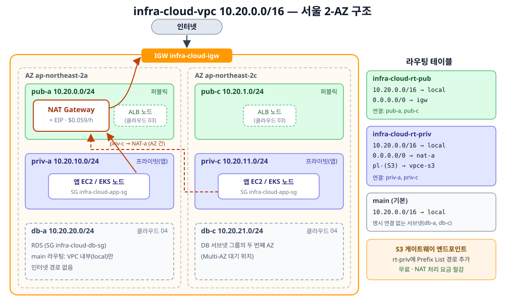
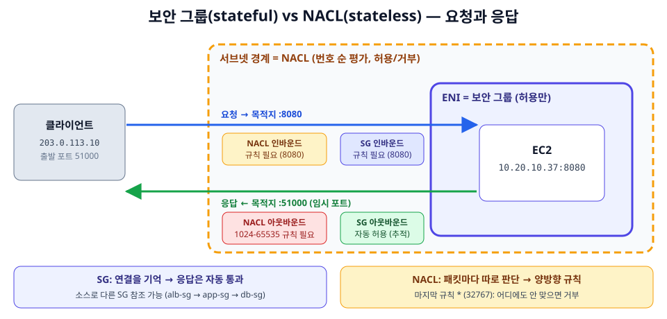
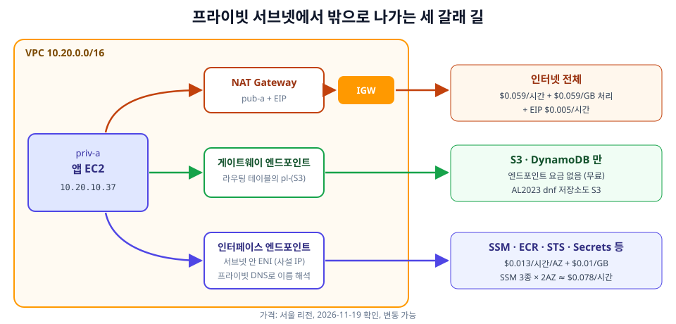

> **클라우드 · AWS** | 난이도 ★★★☆☆ | 예상 소요 2 ~ 2.5시간 | 💰 예상 비용 시간당 약 $0.07 (2시간 실습 시 약 $0.15, 2026-11-19 서울 기준, 변동 가능)

> 💰 **비용 경고 — 실습 전 반드시 읽으세요.**
> - 본인 소유 AWS 계정(클라우드 01에서 준비한 계정)에서만 실습합니다. 리전은 **`ap-northeast-2`(서울)**.
> - VPC·서브넷·라우팅 테이블·IGW·보안 그룹·NACL·S3 게이트웨이 엔드포인트는 **무료**입니다.
> - 과금되는 것: **NAT Gateway $0.059/시간 + 처리 데이터 $0.059/GB**, NAT에 붙는 **퍼블릭 IPv4(EIP) $0.005/시간**, 선택 실습의 **인터페이스 엔드포인트 $0.013/시간/AZ**, **Flow Logs → CloudWatch Logs 수집 $0.76/GB**(Standard 클래스) — 2026-11-19 서울 기준, 변동 가능.
> - NAT Gateway는 **트래픽이 0이어도 켜져 있는 시간만큼** 과금됩니다. 하루 잊으면 약 $1.5, 한 달이면 약 $47입니다.
> - 실습 후 반드시 `bash ~/infra-cloud/vpc-down.sh` 를 실행하고, 맨 아래 **완전 삭제 체크리스트**로 확인하세요.

## 🎯 오늘의 목표

- VPC·서브넷·라우팅 테이블·IGW·NAT Gateway를 Day 30의 **Neutron 리소스와 1:1로 대응**시켜 설명할 수 있다
- 서울 리전 **2개 AZ에 퍼블릭/프라이빗 서브넷**을 나누는 이유와 라우팅 차이를 설명할 수 있다
- **보안 그룹(stateful)** 과 **NACL(stateless)** 의 차이를 규칙으로 보여 줄 수 있다
- **게이트웨이 엔드포인트 vs 인터페이스 엔드포인트**, NAT Gateway 대안(NAT 인스턴스, 엔드포인트)의 비용 차이를 안다
- 전체 네트워크를 **CLI 스크립트로 만들고, 확인하고, 깨끗하게 삭제**할 수 있다

---

## 1. 왜 VPC인가? — Neutron을 떠올리며

Day 30에서 우리는 이렇게 했습니다.

```bash
openstack network create net1
openstack subnet create subnet1 --network net1 --subnet-range 192.168.10.0/24
openstack router create r1
openstack router set r1 --external-gateway public
openstack router add subnet r1 subnet1
openstack floating ip create public
```

AWS에서도 해야 할 일은 같습니다. **IP 대역을 정하고, 쪼개고, 밖으로 나가는 길을 만들고, 들어올 문을 정하고, 방화벽을 친다.** 이름만 다릅니다.

### 홈랩 대응표 — Neutron ↔ VPC

| 본편 Day (홈랩) | Neutron / 리눅스 | AWS | 차이점 |
|---|---|---|---|
| Day 30 | Network (self-service) | **VPC** (`10.20.0.0/16`) | VPC 하나가 리전 전체에 걸침. 서브넷은 AZ 하나에 속함 |
| Day 30 | Subnet + 내장 DHCP | **Subnet** | AWS 서브넷은 **첫 4개와 마지막 1개 IP를 예약**(`.0` `.1` 라우터 `.2` DNS `.3` 예비 `.255`) |
| Day 30 | Router의 external gateway | **Internet Gateway(IGW)** + 라우팅 테이블 `0.0.0.0/0 → igw` | IGW 자체는 NAT를 안 함. 퍼블릭 IP를 가진 ENI만 1:1로 매핑 |
| Day 30 | Router SNAT (`enable_snat`) | **NAT Gateway** | 관리형, AZ 단위, **시간당 과금** |
| Day 30 | Floating IP (`dnat_and_snat`) | **Elastic IP** / 자동 퍼블릭 IP | Floating IP처럼 VM 안에서 안 보임(VPC가 1:1 NAT) |
| Day 30 | Security Group (OVN ACL, stateful) | **Security Group** | 거의 동일. 단 AWS SG는 **허용 규칙만** 있음 |
| Day 22 | iptables 필터 체인 | **Network ACL** (stateless, 서브넷 단위) | Neutron에는 기본 대응 개념이 없음 |
| Day 22 | netns + iptables MASQUERADE | **NAT 인스턴스** (EC2로 직접 만든 NAT) | 싸지만 운영 책임이 내게 |
| Day 23·24 | VXLAN/Geneve 오버레이, OVS | **AWS Nitro 매핑 서비스** (보이지 않음) | 오버레이는 AWS가 숨김. MTU는 VPC 안 9001(점보), 인터넷 1500 |
| H02 | 공유기 포트포워딩 | IGW + 퍼블릭 IP + SG | 공유기 한 대가 하던 일을 여러 리소스로 분해 |

> 💡 Day 30에서 "Floating IP는 VM의 `ip addr`에 안 보인다"고 했습니다. EC2도 똑같습니다. 퍼블릭 IP는 인스턴스 안에 없고, **VPC가 IGW를 지날 때 1:1로 변환**합니다. 인스턴스 메타데이터(IMDS)로만 확인할 수 있습니다.

---

## 2. 오늘 만들 구조 — 2-AZ 퍼블릭/프라이빗



### 이 탭의 고정 주소 계획 (클라우드 03~11이 그대로 사용)

| 이름 | CIDR | AZ | 용도 | 라우팅 테이블 |
|---|---|---|---|---|
| `infra-cloud-vpc` | `10.20.0.0/16` | — | 전체 | — |
| `infra-cloud-pub-a` | `10.20.0.0/24` | `ap-northeast-2a` | ALB, NAT Gateway | `infra-cloud-rt-pub` (`0.0.0.0/0 → IGW`) |
| `infra-cloud-pub-c` | `10.20.1.0/24` | `ap-northeast-2c` | ALB | `infra-cloud-rt-pub` |
| `infra-cloud-priv-a` | `10.20.10.0/24` | `ap-northeast-2a` | 앱(EC2/EKS 노드) | `infra-cloud-rt-priv` (`0.0.0.0/0 → NAT`) |
| `infra-cloud-priv-c` | `10.20.11.0/24` | `ap-northeast-2c` | 앱 | `infra-cloud-rt-priv` |
| (클라우드 04) `infra-cloud-db-a`/`-c` | `10.20.20.0/24`, `10.20.21.0/24` | 2a / 2c | RDS | main (VPC 내부만) |

**왜 이렇게 나누나?**

- **퍼블릭 서브넷** = 라우팅 테이블에 `0.0.0.0/0 → IGW`가 있는 서브넷. 이것뿐입니다. "퍼블릭"은 서브넷 속성이 아니라 **라우팅의 결과**입니다.
- **프라이빗 서브넷** = 인터넷에서 직접 들어올 길이 없음. 나가는 것만 NAT를 통해서.
- **2개 AZ** = 한 데이터센터(AZ)가 죽어도 서비스 유지. ALB는 최소 2개 AZ의 서브넷을 요구하고(클라우드 03), RDS 서브넷 그룹도 2개 AZ가 필요합니다(클라우드 04).
- `/16` 안에 `/24`를 듬성듬성 배치한 이유: 나중에 EKS(클라우드 06)처럼 IP를 많이 먹는 워크로드가 들어올 여유.

> ⚠️ **AZ 이름은 계정마다 실제 데이터센터와의 매핑이 다릅니다.** 내 `ap-northeast-2a`와 다른 계정의 `ap-northeast-2a`는 다른 건물일 수 있습니다. 계정 간에 맞춰야 할 때는 `apne2-az1` 같은 **AZ ID**를 씁니다.

```bash
aws ec2 describe-availability-zones --region ap-northeast-2 \
  --query 'AvailabilityZones[].[ZoneName,ZoneId,State]' --output table
```

> ⚠️ **NAT Gateway를 1개만** 만드는 것은 비용 때문입니다. AZ-a가 죽으면 AZ-c의 프라이빗 서브넷도 밖으로 못 나갑니다. 운영에서는 **AZ마다 NAT 1개**(또는 2025-11 출시된 **리전 NAT Gateway**, `--availability-mode regional`)로 구성합니다 — 대신 비용이 AZ 수만큼 늘어납니다.

---

## 3. 보안 그룹 vs NACL



| 항목 | 보안 그룹 (SG) | 네트워크 ACL (NACL) |
|---|---|---|
| 붙는 곳 | **ENI(인스턴스·ALB·RDS 등)** | **서브넷** |
| 상태 | **Stateful** — 허용된 요청의 응답은 자동 허용 | **Stateless** — 응답 트래픽도 규칙이 있어야 통과 |
| 규칙 | 허용(Allow)만 | 허용·거부(Deny) 모두 |
| 평가 | 모든 규칙을 합쳐서 판단 | **번호 낮은 순서대로**, 처음 맞는 규칙 적용 |
| 기본값 | 새 SG: 인바운드 없음, 아웃바운드 전체 허용 | 기본 NACL: 전체 허용 / 새로 만든 NACL: **전체 거부** |
| 소스 지정 | CIDR, **다른 SG**(참조) | CIDR만 |
| 대응 | Day 30 Neutron SG (OVN ACL `allow-related`) | Day 22 iptables 무상태 필터 |

실무 원칙: **SG로 세밀하게, NACL은 거칠게(대역 차단 등) 또는 기본값 유지.** 이 탭은 SG를 **서로 참조**하는 3단 구조를 고정으로 씁니다.

| SG 이름 | 인바운드 | 쓰는 곳 |
|---|---|---|
| `infra-cloud-alb-sg` | TCP 80 ← `0.0.0.0/0` | ALB (클라우드 03) |
| `infra-cloud-app-sg` | TCP 8080 ← **`infra-cloud-alb-sg`** | 앱 EC2 (클라우드 03) |
| `infra-cloud-db-sg` | TCP 5432 ← **`infra-cloud-app-sg`** | RDS PostgreSQL (클라우드 04) |

> 💡 SG 참조는 "이 SG를 단 ENI에서 오는 트래픽"이라는 뜻입니다. 앱 서버가 스케일 아웃돼 IP가 바뀌어도 규칙을 고칠 필요가 없습니다. K8s NetworkPolicy의 `podSelector`(Day 70)와 같은 발상입니다.

---

## 4. 실습 환경

- 클라우드 01에서 만든 `~/infra-cloud/common.env` (`AWS_PROFILE=infra-admin`, `AWS_REGION=ap-northeast-2`, `P=infra-cloud`, `TAGS`)
- WSL2 Ubuntu 24.04 bash, AWS CLI v2

```bash
cd ~/infra-cloud
source common.env
aws sso login
aws sts get-caller-identity --query Arn --output text
```

---

## 5. 실습 ① — 스크립트로 VPC 만들기

손으로 콘솔을 클릭하면 **지울 때 빠뜨립니다.** 그래서 만들기와 지우기를 **스크립트 한 쌍**으로 둡니다. Day 32 Heat, Day 35 Terraform이 해 주던 일을 오늘은 직접 하고, 클라우드 05에서 Terraform으로 옮깁니다.

`~/infra-cloud/vpc-up.sh`:

```bash
#!/usr/bin/env bash
# 클라우드 02 — VPC 생성. NAT Gateway를 만들므로 실행 순간부터 과금됩니다.
set -euo pipefail
source ~/infra-cloud/common.env
ENV_FILE=~/infra-cloud/infra-cloud.env
ts() { echo "ResourceType=$1,Tags=[{Key=Name,Value=$2},${TAGS}]"; }

echo "[1/8] VPC"
VPC_ID=$(aws ec2 create-vpc --cidr-block 10.20.0.0/16 \
  --tag-specifications "$(ts vpc $P-vpc)" --query Vpc.VpcId --output text)
aws ec2 wait vpc-available --vpc-ids "$VPC_ID"
aws ec2 modify-vpc-attribute --vpc-id "$VPC_ID" --enable-dns-hostnames Value=true

echo "[2/8] 서브넷 4개 (2a / 2c)"
mk_subnet() {
  aws ec2 create-subnet --vpc-id "$VPC_ID" --cidr-block "$1" --availability-zone "$2" \
    --tag-specifications "$(ts subnet "$3")" --query Subnet.SubnetId --output text
}
PUB_A=$(mk_subnet 10.20.0.0/24  ap-northeast-2a $P-pub-a)
PUB_C=$(mk_subnet 10.20.1.0/24  ap-northeast-2c $P-pub-c)
PRIV_A=$(mk_subnet 10.20.10.0/24 ap-northeast-2a $P-priv-a)
PRIV_C=$(mk_subnet 10.20.11.0/24 ap-northeast-2c $P-priv-c)

echo "[3/8] 인터넷 게이트웨이"
IGW_ID=$(aws ec2 create-internet-gateway --tag-specifications "$(ts internet-gateway $P-igw)" \
  --query InternetGateway.InternetGatewayId --output text)
aws ec2 attach-internet-gateway --internet-gateway-id "$IGW_ID" --vpc-id "$VPC_ID"

echo "[4/8] 퍼블릭 라우팅 테이블"
RT_PUB=$(aws ec2 create-route-table --vpc-id "$VPC_ID" \
  --tag-specifications "$(ts route-table $P-rt-pub)" --query RouteTable.RouteTableId --output text)
aws ec2 create-route --route-table-id "$RT_PUB" --destination-cidr-block 0.0.0.0/0 \
  --gateway-id "$IGW_ID" > /dev/null
for s in "$PUB_A" "$PUB_C"; do
  aws ec2 associate-route-table --route-table-id "$RT_PUB" --subnet-id "$s" > /dev/null
done

echo "[5/8] NAT Gateway (과금 시작: NAT \$0.059/h + EIP \$0.005/h)"
EIP_ALLOC=$(aws ec2 allocate-address --domain vpc \
  --tag-specifications "$(ts elastic-ip $P-nat-eip)" --query AllocationId --output text)
NAT_ID=$(aws ec2 create-nat-gateway --subnet-id "$PUB_A" --allocation-id "$EIP_ALLOC" \
  --tag-specifications "$(ts natgateway $P-nat-a)" --query NatGateway.NatGatewayId --output text)
aws ec2 wait nat-gateway-available --nat-gateway-ids "$NAT_ID"

echo "[6/8] 프라이빗 라우팅 테이블"
RT_PRIV=$(aws ec2 create-route-table --vpc-id "$VPC_ID" \
  --tag-specifications "$(ts route-table $P-rt-priv)" --query RouteTable.RouteTableId --output text)
aws ec2 create-route --route-table-id "$RT_PRIV" --destination-cidr-block 0.0.0.0/0 \
  --nat-gateway-id "$NAT_ID" > /dev/null
for s in "$PRIV_A" "$PRIV_C"; do
  aws ec2 associate-route-table --route-table-id "$RT_PRIV" --subnet-id "$s" > /dev/null
done

echo "[7/8] S3 게이트웨이 엔드포인트 (무료)"
VPCE_S3=$(aws ec2 create-vpc-endpoint --vpc-id "$VPC_ID" --vpc-endpoint-type Gateway \
  --service-name "com.amazonaws.${AWS_REGION}.s3" --route-table-ids "$RT_PRIV" \
  --tag-specifications "$(ts vpc-endpoint $P-vpce-s3)" --query VpcEndpoint.VpcEndpointId --output text)

echo "[8/8] 보안 그룹 3개 (ALB → App → DB)"
mk_sg() {
  aws ec2 create-security-group --vpc-id "$VPC_ID" --group-name "$1" --description "$2" \
    --tag-specifications "$(ts security-group "$1")" --query GroupId --output text
}
ALB_SG=$(mk_sg $P-alb-sg "ALB - HTTP from internet")
APP_SG=$(mk_sg $P-app-sg "App - 8080 from ALB only")
DB_SG=$(mk_sg $P-db-sg "DB - 5432 from App only")
aws ec2 authorize-security-group-ingress --group-id "$ALB_SG" --protocol tcp --port 80 \
  --cidr 0.0.0.0/0 > /dev/null
aws ec2 authorize-security-group-ingress --group-id "$APP_SG" --protocol tcp --port 8080 \
  --source-group "$ALB_SG" > /dev/null
aws ec2 authorize-security-group-ingress --group-id "$DB_SG" --protocol tcp --port 5432 \
  --source-group "$APP_SG" > /dev/null

cat > "$ENV_FILE" <<EOF
export VPC_ID=$VPC_ID
export PUB_A=$PUB_A PUB_C=$PUB_C PRIV_A=$PRIV_A PRIV_C=$PRIV_C
export IGW_ID=$IGW_ID RT_PUB=$RT_PUB RT_PRIV=$RT_PRIV
export NAT_ID=$NAT_ID EIP_ALLOC=$EIP_ALLOC VPCE_S3=$VPCE_S3
export ALB_SG=$ALB_SG APP_SG=$APP_SG DB_SG=$DB_SG
EOF
echo "완료 → $ENV_FILE"
```

```bash
chmod +x vpc-up.sh
./vpc-up.sh
```

```
[1/8] VPC
[2/8] 서브넷 4개 (2a / 2c)
[3/8] 인터넷 게이트웨이
[4/8] 퍼블릭 라우팅 테이블
[5/8] NAT Gateway (과금 시작: NAT $0.059/h + EIP $0.005/h)
[6/8] 프라이빗 라우팅 테이블
[7/8] S3 게이트웨이 엔드포인트 (무료)
[8/8] 보안 그룹 3개 (ALB → App → DB)
완료 → /home/you/infra-cloud/infra-cloud.env
```

NAT Gateway가 `available`이 되기까지 1~3분 걸립니다(5단계에서 잠시 멈춰 있는 게 정상).

> 💡 `--enable-dns-hostnames`를 켜는 이유: 인터페이스 엔드포인트의 **프라이빗 DNS**(아래 7절)와 EKS(클라우드 06)가 VPC의 DNS 호스트 이름 기능을 요구합니다. `enableDnsSupport`는 기본으로 켜져 있습니다.

---

## 6. 실습 ② — 만든 것 확인하기

```bash
source ~/infra-cloud/common.env
source ~/infra-cloud/infra-cloud.env

# 서브넷: 이름, CIDR, AZ, 남은 IP
aws ec2 describe-subnets --filters Name=vpc-id,Values=$VPC_ID \
  --query 'Subnets[].[Tags[?Key==`Name`]|[0].Value,CidrBlock,AvailabilityZone,AvailableIpAddressCount]' \
  --output table
```

```
------------------------------------------------------------------
|                        DescribeSubnets                         |
+---------------------+----------------+-------------------+------+
|  infra-cloud-pub-a  |  10.20.0.0/24  |  ap-northeast-2a  |  250 |
|  infra-cloud-pub-c  |  10.20.1.0/24  |  ap-northeast-2c  |  251 |
|  infra-cloud-priv-a |  10.20.10.0/24 |  ap-northeast-2a  |  251 |
|  infra-cloud-priv-c |  10.20.11.0/24 |  ap-northeast-2c  |  251 |
+---------------------+----------------+-------------------+------+
```

`/24`는 256개인데 251개 — AWS가 예약한 5개 때문입니다. `pub-a`가 250인 것은 **NAT Gateway의 ENI가 IP 하나를 먹었기** 때문입니다(순서는 다를 수 있음).

```bash
# 라우팅 테이블별 경로
for rt in $RT_PUB $RT_PRIV; do
  echo "== $rt"
  aws ec2 describe-route-tables --route-table-ids $rt \
    --query 'RouteTables[0].Routes[].[DestinationCidrBlock||DestinationPrefixListId,GatewayId||NatGatewayId,State]' \
    --output text
done
```

```
== rtb-0aaa...
10.20.0.0/16    local           active
0.0.0.0/0       igw-0bbb...     active
== rtb-0ccc...
10.20.0.0/16    local           active
0.0.0.0/0       nat-0ddd...     active
pl-78a54011     vpce-0eee...    active
```

마지막 줄 `pl-…`은 **S3의 IP 대역 묶음(Prefix List)** 입니다. 프라이빗 서브넷에서 S3로 가는 트래픽은 NAT가 아니라 **게이트웨이 엔드포인트**로 갑니다(더 구체적인 경로가 이김 — longest prefix match). Prefix List ID 값은 리전마다 다릅니다.

```bash
# NAT Gateway 상태와 퍼블릭 IP
aws ec2 describe-nat-gateways --nat-gateway-ids $NAT_ID \
  --query 'NatGateways[0].[State,SubnetId,NatGatewayAddresses[0].PublicIp]' --output text

# SG 참조 관계
aws ec2 describe-security-group-rules --filters Name=group-id,Values=$APP_SG \
  --query 'SecurityGroupRules[?!IsEgress].[FromPort,ToPort,ReferencedGroupInfo.GroupId||CidrIpv4]' --output text
```

```
available   subnet-0...   3.38.x.x
8080    8080    sg-0...(ALB_SG와 같은 ID)
```

---

## 7. 실습 ③ — NACL 직접 걸어 보기 (Stateless 체감)

프라이빗 서브넷 전용 NACL을 만들어 봅니다. **새 NACL은 전부 거부**로 시작한다는 점을 기억하세요.

```bash
ts() { echo "ResourceType=$1,Tags=[{Key=Name,Value=$2},${TAGS}]"; }
NACL_PRIV=$(aws ec2 create-network-acl --vpc-id $VPC_ID \
  --tag-specifications "$(ts network-acl $P-nacl-priv)" --query NetworkAcl.NetworkAclId --output text)

# 인바운드: VPC 내부 전체 허용, 인터넷에서 돌아오는 응답(임시 포트) 허용
aws ec2 create-network-acl-entry --network-acl-id $NACL_PRIV --ingress \
  --rule-number 100 --protocol -1 --cidr-block 10.20.0.0/16 --rule-action allow
aws ec2 create-network-acl-entry --network-acl-id $NACL_PRIV --ingress \
  --rule-number 200 --protocol tcp --port-range From=1024,To=65535 --cidr-block 0.0.0.0/0 --rule-action allow
# 예시: 특정 대역(문서용 예시 대역) 명시적 거부 — 번호가 낮아 먼저 평가됨
aws ec2 create-network-acl-entry --network-acl-id $NACL_PRIV --ingress \
  --rule-number 50 --protocol -1 --cidr-block 203.0.113.0/24 --rule-action deny
# 아웃바운드: 전체 허용
aws ec2 create-network-acl-entry --network-acl-id $NACL_PRIV --egress \
  --rule-number 100 --protocol -1 --cidr-block 0.0.0.0/0 --rule-action allow

# 프라이빗 서브넷 2개를 새 NACL로 교체
for s in $PRIV_A $PRIV_C; do
  ASSOC=$(aws ec2 describe-network-acls --filters Name=association.subnet-id,Values=$s \
    --query "NetworkAcls[0].Associations[?SubnetId=='$s'].NetworkAclAssociationId" --output text)
  aws ec2 replace-network-acl-association --association-id $ASSOC --network-acl-id $NACL_PRIV > /dev/null
done

aws ec2 describe-network-acls --network-acl-ids $NACL_PRIV \
  --query 'NetworkAcls[0].Entries[].[Egress,RuleNumber,Protocol,CidrBlock,RuleAction]' --output table
echo "export NACL_PRIV=$NACL_PRIV" >> ~/infra-cloud/infra-cloud.env
```

출력의 맨 끝에 `32767 … deny` 규칙이 보입니다. 모든 NACL에 숨어 있는 **"어디에도 안 맞으면 거부"** 규칙입니다.

> ⚠️ 규칙 200(임시 포트 1024-65535)을 빼면? 프라이빗 인스턴스가 NAT를 거쳐 `dnf update`를 할 때 **나가는 요청은 통과하지만 돌아오는 응답이 막힙니다.** SG였다면 상태 추적으로 자동 허용됐을 것 — 이것이 stateless입니다. 클라우드 03에서 인스턴스를 띄웠을 때 이 규칙을 잠깐 지워 보면 `dnf`가 멈추는 것으로 확인할 수 있습니다.

---

## 8. VPC 엔드포인트와 NAT 비용



프라이빗 서브넷의 인스턴스가 AWS 서비스(S3, SSM, ECR, Secrets Manager …)를 부르면, 기본적으로 **NAT Gateway → 인터넷 → AWS 퍼블릭 엔드포인트**로 갑니다. NAT는 **GB당 $0.059**를 받으니, ECR에서 이미지를 수 GB씩 당기는 EKS 노드라면 이 비용이 금방 커집니다.

| 방식 | 동작 | 대상 서비스 | 비용 (서울, 2026-11-19, 변동 가능) |
|---|---|---|---|
| **게이트웨이 엔드포인트** | 라우팅 테이블에 Prefix List 경로 추가 | **S3, DynamoDB만** | **무료** |
| **인터페이스 엔드포인트** (PrivateLink) | 서브넷에 ENI(사설 IP) 생성, 프라이빗 DNS로 서비스 이름을 그 IP로 | SSM, ECR, STS, Secrets Manager, CloudWatch 등 대부분 | $0.013/시간/AZ + $0.01/GB |
| **NAT Gateway** | 관리형 SNAT | 인터넷 전체 | $0.059/시간 + $0.059/GB |
| **NAT 인스턴스** | EC2에 IP 포워딩 + MASQUERADE (Day 22) | 인터넷 전체 | 인스턴스 요금만 (예: t4g.micro $0.0104/시간) + 운영 부담 |

### 대안 비교 — "NAT 없이 갈 수 있나?"

- **S3/DynamoDB만 쓴다** → 게이트웨이 엔드포인트로 충분, NAT 불필요
- **SSM으로만 접속하고 패키지는 S3 기반 저장소에서** → Amazon Linux 2023의 기본 패키지 저장소는 S3에 있어 **S3 게이트웨이 엔드포인트만으로도 `dnf install`이 동작**합니다. SSM은 인터페이스 엔드포인트 3개(`ssm`, `ssmmessages`, `ec2messages`)가 필요 → 2AZ면 시간당 3×2×$0.013 = **$0.078**. NAT 1개($0.059 + EIP $0.005)와 비슷하거나 더 비쌀 수 있습니다
- **결론(학습용)**: 이 탭은 **NAT Gateway 1개 + S3 게이트웨이 엔드포인트**를 기본으로 하고, 실습 사이에는 **반드시 삭제**합니다. 트래픽이 많은 운영 환경에서는 ECR·S3 등 **대용량 경로를 엔드포인트로 빼는 것**이 핵심 비용 최적화입니다(클라우드 11).

### NAT 인스턴스 (개념)

Day 22에서 직접 했던 것과 같습니다.

1. 퍼블릭 서브넷에 작은 EC2(예: t4g.nano/micro) + EIP
2. `aws ec2 modify-instance-attribute --instance-id <id> --no-source-dest-check` — **출발지/목적지 검사 끄기**(자기 IP가 아닌 패킷을 전달하려면 필수)
3. 인스턴스 안에서 `net.ipv4.ip_forward=1` + `iptables -t nat -A POSTROUTING -o <nic> -j MASQUERADE`
4. 프라이빗 라우팅 테이블의 `0.0.0.0/0` 대상을 그 인스턴스의 ENI로

> ⚠️ NAT 인스턴스는 **단일 장애점**이고, 패치·대역폭·모니터링이 전부 내 몫입니다. 비용 절감용 학습 환경에서만 고려하세요. fck-nat 같은 커뮤니티 AMI도 있지만, 출처와 유지 상태를 직접 확인하고 쓰세요.

### (선택) 인터페이스 엔드포인트 만들어 보기 — SSM 3종

클라우드 03에서 쓰는 SSM Session Manager를 NAT 없이 쓰는 구성입니다. **켜는 순간 시간당 $0.078** 이므로 확인 후 바로 지웁니다.

```bash
ts() { echo "ResourceType=$1,Tags=[{Key=Name,Value=$2},${TAGS}]"; }
VPCE_SG=$(aws ec2 create-security-group --vpc-id $VPC_ID --group-name $P-vpce-sg \
  --description "Interface endpoints - 443 from VPC" \
  --tag-specifications "$(ts security-group $P-vpce-sg)" --query GroupId --output text)
aws ec2 authorize-security-group-ingress --group-id $VPCE_SG --protocol tcp --port 443 \
  --cidr 10.20.0.0/16 > /dev/null

for svc in ssm ssmmessages ec2messages; do
  aws ec2 create-vpc-endpoint --vpc-id $VPC_ID --vpc-endpoint-type Interface \
    --service-name com.amazonaws.${AWS_REGION}.$svc \
    --subnet-ids $PRIV_A $PRIV_C --security-group-ids $VPCE_SG --private-dns-enabled \
    --tag-specifications "$(ts vpc-endpoint $P-vpce-$svc)" \
    --query 'VpcEndpoint.[VpcEndpointId,State]' --output text
done

aws ec2 describe-vpc-endpoints --filters Name=vpc-id,Values=$VPC_ID \
  --query 'VpcEndpoints[].[ServiceName,VpcEndpointType,State]' --output table
```

`pending` → `available`이 되면 VPC 안에서 `ssm.ap-northeast-2.amazonaws.com`이 **10.20.x.x 사설 IP로 해석**됩니다. 확인했다면 바로 지웁니다.

```bash
IFACE_EPS=$(aws ec2 describe-vpc-endpoints --filters Name=vpc-id,Values=$VPC_ID \
  Name=vpc-endpoint-type,Values=Interface --query 'VpcEndpoints[].VpcEndpointId' --output text)
aws ec2 delete-vpc-endpoints --vpc-endpoint-ids $IFACE_EPS
```

---

## 9. 실습 ④ — VPC Flow Logs

Flow Logs는 ENI를 지나간 연결의 **메타데이터**(출발지·목적지·포트·바이트·ACCEPT/REJECT)를 기록합니다. 패킷 내용은 없습니다. Day 21의 Wireshark가 "패킷 그 자체"라면, Flow Logs는 "통화 기록"입니다.

```bash
cd ~/infra-cloud
cat > flowlogs-trust.json <<'EOF'
{
  "Version": "2012-10-17",
  "Statement": [{
    "Effect": "Allow",
    "Principal": { "Service": "vpc-flow-logs.amazonaws.com" },
    "Action": "sts:AssumeRole"
  }]
}
EOF
cat > flowlogs-policy.json <<'EOF'
{
  "Version": "2012-10-17",
  "Statement": [{
    "Effect": "Allow",
    "Action": ["logs:CreateLogGroup", "logs:CreateLogStream", "logs:PutLogEvents",
               "logs:DescribeLogGroups", "logs:DescribeLogStreams"],
    "Resource": "*"
  }]
}
EOF

FL_ROLE_ARN=$(aws iam create-role --role-name $P-flowlogs-role \
  --assume-role-policy-document file://flowlogs-trust.json \
  --tags Key=Project,Value=infra-study Key=Env,Value=lab --query Role.Arn --output text)
aws iam put-role-policy --role-name $P-flowlogs-role --policy-name flowlogs \
  --policy-document file://flowlogs-policy.json

aws logs create-log-group --log-group-name /$P/vpc-flow-logs --tags Project=infra-study,Env=lab
aws logs put-retention-policy --log-group-name /$P/vpc-flow-logs --retention-in-days 1

sleep 10   # 새 IAM 역할이 전파될 시간
ts() { echo "ResourceType=$1,Tags=[{Key=Name,Value=$2},${TAGS}]"; }
aws ec2 create-flow-logs --resource-type VPC --resource-ids $VPC_ID \
  --traffic-type ALL --max-aggregation-interval 60 \
  --log-destination-type cloud-watch-logs --log-group-name /$P/vpc-flow-logs \
  --deliver-logs-permission-arn $FL_ROLE_ARN \
  --tag-specifications "$(ts vpc-flow-log $P-flowlogs)"
```

지금은 VPC 안에 인스턴스가 없어 기록이 거의 없습니다(NAT Gateway ENI의 트래픽 정도). 몇 분 뒤 확인해 보고, **클라우드 03에서 인스턴스·ALB를 띄운 뒤 다시** 보면 훨씬 많이 쌓입니다.

```bash
aws logs tail /$P/vpc-flow-logs --since 15m --format short
```

```
2026-11-19T12:03:41 2 111122223333 eni-0f1e... 10.20.0.85 52.95.x.x 41822 443 6 9 3121 1763553761 1763553821 ACCEPT OK
2026-11-19T12:03:41 2 111122223333 eni-0f1e... 198.51.100.7 10.20.0.85 52711 22 6 1 44 1763553761 1763553821 REJECT OK
```

기본 형식 필드: `버전 계정 ENI 출발지IP 목적지IP 출발지포트 목적지포트 프로토콜(6=TCP) 패킷 바이트 시작 끝 동작 상태`. 인터넷에 열린 IP에는 **아무것도 안 띄워도 스캔 트래픽(REJECT)이 들어오는 것**을 볼 수 있습니다 — H03에서 본 "노출하면 바로 두드린다"의 클라우드판입니다.

> 💡 비용을 더 줄이려면 Flow Logs 대상을 **S3**로 보내는 방법도 있습니다(서울 기준 수집 $0.25/GB부터, 2026-11-19, 변동 가능). 분석은 Athena로 합니다 — 클라우드 08·09에서 다시 봅니다.

---

## 10. 실습 ⑤ — 깨끗하게 삭제하기

AWS 네트워크는 **의존 순서대로** 지워야 합니다. Day 30에서 "라우터 인터페이스를 먼저 떼야 라우터가 지워진다"고 했던 것과 같습니다.

| 순서 | 지울 것 | 이유 |
|---|---|---|
| 1 | Flow Logs, 로그 그룹, 역할 | VPC에 붙어 있음 |
| 2 | VPC 엔드포인트 | 인터페이스 엔드포인트 ENI가 서브넷을 붙잡음 |
| 3 | NAT Gateway → 완전 삭제 대기 | ENI·EIP를 붙잡음 |
| 4 | EIP 해제 | **NAT를 지워도 EIP는 남아서 계속 과금** |
| 5 | IGW 분리·삭제 | VPC 삭제 차단 |
| 6 | 서브넷 → 라우팅 테이블 → NACL → SG | 순서대로 의존 |
| 7 | VPC | 마지막 |

`~/infra-cloud/vpc-down.sh`:

```bash
#!/usr/bin/env bash
# 클라우드 02 — VPC 전체 삭제. 실패한 단계가 있어도 끝까지 진행하고, 마지막에 남은 것을 보여 준다.
set -uo pipefail
source ~/infra-cloud/common.env
source ~/infra-cloud/infra-cloud.env
q() { aws "$@" --output text; }

echo "[1] Flow Logs / 로그 그룹 / 역할"
for fl in $(q ec2 describe-flow-logs --filter Name=resource-id,Values=$VPC_ID --query 'FlowLogs[].FlowLogId'); do
  aws ec2 delete-flow-logs --flow-log-ids $fl > /dev/null
done
aws logs delete-log-group --log-group-name /$P/vpc-flow-logs 2>/dev/null
aws iam delete-role-policy --role-name $P-flowlogs-role --policy-name flowlogs 2>/dev/null
aws iam delete-role --role-name $P-flowlogs-role 2>/dev/null

echo "[2] VPC 엔드포인트"
EPS=$(q ec2 describe-vpc-endpoints --filters Name=vpc-id,Values=$VPC_ID --query 'VpcEndpoints[].VpcEndpointId')
[ -n "$EPS" ] && aws ec2 delete-vpc-endpoints --vpc-endpoint-ids $EPS > /dev/null

echo "[3] NAT Gateway (삭제 완료까지 1~2분)"
NATS=$(q ec2 describe-nat-gateways --filter Name=vpc-id,Values=$VPC_ID Name=state,Values=pending,available \
  --query 'NatGateways[].NatGatewayId')
for n in $NATS; do aws ec2 delete-nat-gateway --nat-gateway-id $n > /dev/null; done
[ -n "$NATS" ] && aws ec2 wait nat-gateway-deleted --nat-gateway-ids $NATS

echo "[4] Elastic IP 해제 (Project=infra-study 태그)"
for a in $(q ec2 describe-addresses --filters Name=tag:Project,Values=infra-study --query 'Addresses[].AllocationId'); do
  aws ec2 release-address --allocation-id $a
done

echo "[5] 남은 ENI가 사라질 때까지 대기 (엔드포인트 등)"
for i in $(seq 1 30); do
  n=$(q ec2 describe-network-interfaces --filters Name=vpc-id,Values=$VPC_ID --query 'length(NetworkInterfaces)')
  [ "$n" = "0" ] && break
  echo "  ENI ${n}개 남음 — 10초 대기"; sleep 10
done

echo "[6] IGW"
for g in $(q ec2 describe-internet-gateways --filters Name=attachment.vpc-id,Values=$VPC_ID \
    --query 'InternetGateways[].InternetGatewayId'); do
  aws ec2 detach-internet-gateway --internet-gateway-id $g --vpc-id $VPC_ID
  aws ec2 delete-internet-gateway --internet-gateway-id $g
done

echo "[7] 서브넷"
for s in $(q ec2 describe-subnets --filters Name=vpc-id,Values=$VPC_ID --query 'Subnets[].SubnetId'); do
  aws ec2 delete-subnet --subnet-id $s
done

echo "[8] 라우팅 테이블 (main 제외)"
for r in $(q ec2 describe-route-tables --filters Name=vpc-id,Values=$VPC_ID \
    --query 'RouteTables[?Associations[0].Main != `true`].RouteTableId'); do
  aws ec2 delete-route-table --route-table-id $r
done

echo "[9] NACL (default 제외)"
for n in $(q ec2 describe-network-acls --filters Name=vpc-id,Values=$VPC_ID Name=default,Values=false \
    --query 'NetworkAcls[].NetworkAclId'); do
  aws ec2 delete-network-acl --network-acl-id $n
done

echo "[10] 보안 그룹 (default 제외) — 서로 참조하므로 인바운드 규칙부터 비움"
SGS=$(q ec2 describe-security-groups --filters Name=vpc-id,Values=$VPC_ID \
  --query "SecurityGroups[?GroupName!='default'].GroupId")
for g in $SGS; do
  rules=$(q ec2 describe-security-group-rules --filters Name=group-id,Values=$g \
    --query 'SecurityGroupRules[?!IsEgress].SecurityGroupRuleId')
  [ -n "$rules" ] && aws ec2 revoke-security-group-ingress --group-id $g --security-group-rule-ids $rules > /dev/null
done
for g in $SGS; do aws ec2 delete-security-group --group-id $g; done

echo "[11] VPC"
aws ec2 delete-vpc --vpc-id $VPC_ID && echo "VPC $VPC_ID 삭제 완료"

echo "== 남은 Project=infra-study 리소스 (몇 분간 삭제된 항목이 보일 수 있음)"
aws resourcegroupstaggingapi get-resources --tag-filters Key=Project,Values=infra-study \
  --query 'ResourceTagMappingList[].ResourceARN' --output text
```

```bash
chmod +x vpc-down.sh
./vpc-down.sh
```

> 💡 `vpc-up.sh` / `vpc-down.sh`는 **클라우드 03·04에서 그대로 재사용**합니다. 매 실습을 `vpc-up.sh`로 시작해 `vpc-down.sh`로 끝내는 것이 이 탭의 기본 리듬입니다(클라우드 05부터는 Terraform이 이 역할을 넘겨받음).

---

## 11. 트러블슈팅

| 증상 | 원인 | 해결 |
|---|---|---|
| `DependencyViolation: The vpc ... has dependencies and cannot be deleted` | ENI·SG·서브넷·IGW 등이 남음 | `aws ec2 describe-network-interfaces --filters Name=vpc-id,Values=$VPC_ID --query 'NetworkInterfaces[].[NetworkInterfaceId,Description]'` 로 남은 ENI의 주인을 찾아 먼저 삭제 |
| `delete-security-group` 시 `DependencyViolation` | 다른 SG가 이 SG를 참조하거나, ENI가 아직 사용 중 | 참조하는 규칙을 먼저 revoke, ALB·RDS 등이 완전히 지워졌는지 확인 |
| NAT를 지웠는데 다음 날 비용이 나옴 | **EIP를 해제하지 않음** (퍼블릭 IPv4는 유휴여도 과금) | `aws ec2 describe-addresses` → `release-address` |
| 프라이빗 인스턴스가 인터넷에 못 나감 | 프라이빗 RT에 NAT 경로 없음 / NAT가 `failed` / NACL 임시 포트 미허용 | RT 경로, `describe-nat-gateways`의 `FailureMessage`, NACL 규칙 200 확인 |
| 인터페이스 엔드포인트를 만들었는데 서비스 이름이 공인 IP로 해석됨 | VPC `enableDnsHostnames`/`enableDnsSupport` 꺼짐 또는 `--private-dns-enabled` 미지정 | `modify-vpc-attribute`로 켜고 엔드포인트 재생성 |
| `create-flow-logs` 후 로그가 안 쌓이고 `DeliverLogsStatus: FAILED` | 역할 신뢰 정책·권한 문제 또는 역할 전파 전 생성 | `describe-flow-logs`의 `DeliverLogsErrorMessage` 확인, 역할 수정 후 재생성 |
| `InvalidParameterValue` — 서브넷 CIDR | VPC 범위 밖이거나 기존 서브넷과 겹침 | 2절 주소 계획표대로 |

---

## 12. 핵심 정리

- **VPC ≈ Neutron network**, 서브넷은 **AZ 하나**에 속하고 각 서브넷에서 **IP 5개가 예약**된다
- "퍼블릭 서브넷"은 **라우팅 테이블에 `0.0.0.0/0 → IGW`가 있는 서브넷**일 뿐이다. 프라이빗은 NAT로 나가기만 한다
- **NAT Gateway = Neutron 라우터 SNAT**의 관리형 버전. AZ 단위·시간당 과금이고, 지워도 **EIP는 따로 해제**해야 한다
- **SG(stateful, ENI 단위, 허용만, SG 참조 가능)** vs **NACL(stateless, 서브넷 단위, 허용/거부, 번호 순)**
- **게이트웨이 엔드포인트(S3·DynamoDB, 무료)** 와 **인터페이스 엔드포인트(PrivateLink, 시간당)** 로 NAT 트래픽을 줄인다
- 이 탭의 고정값: VPC `10.20.0.0/16`, pub `10.20.0.0/24`·`10.20.1.0/24`, priv `10.20.10.0/24`·`10.20.11.0/24`, AZ `2a`/`2c`, SG `alb → app(8080) → db(5432)`

---

## 13. 셀프 체크

<details>
<summary>Q1. 서브넷 설정 어디에도 "퍼블릭"이라는 스위치가 없는데, 퍼블릭 서브넷은 어떻게 결정되나?</summary>

서브넷에 연결된 **라우팅 테이블에 `0.0.0.0/0 → 인터넷 게이트웨이` 경로**가 있으면 퍼블릭 서브넷입니다. (인스턴스가 실제로 인터넷과 통신하려면 퍼블릭 IP/EIP도 있어야 합니다.)
</details>

<details>
<summary>Q2. 프라이빗 서브넷에서 S3로 가는 트래픽이 NAT Gateway를 타지 않게 하려면?</summary>

**S3 게이트웨이 엔드포인트**를 만들고 프라이빗 라우팅 테이블에 연결합니다. S3의 Prefix List 경로가 `0.0.0.0/0`보다 구체적이어서 우선 선택되고, NAT 처리 요금(GB당)이 들지 않습니다. 게이트웨이 엔드포인트 자체도 무료입니다.
</details>

<details>
<summary>Q3. NACL에서 인바운드 80만 허용하고 아웃바운드를 기본(새 NACL)으로 두면 웹 서버가 응답할 수 있나?</summary>

아닙니다. 새 NACL은 아웃바운드도 전부 거부이고, NACL은 **stateless**라 응답 트래픽(서버 80 → 클라이언트 임시 포트 1024-65535)도 아웃바운드 규칙으로 허용해야 합니다. SG였다면 응답이 자동 허용됩니다.
</details>

<details>
<summary>Q4. 앱 SG의 인바운드 소스를 CIDR 대신 ALB SG로 지정하면 좋은 점은?</summary>

ALB 노드의 IP가 바뀌거나 늘어나도 규칙을 고칠 필요가 없고, **ALB를 거치지 않은 직접 접근**(같은 VPC의 다른 리소스 등)은 차단됩니다. 의도("ALB에서 오는 것만")가 규칙에 그대로 드러납니다.
</details>

<details>
<summary>Q5. Neutron의 Floating IP와 AWS Elastic IP의 공통점은?</summary>

둘 다 인스턴스 NIC에 직접 붙지 않고 **라우터/게이트웨이에서 1:1 NAT**로 매핑되므로, 인스턴스 안의 `ip addr`에는 보이지 않습니다. 또한 인스턴스와 독립적으로 할당·해제되어 다른 인스턴스로 옮겨 붙일 수 있습니다.
</details>

---

## 🧹 완전 삭제 체크리스트 (이 편)

`./vpc-down.sh` 실행 후 아래 명령이 모두 **빈 결과**인지 확인합니다.

```bash
source ~/infra-cloud/common.env
aws ec2 describe-vpcs --filters Name=tag:Project,Values=infra-study --query 'Vpcs[].VpcId' --output text
aws ec2 describe-nat-gateways --filter Name=state,Values=pending,available --query 'NatGateways[].NatGatewayId' --output text
aws ec2 describe-addresses --query 'Addresses[].[AllocationId,PublicIp]' --output text
aws ec2 describe-vpc-endpoints --query 'VpcEndpoints[?State!=`deleted`].VpcEndpointId' --output text
aws ec2 describe-flow-logs --query 'FlowLogs[].FlowLogId' --output text
aws logs describe-log-groups --log-group-name-prefix /infra-cloud --query 'logGroups[].logGroupName' --output text
aws iam get-role --role-name infra-cloud-flowlogs-role 2>&1 | grep -q NoSuchEntity && echo "flowlogs role 없음 OK"
```

- [ ] VPC `infra-cloud-vpc` 없음 (기본 VPC는 건드리지 않음)
- [ ] NAT Gateway `available`/`pending` 0개
- [ ] **Elastic IP 0개** (가장 자주 남는 과금 항목)
- [ ] VPC 엔드포인트 0개 (특히 인터페이스 엔드포인트)
- [ ] Flow Logs 0개, 로그 그룹 `/infra-cloud/vpc-flow-logs` 없음, 역할 `infra-cloud-flowlogs-role` 없음
- [ ] 다음 날 Cost Explorer에서 `EC2-Other`(NAT·EIP) 항목이 더 늘지 않는지 확인

---

## ⏭️ 다음 예고 — 클라우드 03. EC2·Auto Scaling·ALB로 Spring Boot 앱 띄우기

오늘 만든 VPC의 프라이빗 서브넷에 **Spring Boot 앱**을 올립니다. Day 29 Nova의 `server create`가 EC2 **시작 템플릿**과 **user data**로, Day 18 HPA가 **Auto Scaling 그룹**으로, Day 15 Ingress가 **ALB**로 바뀝니다. SSH 키 없이 **SSM Session Manager**로 접속하고, CPU 부하를 걸어 **스케일 아웃**을 눈으로 확인한 뒤 전부 정리합니다.
