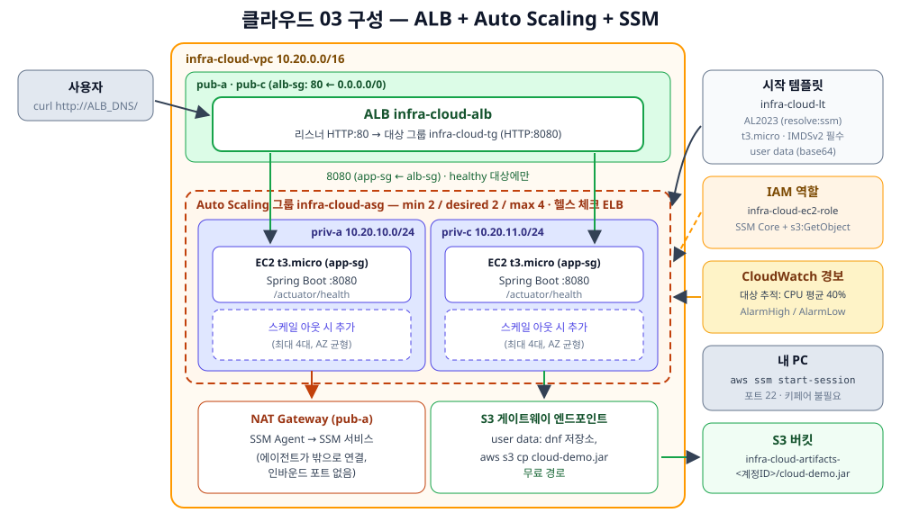
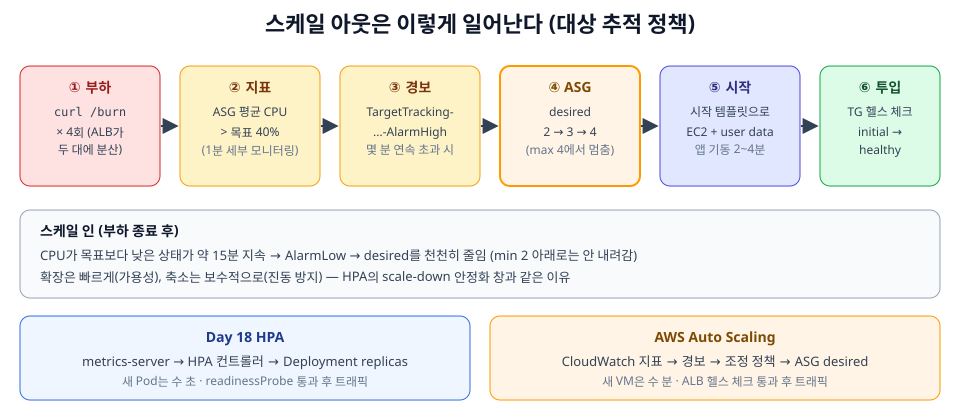

> **클라우드 · AWS** | 난이도 ★★★☆☆ | 예상 소요 2.5 ~ 3시간 | 💰 예상 비용 시간당 약 $0.13~0.16 (3시간 실습 시 약 $0.5, 2026-11-19 서울 기준, 변동 가능)

> 💰 **비용 경고 — 실습 전 반드시 읽으세요.**
> - 본인 소유 AWS 계정에서만 실습합니다. 리전 **`ap-northeast-2`(서울)**.
> - 오늘 켜지는 과금 리소스(2026-11-19 서울 기준, 변동 가능):
>   - 클라우드 02의 **NAT Gateway $0.059/시간** + EIP $0.005/시간
>   - **ALB $0.0225/시간 + LCU $0.008/시간**, ALB가 쓰는 퍼블릭 IPv4(AZ당 1개) $0.005/시간씩
>   - **EC2 t3.micro $0.013/시간 × 2~4대**, EBS gp3 루트 볼륨(GB-월 단위), 세부 모니터링(인스턴스당 소액)
>   - t3는 기본 **unlimited** 크레딧 모드라 부하 실습 중 CPU 크레딧 초과분이 소액 청구될 수 있음
> - 프리 티어/크레딧이 있어도 ALB·NAT는 크레딧을 빠르게 소모합니다.
> - 실습 후 반드시 `bash ~/infra-cloud/app-down.sh && bash ~/infra-cloud/vpc-down.sh` 를 실행하고, 맨 아래 **완전 삭제 체크리스트**로 확인하세요.

## 🎯 오늘의 목표

- EC2를 Day 29의 **Nova**, AMI를 Day 28의 **Glance 이미지**와 대응시켜 설명할 수 있다
- **시작 템플릿 + user data**로 Spring Boot 앱이 부팅과 동시에 뜨는 인스턴스를 정의할 수 있다
- **IAM 역할(인스턴스 프로필)** 로 키 없이 S3에서 아티팩트를 받고, **SSM Session Manager**로 SSH 없이 접속할 수 있다
- **ALB(리스너·대상 그룹·헬스 체크)** 와 **Auto Scaling 그룹**을 연결하고, CPU 부하로 **스케일 아웃**을 확인할 수 있다
- 모든 리소스를 의존 순서대로 **완전히 삭제**할 수 있다

---

## 1. 왜 EC2 + ASG + ALB인가?

컨테이너와 K8s를 다 배웠는데 왜 VM부터 할까요? AWS의 EKS(클라우드 06)도 결국 **EC2 노드 + Auto Scaling 그룹 + 로드 밸런서** 위에서 돕니다. 이 세 가지를 맨손으로 한 번 조립해 보면 EKS가 무엇을 자동화하는지 보입니다.

### 홈랩 대응표

| 본편 Day (홈랩) | 홈랩 개념 | AWS | 메모 |
|---|---|---|---|
| Day 29 Nova `server create` | VM 인스턴스 | **EC2 인스턴스** | 둘 다 KVM 계열 하이퍼바이저(AWS는 Nitro) |
| Day 29 flavor `m1.tiny` | vCPU/RAM 규격 | **인스턴스 유형** `t3.micro` | 패밀리·세대·크기 이름 규칙 |
| Day 28 Glance 이미지 | 부팅 이미지 | **AMI** | 오늘은 SSM 공개 파라미터로 최신 AL2023 AMI 자동 선택 |
| Day 29 `--user-data`, cloud-init | 첫 부팅 스크립트 | **user data** (cloud-init) | 같은 cloud-init이 실행함 |
| Day 29 키페어 + Floating IP + SSH | 원격 접속 | **SSM Session Manager** | 포트 22·키·퍼블릭 IP가 필요 없음 |
| Day 27 Keystone 서비스 계정 | 서비스 자격 증명 | **IAM 역할 + 인스턴스 프로필** | 키를 파일로 두지 않음 |
| Day 11 Deployment / ReplicaSet | 원하는 개수 유지, 자가 치유 | **Auto Scaling 그룹** | desired / min / max |
| Day 18 HPA | 메트릭 기반 개수 조정 | **대상 추적 조정 정책** | CPU 평균 목표값 |
| Day 15 Ingress (Traefik) | L7 라우팅 | **ALB + 리스너 + 규칙** | 경로·호스트 기반 라우팅 |
| Day 12 Service Endpoints | 백엔드 목록 | **대상 그룹(Target Group)** | ASG가 인스턴스를 자동 등록/해제 |
| Day 10 readinessProbe | 트래픽 받을 준비 확인 | **ALB 헬스 체크** `/actuator/health` | 실패하면 트래픽 제외 |
| Day 32 Heat `AutoScalingGroup` | OpenStack 오토스케일 | ASG + CloudWatch 경보 | Heat + Aodh 조합과 같은 구조 |

---

## 2. 오늘 만들 구조



| 구성 요소 | 이름 (고정값) | 위치 |
|---|---|---|
| ALB | `infra-cloud-alb` (인터넷 경계, HTTP :80) | `pub-a`, `pub-c` / SG `infra-cloud-alb-sg` |
| 대상 그룹 | `infra-cloud-tg` (HTTP :8080, 헬스 체크 `/actuator/health`) | VPC |
| 시작 템플릿 | `infra-cloud-lt` (AL2023, t3.micro, IMDSv2 필수) | — |
| Auto Scaling 그룹 | `infra-cloud-asg` (min 2 / desired 2 / max 4) | `priv-a`, `priv-c` / SG `infra-cloud-app-sg` |
| IAM 역할 / 인스턴스 프로필 | `infra-cloud-ec2-role` / `infra-cloud-ec2-profile` | — |
| 아티팩트 버킷 | `infra-cloud-artifacts-<계정ID>` | S3 (게이트웨이 엔드포인트로 접근) |

트래픽 흐름: 사용자 → ALB(퍼블릭 서브넷) → 대상 그룹 → 프라이빗 서브넷 EC2 `:8080`. 인스턴스는 **퍼블릭 IP가 없습니다.** 나가는 트래픽(SSM 등)은 NAT로, S3는 게이트웨이 엔드포인트로 갑니다.

### 핵심 개념 3가지

| 개념 | 설명 |
|---|---|
| **시작 템플릿** | "어떤 인스턴스를 띄울지"의 버전 관리되는 정의(AMI, 유형, SG, 역할, user data, 태그). K8s의 Pod 템플릿과 같은 위치 |
| **user data** | 첫 부팅 때 cloud-init이 **root로 한 번** 실행하는 스크립트. 로그는 `/var/log/cloud-init-output.log` |
| **헬스 체크 유형** | ASG 기본은 `EC2`(인스턴스 상태만). `ELB`로 바꾸면 **ALB 헬스 체크 실패 시에도 교체** → 앱이 죽은 인스턴스를 자동 교체 |

---

## 3. SSH 대신 SSM Session Manager

| 항목 | SSH (Day 29·H01 방식) | SSM Session Manager |
|---|---|---|
| 인바운드 포트 | 22 열어야 함 | **없음** (에이전트가 밖으로 연결) |
| 퍼블릭 IP / 배스천 | 필요 | 불필요 (NAT 또는 SSM 인터페이스 엔드포인트만) |
| 키 관리 | 키페어 배포·회수 | IAM 권한으로 제어 |
| 감사 | 서버 로그 | CloudTrail에 `StartSession` 기록, 세션 로그를 S3/CloudWatch로 남길 수 있음 |
| 필요 조건 | sshd | SSM Agent(AL2023 기본 설치) + 역할에 `AmazonSSMManagedInstanceCore` |

Day 67에서 SSH를 하드닝했던 것보다 더 나아가, **SSH 자체를 닫는** 방식입니다.

로컬에 **Session Manager 플러그인**을 설치합니다(WSL2 Ubuntu 기준, x86_64).

```bash
curl "https://s3.amazonaws.com/session-manager-downloads/plugin/latest/ubuntu_64bit/session-manager-plugin.deb" \
  -o session-manager-plugin.deb
sudo dpkg -i session-manager-plugin.deb
session-manager-plugin --version
```

> 💡 다른 OS·아키텍처는 AWS 문서 "Install the Session Manager plugin for the AWS CLI"의 해당 섹션을 따르세요.

---

## 4. 실습 준비

```bash
cd ~/infra-cloud
source common.env
aws sso login

# 클라우드 02의 VPC를 다시 만든다 (이미 있다면 생략)
./vpc-up.sh
source infra-cloud.env
echo $VPC_ID $PRIV_A $PRIV_C $APP_SG $ALB_SG
```

---

## 5. 실습 ① — Spring Boot 앱 빌드와 업로드

### 5-1. 프로젝트 생성 (로컬, JDK 21)

```bash
sudo apt-get install -y openjdk-21-jdk-headless unzip
mkdir -p ~/infra-cloud/app && cd ~/infra-cloud/app

curl -s https://start.spring.io/starter.zip \
  -d type=gradle-project -d language=java -d javaVersion=21 \
  -d groupId=study.infra -d artifactId=cloud-demo -d name=cloud-demo \
  -d packageName=study.infra.clouddemo -d dependencies=web,actuator \
  -o cloud-demo.zip
unzip -q cloud-demo.zip -d cloud-demo && cd cloud-demo
```

Spring Boot 버전은 start.spring.io의 현재 기본값(최신 안정판)을 따릅니다. `build.gradle`의 `org.springframework.boot` 플러그인 버전에서 확인하세요.

### 5-2. 컨트롤러

`src/main/java/study/infra/clouddemo/HelloController.java`:

```java
package study.infra.clouddemo;

import java.net.InetAddress;
import java.util.Map;
import org.springframework.web.bind.annotation.GetMapping;
import org.springframework.web.bind.annotation.RequestParam;
import org.springframework.web.bind.annotation.RestController;

@RestController
public class HelloController {

    private static String host() {
        try {
            return InetAddress.getLocalHost().getHostName();
        } catch (Exception e) {
            return "unknown";
        }
    }

    @GetMapping("/")
    public Map<String, Object> hello() {
        return Map.of(
                "app", "cloud-demo",
                "host", host(),
                "cpus", Runtime.getRuntime().availableProcessors());
    }

    // 실습용 CPU 부하 엔드포인트 — 운영 코드에는 절대 넣지 말 것
    @GetMapping("/burn")
    public String burn(@RequestParam(defaultValue = "600") int seconds) {
        long end = System.currentTimeMillis() + seconds * 1000L;
        int n = Runtime.getRuntime().availableProcessors();
        for (int i = 0; i < n; i++) {
            Thread.ofPlatform().daemon().start(() -> {
                while (System.currentTimeMillis() < end) {
                    Math.sqrt(Math.random());
                }
            });
        }
        return "burning " + n + " cpu(s) for " + seconds + "s on " + host() + "\n";
    }
}
```

### 5-3. 빌드 → 로컬 확인 → S3 업로드

```bash
./gradlew bootJar
ls build/libs/            # cloud-demo-0.0.1-SNAPSHOT.jar (실행용) 과 -plain.jar
java -jar build/libs/cloud-demo-0.0.1-SNAPSHOT.jar &   # 로컬 테스트
sleep 8; curl -s localhost:8080/ ; curl -s localhost:8080/actuator/health ; kill %1
```

```
{"app":"cloud-demo","host":"DESKTOP-XXXX","cpus":8}
{"status":"UP"}
```

```bash
cd ~/infra-cloud
ACCOUNT_ID=$(aws sts get-caller-identity --query Account --output text)
ARTIFACT_BUCKET=$P-artifacts-$ACCOUNT_ID
aws s3 mb s3://$ARTIFACT_BUCKET --region $AWS_REGION
aws s3api put-bucket-tagging --bucket $ARTIFACT_BUCKET \
  --tagging "TagSet=[{Key=Project,Value=infra-study},{Key=Env,Value=lab},{Key=Owner,Value=$OWNER}]"
aws s3 cp app/cloud-demo/build/libs/cloud-demo-0.0.1-SNAPSHOT.jar s3://$ARTIFACT_BUCKET/cloud-demo.jar

echo "export ACCOUNT_ID=$ACCOUNT_ID ARTIFACT_BUCKET=$ARTIFACT_BUCKET" > ~/infra-cloud/app.env
```

> 💡 새 S3 버킷은 기본으로 **퍼블릭 액세스 차단**이 켜져 있고 SSE-S3 암호화가 적용됩니다. 버킷 정책·버전 관리 등은 클라우드 04에서 제대로 다룹니다. 실무에서는 jar 대신 컨테이너 이미지를 ECR에 올리는 경우가 많습니다(클라우드 06·07).

---

## 6. 실습 ② — IAM 역할과 인스턴스 프로필

인스턴스가 S3에서 jar를 받고 SSM에 등록되려면 권한이 필요합니다. **키 파일을 넣는 대신 역할을 붙입니다.**

```bash
cd ~/infra-cloud && source app.env
cat > ec2-trust.json <<'EOF'
{
  "Version": "2012-10-17",
  "Statement": [{
    "Effect": "Allow",
    "Principal": { "Service": "ec2.amazonaws.com" },
    "Action": "sts:AssumeRole"
  }]
}
EOF
cat > ec2-s3-read.json <<EOF
{
  "Version": "2012-10-17",
  "Statement": [{
    "Effect": "Allow",
    "Action": "s3:GetObject",
    "Resource": "arn:aws:s3:::${ARTIFACT_BUCKET}/*"
  }]
}
EOF

aws iam create-role --role-name $P-ec2-role --assume-role-policy-document file://ec2-trust.json \
  --tags Key=Project,Value=infra-study Key=Env,Value=lab > /dev/null
aws iam attach-role-policy --role-name $P-ec2-role \
  --policy-arn arn:aws:iam::aws:policy/AmazonSSMManagedInstanceCore
aws iam put-role-policy --role-name $P-ec2-role --policy-name s3-artifacts-read \
  --policy-document file://ec2-s3-read.json

aws iam create-instance-profile --instance-profile-name $P-ec2-profile > /dev/null
aws iam add-role-to-instance-profile --instance-profile-name $P-ec2-profile --role-name $P-ec2-role
aws iam wait instance-profile-exists --instance-profile-name $P-ec2-profile
sleep 10   # IAM 전파 대기 (바로 쓰면 Invalid IAM Instance Profile 오류가 날 수 있음)
```

> 💡 **역할 vs 인스턴스 프로필**: 역할은 권한 묶음, 인스턴스 프로필은 그 역할을 EC2에 끼우는 "홀더"입니다. 콘솔에서는 자동으로 같이 만들어지지만 CLI에서는 따로 만듭니다. 인스턴스 안의 SDK·CLI는 **IMDSv2**에서 임시 자격 증명을 받아 씁니다 — 클라우드 01에서 말한 "장기 키 없이"의 서버판입니다.

---

## 7. 실습 ③ — user data와 시작 템플릿

`~/infra-cloud/user-data.sh`:

```bash
#!/bin/bash
# 첫 부팅 시 root로 1회 실행 (cloud-init). 로그: /var/log/cloud-init-output.log
set -euxo pipefail
dnf install -y java-21-amazon-corretto-headless
mkdir -p /opt/cloud-demo
aws s3 cp s3://__BUCKET__/cloud-demo.jar /opt/cloud-demo/app.jar --region ap-northeast-2
useradd --system --no-create-home --shell /sbin/nologin clouddemo || true

cat > /etc/systemd/system/cloud-demo.service <<'EOF'
[Unit]
Description=cloud-demo Spring Boot
After=network-online.target
Wants=network-online.target

[Service]
User=clouddemo
ExecStart=/usr/bin/java -Xms256m -Xmx512m -jar /opt/cloud-demo/app.jar --server.port=8080
Restart=always

[Install]
WantedBy=multi-user.target
EOF

systemctl daemon-reload
systemctl enable --now cloud-demo
```

AL2023에는 AWS CLI와 SSM Agent가 기본 설치되어 있습니다. `dnf` 저장소와 jar 모두 S3에 있으므로, 이 스크립트의 다운로드는 **S3 게이트웨이 엔드포인트**를 탑니다.

```bash
cd ~/infra-cloud && source app.env
USERDATA_B64=$(sed "s/__BUCKET__/${ARTIFACT_BUCKET}/" user-data.sh | base64 -w0)
TAGS_JSON='{"Key":"Project","Value":"infra-study"},{"Key":"Env","Value":"lab"},{"Key":"Owner","Value":"'"$OWNER"'"},{"Key":"ManagedBy","Value":"cli"}'

cat > lt-data.json <<EOF
{
  "ImageId": "resolve:ssm:/aws/service/ami-amazon-linux-latest/al2023-ami-kernel-default-x86_64",
  "InstanceType": "t3.micro",
  "IamInstanceProfile": { "Name": "${P}-ec2-profile" },
  "SecurityGroupIds": ["${APP_SG}"],
  "UserData": "${USERDATA_B64}",
  "Monitoring": { "Enabled": true },
  "MetadataOptions": { "HttpTokens": "required", "HttpEndpoint": "enabled" },
  "TagSpecifications": [
    { "ResourceType": "instance", "Tags": [ {"Key":"Name","Value":"${P}-app"}, ${TAGS_JSON} ] },
    { "ResourceType": "volume",   "Tags": [ {"Key":"Name","Value":"${P}-app-root"}, ${TAGS_JSON} ] }
  ]
}
EOF

aws ec2 create-launch-template --launch-template-name $P-lt \
  --launch-template-data file://lt-data.json \
  --tag-specifications "ResourceType=launch-template,Tags=[{Key=Name,Value=$P-lt},${TAGS}]" \
  --query 'LaunchTemplate.[LaunchTemplateId,LatestVersionNumber]' --output text
```

```
lt-0123456789abcdef0    1
```

| 설정 | 이유 |
|---|---|
| `resolve:ssm:/aws/service/ami-amazon-linux-latest/...` | AMI ID를 하드코딩하지 않고 **시작 시점의 최신 AL2023**을 사용 (AMI ID는 리전마다 다름) |
| `HttpTokens: required` | **IMDSv2 강제** — SSRF로 메타데이터의 임시 자격 증명을 훔치는 공격 완화(해킹 트랙 SSRF 편과 연결) |
| `Monitoring.Enabled: true` | 세부 모니터링(1분 지표) — 스케일 아웃 반응이 빨라짐. 소액 과금 |
| 퍼블릭 IP 설정 없음 | 프라이빗 서브넷 + 퍼블릭 IP 없음 → 인터넷에서 직접 닿을 수 없음 |

---

## 8. 실습 ④ — ALB · 대상 그룹 · 리스너

```bash
LB_ARN=$(aws elbv2 create-load-balancer --name $P-alb --type application --scheme internet-facing \
  --subnets $PUB_A $PUB_C --security-groups $ALB_SG \
  --tags Key=Project,Value=infra-study Key=Env,Value=lab Key=Owner,Value=$OWNER \
  --query 'LoadBalancers[0].LoadBalancerArn' --output text)

TG_ARN=$(aws elbv2 create-target-group --name $P-tg --protocol HTTP --port 8080 \
  --vpc-id $VPC_ID --target-type instance \
  --health-check-path /actuator/health --health-check-interval-seconds 15 \
  --healthy-threshold-count 2 --unhealthy-threshold-count 3 \
  --tags Key=Project,Value=infra-study Key=Env,Value=lab \
  --query 'TargetGroups[0].TargetGroupArn' --output text)

aws elbv2 create-listener --load-balancer-arn $LB_ARN --protocol HTTP --port 80 \
  --default-actions Type=forward,TargetGroupArn=$TG_ARN > /dev/null

aws elbv2 wait load-balancer-available --load-balancer-arns $LB_ARN
ALB_DNS=$(aws elbv2 describe-load-balancers --load-balancer-arns $LB_ARN \
  --query 'LoadBalancers[0].DNSName' --output text)
echo "export LB_ARN=$LB_ARN TG_ARN=$TG_ARN ALB_DNS=$ALB_DNS" >> ~/infra-cloud/app.env
echo $ALB_DNS
```

```
infra-cloud-alb-1234567890.ap-northeast-2.elb.amazonaws.com
```

> ⚠️ 학습용이라 HTTP(80)만 씁니다. 운영에서는 ACM 인증서로 **HTTPS(443) 리스너**를 만들고 80은 443으로 리디렉션합니다(Day 71의 cert-manager가 하던 일을 ACM이 대신).

---

## 9. 실습 ⑤ — Auto Scaling 그룹

```bash
aws autoscaling create-auto-scaling-group --auto-scaling-group-name $P-asg \
  --launch-template "LaunchTemplateName=$P-lt,Version=\$Latest" \
  --min-size 2 --max-size 4 --desired-capacity 2 \
  --vpc-zone-identifier "$PRIV_A,$PRIV_C" \
  --target-group-arns $TG_ARN \
  --health-check-type ELB --health-check-grace-period 300 \
  --tags "ResourceId=$P-asg,ResourceType=auto-scaling-group,Key=Project,Value=infra-study,PropagateAtLaunch=false" \
         "ResourceId=$P-asg,ResourceType=auto-scaling-group,Key=Env,Value=lab,PropagateAtLaunch=false"
```

인스턴스 2대가 `priv-a`, `priv-c`에 하나씩 뜹니다(ASG는 AZ 간 균형을 맞춤). user data가 Java 설치 → jar 다운로드 → 앱 시작까지 하므로 **2~4분** 뒤 대상이 `healthy`가 됩니다.

```bash
aws elbv2 wait target-in-service --target-group-arn $TG_ARN   # 오래 걸리면 Ctrl+C 후 아래로 확인
aws elbv2 describe-target-health --target-group-arn $TG_ARN \
  --query 'TargetHealthDescriptions[].[Target.Id,TargetHealth.State,TargetHealth.Reason]' --output table
```

```
-------------------------------------------
|          DescribeTargetHealth           |
+----------------------+----------+-------+
|  i-0aaa...           |  healthy |  None |
|  i-0bbb...           |  healthy |  None |
+----------------------+----------+-------+
```

```bash
for i in $(seq 1 6); do curl -s http://$ALB_DNS/; echo; done
```

```
{"app":"cloud-demo","host":"ip-10-20-10-37.ap-northeast-2.compute.internal","cpus":2}
{"app":"cloud-demo","host":"ip-10-20-11-142.ap-northeast-2.compute.internal","cpus":2}
...
```

`host`가 **10.20.10.x(2a)와 10.20.11.x(2c)** 를 오가면 ALB가 두 AZ에 분산하고 있는 것입니다.

---

## 10. 실습 ⑥ — SSM Session Manager로 접속

```bash
aws ssm describe-instance-information \
  --query 'InstanceInformationList[].[InstanceId,PingStatus,PlatformName,IPAddress]' --output table

INSTANCE_ID=$(aws autoscaling describe-auto-scaling-groups --auto-scaling-group-names $P-asg \
  --query 'AutoScalingGroups[0].Instances[0].InstanceId' --output text)
aws ssm start-session --target $INSTANCE_ID
```

```
Starting session with SessionId: hong-0a1b2c3d4e5f...
sh-5.2$ sudo -i
[root@ip-10-20-10-37 ~]# systemctl status cloud-demo --no-pager | head -3
● cloud-demo.service - cloud-demo Spring Boot
     Loaded: loaded (/etc/systemd/system/cloud-demo.service; enabled; preset: disabled)
     Active: active (running) since ...
[root@ip-10-20-10-37 ~]# tail -5 /var/log/cloud-init-output.log
[root@ip-10-20-10-37 ~]# TOKEN=$(curl -s -X PUT http://169.254.169.254/latest/api/token -H "X-aws-ec2-metadata-token-ttl-seconds: 60")
[root@ip-10-20-10-37 ~]# curl -s -H "X-aws-ec2-metadata-token: $TOKEN" http://169.254.169.254/latest/meta-data/iam/security-credentials/
infra-cloud-ec2-role
[root@ip-10-20-10-37 ~]# exit
sh-5.2$ exit
```

포트 22를 연 적도, 키페어를 만든 적도, 퍼블릭 IP도 없는데 셸에 들어왔습니다. 메타데이터에서 보이는 역할 이름이 **인스턴스가 쓰는 임시 자격 증명의 출처**입니다.

> 💡 Day 30의 메타데이터 주소 `169.254.169.254`가 여기서도 같습니다. OpenStack도 EC2 호환 메타데이터 API를 제공했기 때문입니다.

---

## 11. 실습 ⑦ — 스케일 아웃 확인



### 11-1. 대상 추적 정책

```bash
aws autoscaling put-scaling-policy --auto-scaling-group-name $P-asg \
  --policy-name cpu-target-40 --policy-type TargetTrackingScaling \
  --target-tracking-configuration '{
    "PredefinedMetricSpecification": { "PredefinedMetricType": "ASGAverageCPUUtilization" },
    "TargetValue": 40.0
  }' --query 'Alarms[].AlarmName' --output text
```

```
TargetTracking-infra-cloud-asg-AlarmHigh-...   TargetTracking-infra-cloud-asg-AlarmLow-...
```

정책을 만들면 **CloudWatch 경보 2개(High/Low)가 자동 생성**됩니다. Day 18 HPA가 metrics-server를 보고 판단했다면, ASG는 CloudWatch 경보가 정책을 깨웁니다.

### 11-2. 부하 걸기

```bash
for i in 1 2 3 4; do curl -s "http://$ALB_DNS/burn?seconds=600"; done
```

```
burning 2 cpu(s) for 600s on ip-10-20-10-37.ap-northeast-2.compute.internal
burning 2 cpu(s) for 600s on ip-10-20-11-142.ap-northeast-2.compute.internal
...
```

### 11-3. 지켜보기 (3~6분)

```bash
for i in $(seq 1 20); do
  aws autoscaling describe-auto-scaling-groups --auto-scaling-group-names $P-asg \
    --query 'AutoScalingGroups[0].[DesiredCapacity,length(Instances)]' --output text
  sleep 30
done
```

```
2   2
2   2
3   3      ← AlarmHigh 발생 → desired 증가
4   4
4   4
```

```bash
aws autoscaling describe-scaling-activities --auto-scaling-group-name $P-asg --max-items 5 \
  --query 'Activities[].[StartTime,StatusCode,Description]' --output table
```

```
| 2026-11-19T12:41:07Z | Successful | Launching a new EC2 instance: i-0ccc... |
| 2026-11-19T12:39:52Z | Successful | Launching a new EC2 instance: i-0ddd... |
```

새 인스턴스도 user data로 앱을 띄우고, 헬스 체크를 통과한 뒤에야 ALB 트래픽을 받습니다(`describe-target-health`로 `initial` → `healthy` 확인). 부하가 끝나면(600초 후) 약 15분에 걸쳐 **천천히 스케일 인**합니다 — 급격히 줄였다 늘였다 하지 않도록 축소는 보수적으로 동작합니다.

> 💡 기다리기 싫다면 수동 조정도 됩니다: `aws autoscaling set-desired-capacity --auto-scaling-group-name $P-asg --desired-capacity 3`. `kubectl scale`과 같습니다.

### 11-4. 자가 치유 확인

```bash
VICTIM=$(aws autoscaling describe-auto-scaling-groups --auto-scaling-group-names $P-asg \
  --query 'AutoScalingGroups[0].Instances[0].InstanceId' --output text)
aws ec2 terminate-instances --instance-ids $VICTIM --query 'TerminatingInstances[0].CurrentState.Name'
# 1~2분 뒤 scaling activities에 "...in response to an EC2 health check..." 대체 인스턴스 시작 기록
```

Deployment가 지워진 Pod를 다시 만들던 것(Day 11)과 같습니다.

---

## 12. 실습 ⑧ — 정리

`~/infra-cloud/app-down.sh`:

```bash
#!/usr/bin/env bash
# 클라우드 03 — 앱 계층 삭제 (VPC는 vpc-down.sh로 따로)
set -uo pipefail
source ~/infra-cloud/common.env
source ~/infra-cloud/infra-cloud.env
source ~/infra-cloud/app.env

echo "[1] ASG 삭제 (인스턴스 종료 포함, 2~5분)"
aws autoscaling delete-auto-scaling-group --auto-scaling-group-name $P-asg --force-delete
while [ "$(aws autoscaling describe-auto-scaling-groups --auto-scaling-group-names $P-asg \
           --query 'length(AutoScalingGroups)' --output text)" != "0" ]; do
  echo "  ASG 삭제 중..."; sleep 15
done

echo "[2] 시작 템플릿"
aws ec2 delete-launch-template --launch-template-name $P-lt > /dev/null

echo "[3] ALB → 대상 그룹 (리스너는 ALB와 함께 삭제)"
aws elbv2 delete-load-balancer --load-balancer-arn $LB_ARN
aws elbv2 wait load-balancers-deleted --load-balancer-arns $LB_ARN
aws elbv2 delete-target-group --target-group-arn $TG_ARN

echo "[4] IAM 인스턴스 프로필 / 역할"
aws iam remove-role-from-instance-profile --instance-profile-name $P-ec2-profile --role-name $P-ec2-role
aws iam delete-instance-profile --instance-profile-name $P-ec2-profile
aws iam detach-role-policy --role-name $P-ec2-role \
  --policy-arn arn:aws:iam::aws:policy/AmazonSSMManagedInstanceCore
aws iam delete-role-policy --role-name $P-ec2-role --policy-name s3-artifacts-read
aws iam delete-role --role-name $P-ec2-role

echo "[5] 아티팩트 버킷 (객체 포함 삭제)"
aws s3 rb s3://$ARTIFACT_BUCKET --force

echo "[6] 남은 인스턴스 확인 (비어 있어야 함)"
aws ec2 describe-instances --filters Name=tag:Project,Values=infra-study \
  Name=instance-state-name,Values=pending,running,stopping,stopped \
  --query 'Reservations[].Instances[].InstanceId' --output text
```

```bash
chmod +x app-down.sh
./app-down.sh && ./vpc-down.sh
```

> ⚠️ **순서가 중요합니다.** ALB를 지운 뒤에도 ALB의 ENI가 몇 분간 남아 있어서 바로 VPC를 지우면 `DependencyViolation`이 납니다. `vpc-down.sh`의 5단계가 ENI가 사라질 때까지 기다려 줍니다. 대상 추적 정책이 만든 CloudWatch 경보는 ASG 삭제 시 함께 지워집니다.

---

## 13. 트러블슈팅

| 증상 | 원인 | 해결 |
|---|---|---|
| 대상이 계속 `unhealthy` (`Target.ResponseCodeMismatch` / `Target.Timeout`) | 앱이 아직 기동 중, user data 실패, SG에서 8080 미허용 | SSM으로 접속해 `tail -50 /var/log/cloud-init-output.log`, `journalctl -u cloud-demo`. `app-sg`의 소스가 `alb-sg`인지 확인 |
| 인스턴스가 계속 생성·종료를 반복 | 헬스 체크 유예(grace) 전에 ELB 헬스 체크 실패 → 교체 루프 | `--health-check-grace-period`를 늘리거나 앱 기동 시간 단축 |
| `aws s3 cp` 실패 `AccessDenied` (user data 로그) | 역할에 `s3:GetObject` 없음 / 버킷 이름 치환 실패 | `lt-data.json`의 UserData를 `base64 -d`로 풀어 버킷 이름 확인, 인라인 정책 확인 |
| `describe-instance-information`에 인스턴스가 안 보임 | 역할에 `AmazonSSMManagedInstanceCore` 없음 / NAT·SSM 엔드포인트 없음 | 역할 정책 확인, 프라이빗 RT의 NAT 경로 확인 |
| `start-session`에서 `SessionManagerPlugin is not found` | 로컬 플러그인 미설치 | 3절의 플러그인 설치 |
| `Invalid IAM Instance Profile name` | 인스턴스 프로필 생성 직후 전파 전 | 10~20초 후 재시도 |
| 스케일 아웃이 안 일어남 | 부하가 일부 인스턴스에만 걸려 **평균** CPU가 40% 미만 | `/burn`을 더 여러 번 호출, `describe-alarms --alarm-name-prefix TargetTracking-$P-asg`로 경보 상태 확인 |
| `vpc-down.sh`에서 서브넷 삭제 실패 | ALB ENI 잔존 / 인스턴스 남음 | `app-down.sh` 6단계 결과 확인 후 몇 분 뒤 재실행 |

---

## 14. 핵심 정리

- **EC2 = Nova, AMI = Glance 이미지, 인스턴스 유형 = flavor, user data = cloud-init** — 개념은 Chapter 4와 같다
- **시작 템플릿**은 인스턴스의 버전 관리되는 정의, **ASG**는 개수 유지·자가 치유·조정(Deployment + HPA), **ALB + 대상 그룹**은 L7 분산(Ingress + Service)
- ASG 헬스 체크를 **`ELB`** 로 두면 앱이 죽은 인스턴스도 교체된다. 대신 **유예 시간**을 앱 기동 시간보다 길게
- 서버의 권한은 **IAM 역할(인스턴스 프로필)** 로, 접속은 **SSM Session Manager**로 — 키도, 포트 22도, 퍼블릭 IP도 필요 없다
- **IMDSv2 필수**(`HttpTokens: required`)로 메타데이터 자격 증명 탈취를 완화
- 정리 순서: **ASG → 시작 템플릿 → ALB(→ENI 소멸 대기) → 대상 그룹 → IAM → 버킷 → VPC**

---

## 15. 셀프 체크

<details>
<summary>Q1. ASG의 헬스 체크 유형을 <code>EC2</code>로 두면 생기는 문제는?</summary>

인스턴스 자체가 살아 있으면(상태 검사 통과) **앱이 죽어도 교체하지 않습니다.** ALB는 그 인스턴스로 트래픽을 보내지 않겠지만 용량이 줄어든 채로 남습니다. `ELB`로 두면 ALB 헬스 체크 실패도 교체 사유가 됩니다.
</details>

<details>
<summary>Q2. 프라이빗 서브넷의 인스턴스에 SSM으로 접속하려면 네트워크적으로 무엇이 필요한가?</summary>

SSM Agent가 **밖으로** SSM 서비스 엔드포인트에 HTTPS로 연결할 수 있어야 합니다. NAT Gateway 경로가 있거나, `ssm`·`ssmmessages`·`ec2messages` **인터페이스 VPC 엔드포인트**가 있으면 됩니다. 인바운드 포트는 필요 없습니다.
</details>

<details>
<summary>Q3. 시작 템플릿의 ImageId에 <code>resolve:ssm:...</code>를 쓰는 장점과 주의점은?</summary>

장점: 리전별 AMI ID를 하드코딩하지 않고 **시작 시점 최신 AMI**를 씁니다. 주의점: 같은 템플릿이라도 **시점에 따라 다른 AMI**로 뜨므로, 운영에서 재현성이 중요하면 검증된 AMI ID를 고정하고 갱신을 별도로 관리합니다.
</details>

<details>
<summary>Q4. 대상 추적 정책은 왜 스케일 인을 스케일 아웃보다 느리게 하나?</summary>

부하가 출렁일 때 인스턴스를 줄였다가 바로 다시 늘리는 **진동(flapping)** 을 막기 위해서입니다. 확장은 빠르게(가용성 우선), 축소는 보수적으로(경보가 더 오래 지속돼야 함) 동작합니다. HPA의 scale-down 안정화 창(Day 18)과 같은 이유입니다.
</details>

<details>
<summary>Q5. 인스턴스에서 <code>aws s3 cp</code>가 액세스 키 없이 동작하는 이유는?</summary>

인스턴스 프로필로 붙은 **IAM 역할의 임시 자격 증명**을 AWS CLI가 IMDS(169.254.169.254)에서 자동으로 받아 쓰기 때문입니다. 자격 증명은 자동으로 갱신되며 파일로 저장되지 않습니다.
</details>

---

## 🧹 완전 삭제 체크리스트 (이 편)

`./app-down.sh && ./vpc-down.sh` 실행 후 확인합니다. 모두 **빈 결과**여야 합니다.

```bash
source ~/infra-cloud/common.env
aws autoscaling describe-auto-scaling-groups --query 'AutoScalingGroups[].AutoScalingGroupName' --output text
aws ec2 describe-instances --filters Name=instance-state-name,Values=pending,running,stopping,stopped \
  --query 'Reservations[].Instances[].InstanceId' --output text
aws ec2 describe-launch-templates --filters Name=tag:Project,Values=infra-study --query 'LaunchTemplates[].LaunchTemplateName' --output text
aws elbv2 describe-load-balancers --query 'LoadBalancers[].LoadBalancerName' --output text
aws elbv2 describe-target-groups --query 'TargetGroups[].TargetGroupName' --output text
aws ec2 describe-volumes --filters Name=status,Values=available --query 'Volumes[].VolumeId' --output text
aws cloudwatch describe-alarms --alarm-name-prefix TargetTracking-infra-cloud --query 'MetricAlarms[].AlarmName' --output text
aws iam list-instance-profiles --query "InstanceProfiles[?starts_with(InstanceProfileName,'infra-cloud')].InstanceProfileName" --output text
aws s3 ls | grep infra-cloud-artifacts
```

- [ ] Auto Scaling 그룹 `infra-cloud-asg` 없음, 실행/중지 상태 인스턴스 0대
- [ ] 시작 템플릿 `infra-cloud-lt` 없음
- [ ] ALB `infra-cloud-alb`, 대상 그룹 `infra-cloud-tg` 없음
- [ ] 분리된(available) EBS 볼륨 없음
- [ ] TargetTracking CloudWatch 경보 없음
- [ ] IAM 역할 `infra-cloud-ec2-role`, 인스턴스 프로필 `infra-cloud-ec2-profile` 없음
- [ ] 버킷 `infra-cloud-artifacts-<계정ID>` 없음
- [ ] 클라우드 02 체크리스트(VPC·NAT·**EIP**·엔드포인트·Flow Logs) 전부 통과

---

## ⏭️ 다음 예고 — 클라우드 04. S3와 RDS

오늘은 앱만 띄웠고, 데이터는 아무 데도 저장하지 않았습니다. 다음 편에서는 Day 31의 **Swift ↔ S3**, Day 06 Compose의 Postgres 컨테이너 ↔ **RDS PostgreSQL**을 다룹니다. 버킷 정책·퍼블릭 차단·버전 관리·수명 주기, **CloudFront OAC**로 비공개 버킷을 안전하게 서비스하기, 프라이빗 DB 서브넷의 RDS와 **Secrets Manager** 비밀번호 자동 관리, 스냅샷, 그리고 DynamoDB 개념까지 정리합니다.
