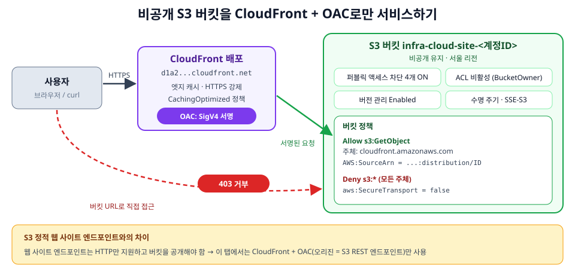
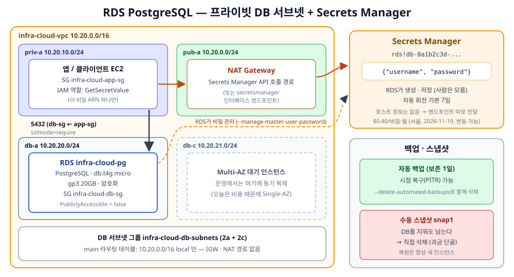

> **클라우드 · AWS** | 난이도 ★★★☆☆ | 예상 소요 3 ~ 3.5시간 | 💰 예상 비용 시간당 약 $0.11 (3시간 실습 시 약 $0.35, 2026-11-19 서울 기준, 변동 가능)

> 💰 **비용 경고 — 실습 전 반드시 읽으세요.**
> - 본인 소유 AWS 계정에서만 실습합니다. 리전 **`ap-northeast-2`(서울)**. (CloudFront는 글로벌 서비스)
> - 오늘 과금 항목(2026-11-19 서울 기준, 변동 가능):
>   - **RDS db.t4g.micro PostgreSQL Single-AZ $0.025/시간** + gp3 스토리지 $0.131/GB-월(20GB ≈ 월 $2.6)
>   - **Secrets Manager 비밀 $0.40/개-월**(사용 기간 비례) + API 1만 건당 $0.05
>   - 클라우드 02 VPC의 **NAT Gateway $0.059/시간** + EIP $0.005/시간, 접속 확인용 **EC2 t3.micro $0.013/시간**
>   - S3 Standard $0.025/GB-월(첫 50TB) + 요청 요금 — 실습 파일 몇 KB라 사실상 0
>   - CloudFront — 실습 트래픽(수 MB)은 무시할 수준. 단 배포를 **지우지 않으면 계속 존재**하므로 정리 필수
>   - RDS **수동 스냅샷**은 DB를 지워도 **남아서 과금**됩니다(백업 스토리지 무료 한도 초과분)
> - 실습 후 반드시 `bash ~/infra-cloud/data-down.sh && bash ~/infra-cloud/vpc-down.sh` 를 실행하고, 맨 아래 **완전 삭제 체크리스트**로 확인하세요.

## 🎯 오늘의 목표

- S3를 Day 31의 **Swift**와 대응시키고, **퍼블릭 액세스 차단·버킷 정책·버전 관리·수명 주기**를 CLI로 설정할 수 있다
- **S3 정적 웹 사이트 엔드포인트**와 **CloudFront + OAC** 방식의 차이를 설명하고, 비공개 버킷을 CloudFront로만 서비스할 수 있다
- **RDS PostgreSQL**을 인터넷 경로가 없는 **DB 전용 프라이빗 서브넷**에 배치하고, 비밀번호를 **Secrets Manager가 관리**하게 할 수 있다
- 스냅샷을 만들고, DB 삭제 후에도 남는 리소스를 찾아 지울 수 있다
- **DynamoDB**의 키 설계와 RDS와의 선택 기준을 설명할 수 있다

---

## 1. 홈랩 대응표 — 오늘 등장하는 것

| 본편 Day (홈랩) | 홈랩 개념 | AWS | 메모 |
|---|---|---|---|
| Day 31 Swift | 오브젝트 스토리지(컨테이너·오브젝트, HTTP API) | **S3** (버킷·객체) | Swift의 컨테이너 = S3 버킷. S3 API는 사실상 업계 표준 |
| Day 31 Cinder | 블록 볼륨 | **EBS** (클라우드 03의 루트 볼륨) | VM에 붙는 디스크 |
| Day 06 Compose `postgres` 컨테이너 + 볼륨 | 직접 운영하는 DB | **RDS for PostgreSQL** | 백업·패치·장애 조치를 AWS가 |
| Day 14 VolumeSnapshot | 볼륨 스냅샷 | **RDS 스냅샷** / 자동 백업(PITR) | |
| Day 13 Secret, Day 55 External Secrets, Day 71 OpenBao | 비밀 저장·주입·회전 | **Secrets Manager** | RDS가 비밀번호 생성·회전까지 |
| Day 15 Traefik TLS, H03 안전한 외부 노출 | 엣지에서 HTTPS 종료 | **CloudFront** | 전 세계 엣지 캐시 + HTTPS |
| Day 41 pgvector | 벡터 검색 | RDS PostgreSQL의 `pgvector` 확장 | 클라우드 10에서 RAG 이전 시 선택지 |
| (없음) | 키-값/문서 DB | **DynamoDB** | 서버·커넥션 개념이 없는 완전 관리형 |

---

## 2. S3 핵심 개념

| 개념 | 설명 |
|---|---|
| 버킷 | 객체를 담는 최상위 그릇. 이름은 **전 세계에서 유일**(그래서 `infra-cloud-site-<계정ID>`) |
| 객체 | 키(경로처럼 보이는 문자열) + 데이터 + 메타데이터. 디렉터리는 실제로 없음 |
| 퍼블릭 액세스 차단(BPA) | 계정·버킷 단위 안전장치. **새 버킷은 기본으로 4개 옵션 모두 켜짐** → 실수로 공개 정책·ACL을 걸어도 막힘 |
| 객체 소유권 | 새 버킷 기본값 **BucketOwnerEnforced** → ACL 비활성, 권한은 정책으로만 |
| 버킷 정책 | 리소스 기반 IAM 정책(JSON). "누가 이 버킷에 무엇을" |
| 암호화 | 새 객체는 기본으로 **SSE-S3** 암호화. KMS 키(SSE-KMS)는 클라우드 09 |
| 버전 관리 | 덮어쓰기·삭제해도 이전 버전 보존. 삭제는 "삭제 마커"가 덮일 뿐 |
| 수명 주기 | 일정 기간 뒤 저렴한 스토리지 클래스로 전환하거나 만료(삭제) |

> 💡 S3 데이터 사고의 대부분은 "버킷을 퍼블릭으로 열어 둠"입니다. 그래서 AWS는 기본값을 **전부 잠금**으로 바꿨고, 우리는 **잠근 채로** 웹 사이트를 서비스하는 방법(CloudFront OAC)을 배웁니다.

---

## 3. 실습 ① — S3 버킷 · 퍼블릭 차단 · 버전 관리 · 수명 주기

### 3-1. 버킷 만들기와 기본 잠금 확인

```bash
cd ~/infra-cloud && source common.env && aws sso login
ACCOUNT_ID=$(aws sts get-caller-identity --query Account --output text)
SITE_BUCKET=$P-site-$ACCOUNT_ID

aws s3api create-bucket --bucket $SITE_BUCKET \
  --create-bucket-configuration LocationConstraint=$AWS_REGION
aws s3api put-bucket-tagging --bucket $SITE_BUCKET \
  --tagging "TagSet=[{Key=Project,Value=infra-study},{Key=Env,Value=lab},{Key=Owner,Value=$OWNER}]"
echo "export ACCOUNT_ID=$ACCOUNT_ID SITE_BUCKET=$SITE_BUCKET" > ~/infra-cloud/data.env

aws s3api get-public-access-block --bucket $SITE_BUCKET
aws s3api get-bucket-ownership-controls --bucket $SITE_BUCKET \
  --query 'OwnershipControls.Rules[0].ObjectOwnership' --output text
```

```json
{
    "PublicAccessBlockConfiguration": {
        "BlockPublicAcls": true,
        "IgnorePublicAcls": true,
        "BlockPublicPolicy": true,
        "RestrictPublicBuckets": true
    }
}
BucketOwnerEnforced
```

계정 전체에도 같은 차단을 걸어 두면 더 안전합니다(이미 켜져 있을 수 있음).

```bash
aws s3control put-public-access-block --account-id $ACCOUNT_ID \
  --public-access-block-configuration \
  BlockPublicAcls=true,IgnorePublicAcls=true,BlockPublicPolicy=true,RestrictPublicBuckets=true
```

### 3-2. 일부러 "전체 공개" 정책을 걸어 보기 (막히는지 확인)

```bash
cat > public-policy.json <<EOF
{
  "Version": "2012-10-17",
  "Statement": [{
    "Effect": "Allow", "Principal": "*", "Action": "s3:GetObject",
    "Resource": "arn:aws:s3:::${SITE_BUCKET}/*"
  }]
}
EOF
aws s3api put-bucket-policy --bucket $SITE_BUCKET --policy file://public-policy.json
```

```
An error occurred (AccessDenied) when calling the PutBucketPolicy operation: ...
because public policies are prevented by the BlockPublicPolicy setting in S3 Block Public Access.
```

**의도대로 막혔습니다.** 이 오류를 보고 BPA를 끄는 것이 아니라, 공개하지 않고 서비스하는 방법(5절)을 찾는 것이 정답입니다.

### 3-3. 버전 관리

```bash
aws s3api put-bucket-versioning --bucket $SITE_BUCKET --versioning-configuration Status=Enabled

mkdir -p site
echo '<h1>infra-cloud v1</h1>' > site/index.html
aws s3 cp site/index.html s3://$SITE_BUCKET/index.html
echo '<h1>infra-cloud v2</h1>' > site/index.html
aws s3 cp site/index.html s3://$SITE_BUCKET/index.html
aws s3 rm s3://$SITE_BUCKET/index.html           # "삭제"

aws s3api list-object-versions --bucket $SITE_BUCKET --prefix index.html \
  --query '{Versions:Versions[].[VersionId,IsLatest,Size],DeleteMarkers:DeleteMarkers[].[VersionId,IsLatest]}'
```

```json
{
    "Versions": [ ["3HL4kqtJlcpXroDTDmJ...", false, 24], ["Uv8fd7SnZ0R8ZJ4c...", false, 24] ],
    "DeleteMarkers": [ ["sI8Dq0v9ZuXbbaUx...", true] ]
}
```

객체는 사라지지 않았습니다. **삭제 마커**가 최신 버전으로 덮였을 뿐입니다. 삭제 마커를 지우면 v2가 되살아납니다.

```bash
MARKER=$(aws s3api list-object-versions --bucket $SITE_BUCKET --prefix index.html \
  --query 'DeleteMarkers[0].VersionId' --output text)
aws s3api delete-object --bucket $SITE_BUCKET --key index.html --version-id $MARKER
aws s3 cp s3://$SITE_BUCKET/index.html -      # <h1>infra-cloud v2</h1>
```

> ⚠️ 버전 관리를 켠 버킷은 **이전 버전도 전부 저장 용량으로 과금**됩니다. 그래서 수명 주기 규칙과 짝으로 씁니다. 또한 `aws s3 rb --force`는 **이전 버전을 지우지 못해** 버킷 삭제가 실패합니다(정리 스크립트에서 처리).

### 3-4. 수명 주기

```bash
cat > lifecycle.json <<'EOF'
{
  "Rules": [
    {
      "ID": "noncurrent-cleanup",
      "Status": "Enabled",
      "Filter": { "Prefix": "" },
      "NoncurrentVersionExpiration": { "NoncurrentDays": 30 },
      "AbortIncompleteMultipartUpload": { "DaysAfterInitiation": 7 }
    },
    {
      "ID": "logs-ia-then-expire",
      "Status": "Enabled",
      "Filter": { "Prefix": "logs/" },
      "Transitions": [ { "Days": 30, "StorageClass": "STANDARD_IA" } ],
      "Expiration": { "Days": 90 }
    }
  ]
}
EOF
aws s3api put-bucket-lifecycle-configuration --bucket $SITE_BUCKET --lifecycle-configuration file://lifecycle.json
aws s3api get-bucket-lifecycle-configuration --bucket $SITE_BUCKET --query 'Rules[].[ID,Status]' --output text
```

| 규칙 | 의미 |
|---|---|
| `NoncurrentVersionExpiration 30` | 최신이 아닌 버전은 30일 뒤 삭제 → 버전 관리 비용 상한 |
| `AbortIncompleteMultipartUpload 7` | 중단된 대용량 업로드 조각(보이지 않지만 과금) 정리 |
| `logs/` → 30일 후 `STANDARD_IA`, 90일 후 삭제 | 자주 안 읽는 로그를 싸게 보관 후 폐기. IA는 **최소 30일·최소 크기 과금**이 있어 작은 객체에는 오히려 손해일 수 있음 |

---

## 4. 정적 호스팅 — S3 웹 사이트 엔드포인트 vs CloudFront + OAC



| 항목 | S3 정적 웹 사이트 엔드포인트 | CloudFront + OAC (오늘 방식) |
|---|---|---|
| 버킷 공개 | **필요** (BPA 해제 + 공개 정책) | **불필요** — 버킷은 끝까지 비공개 |
| HTTPS | 웹 사이트 엔드포인트는 **HTTP만** | HTTPS 기본(`*.cloudfront.net` 인증서, ACM으로 내 도메인) |
| 캐시·지연 | 리전(서울) 한 곳에서 응답 | 전 세계 엣지 캐시 |
| 접근 통제 | 누구나 버킷 URL로 직접 접근 | 버킷 정책이 **특정 배포의 요청만** 허용 (`AWS:SourceArn`) |
| 리디렉션·인덱스 문서 | 웹 사이트 기능으로 지원 | 기본 루트 객체(`index.html`), 하위 경로 인덱스는 CloudFront Functions 등 |

웹 사이트 엔드포인트는 `aws s3 website s3://<버킷>/ --index-document index.html`로 켤 수 있지만, BPA를 꺼야 쓸모가 있으므로 오늘은 개념만 봅니다. **OAC(Origin Access Control)** 는 CloudFront가 S3에 요청할 때 **SigV4로 서명**하게 하고, 버킷 정책은 "cloudfront.amazonaws.com 서비스가, 내 배포 ARN으로 서명한 요청만" 허용합니다. (예전 방식 OAI는 레거시입니다.)

---

## 5. 실습 ② — CloudFront + OAC로 비공개 버킷 서비스하기

### 5-1. OAC와 배포 만들기

```bash
cd ~/infra-cloud && source common.env && source data.env

OAC_ID=$(aws cloudfront create-origin-access-control --origin-access-control-config \
  Name=$P-site-oac,SigningProtocol=sigv4,SigningBehavior=always,OriginAccessControlOriginType=s3 \
  --query 'OriginAccessControl.Id' --output text)

cat > dist-config.json <<EOF
{
  "CallerReference": "$P-site-$(date +%s)",
  "Comment": "$P static site (Project=infra-study)",
  "Enabled": true,
  "DefaultRootObject": "index.html",
  "PriceClass": "PriceClass_200",
  "Origins": {
    "Quantity": 1,
    "Items": [{
      "Id": "s3-site",
      "DomainName": "${SITE_BUCKET}.s3.${AWS_REGION}.amazonaws.com",
      "S3OriginConfig": { "OriginAccessIdentity": "" },
      "OriginAccessControlId": "${OAC_ID}"
    }]
  },
  "DefaultCacheBehavior": {
    "TargetOriginId": "s3-site",
    "ViewerProtocolPolicy": "redirect-to-https",
    "CachePolicyId": "658327ea-f89d-4fab-a63d-7e88639e58f6",
    "Compress": true
  }
}
EOF

read DIST_ID DIST_DOMAIN < <(aws cloudfront create-distribution --distribution-config file://dist-config.json \
  --query 'Distribution.[Id,DomainName]' --output text)
echo "export OAC_ID=$OAC_ID DIST_ID=$DIST_ID DIST_DOMAIN=$DIST_DOMAIN" >> ~/infra-cloud/data.env
echo $DIST_DOMAIN
```

```
d1a2b3c4d5e6f7.cloudfront.net
```

| 설정 | 의미 |
|---|---|
| `DomainName: <버킷>.s3.ap-northeast-2.amazonaws.com` | 웹 사이트 엔드포인트가 아닌 **S3 REST 엔드포인트**(OAC는 이쪽만) |
| `OriginAccessIdentity: ""` | 레거시 OAI는 쓰지 않음 |
| `CachePolicyId 658327ea-…` | AWS 관리형 캐시 정책 **CachingOptimized** |
| `PriceClass_200` | 가장 비싼 일부 엣지 지역 제외(한국·일본 등 아시아 포함) |

### 5-2. 버킷 정책 — 이 배포만 허용 + TLS 강제

```bash
cat > site-policy.json <<EOF
{
  "Version": "2012-10-17",
  "Statement": [
    {
      "Sid": "AllowCloudFrontOACOnly",
      "Effect": "Allow",
      "Principal": { "Service": "cloudfront.amazonaws.com" },
      "Action": "s3:GetObject",
      "Resource": "arn:aws:s3:::${SITE_BUCKET}/*",
      "Condition": { "StringEquals": {
        "AWS:SourceArn": "arn:aws:cloudfront::${ACCOUNT_ID}:distribution/${DIST_ID}" } }
    },
    {
      "Sid": "DenyInsecureTransport",
      "Effect": "Deny",
      "Principal": "*",
      "Action": "s3:*",
      "Resource": [ "arn:aws:s3:::${SITE_BUCKET}", "arn:aws:s3:::${SITE_BUCKET}/*" ],
      "Condition": { "Bool": { "aws:SecureTransport": "false" } }
    }
  ]
}
EOF
aws s3api put-bucket-policy --bucket $SITE_BUCKET --policy file://site-policy.json
```

이번에는 **BPA가 막지 않습니다.** 주체가 특정 서비스 + 특정 배포 ARN으로 제한된 정책은 "퍼블릭"으로 판정되지 않기 때문입니다.

### 5-3. 확인

배포가 전 세계 엣지에 퍼지는 데 몇 분 걸립니다.

```bash
aws cloudfront wait distribution-deployed --id $DIST_ID
curl -s https://$DIST_DOMAIN/                                   # <h1>infra-cloud v2</h1>
curl -sI https://$DIST_DOMAIN/ | grep -i -E 'x-cache|via'       # 두 번째 요청부터 Hit from cloudfront
curl -s -o /dev/null -w '%{http_code}\n' https://$SITE_BUCKET.s3.$AWS_REGION.amazonaws.com/index.html   # 403
```

CloudFront로는 보이고, **버킷 URL로 직접 가면 403** — 버킷은 여전히 비공개입니다. 파일을 바꾼 뒤 바로 반영하려면 캐시 무효화를 합니다(월 1,000개 경로까지 무료, 2026-11-19 기준, 변동 가능).

```bash
echo '<h1>infra-cloud v3</h1>' > site/index.html && aws s3 cp site/index.html s3://$SITE_BUCKET/
aws cloudfront create-invalidation --distribution-id $DIST_ID --paths "/index.html" \
  --query 'Invalidation.Status' --output text
```

---

## 6. RDS 핵심 개념



Day 06에서 Compose로 Postgres를 띄울 때 우리가 책임졌던 것들을 떠올려 봅시다: 이미지 버전 업데이트, 볼륨 백업, 장애 시 재시작, 비밀번호를 `.env`에 두는 문제. RDS는 이걸 이렇게 나눕니다.

| 책임 | Compose Postgres (Day 06) | RDS |
|---|---|---|
| OS·DB 엔진 패치 | 내가 이미지 교체 | 유지 관리 창에 AWS가 (마이너 자동 업그레이드 옵션) |
| 백업 | 내가 `pg_dump`·볼륨 스냅샷 | **자동 백업 + 시점 복구(PITR)**, 수동 스냅샷 |
| 장애 조치 | 없음 | **Multi-AZ**면 대기 인스턴스로 자동 전환 (오늘은 비용 때문에 Single-AZ) |
| 비밀번호 | `.env` 평문 | **Secrets Manager**가 생성·저장·자동 회전 |
| 네트워크 노출 | `-p 5432:5432` | **DB 서브넷 그룹 + SG**, `PubliclyAccessible=false` |
| 스키마·쿼리·인덱스 튜닝 | 나 | **여전히 나** |

### 이 탭의 DB 배치 고정값

| 항목 | 값 |
|---|---|
| DB 서브넷 | `infra-cloud-db-a` `10.20.20.0/24` (2a), `infra-cloud-db-c` `10.20.21.0/24` (2c) |
| 라우팅 | VPC **main 라우팅 테이블**(`10.20.0.0/16 local`만) — IGW·NAT 경로 없음 |
| DB 서브넷 그룹 | `infra-cloud-db-subnets` |
| SG | `infra-cloud-db-sg` (5432 ← `infra-cloud-app-sg`만) |
| 인스턴스 | `infra-cloud-pg`, PostgreSQL(기본 버전), `db.t4g.micro`, gp3 20GB, DB 이름 `appdb`, 마스터 사용자 `appadmin` |

> 💡 앱 서브넷(`priv-*`)과 DB 서브넷을 나누는 이유: DB 서브넷에는 **밖으로 나가는 경로조차 없게** 만들어, DB가 털리더라도 외부로 데이터를 직접 내보낼 길을 줄입니다. 3계층(퍼블릭 → 앱 → 데이터) 구조입니다.

---

## 7. 실습 ③ — RDS PostgreSQL + Secrets Manager

### 7-1. VPC와 DB 서브넷

```bash
cd ~/infra-cloud && source common.env
./vpc-up.sh                    # 클라우드 02 스크립트 (NAT 과금 시작)
source infra-cloud.env && source data.env

ts() { echo "ResourceType=$1,Tags=[{Key=Name,Value=$2},${TAGS}]"; }
DB_A=$(aws ec2 create-subnet --vpc-id $VPC_ID --cidr-block 10.20.20.0/24 --availability-zone ap-northeast-2a \
  --tag-specifications "$(ts subnet $P-db-a)" --query Subnet.SubnetId --output text)
DB_C=$(aws ec2 create-subnet --vpc-id $VPC_ID --cidr-block 10.20.21.0/24 --availability-zone ap-northeast-2c \
  --tag-specifications "$(ts subnet $P-db-c)" --query Subnet.SubnetId --output text)
# 라우팅 테이블을 연결하지 않으면 main 테이블(local만)이 적용된다

aws rds create-db-subnet-group --db-subnet-group-name $P-db-subnets \
  --db-subnet-group-description "infra-cloud private DB subnets" \
  --subnet-ids $DB_A $DB_C --tags Key=Project,Value=infra-study Key=Env,Value=lab > /dev/null
echo "export DB_A=$DB_A DB_C=$DB_C" >> ~/infra-cloud/data.env
```

### 7-2. DB 인스턴스 생성 (5~10분)

```bash
aws rds describe-db-engine-versions --engine postgres --default-only \
  --query 'DBEngineVersions[0].EngineVersion' --output text      # 오늘 기본 버전 확인

aws rds create-db-instance --db-instance-identifier $P-pg \
  --engine postgres --db-instance-class db.t4g.micro \
  --allocated-storage 20 --storage-type gp3 --storage-encrypted \
  --db-name appdb --master-username appadmin --manage-master-user-password \
  --db-subnet-group-name $P-db-subnets --vpc-security-group-ids $DB_SG \
  --no-publicly-accessible --no-multi-az --backup-retention-period 1 \
  --tags Key=Project,Value=infra-study Key=Env,Value=lab Key=Owner,Value=$OWNER \
  --query 'DBInstance.DBInstanceStatus' --output text

aws rds wait db-instance-available --db-instance-identifier $P-pg
read DB_HOST SECRET_ARN < <(aws rds describe-db-instances --db-instance-identifier $P-pg \
  --query 'DBInstances[0].[Endpoint.Address,MasterUserSecret.SecretArn]' --output text)
echo "export DB_HOST=$DB_HOST SECRET_ARN=$SECRET_ARN" >> ~/infra-cloud/data.env
echo $DB_HOST
```

```
infra-cloud-pg.cxxxxxxxxxxx.ap-northeast-2.rds.amazonaws.com
```

| 옵션 | 의미 |
|---|---|
| `--manage-master-user-password` | 비밀번호를 **내가 정하지 않음**. RDS가 생성해 Secrets Manager에 저장하고 주기적으로 **자동 회전**(기본 7일) |
| `--no-publicly-accessible` | 퍼블릭 IP를 받지 않음. DB 엔드포인트는 VPC 안에서만 해석·접속 가능 |
| `--storage-encrypted` | 저장 데이터 암호화(KMS 기본 키). **생성 후에는 켤 수 없음** |
| `--backup-retention-period 1` | 자동 백업 1일 보관(0이면 자동 백업·PITR 비활성) |
| `--no-multi-az` | 학습 비용 절감. 운영에서는 Multi-AZ |

> ⚠️ 엔진 버전을 생략하면 오늘의 기본 버전이 쓰입니다. 오래된 메이저 버전은 표준 지원이 끝나면 **RDS 연장 지원(Extended Support) 요금**이 추가되므로, 운영에서는 버전 수명 주기를 확인하세요.

Secrets Manager에 무엇이 들어 있는지 봅니다(값은 화면에만 보고 저장하지 마세요).

```bash
aws secretsmanager describe-secret --secret-id "$SECRET_ARN" \
  --query '{Name:Name,Rotation:RotationEnabled,Days:RotationRules.AutomaticallyAfterDays,OwningService:OwningService}'
```

```json
{ "Name": "rds!db-0a1b2c3d-...", "Rotation": true, "Days": 7, "OwningService": "rds" }
```

비밀 값은 `{"username":"appadmin","password":"…"}` 형태입니다. **호스트 정보는 들어 있지 않으므로** 엔드포인트는 따로 전달합니다.

### 7-3. 접속 확인용 EC2 (SSM으로 들어가 psql)

DB SG는 `app-sg`에서 오는 5432만 허용하므로, 클라이언트 인스턴스에 `app-sg`를 붙입니다. 클라우드 03과 같은 방식으로 역할을 만들되, 권한은 **이 비밀 하나 읽기**만 줍니다.

```bash
cd ~/infra-cloud && source data.env
cat > ec2-trust.json <<'EOF'
{ "Version": "2012-10-17",
  "Statement": [{ "Effect": "Allow", "Principal": { "Service": "ec2.amazonaws.com" }, "Action": "sts:AssumeRole" }] }
EOF
cat > ec2-secret-read.json <<EOF
{ "Version": "2012-10-17",
  "Statement": [{ "Effect": "Allow", "Action": "secretsmanager:GetSecretValue", "Resource": "${SECRET_ARN}" }] }
EOF
aws iam create-role --role-name $P-ec2-role --assume-role-policy-document file://ec2-trust.json \
  --tags Key=Project,Value=infra-study Key=Env,Value=lab > /dev/null
aws iam attach-role-policy --role-name $P-ec2-role \
  --policy-arn arn:aws:iam::aws:policy/AmazonSSMManagedInstanceCore
aws iam put-role-policy --role-name $P-ec2-role --policy-name db-secret-read \
  --policy-document file://ec2-secret-read.json
aws iam create-instance-profile --instance-profile-name $P-ec2-profile > /dev/null
aws iam add-role-to-instance-profile --instance-profile-name $P-ec2-profile --role-name $P-ec2-role
sleep 15

printf '#!/bin/bash\ndnf install -y postgresql17\n' > client-user-data.sh
CLIENT_ID=$(aws ec2 run-instances \
  --image-id resolve:ssm:/aws/service/ami-amazon-linux-latest/al2023-ami-kernel-default-x86_64 \
  --instance-type t3.micro --subnet-id $PRIV_A --security-group-ids $APP_SG \
  --iam-instance-profile Name=$P-ec2-profile --metadata-options HttpTokens=required \
  --user-data file://client-user-data.sh \
  --tag-specifications "ResourceType=instance,Tags=[{Key=Name,Value=$P-dbclient},${TAGS}]" \
  --query 'Instances[0].InstanceId' --output text)
echo "export CLIENT_ID=$CLIENT_ID" >> ~/infra-cloud/data.env
aws ec2 wait instance-status-ok --instance-ids $CLIENT_ID

echo "export DB_HOST=$DB_HOST SECRET_ARN='$SECRET_ARN'"    # 이 줄을 복사해 둔다
aws ssm start-session --target $CLIENT_ID
```

세션 안에서:

```bash
export DB_HOST=... SECRET_ARN='...'          # 위에서 복사한 줄 붙여넣기
export PGPASSWORD=$(aws secretsmanager get-secret-value --secret-id "$SECRET_ARN" --region ap-northeast-2 \
  --query SecretString --output text | python3 -c 'import sys,json; print(json.load(sys.stdin)["password"])')

psql "host=$DB_HOST port=5432 dbname=appdb user=appadmin sslmode=require" <<'SQL'
select version();
create table notes (id serial primary key, body text, created_at timestamptz default now());
insert into notes(body) values ('hello from infra-cloud');
select * from notes;
SQL
unset PGPASSWORD
exit
```

```
 PostgreSQL 17.x on aarch64-unknown-linux-gnu, compiled by ...
CREATE TABLE
INSERT 0 1
 id |          body          |          created_at
----+------------------------+-------------------------------
  1 | hello from infra-cloud | 2026-11-19 13:20:41.12345+00
```

(버전 숫자는 오늘의 기본 엔진 버전에 따라 다릅니다.)

> 💡 최근 RDS PostgreSQL은 기본 파라미터로 **SSL 연결을 강제**(`rds.force_ssl=1`)하므로 `sslmode=require`를 붙입니다. 운영에서는 RDS CA 번들로 `verify-full`까지 검증하세요.

### 7-4. Spring Boot에서 쓰는 법 (개념)

클라우드 03의 앱이 이 DB를 쓴다면, **비밀번호를 설정 파일에 쓰지 않고** 실행 시점에 Secrets Manager에서 읽습니다.

```yaml
# application.yml — 방법 1: 환경 변수로 주입 (user data나 ECS/EKS가 비밀을 꺼내 주입)
spring:
  datasource:
    url: jdbc:postgresql://${DB_HOST}:5432/appdb?sslmode=require
    username: ${DB_USERNAME}
    password: ${DB_PASSWORD}
```

```yaml
# application.yml — 방법 2: Spring Cloud AWS의 Secrets Manager 연동
# (spring-cloud-aws-starter-secrets-manager, 사용하는 Spring Boot 버전과 호환되는 Spring Cloud AWS 버전을 확인)
spring:
  config:
    import: "aws-secretsmanager:rds!db-0a1b2c3d-..."   # 비밀 이름
  datasource:
    url: jdbc:postgresql://${DB_HOST}:5432/appdb?sslmode=require
    username: ${username}      # 비밀 JSON의 키가 프로퍼티로 들어옴
    password: ${password}
```

어느 쪽이든 앱 인스턴스의 **IAM 역할에 그 비밀의 `GetSecretValue` 권한**만 주면 됩니다. 비밀번호가 자동 회전되므로, 장시간 커넥션 풀은 인증 실패 시 다시 읽어 오도록(또는 재시작) 설계해야 한다는 점도 기억하세요. K8s에서는 Day 55의 External Secrets가 같은 비밀을 Secret으로 동기화합니다(클라우드 07).

### 7-5. 스냅샷

```bash
source ~/infra-cloud/data.env
aws rds create-db-snapshot --db-instance-identifier $P-pg --db-snapshot-identifier $P-pg-snap1 \
  --tags Key=Project,Value=infra-study --query 'DBSnapshot.Status' --output text
aws rds wait db-snapshot-available --db-snapshot-identifier $P-pg-snap1
aws rds describe-db-snapshots --db-instance-identifier $P-pg \
  --query 'DBSnapshots[].[DBSnapshotIdentifier,SnapshotType,Status,AllocatedStorage]' --output table
```

```
|  infra-cloud-pg-snap1                         |  manual     |  available |  20 |
|  rds:infra-cloud-pg-2026-11-19-13-05          |  automated  |  available |  20 |
```

| 구분 | 자동 백업 | 수동 스냅샷 |
|---|---|---|
| 생성 | 매일 백업 창 + 트랜잭션 로그 → **시점 복구(PITR)** | 내가 원할 때 |
| 보존 | 보존 기간(1~35일) 후 자동 삭제 | **내가 지울 때까지 영구** |
| DB 삭제 시 | `--delete-automated-backups`면 같이 삭제 | **남는다** → 잊으면 계속 과금 |
| 복원 | `restore-db-instance-to-point-in-time` | `restore-db-instance-from-db-snapshot` → **새 인스턴스**로 생성 |

복원은 항상 **새 DB 인스턴스**를 만듭니다(엔드포인트도 새로 생김). 실습에서는 비용 때문에 복원은 명령만 확인하고 넘어갑니다.

---

## 8. DynamoDB 개념 — RDS와 언제 다르게 쓰나

| 항목 | RDS (PostgreSQL) | DynamoDB |
|---|---|---|
| 모델 | 관계형, SQL, 조인, 트랜잭션 | 키-값/문서, 키 기반 조회 |
| 서버 | 인스턴스(크기 선택, 커넥션 수 제한) | **서버 개념 없음**, HTTP API |
| 확장 | 수직(인스턴스 크기) + 읽기 복제본 | 파티션 단위로 사실상 무제한 수평 확장 |
| 과금 | 인스턴스 시간 + 스토리지 | **온디맨드**(요청당) 또는 프로비저닝 용량 + 스토리지 |
| 설계 순서 | 데이터 모델 → 쿼리 | **쿼리(접근 패턴) → 키 설계** |
| 잘 맞는 곳 | 복잡한 조회·리포팅·정합성 | 세션, 장바구니, 이벤트, 대량 단순 조회 |

핵심 용어: **파티션 키**(어느 파티션에 저장할지, 해시), **정렬 키**(같은 파티션 안 정렬·범위 조회), **GSI**(다른 키로 조회하기 위한 보조 인덱스). VPC 안에서는 오늘의 S3처럼 **게이트웨이 엔드포인트**(무료)로 접근할 수 있습니다.

### (선택) 2분 체험 — 온디맨드 테이블

```bash
aws dynamodb create-table --table-name $P-orders \
  --attribute-definitions AttributeName=pk,AttributeType=S AttributeName=sk,AttributeType=S \
  --key-schema AttributeName=pk,KeyType=HASH AttributeName=sk,KeyType=RANGE \
  --billing-mode PAY_PER_REQUEST --tags Key=Project,Value=infra-study Key=Env,Value=lab > /dev/null
aws dynamodb wait table-exists --table-name $P-orders

aws dynamodb put-item --table-name $P-orders \
  --item '{"pk":{"S":"user#hong"},"sk":{"S":"order#2026-11-19#001"},"amount":{"N":"12000"}}'
aws dynamodb put-item --table-name $P-orders \
  --item '{"pk":{"S":"user#hong"},"sk":{"S":"order#2026-11-20#002"},"amount":{"N":"8000"}}'

aws dynamodb query --table-name $P-orders \
  --key-condition-expression "pk = :p AND begins_with(sk, :s)" \
  --expression-attribute-values '{":p":{"S":"user#hong"},":s":{"S":"order#2026-11"}}' \
  --query 'Items[].[sk.S,amount.N]' --output text

aws dynamodb delete-table --table-name $P-orders > /dev/null
```

"사용자별 주문을 날짜순으로"라는 **접근 패턴을 키 이름(`user#…`, `order#날짜#…`)에 녹이는** 것이 DynamoDB 설계의 핵심입니다.

---

## 9. 실습 ④ — 정리

`~/infra-cloud/data-down.sh`:

```bash
#!/usr/bin/env bash
# 클라우드 04 — S3·CloudFront·RDS·클라이언트 EC2 삭제 (VPC는 vpc-down.sh로 따로)
set -uo pipefail
source ~/infra-cloud/common.env
source ~/infra-cloud/data.env

echo "[1] 클라이언트 EC2"
[ -n "${CLIENT_ID:-}" ] && aws ec2 terminate-instances --instance-ids $CLIENT_ID > /dev/null \
  && aws ec2 wait instance-terminated --instance-ids $CLIENT_ID

echo "[2] RDS 인스턴스 (최종 스냅샷 없이, 자동 백업 포함 삭제, 5~10분)"
aws rds delete-db-instance --db-instance-identifier $P-pg \
  --skip-final-snapshot --delete-automated-backups > /dev/null
aws rds wait db-instance-deleted --db-instance-identifier $P-pg

echo "[3] 수동 스냅샷 / DB 서브넷 그룹"
for s in $(aws rds describe-db-snapshots --snapshot-type manual \
    --query "DBSnapshots[?starts_with(DBSnapshotIdentifier,'$P')].DBSnapshotIdentifier" --output text); do
  aws rds delete-db-snapshot --db-snapshot-identifier $s > /dev/null
done
aws rds delete-db-subnet-group --db-subnet-group-name $P-db-subnets

echo "[4] IAM 인스턴스 프로필 / 역할"
aws iam remove-role-from-instance-profile --instance-profile-name $P-ec2-profile --role-name $P-ec2-role
aws iam delete-instance-profile --instance-profile-name $P-ec2-profile
aws iam detach-role-policy --role-name $P-ec2-role \
  --policy-arn arn:aws:iam::aws:policy/AmazonSSMManagedInstanceCore
aws iam delete-role-policy --role-name $P-ec2-role --policy-name db-secret-read
aws iam delete-role --role-name $P-ec2-role

echo "[5] CloudFront 배포 비활성화 → 배포 완료 대기 → 삭제 (10분 안팎)"
if [ -n "${DIST_ID:-}" ]; then
  ETAG=$(aws cloudfront get-distribution-config --id $DIST_ID --query ETag --output text)
  aws cloudfront get-distribution-config --id $DIST_ID --query DistributionConfig > /tmp/dist-cfg.json
  sed -i 's/"Enabled": true/"Enabled": false/' /tmp/dist-cfg.json
  aws cloudfront update-distribution --id $DIST_ID --if-match $ETAG \
    --distribution-config file:///tmp/dist-cfg.json > /dev/null
  aws cloudfront wait distribution-deployed --id $DIST_ID
  ETAG=$(aws cloudfront get-distribution --id $DIST_ID --query ETag --output text)
  aws cloudfront delete-distribution --id $DIST_ID --if-match $ETAG
fi
if [ -n "${OAC_ID:-}" ]; then
  ETAG=$(aws cloudfront get-origin-access-control --id $OAC_ID --query ETag --output text)
  aws cloudfront delete-origin-access-control --id $OAC_ID --if-match $ETAG
fi

echo "[6] 버전 관리 버킷 비우기 (모든 버전 + 삭제 마커) → 버킷 삭제"
aws s3api list-object-versions --bucket $SITE_BUCKET --output json \
  --query '{Objects: [Versions, DeleteMarkers][].{Key: Key, VersionId: VersionId}}' > /tmp/del.json
grep -q '"Key"' /tmp/del.json && aws s3api delete-objects --bucket $SITE_BUCKET --delete file:///tmp/del.json > /dev/null
aws s3api delete-bucket --bucket $SITE_BUCKET && echo "버킷 $SITE_BUCKET 삭제"

echo "[7] DynamoDB (선택 실습 테이블이 남아 있다면)"
aws dynamodb delete-table --table-name $P-orders > /dev/null 2>&1

echo "[8] RDS가 관리하던 비밀이 사라졌는지 확인 (빈 결과여야 함)"
aws secretsmanager list-secrets --query "SecretList[?starts_with(Name,'rds!')].[Name,DeletedDate]" --output text
```

```bash
chmod +x data-down.sh
./data-down.sh && ./vpc-down.sh
```

> 💡 DB 서브넷 `db-a`/`db-c`는 `vpc-down.sh`가 VPC의 모든 서브넷과 함께 지웁니다. RDS가 관리하는 마스터 비밀은 DB 인스턴스 삭제와 함께 정리되지만, 8단계로 **반드시 눈으로** 확인하세요.

---

## 10. 트러블슈팅

| 증상 | 원인 | 해결 |
|---|---|---|
| `put-bucket-policy` → `AccessDenied ... BlockPublicPolicy` | 공개 정책을 BPA가 차단 (정상 동작) | 공개 대신 CloudFront OAC 사용. 정책의 Principal이 `*`인 Allow가 있는지 확인 |
| CloudFront에서 `403 AccessDenied` (XML) | 버킷 정책의 `AWS:SourceArn` 배포 ID 오타 / 오리진이 웹 사이트 엔드포인트 / 객체 없음 | `get-bucket-policy`로 ARN 확인, 오리진 도메인이 `<버킷>.s3.<리전>.amazonaws.com`인지 확인 |
| 파일을 바꿨는데 CloudFront가 옛 내용 | 엣지 캐시 | `create-invalidation` 또는 파일명에 버전 포함 |
| `delete-distribution` → `DistributionNotDisabled` | 비활성화 후 배포 완료 전 삭제 시도 | `wait distribution-deployed` 후 새 ETag로 삭제 |
| `delete-bucket` → `BucketNotEmpty` | 이전 버전·삭제 마커 잔존 | 9절 6단계처럼 `list-object-versions` → `delete-objects` |
| `create-db-instance` → `DBSubnetGroupDoesNotCoverEnoughAZs` | 서브넷 그룹이 AZ 1개만 포함 | 서로 다른 AZ의 서브넷 2개 이상 |
| psql이 멈췄다가 타임아웃 | DB SG가 클라이언트 SG를 허용하지 않음 / 클라이언트에 `app-sg` 미부착 | `db-sg` 인바운드 소스가 `app-sg`인지, 인스턴스 SG 확인 |
| `no pg_hba.conf entry ... no encryption` | SSL 강제 파라미터 | 연결 문자열에 `sslmode=require` |
| `AccessDeniedException` on `GetSecretValue` | 역할 정책의 비밀 ARN 불일치 | `describe-db-instances`의 `MasterUserSecret.SecretArn`과 정책 Resource 비교 |
| DB를 지웠는데 RDS 비용이 계속 | **수동 스냅샷** 잔존 | `describe-db-snapshots --snapshot-type manual` → 삭제 |

---

## 11. 핵심 정리

- **S3 ≈ Swift**. 새 버킷은 **퍼블릭 액세스 차단 + ACL 비활성 + SSE-S3**가 기본 — 이 잠금을 풀지 않고 일하는 것이 원칙
- **버전 관리**는 삭제를 "삭제 마커"로 바꿔 실수를 되돌리게 해 주지만 저장 비용이 늘어난다 → **수명 주기**(이전 버전 만료, 미완료 업로드 중단)와 한 쌍
- 정적 사이트는 웹 사이트 엔드포인트(공개·HTTP)가 아니라 **CloudFront + OAC**(비공개 버킷·HTTPS·`AWS:SourceArn` 조건)로
- **RDS**는 백업·패치·장애 조치를 맡아 주지만 **네트워크 배치(DB 전용 프라이빗 서브넷 + SG 참조)** 와 쿼리 튜닝은 내 몫
- `--manage-master-user-password`로 **비밀번호를 사람이 모르게**, 앱은 IAM 역할로 Secrets Manager에서 읽는다
- **수동 스냅샷은 DB를 지워도 남는다** — 삭제 체크리스트의 단골 항목
- DynamoDB는 **접근 패턴 → 키 설계** 순서로 생각하는 서버리스 키-값 DB

---

## 12. 셀프 체크

<details>
<summary>Q1. 버전 관리가 켜진 버킷에서 <code>aws s3 rm</code>으로 객체를 지우면 실제로 무슨 일이 일어나나?</summary>

객체 데이터는 그대로 남고, 그 키에 **삭제 마커**가 최신 버전으로 추가됩니다. 일반 조회에는 없는 것처럼 보이지만, 삭제 마커를 지우면 이전 버전이 다시 최신이 됩니다. 이전 버전들은 계속 저장 용량으로 과금됩니다.
</details>

<details>
<summary>Q2. OAC용 버킷 정책이 BPA의 <code>BlockPublicPolicy</code>에 걸리지 않는 이유는?</summary>

주체가 `*`가 아니라 `cloudfront.amazonaws.com` 서비스이고, `AWS:SourceArn` 조건으로 **특정 배포**로 제한되어 있어 퍼블릭 정책으로 판정되지 않기 때문입니다.
</details>

<details>
<summary>Q3. RDS를 <code>--no-publicly-accessible</code>로 만들고 DB 서브넷에 NAT 경로도 없게 한 이유는?</summary>

DB에 인터넷에서 들어오는 길과 DB에서 인터넷으로 나가는 길을 모두 없애 공격 표면과 데이터 유출 경로를 줄이기 위해서입니다. 접근은 같은 VPC의 앱 SG에서 오는 5432뿐입니다.
</details>

<details>
<summary>Q4. <code>--manage-master-user-password</code>를 쓰면 앱은 비밀번호를 어떻게 얻나? 주의할 점은?</summary>

앱의 IAM 역할에 그 비밀의 `secretsmanager:GetSecretValue` 권한을 주고, 실행 시 Secrets Manager에서 읽습니다(직접 SDK 호출, Spring Cloud AWS, External Secrets 등). 비밀번호가 **자동 회전**되므로 오래 유지되는 커넥션 풀이 인증 실패 시 비밀을 다시 읽도록 설계해야 합니다.
</details>

<details>
<summary>Q5. DB 인스턴스를 삭제했는데도 RDS 비용이 나온다면 무엇부터 확인하나?</summary>

**수동 스냅샷**(DB 삭제와 무관하게 남음)과, `--delete-automated-backups` 없이 삭제해 남은 **보존된 자동 백업**을 확인합니다. `describe-db-snapshots --snapshot-type manual`, `describe-db-instance-automated-backups`로 찾아 삭제합니다.
</details>

---

## 🧹 완전 삭제 체크리스트 (이 편)

`./data-down.sh && ./vpc-down.sh` 실행 후 아래가 모두 **빈 결과**인지 확인합니다.

```bash
source ~/infra-cloud/common.env
aws rds describe-db-instances --query 'DBInstances[].DBInstanceIdentifier' --output text
aws rds describe-db-snapshots --snapshot-type manual --query 'DBSnapshots[].DBSnapshotIdentifier' --output text
aws rds describe-db-instance-automated-backups --query 'DBInstanceAutomatedBackups[].DBInstanceIdentifier' --output text
aws rds describe-db-subnet-groups --query "DBSubnetGroups[?starts_with(DBSubnetGroupName,'infra-cloud')].DBSubnetGroupName" --output text
aws secretsmanager list-secrets --query "SecretList[?starts_with(Name,'rds!')].Name" --output text
aws cloudfront list-distributions --query 'DistributionList.Items[].[Id,Comment,Enabled]' --output text
aws cloudfront list-origin-access-controls --query 'OriginAccessControlList.Items[].Name' --output text
aws s3 ls | grep infra-cloud
aws dynamodb list-tables --query 'TableNames' --output text
aws ec2 describe-instances --filters Name=instance-state-name,Values=pending,running,stopping,stopped \
  --query 'Reservations[].Instances[].InstanceId' --output text
```

- [ ] RDS 인스턴스 `infra-cloud-pg` 없음
- [ ] **수동 스냅샷 `infra-cloud-pg-snap1` 없음**, 보존된 자동 백업 없음
- [ ] DB 서브넷 그룹 `infra-cloud-db-subnets` 없음
- [ ] `rds!db-…` 비밀 없음 (예정된 삭제 상태도 확인)
- [ ] CloudFront 배포·OAC 없음 (`list-distributions` 결과가 `None`이거나 비어 있음)
- [ ] 버킷 `infra-cloud-site-<계정ID>` 없음 (`grep` 결과 없음)
- [ ] DynamoDB 테이블 `infra-cloud-orders` 없음
- [ ] 클라이언트 EC2 없음, IAM 역할 `infra-cloud-ec2-role`·인스턴스 프로필 없음
- [ ] 클라우드 02 체크리스트(VPC·NAT·**EIP**·엔드포인트·Flow Logs) 전부 통과

---

## ⏭️ 다음 예고 — 클라우드 05. Terraform으로 AWS 인프라

클라우드 02~04에서 `vpc-up.sh`, `app-down.sh`, `data-down.sh`를 손으로 짜면서 **"삭제 순서"와 "ID를 env 파일로 넘기기"** 가 얼마나 번거로운지 느꼈을 겁니다. Day 35에서 OpenStack을 코드로 만들었던 Terraform을 AWS에 그대로 적용합니다. 오늘까지 만든 VPC(`10.20.0.0/16`, 2-AZ 서브넷, NAT, SG 3단)를 **모듈**로 옮기고, 상태 파일을 **S3 원격 백엔드 + 잠금**으로 관리해, `terraform apply` 한 번으로 만들고 `terraform destroy` 한 번으로 지웁니다.
