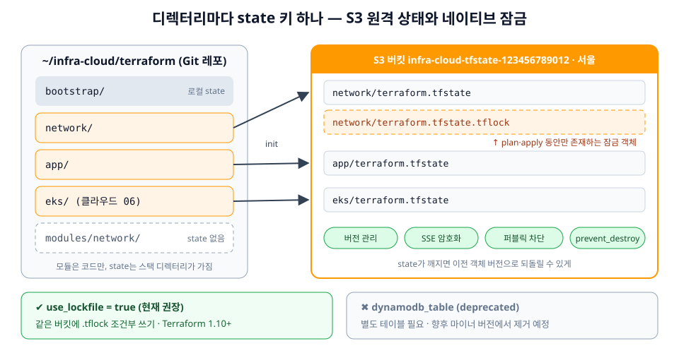
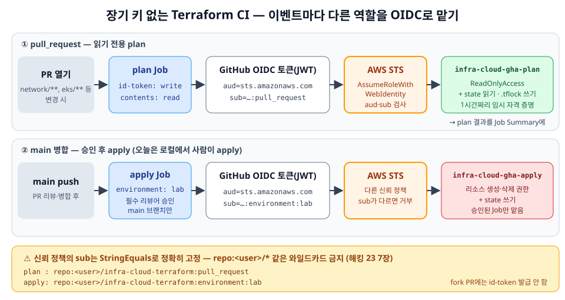

> **클라우드 · AWS** | 난이도 ★★★★☆ | 예상 소요 3 ~ 4시간 | 💰 예상 비용 실습 3시간 기준 약 $0.5 ~ 1 (NAT 게이트웨이·ALB·RDS를 켠 시간만큼, 2026-11-19 기준·변동 가능)

> ⚠️ **실습 전 반드시 읽을 것 — 비용 경고**
> - 오늘 만드는 것 중 **NAT 게이트웨이**(서울 리전 시간당 약 $0.06 + 처리 GB당 요금), **ALB**(시간당 약 $0.02 + LCU), **RDS**, **퍼블릭 IPv4 주소**(개당 시간당 $0.005)는 **켜 두는 동안 계속 과금**됩니다. 프리 티어 범위를 넘을 수 있습니다.
> - 다음 편(클라우드 06)부터 쓰는 **EKS 컨트롤 플레인은 클러스터당 시간당 $0.10**(표준 지원, 확장 지원 버전이면 $0.60)이 **노드가 0대여도** 나갑니다. 오늘 만든 VPC의 **NAT 비용도 EKS 실습 내내 함께** 나갑니다. 실습이 끝나면 바로 지우는 습관을 오늘부터 들입니다.
> - 리전은 **`ap-northeast-2`(서울)** 고정. 본인 계정(클라우드 01에서 만든 샌드박스 계정)에서만 하고, 액세스 키 대신 **IAM Identity Center(SSO) 또는 단기 자격 증명**으로 로그인합니다.
> - 실습 후 삭제: `terraform destroy`를 **역순(app → network)** 으로 실행하고, 맨 아래 [삭제 체크리스트](#-삭제-체크리스트)로 남은 리소스를 확인합니다.
> - 가격은 AWS 공식 요금 페이지를 2026-11-19에 확인한 값이며 언제든 바뀔 수 있습니다.

> 📌 **cloud02 고정값 기준** — VPC `infra-cloud-vpc` `10.20.0.0/16`(pub-a `10.20.0.0/24`·pub-c `10.20.1.0/24`, priv-a `10.20.10.0/24`·priv-c `10.20.11.0/24`, db-a `10.20.20.0/24`·db-c `10.20.21.0/24`, NAT `infra-cloud-nat-a` 1개), 이름 접두사 `infra-cloud-`, 태그 `Project=infra-study`·`Env=lab`·`Owner=<사용자명>`·`ManagedBy=terraform`·`Name`, 리전 `ap-northeast-2`, CLI 프로필 `infra-admin`(SSO 세션 `infra-sso`), 작업 폴더 `~/infra-cloud/`, Terraform `~/infra-cloud/terraform/{network,eks}`, 상태 버킷 `infra-cloud-tfstate-<계정ID>`(S3 네이티브 잠금 `use_lockfile`), 클러스터 `infra-cloud-eks`.

## 🎯 오늘의 목표

- 클라우드 02~04에서 콘솔·CLI로 만든 VPC·ALB/ASG·S3/RDS를 **Terraform 코드**로 옮긴다
- **공식 VPC 모듈**(`terraform-aws-modules/vpc/aws`)과 **직접 작성한 리소스**를 같은 결과로 만들어 보고 장단점을 비교한다
- **S3 원격 상태**를 만들고, 잠금 방식으로 **S3 네이티브 잠금(`use_lockfile`)** 과 DynamoDB 방식 중 무엇이 현재 권장인지 설명할 수 있다
- 워크스페이스와 디렉터리 중 하나로 **dev/prod 환경을 나누는 기준**을 세운다
- PR마다 **GitHub Actions가 OIDC로 AWS 역할을 맡아 `terraform plan`** 을 돌리게 한다(해킹 23과 연결)

---

## 1. 지금까지 온 길 — 손으로 만든 것을 코드로

[Day 35](../05-capstone/day35-terraform.md)에서 OpenStack 위의 VM·네트워크를 Terraform으로 옮겼습니다. 오늘은 같은 일을 AWS에서 합니다. 바뀌는 것은 **provider와 리소스 이름**뿐이고, `init → plan → apply → destroy` 사이클과 state의 의미는 그대로입니다.

| 홈랩·본편 | 클라우드 01~04 | 오늘 코드로 옮기는 것 |
|---|---|---|
| Day 34 Neutron 네트워크·라우터 | [클라우드 02](./cloud02-vpc-networking.md) VPC·서브넷·NAT·라우팅 | `network/` (공식 모듈) / `modules/network/` (직접 작성) |
| Day 34 Octavia LB + VM | [클라우드 03](./cloud03-ec2-asg-alb.md) ALB + Auto Scaling | `app/` |
| Day 31 Swift / DB VM | [클라우드 04](./cloud04-s3-rds.md) S3 + RDS | `app/` (data.tf) |
| Day 35 state를 MinIO에 | — | S3 원격 상태 + `use_lockfile` |
| Day 51 GitHub Actions | [클라우드 01](./cloud01-aws-account-setup.md) IAM | OIDC로 역할을 맡는 plan 파이프라인 |

### 홈랩 대응 표

| 본편 Day | 홈랩에서 쓴 것 | AWS에서 대응하는 것 |
|---|---|---|
| [Day 35](../05-capstone/day35-terraform.md) | terraform-provider-openstack | `hashicorp/aws` provider |
| Day 35 6-3 | MinIO S3 호환 backend | Amazon S3 backend + S3 네이티브 잠금 |
| Day 32 | Heat 템플릿 | CloudFormation (오늘은 Terraform만) |
| Day 51 | GHCR 푸시용 `GITHUB_TOKEN` | GitHub OIDC → `sts:AssumeRoleWithWebIdentity` |
| 해킹 24 | Checkov·Trivy로 Terraform 점검 | 같은 도구를 오늘 레포에 그대로 적용 |

---

## 2. 레포 구조와 버전

오늘 실습 레포는 GitHub에 새로 만드는 **`infra-cloud-terraform`** 이고, 클라우드 01에서 정한 작업 폴더 아래 **`~/infra-cloud/terraform`** 에 클론합니다. 이후 클라우드 06~11이 같은 폴더를 이어 씁니다. 디렉터리 하나가 **state 하나(스택)** 입니다.

```text
~/infra-cloud/terraform/          (= GitHub 레포 infra-cloud-terraform)
├── bootstrap/        # 원격 상태용 S3 버킷 + GitHub OIDC 역할 (이것만 로컬 state)
├── modules/
│   └── network/      # 직접 작성한 VPC 모듈 (비교용, state 없음)
├── network/          # 공식 VPC 모듈 → state 키 network/terraform.tfstate
├── app/              # ALB·ASG·S3·RDS → state 키 app/terraform.tfstate
├── eks/              # 클라우드 06~08   → state 키 eks/terraform.tfstate
└── .github/workflows/
    └── terraform-plan.yaml
```

```bash
mkdir -p ~/infra-cloud && cd ~/infra-cloud
gh repo create infra-cloud-terraform --private --clone && mv infra-cloud-terraform terraform
cd terraform
```

| 도구 | 오늘 기준 버전 (2026-11-19 확인) | 비고 |
|---|---|---|
| Terraform | **1.17.x** (최신 1.17.2) | `use_lockfile`은 1.10+, DynamoDB 잠금 deprecated는 1.11+. OpenTofu 1.10+도 `use_lockfile` 지원 |
| AWS provider `hashicorp/aws` | **6.x** (최신 6.73.0) | 클라우드 06의 EKS 모듈이 최근 6.x를 요구하므로 `~> 6.70` 정도로 고정 |
| VPC 모듈 `terraform-aws-modules/vpc/aws` | **6.8.0** | AWS provider 6.x 필요 |
| AWS CLI | v2 | `aws sts get-caller-identity`로 로그인 확인 |

```bash
terraform version
# Terraform v1.17.2
aws sts get-caller-identity --query Arn --output text
# arn:aws:sts::123456789012:assumed-role/AWSReservedSSO_AdministratorAccess_.../me
```

> 💡 IAM Identity Center로 로그인했다면 `aws sso login --profile infra-admin`(SSO 세션 `infra-sso`) 후 `export AWS_PROFILE=infra-admin`이면 Terraform도 같은 자격 증명을 씁니다. 장기 액세스 키를 `~/.aws/credentials`에 넣지 마세요(클라우드 01).

---

## 3. 원격 상태와 잠금

### 3-1. 왜 원격 상태인가

Day 35 6장에서 본 것처럼 state에는 **리소스 ID와 민감한 값**(RDS 비밀번호를 직접 넣었다면 그 값까지)이 들어갑니다. 노트북에만 두면 ① 팀원·CI와 공유가 안 되고 ② 디스크가 날아가면 Terraform이 만든 리소스를 "모르는" 상태가 되며 ③ 두 사람이 동시에 apply하면 state가 깨집니다. 그래서 **원격 저장 + 잠금**이 필요합니다.



### 3-2. 잠금 방식 — S3 네이티브 잠금이 현재 권장

| | S3 네이티브 잠금 `use_lockfile = true` | DynamoDB 잠금 `dynamodb_table = "..."` |
|---|---|---|
| 도입 | Terraform 1.10 (실험) → 1.11에서 정식 | 오래된 방식 |
| 현재 상태 | **지원·권장 경로** | HashiCorp 문서에 **"Deprecated, 향후 마이너 버전에서 제거 예정"** |
| 동작 | state 옆에 `<key>.tflock` 객체를 **조건부 쓰기**(이미 있으면 실패)로 만든다 | DynamoDB 테이블에 LockID 항목을 쓴다 |
| 추가 리소스 | 없음 (같은 버킷) | DynamoDB 테이블 + IAM 권한 |
| 필요 권한 | state 객체 + `.tflock`에 `s3:GetObject`, `s3:PutObject`, `s3:DeleteObject` | 위 + `dynamodb:GetItem/PutItem/DeleteItem` |

> ⚠️ 기본값은 **`use_lockfile = false`** 입니다. 적지 않으면 잠금 없이 동작합니다. 기존에 DynamoDB를 쓰던 레포는 **두 옵션을 동시에 켠 채로 한동안 운영**하다가(둘 다 잠금을 잡음) DynamoDB를 빼는 식으로 옮깁니다.

### 3-3. 상태 버킷 만들기 (bootstrap)

닭과 달걀 문제 때문에 **상태 버킷 자체는 로컬 state로** 만듭니다. 버킷 이름은 전 세계에서 유일해야 하므로 계정 ID를 붙입니다.

```hcl
# bootstrap/main.tf
terraform {
  required_version = ">= 1.11"
  required_providers {
    aws = { source = "hashicorp/aws", version = "~> 6.70" }
  }
}

provider "aws" {
  region = "ap-northeast-2"
  default_tags {
    tags = {
      Project   = "infra-study"
      Env       = "lab"
      Owner     = "<사용자명>"      # 클라우드 01에서 정한 내 사용자명
      ManagedBy = "terraform"
    }
  }
}

data "aws_caller_identity" "current" {}

resource "aws_s3_bucket" "tfstate" {
  bucket = "infra-cloud-tfstate-${data.aws_caller_identity.current.account_id}"
  lifecycle { prevent_destroy = true }      # 실수로 destroy 해도 막힘
}

resource "aws_s3_bucket_versioning" "tfstate" {
  bucket = aws_s3_bucket.tfstate.id
  versioning_configuration { status = "Enabled" }   # state가 깨지면 이전 버전으로 복구
}

resource "aws_s3_bucket_server_side_encryption_configuration" "tfstate" {
  bucket = aws_s3_bucket.tfstate.id
  rule {
    apply_server_side_encryption_by_default { sse_algorithm = "AES256" }
  }
}

resource "aws_s3_bucket_public_access_block" "tfstate" {
  bucket                  = aws_s3_bucket.tfstate.id
  block_public_acls       = true
  block_public_policy     = true
  ignore_public_acls      = true
  restrict_public_buckets = true
}

output "bucket" { value = aws_s3_bucket.tfstate.bucket }
```

```bash
cd bootstrap
terraform init && terraform apply
# Outputs:
# bucket = "infra-cloud-tfstate-123456789012"
```

> 💡 이 버킷은 몇 KB짜리 객체 몇 개라 비용이 거의 0입니다. 시리즈가 끝나는 클라우드 11까지 남겨 두고, 마지막에 지웁니다.

---

## 4. 네트워크 ① — 공식 VPC 모듈

### 4-1. backend와 provider

```hcl
# network/versions.tf
terraform {
  required_version = ">= 1.11"
  required_providers {
    aws = { source = "hashicorp/aws", version = "~> 6.70" }
  }
  backend "s3" {
    bucket       = "infra-cloud-tfstate-123456789012"            # bootstrap 출력값
    key          = "network/terraform.tfstate"  # 디렉터리 경로와 같게
    region       = "ap-northeast-2"
    encrypt      = true
    use_lockfile = true                                  # S3 네이티브 잠금
  }
}

provider "aws" {
  region = "ap-northeast-2"
  default_tags {
    tags = {
      Project   = "infra-study"
      Env       = "lab"
      Owner     = "<사용자명>"      # 클라우드 01에서 정한 내 사용자명
      ManagedBy = "terraform"
    }
  }
}
```

> ⚠️ `backend` 블록 안에서는 **변수를 쓸 수 없습니다.** 버킷 이름을 파일마다 쓰기 싫다면 `backend.hcl`에 공통값을 두고 `terraform init -backend-config=../../backend.hcl`로 넘기는 **부분 설정(partial configuration)** 을 씁니다.

### 4-2. 모듈 호출 — 클라우드 02 구성을 30여 줄로

```hcl
# network/main.tf
module "vpc" {
  source  = "terraform-aws-modules/vpc/aws"
  version = "~> 6.8"

  name = "infra-cloud-vpc"
  cidr = "10.20.0.0/16"
  azs  = ["ap-northeast-2a", "ap-northeast-2c"]

  public_subnets   = ["10.20.0.0/24", "10.20.1.0/24"]    # ALB, NAT
  private_subnets  = ["10.20.10.0/24", "10.20.11.0/24"]  # EC2, EKS 노드(클라우드 06)
  database_subnets = ["10.20.20.0/24", "10.20.21.0/24"]  # RDS

  # 클라우드 02의 이름 규칙(infra-cloud-<역할>-<AZ 접미사>)에 맞춤
  public_subnet_names   = ["infra-cloud-pub-a", "infra-cloud-pub-c"]
  private_subnet_names  = ["infra-cloud-priv-a", "infra-cloud-priv-c"]
  database_subnet_names = ["infra-cloud-db-a", "infra-cloud-db-c"]
  create_database_subnet_group = true
  database_subnet_group_name   = "infra-cloud-db-subnets"
  igw_tags                     = { Name = "infra-cloud-igw" }

  enable_nat_gateway   = true
  single_nat_gateway   = true     # 실습용: NAT 1개 = infra-cloud-nat-a (운영은 one_nat_gateway_per_az = true)
  nat_gateway_tags     = { Name = "infra-cloud-nat-a" }
  nat_eip_tags         = { Name = "infra-cloud-nat-a-eip" }
  enable_dns_hostnames = true
  enable_dns_support   = true

  # 클라우드 07의 AWS Load Balancer Controller가 서브넷을 자동 발견할 때 쓰는 태그
  public_subnet_tags  = { "kubernetes.io/role/elb" = "1" }
  private_subnet_tags = { "kubernetes.io/role/internal-elb" = "1" }
}

# 클라우드 02의 S3 게이트웨이 엔드포인트 (무료, NAT 처리 요금 절약)
resource "aws_vpc_endpoint" "s3" {
  vpc_id            = module.vpc.vpc_id
  service_name      = "com.amazonaws.ap-northeast-2.s3"
  vpc_endpoint_type = "Gateway"
  route_table_ids   = module.vpc.private_route_table_ids
  tags              = { Name = "infra-cloud-vpce-s3" }
}
```

```hcl
# network/outputs.tf
output "vpc_id"                     { value = module.vpc.vpc_id }
output "public_subnets"             { value = module.vpc.public_subnets }
output "private_subnets"            { value = module.vpc.private_subnets }
output "database_subnet_group_name" { value = module.vpc.database_subnet_group_name }
```

```bash
cd ~/infra-cloud/terraform/network
terraform init
# Initializing the backend...
# Successfully configured the backend "s3"! ...
# - vpc in .terraform/modules/vpc
terraform plan -out tfplan
# Plan: 24 to add, 0 to change, 0 to destroy.
terraform apply tfplan
```

> 💡 `single_nat_gateway = true`면 NAT가 AZ 하나에만 있어서 그 AZ가 죽으면 다른 AZ의 프라이빗 서브넷도 인터넷이 끊깁니다. 실습에선 비용(NAT 1개 = 시간당 약 $0.06)을 아끼려고 1개, 운영에선 AZ마다 하나씩이 기본입니다.

### 4-3. apply 중에 잠금이 보이는가

apply가 도는 동안 다른 터미널에서:

```bash
aws s3 ls s3://infra-cloud-tfstate-123456789012/network/
# 2026-11-19 21:10:03      0 terraform.tfstate.tflock    ← 잠금 파일
# 2026-11-19 21:09:41  41234 terraform.tfstate

terraform plan       # 같은 디렉터리에서 동시에 실행
# Error: Error acquiring the state lock
# Lock Info:
#   ID:        2f0c9a1e-...
#   Path:      infra-cloud-tfstate-123456789012/network/terraform.tfstate
#   Operation: OperationTypeApply
#   Who:       me@laptop
```

apply가 끝나면 `.tflock` 객체는 사라집니다. 프로세스가 비정상 종료돼 잠금이 남았을 때만, **다른 사람이 실행 중이 아님을 확인한 뒤** `terraform force-unlock <ID>`로 풉니다.

---

## 5. 네트워크 ② — 직접 작성한 리소스와 비교

같은 VPC를 모듈 없이 쓰면 어떤 모양인지 봅니다. **비교용이므로 apply하지 않고 `plan`만** 해 봅니다(같은 CIDR VPC가 두 개 생기면 헷갈립니다).

```hcl
# modules/network/main.tf (요점만)
variable "name"    { type = string }
variable "cidr"    { type = string }
variable "subnets" {   # { "public-a" = { cidr = "10.20.0.0/24", az = "ap-northeast-2a", public = true }, ... }
  type = map(object({ cidr = string, az = string, public = bool }))
}

resource "aws_vpc" "this" {
  cidr_block           = var.cidr
  enable_dns_support   = true
  enable_dns_hostnames = true
  tags                 = { Name = var.name }
}

resource "aws_subnet" "this" {
  for_each                = var.subnets
  vpc_id                  = aws_vpc.this.id
  cidr_block              = each.value.cidr
  availability_zone       = each.value.az
  map_public_ip_on_launch = each.value.public
  tags                    = { Name = "${var.name}-${each.key}" }
}

resource "aws_internet_gateway" "this" {
  vpc_id = aws_vpc.this.id
  tags   = { Name = "${var.name}-igw" }
}

locals {
  public_ids = [for k, s in aws_subnet.this : s.id if var.subnets[k].public]
}

resource "aws_eip" "nat" {
  domain = "vpc"
  tags   = { Name = "${var.name}-nat-eip" }
}

resource "aws_nat_gateway" "this" {
  allocation_id = aws_eip.nat.id
  subnet_id     = local.public_ids[0]
  tags          = { Name = "${var.name}-nat" }
  depends_on    = [aws_internet_gateway.this]
}

resource "aws_route_table" "public" {
  vpc_id = aws_vpc.this.id
  route {
    cidr_block = "0.0.0.0/0"
    gateway_id = aws_internet_gateway.this.id
  }
  tags = { Name = "${var.name}-rt-public" }
}

resource "aws_route_table" "private" {
  vpc_id = aws_vpc.this.id
  route {
    cidr_block     = "0.0.0.0/0"
    nat_gateway_id = aws_nat_gateway.this.id
  }
  tags = { Name = "${var.name}-rt-private" }
}

resource "aws_route_table_association" "public" {
  for_each       = { for k, v in var.subnets : k => v if v.public }    # 키 = 서브넷 이름(정적)
  subnet_id      = aws_subnet.this[each.key].id
  route_table_id = aws_route_table.public.id
}

resource "aws_route_table_association" "private" {
  for_each       = { for k, v in var.subnets : k => v if !v.public }
  subnet_id      = aws_subnet.this[each.key].id
  route_table_id = aws_route_table.private.id
}
```

> ⚠️ 처음 쓸 때 흔히 `for_each = toset(local.private_ids)`처럼 **apply 전에는 모르는 값(서브넷 ID)** 을 키로 잡습니다. 그러면 첫 plan에서 `Invalid for_each argument` 오류가 납니다. 위처럼 키는 `var.subnets`의 이름 같은 **정적인 값**으로 잡아야 합니다. 이런 함정을 공식 모듈은 이미 피해 두었습니다.

| 기준 | 공식 VPC 모듈 | 직접 작성 |
|---|---|---|
| 코드 양 | 호출부 30여 줄 | 100줄 이상 (NACL·엔드포인트·플로우 로그까지 넣으면 수백 줄) |
| 기능 | NAT 모드 3종, DB/ElastiCache 서브넷 그룹, IPv6, 플로우 로그, 엔드포인트 서브모듈 | 필요한 것만 |
| 이해도 | 내부가 블랙박스가 되기 쉬움 → `terraform state list`로 실제 리소스 확인 습관 | 모든 리소스를 내가 앎 |
| 업그레이드 | 메이저 버전마다 입력·주소가 바뀔 수 있음 → **`version` 고정 필수**, CHANGELOG 확인 | 내가 바꿀 때만 바뀜 |
| 보안 점검 | 해킹 24의 Checkov가 모듈 내부까지 스캔 | 같음 |
| 추천 | **팀·운영 표준 구성**, 오늘 이후 실습 | 학습용, 모듈이 못 하는 특수 구성 |

> 💡 직접 만든 리소스를 나중에 모듈로 옮기고 싶으면 `moved { from = aws_vpc.this  to = module.vpc.aws_vpc.this[0] }` 같은 **`moved` 블록**으로 state 주소만 바꿔 재생성을 막을 수 있습니다(콘솔에서 만든 것을 처음 가져올 때는 Day 35 6-4의 `import` 블록).

---

## 6. 앱·데이터 계층 — 클라우드 03·04를 코드로

다른 디렉터리의 출력은 `terraform_remote_state`로 읽습니다.

> 💡 클라우드 03은 Spring Boot 앱(포트 8080)을 띄웠습니다. 여기서는 **Terraform 구조에 집중하려고 user data를 nginx(포트 80)로 줄였습니다.** 클라우드 03의 user data와 포트(ALB → 앱 8080, 대상 그룹 헬스 체크 경로)를 그대로 옮기려면 아래 `user_data`, 보안그룹 포트, `aws_lb_target_group`의 `port`·`health_check.path`만 바꾸면 됩니다.

```hcl
# app/network.tf
data "terraform_remote_state" "network" {
  backend = "s3"
  config = {
    bucket = "infra-cloud-tfstate-123456789012"
    key    = "network/terraform.tfstate"
    region = "ap-northeast-2"
  }
}

locals {
  vpc_id          = data.terraform_remote_state.network.outputs.vpc_id
  public_subnets  = data.terraform_remote_state.network.outputs.public_subnets
  private_subnets = data.terraform_remote_state.network.outputs.private_subnets
}
```

```hcl
# app/web.tf — 클라우드 03의 ALB + Auto Scaling (요점)
data "aws_ssm_parameter" "al2023" {
  name = "/aws/service/ami-amazon-linux-latest/al2023-ami-kernel-default-x86_64"
}

resource "aws_security_group" "alb" {
  name   = "infra-cloud-alb-sg"
  vpc_id = local.vpc_id
  ingress {
    from_port   = 80
    to_port     = 80
    protocol    = "tcp"
    cidr_blocks = ["0.0.0.0/0"]
  }
  egress {
    from_port   = 0
    to_port     = 0
    protocol    = "-1"
    cidr_blocks = ["0.0.0.0/0"]
  }
}

resource "aws_security_group" "web" {
  name   = "infra-cloud-app-sg"
  vpc_id = local.vpc_id
  ingress {                       # ALB 보안그룹에서 오는 것만 (클라우드 02의 SG 참조 규칙)
    from_port       = 80
    to_port         = 80
    protocol        = "tcp"
    security_groups = [aws_security_group.alb.id]
  }
  egress {
    from_port   = 0
    to_port     = 0
    protocol    = "-1"
    cidr_blocks = ["0.0.0.0/0"]
  }
}

resource "aws_launch_template" "web" {
  name_prefix            = "infra-cloud-app-lt-"
  image_id               = data.aws_ssm_parameter.al2023.value
  instance_type          = "t3.micro"
  vpc_security_group_ids = [aws_security_group.web.id]
  metadata_options { http_tokens = "required" }      # IMDSv2 강제
  user_data = base64encode(<<-EOF
    #!/bin/bash
    dnf install -y nginx
    echo "hello from $(hostname)" > /usr/share/nginx/html/index.html
    systemctl enable --now nginx
  EOF
  )
}

resource "aws_lb" "web" {
  name               = "infra-cloud-alb"
  load_balancer_type = "application"
  subnets            = local.public_subnets
  security_groups    = [aws_security_group.alb.id]
}

resource "aws_lb_target_group" "web" {
  name     = "infra-cloud-app-tg"
  port     = 80
  protocol = "HTTP"
  vpc_id   = local.vpc_id
  health_check { path = "/" }
}

resource "aws_lb_listener" "http" {
  load_balancer_arn = aws_lb.web.arn
  port              = 80
  protocol          = "HTTP"
  default_action {
    type             = "forward"
    target_group_arn = aws_lb_target_group.web.arn
  }
}

resource "aws_autoscaling_group" "web" {
  name                = "infra-cloud-app-asg"
  min_size            = 1
  max_size            = 2
  desired_capacity    = 2
  vpc_zone_identifier = local.private_subnets
  target_group_arns   = [aws_lb_target_group.web.arn]
  health_check_type   = "ELB"
  launch_template {
    id      = aws_launch_template.web.id
    version = "$Latest"
  }
  tag {                            # ASG가 만드는 EC2에도 태그 전파
    key                 = "Project"
    value               = "infra-study"
    propagate_at_launch = true
  }
}

output "alb_dns" { value = aws_lb.web.dns_name }
```

> 💡 보안그룹 안의 인라인 `ingress`/`egress` 블록은 짧은 예시에는 편하지만, AWS provider 문서는 규칙 하나당 리소스 하나인 `aws_vpc_security_group_ingress_rule` / `aws_vpc_security_group_egress_rule`을 권장합니다. 규칙이 많아지면 그쪽으로 옮기세요(두 방식을 한 보안그룹에 섞으면 서로 덮어씁니다).

```hcl
# app/data.tf — 클라우드 04의 S3 + RDS (요점)
data "aws_caller_identity" "current" {}

resource "aws_s3_bucket" "assets" {
  bucket        = "infra-cloud-assets-${data.aws_caller_identity.current.account_id}"  # infra-cloud-<용도>-<계정ID>
  force_destroy = true                 # 실습용: destroy 때 객체까지 삭제
}

resource "aws_security_group" "db" {
  name   = "infra-cloud-db-sg"
  vpc_id = local.vpc_id
  ingress {
    from_port       = 5432
    to_port         = 5432
    protocol        = "tcp"
    security_groups = [aws_security_group.web.id]
  }
}

resource "aws_db_instance" "app" {
  identifier                  = "infra-cloud-rds"
  engine                      = "postgres"
  instance_class              = "db.t4g.micro"
  allocated_storage           = 20
  db_name                     = "app"
  username                    = "app_admin"
  manage_master_user_password = true     # 비밀번호를 Secrets Manager가 생성·보관 → state에 평문이 남지 않음
  db_subnet_group_name        = data.terraform_remote_state.network.outputs.database_subnet_group_name
  vpc_security_group_ids      = [aws_security_group.db.id]
  skip_final_snapshot         = true     # 실습용. 운영에서는 false
  deletion_protection         = false    # 실습용. 운영에서는 true
}
```

```bash
cd ../app
terraform init && terraform apply
# Apply complete! Resources: 12 added, 0 changed, 0 destroyed.
# Outputs:
# alb_dns = "infra-cloud-alb-1234567890.ap-northeast-2.elb.amazonaws.com"
curl -s http://$(terraform output -raw alb_dns)
# hello from ip-10-20-10-37.ap-northeast-2.compute.internal
```

> ⚠️ RDS는 생성·삭제에 각각 5~10분이 걸리고 **켜져 있는 동안 계속 과금**됩니다. 오늘은 apply가 되는 것만 확인하고, 6장이 끝나면 `terraform destroy`로 바로 지워도 됩니다.

---

## 7. 환경 나누기 — 워크스페이스 vs 디렉터리

| | CLI 워크스페이스 (`terraform workspace`) | 디렉터리 분리 (`network/`, `prod/network/`) |
|---|---|---|
| state 위치 | 같은 backend, 키 앞에 `env:/<이름>/` 접두사 | 디렉터리마다 다른 `key` |
| 코드 | 하나. 차이는 `terraform.workspace`로 분기 | 디렉터리마다 다른 호출부(같은 모듈 재사용) |
| 실수 위험 | **지금 어느 워크스페이스인지** 잊고 prod에 apply | 경로가 곧 환경이라 눈에 보임 |
| 권한 분리 | 같은 backend라 IAM으로 나누기 어려움 | prod만 다른 버킷·다른 계정·다른 역할 가능 |
| 잘 맞는 곳 | 같은 구성을 잠깐 여러 벌(기능 브랜치 테스트) | **dev/stage/prod처럼 오래 사는 환경** |

```bash
# 워크스페이스는 이렇게 동작한다 (참고만)
terraform workspace new feature-x
terraform workspace list
#   default
# * feature-x
# → state 키: env:/feature-x/network/terraform.tfstate
terraform workspace select default && terraform workspace delete feature-x
```

이 시리즈는 **디렉터리 분리**를 씁니다. 실습 환경은 `Env=lab` 하나뿐이라 최상위 스택 디렉터리(`network/`, `app/`, `eks/`)가 곧 lab 환경입니다. 운영 환경을 추가한다면 `~/infra-cloud/terraform/prod/network/main.tf` 같은 디렉터리를 하나 더 두고, 같은 모듈을 부르되 `single_nat_gateway = false`, `one_nat_gateway_per_az = true`, **lab과 겹치지 않는 별도 VPC CIDR**(예: `10.30.0.0/16` — 나중에 피어링·Transit Gateway로 이어도 충돌하지 않게), 다른 state 키(`prod/network/terraform.tfstate`), `Env=prod` 태그를 씁니다. 오늘 실습에서는 prod를 만들지 않습니다. 운영 수준이라면 prod는 **아예 다른 AWS 계정**(클라우드 01의 Organizations)으로 나누는 것이 가장 강한 분리입니다.

> 💡 Day 52의 Kustomize `base` + `overlays/{dev,stage,prod}`와 같은 생각입니다. Terraform에서는 **모듈이 base, 환경 디렉터리가 overlay** 역할을 합니다.

---

## 8. CI에서 plan 돌리기 — GitHub OIDC로 역할 맡기

[해킹 23](../hacking/hack23-cicd-security.md) 7장에서 "장기 클라우드 키 → OIDC로 없애기"를 원리로 봤습니다. 오늘은 그것을 Terraform 레포에 실제로 붙입니다. PR에서는 **읽기 전용 plan 역할**, main 병합 후 apply는 **Environment 승인이 걸린 별도 역할**로 나눕니다.



### 8-1. OIDC 공급자와 plan 역할 (Terraform으로)

```hcl
# bootstrap/github-oidc.tf — bootstrap과 같은 로컬 state로 관리
resource "aws_iam_openid_connect_provider" "github" {
  url            = "https://token.actions.githubusercontent.com"
  client_id_list = ["sts.amazonaws.com"]
}

data "aws_iam_policy_document" "plan_trust" {
  statement {
    actions = ["sts:AssumeRoleWithWebIdentity"]
    principals {
      type        = "Federated"
      identifiers = [aws_iam_openid_connect_provider.github.arn]
    }
    condition {
      test     = "StringEquals"
      variable = "token.actions.githubusercontent.com:aud"
      values   = ["sts.amazonaws.com"]
    }
    condition {
      test     = "StringEquals"                         # StringLike + * 금지 (해킹 23)
      variable = "token.actions.githubusercontent.com:sub"
      values   = ["repo:<user>/infra-cloud-terraform:pull_request"]
    }
  }
}

resource "aws_iam_role" "plan" {
  name                 = "infra-cloud-gha-plan"
  assume_role_policy   = data.aws_iam_policy_document.plan_trust.json
  max_session_duration = 3600
}

resource "aws_iam_role_policy_attachment" "plan_readonly" {
  role       = aws_iam_role.plan.name
  policy_arn = "arn:aws:iam::aws:policy/ReadOnlyAccess"
}

data "aws_iam_policy_document" "plan_state" {
  statement {                    # state 읽기
    actions   = ["s3:ListBucket"]
    resources = [aws_s3_bucket.tfstate.arn]
  }
  statement {
    actions   = ["s3:GetObject"]
    resources = ["${aws_s3_bucket.tfstate.arn}/*"]
  }
  statement {                    # plan도 잠금을 잡으므로 .tflock 쓰기·삭제는 필요
    actions   = ["s3:PutObject", "s3:DeleteObject"]
    resources = ["${aws_s3_bucket.tfstate.arn}/*.tflock"]
  }
}

resource "aws_iam_role_policy" "plan_state" {
  name   = "tfstate-access"
  role   = aws_iam_role.plan.id
  policy = data.aws_iam_policy_document.plan_state.json
}

output "plan_role_arn" { value = aws_iam_role.plan.arn }
```

| `sub` 값 | 언제 나오나 | 쓰는 역할 |
|---|---|---|
| `repo:<user>/infra-cloud-terraform:pull_request` | `pull_request` 이벤트 | plan (ReadOnly) |
| `repo:<user>/infra-cloud-terraform:environment:lab` | `environment: lab`을 단 Job | apply (쓰기 권한, Environment에 필수 리뷰어) |
| `repo:<user>/infra-cloud-terraform:ref:refs/heads/main` | Environment 없이 main push | 오늘은 쓰지 않음 |

> ⚠️ `ReadOnlyAccess`는 **S3 객체·Secrets Manager 값·SSM 파라미터까지 읽을 수 있는** 넓은 정책입니다. plan은 refresh를 위해 넓은 Describe/Get 권한이 필요해서 실습에선 이걸 쓰지만, 운영에서는 `secretsmanager:GetSecretValue` 같은 데이터 읽기를 Deny로 덧붙이세요. 그리고 **fork에서 온 PR에는 `id-token`이 발급되지 않도록** 해킹 23 4장의 설정(외부 기여자 워크플로 승인)을 유지합니다.

### 8-2. 워크플로

```yaml
# .github/workflows/terraform-plan.yaml
name: terraform-plan
on:
  pull_request:
    paths: ["network/**", "app/**", "eks/**", "modules/**"]

permissions: {}                       # 워크플로 기본 권한 0 (해킹 23 3장)

jobs:
  plan:
    runs-on: ubuntu-latest
    permissions:
      contents: read
      id-token: write                 # OIDC 토큰은 이 Job에만
    strategy:
      fail-fast: false
      matrix:
        dir: [network, app]
    defaults:
      run:
        working-directory: ${{ matrix.dir }}
    steps:
      - uses: actions/checkout@v7
      - uses: hashicorp/setup-terraform@v4
        with:
          terraform_version: 1.17.2
      - uses: aws-actions/configure-aws-credentials@v6
        with:
          role-to-assume: arn:aws:iam::123456789012:role/infra-cloud-gha-plan
          aws-region: ap-northeast-2
      - run: terraform fmt -check -recursive
      - run: terraform init -input=false
      - run: terraform validate
      - name: plan
        run: |
          terraform plan -input=false -no-color -out tfplan
          terraform show -no-color tfplan > plan.txt
          {
            echo "### ${{ matrix.dir }}"
            echo '```'
            tail -c 60000 plan.txt
            echo '```'
          } >> "$GITHUB_STEP_SUMMARY"
```

PR을 열면 Actions 탭의 **Summary**에 디렉터리별 plan이 붙습니다.

```text
### network
No changes. Your infrastructure matches the configuration.

### app
  # aws_autoscaling_group.web will be updated in-place
  ~ resource "aws_autoscaling_group" "web" {
      ~ desired_capacity = 2 -> 3
  ...
Plan: 0 to add, 1 to change, 0 to destroy.
```

> 💡 `${{ matrix.dir }}`는 워크플로 파일에 적힌 고정값이라 스크립트 인젝션(해킹 23 5장) 걱정이 없습니다. PR 제목·브랜치 이름 같은 **외부 입력을 `run:`에 직접 넣지 않는 원칙**은 그대로입니다. 해킹 24의 Checkov·Trivy 단계를 이 Job 앞에 붙이면 plan 전에 IaC 설정 실수도 막을 수 있습니다.

apply 워크플로는 `on: push: branches: [main]` + `environment: lab`을 단 Job에서 `infra-cloud-gha-apply` 역할(신뢰 정책 `sub`가 `environment:lab`)을 맡아 `terraform apply -auto-approve`를 돌리는 모양입니다. 오늘은 **apply는 로컬에서 사람이** 하고, CI는 plan까지만 둡니다.

---

## 9. 트러블슈팅

| 증상 | 원인 | 해결 |
|---|---|---|
| `Error acquiring the state lock` | 다른 apply/plan이 실행 중, 또는 비정상 종료로 `.tflock`이 남음 | 실행 중인 사람·CI가 없는지 확인 후 `terraform force-unlock <ID>` |
| `AccessDenied ... terraform.tfstate.tflock` | 역할에 `.tflock` 객체 쓰기·삭제 권한 없음 | 8-1처럼 `*.tflock`에 `s3:PutObject`, `s3:DeleteObject` 추가 |
| `Warning: Deprecated Parameter ... dynamodb_table` | 옛 DynamoDB 잠금 설정 | `use_lockfile = true`를 추가하고 안정화 후 `dynamodb_table` 제거 |
| `Backend configuration changed` | backend 블록을 고친 뒤 그냥 init | `terraform init -migrate-state`(옮기기) 또는 `-reconfigure`(새로 시작) |
| `Not authorized to perform sts:AssumeRoleWithWebIdentity` | 신뢰 정책의 `sub`가 실제 토큰과 다름 (레포 이름 오타, Environment 유무) | Job에 `environment:`가 있으면 `sub`가 `environment:<이름>`으로 바뀜. 표의 형식과 대조 |
| `Credentials could not be loaded` (Actions) | Job에 `id-token: write` 없음 | Job 단위 `permissions`에 추가 |
| `Invalid for_each argument` | apply 전에 모르는 값(ID)을 키로 사용 | 키는 변수의 이름 같은 **정적인 값**으로 |
| 모듈 버전 올린 뒤 plan에 대량 destroy/create | 메이저 업그레이드로 리소스 주소 변경 | CHANGELOG의 업그레이드 가이드대로 `moved` 블록 추가, plan에 destroy가 없을 때만 apply |
| `BucketAlreadyExists` | S3 버킷 이름이 전 세계에서 이미 사용 중 | 이름 규칙 `infra-cloud-<용도>-<계정ID>`를 지켰는지 확인 |

---

## 10. 핵심 정리

- AWS도 Day 35와 같은 **init → plan → apply → destroy**. 바뀌는 건 provider와 리소스 이름뿐
- 원격 상태는 **버전 관리·암호화·퍼블릭 차단을 켠 S3 버킷**, 잠금은 **`use_lockfile = true`(S3 네이티브)** 가 현재 경로. DynamoDB 잠금은 deprecated
- **공식 VPC 모듈**은 30여 줄로 클라우드 02 구성을 재현하지만 **버전 고정과 `state list` 확인**이 필수. 직접 작성은 이해에 좋고 함정(`for_each` 키 등)도 직접 겪는다
- 오래 사는 환경은 **디렉터리(+가능하면 계정) 분리**, 워크스페이스는 잠깐 쓰는 복제본용
- CI는 **OIDC로 단기 자격 증명**, PR은 읽기 전용 plan 역할, apply는 Environment 승인이 걸린 별도 역할. `sub`는 정확히 고정
- NAT·ALB·RDS는 켜 둔 시간만큼 과금 → 실습 끝나면 **역순 destroy**

---

## 11. 셀프 체크

<details>
<summary>Q1. <code>use_lockfile = true</code>는 잠금을 어디에, 어떤 이름으로 만들며 IAM 권한은 무엇이 더 필요한가?</summary>

state와 같은 버킷의 같은 경로에 `<key>.tflock` 객체(예: `network/terraform.tfstate.tflock`)를 조건부 쓰기로 만듭니다. 그래서 state 객체 권한 외에 `.tflock` 객체에 대한 `s3:GetObject`, `s3:PutObject`, `s3:DeleteObject`가 필요합니다. DynamoDB 테이블은 필요 없습니다.
</details>

<details>
<summary>Q2. 원격 상태 버킷은 왜 별도 디렉터리(bootstrap)에서 로컬 state로 만드나?</summary>

backend 버킷이 있어야 원격 state를 쓸 수 있는데, 그 버킷을 같은 원격 state로 관리하려 하면 닭과 달걀 문제가 됩니다. 또 일반 디렉터리의 `destroy`에 휩쓸려 state 저장소가 지워지는 사고를 막기 위해 수명이 다른 리소스를 분리하고 `prevent_destroy`를 겁니다.
</details>

<details>
<summary>Q3. dev/prod를 워크스페이스로 나눴을 때 가장 흔한 사고와, 디렉터리 분리가 그것을 어떻게 줄이나?</summary>

현재 선택된 워크스페이스를 착각해 prod에 apply하는 사고입니다. 디렉터리 분리는 **경로 자체가 환경**이라 `cd prod/network`를 해야만 prod를 건드리고, state 키·버킷·IAM 역할·계정까지 환경별로 다르게 둘 수 있어 권한으로도 막을 수 있습니다.
</details>

<details>
<summary>Q4. PR plan 역할의 신뢰 정책 <code>sub</code>를 <code>repo:&lt;user&gt;/*</code>로 걸면 무엇이 문제인가?</summary>

그 사용자(조직)의 **아무 레포, 아무 브랜치·이벤트**에서 실행된 워크플로가 이 역할을 맡을 수 있습니다(해킹 23의 "과한 신뢰 정책"). 레포 이름과 이벤트(`pull_request`) 또는 Environment까지 `StringEquals`로 정확히 고정해야 합니다.
</details>

<details>
<summary>Q5. <code>single_nat_gateway = true</code>와 <code>one_nat_gateway_per_az = true</code>의 비용·가용성 차이는?</summary>

전자는 NAT 1개라 비용이 가장 싸지만 그 AZ가 장애 나면 모든 프라이빗 서브넷의 외부 통신이 끊기고, AZ 간 데이터 전송 요금도 생깁니다. 후자는 AZ 수만큼 NAT 비용이 들지만 AZ 장애가 다른 AZ로 번지지 않습니다. 실습은 전자, 운영은 후자가 기본입니다.
</details>

---

## 🧹 삭제 체크리스트

오늘 만든 것은 **역순**으로 지웁니다. 클라우드 06에서 VPC를 다시 쓸 거라면 `network`는 남겨도 되지만, **NAT 게이트웨이 비용이 계속 나간다**는 점을 기억하세요(다음 실습 직전에 다시 apply해도 2분이면 됩니다).

```bash
cd ~/infra-cloud/terraform/app     && terraform destroy     # ALB, ASG/EC2, RDS, S3(force_destroy)
cd ../network       && terraform destroy     # NAT, EIP, VPC, 서브넷, 엔드포인트
# bootstrap(상태 버킷 + OIDC 역할)은 클라우드 11까지 유지
```

- [ ] `aws ec2 describe-nat-gateways --region ap-northeast-2 --filter Name=state,Values=available --query 'NatGateways[].NatGatewayId'` → `[]`
- [ ] `aws ec2 describe-addresses --region ap-northeast-2 --query 'Addresses[].PublicIp'` → `[]` (남은 EIP는 시간당 과금)
- [ ] `aws elbv2 describe-load-balancers --region ap-northeast-2 --query 'LoadBalancers[].LoadBalancerName'` → `infra-cloud-` 로 시작하는 것 없음
- [ ] `aws rds describe-db-instances --region ap-northeast-2 --query 'DBInstances[].DBInstanceIdentifier'` → `infra-cloud-rds` 없음
- [ ] `aws autoscaling describe-auto-scaling-groups --region ap-northeast-2 --query 'AutoScalingGroups[].AutoScalingGroupName'` → `infra-cloud-app-asg` 없음
- [ ] 태그로 한 번 더: `aws resourcegroupstaggingapi get-resources --region ap-northeast-2 --tag-filters Key=Project,Values=infra-study --query 'ResourceTagMappingList[].ResourceARN'` → 상태 버킷·OIDC 역할만 남음
- [ ] 클라우드 01에서 만든 **AWS Budgets 알림**이 켜져 있는지

---

## ⏭️ 다음 예고 — 클라우드 06. EKS 클러스터 구축 (Terraform EKS 모듈, 관리형 노드그룹, Karpenter·Auto Mode 개념)

오늘 만든 `infra-cloud-vpc`의 프라이빗 서브넷 위에 **Terraform EKS 모듈(v21)** 로 `infra-cloud-eks` 클러스터를 올립니다.

- 관리형 노드그룹(AL2023), **access entries**로 kubectl 권한 주기 — `aws-auth` ConfigMap은 왜 deprecated인가
- 애드온 4종(VPC CNI, CoreDNS, kube-proxy, EBS CSI)과 EKS Pod Identity로 EBS CSI에 권한 주기
- `aws eks update-kubeconfig`로 접속, gp3 StorageClass로 PVC 만들기
- 노드 확장 방식 비교 — Cluster Autoscaler vs **Karpenter** vs **EKS Auto Mode**

> 💰 EKS는 컨트롤 플레인만으로 **시간당 $0.10**이 나갑니다. 다음 편은 한 번에 몰아서 실습하고 바로 지울 수 있게 시간을 잡아 두세요.
