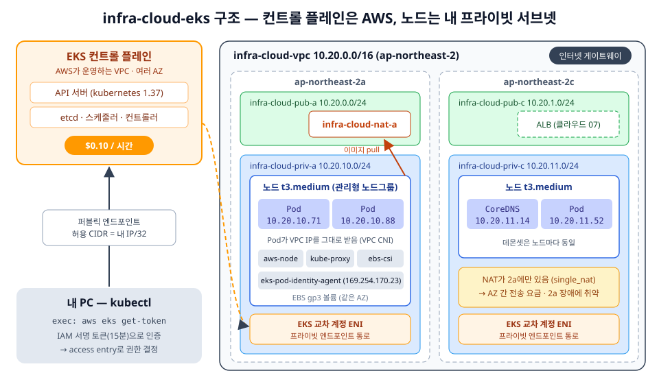
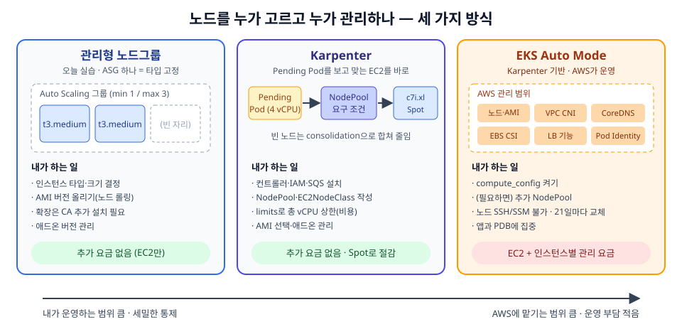
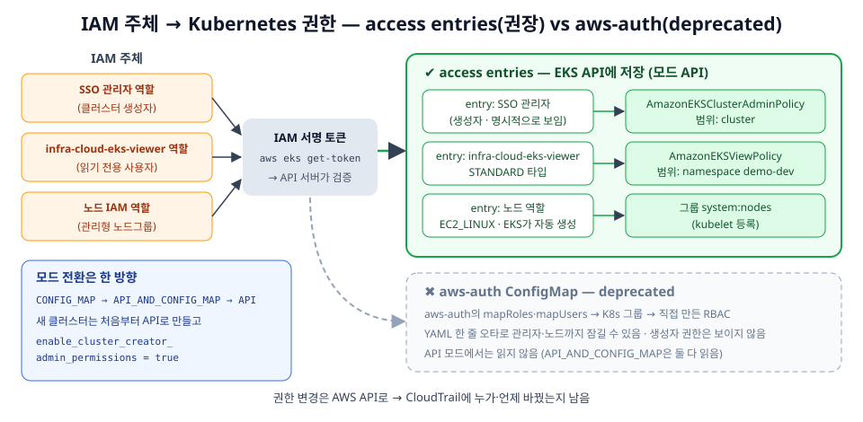

> **클라우드 · AWS** | 난이도 ★★★★☆ | 예상 소요 3 ~ 4시간 | 💰 예상 비용 시간당 약 $0.30 (실습 4시간 기준 약 $1.2 ~ 2, 2026-11-19 기준·변동 가능)

> ⚠️ **실습 전 반드시 읽을 것 — 비용 경고**
> - **EKS 컨트롤 플레인은 클러스터당 시간당 $0.10**(표준 지원 버전). 노드가 0대여도, kubectl을 한 번도 안 쳐도 **클러스터가 존재하는 동안** 과금됩니다. 확장 지원(Extended support) 버전으로 만들면 **시간당 $0.60**으로 6배가 됩니다 → 반드시 **표준 지원 버전**(오늘 기준 1.34~1.37)으로 만듭니다.
> - 클라우드 05의 **NAT 게이트웨이(서울 시간당 약 $0.06 + GB당 처리 요금)** 가 노드의 이미지 pull·패키지 다운로드 트래픽까지 처리하므로 EKS 실습 중에는 NAT 처리 요금도 함께 늘어납니다.
> - 노드 **t3.medium × 2대**(서울 온디맨드 시간당 약 $0.052 × 2), 노드 EBS(gp3), 퍼블릭 IPv4, 컨트롤 플레인 로그(CloudWatch Logs)도 과금됩니다. 프리 티어로 덮이지 않습니다.
> - 합계 대략 **시간당 $0.30, 하루 켜 두면 약 $7** 입니다. 리전은 **`ap-northeast-2`**, 본인 샌드박스 계정에서만, 로그인은 IAM Identity Center(SSO)·단기 자격 증명으로 합니다.
> - 실습 후 삭제: 클러스터 안의 LoadBalancer·PVC를 먼저 지우고 `terraform destroy`(eks → network 순). 맨 아래 [삭제 체크리스트](#-삭제-체크리스트)를 꼭 따라가세요.

> 📌 **cloud02 고정값 기준** — VPC `infra-cloud-vpc` `10.20.0.0/16`(pub-a `10.20.0.0/24`·pub-c `10.20.1.0/24`, priv-a `10.20.10.0/24`·priv-c `10.20.11.0/24`, db-a `10.20.20.0/24`·db-c `10.20.21.0/24`, NAT `infra-cloud-nat-a` 1개), 이름 접두사 `infra-cloud-`, 태그 `Project=infra-study`·`Env=lab`·`Owner=<사용자명>`·`ManagedBy=terraform`·`Name`, 리전 `ap-northeast-2`, CLI 프로필 `infra-admin`(SSO 세션 `infra-sso`), 작업 폴더 `~/infra-cloud/`, Terraform `~/infra-cloud/terraform/{network,eks}`, 상태 버킷 `infra-cloud-tfstate-<계정ID>`(S3 네이티브 잠금 `use_lockfile`), 클러스터 `infra-cloud-eks`. 네트워크는 [클라우드 05](./cloud05-terraform-aws.md)의 `~/infra-cloud/terraform/network`(프라이빗 `10.20.10.0/24`, `10.20.11.0/24`)를 그대로 씁니다.

## 🎯 오늘의 목표

- EKS에서 **AWS가 맡는 것(컨트롤 플레인)과 내가 맡는 것(노드·애드온·권한)** 을 Day 20의 kubeadm과 비교해 설명할 수 있다
- **Terraform EKS 모듈 v21**로 `infra-cloud-eks` 클러스터와 **관리형 노드그룹**을 만든다
- **access entries**로 kubectl 권한을 주고, `aws-auth` ConfigMap이 왜 deprecated인지 설명할 수 있다
- 애드온 **VPC CNI · CoreDNS · kube-proxy · EBS CSI** 를 이해하고, EBS CSI에 **EKS Pod Identity**로 권한을 준다
- `kubeconfig`를 설정하고, 노드 확장 방식(Cluster Autoscaler · **Karpenter** · **EKS Auto Mode**)을 비교할 수 있다

---

## 1. EKS는 무엇을 대신해 주나

[Day 20](../02-kubernetes/day20-kubeadm-multinode.md)에서 kubeadm으로 컨트롤 플레인을 직접 띄웠습니다. etcd 백업, 인증서 갱신, API 서버 업그레이드가 모두 우리 몫이었죠. EKS는 그 **컨트롤 플레인을 AWS 계정 쪽에서 운영**해 주고, 우리 VPC에는 API 서버와 통신할 ENI만 꽂아 줍니다.



| 구성 요소 | Day 20 kubeadm | EKS |
|---|---|---|
| API 서버·etcd·스케줄러 | 내가 설치·백업·업그레이드 | **AWS 관리** (여러 AZ, etcd 백업 포함) |
| 컨트롤 플레인 업그레이드 | `kubeadm upgrade` | `kubernetes_version` 한 줄 바꾸고 apply (한 번에 마이너 1단계) |
| 워커 노드 | VM에 직접 kubelet 설치 | 관리형 노드그룹(EC2 ASG) / Karpenter / Auto Mode |
| CNI | Day 20의 Calico·Cilium 직접 설치 | **VPC CNI** — Pod가 VPC IP를 그대로 받음 |
| 클러스터 인증 | 인증서·kubeconfig | **IAM** 주체 → access entry → Kubernetes 권한 |
| 스토리지 | local-path, NFS | **EBS CSI** 드라이버 (애드온) |
| LoadBalancer | MetalLB | AWS Load Balancer Controller (클라우드 07) |

### 홈랩 대응 표

| 본편 Day | 홈랩에서 쓴 것 | 오늘 AWS에서 쓰는 것 |
|---|---|---|
| [Day 08](../02-kubernetes/day08-k8s-architecture.md) | 컨트롤 플레인 구성 요소 | EKS 관리형 컨트롤 플레인 |
| [Day 09](../02-kubernetes/day09-local-cluster-kubectl.md) | kind `infra-lab`, kubeconfig | `aws eks update-kubeconfig` |
| [Day 14](../02-kubernetes/day14-storage.md) | StorageClass / PVC | EBS CSI + gp3 StorageClass |
| [Day 18](../02-kubernetes/day18-autoscaling.md) | HPA | HPA + 노드 오토스케일링(Karpenter/Auto Mode) |
| [Day 19](../02-kubernetes/day19-rbac-namespace.md) | RBAC, ServiceAccount | access entries + access policy, Pod Identity |
| [Day 20](../02-kubernetes/day20-kubeadm-multinode.md) | kubeadm 3노드 | EKS + 관리형 노드그룹 |
| [Day 35](../05-capstone/day35-terraform.md) | Terraform으로 OpenStack 위 K8s | Terraform EKS 모듈 |

---

## 2. 버전과 준비물

| 항목 | 오늘 기준 (2026-11-19 확인) | 메모 |
|---|---|---|
| EKS Kubernetes | 표준 지원 **1.34 · 1.35 · 1.36 · 1.37**, 확장 지원 1.31~1.33 | 오늘은 **1.37** (표준 지원 종료 2027-12-01). 1.34는 2026-12-02에 표준 지원 종료 |
| EKS 모듈 `terraform-aws-modules/eks/aws` | **v21.30.x** | AWS provider **≥ 6.59**, Terraform ≥ 1.5.7 요구 |
| Pod Identity 모듈 `terraform-aws-modules/eks-pod-identity/aws` | **v2.11.0** | 애드온·컨트롤러용 IAM 역할 생성 |
| AWS CLI | v2.12.3 이상 | `update-kubeconfig`가 `aws eks get-token` 사용 |
| kubectl | 클러스터와 ±1 마이너 (1.36~1.38) | `kubectl version --client` |

> ⚠️ EKS 모듈은 v20 → v21에서 입력 이름이 많이 바뀌었습니다(`cluster_name` → `name`, `cluster_version` → `kubernetes_version`, `cluster_addons` → `addons`, `cluster_endpoint_public_access` → `endpoint_public_access` 등). 인터넷의 예전 예제를 그대로 붙이면 `Unsupported argument` 오류가 납니다. 반드시 `version = "~> 21.30"`으로 고정하고 이 글의 이름을 쓰세요.

> 💡 eksctl(`eksctl create cluster -f cluster.yaml`)로도 같은 클러스터를 만들 수 있습니다. 하지만 클라우드 05에서 VPC를 Terraform으로 만들었으니 **같은 state·같은 CI로 관리**하려고 오늘은 Terraform 모듈을 씁니다.

---

## 3. 노드를 어떻게 둘 것인가



| | 관리형 노드그룹 (MNG) | MNG + Cluster Autoscaler | **Karpenter** (v1.15.x) | **EKS Auto Mode** |
|---|---|---|---|---|
| 노드 단위 | ASG 하나 = 인스턴스 타입 고정 | 같음, ASG 크기만 조절 | Pod 요구에 맞춰 **인스턴스를 바로 고름** (NodePool·EC2NodeClass) | Karpenter 기반, **AWS가 운영** |
| 내가 설치·운영 | 노드그룹 정의 | + CA Deployment, IAM | + Karpenter 컨트롤러, IAM, SQS(중단 알림) | 거의 없음 (기본 NodePool `general-purpose`, `system`) |
| 노드 OS·패치 | AMI 버전 올리기는 내 몫 | 같음 | `amiSelectorTerms`로 관리 | **AWS가 관리**(Bottlerocket 변형, 최대 수명 21일 후 교체) |
| 함께 관리되는 것 | — | — | — | VPC CNI·CoreDNS·kube-proxy·EBS CSI·Pod Identity Agent·로드밸런서 기능이 **기본 내장** |
| 추가 비용 | 없음 (EC2만) | 없음 | 없음 (컨트롤러가 노드에서 돔) | EC2 요금 **+ 인스턴스별 Auto Mode 관리 요금** (예: c6a.2xlarge 시간당 $0.03672 추가) |
| 잘 맞는 곳 | 학습, 예측 가능한 고정 용량 | 단순한 확장 | 다양한 워크로드·Spot 최적화 | 운영 부담을 최소화하고 싶을 때 |

오늘은 **구조가 가장 잘 보이는 관리형 노드그룹**으로 만들고, 9장에서 Karpenter와 Auto Mode의 설정 모양을 비교만 합니다.

---

## 4. 인증 — access entries가 aws-auth를 대체한다



EKS에서 `kubectl`은 **IAM 서명 토큰**(`aws eks get-token`)으로 로그인합니다. 그 IAM 주체를 Kubernetes 권한과 연결하는 방법이 두 가지입니다.

| | `aws-auth` ConfigMap | **access entries** (EKS API) |
|---|---|---|
| 현재 상태 | AWS 문서에 **"deprecated"** 명시 | **권장 방식** |
| 어디에 저장 | 클러스터 안 `kube-system/aws-auth` | EKS 컨트롤 플레인 (AWS API) |
| 관리 도구 | kubectl edit, eksctl | AWS CLI·콘솔·Terraform (`aws_eks_access_entry`) |
| 실수하면 | YAML 한 줄 오타로 **모두 잠김**(노드까지) | API가 검증, CloudTrail에 기록 |
| 권한 표현 | Kubernetes 그룹 → 직접 만든 RBAC | **AWS 관리 access policy**(Admin/Edit/View 등, 클러스터·네임스페이스 범위) 또는 Kubernetes 그룹 |
| 클러스터 생성자 | 보이지 않는 `system:masters` (추적 어려움) | access entry로 명시적으로 보임 |

`authentication_mode`는 세 가지입니다.

| 모드 | 의미 |
|---|---|
| `CONFIG_MAP` | aws-auth만 (옛 클러스터) |
| `API_AND_CONFIG_MAP` | 둘 다 읽음 — **모듈 기본값**, 옮기는 중인 클러스터 |
| `API` | access entries만 — **새 클러스터 권장**. 한번 `API`로 바꾸면 되돌릴 수 없음 |

| AWS 관리 access policy | 대략 대응하는 Kubernetes 역할 |
|---|---|
| `AmazonEKSClusterAdminPolicy` | `cluster-admin` |
| `AmazonEKSAdminPolicy` | `admin` |
| `AmazonEKSEditPolicy` | `edit` |
| `AmazonEKSViewPolicy` | `view` |

> 💡 관리형 노드그룹의 노드 IAM 역할에 대한 access entry(`EC2_LINUX` 타입)는 **EKS가 자동으로 만들어** 줍니다. 그래서 `API` 모드에서도 노드가 클러스터에 붙는 데 aws-auth가 필요 없습니다.

---

## 5. 실습 ① 코드 작성 — `~/infra-cloud/terraform/eks`

클라우드 05의 레포 구조에 디렉터리 하나를 더합니다.

```text
~/infra-cloud/terraform/
├── bootstrap/ · modules/ · network/ · app/   # 클라우드 05
└── eks/         # 오늘
    ├── versions.tf
    ├── network.tf
    ├── eks.tf
    ├── access.tf
    └── outputs.tf
```

### 5-1. versions.tf · network.tf

```hcl
# eks/versions.tf
terraform {
  required_version = ">= 1.11"
  required_providers {
    aws = { source = "hashicorp/aws", version = "~> 6.70" }   # EKS 모듈 v21.30은 >= 6.59 요구
  }
  backend "s3" {
    bucket       = "infra-cloud-tfstate-123456789012"
    key          = "eks/terraform.tfstate"
    region       = "ap-northeast-2"
    encrypt      = true
    use_lockfile = true
  }
}

provider "aws" {
  region = "ap-northeast-2"
  default_tags {
    tags = {
      Project   = "infra-study"
      Env       = "lab"
      Owner     = "<사용자명>"      # 클라우드 01에서 정한 내 사용자명
      ManagedBy = "terraform"
    }
  }
}

data "aws_caller_identity" "current" {}
```

```hcl
# eks/network.tf — 클라우드 05의 출력값 읽기
data "terraform_remote_state" "network" {
  backend = "s3"
  config = {
    bucket = "infra-cloud-tfstate-123456789012"
    key    = "network/terraform.tfstate"
    region = "ap-northeast-2"
  }
}

locals {
  cluster_name    = "infra-cloud-eks"
  vpc_id          = data.terraform_remote_state.network.outputs.vpc_id
  private_subnets = data.terraform_remote_state.network.outputs.private_subnets
}
```

### 5-2. eks.tf — 클러스터, 노드그룹, 애드온

```hcl
# eks/eks.tf

# EBS CSI 드라이버가 쓸 IAM 역할 (Pod Identity 신뢰 정책 = pods.eks.amazonaws.com)
module "ebs_csi_pod_identity" {
  source  = "terraform-aws-modules/eks-pod-identity/aws"
  version = "~> 2.11"

  name                      = "infra-cloud-ebs-csi"
  attach_aws_ebs_csi_policy = true
  # associations는 여기서 만들지 않고, 아래 애드온의 pod_identity_association이 만든다 (중복 방지)
}

module "eks" {
  source  = "terraform-aws-modules/eks/aws"
  version = "~> 21.30"

  name               = local.cluster_name
  kubernetes_version = "1.37"

  vpc_id     = local.vpc_id
  subnet_ids = local.private_subnets          # 노드와 컨트롤 플레인 ENI 모두 프라이빗

  # API 서버 엔드포인트: 프라이빗(노드·클라우드 08의 AMP 수집기용) + 내 IP에서만 퍼블릭
  endpoint_private_access      = true
  endpoint_public_access       = true
  endpoint_public_access_cidrs = ["203.0.113.10/32"]   # ← curl -s https://checkip.amazonaws.com 결과/32

  # 인증: access entries만 사용, 지금 terraform을 실행하는 주체를 관리자로
  authentication_mode                      = "API"
  enable_cluster_creator_admin_permissions = true

  # 컨트롤 플레인 로그는 CloudWatch Logs 비용이 드므로 감사·인증만, 7일 보관
  enabled_log_types                      = ["audit", "authenticator"]
  cloudwatch_log_group_retention_in_days = 7

  addons = {
    vpc-cni = {
      before_compute = true                  # 노드보다 먼저 설치 → 노드가 바로 Ready
    }
    eks-pod-identity-agent = {
      before_compute = true
    }
    kube-proxy = {}
    coredns    = {}
    aws-ebs-csi-driver = {
      pod_identity_association = [{
        role_arn        = module.ebs_csi_pod_identity.iam_role_arn
        service_account = "ebs-csi-controller-sa"
      }]
    }
  }

  eks_managed_node_groups = {
    default = {
      ami_type       = "AL2023_x86_64_STANDARD"
      instance_types = ["t3.medium"]
      capacity_type  = "ON_DEMAND"           # 비용을 더 줄이려면 "SPOT" (중단될 수 있음)
      min_size       = 1
      max_size       = 3
      desired_size   = 2
      labels         = { role = "general" }
    }
  }

  tags = { Name = local.cluster_name }
}
```

| 입력 | 오늘 값 | 이유 |
|---|---|---|
| `kubernetes_version` | `"1.37"` | 표준 지원 중 가장 최신 → 확장 지원 요금($0.60/h) 회피 기간이 가장 김 |
| `endpoint_public_access_cidrs` | 내 IP/32 | 기본값 `0.0.0.0/0`은 API 서버를 전 세계에 노출 (인증은 필요하지만 공격면) |
| `authentication_mode` | `"API"` | 모듈 기본 `API_AND_CONFIG_MAP` 대신 access entries만 |
| `enable_cluster_creator_admin_permissions` | `true` | 모듈 기본은 `false` → 안 켜면 만든 사람도 kubectl이 안 됨 |
| `before_compute` | VPC CNI, Pod Identity Agent | 노드 생성 전에 설치해야 노드가 NotReady로 멈추지 않음 |
| `enabled_log_types` | audit, authenticator | 모듈 기본은 audit·api·authenticator + **90일 보관** |

> ⚠️ 노드그룹의 `desired_size`는 **처음 만들 때만** 반영됩니다. 모듈 문서대로 이후 Terraform에서 바꿔도 기존 노드그룹 크기는 변하지 않습니다(오토스케일러와 싸우지 않게 무시). 크기를 바꾸려면 콘솔·`aws eks update-nodegroup-config`나 오토스케일러를 씁니다.

### 5-3. access.tf — 네임스페이스 읽기 전용 사용자 추가

관리자 외에, 데모 네임스페이스만 볼 수 있는 역할을 하나 만들어 access entry를 붙입니다(Day 19의 RBAC를 IAM 쪽에서 하는 셈).

```hcl
# eks/access.tf
resource "aws_iam_role" "eks_viewer" {
  name = "infra-cloud-eks-viewer"
  assume_role_policy = jsonencode({
    Version = "2012-10-17"
    Statement = [{
      Effect    = "Allow"
      Principal = { AWS = "arn:aws:iam::${data.aws_caller_identity.current.account_id}:root" }
      Action    = "sts:AssumeRole"
    }]
  })
}

resource "aws_eks_access_entry" "viewer" {
  cluster_name  = module.eks.cluster_name
  principal_arn = aws_iam_role.eks_viewer.arn
}

resource "aws_eks_access_policy_association" "viewer" {
  cluster_name  = module.eks.cluster_name
  principal_arn = aws_iam_role.eks_viewer.arn
  policy_arn    = "arn:aws:eks::aws:cluster-access-policy/AmazonEKSViewPolicy"
  access_scope {
    type       = "namespace"
    namespaces = ["demo-dev"]        # 클라우드 07에서 데모 앱이 들어갈 네임스페이스
  }
}
```

> 💡 같은 내용을 모듈의 `access_entries = { viewer = { principal_arn = ..., policy_associations = { ... } } }` 입력으로도 쓸 수 있습니다. 여기서는 access entry와 policy association이 **별개의 리소스**라는 구조를 보이려고 따로 썼습니다.

```hcl
# eks/outputs.tf
output "cluster_name"      { value = module.eks.cluster_name }
output "cluster_endpoint"  { value = module.eks.cluster_endpoint }
output "node_sg_id"        { value = module.eks.node_security_group_id }
output "oidc_provider_arn" { value = module.eks.oidc_provider_arn }   # IRSA 비교용 (클라우드 07)
output "viewer_role_arn"   { value = aws_iam_role.eks_viewer.arn }
```

---

## 6. 실습 ② apply와 kubeconfig

```bash
# 클라우드 05의 network가 지워져 있다면 먼저
cd ~/infra-cloud/terraform/network && terraform apply

cd ../eks
terraform init
terraform plan -out tfplan
# Plan: 58 to add, 0 to change, 0 to destroy.
time terraform apply tfplan
# module.eks.aws_eks_cluster.this[0]: Creation complete after 9m12s
# module.eks.module.eks_managed_node_group["default"].aws_eks_node_group.this[0]: Creation complete after 1m48s
# ...
# Apply complete! Resources: 58 added, 0 changed, 0 destroyed.
# real    14m...
```

> 💡 컨트롤 플레인 생성에 10분 안팎이 걸립니다. 이 시간부터 **시간당 $0.10이 이미 나가고** 있으니, apply를 걸어 둔 채 다음 절을 읽으세요.

### 6-1. kubeconfig

```bash
aws eks update-kubeconfig --region ap-northeast-2 --name infra-cloud-eks --alias infra-cloud-eks
# Added new context infra-cloud-eks to /home/me/.kube/config

kubectl config get-contexts
# CURRENT   NAME       CLUSTER                                                AUTHINFO
# *         infra-cloud-eks    arn:aws:eks:ap-northeast-2:123456789012:cluster/infra-cloud-eks   arn:aws:eks:...
#           kind-infra-lab   kind-infra-lab                                   kind-infra-lab

kubectl get nodes -o wide
# NAME                                             STATUS   ROLES    AGE   VERSION               INTERNAL-IP    OS-IMAGE
# ip-10-20-10-58.ap-northeast-2.compute.internal   Ready    <none>   3m    v1.37.x-eks-xxxxxxx   10.20.10.58    Amazon Linux 2023...
# ip-10-20-11-201.ap-northeast-2.compute.internal  Ready    <none>   3m    v1.37.x-eks-xxxxxxx   10.20.11.201   Amazon Linux 2023...
```

kubeconfig의 `users` 항목을 보면 인증서 대신 **`aws eks get-token`을 실행하는 exec 플러그인**이 들어 있습니다. 토큰은 15분짜리라 SSO 세션이 만료되면 kubectl도 `Unauthorized`가 납니다(`aws sso login` 다시).

> ⚠️ Day 09의 kind `infra-lab`과 context가 섞입니다. `kubectl config use-context infra-cloud-eks`를 습관적으로 확인하고, 프롬프트에 현재 context를 띄워 두세요(kube-ps1 등). **EKS에 kind용 매니페스트를 잘못 apply하면 과금 리소스(LoadBalancer 등)가 생길 수 있습니다.**

### 6-2. 무엇이 떠 있나

```bash
kubectl get pods -A
# NAMESPACE     NAME                                  READY   STATUS
# kube-system   aws-node-7xk2p                        2/2     Running   ← VPC CNI
# kube-system   aws-node-q9m4d                        2/2     Running
# kube-system   coredns-5c8d7f8b9-2hq4x               1/1     Running
# kube-system   coredns-5c8d7f8b9-tz7mw               1/1     Running
# kube-system   ebs-csi-controller-6b9d8c9f6c-8wq2l   6/6     Running   ← EBS CSI
# kube-system   ebs-csi-node-4kq8z                    3/3     Running
# kube-system   eks-pod-identity-agent-2vxpk          1/1     Running   ← Pod Identity Agent
# kube-system   kube-proxy-6ptlz                      1/1     Running

aws eks list-addons --cluster-name infra-cloud-eks --region ap-northeast-2
# { "addons": ["aws-ebs-csi-driver", "coredns", "eks-pod-identity-agent", "kube-proxy", "vpc-cni"] }

aws eks list-pod-identity-associations --cluster-name infra-cloud-eks --region ap-northeast-2 \
  --query 'associations[].[namespace,serviceAccount]' --output text
# kube-system   ebs-csi-controller-sa
```

| 애드온 | 하는 일 | Day 대응 |
|---|---|---|
| `vpc-cni` (aws-node) | 노드에 보조 ENI·IP를 붙여 **Pod에 VPC IP**를 줌. 그래서 ALB가 Pod IP로 직접 보냄(클라우드 07 `target-type: ip`) | Day 22·23의 veth/overlay 대신 |
| `coredns` | 클러스터 DNS | Day 12 Service DNS |
| `kube-proxy` | Service → Pod iptables 규칙 | Day 12 |
| `aws-ebs-csi-driver` | PVC → EBS 볼륨 생성·연결 | Day 14 |
| `eks-pod-identity-agent` | Pod에 IAM 역할 임시 자격 증명 전달 (노드의 `169.254.170.23`) | — (클라우드 07에서 자세히) |

> 💡 VPC CNI는 Pod마다 서브넷 IP를 하나씩 씁니다. `/24` 서브넷은 약 250개뿐이고, t3.medium은 ENI 한계 때문에 **노드당 Pod 최대 17개**입니다. 실습엔 충분하지만 운영에서는 프라이빗 서브넷을 크게(/19 등) 잡거나 **prefix delegation**(`ENABLE_PREFIX_DELEGATION=true`)을 씁니다.

### 6-3. access entries 확인

```bash
aws eks list-access-entries --cluster-name infra-cloud-eks --region ap-northeast-2
# {
#   "accessEntries": [
#     "arn:aws:iam::123456789012:role/AWSReservedSSO_AdministratorAccess_abcd1234",   ← 생성자(관리자)
#     "arn:aws:iam::123456789012:role/default-eks-node-group-2026...",                ← 노드 역할 (자동)
#     "arn:aws:iam::123456789012:role/infra-cloud-eks-viewer"
#   ]
# }

kubectl auth whoami
# ATTRIBUTE   VALUE
# Username    arn:aws:sts::123456789012:assumed-role/AWSReservedSSO_AdministratorAccess_abcd1234/me
# Groups      [system:authenticated]

kubectl -n kube-system get configmap aws-auth
# Error from server (NotFound): configmaps "aws-auth" not found      ← API 모드라 없음
```

읽기 전용 역할로 바꿔서 권한을 시험합니다.

```bash
aws eks update-kubeconfig --region ap-northeast-2 --name infra-cloud-eks \
  --role-arn "$(terraform output -raw viewer_role_arn)" --alias infra-cloud-eks-viewer

kubectl --context infra-cloud-eks-viewer auth can-i list pods -n demo-dev      # yes
kubectl --context infra-cloud-eks-viewer auth can-i delete pods -n demo-dev    # no
kubectl --context infra-cloud-eks-viewer auth can-i list pods -n kube-system   # no
kubectl --context infra-cloud-eks-viewer auth can-i list secrets -n demo-dev   # no  (View 정책은 Secret 제외)
```

---

## 7. 실습 ③ EBS 볼륨 — gp3 StorageClass와 PVC

EBS CSI 드라이버를 설치했다고 기본 StorageClass가 gp3로 잡히지는 않습니다. 먼저 확인합니다.

```bash
kubectl get storageclass
# NAME   PROVISIONER             RECLAIMPOLICY   VOLUMEBINDINGMODE      ...
# gp2    kubernetes.io/aws-ebs   Delete          WaitForFirstConsumer   ...
```

기본(default) 표시가 없거나 옛 gp2라면 gp3를 기본으로 만듭니다.

```yaml
# gp3-sc.yaml
apiVersion: storage.k8s.io/v1
kind: StorageClass
metadata:
  name: gp3
  annotations:
    storageclass.kubernetes.io/is-default-class: "true"
provisioner: ebs.csi.aws.com
volumeBindingMode: WaitForFirstConsumer     # Pod가 뜰 AZ를 보고 같은 AZ에 볼륨 생성 (EBS는 AZ 종속)
reclaimPolicy: Delete
allowVolumeExpansion: true
parameters:
  type: gp3
  encrypted: "true"
---
apiVersion: v1
kind: PersistentVolumeClaim
metadata:
  name: ebs-test
spec:
  accessModes: ["ReadWriteOnce"]
  resources:
    requests:
      storage: 1Gi
---
apiVersion: v1
kind: Pod
metadata:
  name: ebs-test
spec:
  containers:
  - name: app
    image: busybox:1.37
    command: ["sh", "-c", "date >> /data/out.txt; sleep 3600"]
    volumeMounts:
    - name: data
      mountPath: /data
  volumes:
  - name: data
    persistentVolumeClaim:
      claimName: ebs-test
```

```bash
kubectl apply -f gp3-sc.yaml
kubectl get pvc ebs-test -w
# NAME       STATUS    VOLUME                                     CAPACITY   STORAGECLASS
# ebs-test   Pending                                                         gp3      ← Pod 스케줄 전 (WaitForFirstConsumer)
# ebs-test   Bound     pvc-3f1c2a9e-...                           1Gi        gp3
kubectl exec ebs-test -- cat /data/out.txt
aws ec2 describe-volumes --region ap-northeast-2 \
  --filters Name=tag:kubernetes.io/created-for/pvc/name,Values=ebs-test \
  --query 'Volumes[].[VolumeId,VolumeType,AvailabilityZone,State]' --output text
# vol-0a1b2c3d4e5f   gp3   ap-northeast-2a   in-use

# 확인 후 정리 (PVC를 지워야 EBS가 지워짐)
kubectl delete pod ebs-test && kubectl delete pvc ebs-test
```

> ⚠️ PVC를 남긴 채 `terraform destroy`로 클러스터를 지우면 **EBS 볼륨이 고아로 남아 계속 과금**됩니다(GB-월 단위). 삭제 체크리스트의 볼륨 확인을 꼭 하세요.

---

## 8. Karpenter와 EKS Auto Mode — 개념과 설정 모양

### 8-1. Karpenter

Karpenter는 **Pending Pod를 보고 거기에 맞는 EC2를 바로 띄우는** 컨트롤러입니다. 노드그룹(ASG) 없이 `NodePool`(어떤 조건의 노드를 허용할지)과 `EC2NodeClass`(AMI·서브넷·보안그룹)를 씁니다. EKS 모듈에는 `modules/karpenter` 서브모듈이 있어 IAM·SQS(Spot 중단 알림)를 만들어 줍니다.

```yaml
# 설정 모양만 보기 (오늘 apply 하지 않음) — Karpenter v1 API
apiVersion: karpenter.sh/v1
kind: NodePool
metadata:
  name: general
spec:
  template:
    spec:
      requirements:
      - key: karpenter.sh/capacity-type
        operator: In
        values: ["spot", "on-demand"]
      - key: kubernetes.io/arch
        operator: In
        values: ["amd64"]
      nodeClassRef:
        group: karpenter.k8s.aws
        kind: EC2NodeClass
        name: default
  limits:
    cpu: "16"                        # 이 NodePool이 만들 수 있는 총 vCPU 상한 → 비용 가드레일
  disruption:
    consolidationPolicy: WhenEmptyOrUnderutilized   # 덜 쓰는 노드를 합쳐서 줄임
```

### 8-2. EKS Auto Mode

Auto Mode는 Karpenter를 포함한 데이터 플레인 구성 요소(노드, VPC CNI, CoreDNS, kube-proxy, EBS CSI, 로드밸런싱, Pod Identity Agent)를 **AWS가 운영**합니다. 모듈에서는 `compute_config` 하나로 켭니다.

```hcl
# 설정 모양만 보기 — eks.tf에서 eks_managed_node_groups·addons 대신
  compute_config = {
    enabled    = true
    node_pools = ["general-purpose", "system"]   # AWS가 만든 기본 NodePool
  }
```

| 질문 | 관리형 노드그룹 (오늘) | Karpenter | Auto Mode |
|---|---|---|---|
| 노드 AMI 패치는 누가? | 나 (노드그룹 AMI 버전 갱신) | 나 (EC2NodeClass) | AWS (최대 21일마다 교체) |
| 노드에 SSH/SSM 접속 | 가능 | 가능 | **불가** (읽기 전용 루트, SELinux) |
| 애드온 버전 관리 | 나 | 나 | 핵심 애드온은 AWS |
| 추가 요금 | 없음 | 없음 | 인스턴스별 관리 요금 |

> ⚠️ Auto Mode를 끌 때는 `compute_config` 블록을 **지우지 말고** 먼저 `enabled = false`로 apply한 다음에 지워야 합니다(모듈 문서 경고). 블록만 지우면 비활성화가 실패합니다.

---

## 9. 비용 감 잡기 (서울, 2026-11-19 확인, 변동 가능)

| 항목 | 단가 | 오늘 구성 |
|---|---|---|
| EKS 컨트롤 플레인 | $0.10/시간 (확장 지원 $0.60) | 1개 → $0.10 |
| EC2 t3.medium | 약 $0.052/시간 | 2대 → 약 $0.104 |
| NAT 게이트웨이 | 약 $0.06/시간 + GB당 처리 | 1개 → 약 $0.06 + α |
| 퍼블릭 IPv4 | $0.005/시간/개 | NAT EIP 등 → 약 $0.01 |
| EBS gp3 | GB-월 단위 | 노드 루트 20GB × 2 → 시간당 1센트 미만 |
| CloudWatch Logs | 수집 GB당 | audit 로그 양에 비례 |
| **합계** | | **시간당 약 $0.28 ~ 0.32** |

> 💡 실습하지 않는 날까지 켜 두면 한 달에 약 $200입니다. "다음에 또 쓸 거니까"는 이유가 되지 않습니다 — **Terraform이 있으니 15분이면 다시 만들 수 있습니다.**

---

## 10. 트러블슈팅

| 증상 | 원인 | 해결 |
|---|---|---|
| `Unsupported argument "cluster_name"` 등 | v20 예제를 v21 모듈에 사용 | v21 이름(`name`, `kubernetes_version`, `addons`, `endpoint_public_access`)으로 |
| `error: You must be logged in to the server (Unauthorized)` | 내 IAM 주체에 access entry 없음 / SSO 세션 만료 | `enable_cluster_creator_admin_permissions = true` 확인, 다른 사람이 만든 클러스터면 access entry 추가, `aws sso login` |
| kubectl이 타임아웃 | `endpoint_public_access_cidrs`에 지금 내 IP가 없음 (IP 바뀜) | `checkip` 결과로 CIDR 갱신 후 apply |
| 노드가 `NotReady`, `cni plugin not initialized` | VPC CNI가 노드보다 늦게 설치 | `vpc-cni`에 `before_compute = true` |
| 노드그룹 생성 실패 `NodeCreationFailure` | 프라이빗 서브넷에 NAT 경로 없음(이미지·부트스트랩 다운로드 불가) | 클라우드 05의 NAT·라우팅 확인 |
| PVC가 계속 `Pending` | EBS CSI 컨트롤러 권한 없음 (Pod Identity 연결 누락) | `aws eks list-pod-identity-associations`, `kubectl -n kube-system logs deploy/ebs-csi-controller -c csi-provisioner` |
| Pod가 `Too many pods`로 Pending | 노드당 Pod 한계(t3.medium 17) 도달 | 노드 추가, 더 큰 인스턴스, prefix delegation |
| 클러스터 요금이 $0.60/시간 | 확장 지원 버전으로 생성됨 | 표준 지원 버전으로 업그레이드 (한 단계씩) |
| `terraform destroy`가 VPC에서 멈춤 | 클러스터 밖에서 만든 ALB/ENI·보안그룹이 남음 | 삭제 체크리스트 1단계(LoadBalancer·Ingress 삭제)부터 |

---

## 11. 핵심 정리

- EKS = **AWS가 운영하는 컨트롤 플레인** + 내 VPC의 노드. 컨트롤 플레인은 **존재만 해도 시간당 $0.10**, 확장 지원 버전은 $0.60
- Terraform **EKS 모듈 v21** 입력은 `name`, `kubernetes_version`, `addons`, `eks_managed_node_groups`. 버전은 `~> 21.30`으로 고정
- 권한은 **access entries**(`authentication_mode = "API"`) + AWS 관리 access policy. **aws-auth ConfigMap은 deprecated**, 노드 역할 entry는 EKS가 자동 생성
- 핵심 애드온 VPC CNI·CoreDNS·kube-proxy·EBS CSI·Pod Identity Agent. CNI와 Pod Identity Agent는 **`before_compute`**
- EBS CSI 권한은 **Pod Identity**로, StorageClass는 **gp3 + WaitForFirstConsumer**
- 노드 확장: 고정 노드그룹 → Karpenter(Pod 맞춤 인스턴스) → Auto Mode(AWS 운영, 추가 요금)

---

## 12. 셀프 체크

<details>
<summary>Q1. 노드그룹을 0대로 줄여도 EKS 요금이 계속 나가는 이유는? 확장 지원 버전을 피해야 하는 이유는?</summary>

EKS 클러스터 요금은 노드가 아니라 **컨트롤 플레인(클러스터) 시간**에 붙기 때문입니다(표준 지원 $0.10/시간). 노드를 0대로 해도 API 서버·etcd는 AWS가 계속 운영합니다. 표준 지원(14개월)이 끝난 버전은 확장 지원으로 넘어가며 **시간당 $0.60**이 되므로, 최신 표준 지원 버전으로 만들고 제때 업그레이드합니다.
</details>

<details>
<summary>Q2. <code>authentication_mode = "API"</code>로 만든 클러스터에서 노드는 aws-auth 없이 어떻게 클러스터에 등록되나?</summary>

관리형 노드그룹의 노드 IAM 역할에 대해 EKS가 `EC2_LINUX` 타입 **access entry를 자동으로 생성**합니다. 노드의 kubelet은 그 역할로 인증하고, access entry가 `system:nodes` 그룹 권한을 줍니다. 그래서 aws-auth ConfigMap이 필요 없습니다.
</details>

<details>
<summary>Q3. <code>enable_cluster_creator_admin_permissions</code>를 끈 상태로 클러스터를 만들면 무슨 일이 생기나?</summary>

EKS 모듈 v21은 이 값의 기본이 `false`이고 `API` 모드에서는 숨은 `system:masters` 매핑도 없으므로, 클러스터를 만든 본인조차 kubectl에서 `Unauthorized`가 납니다. `true`로 바꾸거나 `access_entries`/`aws_eks_access_entry`로 자기 역할에 `AmazonEKSClusterAdminPolicy`를 연결해야 합니다.
</details>

<details>
<summary>Q4. gp3 StorageClass에 <code>volumeBindingMode: WaitForFirstConsumer</code>를 쓰는 이유는?</summary>

EBS 볼륨은 **하나의 AZ에 묶입니다.** `Immediate`면 PVC가 만들어지는 순간 임의의 AZ에 볼륨이 생기고, Pod가 다른 AZ 노드에 스케줄되면 붙일 수 없어 Pending이 됩니다. `WaitForFirstConsumer`는 Pod가 배치될 노드의 AZ를 본 뒤 그 AZ에 볼륨을 만듭니다.
</details>

<details>
<summary>Q5. 관리형 노드그룹, Karpenter, EKS Auto Mode 중 "노드 OS 패치를 신경 쓰고 싶지 않고 추가 요금은 감수한다"면? 반대로 Spot을 적극 섞어 비용을 최소화하고 직접 조정하고 싶다면?</summary>

앞의 경우는 **EKS Auto Mode**(AWS가 Bottlerocket 기반 노드를 관리하고 최대 21일마다 교체, 인스턴스별 관리 요금 추가). 뒤의 경우는 **Karpenter**(NodePool에서 Spot/온디맨드·인스턴스 계열을 직접 지정하고 consolidation으로 노드를 줄임, 추가 요금 없음).
</details>

---

## 🧹 삭제 체크리스트

순서가 중요합니다. **클러스터 안에서 AWS 리소스를 만든 것 → 클러스터 → 네트워크** 순입니다.

```bash
kubectl config use-context infra-cloud-eks
# 1) 클러스터가 AWS에 만든 것 먼저 (LoadBalancer Service·Ingress → ELB, PVC → EBS)
kubectl get svc -A --field-selector spec.type=LoadBalancer
kubectl get ingress -A
kubectl delete pvc --all -A          # 남은 PVC가 있다면

# 2) 클러스터 (약 10분)
cd ~/infra-cloud/terraform/eks && terraform destroy

# 3) 네트워크 (다음 편을 바로 이어서 하지 않을 거라면 — NAT 과금 중단)
cd ../network && terraform destroy

# 4) kubeconfig에서 context 정리
kubectl config delete-context infra-cloud-eks
kubectl config delete-context infra-cloud-eks-viewer
```

- [ ] `aws eks list-clusters --region ap-northeast-2` → `infra-cloud-eks` 없음
- [ ] `aws ec2 describe-volumes --region ap-northeast-2 --filters Name=status,Values=available --query 'Volumes[].VolumeId'` → `[]` (고아 EBS 없음)
- [ ] `aws elbv2 describe-load-balancers --region ap-northeast-2 --query 'LoadBalancers[].LoadBalancerName'` → `k8s-` 로 시작하는 것 없음
- [ ] `aws ec2 describe-nat-gateways --region ap-northeast-2 --filter Name=state,Values=available --query 'NatGateways[].NatGatewayId'` → `[]` (network까지 지웠다면)
- [ ] `aws logs describe-log-groups --region ap-northeast-2 --log-group-name-prefix /aws/eks/infra-cloud-eks --query 'logGroups[].logGroupName'` → `[]` (모듈이 만든 로그 그룹은 destroy 때 함께 삭제)
- [ ] `aws resourcegroupstaggingapi get-resources --region ap-northeast-2 --tag-filters Key=Project,Values=infra-study --query 'ResourceTagMappingList[].ResourceARN'` → 상태 버킷·OIDC 역할만
- [ ] 다음 날 **Cost Explorer**(또는 클라우드 01의 Budgets 알림)에서 EKS·EC2·NAT 요금이 멈췄는지

---

## ⏭️ 다음 예고 — 클라우드 07. EKS 위 GitOps — Argo CD, AWS Load Balancer Controller, Pod Identity/IRSA, ExternalDNS

오늘 만든 `infra-cloud-eks`에 Chapter 7의 GitOps를 그대로 옮깁니다.

- [Day 53](../07-gitops/day53-argocd.md)의 Argo CD를 EKS에 설치하고 `gitops-demo-config`를 연결
- **AWS Load Balancer Controller**로 Ingress(그리고 Gateway API) → **ALB**, `target-type: ip`로 Pod에 직접
- 컨트롤러 권한은 **EKS Pod Identity** vs **IRSA** — 무엇이 현재 권장인가
- **ExternalDNS**로 Route 53 레코드 자동 생성, **ACM 인증서**로 HTTPS

> 💰 다음 편은 EKS($0.10/h) + NAT + **ALB(시간당 약 $0.02 + LCU)** + Route 53 호스팅 영역(월 $0.50)이 더해집니다. 오늘 클러스터를 지웠다면 다음 실습 시작 때 `terraform apply` 두 번(network → eks)으로 다시 만들면 됩니다.
