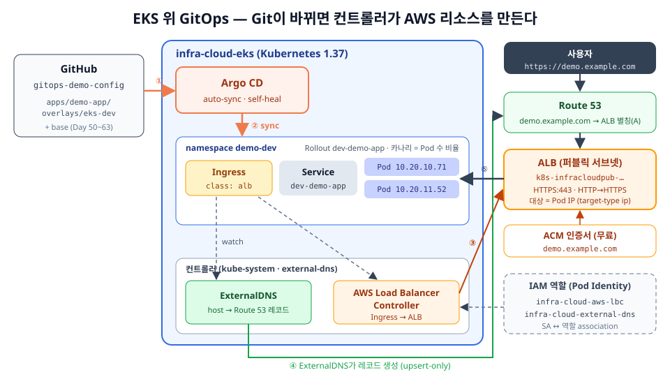
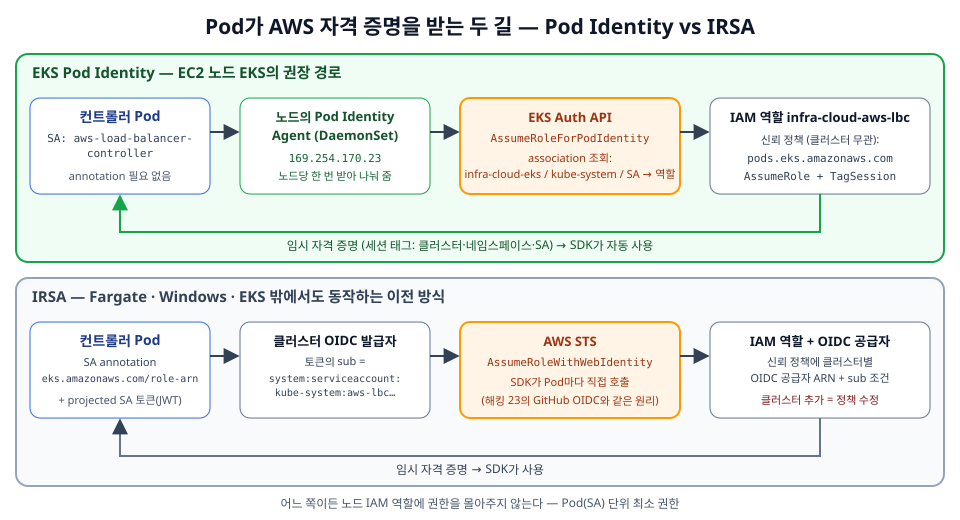

> **클라우드 · AWS** | 난이도 ★★★★★ | 예상 소요 4 ~ 5시간 | 💰 예상 비용 시간당 약 $0.33 + Route 53 호스팅 영역 월 $0.50 (실습 5시간 기준 약 $2 ~ 3, 2026-11-19 기준·변동 가능)

> ⚠️ **실습 전 반드시 읽을 것 — 비용 경고**
> - **EKS 컨트롤 플레인 시간당 $0.10**(표준 지원 버전)이 클러스터가 있는 동안 계속 나갑니다. 노드 t3.medium 2대(약 $0.10/시간)도 같습니다.
> - **NAT 게이트웨이**(서울 약 $0.06/시간 + 처리 GB당)는 오늘 Argo CD가 GitHub·GHCR·Helm 저장소에서 받아 오는 트래픽을 모두 처리합니다.
> - 오늘 새로 생기는 것: **ALB**(시간당 약 $0.02~0.03 + LCU 사용량, Ingress를 지워야 사라짐), **Route 53 호스팅 영역**(월 $0.50, 생성 후 12시간 안에 지우면 청구되지 않음), DNS 질의 요금(소량). **ACM 퍼블릭 인증서는 무료**입니다. 도메인을 새로 사면 도메인 등록비가 따로 듭니다(선택).
> - 리전 **`ap-northeast-2`**, 본인 샌드박스 계정, IAM Identity Center(SSO)·단기 자격 증명으로만.
> - 실습 후 삭제: **Argo CD Application 삭제 → ALB가 사라진 것 확인 → 컨트롤러 삭제 → `terraform destroy`** 순서. 순서를 바꾸면 ALB·DNS 레코드가 고아로 남습니다. 맨 아래 [삭제 체크리스트](#-삭제-체크리스트)를 따르세요.

> 📌 **cloud02 고정값 기준** — VPC `infra-cloud-vpc` `10.20.0.0/16`(pub-a `10.20.0.0/24`·pub-c `10.20.1.0/24`, priv-a `10.20.10.0/24`·priv-c `10.20.11.0/24`, db-a `10.20.20.0/24`·db-c `10.20.21.0/24`, NAT `infra-cloud-nat-a` 1개), 이름 접두사 `infra-cloud-`, 태그 `Project=infra-study`·`Env=lab`·`Owner=<사용자명>`·`ManagedBy=terraform`·`Name`, 리전 `ap-northeast-2`, CLI 프로필 `infra-admin`(SSO 세션 `infra-sso`), 작업 폴더 `~/infra-cloud/`, Terraform `~/infra-cloud/terraform/{network,eks}`, 상태 버킷 `infra-cloud-tfstate-<계정ID>`(S3 네이티브 잠금 `use_lockfile`), 클러스터 `infra-cloud-eks`. 클러스터는 [클라우드 06](./cloud06-eks-cluster.md)의 `infra-cloud-eks`(Kubernetes 1.37, `authentication_mode = "API"`)입니다. 퍼블릭 서브넷에는 클라우드 05에서 `kubernetes.io/role/elb = 1` 태그를 붙여 두었습니다.

## 🎯 오늘의 목표

- [Day 53](../07-gitops/day53-argocd.md)의 Argo CD를 EKS에 설치하고, Chapter 7 데모 레포 `gitops-demo-config`를 연결한다
- **AWS Load Balancer Controller**로 Ingress(선택: Gateway API)에서 **ALB**를 만들고, `target-type: ip`로 Pod에 직접 보낸다
- 컨트롤러에 AWS 권한을 주는 **EKS Pod Identity**와 **IRSA**를 비교하고, 현재 무엇이 권장인지 근거와 함께 말할 수 있다
- **ExternalDNS**로 Route 53 레코드를 자동으로 만들고, **ACM 인증서**로 HTTPS를 붙인다

---

## 1. 오늘의 그림

kind에서는 Traefik이 NodePort 30080으로 받아 HTTPRoute로 보냈습니다(Day 15·52). EKS에서는 **컨트롤러가 Kubernetes 리소스를 보고 AWS 리소스를 대신 만들어 주는** 구조가 핵심입니다.



| 단계 | 누가 | 무엇을 |
|---|---|---|
| ①② | Argo CD | `gitops-demo-config`의 `apps/demo-app/overlays/eks-dev`를 읽어 클러스터에 적용 (Rollout, Service, **Ingress**) |
| ③ | AWS Load Balancer Controller | Ingress를 보고 **ALB·리스너·대상 그룹**을 생성, Pod IP를 대상으로 등록 |
| ④ | ExternalDNS | Ingress의 `host`를 보고 **Route 53에 ALB 별칭 레코드** 생성 |
| ⑤ | ALB | 사용자 요청을 **Pod IP로 직접** 전달 (`target-type: ip`) |
| — | ACM | `demo.<도메인>` 인증서 — ALB의 HTTPS 리스너에 연결 |
| — | Pod Identity | ③·④의 컨트롤러 Pod에 **각자의 IAM 역할** 임시 자격 증명 |

### 홈랩 대응 표

| 본편 Day | 홈랩에서 쓴 것 | 오늘 AWS에서 쓰는 것 |
|---|---|---|
| [Day 53](../07-gitops/day53-argocd.md) | kind의 Argo CD | EKS의 Argo CD (같은 매니페스트) |
| [Day 15](../02-kubernetes/day15-ingress.md) | Traefik Ingress / Gateway API, NodePort 30080 | AWS Load Balancer Controller → ALB |
| [Day 12](../02-kubernetes/day12-service.md) | MetalLB `LoadBalancer` | NLB (Service `type: LoadBalancer`, 오늘은 안 씀) |
| [Day 71](../09-security/day71-vault-cert-manager.md) | cert-manager + 사설 CA | ACM 퍼블릭 인증서 (자동 갱신, 무료) |
| H03 | Cloudflare Tunnel·DNS | Route 53 + ExternalDNS |
| [Day 19](../02-kubernetes/day19-rbac-namespace.md) | ServiceAccount + RBAC | ServiceAccount + **Pod Identity**(AWS 권한) |
| [Day 56](../07-gitops/day56-argo-rollouts.md) | Argo Rollouts + Gateway API 플러그인 | Argo Rollouts (오늘은 Pod 비율 카나리, ALB 트래픽 분할은 💡) |

---

## 2. Pod에 AWS 권한 주기 — Pod Identity vs IRSA

Load Balancer Controller는 ALB를 만들고, ExternalDNS는 Route 53을 고칩니다. 둘 다 **AWS API를 부르는 Pod** 입니다. 노드 IAM 역할에 권한을 몰아주면 같은 노드의 **모든 Pod가 그 권한을 갖게** 되므로(해킹 09의 과한 권한), Pod(ServiceAccount) 단위로 역할을 나눠 줘야 합니다.



| | **EKS Pod Identity** | IRSA (IAM Roles for Service Accounts) |
|---|---|---|
| 연결 방법 | EKS API의 **association**(클러스터·네임스페이스·SA → 역할) | SA에 `eks.amazonaws.com/role-arn` **annotation** |
| IAM 신뢰 정책 | `"Service": "pods.eks.amazonaws.com"` **하나로 고정** | 클러스터마다 다른 **OIDC 공급자** + `sub` 조건 |
| 클러스터 준비 | `eks-pod-identity-agent` 애드온 (클라우드 06에서 설치) | 클러스터별 IAM OIDC 공급자 등록 |
| 여러 클러스터에서 같은 역할 | 신뢰 정책 수정 없이 association만 추가 | 클러스터마다 신뢰 정책에 OIDC 공급자 추가 |
| 역할 세션 태그 | 지원 (클러스터·네임스페이스·SA 태그 → ABAC) | 제한적 |
| 자격 증명 경로 | 노드의 에이전트(`169.254.170.23`)가 EKS Auth API로 받아 전달 | SDK가 projected SA 토큰으로 직접 `AssumeRoleWithWebIdentity` |
| 안 되는 곳 | **Fargate, Windows 노드**, EKS가 아닌 쿠버네티스(EKS Anywhere, EC2 위 직접 설치), Outposts | 위 환경에서도 동작 |
| SDK 요구 | 컨테이너 자격 증명 공급자를 지원하는 최신 SDK | 오래된 SDK도 대부분 지원 |

**현재 권장**: AWS EKS 사용자 가이드는 Pod Identity를 "OIDC 공급자를 쓰지 않는 IRSA보다 단순한 방법"으로 소개하고, AWS Load Balancer Controller 설치 문서와 CloudWatch Observability 애드온 문서는 Pod Identity를 **권장 옵션**으로 표시합니다(2026-11-19 확인). 그래서 이 시리즈는 **EC2 노드의 EKS라면 Pod Identity, Fargate·Windows·EKS 밖이면 IRSA**를 기준으로 삼습니다.

```json
// Pod Identity 역할의 신뢰 정책 — 클러스터가 몇 개든 이대로
{
  "Version": "2012-10-17",
  "Statement": [{
    "Effect": "Allow",
    "Principal": { "Service": "pods.eks.amazonaws.com" },
    "Action": ["sts:AssumeRole", "sts:TagSession"]
  }]
}
```

```json
// 같은 일을 IRSA로 하면 — 클러스터의 OIDC 발급자와 SA를 정확히 고정 (해킹 23의 sub 고정과 같은 원리)
{
  "Version": "2012-10-17",
  "Statement": [{
    "Effect": "Allow",
    "Principal": { "Federated": "arn:aws:iam::123456789012:oidc-provider/oidc.eks.ap-northeast-2.amazonaws.com/id/EXAMPLE0123" },
    "Action": "sts:AssumeRoleWithWebIdentity",
    "Condition": {
      "StringEquals": {
        "oidc.eks.ap-northeast-2.amazonaws.com/id/EXAMPLE0123:aud": "sts.amazonaws.com",
        "oidc.eks.ap-northeast-2.amazonaws.com/id/EXAMPLE0123:sub": "system:serviceaccount:kube-system:aws-load-balancer-controller"
      }
    }
  }]
}
```

> 💡 Pod Identity 신뢰 정책에는 클러스터가 적혀 있지 않습니다. "어느 클러스터의 어느 SA가 이 역할을 쓰는가"는 **association을 만들 권한(`eks:CreatePodIdentityAssociation`)** 이 통제합니다. 그래서 그 권한과 `iam:PassRole`을 누구에게 줄지가 곧 보안 경계입니다(클라우드 09에서 IAM Access Analyzer로 점검).

---

## 3. 실습 ① Terraform — 컨트롤러 역할, ACM 인증서

클라우드 06의 `~/infra-cloud/terraform/eks`에 파일 두 개를 더합니다. 도메인은 **이미 Route 53 퍼블릭 호스팅 영역이 있는 도메인**(예: `example.com`)이 필요합니다.

> ⚠️ 도메인이 없다면 3-2(ACM)와 5장(ExternalDNS)을 건너뛰고, Ingress에서 `host`·HTTPS 관련 annotation을 빼면 ALB의 DNS 이름(`k8s-infracloudpub-....elb.amazonaws.com`)으로 HTTP 접속까지는 그대로 실습할 수 있습니다.

### 3-1. platform-iam.tf — Pod Identity 역할 2개

```hcl
# eks/platform-iam.tf
variable "zone_name" {
  type    = string
  default = "example.com"           # ← 내 Route 53 호스팅 영역
}

data "aws_route53_zone" "this" {
  name         = var.zone_name
  private_zone = false
}

module "lbc_pod_identity" {
  source  = "terraform-aws-modules/eks-pod-identity/aws"
  version = "~> 2.11"

  name                            = "infra-cloud-aws-lbc"
  attach_aws_lb_controller_policy = true

  associations = {
    this = {
      cluster_name    = module.eks.cluster_name
      namespace       = "kube-system"
      service_account = "aws-load-balancer-controller"
    }
  }
}

module "external_dns_pod_identity" {
  source  = "terraform-aws-modules/eks-pod-identity/aws"
  version = "~> 2.11"

  name                          = "infra-cloud-external-dns"
  attach_external_dns_policy    = true
  external_dns_hosted_zone_arns = [data.aws_route53_zone.this.arn]   # 이 영역만 수정 가능

  associations = {
    this = {
      cluster_name    = module.eks.cluster_name
      namespace       = "external-dns"
      service_account = "external-dns"
    }
  }
}
```

> 💡 모듈의 `attach_aws_lb_controller_policy`는 컨트롤러 레포의 `docs/install/iam_policy.json`과 같은 권한을 정책으로 만들어 줍니다. 직접 하려면 `https://raw.githubusercontent.com/kubernetes-sigs/aws-load-balancer-controller/v3.6.3/docs/install/iam_policy.json`을 받아 `aws iam create-policy`로 만들면 됩니다(설치하는 컨트롤러 버전과 **같은 태그**의 파일을 쓰세요).

### 3-2. dns.tf — ACM 인증서와 DNS 검증

```hcl
# eks/dns.tf
resource "aws_acm_certificate" "demo" {
  domain_name       = "demo.${var.zone_name}"
  validation_method = "DNS"
  lifecycle { create_before_destroy = true }
}

resource "aws_route53_record" "demo_validation" {
  for_each = {
    for o in aws_acm_certificate.demo.domain_validation_options : o.domain_name => {
      name   = o.resource_record_name
      type   = o.resource_record_type
      record = o.resource_record_value
    }
  }
  zone_id         = data.aws_route53_zone.this.zone_id
  name            = each.value.name
  type            = each.value.type
  records         = [each.value.record]
  ttl             = 60
  allow_overwrite = true
}

resource "aws_acm_certificate_validation" "demo" {
  certificate_arn         = aws_acm_certificate.demo.arn
  validation_record_fqdns = [for r in aws_route53_record.demo_validation : r.fqdn]
}

output "demo_cert_arn" { value = aws_acm_certificate_validation.demo.certificate_arn }
output "vpc_id"        { value = local.vpc_id }
```

```bash
cd ~/infra-cloud/terraform/eks
terraform apply
# module.lbc_pod_identity.aws_eks_pod_identity_association.this["this"]: Creation complete
# aws_acm_certificate_validation.demo: Still creating... [1m0s elapsed]
# aws_acm_certificate_validation.demo: Creation complete after 1m32s
# Outputs:
# demo_cert_arn = "arn:aws:acm:ap-northeast-2:123456789012:certificate/1a2b3c4d-..."

aws eks list-pod-identity-associations --cluster-name infra-cloud-eks --region ap-northeast-2 \
  --query 'associations[].[namespace,serviceAccount]' --output text
# external-dns   external-dns
# kube-system    aws-load-balancer-controller
# kube-system    ebs-csi-controller-sa
```

> ⚠️ ALB에 붙일 ACM 인증서는 **ALB와 같은 리전(ap-northeast-2)** 에 있어야 합니다. CloudFront용 인증서만 `us-east-1`입니다.

---

## 4. 실습 ② AWS Load Balancer Controller 설치

컨트롤러 같은 **플랫폼 구성 요소는 Helm으로 먼저** 깔고, 앱은 Argo CD로 배포합니다(플랫폼까지 Argo CD로 관리하는 App of Apps는 9장 💡).

```bash
kubectl config use-context infra-cloud-eks

helm repo add eks https://aws.github.io/eks-charts
helm repo update
helm search repo eks/aws-load-balancer-controller
# NAME                              CHART VERSION   APP VERSION
# eks/aws-load-balancer-controller  <x.y.z>         v3.6.3      ← 이 차트 버전을 --version 으로 고정

helm install aws-load-balancer-controller eks/aws-load-balancer-controller \
  --version <x.y.z> \
  -n kube-system \
  --set clusterName=infra-cloud-eks \
  --set serviceAccount.create=true \
  --set serviceAccount.name=aws-load-balancer-controller \
  --set region=ap-northeast-2 \
  --set vpcId="$(terraform -chdir=$HOME/infra-cloud/terraform/eks output -raw vpc_id)"
```

| 값 | 이유 |
|---|---|
| `serviceAccount.name=aws-load-balancer-controller` | 3-1의 Pod Identity association과 **이름이 같아야** 자격 증명이 나옴. Pod Identity는 SA에 annotation이 필요 없음 |
| `region`, `vpcId` | 생략하면 노드의 IMDS에서 알아내는데, IMDSv2 hop limit 때문에 실패할 수 있어 명시 |
| `clusterName` | 이 클러스터가 만든 ALB·대상 그룹에 붙는 태그(`elbv2.k8s.aws/cluster`)로 쓰임 |

```bash
kubectl -n kube-system rollout status deploy/aws-load-balancer-controller
kubectl get ingressclass
# NAME   CONTROLLER            PARAMETERS   AGE
# alb    ingress.k8s.aws/alb   <none>       40s
kubectl -n kube-system logs deploy/aws-load-balancer-controller | grep -i -m3 "version\|started"
```

> ⚠️ association을 **Pod가 뜬 뒤에** 만들었다면 이미 떠 있는 Pod에는 자격 증명 환경 변수가 주입되지 않습니다. `kubectl -n kube-system rollout restart deploy/aws-load-balancer-controller`로 다시 띄우세요.

---

## 5. 실습 ③ ExternalDNS 설치

```yaml
# external-dns-values.yaml
provider:
  name: aws
env:
  - name: AWS_DEFAULT_REGION
    value: ap-northeast-2
serviceAccount:
  create: true
  name: external-dns            # Pod Identity association과 같은 이름
domainFilters:
  - example.com                 # 이 영역만 건드림
policy: upsert-only             # 만들고 고치기만, 지우지는 않음 (실습 안전장치)
registry: txt
txtOwnerId: infra-cloud-eks             # 이 클러스터가 만든 레코드 표시 → 다른 클러스터 레코드는 건드리지 않음
sources:
  - ingress
  - service
```

```bash
helm repo add external-dns https://kubernetes-sigs.github.io/external-dns/
helm repo update
helm upgrade --install external-dns external-dns/external-dns \
  -n external-dns --create-namespace -f external-dns-values.yaml
kubectl -n external-dns logs deploy/external-dns | tail -3
# level=info msg="Applying provider record filter for domains: [example.com. .example.com.]"
# level=info msg="All records are already up to date"
```

| `policy` | 동작 | 언제 |
|---|---|---|
| `upsert-only` | 생성·수정만 | 오늘처럼 실수로 남의 레코드를 지울까 걱정될 때 (단, 삭제는 손으로) |
| `sync` | Ingress가 사라지면 레코드도 삭제 | 클러스터가 그 영역의 레코드를 온전히 소유할 때 |

> 💡 ExternalDNS 공식 문서는 v0.15.0 이상, 2026-11 기준 이미지 `registry.k8s.io/external-dns/external-dns:v0.24.0`을 예로 씁니다. Pod Identity는 EKS에서만 동작하며 `eks-pod-identity-agent` 애드온이 필요합니다(클라우드 06에서 설치).

---

## 6. 실습 ④ Argo CD와 데모 앱

### 6-1. Argo CD, Argo Rollouts, CRD 준비

Day 53과 같은 방식으로 설치합니다(버전만 2026-11-18 최신 패치 v3.6.2).

```bash
kubectl create namespace argocd
kubectl apply -n argocd --server-side --force-conflicts \
  -f https://raw.githubusercontent.com/argoproj/argo-cd/v3.6.2/manifests/install.yaml
kubectl -n argocd rollout status deploy/argocd-server
```

설정 레포의 `base`는 Chapter 7~8을 거치며 **Rollout·AnalysisTemplate(Day 56·63)**, **ServiceMonitor·PrometheusRule(Day 58·62)** 까지 늘었습니다. 이 CRD가 클러스터에 없으면 Argo CD가 `no matches for kind "Rollout"`으로 Sync에 실패하므로 먼저 준비합니다.

```bash
# Argo Rollouts — base의 configurations와 같은 v1.10.2
kubectl create namespace argo-rollouts
kubectl apply -n argo-rollouts \
  -f https://github.com/argoproj/argo-rollouts/releases/download/v1.10.2/install.yaml

# ServiceMonitor·PrometheusRule CRD만 (Prometheus 본체는 클라우드 08)
helm repo add prometheus-community https://prometheus-community.github.io/helm-charts
helm install prometheus-operator-crds prometheus-community/prometheus-operator-crds \
  -n kube-system
```

### 6-2. 설정 레포에 `eks-dev` overlay 추가

kind의 `overlays/dev`는 Traefik HTTPRoute, SOPS(Day 55), ExternalSecret(Day 55), Gateway API 트래픽 분할 플러그인(Day 56)에 묶여 있어 EKS에 그대로 쓸 수 없습니다. **`base`를 공유하는 새 overlay** 를 만듭니다. 네임스페이스·접두사·`environment` 라벨은 dev와 같게 둬서 Day 58의 SLO 규칙과 셀렉터가 클라우드 08에서도 그대로 맞게 합니다.

```text
gitops-demo-config/apps/demo-app/overlays/
├── dev/          # kind (그대로)
├── stage/
├── prod/
└── eks-dev/      # 오늘 추가
    ├── kustomization.yaml
    └── ingress.yaml
```

```yaml
# apps/demo-app/overlays/eks-dev/kustomization.yaml
apiVersion: kustomize.config.k8s.io/v1beta1
kind: Kustomization

namespace: demo-dev
namePrefix: dev-

configurations:   # Day 56과 같이 Rollout 참조를 Kustomize에 알려 줌
- https://raw.githubusercontent.com/argoproj/argo-rollouts/v1.10.2/docs/features/kustomize/rollout-transform-kustomize-v5.yaml

resources:
- ../../base
- ingress.yaml

labels:
- pairs:
    environment: dev            # SLO 셀렉터(Day 58)와 같게
  includeTemplates: true

images:
- name: gitops-demo-app
  newName: ghcr.io/<user>/gitops-demo-app
  newTag: sha-1a2b3c4

replicas:
- name: demo-app
  count: 2

configMapGenerator:
- name: demo-app-config
  behavior: merge
  literals:
  - APP_ENV=dev
  - APP_MESSAGE=hello from eks

patches:
- target:                       # base의 전략(Gateway API 플러그인 + Prometheus 분석)을
    kind: Rollout               # EKS용 단순 카나리로 교체 — Pod 수 비율로 트래픽이 나뉨
    name: demo-app
  patch: |-
    - op: replace
      path: /spec/strategy
      value:
        canary:
          steps:
          - setWeight: 50
          - pause: {duration: 1m}
          - setWeight: 100
```

```yaml
# apps/demo-app/overlays/eks-dev/ingress.yaml
apiVersion: networking.k8s.io/v1
kind: Ingress
metadata:
  name: demo-app                                   # → dev-demo-app
  annotations:
    alb.ingress.kubernetes.io/scheme: internet-facing
    alb.ingress.kubernetes.io/target-type: ip      # ALB → Pod IP 직접 (VPC CNI 덕분)
    alb.ingress.kubernetes.io/listen-ports: '[{"HTTP": 80}, {"HTTPS": 443}]'
    alb.ingress.kubernetes.io/ssl-redirect: "443"
    alb.ingress.kubernetes.io/certificate-arn: arn:aws:acm:ap-northeast-2:123456789012:certificate/1a2b3c4d-...
    alb.ingress.kubernetes.io/healthcheck-path: /healthz
    alb.ingress.kubernetes.io/group.name: infra-cloud-public   # 여러 Ingress가 ALB 하나를 공유 → 비용 절약
    alb.ingress.kubernetes.io/tags: Project=infra-study,Env=lab,Owner=<사용자명>,Name=infra-cloud-alb-public
spec:
  ingressClassName: alb
  rules:
  - host: demo.example.com
    http:
      paths:
      - path: /
        pathType: Prefix
        backend:
          service:
            name: demo-app                         # Kustomize가 dev-demo-app으로 바꿔 줌
            port:
              number: 80
```

> 💡 Day 52에서 HTTPRoute의 `backendRefs`는 CRD라 Kustomize가 이름을 못 바꿔서 `dev-demo-app`을 직접 적었습니다. **Ingress의 `backend.service.name`은 내장 리소스 참조라 Kustomize가 접두사를 붙여 줍니다.** 그래서 여기선 `demo-app`이라고 씁니다. `kubectl kustomize apps/demo-app/overlays/eks-dev | grep -A3 "service:"`로 확인하세요.

| annotation | 값 | 의미 |
|---|---|---|
| `scheme` | `internet-facing` | 퍼블릭 서브넷(`kubernetes.io/role/elb` 태그)에 생성. `internal`이면 프라이빗 |
| `target-type` | `ip` | 대상 그룹에 **Pod IP** 등록. `instance`면 NodePort 경유 |
| `certificate-arn` | 3-2 출력 | 생략해도 `host`와 맞는 ACM 인증서를 **자동 발견**함. 오늘은 명시 |
| `ssl-redirect` | `"443"` | HTTP 요청을 HTTPS로 리다이렉트 |
| `group.name` | `infra-cloud-public` | 같은 그룹의 Ingress는 ALB 하나를 공유 (ALB 시간 요금은 ALB 개수에 비례) |

```bash
cd ~/gitops-lab/gitops-demo-config
kubectl kustomize apps/demo-app/overlays/eks-dev | grep -E "^kind:|^  name:" | paste - - | sort | uniq
git add apps/demo-app/overlays/eks-dev && git commit -m "feat: EKS용 eks-dev overlay (ALB Ingress)" && git push
```

### 6-3. Application 등록

```yaml
# app-gitops-demo-eks-dev.yaml
apiVersion: argoproj.io/v1alpha1
kind: Application
metadata:
  name: gitops-demo-eks-dev
  namespace: argocd
  finalizers:
  - resources-finalizer.argocd.argoproj.io     # Application 삭제 → Ingress 삭제 → ALB 삭제
spec:
  project: default
  source:
    repoURL: https://github.com/<user>/gitops-demo-config.git
    targetRevision: main
    path: apps/demo-app/overlays/eks-dev
  destination:
    server: https://kubernetes.default.svc
    namespace: demo-dev
  syncPolicy:
    automated:
      prune: true
      selfHeal: true
    syncOptions:
    - CreateNamespace=true
```

```bash
kubectl apply -f app-gitops-demo-eks-dev.yaml
argocd login localhost:8080 --username admin --insecure   # 별도 터미널: kubectl -n argocd port-forward svc/argocd-server 8080:443
argocd app get gitops-demo-eks-dev --refresh | grep -E "Sync Status|Health Status"
# Sync Status:        Synced to main (9c1e2f4)
# Health Status:      Progressing     ← ALB 프로비저닝 중 (Ingress 주소가 생길 때까지)

kubectl -n demo-dev get rollout,svc,ingress
# NAME                               DESIRED   CURRENT   UP-TO-DATE   AVAILABLE
# rollout.argoproj.io/dev-demo-app   2         2         2            2
# NAME                          TYPE        CLUSTER-IP      PORT(S)
# service/dev-demo-app          ClusterIP   172.20.88.14    80/TCP
# service/dev-demo-app-canary   ClusterIP   172.20.140.3    80/TCP
# NAME                                     CLASS   HOSTS              ADDRESS                                                         PORTS
# ingress.networking.k8s.io/dev-demo-app   alb     demo.example.com   k8s-infracloudpub-3f2a1b9c8d-123456789.ap-northeast-2.elb.amazonaws.com   80
```

> 💡 Argo CD UI는 오늘 **port-forward로만** 엽니다. Argo CD 자체를 ALB로 공개하려면 같은 `group.name`의 Ingress에 `argocd.example.com`을 추가하고, `alb.ingress.kubernetes.io/inbound-cidrs`로 내 IP만 허용하거나 Day 73의 SSO를 먼저 붙이세요. 관리 UI를 인터넷에 그대로 여는 것은 피합니다.

---

## 7. 실습 ⑤ 확인 — ALB, 대상 그룹, DNS, HTTPS

```bash
# 대상 그룹에 Pod IP가 직접 등록됐는지
kubectl -n demo-dev get pods -o wide | awk '{print $1, $6}'
# dev-demo-app-7c9d8b6f5-2xk4p   10.20.10.71
# dev-demo-app-7c9d8b6f5-q8m3z   10.20.11.52
TG=$(aws elbv2 describe-target-groups --region ap-northeast-2 \
  --query "TargetGroups[?contains(TargetGroupName,'demodev')].TargetGroupArn | [0]" --output text)
aws elbv2 describe-target-health --target-group-arn "$TG" --region ap-northeast-2 \
  --query 'TargetHealthDescriptions[].[Target.Id,TargetHealth.State]' --output text
# 10.20.10.71   healthy
# 10.20.11.52   healthy

# ExternalDNS가 만든 레코드 (A 별칭 + 소유 표시 TXT)
kubectl -n external-dns logs deploy/external-dns | grep demo
# level=info msg="Desired change: CREATE demo.example.com A" ...
# level=info msg="Desired change: CREATE a-demo.example.com TXT" ...
dig +short demo.example.com
# 3.38.x.x
# 43.200.x.x

curl -sI http://demo.example.com | head -3
# HTTP/1.1 301 Moved Permanently
# Location: https://demo.example.com:443/
curl -s https://demo.example.com/
# {"message":"hello from eks","env":"dev", ...}
```

> 💡 대상 그룹 이름은 `k8s-<네임스페이스>-<서비스>-<해시>`를 32자로 줄인 형태라 위처럼 `contains`로 찾습니다. 정확한 이름은 `kubectl -n demo-dev get targetgroupbindings -o wide`로도 볼 수 있습니다.

### 7-1. GitOps로 버전 올리기

Day 53처럼 **Git만 바꿉니다.**

```bash
cd ~/gitops-lab/gitops-demo-config/apps/demo-app/overlays/eks-dev
kustomize edit set image gitops-demo-app=ghcr.io/<user>/gitops-demo-app:sha-5e6f7a8
git commit -am "chore: eks-dev 이미지 sha-5e6f7a8" && git push
kubectl argo rollouts get rollout dev-demo-app -n demo-dev --watch
# Status:          ॥ Paused
# Step:            1/3
# SetWeight:       50
# Images:          ghcr.io/<user>/gitops-demo-app:sha-1a2b3c4 (stable)
#                  ghcr.io/<user>/gitops-demo-app:sha-5e6f7a8 (canary)
```

카나리 Pod IP가 대상 그룹에 **새로 등록되고**, 1분 뒤 100%가 되면 옛 Pod IP가 **등록 해제(draining)** 되는 것을 `describe-target-health`로 볼 수 있습니다.

> 💡 오늘은 Pod 개수 비율로 카나리를 했습니다. Argo Rollouts는 **ALB 가중치 기반 트래픽 분할**(`trafficRouting.alb`)을 기본 지원하므로, Day 56의 Gateway API 플러그인 자리에 이것을 넣으면 Pod 수와 무관하게 정확히 5%·20%를 보낼 수 있습니다. 이 경우 Ingress 백엔드 포트를 `use-annotation`으로 바꾸는 등 설정이 달라지니 Argo Rollouts 문서의 *AWS Load Balancer Controller* 편을 따르세요.

---

## 8. (선택) Gateway API로 ALB 만들기

Day 15에서 Gateway API를 먼저 배웠다면 이쪽이 자연스럽습니다. LBC는 v2.13부터 Gateway API를 지원하며, 문서 메뉴에는 아직 **"Gateway API (New)"** 로 표시됩니다(2026-11 기준 Gateway API v1.6.0 기준으로 빌드). Ingress 실습과 **같은 클러스터에서 동시에 하지 말고**, 해 본다면 6장의 Ingress를 빼고 해 보세요.

```bash
kubectl apply --server-side=true \
  -f https://github.com/kubernetes-sigs/gateway-api/releases/download/v1.6.0/standard-install.yaml
kubectl apply \
  -f https://raw.githubusercontent.com/kubernetes-sigs/aws-load-balancer-controller/v3.6.3/config/crd/gateway/gateway-crds.yaml
kubectl -n kube-system rollout restart deploy/aws-load-balancer-controller   # CRD를 감지해 Gateway 컨트롤러 활성화
```

```yaml
apiVersion: gateway.networking.k8s.io/v1
kind: GatewayClass
metadata:
  name: aws-alb
spec:
  controllerName: gateway.k8s.aws/alb
---
apiVersion: gateway.k8s.aws/v1
kind: LoadBalancerConfiguration
metadata:
  name: infra-cloud-public
  namespace: demo-dev
spec:
  scheme: internet-facing            # 기본값은 internal
  listenerConfigurations:
  - protocolPort: HTTPS:443
    defaultCertificate: arn:aws:acm:ap-northeast-2:123456789012:certificate/1a2b3c4d-...
---
apiVersion: gateway.networking.k8s.io/v1
kind: Gateway
metadata:
  name: infra-cloud-public
  namespace: demo-dev
spec:
  gatewayClassName: aws-alb
  infrastructure:
    parametersRef:
      group: gateway.k8s.aws
      kind: LoadBalancerConfiguration
      name: infra-cloud-public
  listeners:
  - name: https
    protocol: HTTPS
    port: 443
    allowedRoutes:
      namespaces:
        from: Same
---
apiVersion: gateway.networking.k8s.io/v1
kind: HTTPRoute
metadata:
  name: dev-demo-app
  namespace: demo-dev
spec:
  parentRefs:
  - name: infra-cloud-public
    sectionName: https
  hostnames:
  - demo.example.com
  rules:
  - backendRefs:
    - name: dev-demo-app
      port: 80
```

| | Ingress + annotation | Gateway API |
|---|---|---|
| 설정 위치 | annotation 문자열 | 타입이 있는 CRD 필드 (`LoadBalancerConfiguration` 등) |
| 역할 분리 | 한 리소스에 섞임 | 플랫폼 팀(Gateway) / 앱 팀(HTTPRoute) |
| ExternalDNS | `sources: [ingress]` | `sources: [gateway-httproute]` 추가 |
| 성숙도(LBC) | 오래 쓰인 기본 경로 | 새 기능, 릴리스 노트 확인 필요 |

---

## 9. 트러블슈팅

| 증상 | 원인 | 해결 |
|---|---|---|
| Ingress `ADDRESS`가 계속 비어 있음 | 컨트롤러 권한 없음 / 서브넷 태그 없음 | `kubectl -n kube-system logs deploy/aws-load-balancer-controller`에서 `AccessDenied`면 association·SA 이름 확인 후 재시작, `unable to resolve at least one subnet`이면 퍼블릭 서브넷에 `kubernetes.io/role/elb=1` |
| 로그에 `no EC2 IMDS role found` / `failed to get VPC ID` | Pod Identity 자격 증명이 주입되지 않아 IMDS로 떨어짐 | association 생성 후 Pod 재시작, Helm에 `region`·`vpcId` 명시 |
| 대상이 `unhealthy` | `healthcheck-path`가 앱과 다름, 또는 노드 보안그룹이 ALB에서 Pod 포트를 막음 | `/healthz` 확인, 컨트롤러가 보안그룹 규칙을 자동 추가하는지 로그 확인 |
| Argo CD `no matches for kind "Rollout"` / `"ServiceMonitor"` | CRD 미설치 | 6-1의 Argo Rollouts·prometheus-operator-crds 설치 |
| Pod `ErrImagePull` `401` | GHCR 패키지가 private | Day 51처럼 Public으로, 아니면 `imagePullSecret` |
| 앱 로그에 OTLP 전송 오류가 반복 | Day 59의 OTel Collector 주소가 EKS에 없음 | 앱 동작엔 지장 없음. 클라우드 08에서 수집 경로를 정하거나 eks-dev overlay에서 `OTEL_SDK_DISABLED=true` |
| `curl https://...` 인증서 오류 | 인증서 도메인과 host 불일치, 검증 미완료 | `aws acm describe-certificate`의 `Status: ISSUED`, `DomainName` 확인 |
| DNS가 안 생김 | `domainFilters` 불일치, 호스팅 영역 권한 | ExternalDNS 로그, `external_dns_hosted_zone_arns`가 그 영역인지 |
| Application 삭제 후에도 ALB가 남음 | 컨트롤러를 먼저 지움 / finalizer 없음 | 컨트롤러를 다시 설치해 Ingress를 지우게 하거나 콘솔에서 ALB·대상 그룹·보안그룹 삭제 |

---

## 10. 핵심 정리

- EKS의 "클라우드다움"은 **컨트롤러가 K8s 리소스를 AWS 리소스로 바꿔 주는 것**: Ingress → ALB(LBC), host → Route 53(ExternalDNS), annotation → ACM 인증서
- `target-type: ip` = ALB가 **Pod IP로 직접**. VPC CNI가 Pod에 VPC IP를 주기 때문에 가능
- AWS 권한은 Pod(SA) 단위로: **EC2 노드 EKS에서는 Pod Identity가 권장**(신뢰 정책 고정, association으로 연결), Fargate·Windows·EKS 밖은 IRSA
- Argo CD는 Day 53 그대로, 설정 레포에 **EKS 전용 overlay**(`eks-dev`)만 추가. 네임스페이스·라벨은 dev와 같게 해서 SLO 규칙을 재사용
- 삭제는 **Application → (ALB 사라짐 확인) → 컨트롤러 → Terraform** 순서. ExternalDNS가 `upsert-only`면 DNS 레코드는 손으로

---

## 11. 셀프 체크

<details>
<summary>Q1. <code>target-type: ip</code>와 <code>instance</code>의 차이는? EKS에서 ip가 가능한 이유는?</summary>

`instance`는 ALB가 노드의 NodePort로 보내고 kube-proxy가 다시 Pod로 보냅니다(한 번 더 홉, 다른 노드로 튈 수 있음). `ip`는 대상 그룹에 Pod IP를 직접 등록해 ALB가 Pod로 바로 보냅니다. VPC CNI가 Pod에 **VPC 서브넷의 실제 IP**를 주기 때문에 ALB가 그 IP로 라우팅할 수 있습니다.
</details>

<details>
<summary>Q2. Pod Identity 역할의 신뢰 정책에는 클러스터 이름이 없는데, 아무 클러스터나 이 역할을 쓰지 못하게 막는 것은 무엇인가?</summary>

역할을 어느 클러스터·네임스페이스·SA에 연결할지는 **EKS Pod Identity association**이 정하고, association을 만들려면 `eks:CreatePodIdentityAssociation`과 그 역할에 대한 `iam:PassRole` 권한이 필요합니다. 즉 IAM 정책으로 "누가 association을 만들 수 있는가"를 통제하는 것이 경계입니다. 추가로 세션 태그(`kubernetes-namespace` 등)로 권한 정책에 조건을 걸 수 있습니다.
</details>

<details>
<summary>Q3. Pod Identity 대신 IRSA를 써야 하는 경우를 두 가지 이상 들어라.</summary>

Fargate에서 도는 Pod, Windows EC2 노드의 Pod, EKS가 아닌 쿠버네티스(EC2 위 직접 설치, EKS Anywhere 등), Outposts, 컨테이너 자격 증명 공급자를 지원하지 않는 오래된 AWS SDK를 쓰는 앱.
</details>

<details>
<summary>Q4. HTTPRoute에서는 <code>dev-demo-app</code>을 직접 적었는데, 오늘 Ingress에서는 <code>demo-app</code>이라고 적어도 되는 이유는?</summary>

Kustomize의 `namePrefix`는 **내장 리소스의 알려진 참조 필드**(Ingress `backend.service.name` 등)를 함께 바꿉니다. HTTPRoute `backendRefs`는 CRD 필드라 Kustomize가 모르기 때문에 최종 이름을 직접 적어야 했습니다.
</details>

<details>
<summary>Q5. 실습을 끝낼 때 <code>helm uninstall aws-load-balancer-controller</code>를 먼저 하면 무엇이 남나?</summary>

Ingress가 지워져도 ALB를 지워 줄 컨트롤러가 없으므로 **ALB·리스너·대상 그룹·컨트롤러가 만든 보안그룹**이 AWS에 남아 계속 과금되고, VPC 삭제(`terraform destroy`)도 ENI·보안그룹 때문에 실패합니다. 반드시 Application(→ Ingress)을 먼저 지우고 ALB가 사라진 것을 확인한 뒤 컨트롤러를 지웁니다.
</details>

---

## 🧹 삭제 체크리스트

```bash
kubectl config use-context infra-cloud-eks

# 1) 앱 삭제 → finalizer가 Ingress를 지우고 → LBC가 ALB를 지움
kubectl -n argocd delete application gitops-demo-eks-dev
kubectl -n demo-dev get ingress           # No resources found 가 될 때까지
aws elbv2 describe-load-balancers --region ap-northeast-2 \
  --query "LoadBalancers[?starts_with(LoadBalancerName,'k8s-')].LoadBalancerName"   # [] 가 될 때까지 (1~2분)

# 2) ExternalDNS는 upsert-only → 레코드를 손으로 삭제 (A 별칭 + TXT 소유 표시)
aws route53 list-resource-record-sets --hosted-zone-id <ZONE_ID> \
  --query "ResourceRecordSets[?contains(Name,'demo.example.com')].[Name,Type]" --output text
#   콘솔 Route 53 → 호스팅 영역에서 demo.example.com A, a-demo.example.com TXT(등) 삭제

# 3) 컨트롤러·플랫폼 구성 요소
helm -n external-dns uninstall external-dns
helm -n kube-system uninstall aws-load-balancer-controller

# 4) Terraform — 인증서·역할 → 클러스터 → 네트워크
cd ~/infra-cloud/terraform/eks && terraform destroy       # ACM 인증서·검증 레코드·Pod Identity 역할도 함께
cd ../network && terraform destroy
```

- [ ] `aws elbv2 describe-load-balancers --region ap-northeast-2` → `k8s-` ALB 없음
- [ ] `aws elbv2 describe-target-groups --region ap-northeast-2 --query "TargetGroups[?starts_with(TargetGroupName,'k8s-')].TargetGroupName"` → `[]`
- [ ] `aws ec2 describe-security-groups --region ap-northeast-2 --filters Name=tag-key,Values=elbv2.k8s.aws/cluster --query 'SecurityGroups[].GroupId'` → `[]`
- [ ] Route 53에 `demo.example.com` A·TXT 레코드 없음 (호스팅 영역을 실습용으로 새로 만들었다면 영역도 삭제 → 월 $0.50 중단)
- [ ] `aws acm list-certificates --region ap-northeast-2 --query 'CertificateSummaryList[].DomainName'` → `demo.example.com` 없음
- [ ] `aws eks list-clusters --region ap-northeast-2` → `[]`, NAT 게이트웨이·EIP 없음 (클라우드 06 체크리스트)
- [ ] 태그 확인: `aws resourcegroupstaggingapi get-resources --region ap-northeast-2 --tag-filters Key=Project,Values=infra-study --query 'ResourceTagMappingList[].ResourceARN'` → 상태 버킷·OIDC 역할만

---

## ⏭️ 다음 예고 — 클라우드 08. 클라우드 관측성 — CloudWatch, Amazon Managed Prometheus·Grafana

오늘 EKS에 올린 `dev-demo-app`을 **클라우드 방식으로 관측**합니다.

- **CloudWatch Container Insights**(Observability 애드온), 로그 그룹과 Logs Insights, 지표·알람
- **Amazon Managed Service for Prometheus**에 Prometheus agent(또는 ADOT)로 수집, **Amazon Managed Grafana**로 대시보드
- [Day 58](../08-sre-observability/day58-sre-slo.md)의 SLI recording rule과 Day 62의 번 레이트 알림을 **AMP 규칙 + SNS 알림**으로, ALB 지표로는 **CloudWatch 복합 알람**으로 옮기기

> 💰 다음 편은 EKS($0.10/h) + NAT + ALB에 **CloudWatch 수집량·AMP 샘플 수·Managed Grafana 사용자 라이선스(편집자 월 $9, 90일 무료 체험)** 가 더해집니다.
