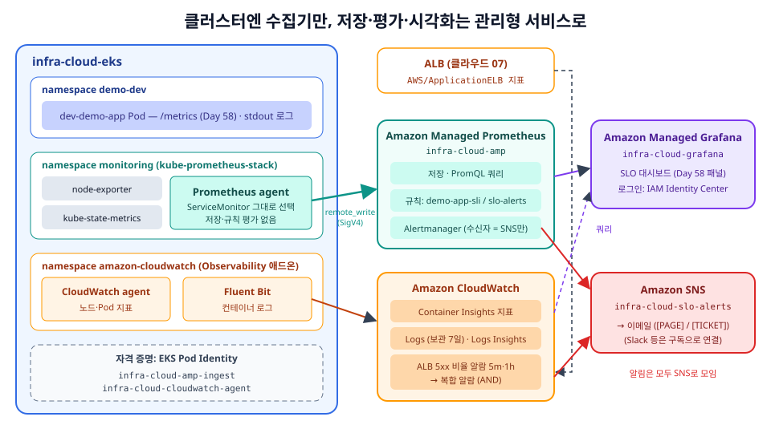
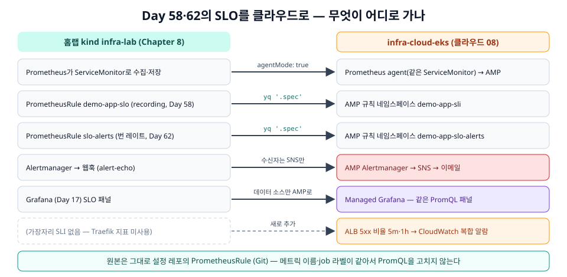

> **클라우드 · AWS** | 난이도 ★★★★★ | 예상 소요 4 ~ 5시간 | 💰 예상 비용 시간당 약 $0.35 + 수집량 비례 요금 + Managed Grafana 편집자 월 $9(90일 무료 체험) (실습 5시간 기준 약 $2 ~ 4, 2026-11-19 기준·변동 가능)

> ⚠️ **실습 전 반드시 읽을 것 — 비용 경고**
> - 바탕 비용은 클라우드 07과 같습니다: **EKS 컨트롤 플레인 시간당 $0.10**(표준 지원 버전, 노드가 없어도 과금), 노드 t3.medium 2대, **NAT 게이트웨이(서울 약 $0.06/시간 + 처리 GB당)**, ALB(약 $0.02/시간 + LCU).
> - 오늘 추가되는 것은 **쓴 만큼 늘어나는** 요금입니다. CloudWatch(Container Insights 관측값·로그 수집 GB·보관·알람 개수), **Amazon Managed Service for Prometheus**(수집 샘플 수·저장·쿼리 처리 샘플), **Amazon Managed Grafana**(워크스페이스당 활성 편집자 월 $9 / 뷰어 월 $5, 계정당 90일·5명 무료 체험), SNS 이메일(소량). **로그 그룹 보관 기간을 정하지 않으면 로그가 영구 보관**되어 매달 쌓입니다.
> - 수집 간격을 짧게, 라벨을 많이 잡을수록 AMP 비용이 커집니다. 오늘은 **수집 대상을 데모 앱과 기본 쿠버네티스 지표로 한정**합니다.
> - 리전 **`ap-northeast-2`**, 본인 샌드박스 계정, IAM Identity Center(SSO)·단기 자격 증명으로만. Managed Grafana 로그인에도 **클라우드 01에서 켠 IAM Identity Center**를 씁니다.
> - 실습 후 삭제: Helm 릴리스·애드온 제거 → `terraform destroy`(관측성 리소스 포함) → 로그 그룹·AMP·Grafana 워크스페이스가 남지 않았는지 확인. 맨 아래 [삭제 체크리스트](#-삭제-체크리스트)를 따르세요.

> 📌 **cloud02 고정값 기준** — VPC `infra-cloud-vpc` `10.20.0.0/16`(pub-a `10.20.0.0/24`·pub-c `10.20.1.0/24`, priv-a `10.20.10.0/24`·priv-c `10.20.11.0/24`, db-a `10.20.20.0/24`·db-c `10.20.21.0/24`, NAT `infra-cloud-nat-a` 1개), 이름 접두사 `infra-cloud-`, 태그 `Project=infra-study`·`Env=lab`·`Owner=<사용자명>`·`ManagedBy=terraform`·`Name`, 리전 `ap-northeast-2`, CLI 프로필 `infra-admin`(SSO 세션 `infra-sso`), 작업 폴더 `~/infra-cloud/`, Terraform `~/infra-cloud/terraform/{network,eks}`, 상태 버킷 `infra-cloud-tfstate-<계정ID>`(S3 네이티브 잠금 `use_lockfile`), 클러스터 `infra-cloud-eks`. 클러스터는 [클라우드 06](./cloud06-eks-cluster.md)의 `infra-cloud-eks`, 데모 앱은 [클라우드 07](./cloud07-eks-gitops.md)에서 Argo CD로 배포한 `demo-dev/dev-demo-app`(ALB `k8s-infracloudpub-…`)입니다.

## 🎯 오늘의 목표

- **CloudWatch Container Insights**(Observability 애드온)로 노드·Pod 지표와 컨테이너 로그를 모으고, Logs Insights로 검색한다
- **Amazon Managed Service for Prometheus(AMP)** 에 **Prometheus agent 모드**로 데모 앱 지표를 보내고, 관리형 수집기·ADOT와 비교한다
- **Amazon Managed Grafana(AMG)** 에서 AMP를 데이터 소스로 SLO 대시보드를 만든다
- [Day 58](../08-sre-observability/day58-sre-slo.md)의 SLI recording rule과 Day 62의 번 레이트 알림을 **AMP 규칙 + Alertmanager → SNS**로 옮긴다
- 같은 SLO를 **ALB 지표 + CloudWatch 복합 알람**으로도 만들어 "어디서 측정하나"의 차이를 설명한다

---

## 1. 홈랩 관측성 스택을 AWS로 옮기면

[Day 17](../02-kubernetes/day17-monitoring.md)에서 kube-prometheus-stack 하나로 Prometheus·Alertmanager·Grafana를 띄웠고, Chapter 8에서 SLO·로그·트레이스·알림을 쌓았습니다. 클라우드에서는 **저장·평가·시각화를 관리형 서비스에 넘기고, 클러스터에는 수집기만** 남기는 것이 기본 모양입니다.



### 홈랩 대응 표

| 본편 Day | 홈랩에서 쓴 것 | AWS에서 대응하는 것 | 오늘 |
|---|---|---|---|
| [Day 17](../02-kubernetes/day17-monitoring.md) | Prometheus (저장·쿼리·규칙) | **AMP** 워크스페이스 (저장·쿼리·규칙 평가) | ✅ |
| Day 17 | Prometheus의 스크레이프 | Prometheus **agent 모드** / AMP 관리형 수집기 / ADOT | ✅ agent |
| Day 17 | Grafana | **Amazon Managed Grafana** | ✅ |
| [Day 58](../08-sre-observability/day58-sre-slo.md) | PrometheusRule (recording) | AMP **규칙 그룹 네임스페이스** | ✅ |
| [Day 62](../08-sre-observability/day62-alerting.md) | Alertmanager → 웹훅 | AMP **Alertmanager → SNS** (수신자는 SNS만 지원) | ✅ |
| [Day 60](../08-sre-observability/day60-loki-alloy.md) | Loki + Alloy | **CloudWatch Logs** + Fluent Bit (Observability 애드온) | ✅ |
| [Day 61](../08-sre-observability/day61-tempo.md) | Tempo | AWS X-Ray / CloudWatch Application Signals | 개념만 |
| Day 17 node-exporter·cAdvisor | 노드·컨테이너 지표 | **Container Insights** | ✅ |

| 관측 데이터 | 오늘 가는 곳 | 왜 |
|---|---|---|
| 앱 SLI 지표 (`http_requests_total` 등) | AMP | Day 58의 PromQL·recording rule을 그대로 재사용 |
| 노드·Pod 자원 지표 | CloudWatch Container Insights | 콘솔 대시보드가 바로 생기고 AWS 알람과 바로 연결 |
| 컨테이너 로그 | CloudWatch Logs | Logs Insights 검색, 보관 기간 설정 |
| ALB 요청·5xx | CloudWatch (`AWS/ApplicationELB`, 자동) | **사용자 가장자리에서 본 SLI** |

---

## 2. 실습 준비 — Terraform 파일 추가

클라우드 06·07의 `~/infra-cloud/terraform/eks`에 `observability.tf`와 `rules/` 디렉터리를 더합니다. 앞 편의 리소스가 떠 있어야 합니다.

```bash
cd ~/infra-cloud/terraform/network && terraform apply     # 지웠다면
cd ../eks && terraform apply               # infra-cloud-eks + 클라우드 07 역할·인증서
# 클라우드 07의 6장(Argo CD, LBC, ExternalDNS, Application)까지 다시 적용해 dev-demo-app과 ALB를 띄워 둠
kubectl -n demo-dev get ingress dev-demo-app
```

```text
~/infra-cloud/terraform/eks/
├── ... (클라우드 06·07 파일)
├── observability.tf      # 오늘
└── rules/
    ├── demo-app-sli.yaml         # Day 58 recording rule
    └── demo-app-slo-alerts.yaml  # Day 62 알림
```

---

## 3. 실습 ① CloudWatch Container Insights

### 3-1. 로그 그룹을 먼저, 보관 7일로

Observability 애드온의 Fluent Bit은 로그 그룹이 없으면 **보관 기간 "만료 없음"으로 직접 만듭니다.** 비용을 통제하려면 Terraform으로 먼저 만들어 둡니다.

```hcl
# eks/observability.tf (1/4) — Container Insights
resource "aws_cloudwatch_log_group" "container_insights" {
  for_each          = toset(["application", "dataplane", "host", "performance"])
  name              = "/aws/containerinsights/${local.cluster_name}/${each.key}"
  retention_in_days = 7
}

module "cloudwatch_pod_identity" {
  source  = "terraform-aws-modules/eks-pod-identity/aws"
  version = "~> 2.11"

  name                                       = "infra-cloud-cloudwatch-agent"
  attach_aws_cloudwatch_observability_policy = true   # CloudWatchAgentServerPolicy 등 (X-Ray 쓰기 포함)
  # association은 애드온의 pod_identity_association이 만든다
}
```

```bash
terraform apply -target=aws_cloudwatch_log_group.container_insights -target=module.cloudwatch_pod_identity
```

### 3-2. 애드온 추가

클라우드 06 `eks.tf`의 `addons` 맵에 한 항목을 더합니다.

```hcl
# eks/eks.tf — module "eks" 의 addons 안에 추가
    amazon-cloudwatch-observability = {
      pod_identity_association = [{
        role_arn        = module.cloudwatch_pod_identity.iam_role_arn
        service_account = "cloudwatch-agent"
      }]
    }
```

```bash
terraform apply
kubectl -n amazon-cloudwatch get pods
# NAME                                                              READY   STATUS
# amazon-cloudwatch-observability-controller-manager-6c8f9d7b5-x2k8q   1/1     Running
# cloudwatch-agent-4kq8z                                            1/1     Running   ← 노드마다
# cloudwatch-agent-q9m4d                                            1/1     Running
# fluent-bit-7xk2p                                                  1/1     Running   ← 노드마다
# fluent-bit-tz7mw                                                  1/1     Running
```

| 애드온이 하는 일 | 결과 |
|---|---|
| CloudWatch 에이전트(DaemonSet) | `ContainerInsights` 네임스페이스에 클러스터·노드·Pod·컨테이너 지표 (**enhanced observability**) |
| Fluent Bit(DaemonSet) | `/aws/containerinsights/infra-cloud-eks/application` 등 로그 그룹으로 컨테이너 로그 |
| Application Signals | **기본으로 켜짐** — 요청 수 기반 과금. 필요 없으면 애드온 고급 설정으로 끔(문서의 *Opt out of Application Signals*) |

> 💡 애드온 v6.2.0 이상은 **OTel Container Insights**(OTLP로 수집, PromQL 질의 지원)도 켤 수 있고 AWS 문서는 이를 *Recommended*로 표시합니다. 과금 방식이 GB 단위로 달라지니, 쓰기 전에 CloudWatch 요금 페이지를 확인하세요. 오늘은 기본(enhanced observability)으로 진행합니다.

### 3-3. 지표와 로그 확인

```bash
aws cloudwatch list-metrics --region ap-northeast-2 --namespace ContainerInsights \
  --dimensions Name=ClusterName,Value=infra-cloud-eks --query 'Metrics[].MetricName' --output text | tr '\t' '\n' | sort -u | head
# cluster_failed_node_count
# cluster_node_count
# node_cpu_utilization
# node_memory_utilization
# pod_cpu_utilization
# pod_memory_utilization
# pod_number_of_container_restarts
# ...
```

콘솔 **CloudWatch → Insights → Container Insights**에서 클러스터 → 네임스페이스 `demo-dev` → Pod로 내려가 봅니다. Day 17에서 Grafana 기본 대시보드로 보던 것과 같은 그림이 설정 없이 나옵니다.

로그는 **Logs Insights**에서 로그 그룹 `/aws/containerinsights/infra-cloud-eks/application`을 고르고 질의합니다(Day 60의 LogQL 대응).

```text
fields @timestamp, kubernetes.pod_name, log
| filter kubernetes.namespace_name = "demo-dev" and log like /500/
| sort @timestamp desc
| limit 20
```

```text
# 5분 단위 에러 로그 수 (LogQL의 count_over_time 대응)
filter kubernetes.namespace_name = "demo-dev" and log like /simulated failure/
| stats count(*) as errors by bin(5m)
```

---

## 4. 실습 ② AMP 워크스페이스와 Prometheus agent

### 4-1. 수집 방법 고르기

| | **Prometheus agent 모드** (오늘) | AMP 관리형 수집기 (scraper) | ADOT (EKS 애드온 `adot`) |
|---|---|---|---|
| 클러스터에 도는 것 | Prometheus(agent) + node-exporter, kube-state-metrics | **없음** (AWS가 수집) | OpenTelemetry Collector |
| 대상 지정 | **ServiceMonitor 그대로** (Day 58 재사용) | `kubernetes_sd_configs` 스크레이프 설정만 (ServiceMonitor 미지원) | Prometheus receiver 설정 또는 Target Allocator |
| 규칙 평가 | 안 함 (agent는 저장·평가 없음) → AMP가 평가 | AMP가 평가 | AMP가 평가 |
| 제약 | Prometheus 운영(메모리) | 수집 간격 **30초 이상**, 클러스터 **프라이빗 엔드포인트 필요**(클라우드 06에서 켬), 리전당 10개 | **cert-manager 선행 필요**, 트레이스(X-Ray)까지 한 번에 |
| 잘 맞는 곳 | Prometheus Operator 자산이 이미 있을 때 | 클러스터에 아무것도 깔기 싫을 때 | OTel로 지표·트레이스 통합(Day 59) |

오늘은 Day 17·58의 **ServiceMonitor를 그대로 쓰려고** agent 모드를 고릅니다. 관리형 수집기는 4-5에서 모양만 봅니다.

### 4-2. 워크스페이스와 쓰기 권한

```hcl
# eks/observability.tf (2/4) — AMP
resource "aws_prometheus_workspace" "lab" {
  alias = "infra-cloud-amp"
}

module "amp_ingest_pod_identity" {
  source  = "terraform-aws-modules/eks-pod-identity/aws"
  version = "~> 2.11"

  name                                             = "infra-cloud-amp-ingest"
  attach_amazon_managed_service_prometheus_policy  = true
  amazon_managed_service_prometheus_workspace_arns = [aws_prometheus_workspace.lab.arn]

  associations = {
    this = {
      cluster_name    = module.eks.cluster_name
      namespace       = "monitoring"
      service_account = "amp-ingest"       # Helm values의 serviceAccount.name과 같게
    }
  }
}

output "amp_workspace_id"   { value = aws_prometheus_workspace.lab.id }
output "amp_remote_write"   { value = "${aws_prometheus_workspace.lab.prometheus_endpoint}api/v1/remote_write" }
output "amp_query_endpoint" { value = aws_prometheus_workspace.lab.prometheus_endpoint }
```

```bash
terraform apply
terraform output -raw amp_remote_write
# https://aps-workspaces.ap-northeast-2.amazonaws.com/workspaces/ws-1a2b3c4d-.../api/v1/remote_write
```

### 4-3. kube-prometheus-stack을 agent 모드로

Day 17과 같은 차트, 같은 릴리스 이름 `monitoring`을 쓰되 **저장·규칙·Alertmanager·Grafana를 끄고 remote write만** 합니다.

```yaml
# kps-agent-values.yaml
crds:
  enabled: false                 # 클라우드 07에서 prometheus-operator-crds로 이미 설치
alertmanager:
  enabled: false                 # 알림은 AMP Alertmanager (6장)
grafana:
  enabled: false                 # 대시보드는 Managed Grafana (5장)
defaultRules:
  create: false                  # agent는 규칙을 평가하지 않음
kubeEtcd:
  enabled: false                 # EKS 컨트롤 플레인은 AWS 관리 → 스크레이프 불가
kubeScheduler:
  enabled: false
kubeControllerManager:
  enabled: false

prometheus:
  agentMode: true                # PrometheusAgent 리소스로 배포
  serviceAccount:
    create: true
    name: amp-ingest             # Pod Identity association 대상
  prometheusSpec:
    serviceMonitorSelectorNilUsesHelmValues: false   # 라벨과 무관하게 모든 ServiceMonitor 선택
    podMonitorSelectorNilUsesHelmValues: false
    scrapeInterval: 30s          # 15s → 30s: 샘플 수(=비용) 절반
    externalLabels:
      cluster: infra-cloud-eks
    remoteWrite:
    - url: https://aps-workspaces.ap-northeast-2.amazonaws.com/workspaces/ws-1a2b3c4d-.../api/v1/remote_write
      sigv4:
        region: ap-northeast-2   # 자격 증명은 Pod Identity → SDK 기본 체인
      queueConfig:
        maxSamplesPerSend: 1000
        maxShards: 20
```

```bash
helm upgrade --install monitoring prometheus-community/kube-prometheus-stack \
  -n monitoring --create-namespace -f kps-agent-values.yaml
kubectl -n monitoring get prometheusagent,pods
# NAME                                                          VERSION   REPLICAS
# prometheusagent.monitoring.coreos.com/monitoring-kube-prom-prometheus  v3.x   1
# pod/prom-agent-monitoring-kube-prom-prometheus-0   2/2   Running
# pod/monitoring-kube-state-metrics-...              1/1   Running
# pod/monitoring-prometheus-node-exporter-...        1/1   Running
```

데모 앱의 **ServiceMonitor는 클라우드 07의 `base`에 이미 있습니다**(Day 58). agent가 그것을 골라 `dev-demo-app`을 스크레이프합니다. 반면 `base`의 **PrometheusRule(Day 58·62)은 agent 모드에서 무시**됩니다 — 그 규칙은 6장에서 AMP로 옮깁니다.

> ⚠️ 리소스 이름(`prometheusagent`, Pod 이름)은 차트 버전에 따라 조금 다릅니다. `kubectl -n monitoring get prometheusagent` 가 비어 있으면 `prometheus.agentMode`가 반영되지 않은 것입니다.

### 4-4. AMP에 들어왔는지 질의

AMP 쿼리 API는 SigV4 서명이 필요합니다. `awscurl`을 씁니다.

```bash
pipx install awscurl            # 또는 pip install --user awscurl
WS=$(terraform output -raw amp_query_endpoint)
awscurl --service aps --region ap-northeast-2 \
  "${WS}api/v1/query?query=up%7Bjob%3D%22dev-demo-app%22%7D"
# {"status":"success","data":{"resultType":"vector","result":[
#   {"metric":{"__name__":"up","cluster":"infra-cloud-eks","job":"dev-demo-app","namespace":"demo-dev",...},"value":[1763556000,"1"]},
#   ...
```

`job="dev-demo-app"`이 Day 58과 같게 나오는 것이 중요합니다. 그래야 `job=~".+-demo-app"`을 쓰는 recording rule을 고치지 않고 옮길 수 있습니다.

### 4-5. (참고) 관리형 수집기 모양

클러스터에 아무것도 깔지 않고 AWS가 긁어 가게 하려면 스크레이퍼를 만듭니다. 대상은 ServiceMonitor가 아니라 Prometheus 설정 문법으로 적고, **Service 이름을 job 라벨로** 바꿔 줘야 Day 58 규칙과 맞습니다.

```yaml
# scraper.yaml (요점)
global:
  scrape_interval: 30s           # 30초 미만 불가
scrape_configs:
- job_name: demo-app
  kubernetes_sd_configs:
  - role: endpoints
  relabel_configs:
  - source_labels: [__meta_kubernetes_service_label_app_kubernetes_io_name, __meta_kubernetes_endpoint_port_name]
    regex: demo-app;http
    action: keep
  - source_labels: [__meta_kubernetes_service_name]
    target_label: job            # → dev-demo-app
  - source_labels: [__meta_kubernetes_namespace]
    target_label: namespace
```

```bash
aws amp create-scraper --region ap-northeast-2 \
  --source eksConfiguration="{clusterArn='arn:aws:eks:ap-northeast-2:123456789012:cluster/infra-cloud-eks',securityGroupIds=['sg-...'],subnetIds=['subnet-...','subnet-...']}" \
  --scrape-configuration configurationBlob="$(base64 -w0 scraper.yaml)" \
  --destination ampConfiguration="{workspaceArn='arn:aws:aps:ap-northeast-2:123456789012:workspace/ws-...'}"
```

클러스터가 `authentication_mode = "API"`라서 **스크레이퍼용 access entry가 자동 생성**됩니다(aws-auth를 손댈 필요 없음 — 클라우드 06 4장). 스크레이퍼는 클러스터를 지워도 **따로 지워야** 합니다(`aws amp delete-scraper`).

---

## 5. 실습 ③ Amazon Managed Grafana

### 5-1. 워크스페이스

```hcl
# eks/observability.tf (3/4) — Managed Grafana
variable "grafana_admin_user_id" {
  type        = string
  description = "IAM Identity Center 사용자 ID (aws identitystore list-users 로 확인)"
}

resource "aws_iam_role" "grafana" {
  name = "infra-cloud-grafana"
  assume_role_policy = jsonencode({
    Version = "2012-10-17"
    Statement = [{
      Effect    = "Allow"
      Principal = { Service = "grafana.amazonaws.com" }
      Action    = "sts:AssumeRole"
      Condition = { StringEquals = { "aws:SourceAccount" = data.aws_caller_identity.current.account_id } }
    }]
  })
}

resource "aws_iam_role_policy_attachment" "grafana_amp" {
  role       = aws_iam_role.grafana.name
  policy_arn = "arn:aws:iam::aws:policy/AmazonPrometheusQueryAccess"
}

resource "aws_iam_role_policy_attachment" "grafana_cw" {
  role       = aws_iam_role.grafana.name
  policy_arn = "arn:aws:iam::aws:policy/CloudWatchReadOnlyAccess"
}

resource "aws_grafana_workspace" "lab" {
  name                     = "infra-cloud-grafana"
  account_access_type      = "CURRENT_ACCOUNT"
  authentication_providers = ["AWS_SSO"]          # 클라우드 01의 IAM Identity Center
  permission_type          = "CUSTOMER_MANAGED"   # 위 역할을 직접 지정
  role_arn                 = aws_iam_role.grafana.arn
  data_sources             = ["PROMETHEUS", "CLOUDWATCH"]
}

resource "aws_grafana_role_association" "admin" {
  workspace_id = aws_grafana_workspace.lab.id
  role         = "ADMIN"
  user_ids     = [var.grafana_admin_user_id]
}

output "grafana_url" { value = "https://${aws_grafana_workspace.lab.endpoint}" }
```

```bash
aws identitystore list-users --region ap-northeast-2 \
  --identity-store-id "$(aws sso-admin list-instances --query 'Instances[0].IdentityStoreId' --output text)" \
  --query 'Users[].[UserName,UserId]' --output text
# me@example.com   9a67xxxx-xxxx-...
terraform apply -var grafana_admin_user_id=9a67xxxx-xxxx-...
terraform output -raw grafana_url
# https://g-1a2b3c4d5e.grafana-workspace.ap-northeast-2.amazonaws.com
```

> 💡 Identity Center가 다른 리전에 있다면 위 `--region`을 그 리전으로 바꿉니다. AMG 워크스페이스에 편집자(ADMIN/EDITOR)가 한 명이라도 있으면 그 워크스페이스는 **월 $9 라이선스** 대상입니다(체험 기간 제외).

### 5-2. 데이터 소스와 SLO 대시보드

1. `grafana_url`로 접속 → Identity Center로 로그인
2. **Apps → AWS Data Sources → Amazon Managed Service for Prometheus** → 리전 `ap-northeast-2` → `infra-cloud-amp` 추가 (인증은 워크스페이스 IAM 역할 + SigV4로 자동)
3. 같은 화면에서 **CloudWatch**도 추가
4. 새 대시보드에 Day 58의 패널을 그대로 만듭니다 — 6장 규칙이 들어간 뒤부터 값이 나옵니다.

| 패널 | 데이터 소스 | 쿼리 |
|---|---|---|
| 가용성 SLI (5m) | AMP | `namespace:sli_availability:ratio_rate5m{namespace="demo-dev"}` |
| 번 레이트 (1h) | AMP | `namespace:error_budget_burn_rate:1h{namespace="demo-dev"}` |
| 지연 SLI (300ms) | AMP | `namespace:sli_latency_300ms:ratio_rate5m{namespace="demo-dev"}` |
| ALB 5xx 비율 | CloudWatch | `AWS/ApplicationELB` `HTTPCode_Target_5XX_Count` / `RequestCount` (LoadBalancer = `app/k8s-infracloudpub-…`) |
| Pod 재시작 | CloudWatch | `ContainerInsights` `pod_number_of_container_restarts` (Namespace = demo-dev) |

> 💡 Day 17에서 Grafana 대시보드 JSON을 저장해 두었다면 **Import**로 그대로 가져올 수 있습니다. 데이터 소스 UID만 AMP 것으로 바꿔 주면 됩니다.

---

## 6. 실습 ④ Day 58·62의 SLO 알림을 AMP로



### 6-1. 규칙 파일 만들기 — Git이 여전히 원본

AMP 규칙 파일은 Prometheus 규칙 파일 형식(`groups:`)입니다. PrometheusRule CR의 `spec`이 정확히 그 모양이므로 **설정 레포의 파일에서 그대로 뽑아냅니다.**

```bash
# yq v4 (mikefarah/yq)
yq '.spec' ~/gitops-lab/gitops-demo-config/apps/demo-app/base/prometheusrule.yaml > rules/demo-app-sli.yaml
yq '.spec' ~/gitops-lab/gitops-demo-config/apps/demo-app/base/slo-alerts.yaml    > rules/demo-app-slo-alerts.yaml
head -8 rules/demo-app-sli.yaml
# groups:
#   - name: demo-app.sli
#     interval: 30s
#     rules:
#       - record: namespace:http_requests_errors:ratio_rate5m
#         expr: |
#           sum by (namespace) (rate(http_requests_total{job=~".+-demo-app", route!="/healthz", code=~"5.."}[5m]))
```

> 💡 원본은 계속 **설정 레포의 PrometheusRule** 입니다. kind(홈랩)에서는 Prometheus Operator가 읽고, EKS에서는 이 변환 결과를 AMP가 읽습니다. 설정 레포에 CI를 하나 두어 PrometheusRule이 바뀌면 이 변환과 `terraform plan`(클라우드 05의 OIDC plan 역할)을 돌리게 하면 둘이 어긋나지 않습니다.

### 6-2. 규칙·Alertmanager·SNS를 Terraform으로

```hcl
# eks/observability.tf (4/4) — 규칙과 알림
resource "aws_prometheus_rule_group_namespace" "sli" {
  name         = "demo-app-sli"
  workspace_id = aws_prometheus_workspace.lab.id
  data         = file("${path.module}/rules/demo-app-sli.yaml")
}

resource "aws_prometheus_rule_group_namespace" "slo_alerts" {
  name         = "demo-app-slo-alerts"
  workspace_id = aws_prometheus_workspace.lab.id
  data         = file("${path.module}/rules/demo-app-slo-alerts.yaml")
}

variable "alert_email" { type = string }

resource "aws_sns_topic" "slo" {
  name = "infra-cloud-slo-alerts"
}

resource "aws_sns_topic_policy" "slo" {
  arn = aws_sns_topic.slo.arn
  policy = jsonencode({
    Version = "2012-10-17"
    Statement = [
      {
        Sid       = "AllowAMP"
        Effect    = "Allow"
        Principal = { Service = "aps.amazonaws.com" }
        Action    = ["sns:Publish", "sns:GetTopicAttributes"]
        Resource  = aws_sns_topic.slo.arn
        Condition = {
          ArnEquals    = { "aws:SourceArn" = aws_prometheus_workspace.lab.arn }
          StringEquals = { "aws:SourceAccount" = data.aws_caller_identity.current.account_id }
        }
      },
      {
        Sid       = "AllowCloudWatchAlarms"
        Effect    = "Allow"
        Principal = { Service = "cloudwatch.amazonaws.com" }
        Action    = "sns:Publish"
        Resource  = aws_sns_topic.slo.arn
        Condition = { StringEquals = { "aws:SourceAccount" = data.aws_caller_identity.current.account_id } }
      }
    ]
  })
}

resource "aws_sns_topic_subscription" "email" {
  topic_arn = aws_sns_topic.slo.arn
  protocol  = "email"
  endpoint  = var.alert_email          # 메일의 "Confirm subscription"을 눌러야 활성화
}

resource "aws_prometheus_alert_manager_definition" "lab" {
  workspace_id = aws_prometheus_workspace.lab.id
  definition   = <<-EOT
    alertmanager_config: |
      route:
        receiver: sns-ticket
        group_by: ['alertname', 'namespace']
        group_wait: 30s
        group_interval: 5m
        repeat_interval: 4h
        routes:
          - matchers: ['severity="page"']
            receiver: sns-page
            repeat_interval: 1h
      receivers:
        - name: sns-page
          sns_configs:
            - topic_arn: ${aws_sns_topic.slo.arn}
              sigv4:
                region: ap-northeast-2
              subject: '[PAGE] {{ .CommonLabels.alertname }} {{ .CommonLabels.namespace }}'
              attributes:
                severity: page
        - name: sns-ticket
          sns_configs:
            - topic_arn: ${aws_sns_topic.slo.arn}
              sigv4:
                region: ap-northeast-2
              subject: '[TICKET] {{ .CommonLabels.alertname }} {{ .CommonLabels.namespace }}'
              attributes:
                severity: ticket
  EOT
}
```

```bash
terraform apply -var grafana_admin_user_id=9a67xxxx-... -var alert_email=me@example.com
# 메일함에서 "AWS Notification - Subscription Confirmation" → Confirm subscription

aws amp describe-rule-groups-namespace --region ap-northeast-2 \
  --workspace-id "$(terraform output -raw amp_workspace_id)" --name demo-app-slo-alerts \
  --query 'ruleGroupsNamespace.status.statusCode'
# "ACTIVE"
```

| Day 58·62 (홈랩) | 클라우드 08 (AMP) | 달라진 점 |
|---|---|---|
| PrometheusRule `release: monitoring` 라벨로 선택 | 규칙 그룹 네임스페이스 2개 | 라벨 대신 네임스페이스 이름으로 관리 |
| Alertmanager 웹훅 → `alert-echo` | Alertmanager → **SNS만** (다른 수신자는 설정 자체가 거부됨) | Slack·PagerDuty는 SNS 구독(Chatbot·Lambda·HTTPS)으로 연결 |
| `repeat_interval` 자유 | 최대 **5일** (넘기면 5일로 취급) | |
| `{{ $labels.namespace }}` 템플릿 | 그대로 동작 | `runbook_url` 주석도 메일 본문에 포함 |

> ⚠️ Alertmanager 정의의 `${aws_sns_topic.slo.arn}`은 **Terraform 보간**, `{{ .CommonLabels... }}`는 **Alertmanager 템플릿**입니다. heredoc 안에서 둘이 섞이므로 Terraform이 `{{`를 건드리지 않는지 `terraform plan`에서 렌더링 결과를 확인하세요(`%{`·`${`만 Terraform이 해석합니다).

### 6-3. 장애를 내서 메일 받기

Day 58 8-1과 같은 부하를 EKS에서 겁니다.

```bash
kubectl -n demo-dev run loadgen --image=curlimages/curl --restart=Never -- \
  sh -c 'while true; do curl -s -o /dev/null "http://dev-demo-app/work?error_rate=0.05"; sleep 0.1; done'

# 몇 분 뒤 번 레이트 확인 (AMP가 평가한 recording rule)
awscurl --service aps --region ap-northeast-2 \
  "${WS}api/v1/query?query=namespace:error_budget_burn_rate:1h"
# ... "value":[..., "18.7"]   ← 1시간 창이 차오르는 중

# AMP Alertmanager에 올라온 알림
awscurl --service aps --region ap-northeast-2 "${WS}alertmanager/api/v2/alerts" | jq '.[].labels.alertname'
# "SLOErrorBudgetBurnFast"
```

에러율 5%에서 1시간 창 에러율이 기준(14.4 × 0.1% = 1.44%)을 넘기까지 십수 분, 그 뒤 `for: 2m`을 채우면 **`[PAGE] SLOErrorBudgetBurnFast demo-dev`** 메일이 옵니다(Day 62 4-1과 같은 타이밍). 확인 후 `kubectl -n demo-dev delete pod loadgen`.

---

## 7. 실습 ⑤ 같은 SLO를 ALB 지표로 — CloudWatch 복합 알람

Day 58 3-2에서 "SLI를 어디서 측정하나"를 비교했습니다. AMP의 규칙은 **앱이 스스로 센 값**이고, ALB 지표는 **사용자 바로 앞(가장자리)에서 센 값**입니다. Pod가 아예 응답을 못 해 앱 지표가 끊기는 장애는 ALB 쪽에서만 보입니다. 같은 다중 창 아이디어를 CloudWatch로 만들어 봅니다.

```hcl
# eks/alb-slo.tf — ALB는 클라우드 07의 LBC가 만든 것을 태그로 찾음 (ALB가 떠 있어야 plan 가능)
data "aws_lb" "public" {
  tags = { "ingress.k8s.aws/stack" = "infra-cloud-public" }      # group.name
}

locals {
  windows = { "5m" = 300, "1h" = 3600 }
}

resource "aws_cloudwatch_metric_alarm" "alb_5xx_ratio" {
  for_each            = local.windows
  alarm_name          = "infra-cloud-alb-5xx-ratio-${each.key}"
  comparison_operator = "GreaterThanThreshold"
  threshold           = 0.0144                 # 14.4 × 0.1% (Day 62의 fast burn 기준)
  evaluation_periods  = 1
  treat_missing_data  = "notBreaching"

  metric_query {
    id          = "ratio"
    expression  = "FILL(errors, 0) / requests"
    label       = "ALB 5xx 비율 ${each.key}"
    return_data = true
  }
  metric_query {
    id = "errors"
    metric {
      namespace   = "AWS/ApplicationELB"
      metric_name = "HTTPCode_Target_5XX_Count"
      period      = each.value
      stat        = "Sum"
      dimensions  = { LoadBalancer = data.aws_lb.public.arn_suffix }
    }
  }
  metric_query {
    id = "requests"
    metric {
      namespace   = "AWS/ApplicationELB"
      metric_name = "RequestCount"
      period      = each.value
      stat        = "Sum"
      dimensions  = { LoadBalancer = data.aws_lb.public.arn_suffix }
    }
  }
}

resource "aws_cloudwatch_composite_alarm" "alb_slo_fast_burn" {
  alarm_name    = "infra-cloud-alb-slo-fast-burn"
  alarm_rule    = "ALARM(\"infra-cloud-alb-5xx-ratio-5m\") AND ALARM(\"infra-cloud-alb-5xx-ratio-1h\")"
  alarm_actions = [aws_sns_topic.slo.arn]
  ok_actions    = [aws_sns_topic.slo.arn]
  depends_on    = [aws_cloudwatch_metric_alarm.alb_5xx_ratio]
}
```

```bash
terraform apply -var grafana_admin_user_id=... -var alert_email=...
# 6-3의 부하를 이번엔 ALB를 거쳐서
kubectl -n demo-dev run loadgen-ext --image=curlimages/curl --restart=Never -- \
  sh -c 'while true; do curl -s -o /dev/null "https://demo.example.com/work?error_rate=0.05"; sleep 0.1; done'
aws cloudwatch describe-alarms --region ap-northeast-2 --alarm-name-prefix infra-cloud-alb \
  --query 'CompositeAlarms[].StateValue' --output text
# ALARM        ← 5m·1h 둘 다 ALARM일 때만
```

| | AMP 번 레이트 알림 (6장) | ALB 복합 알람 (7장) |
|---|---|---|
| 측정 위치 | 앱 내부 (`http_requests_total`) | 가장자리 (ALB) |
| `/healthz` 제외 | `route!="/healthz"`로 제외 | ALB 헬스 체크는 `RequestCount`에 안 들어감. 단, 경로별 구분은 불가 |
| 잡는 장애 | 앱 로직 오류, 경로별 SLI | 앱 오류 + **Pod 전부 다운·대상 없음**(`HTTPCode_ELB_5XX_Count`도 더하면) |
| 다중 창 | PromQL `and` | **복합 알람** `ALARM() AND ALARM()` |
| 비용 | AMP 규칙 평가 샘플 | 알람 개수(지표 수학 알람 포함) |

> 💡 CloudWatch **Application Signals**에도 SLO 기능(서비스 SLO, 번 레이트)이 있습니다. 애드온이 Application Signals를 켜 두었으니 콘솔 *Application Signals → SLOs*에서 같은 99.9%/30일 SLO를 클릭으로 만들어 비교해 볼 수 있습니다(요금은 SLO마다 별도 신호로 과금).

> 💡 Day 63의 **SLO 기반 카나리 분석**을 EKS에서 다시 쓰려면 AnalysisTemplate의 Prometheus 주소를 AMP 쿼리 엔드포인트로 바꾸고 SigV4 인증을 켜야 합니다. Argo Rollouts의 Prometheus 공급자 문서에서 AMP(SigV4) 설정 항목을 확인한 뒤 클라우드 07의 `eks-dev` overlay에 분석을 되살리세요.

---

## 8. 비용 감 잡기와 줄이는 법

| 항목 | 과금 단위 | 오늘 구성에서 줄이는 법 |
|---|---|---|
| Container Insights (enhanced) | 관측값 수 | 필요 없는 네임스페이스·Application Signals 끄기 |
| CloudWatch Logs | 수집 GB + 보관 GB-월 + Logs Insights 스캔 GB | **보관 7일**, 디버그 로그 끄기, 질의 시간 범위 좁히기 |
| CloudWatch 알람 | 알람 개수(지표 수학·복합 포함) | 실습 후 삭제 |
| AMP | 수집 샘플 수 · 저장 · 쿼리 처리 샘플 | 수집 간격 30s, 쓰지 않는 지표 `metricRelabelings`로 drop, 라벨 카디널리티 관리 |
| AMG | 워크스페이스당 활성 편집자 $9/월, 뷰어 $5/월 | 체험 90일 안에 실습, 끝나면 워크스페이스 삭제 |
| SNS 이메일 | 소량 무료 범위 | — |

> 💡 kube-state-metrics·node-exporter의 기본 지표만으로도 시계열이 수천 개입니다. AMP 콘솔의 워크스페이스 **사용량(Ingestion rate)** 과 CloudWatch의 `AWS/Prometheus` 지표를 보면서, 실습이 끝나면 바로 `helm uninstall`로 수집을 멈추는 것이 가장 확실한 절약입니다.

---

## 9. 트러블슈팅

| 증상 | 원인 | 해결 |
|---|---|---|
| Container Insights에 데이터 없음, 에이전트 로그에 `AccessDenied` | 애드온 Pod Identity 연결 누락 | `aws eks list-pod-identity-associations`에 `amazon-cloudwatch/cloudwatch-agent`가 있는지, 없으면 `pod_identity_association` 추가 후 apply |
| `ResourceAlreadyExistsException` (로그 그룹) | 애드온이 로그 그룹을 먼저 만듦 | `terraform import 'aws_cloudwatch_log_group.container_insights["application"]' /aws/containerinsights/infra-cloud-eks/application` |
| agent 로그 `remote_write ... 403` | Pod Identity 자격 증명 미주입(association 후 Pod 미재시작) 또는 워크스페이스 ARN 불일치 | `kubectl -n monitoring delete pod -l app.kubernetes.io/name=prometheus`, 정책의 워크스페이스 ARN 확인. 아주 오래된 Prometheus 이미지는 Pod Identity 자격 증명을 못 읽으므로 차트를 최신으로 |
| AMP `up`에 `dev-demo-app`이 없음 | ServiceMonitor가 선택되지 않음 | `serviceMonitorSelectorNilUsesHelmValues: false`, `kubectl -n demo-dev get servicemonitor` |
| 규칙 네임스페이스 `CREATION_FAILED` | 규칙 파일 문법 오류 (`spec:`까지 들어감 등) | `promtool check rules rules/*.yaml`, 최상위가 `groups:`인지 |
| 알림이 AMP에는 있는데 메일이 안 옴 | SNS 구독 미확인 / 토픽 정책에 `aps.amazonaws.com` 없음 | 구독 상태 `PendingConfirmation` 확인, 6-2 토픽 정책 |
| Alertmanager 정의 거부 | SNS 외 수신자(webhook 등) 포함 | `sns_configs`만 사용 |
| AMG 로그인 불가 | Identity Center 미사용 / 사용자 미할당 | 클라우드 01에서 Identity Center 활성화, `aws_grafana_role_association` |
| `data.aws_lb.public` plan 실패 | ALB가 아직 없음(클라우드 07 Ingress 미적용) | Ingress가 ALB를 만든 뒤 plan |
| 1h 알람이 너무 늦게 울림 | 긴 창은 원래 느림 | 5m과 AND로 묶은 이유. 빨리 꺼지는 것은 5m 쪽이 담당 |

---

## 10. 핵심 정리

- 클라우드 관측성의 기본 모양: **클러스터엔 수집기만, 저장·평가·시각화는 관리형**(CloudWatch, AMP, AMG)
- Container Insights는 **Observability 애드온 + Pod Identity**. Fluent Bit 로그 그룹은 **Terraform으로 먼저 만들고 보관 기간을 정한다**
- AMP 수집은 **Prometheus agent(ServiceMonitor 재사용)** / 관리형 수집기(에이전트 없음, 30초 이상) / ADOT(OTel, cert-manager 필요) 중 선택
- Day 58·62의 PrometheusRule은 `spec`만 뽑아 **AMP 규칙 그룹 네임스페이스**로, Alertmanager 수신자는 **SNS만**
- 같은 SLO를 **ALB 지표 + 복합 알람**으로도 만들면 앱이 못 세는 장애(가장자리 SLI)까지 잡는다
- 비용은 **샘플 수·로그 GB·편집자 수**에 비례 → 수집 간격·보관 기간·실습 후 즉시 삭제

---

## 11. 셀프 체크

<details>
<summary>Q1. Prometheus를 agent 모드로 돌리면 Day 58의 PrometheusRule은 왜 동작하지 않고, 그 규칙은 어디서 평가되나?</summary>

agent 모드는 스크레이프와 remote write만 하고 **로컬 저장(TSDB)·쿼리·규칙 평가·알림을 하지 않습니다.** 그래서 클러스터 안의 PrometheusRule은 무시되고, 같은 내용을 AMP의 **규칙 그룹 네임스페이스**에 올려 AMP가 평가합니다. 알림 라우팅도 AMP의 Alertmanager가 맡습니다.
</details>

<details>
<summary>Q2. AMP 관리형 수집기를 쓸 때 Day 58 recording rule을 고치지 않으려면 스크레이프 설정에서 무엇을 맞춰야 하나?</summary>

규칙이 `job=~".+-demo-app"`과 `namespace` 라벨에 의존하므로, relabel로 **Service 이름을 `job`** 에, 네임스페이스를 `namespace` 라벨에 넣어야 합니다. ServiceMonitor는 이 일을 자동으로 해 줬지만 관리형 수집기는 ServiceMonitor를 읽지 않습니다. 또 수집 간격은 30초 이상이어야 합니다.
</details>

<details>
<summary>Q3. Container Insights 로그 그룹을 Terraform으로 미리 만드는 이유는?</summary>

애드온의 Fluent Bit은 로그 그룹이 없으면 직접 만드는데, 이때 **보관 기간이 "만료 없음"** 이라 로그가 계속 쌓여 보관 요금이 늘어납니다. 미리 `retention_in_days = 7`로 만들어 두면 비용이 통제되고, `terraform destroy`로 함께 지울 수도 있습니다.
</details>

<details>
<summary>Q4. AMP 번 레이트 알림과 ALB 5xx 복합 알람이 서로 다른 판단을 내리는 상황을 하나 들어라.</summary>

모든 Pod가 죽어 ALB가 대상 없이 503을 직접 돌려주는 경우, 앱은 요청을 받지 못하니 `http_requests_total`이 늘지 않아(또는 스크레이프 실패로 데이터가 끊겨) AMP 규칙은 에러를 못 셉니다. ALB 쪽 `HTTPCode_ELB_5XX_Count`/`RequestCount`에는 그대로 드러납니다. 반대로 `/work`만 실패하고 다른 경로는 정상인 경우, 경로별로 나눠 보는 것은 앱 지표만 가능합니다.
</details>

<details>
<summary>Q5. Managed Grafana를 한 달 켜 두고 편집자 1명이 로그인했다면 라이선스 비용은? 아무도 로그인하지 않았다면?</summary>

체험 기간이 아니라면 활성 편집자 1명 × 월 $9입니다. AWS 요금 페이지는 **각 워크스페이스에 최소 한 명의 편집자 라이선스가 필요**하다고 하므로, 아무도 로그인하지 않아도 워크스페이스가 있으면 비용이 생길 수 있습니다. 실습이 끝나면 워크스페이스를 지웁니다.
</details>

---

## 🧹 삭제 체크리스트

```bash
kubectl config use-context infra-cloud-eks
kubectl -n demo-dev delete pod loadgen loadgen-ext --ignore-not-found

# 1) 클러스터 안 수집기
helm -n monitoring uninstall monitoring
kubectl delete namespace monitoring

# 2) 관측성 리소스 (알람, 규칙, Alertmanager, SNS, Grafana, AMP, 로그 그룹, 애드온)
#    eks.tf의 amazon-cloudwatch-observability 항목을 지우고 apply → 애드온 제거
#    그 다음 observability.tf · alb-slo.tf 를 지우고 apply (또는 아래 전체 destroy)

# 3) 앱·컨트롤러 → 클러스터 → 네트워크 (클라우드 07 체크리스트 순서 그대로)
kubectl -n argocd delete application gitops-demo-eks-dev     # ALB 삭제 대기
helm -n external-dns uninstall external-dns
helm -n kube-system uninstall aws-load-balancer-controller
cd ~/infra-cloud/terraform/eks && terraform destroy -var grafana_admin_user_id=x -var alert_email=x
cd ../network && terraform destroy
```

- [ ] `aws amp list-workspaces --region ap-northeast-2 --query 'workspaces[].alias'` → `infra-cloud-amp` 없음
- [ ] `aws amp list-scrapers --region ap-northeast-2 --query 'scrapers[].scraperId'` → `[]` (4-5를 해 봤다면 **따로** 삭제: `aws amp delete-scraper --scraper-id ...`)
- [ ] `aws grafana list-workspaces --region ap-northeast-2 --query 'workspaces[].name'` → `infra-cloud-grafana` 없음
- [ ] `aws logs describe-log-groups --region ap-northeast-2 --log-group-name-prefix /aws/containerinsights/infra-cloud-eks --query 'logGroups[].logGroupName'` → `[]` (애드온이 따로 만든 그룹이 남았다면 `aws logs delete-log-group`)
- [ ] `aws logs describe-log-groups --region ap-northeast-2 --log-group-name-prefix /aws/application-signals --query 'logGroups[].logGroupName'` → Application Signals가 만든 그룹이 남았다면 삭제
- [ ] `aws cloudwatch describe-alarms --region ap-northeast-2 --alarm-name-prefix infra-cloud- --query '[MetricAlarms[].AlarmName, CompositeAlarms[].AlarmName]'` → 빈 목록
- [ ] `aws sns list-topics --region ap-northeast-2 --query 'Topics[].TopicArn'` → `infra-cloud-slo-alerts` 없음
- [ ] 클라우드 06·07 체크리스트(EKS·ALB·대상 그룹·EBS·NAT·EIP·Route 53 레코드)

---

## ⏭️ 다음 예고 — 클라우드 09. 클라우드 보안 — GuardDuty, Security Hub, KMS, CloudTrail, IAM Access Analyzer

관측이 "잘 돌고 있나"였다면, 다음 편 [클라우드 09](./cloud09-security.md)는 "**누가 무엇을 했고, 위험한 설정은 없나**"입니다.

- **CloudTrail**로 계정의 모든 API 호출 기록 — 오늘 만든 Pod Identity 역할의 호출도 남습니다
- **GuardDuty**(EKS 감사 로그·런타임 모니터링)와 **Security Hub**로 위협·설정 점검을 한곳에 — Day 72 Falco의 클라우드 버전
- **KMS**로 EKS Secret·EBS·S3 암호화, **IAM Access Analyzer**로 클라우드 07의 Pod Identity 역할 같은 권한 범위 점검
- 오늘 만든 **SNS 알림 경로**에 보안 탐지 결과까지 연결

> 💰 GuardDuty·Security Hub는 무료 체험 기간 이후 분석량에 따라 과금되고, EKS($0.10/h)·NAT 비용은 그대로입니다. 실습을 몰아서 하고 [클라우드 11](./cloud11-finops-cleanup.md)의 삭제 체크리스트로 마무리합니다.
