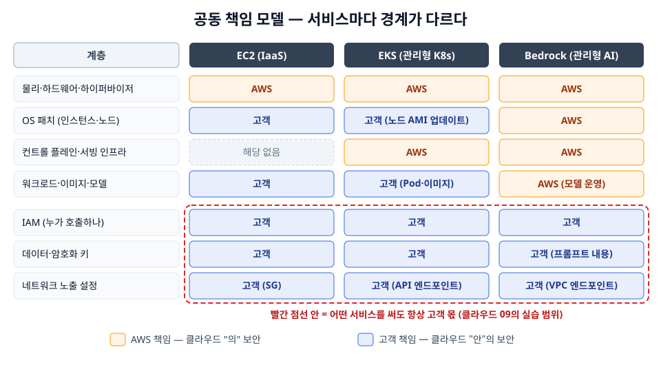
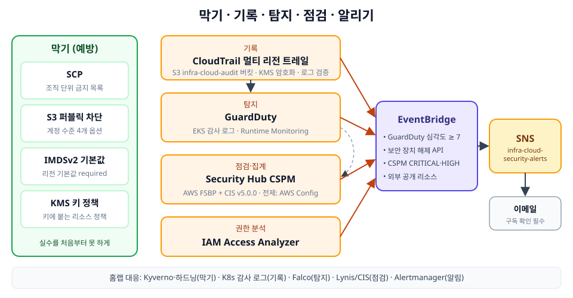

> **클라우드 · AWS** | 난이도 ★★★★☆ | 예상 소요 2.5 ~ 3시간 | 💰 예상 비용 실습 하루 약 $1~3 (무료 체험 기간 기준, 2026-11-19 확인, 변동 가능)

> 💸 **비용 경고 — 실습 전에 반드시 읽기**
> - 오늘 켜는 서비스 대부분은 **프리 티어가 아니라 "30일 무료 체험"** 입니다. GuardDuty, Security Hub CSPM은 체험이 끝나면 **자동으로 꺼지지 않고 과금이 시작**됩니다.
> - 체험 기간에도 과금되는 것: **AWS Config 구성 항목**(Security Hub CSPM이 필요로 함, 서울 $0.003/항목), **KMS 고객 관리형 키**(키 버전당 월 $1), **IAM Access Analyzer 미사용 접근 분석**(역할·사용자당 월 $0.20), CloudTrail 로그를 담는 S3 저장 요금.
> - 가격은 AWS Price List(2026-11-19 조회, `ap-northeast-2`) 기준이며 **변동 가능**합니다.
> - 실습 후 삭제는 **8장 "정리"** 의 명령을 그대로 실행하세요. 계정 수준 S3 퍼블릭 차단과 IMDSv2 기본값은 **무료이므로 켜 둔 채** 두는 것을 권장합니다.
> - **본인 소유 샌드박스 계정에서만** 하세요. 액세스 키 대신 클라우드 01에서 만든 **IAM Identity Center(SSO) 단기 자격 증명**(`aws sso login`)을 씁니다.

> 📌 **이 탭의 고정값** — 클라우드 01~08에서 정한 값을 그대로 씁니다.
> 리전 `ap-northeast-2` · VPC `10.20.0.0/16` · 리소스 이름 접두사 `infra-cloud-` · 공통 태그 `Project=infra-study`, `Env=lab` · CLI 프로필 `infra-admin` · EKS 클러스터 `infra-cloud-eks`

## 🎯 오늘의 목표

- **공동 책임 모델**로 "AWS가 지켜 주는 것"과 "내가 지켜야 하는 것"을 서비스(EC2·EKS·Bedrock)별로 구분할 수 있다
- **CloudTrail → GuardDuty → Security Hub CSPM** 으로 이어지는 "기록 → 탐지 → 점검·집계" 흐름을 직접 켜고 설명할 수 있다
- **IAM Access Analyzer**(외부 접근·미사용 권한)와 **KMS 키 정책**으로 "누가 무엇에 닿을 수 있는가"를 좁힌다
- **계정 기본값**(S3 퍼블릭 차단, IMDSv2 강제)과 **SCP**로 실수를 처음부터 막는 가드레일을 건다
- 중요한 보안 이벤트를 **EventBridge → SNS** 로 메일 알림 받는다

---

## 1. 왜 클라우드 보안을 따로 보나?

Chapter 9(Day 66~73)에서는 홈랩을 지켰습니다. 방화벽, SSH 하드닝, Falco, K8s 감사 로그까지 **전부 내가 설치하고 내가 운영**했습니다. 클라우드로 오면 두 가지가 달라집니다.

1. **AWS가 대신 지켜 주는 층이 생긴다.** 데이터센터 출입, 하이퍼바이저 패치, EKS 컨트롤 플레인 운영은 AWS 몫입니다.
2. **대신 "API 한 번"이 곧 사고가 된다.** 버킷 정책 한 줄, 역할 신뢰 정책 한 줄, `HttpTokens=optional` 하나가 인터넷 전체에 문을 엽니다([해킹 09](../hacking/hack09-cloud-iam-mistakes.md)에서 본 네 가지 실수).

그래서 클라우드 보안의 중심은 **"설정(API 호출)을 기록하고, 위험한 설정을 막고, 이상한 행동을 탐지해 알리는 것"** 입니다. 오늘은 이것을 AWS 관리형 서비스로 한 번에 구성합니다.

| 홈랩(본편) | AWS(오늘) | 하는 일 |
|---|---|---|
| Day 66 4C·위협 모델링 | **공동 책임 모델** | 지킬 경계 나누기 |
| Day 73 K8s 감사 로그 | **CloudTrail**(계정 API) + EKS 감사 로그 | 누가 무엇을 했나 기록 |
| Day 72 Falco | **GuardDuty**(EKS Protection, Runtime Monitoring) | 이상 행동 탐지 |
| Day 67 Lynis·CIS 점검 | **Security Hub CSPM**(CIS, AWS FSBP 표준) | 설정 점검·점수화 |
| Day 19 RBAC / 해킹 09 | **IAM Access Analyzer** | 과한 권한·외부 공개 찾기 |
| Day 71 Vault·OpenBao | **KMS**(+ Secrets Manager) | 키 관리·암호화 |
| Day 57 Kyverno(배포 전 차단) | **SCP**, 계정 기본값 | 위험한 설정 자체를 금지 |
| Day 62 Alertmanager | **EventBridge → SNS** | 알림 라우팅 |

---

## 2. 공동 책임 모델



AWS의 표현으로는 **AWS는 클라우드 "의(of)" 보안**, **고객은 클라우드 "안(in)"의 보안**을 책임집니다. 핵심은 **경계선이 서비스마다 다르다**는 점입니다. 관리형일수록 AWS 몫이 커지지만, **IAM·데이터·네트워크 노출 설정은 어느 서비스에서도 고객 몫**으로 남습니다.

| 계층 | EC2 (IaaS) | EKS (관리형 K8s) | Bedrock (관리형 AI) |
|---|---|---|---|
| 물리 시설·하드웨어·하이퍼바이저 | AWS | AWS | AWS |
| 게스트 OS 패치 | **고객** | 노드는 **고객**(관리형 노드그룹도 AMI 업데이트 실행은 고객), 컨트롤 플레인은 AWS | AWS |
| K8s 컨트롤 플레인(API 서버, etcd) | - | AWS | - |
| 애드온·워크로드(Pod, 이미지) | **고객** | **고객** | - |
| 모델 서빙 인프라 | - | - | AWS |
| IAM(누가 호출할 수 있나) | **고객** | **고객** | **고객** |
| 데이터(암호화 키 선택, 공개 여부) | **고객** | **고객** | **고객**(프롬프트에 무엇을 넣는가 포함) |
| 네트워크 노출(SG, 퍼블릭 엔드포인트) | **고객** | **고객**(API 엔드포인트 공개 범위 포함) | **고객**(VPC 엔드포인트 사용 여부) |

> 💡 [Day 66](../09-security/day66-threat-modeling-4c.md)의 4C로 다시 보면, 홈랩에서 **Cloud = 내 공유기와 H01 서버**였던 층의 아랫부분(물리·하이퍼바이저)을 AWS가 가져갑니다. 하지만 **Cluster·Container·Code 층과 "Cloud 층의 설정(IAM, SG, 버킷 정책)"** 은 그대로 내 몫입니다. Day 66의 STRIDE 표에서 "Elevation of privilege"와 "Information disclosure"로 분류했던 위협이 클라우드에서는 대부분 **IAM과 리소스 정책**으로 옮겨 옵니다.

---

## 3. 서비스 지도 — 막기, 기록하기, 찾기, 알리기



| 역할 | 서비스 | 오늘 할 일 | 서울 가격 (2026-11-19, 변동 가능) |
|---|---|---|---|
| **막기(예방)** | 계정 S3 퍼블릭 차단, IMDSv2 계정 기본값, SCP, KMS 키 정책 | 켜기 / 개념 | 무료 (KMS 키는 월 $1) |
| **기록** | CloudTrail 트레일 | 멀티 리전 트레일 → S3 | 관리 이벤트 첫 사본 무료, S3 저장 요금 |
| **탐지** | GuardDuty (+ EKS Protection, Runtime Monitoring) | 켜고 샘플 결과로 시험 | 30일 무료 체험 → CloudTrail 이벤트 100만 건당 약 $4.6 등 |
| **점검·집계** | Security Hub CSPM (CIS v5.0.0, AWS FSBP) + AWS Config | 표준 2개 켜기 | 30일 무료 체험, Config 항목 $0.003 |
| **권한 분석** | IAM Access Analyzer | 외부 접근(무료), 미사용 접근(유료) | 미사용 접근: 역할·사용자당 월 $0.20 |
| **알림** | EventBridge → SNS(이메일) | 규칙 4개 | 사실상 무료 수준 |

> ⚠️ **"Security Hub" 이름 주의** — 2025년 이후 AWS는 위협·노출을 상관 분석하는 새 **AWS Security Hub**를 따로 내놓았고, 기존의 표준 점검 서비스는 **AWS Security Hub CSPM**으로 이름이 바뀌었습니다. **CIS·AWS FSBP 같은 보안 표준은 Security Hub CSPM에 있습니다.** AWS CLI의 `aws securityhub enable-security-hub`, `batch-enable-standards` 는 CSPM API이고, 새 Security Hub는 `enable-security-hub-v2` 계열입니다. 새 Security Hub를 켜면 CSPM도 함께 켜집니다. 오늘은 **CSPM**을 씁니다.

---

## 4. 실습 준비

실습 환경: Ubuntu 24.04(WSL2 포함) + AWS CLI v2. 클라우드 01에서 만든 SSO 프로필을 씁니다.

```bash
aws sso login --profile lab
export AWS_PROFILE=lab AWS_REGION=ap-northeast-2
ACCOUNT_ID=$(aws sts get-caller-identity --query Account --output text)
TAGS='Key=Project,Value=infra-study'
AUDIT_BUCKET=infra-cloud-audit-${ACCOUNT_ID}     # 버킷 이름은 전 세계에서 유일해야 함
echo $ACCOUNT_ID $AUDIT_BUCKET
```

---

## 5. 실습 ① 막기 — 계정 기본값과 가드레일

### 5-1. S3 퍼블릭 차단 — 계정 수준

버킷마다 켜는 대신 **계정 전체**에 걸면, 앞으로 누가 어떤 버킷 정책을 붙여도 공개되지 않습니다(해킹 09 8-4).

```bash
aws s3control put-public-access-block --account-id "$ACCOUNT_ID" \
  --public-access-block-configuration \
  BlockPublicAcls=true,IgnorePublicAcls=true,BlockPublicPolicy=true,RestrictPublicBuckets=true
aws s3control get-public-access-block --account-id "$ACCOUNT_ID"
```

```json
{
    "PublicAccessBlockConfiguration": {
        "BlockPublicAcls": true,
        "IgnorePublicAcls": true,
        "BlockPublicPolicy": true,
        "RestrictPublicBuckets": true
    }
}
```

> 💡 2023년 4월부터 **새로 만드는 버킷**은 기본으로 퍼블릭 차단이 켜져 있지만, 이것은 버킷 단위 기본값이라 사람이 끌 수 있습니다. 계정 수준 설정은 버킷 설정보다 **우선**하므로 한 번 더 막는 층이 됩니다. 정적 사이트처럼 공개가 필요하면 버킷은 비공개로 두고 **CloudFront + OAC**로 내보냅니다.

### 5-2. IMDSv2를 계정(리전) 기본값으로 강제

해킹 09 6장에서 본 대로 **IMDSv1 + SSRF = 역할 자격 증명 유출**입니다. 인스턴스마다 고치는 대신, **이 리전에서 앞으로 뜨는 모든 인스턴스의 기본값**을 바꿉니다. EKS 노드그룹(클라우드 06)이 만드는 인스턴스도 시작 템플릿에 값이 없으면 이 기본값을 따릅니다.

```bash
# 1) 지금 IMDSv1을 쓰는 인스턴스가 있는지 먼저 본다 (MetadataNoToken > 0 이면 v1 호출 중)
aws cloudwatch get-metric-statistics --namespace AWS/EC2 --metric-name MetadataNoToken \
  --start-time $(date -u -d '-1 day' +%FT%TZ) --end-time $(date -u +%FT%TZ) \
  --period 86400 --statistics Sum --query 'Datapoints[0].Sum'

# 2) 계정·리전 기본값: 토큰 필수, 홉 제한 2 (컨테이너가 노드 IMDS를 정상 사용해야 하는 경우 대비)
aws ec2 modify-instance-metadata-defaults --http-tokens required --http-put-response-hop-limit 2
aws ec2 get-instance-metadata-defaults
```

```json
{
    "AccountLevel": {
        "HttpTokens": "required",
        "HttpPutResponseHopLimit": 2
    }
}
```

```bash
# 3) 이미 떠 있는 인스턴스 점검 — HttpTokens 가 optional 인 것만
aws ec2 describe-instances --filters Name=instance-state-name,Values=running \
  --query "Reservations[].Instances[?MetadataOptions.HttpTokens=='optional'].[InstanceId,Tags[?Key=='Name']|[0].Value]" \
  --output table
# 나오면 하나씩:
# aws ec2 modify-instance-metadata-options --instance-id i-xxx --http-tokens required --http-endpoint enabled
```

| 홉 제한 | 의미 | 언제 |
|---|---|---|
| 1 | 인스턴스 자신만 IMDS 응답을 받음. 컨테이너(브리지 네트워크)·Pod는 못 받음 | EKS에서 **Pod Identity/IRSA로 Pod별 자격 증명**을 쓰고, Pod가 노드 역할을 빌려 쓰지 못하게 할 때 (더 안전) |
| 2 | 한 단계 더 건너 컨테이너도 응답을 받음 | 노드 IMDS가 꼭 필요한 컨테이너가 있을 때 |

> ⚠️ 계정 기본값은 **리전마다** 따로입니다. 다른 리전도 쓴다면 거기서도 실행합니다. 또 **명시적으로 `optional`을 지정한 시작 템플릿은 기본값보다 우선**합니다. 그래서 조직에서는 "IMDSv2가 아니면 인스턴스 생성 자체를 거부"하는 **SCP**(해킹 09 8-3의 `ec2:MetadataHttpTokens` 조건)와 함께 씁니다. AWS Organizations의 **선언적 정책(declarative policy)** 으로 조직 전체의 IMDS 기본값을 고정하는 방법도 있습니다.

> 💡 EKS 노드에 홉 제한 1을 쓰면, 노드 IMDS로 리전·VPC ID를 알아내던 일부 컨트롤러(예: 설정을 생략한 AWS Load Balancer Controller)가 실패할 수 있습니다. 클라우드 07처럼 **`region`·`vpcId`를 명시**하고 **Pod Identity**로 권한을 주면 문제없습니다.

### 5-3. SCP — 조직 단위 "절대 금지" 목록 (개념)

**SCP(Service Control Policy)** 는 AWS Organizations에서 계정(또는 OU)에 거는 **권한 상한선**입니다. SCP는 권한을 **주지 않고** 최대치만 제한합니다. 계정 안의 관리자(루트 사용자 포함)도 SCP를 넘지 못합니다. 단, **관리 계정(management account)에는 적용되지 않으므로** 워크로드는 멤버 계정에서 돌립니다.

| SCP 예시 | 막는 것 | 연결 |
|---|---|---|
| `cloudtrail:StopLogging`, `DeleteTrail` 거부 | 흔적 지우기 | 6장 |
| `guardduty:DeleteDetector`, `DisassociateFromMasterAccount` 거부 | 탐지 끄기 | 6장 |
| `aws:RequestedRegion` 이 허용 리전이 아니면 거부 | 엉뚱한 리전에 몰래 띄운 자원 | 클라우드 11 비용 |
| `ec2:MetadataHttpTokens` ≠ `required` 이면 `RunInstances` 거부 | IMDSv1 | 5-2 |
| `s3:PutAccountPublicAccessBlock` 거부 | 5-1 해제 | 5-1 |

```json
{
  "Version": "2012-10-17",
  "Statement": [
    {
      "Sid": "ProtectSecurityServices",
      "Effect": "Deny",
      "Action": [
        "cloudtrail:StopLogging", "cloudtrail:DeleteTrail",
        "guardduty:DeleteDetector", "guardduty:UpdateDetector",
        "securityhub:DisableSecurityHub",
        "s3:PutAccountPublicAccessBlock"
      ],
      "Resource": "*",
      "Condition": {
        "ArnNotLike": { "aws:PrincipalArn": "arn:aws:iam::*:role/infra-cloud-security-admin" }
      }
    }
  ]
}
```

> 💡 개인 샌드박스 하나라면 Organizations까지 만들 필요는 없습니다. 위 정책을 **"무엇을 금지하고 싶은가"의 목록**으로 읽고, 조직을 쓰게 될 때 그대로 옮기세요. 실습 계정 하나에 SCP를 잘못 걸면 **정리(8장)조차 못 하게** 될 수 있으니, 예외 역할(`infra-cloud-security-admin`)을 꼭 둡니다.

---

## 6. 실습 ② 기록·탐지·점검

### 6-1. 감사 로그 버킷과 KMS 키

CloudTrail과 Config가 쓸 버킷을 하나 만들고, **고객 관리형 KMS 키**로 암호화합니다.

```bash
aws s3api create-bucket --bucket "$AUDIT_BUCKET" \
  --create-bucket-configuration LocationConstraint=ap-northeast-2
aws s3api put-bucket-tagging --bucket "$AUDIT_BUCKET" --tagging 'TagSet=[{Key=Project,Value=infra-study}]'
```

**KMS 키 정책**은 IAM 정책과 별개로 **키 자체에 붙는 리소스 정책**입니다. 키 정책이 허락하지 않으면 계정 관리자라도 키를 못 씁니다. 그래서 정책 첫 문장이 중요합니다.

`infra-cloud-audit-key-policy.json`:

```json
{
  "Version": "2012-10-17",
  "Statement": [
    {
      "Sid": "EnableIAMPolicies",
      "Effect": "Allow",
      "Principal": { "AWS": "arn:aws:iam::ACCOUNT_ID:root" },
      "Action": "kms:*",
      "Resource": "*"
    },
    {
      "Sid": "AllowCloudTrailEncrypt",
      "Effect": "Allow",
      "Principal": { "Service": "cloudtrail.amazonaws.com" },
      "Action": "kms:GenerateDataKey*",
      "Resource": "*",
      "Condition": {
        "StringEquals": { "aws:SourceArn": "arn:aws:cloudtrail:ap-northeast-2:ACCOUNT_ID:trail/infra-cloud-trail" },
        "StringLike": { "kms:EncryptionContext:aws:cloudtrail:arn": "arn:aws:cloudtrail:*:ACCOUNT_ID:trail/*" }
      }
    },
    {
      "Sid": "AllowCloudTrailDescribe",
      "Effect": "Allow",
      "Principal": { "Service": "cloudtrail.amazonaws.com" },
      "Action": "kms:DescribeKey",
      "Resource": "*"
    }
  ]
}
```

| 문장 | 의미 |
|---|---|
| `EnableIAMPolicies` (`:root`) | "루트 사용자만"이 아니라 **"이 계정의 IAM 정책이 이 키 권한을 줄 수 있게 위임"** 한다는 뜻. 이 문장이 없으면 IAM으로 권한을 줄 수 없고, 정책을 잘못 고치면 **아무도 못 쓰는 키**가 됩니다 |
| `AllowCloudTrailEncrypt` | CloudTrail 서비스가 **이 트레일에 대해서만** 데이터 키를 만들 수 있게 (`aws:SourceArn` 으로 혼동된 대리인 방지) |

```bash
sed "s/ACCOUNT_ID/$ACCOUNT_ID/g" infra-cloud-audit-key-policy.json > /tmp/key-policy.json
KEY_ID=$(aws kms create-key --description "lab audit logs" \
  --policy file:///tmp/key-policy.json --tags TagKey=Project,TagValue=infra-study \
  --query KeyMetadata.KeyId --output text)
aws kms create-alias --alias-name alias/infra-cloud-audit --target-key-id "$KEY_ID"
aws kms enable-key-rotation --key-id "$KEY_ID"          # 자동 교체 (CIS KMS.4)
aws kms get-key-rotation-status --key-id "$KEY_ID"
# { "KeyRotationEnabled": true, "RotationPeriodInDays": 365, ... }
```

> 💡 앱 데이터용 키라면 키 정책(또는 IAM 정책)에 **`kms:ViaService`** 조건을 걸어 "이 역할은 **S3를 통해서만** 이 키로 복호화 가능"처럼 좁힙니다. 키 사용자가 KMS API를 직접 불러 아무 데이터나 복호화하는 것을 막습니다. EKS는 1.28 이상에서 Kubernetes Secret 등 API 데이터를 기본으로 KMS envelope 암호화하며, 클러스터 생성 시 **고객 관리형 키**를 지정할 수도 있습니다(Day 71에서 본 etcd 암호화와 같은 목적).

### 6-2. CloudTrail 트레일

계정에는 **이벤트 기록(최근 90일 관리 이벤트)** 이 기본으로 있지만, 장기 보관·EventBridge 규칙·조직 수집은 **트레일**을 만들어야 합니다.

버킷 정책 `audit-bucket-policy.json` (CloudTrail과 6-4의 Config가 함께 씀):

```json
{
  "Version": "2012-10-17",
  "Statement": [
    { "Sid": "CloudTrailAclCheck", "Effect": "Allow",
      "Principal": { "Service": "cloudtrail.amazonaws.com" },
      "Action": "s3:GetBucketAcl", "Resource": "arn:aws:s3:::BUCKET",
      "Condition": { "StringEquals": { "aws:SourceArn": "arn:aws:cloudtrail:ap-northeast-2:ACCOUNT_ID:trail/infra-cloud-trail" } } },
    { "Sid": "CloudTrailWrite", "Effect": "Allow",
      "Principal": { "Service": "cloudtrail.amazonaws.com" },
      "Action": "s3:PutObject", "Resource": "arn:aws:s3:::BUCKET/AWSLogs/ACCOUNT_ID/*",
      "Condition": { "StringEquals": { "s3:x-amz-acl": "bucket-owner-full-control",
                                       "aws:SourceArn": "arn:aws:cloudtrail:ap-northeast-2:ACCOUNT_ID:trail/infra-cloud-trail" } } },
    { "Sid": "ConfigAclCheck", "Effect": "Allow",
      "Principal": { "Service": "config.amazonaws.com" },
      "Action": ["s3:GetBucketAcl", "s3:ListBucket"], "Resource": "arn:aws:s3:::BUCKET",
      "Condition": { "StringEquals": { "AWS:SourceAccount": "ACCOUNT_ID" } } },
    { "Sid": "ConfigWrite", "Effect": "Allow",
      "Principal": { "Service": "config.amazonaws.com" },
      "Action": "s3:PutObject", "Resource": "arn:aws:s3:::BUCKET/AWSLogs/ACCOUNT_ID/Config/*",
      "Condition": { "StringEquals": { "s3:x-amz-acl": "bucket-owner-full-control",
                                       "AWS:SourceAccount": "ACCOUNT_ID" } } },
    { "Sid": "DenyInsecureTransport", "Effect": "Deny", "Principal": "*",
      "Action": "s3:*", "Resource": ["arn:aws:s3:::BUCKET", "arn:aws:s3:::BUCKET/*"],
      "Condition": { "Bool": { "aws:SecureTransport": "false" } } }
  ]
}
```

```bash
sed -e "s/ACCOUNT_ID/$ACCOUNT_ID/g" -e "s/BUCKET/$AUDIT_BUCKET/g" audit-bucket-policy.json > /tmp/bp.json
aws s3api put-bucket-policy --bucket "$AUDIT_BUCKET" --policy file:///tmp/bp.json

aws cloudtrail create-trail --name infra-cloud-trail --s3-bucket-name "$AUDIT_BUCKET" \
  --is-multi-region-trail --enable-log-file-validation --kms-key-id alias/infra-cloud-audit \
  --tags-list Key=Project,Value=infra-study
aws cloudtrail start-logging --name infra-cloud-trail
aws cloudtrail get-trail-status --name infra-cloud-trail --query '{logging:IsLogging,latest:LatestDeliveryTime}'
```

| 옵션 | 이유 (CIS v5.0.0 대응) |
|---|---|
| `--is-multi-region-trail` | 내가 안 쓰는 리전에서 일어난 일도 기록 (CloudTrail.1) |
| `--enable-log-file-validation` | 로그 파일 위·변조 검증용 다이제스트 (CloudTrail.4) |
| `--kms-key-id` | 저장 시 KMS 암호화 (CloudTrail.2) |

> 💡 **조직 트레일(organization trail)** — AWS Organizations의 관리 계정(또는 위임된 관리자)에서 `--is-organization-trail` 을 붙여 만들면 **모든 멤버 계정의 이벤트가 한 버킷**으로 모입니다. 멤버 계정은 이 트레일을 보거나 지울 수 없습니다. 보통 로그 버킷은 별도의 **Log Archive 계정**에 두고, 위 5-3의 SCP로 `StopLogging`을 막습니다. 개인 계정 하나라면 오늘처럼 멀티 리전 트레일이면 충분합니다.

> ⚠️ 관리 이벤트의 **첫 번째 사본**은 무료지만, 같은 관리 이벤트를 두 번째 트레일로 또 받거나 **데이터 이벤트**(S3 객체 단위, Lambda 호출 등)를 켜면 과금됩니다(서울 데이터 이벤트 10만 건당 $0.10). 실습에서는 데이터 이벤트를 켜지 않습니다.

### 6-3. GuardDuty — EKS 보호 포함

GuardDuty는 CloudTrail 관리 이벤트, VPC 흐름 로그, DNS 로그를 **AWS가 따로 수집한 스트림**으로 분석합니다. 내가 흐름 로그를 켜지 않아도 됩니다.

```bash
DET=$(aws guardduty create-detector --enable \
  --features '[{"Name":"EKS_AUDIT_LOGS","Status":"ENABLED"}]' \
  --tags Project=infra-study --query DetectorId --output text)
aws guardduty get-detector --detector-id "$DET" \
  --query 'Features[].[Name,Status]' --output table
```

| 기능 | 무엇을 보나 | 홈랩 대응 |
|---|---|---|
| 기본(Foundational) | CloudTrail 관리 이벤트, VPC 흐름, DNS | - |
| **EKS Protection** (`EKS_AUDIT_LOGS`) | `infra-cloud-eks`의 **K8s 감사 로그**를 GuardDuty 자체 스트림으로 분석 — 익명 접근, 위험한 RoleBinding, 노출된 대시보드 등 | Day 73 감사 로그 + 해킹 08 |
| **Runtime Monitoring** (EKS) | 노드에 **보안 에이전트(EKS 애드온)** 를 깔아 프로세스·파일·네트워크 이벤트 분석 — 컨테이너 안 크립토마이너, 리버스 셸 | Day 72 Falco |

> 💡 EKS Protection은 클러스터의 **컨트롤 플레인 로깅을 켜지 않아도** 동작합니다(GuardDuty가 독립 스트림으로 받음). 감사 로그를 **내가** CloudWatch에서 보고 싶을 때만 EKS 컨트롤 플레인 로깅을 켭니다(로그 수집 요금 별도).

Runtime Monitoring은 **선택**입니다. 켜면 GuardDuty가 `infra-cloud-eks`에 에이전트 애드온을 설치하고, VPC에 **`GuardDutyManaged=true` 태그가 붙은 인터페이스 VPC 엔드포인트와 보안 그룹**을 만듭니다(엔드포인트 시간 요금 발생).

```bash
# 선택: Runtime Monitoring + 에이전트 자동 관리 (infra-cloud-eks가 떠 있을 때만 의미 있음)
aws guardduty update-detector --detector-id "$DET" --features \
 '[{"Name":"RUNTIME_MONITORING","Status":"ENABLED","AdditionalConfiguration":[{"Name":"EKS_ADDON_MANAGEMENT","Status":"ENABLED"}]}]'
aws eks list-addons --cluster-name infra-cloud-eks     # 몇 분 뒤 aws-guardduty-agent 가 보이면 설치된 것
```

> ⚠️ 이 VPC 엔드포인트는 클라우드 11에서 **`terraform destroy`가 VPC를 못 지우는 흔한 원인**입니다. Runtime Monitoring을 끄면 GuardDuty가 태그 붙은 엔드포인트·보안 그룹을 지우지만, "자동 에이전트 관리만" 끄면 **엔드포인트가 남습니다.** 8장 순서를 지키세요.

동작 확인은 **샘플 결과**로 합니다(실제 공격 불필요).

```bash
aws guardduty create-sample-findings --detector-id "$DET" \
  --finding-types "UnauthorizedAccess:IAMUser/InstanceCredentialExfiltration.OutsideAWS"
aws guardduty list-findings --detector-id "$DET" \
  --finding-criteria '{"Criterion":{"service.additionalInfo.sample":{"Eq":["true"]}}}' \
  --query 'FindingIds' --output text | head -c 80; echo
```

해킹 09에서 본 바로 그 결과 유형 — **IMDS에서 나온 인스턴스 자격 증명이 AWS 밖에서 쓰임** — 입니다. 5-2의 IMDSv2 강제가 이 결과의 원인을 막는 예방 쪽 짝입니다.

### 6-4. Security Hub CSPM — CIS와 AWS FSBP 표준

Security Hub CSPM은 대부분의 점검을 **AWS Config 규칙**으로 수행하므로 **Config 기록기가 먼저** 있어야 합니다.

```bash
# AWS Config: 서비스 연결 역할 + 기록기(하루 1회 기록으로 비용 절감) + 전송 채널
aws iam create-service-linked-role --aws-service-name config.amazonaws.com 2>/dev/null || true
cat > /tmp/recorder.json <<EOF
{ "name": "default",
  "roleARN": "arn:aws:iam::${ACCOUNT_ID}:role/aws-service-role/config.amazonaws.com/AWSServiceRoleForConfig",
  "recordingGroup": { "allSupported": true, "includeGlobalResourceTypes": true },
  "recordingMode": { "recordingFrequency": "DAILY" } }
EOF
aws configservice put-configuration-recorder --configuration-recorder file:///tmp/recorder.json
aws configservice put-delivery-channel --delivery-channel name=default,s3BucketName=$AUDIT_BUCKET
aws configservice start-configuration-recorder --configuration-recorder-name default
```

> 💡 `recordingFrequency: DAILY` 는 변경을 즉시가 아니라 하루 한 번 기록해 **구성 항목 수(=요금)** 를 줄입니다. 운영 계정이라면 보안 관련 리소스는 `CONTINUOUS` 로 두는 것이 원칙입니다.

```bash
aws securityhub enable-security-hub --no-enable-default-standards \
  --control-finding-generator SECURITY_CONTROL --tags Project=infra-study
aws securityhub batch-enable-standards --standards-subscription-requests \
  StandardsArn=arn:aws:securityhub:ap-northeast-2::standards/aws-foundational-security-best-practices/v/1.0.0 \
  StandardsArn=arn:aws:securityhub:ap-northeast-2::standards/cis-aws-foundations-benchmark/v/5.0.0
aws securityhub get-enabled-standards \
  --query 'StandardsSubscriptions[].[StandardsArn,StandardsStatus]' --output table
```

| 표준 | 누가 만들었나 | 성격 |
|---|---|---|
| **AWS FSBP** (Foundational Security Best Practices) | AWS | 서비스 전반(EKS, ECR, RDS, S3…)의 모범 사례. **넓게** 본다 |
| **CIS AWS Foundations Benchmark v5.0.0** | CIS | 계정 기초(IAM, CloudTrail, 로깅, 네트워크). **깊고 좁게** 본다. 외부 감사에서 자주 요구 |

`--control-finding-generator SECURITY_CONTROL` 은 **통합 제어 결과**를 켭니다. 두 표준에 같은 제어(예: `EC2.8` IMDSv2)가 있어도 결과가 하나만 나옵니다.

첫 점검은 수 시간~최대 하루 걸립니다. 다음 날 오늘 한 일이 점수에 반영됐는지 봅니다.

```bash
aws securityhub get-findings --filters '{
  "ComplianceSecurityControlId":[{"Value":"EC2.8","Comparison":"EQUALS"},{"Value":"S3.1","Comparison":"EQUALS"},
                                 {"Value":"CloudTrail.1","Comparison":"EQUALS"},{"Value":"KMS.4","Comparison":"EQUALS"}],
  "RecordState":[{"Value":"ACTIVE","Comparison":"EQUALS"}]}' \
  --query 'Findings[].[Compliance.SecurityControlId,Compliance.Status,Resources[0].Id]' --output table
```

```
------------------------------------------------------------------------
|                             GetFindings                              |
+---------------+---------+--------------------------------------------+
|  CloudTrail.1 |  PASSED |  AWS::::Account:111122223333               |
|  S3.1         |  PASSED |  AWS::::Account:111122223333               |
|  KMS.4        |  PASSED |  arn:aws:kms:ap-northeast-2:...:key/...    |
|  EC2.8        |  FAILED |  arn:aws:ec2:ap-northeast-2:...:instance/… |   ← 5-2 이전에 뜬 노드
+---------------+---------+--------------------------------------------+
```

> 💡 `EC2.8 FAILED` 가 남아 있다면 5-2의 계정 기본값 **이전에** 뜬 노드입니다. 클라우드 06의 노드그룹 시작 템플릿에 `http_tokens = "required"` 를 명시하고 노드를 교체(롤링)하면 PASSED로 바뀝니다. **기본값은 새 인스턴스에만** 적용된다는 점을 기억하세요.

### 6-5. IAM Access Analyzer — 외부 접근과 미사용 권한

| 분석기 타입 | 찾는 것 | 비용 (2026-11-19, 변동 가능) |
|---|---|---|
| `ACCOUNT` (외부 접근) | S3 버킷, IAM 역할 신뢰 정책, KMS 키, ECR 리포지토리 등이 **계정 밖**에 열려 있는가 | 무료 |
| `ACCOUNT_UNUSED_ACCESS` (미사용 접근) | N일 동안 안 쓴 역할·액세스 키·비밀번호, **역할 안의 안 쓰는 권한** | 역할·사용자당 월 $0.20 |
| `ACCOUNT_INTERNAL_ACCESS` (내부 접근) | 계정 **안**에서 중요한 리소스에 닿을 수 있는 주체 | 리소스당 월 $9 — 실습 생략 |

```bash
aws accessanalyzer create-analyzer --analyzer-name infra-cloud-external --type ACCOUNT \
  --tags Project=infra-study
aws accessanalyzer create-analyzer --analyzer-name infra-cloud-unused --type ACCOUNT_UNUSED_ACCESS \
  --configuration '{"unusedAccess":{"unusedAccessAge":30}}' --tags Project=infra-study

EXT=$(aws accessanalyzer get-analyzer --analyzer-name infra-cloud-external --query analyzer.arn --output text)
UNU=$(aws accessanalyzer get-analyzer --analyzer-name infra-cloud-unused   --query analyzer.arn --output text)

aws accessanalyzer list-findings-v2 --analyzer-arn "$EXT" \
  --filter '{"status":{"eq":["ACTIVE"]}}' --query 'findings[].[resourceType,resource]' --output table
aws accessanalyzer list-findings-v2 --analyzer-arn "$UNU" \
  --filter '{"status":{"eq":["ACTIVE"]}}' --query 'findings[].[findingType,resource]' --output table
```

```
---------------------------------------------------------------------------------
|                               ListFindingsV2                                  |
+-------------------------+-----------------------------------------------------+
|  UnusedPermission       |  arn:aws:iam::111122223333:role/infra-cloud-eks-node-role   |
|  UnusedIAMRole          |  arn:aws:iam::111122223333:role/infra-cloud-old-ci-role     |
+-------------------------+-----------------------------------------------------+
```

- 외부 접근 결과가 **의도된 공유**(예: 다른 계정에 일부러 연 ECR)라면 **보관(archive) 규칙**으로 정리하고, 아니면 리소스 정책을 고칩니다.
- `UnusedPermission` 결과는 **"이 역할이 30일간 실제로 쓴 서비스·액션"** 을 알려 줍니다. 클라우드 07의 Pod Identity 역할에 `*`를 줬다면 여기서 좁힐 근거가 나옵니다. 해킹 09의 `check-access-not-granted` 로 PR 단계에서 막는 것과 짝입니다.

> ⚠️ 미사용 접근 분석기는 **만들 때와 매월 1일**에 그 시점의 역할·사용자 수로 과금됩니다. EKS·Karpenter·애드온이 만든 역할까지 세면 수십 개가 될 수 있습니다. 결과를 확인했으면 8장에서 지웁니다.

---

## 7. 실습 ③ 알리기 — EventBridge → SNS

Day 62에서 "증상 기반으로, 적게, 행동할 수 있는 알림만"을 배웠습니다. 클라우드 보안 알림도 같습니다. **높은 심각도**와 **"보안 장치를 끄는 행동"** 만 메일로 받습니다.

```bash
TOPIC=$(aws sns create-topic --name infra-cloud-security-alerts --tags $TAGS --query TopicArn --output text)
aws sns subscribe --topic-arn "$TOPIC" --protocol email --notification-endpoint you@example.com
# → 메일함에서 "Confirm subscription" 클릭 (안 하면 아무것도 안 옴)
```

EventBridge가 이 토픽에 게시할 수 있게 **토픽 정책**을 줍니다.

```bash
cat > /tmp/topic-policy.json <<EOF
{ "Version": "2012-10-17",
  "Statement": [
    { "Sid": "Owner", "Effect": "Allow", "Principal": { "AWS": "arn:aws:iam::${ACCOUNT_ID}:root" },
      "Action": ["sns:Publish","sns:Subscribe","sns:GetTopicAttributes","sns:SetTopicAttributes"],
      "Resource": "${TOPIC}" },
    { "Sid": "EventBridgePublish", "Effect": "Allow", "Principal": { "Service": "events.amazonaws.com" },
      "Action": "sns:Publish", "Resource": "${TOPIC}",
      "Condition": { "ArnLike": { "aws:SourceArn": "arn:aws:events:ap-northeast-2:${ACCOUNT_ID}:rule/infra-cloud-sec-*" } } }
  ] }
EOF
aws sns set-topic-attributes --topic-arn "$TOPIC" --attribute-name Policy --attribute-value file:///tmp/topic-policy.json
```

규칙 네 개를 만듭니다.

| 규칙 | 이벤트 패턴 핵심 | 왜 |
|---|---|---|
| `infra-cloud-sec-guardduty-high` | `source: aws.guardduty`, `severity >= 7` | 높은 심각도 위협 |
| `infra-cloud-sec-tamper` | `AWS API Call via CloudTrail` + `StopLogging`·`DeleteTrail`·`DeleteDetector`·`PutAccountPublicAccessBlock`·`ModifyInstanceMetadataOptions`·`ModifyInstanceMetadataDefaults` | 보안 장치 해제 (해킹 09 8-5 표) |
| `infra-cloud-sec-hub-critical` | `Security Hub Findings - Imported`, 심각도 CRITICAL/HIGH, 상태 NEW | 설정 점검 실패 중 심각한 것 |
| `infra-cloud-sec-access-analyzer` | `Access Analyzer Finding`, 상태 ACTIVE | 외부 공개된 리소스 |

```bash
put_rule () {   # $1=이름  $2=패턴 JSON
  aws events put-rule --name "$1" --event-pattern "$2" --tags $TAGS >/dev/null
  aws events put-targets --rule "$1" --targets "Id=sns,Arn=$TOPIC" >/dev/null
  echo "ok: $1"
}

put_rule infra-cloud-sec-guardduty-high '{
  "source": ["aws.guardduty"], "detail-type": ["GuardDuty Finding"],
  "detail": { "severity": [ { "numeric": [">=", 7] } ] } }'

put_rule infra-cloud-sec-tamper '{
  "detail-type": ["AWS API Call via CloudTrail"],
  "source": ["aws.cloudtrail", "aws.guardduty", "aws.s3", "aws.ec2"],
  "detail": { "eventName": ["StopLogging", "DeleteTrail", "DeleteDetector",
     "PutAccountPublicAccessBlock", "DeleteAccountPublicAccessBlock",
     "ModifyInstanceMetadataOptions", "ModifyInstanceMetadataDefaults"] } }'

put_rule infra-cloud-sec-hub-critical '{
  "source": ["aws.securityhub"], "detail-type": ["Security Hub Findings - Imported"],
  "detail": { "findings": { "Severity": { "Label": ["CRITICAL", "HIGH"] },
    "Workflow": { "Status": ["NEW"] }, "RecordState": ["ACTIVE"] } } }'

put_rule infra-cloud-sec-access-analyzer '{
  "source": ["aws.access-analyzer"], "detail-type": ["Access Analyzer Finding"],
  "detail": { "status": ["ACTIVE"] } }'
```

> 💡 `AWS API Call via CloudTrail` 이벤트를 EventBridge로 받으려면 **로깅 중인 트레일**이 있어야 합니다. 6-2에서 만든 이유입니다. 또 `ModifyInstanceMetadataOptions` 는 정상 운영에서도 나오므로, 실제로는 `detail.requestParameters` 로 `HttpTokens: optional` 인 경우만 거르는 것이 좋습니다. 처음에는 넓게 받고 시끄러우면 좁힙니다(Day 62 알림 피로).

시험:

```bash
# 1) GuardDuty 샘플 결과 → 몇 분 안에 메일 도착 (샘플 결과 심각도 8)
aws guardduty create-sample-findings --detector-id "$DET" \
  --finding-types "UnauthorizedAccess:IAMUser/InstanceCredentialExfiltration.OutsideAWS"

# 2) 탬퍼 규칙 → IMDS 기본값을 같은 값으로 다시 써도 API 호출 이벤트는 남는다
aws ec2 modify-instance-metadata-defaults --http-tokens required --http-put-response-hop-limit 2
```

메일 본문은 이벤트 JSON 그대로입니다. 읽기 좋게 하려면 `put-targets`에 **입력 변환기(InputTransformer)** 를 붙여 `detail.type`, `detail.severity`, `detail.resource` 만 뽑습니다. 사내에서는 SNS 대신 **AWS Chatbot(Amazon Q Developer in chat applications)** 이나 Lambda로 Slack에 보내는 경우가 많습니다.

> 💡 Day 60처럼 CloudTrail 로그를 Loki로 모아 Grafana에서 보는 방법도 있습니다. 하지만 **"보안 장치를 끄는 행동"에 대한 알림만큼은** 감시 대상 바깥(관리형 EventBridge)에 두는 것이 원칙입니다. 공격자가 클러스터를 장악해 Loki를 끄면 알림도 같이 사라지기 때문입니다.

---

## 8. 정리 — 오늘 켠 것 되돌리기

**남겨도 되는 것(무료)**: 계정 S3 퍼블릭 차단, IMDSv2 계정 기본값. 그대로 두세요.

**지워야 하는 것** — 아래 순서대로:

```bash
# 1) EventBridge 규칙과 SNS
for r in infra-cloud-sec-guardduty-high infra-cloud-sec-tamper infra-cloud-sec-hub-critical infra-cloud-sec-access-analyzer; do
  aws events remove-targets --rule $r --ids sns && aws events delete-rule --name $r
done
aws sns delete-topic --topic-arn "$TOPIC"

# 2) Access Analyzer
aws accessanalyzer delete-analyzer --analyzer-name infra-cloud-unused
aws accessanalyzer delete-analyzer --analyzer-name infra-cloud-external

# 3) Security Hub CSPM → Config
aws securityhub disable-security-hub
aws configservice stop-configuration-recorder --configuration-recorder-name default
aws configservice delete-delivery-channel --delivery-channel-name default
aws configservice delete-configuration-recorder --configuration-recorder-name default

# 4) GuardDuty — Runtime Monitoring을 켰다면 먼저 끄고 엔드포인트가 사라졌는지 확인
aws guardduty update-detector --detector-id "$DET" --features '[{"Name":"RUNTIME_MONITORING","Status":"DISABLED"}]'
aws ec2 describe-vpc-endpoints --filters Name=tag:GuardDutyManaged,Values=true \
  --query 'VpcEndpoints[].[VpcEndpointId,VpcId,State]' --output table     # 비어야 함 (수 분 소요)
aws guardduty delete-detector --detector-id "$DET"

# 5) CloudTrail → 버킷 → KMS 키
aws cloudtrail delete-trail --name infra-cloud-trail
aws s3 rm "s3://$AUDIT_BUCKET" --recursive
aws s3api delete-bucket --bucket "$AUDIT_BUCKET"
aws kms delete-alias --alias-name alias/infra-cloud-audit
aws kms schedule-key-deletion --key-id "$KEY_ID" --pending-window-in-days 7
```

> ⚠️ KMS 키는 **즉시 삭제되지 않고** 최소 7일 대기 후 삭제됩니다. 대기 중에는 과금되지 않으며, 실수였다면 `cancel-key-deletion` 으로 되돌릴 수 있습니다. 키가 지워지면 그 키로 암호화한 데이터는 **영원히 복호화할 수 없습니다.** 그래서 버킷을 먼저 비우고 키를 마지막에 지웁니다.

> 💡 클라우드 10·11을 이어서 할 계획이면 GuardDuty와 CloudTrail은 남겨 두고 **클라우드 11의 전체 정리 때 함께** 지워도 됩니다. 단, **GuardDuty·Security Hub CSPM의 30일 체험 종료일**을 달력에 적어 두세요.

---

## 9. 트러블슈팅

| 증상 | 원인 | 해결 |
|---|---|---|
| `create-trail` 이 `InsufficientS3BucketPolicyException` | 버킷 정책의 `aws:SourceArn` 트레일 이름·리전 불일치 | 정책의 트레일 ARN을 `infra-cloud-trail`·`ap-northeast-2`와 정확히 맞춤 |
| `create-trail` 이 `InsufficientEncryptionPolicyException` | KMS 키 정책에 CloudTrail 문장 없음 | 6-1의 `AllowCloudTrailEncrypt`·`AllowCloudTrailDescribe` 추가 |
| Security Hub 제어가 전부 `NO_DATA`/결과 없음 | Config 기록기 미시작, 또는 첫 점검 전 | `describe-configuration-recorder-status`, 최대 24시간 대기 |
| SNS 메일이 안 옴 | 구독 확인 안 함 / 토픽 정책에 EventBridge 없음 | 메일의 Confirm 클릭, 7장 토픽 정책 적용 후 `list-subscriptions-by-topic` 로 확인 |
| 탬퍼 규칙이 안 울림 | 트레일이 로깅 중이 아님 / 다른 리전에서 호출 | `get-trail-status`, 규칙은 **이벤트가 난 리전**에 있어야 함 |
| IMDSv2 강제 뒤 Pod가 AWS 자격 증명을 못 받음 | Pod가 노드 IMDS에 기대고 있었음 + 홉 제한 1 | Pod Identity/IRSA로 전환(클라우드 07), 임시로 홉 제한 2 |
| `EC2.8` 이 계속 FAILED | 기본값 이전에 뜬 인스턴스 | 시작 템플릿에 IMDSv2 명시 후 노드 교체 |
| KMS 키 정책 수정 후 아무도 키를 못 씀 | `EnableIAMPolicies`(:root) 문장 삭제 | 키 정책에 그 문장이 남아 있는 주체로 복구, 없으면 AWS Support 필요 — 항상 먼저 `get-key-policy` 로 백업 |

---

## 10. 핵심 정리

- **공동 책임 모델**: 관리형일수록 AWS 몫이 커지지만 **IAM·데이터·네트워크 노출 설정은 언제나 고객 몫**이다.
- **막기**: 계정 S3 퍼블릭 차단 + `modify-instance-metadata-defaults --http-tokens required` + (조직이라면) SCP. 기본값은 **새 자원에만**, SCP는 **모든 주체에** 적용된다.
- **기록**: 멀티 리전 CloudTrail 트레일(로그 검증, KMS 암호화). 조직이라면 **조직 트레일 + 별도 로그 계정**.
- **탐지**: GuardDuty는 내 로그 설정 없이 동작하고, **EKS Protection**(감사 로그)과 **Runtime Monitoring**(에이전트)으로 클러스터까지 본다. Runtime Monitoring은 **VPC 엔드포인트**를 만든다는 점을 기억.
- **점검**: Security Hub **CSPM**에 **AWS FSBP + CIS v5.0.0**, 전제는 AWS Config.
- **권한**: Access Analyzer 외부 접근(무료)은 항상 켜고, 미사용 접근(유료)으로 역할을 좁힌다. **KMS 키 정책의 `:root` 문장**은 "IAM에 위임"이라는 뜻이다.
- **알림**: EventBridge 패턴 → SNS. "보안 장치를 끄는 API"는 무조건 알린다.

---

## 11. 셀프 체크

<details>
<summary>Q1. EKS를 쓰면 노드 OS 패치도 AWS 책임인가?</summary>

아닙니다. EKS에서 AWS가 운영하는 것은 **컨트롤 플레인**(API 서버, etcd)입니다. 관리형 노드그룹이라도 **새 AMI로 업데이트를 실행하는 것**은 고객이 합니다(EKS Auto Mode나 Fargate처럼 노드 관리까지 맡기는 선택지는 있음). 워크로드 이미지, RBAC, NetworkPolicy, IAM은 어떤 방식이든 고객 몫입니다.
</details>

<details>
<summary>Q2. 계정 기본값으로 IMDSv2를 강제했는데 왜 SCP도 필요한가?</summary>

계정 기본값은 **값을 지정하지 않은 새 인스턴스**에만 적용됩니다. 시작 템플릿이나 `run-instances`에서 `HttpTokens=optional` 을 **명시**하면 기본값을 덮어씁니다. 또 권한이 있는 사람은 기본값 자체를 되돌릴 수 있습니다. SCP의 `ec2:MetadataHttpTokens` 조건은 **"IMDSv2가 아니면 생성 불가"** 를 계정 관리자에게도 강제합니다. 기본값은 편의, SCP는 강제입니다.
</details>

<details>
<summary>Q3. Security Hub CSPM을 켰는데 결과가 거의 나오지 않는다. 가장 먼저 볼 것은?</summary>

**AWS Config 기록기**입니다. CSPM의 대부분의 제어는 Config의 서비스 연결 규칙으로 평가되므로, 기록기가 없거나 꺼져 있으면 결과가 생기지 않습니다. `aws configservice describe-configuration-recorder-status` 로 `recording: true` 인지 확인하고, 첫 평가는 최대 하루 걸린다는 점도 감안합니다.
</details>

<details>
<summary>Q4. KMS 키 정책의 <code>"Principal": {"AWS": "arn:aws:iam::ACCOUNT_ID:root"}</code> 는 루트 사용자에게만 권한을 주는가?</summary>

아닙니다. 이 문장은 **"이 계정의 IAM 정책이 이 키에 대한 권한을 줄 수 있도록 계정에 위임한다"** 는 뜻입니다. 이 문장이 있어야 역할·사용자에게 IAM 정책으로 `kms:Decrypt` 등을 줄 수 있습니다. 지우면 키 정책에 직접 적힌 주체 외에는 아무도 키를 쓸 수 없고, 잘못하면 관리 불능 키가 됩니다.
</details>

<details>
<summary>Q5. 클러스터 안에서 Loki·Alertmanager로 보안 알림을 다 처리하면 안 되는 이유는?</summary>

감시 대상과 감시자가 **같은 장애·침해 범위**에 있기 때문입니다. 공격자가 클러스터 관리자 권한을 얻으면 Loki나 Alertmanager를 꺼서 흔적과 알림을 함께 없앨 수 있습니다. CloudTrail → EventBridge → SNS는 클러스터 밖, AWS 관리형 경로이고 SCP로 끄는 것까지 막을 수 있어 **"보안 장치 해제" 알림**에 적합합니다. 앱 지표·로그 알림은 Day 60~62 스택을 그대로 써도 됩니다.
</details>

---

## ⏭️ 다음 예고 — 클라우드 10. RAG 챗봇(Day 49)을 EKS로 이전 — GPU 노드 vs Bedrock

[Day 49](../06-ai-infra/day49-capstone-rag-chatbot.md)에서 홈랩 GPU 한 장으로 운영한 사내 문서 RAG 챗봇을 `infra-cloud-eks`로 옮깁니다. **GPU 노드그룹에 vLLM을 그대로 올릴지**, **Amazon Bedrock 관리형 모델로 바꾸고 rag-api는 그대로 둘지**를 비용·운영 부담·데이터 위치로 비교하고, Bedrock 쪽으로 실제 이전합니다. 오늘 만든 **KMS 키 정책, Access Analyzer, GuardDuty EKS 보호**가 그대로 새 워크로드를 지켜 줍니다.
