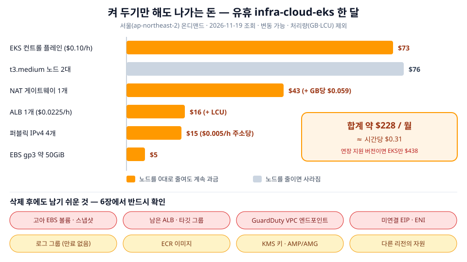
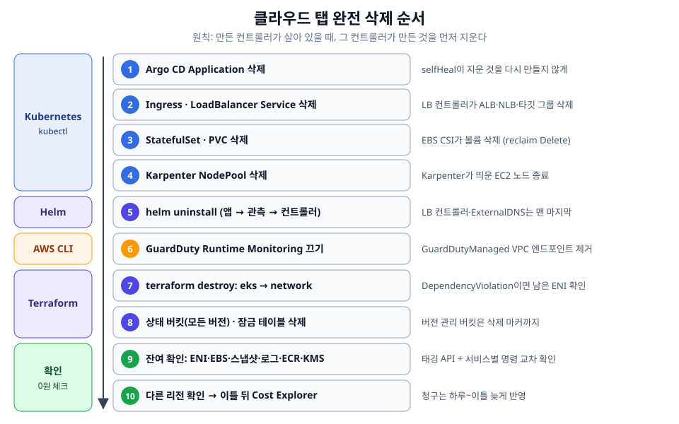

> **클라우드 · AWS** | 난이도 ★★★☆☆ | 예상 소요 2 ~ 3시간 (삭제 대기 포함) | 💰 예상 비용 이 편 자체는 거의 $0 — **삭제를 미루는 시간만큼** `infra-cloud-eks` 기본 비용(시간당 약 $0.3) 발생 (2026-11-19 확인, 변동 가능)

> 💸 **비용 경고 — 이 편은 "비용을 0으로 만드는" 편입니다**
> - 아직 `infra-cloud-eks`, NAT 게이트웨이, 로드밸런서가 떠 있다면 **지금 이 순간에도 과금 중**입니다. 개념(1~4장)은 나중에 읽어도 되니, 급하면 **5장 "완전 삭제"부터** 실행하세요.
> - 이 편에서 쓰는 Cost Explorer **콘솔**은 무료지만, **API 호출은 요청당 $0.01** 입니다. 스크립트로 반복 호출하지 마세요.
> - 가격은 AWS Price List(2026-11-19 조회, `ap-northeast-2`) 기준이며 **변동 가능**합니다.
> - 삭제가 끝나도 **청구서에는 하루~이틀 늦게** 반영됩니다. 6장의 "이틀 뒤 확인"까지 해야 끝입니다.

> 📌 **이 탭의 고정값** — 클라우드 01~08에서 정한 값을 그대로 씁니다.
> 리전 `ap-northeast-2` · VPC `10.20.0.0/16` · 리소스 이름 접두사 `infra-cloud-` · 공통 태그 `Project=infra-study`, `Env=lab` · CLI 프로필 `infra-admin` · EKS 클러스터 `infra-cloud-eks`
> 고정값(클라우드 05·06 기준): Terraform 코드는 `~/infra-cloud/terraform/`(레포 `infra-cloud-terraform`)의 `bootstrap/`, `network/`, `app/`, `eks/` 스택이고, 원격 상태는 S3 버킷 `infra-cloud-tfstate-<계정ID>`, 잠금은 S3 네이티브 `use_lockfile`(DynamoDB 테이블 없음)입니다.

## 🎯 오늘의 목표

- **Cost Explorer**와 **비용 할당 태그**(`Project`)로 "이 탭에 얼마를 썼는가"를 서비스별·일별로 볼 수 있다
- **Budgets 액션, Compute Optimizer, Savings Plans**가 각각 언제 쓰는 도구인지 설명할 수 있다
- NAT·EKS·로드밸런서·퍼블릭 IPv4·로그처럼 **숨어서 새는 비용**을 찾을 수 있다
- **Kubernetes 리소스 → Helm → `terraform destroy` → 잔여 확인** 순서로 탭 전체를 **완전히** 지운다
- 클라우드 탭 전체를 회고하고 홈랩과 클라우드의 차이를 정리한다

---

## 1. 왜 FinOps인가 — 홈랩과 가장 다른 점

홈랩은 **고정비**였습니다. H01 서버를 사면 전기료 말고는 무엇을 몇 개 띄우든 돈이 거의 같습니다([Day 49](../06-ai-infra/day49-capstone-rag-chatbot.md) 8장). 클라우드는 **변동비**입니다. "켜 둔 시간 × 단가"가 그대로 청구됩니다. 그래서 클라우드에서는 **비용도 SLO처럼 관측하고 알림을 거는 지표**가 됩니다(Day 58).

| 홈랩(본편) | AWS(오늘) |
|---|---|
| 전기료 고지서, Day 49 8장 비용 계산 | **Cost Explorer**, 비용 및 사용 보고서 |
| Prometheus 라벨(`namespace`, `app`) | **비용 할당 태그**(`Project=infra-study`) |
| Day 18 리소스 requests/limits, rightsizing | **Compute Optimizer** |
| Day 62 알림 | **Budgets** 알림 + **Budgets 액션** |
| 장비를 한 번 사면 끝 | **Savings Plans**(1·3년 약정 할인) |
| `docker system prune`, `kind delete cluster` | **삭제 순서 + 잔여 리소스 확인** (오늘의 핵심) |

> 💡 FinOps Foundation은 FinOps를 **Inform(보이게) → Optimize(줄이고) → Operate(습관으로)** 세 단계로 설명합니다. 오늘 2장은 Inform, 3·4장은 Optimize, 5·6장은 이 탭 기준의 Operate입니다.

---

## 2. Inform — 얼마를, 어디에 썼나

### 2-1. 비용 할당 태그 활성화

클라우드 01부터 붙여 온 `Project=infra-study` 태그는 **리소스에 붙어 있을 뿐, 청구 데이터에는 아직 안 보입니다.** 결제(관리) 계정에서 **태그 키를 비용 할당 태그로 활성화**해야 Cost Explorer에서 태그로 나눌 수 있습니다.

```bash
export AWS_PROFILE=lab
# Cost Explorer / Budgets API는 us-east-1 엔드포인트를 씁니다
aws ce list-cost-allocation-tags --tag-keys Project --region us-east-1
# { "CostAllocationTags": [ { "TagKey": "Project", "Type": "UserDefined", "Status": "Inactive", ... } ] }

aws ce update-cost-allocation-tags-status --region us-east-1 \
  --cost-allocation-tags-status TagKey=Project,Status=Active

# 활성화 이전 기간에도 태그를 적용하고 싶으면 (매월 1일 기준, 최대 12개월 전까지, 24시간에 1회)
aws ce start-cost-allocation-tag-backfill --region us-east-1 --backfill-from 2026-10-01T00:00:00Z
```

| 알아 둘 점 | 내용 |
|---|---|
| 나타나기까지 | 리소스에 태그를 붙인 뒤 **최대 24시간** 후 목록에 나타나고, 활성화에 또 **최대 24시간** |
| 활성화 이전 비용 | 기본은 활성화 이후부터. 이전 달은 **백필 요청**으로 |
| 누가 | 조직이라면 **관리(결제) 계정**에서 |
| 태그가 안 붙는 비용 | 일부 데이터 전송, 지원 요금, 세금 등은 태그로 나뉘지 않음 → "태그 없음"으로 보임 |
| EKS Pod 단위 비용 | **분할 비용 할당 데이터(split cost allocation data for EKS)** 를 켜면 비용 및 사용 보고서에서 노드 비용을 Pod·네임스페이스 단위로 나눠 봄 (플랫폼 탭의 OpenCost와 같은 목적) |

> 💡 태그는 **IaC에서 강제**하는 것이 가장 확실합니다. Terraform AWS 프로바이더의 `default_tags { tags = { Project = "infra-study" } }` 를 쓰면 프로바이더가 만드는 모든 리소스에 붙습니다(클라우드 05). 다만 **EKS·Karpenter·LB 컨트롤러가 대신 만드는 리소스**(노드, ALB, EBS)는 각 컨트롤러 설정(노드그룹 태그, `tagSpecification`, `alb.ingress.kubernetes.io/tags`)으로 따로 붙여야 합니다.

### 2-2. Cost Explorer로 보기

콘솔: **Billing and Cost Management → Cost Explorer**. 처음 켜면 데이터가 준비되는 데 최대 24시간이 걸립니다.

1. **Date range**: 이 탭을 시작한 날 ~ 오늘, **Granularity**: Daily
2. **Group by**: Service → 어떤 서비스가 큰지
3. **Group by**: Tag → `Project` → `infra-study` 와 **"No tag key: Project"** 비교
4. **Filters**: Region = Asia Pacific (Seoul) / 다른 리전에 비용이 있으면 의심

같은 질문을 CLI로(요청당 $0.01):

```bash
aws ce get-cost-and-usage --region us-east-1 \
  --time-period Start=2026-11-01,End=2026-11-20 --granularity MONTHLY \
  --metrics UnblendedCost --group-by Type=DIMENSION,Key=SERVICE \
  --query 'ResultsByTime[0].Groups[?Metrics.UnblendedCost.Amount>`0.01`].[Keys[0],Metrics.UnblendedCost.Amount]' \
  --output table
```

```
------------------------------------------------------------
|                     GetCostAndUsage                      |
+-------------------------------------------+--------------+
|  Amazon Elastic Container Service for Kubernetes | 14.40 |
|  EC2 - Other                              |  9.87        |   ← NAT, EBS, 퍼블릭 IPv4가 여기에
|  Amazon Elastic Compute Cloud - Compute   |  12.48       |
|  Amazon Elastic Load Balancing            |  3.24        |
|  Amazon Virtual Private Cloud             |  2.16        |
|  AmazonCloudWatch                         |  1.05        |
|  Amazon Bedrock                           |  0.04        |
+-------------------------------------------+--------------+
```

```bash
# 이 탭(태그)만, 일별
aws ce get-cost-and-usage --region us-east-1 \
  --time-period Start=2026-11-01,End=2026-11-20 --granularity DAILY --metrics UnblendedCost \
  --filter '{"Tags":{"Key":"Project","Values":["infra-study"]}}' \
  --query 'ResultsByTime[].[TimePeriod.Start,Total.UnblendedCost.Amount]' --output text
```

> 💡 **"EC2 - Other"** 가 생각보다 크면 거의 항상 **NAT 게이트웨이, EBS 볼륨·스냅샷, 퍼블릭 IPv4, 데이터 전송**입니다. 다음 장의 숨은 비용 표가 바로 그 내역입니다. Group by **Usage type** 으로 바꾸면 `APN2-NatGateway-Hours`, `APN2-EBS:VolumeUsage.gp3`, `APN2-PublicIPv4:InUseAddress` 처럼 정체가 보입니다.

---

## 3. Optimize — 숨은 비용 지도



"노드(EC2)만 끄면 되겠지"가 가장 흔한 착각입니다. 노드를 0대로 줄여도 아래 항목은 **계속** 과금됩니다. 서울 가격, 2026-11-19 조회, **변동 가능**.

| 항목 | 단가 | 한 달 켜 두면 | 왜 숨어 있나 | 줄이는 법 |
|---|---|---|---|---|
| **EKS 컨트롤 플레인** | $0.10/시간 | 약 $73 | 노드 0대여도 클러스터가 있으면 과금 | 실습 끝나면 클러스터 삭제 |
| **EKS 연장 지원** | +$0.50/시간 (합계 $0.60) | 약 $438 | 표준 지원이 끝난 K8s 버전을 계속 쓰면 **자동으로** 6배 | 버전 업그레이드(클라우드 06), 오래 안 쓸 클러스터는 삭제 |
| **NAT 게이트웨이** | $0.059/시간 + **처리 GB당 $0.059** | 1개 약 $43, AZ마다 1개면 약 $129 | 이미지 pull·패키지 다운로드가 전부 NAT 처리량 | 실습은 NAT 1개, **S3 게이트웨이 엔드포인트(무료)**, ECR 이미지는 작게 |
| **로드밸런서** (ALB/NLB) | $0.0225/시간 + LCU | 개당 약 $16 + α | **Ingress마다 ALB가 하나씩** 생길 수 있음, 클러스터를 지워도 남음 | IngressGroup으로 ALB 공유, 삭제 순서(5장) |
| **퍼블릭 IPv4** | 주소당 $0.005/시간 | 주소당 약 $3.65 | ALB는 AZ마다 IP, NAT EIP, 퍼블릭 서브넷 노드 | 노드는 프라이빗 서브넷, 쓰지 않는 EIP 해제 |
| **인터페이스 VPC 엔드포인트** | AZ당 $0.013/시간 + GB당 $0.01 | 엔드포인트×AZ당 약 $9.5 | **GuardDuty Runtime Monitoring이 자동 생성**(클라우드 09), ECR·STS 엔드포인트 | 필요한 것만, 삭제 확인 |
| **EBS 볼륨** (gp3) | GB-월 $0.0912 | 20GiB 약 $1.8 | PVC 삭제 정책 `Retain`, 클러스터 먼저 삭제 → **고아 볼륨** | `reclaimPolicy: Delete`, PVC 먼저 삭제 |
| **EBS 스냅샷** | GB-월 $0.05 | 작지만 영원히 | AMI·백업이 남김 | 6장에서 확인 |
| **CloudWatch Logs** | 수집 GB당 $0.76, 저장 GB-월 $0.0314 | 로그 양 비례 | EKS 컨트롤 플레인 로그·Container Insights, **보존 기간 기본 "만료 없음"** | 보존 기간 설정, 로그 그룹 삭제 |
| **KMS 키** | 키당 월 $1 | $1씩 | EKS Terraform 모듈이 클러스터 암호화용 키를 만듦 | 삭제 예약(7~30일 대기) |
| **ECR 저장** | GB-월 $0.10 | 이미지 크기 비례 | 태그마다 이미지가 쌓임 | 수명 주기 정책, 리포지토리 삭제 |
| **보안 서비스** | GuardDuty·Security Hub CSPM 체험 종료 후 | 수 달러~ | **30일 뒤 자동 과금 시작** | 클라우드 09 정리 |
| **AMP·AMG** | 수집 샘플·사용자 수 | 사용량 비례 | 클라우드 08 워크스페이스가 남음 | 워크스페이스 삭제 |

**계산해 보기** — 클라우드 06~10 상태로 `infra-cloud-eks`를 **아무것도 안 하고** 한 달 켜 두면:

| 항목 | 월 비용 (대략) |
|---|---|
| EKS 컨트롤 플레인 | $73 |
| t3.medium 노드 2대 ($0.052/h) | $76 |
| NAT 게이트웨이 1개 (처리량 제외) | $43 |
| ALB 1개 (LCU 제외) | $16 |
| 퍼블릭 IPv4 4개 | $15 |
| EBS gp3 (노드 루트 2×20GiB + PVC) | $5 |
| **합계** | **약 $228 (≈ 시간당 $0.31)** |

> ⚠️ 이것이 "주말에 켜 두고 잊으면" 나오는 숫자입니다. 클라우드 01의 Budgets 알림이 울렸다면 이 표의 어느 줄인지부터 찾으세요.

---

## 4. Optimize — 도구 세 가지

### 4-1. Budgets 액션 — 알림을 넘어 "자동 브레이크"

클라우드 01에서 만든 Budgets는 **알림**입니다. **Budgets 액션**은 임계값을 넘으면 AWS가 **직접 조치**합니다.

| 액션 타입 | 하는 일 | 어울리는 곳 |
|---|---|---|
| `APPLY_IAM_POLICY` | 지정한 역할·그룹·사용자에 정책 부착 (예: 새 자원 생성 거부) | 단일 계정 실습·팀 계정 |
| `APPLY_SCP_POLICY` | 계정·OU에 SCP 부착 | 조직(클라우드 09 5-3) |
| `RUN_SSM_DOCUMENTS` | 지정한 EC2/RDS 인스턴스 **중지** | 고정된 인스턴스 (ASG·EKS 노드는 다시 뜸) |

승인 방식은 `AUTOMATIC`(즉시) 또는 `MANUAL`(메일로 승인 요청)입니다. 가격: 예산 모니터링·알림은 무료, **액션이 있는 예산은 처음 2개 무료**, 그다음부터 예산당 하루 $0.10 (2026-11-19, 변동 가능).

```bash
ACCOUNT_ID=$(aws sts get-caller-identity --query Account --output text)

# 1) "새 자원을 못 만들게" 하는 거부 정책
cat > /tmp/deny-create.json <<'EOF'
{ "Version": "2012-10-17",
  "Statement": [{ "Effect": "Deny",
    "Action": ["ec2:RunInstances", "ec2:CreateNatGateway", "eks:CreateCluster", "eks:CreateNodegroup",
               "elasticloadbalancing:CreateLoadBalancer", "rds:CreateDBInstance", "bedrock:InvokeModel*"],
    "Resource": "*" }] }
EOF
aws iam create-policy --policy-name infra-cloud-budget-freeze --policy-document file:///tmp/deny-create.json

# 2) Budgets가 대신 정책을 붙일 때 쓸 실행 역할 (budgets.amazonaws.com 신뢰 + IAM 부착 권한)
#    → AWS 관리형 정책 AWSBudgetsActions_RolePolicyForResourceAdministrationWithSSM 또는 최소 권한 정책

# 3) 월 $30 예산의 100% 실제 비용에서 infra-cloud-deployer 역할에 거부 정책 부착
aws budgets create-budget-action --region us-east-1 --account-id "$ACCOUNT_ID" \
  --budget-name infra-cloud-monthly --notification-type ACTUAL \
  --action-type APPLY_IAM_POLICY \
  --action-threshold ActionThresholdValue=100,ActionThresholdType=PERCENTAGE \
  --definition "{\"IamActionDefinition\":{\"PolicyArn\":\"arn:aws:iam::${ACCOUNT_ID}:policy/infra-cloud-budget-freeze\",\"Roles\":[\"infra-cloud-deployer\"]}}" \
  --execution-role-arn arn:aws:iam::${ACCOUNT_ID}:role/infra-cloud-budgets-action \
  --approval-model AUTOMATIC \
  --subscribers SubscriptionType=EMAIL,Address=you@example.com
```

> ⚠️ 거부 정책은 **새 자원 생성만** 막습니다. **이미 떠 있는 자원의 과금은 멈추지 않습니다.** "예산 초과 = 자동 삭제"는 Budgets로 할 수 없고, 그런 장치는 사고(데이터 삭제)를 부릅니다. 실습 계정의 진짜 브레이크는 **5장의 삭제 습관**입니다.

> 💡 IAM Identity Center(SSO) 권한 세트가 만든 `AWSReservedSSO_*` 역할은 Identity Center가 관리하므로 직접 정책을 붙이는 대상으로 적합하지 않습니다. 단일 계정이라면 Terraform이 쓰는 배포 역할(`infra-cloud-deployer` 같은)에, 조직이라면 `APPLY_SCP_POLICY` 로 계정 전체에 겁니다.

### 4-2. Compute Optimizer — rightsizing 추천

Day 18에서 requests/limits를 "실제 사용량을 보고" 정했듯이, Compute Optimizer는 CloudWatch 지표로 **EC2·Auto Scaling 그룹·EBS·Lambda·RDS** 의 크기를 추천합니다.

```bash
aws compute-optimizer update-enrollment-status --status Active
# EC2·ASG는 최근 14일 중 최소 30시간의 지표가 있어야 추천이 나옴 → 실습 클러스터는 대개 "데이터 부족"
aws compute-optimizer get-auto-scaling-group-recommendations \
  --query 'autoScalingGroupRecommendations[].[autoScalingGroupName,finding,recommendationOptions[0].configuration.instanceType]' \
  --output table
```

| 알아 둘 점 | 내용 |
|---|---|
| 비용 | 기본 추천은 무료. **향상된 인프라 지표**(93일 분석)는 리소스-시간당 과금 (서울 약 $0.000336/h) |
| EKS 노드 | 노드그룹의 **Auto Scaling 그룹** 단위로 추천. Pod 단위 rightsizing은 Day 18 VPA·Goldilocks, 플랫폼 탭 OpenCost 영역 |
| 전제 | 절감액 계산에 **Cost Explorer 활성화** 필요 |

### 4-3. Savings Plans — 약정 할인 (개념)

**"앞으로 1년(또는 3년) 동안 시간당 $X 만큼은 꼭 쓰겠다"** 고 약정하면 그 금액만큼 온디맨드보다 싸게 계산해 줍니다.

| 종류 | 적용 범위 | 할인 | 유연성 |
|---|---|---|---|
| **Compute Savings Plans** | EC2(모든 패밀리·리전·OS), **Fargate**, Lambda | 중간 | 높음 — 인스턴스 타입을 바꿔도 유지 |
| **EC2 Instance Savings Plans** | 특정 리전의 특정 인스턴스 패밀리(예: 서울 m7i) | 더 큼 | 낮음 — 패밀리 안 크기·OS는 변경 가능 |

| 결정 포인트 | 실습 계정 | 운영 계정 |
|---|---|---|
| 약정할 만한가 | **아니요.** 켜고 끄는 실습은 약정 금액을 못 채워 손해 | 24시간 켜 있는 **바닥 사용량**만큼 |
| 얼마나 | - | Cost Explorer의 **Savings Plans 추천**(최근 7·30·60일 사용 기반)으로 시작, 바닥의 70~80%만 |
| 무엇이 안 되나 | - | EKS 컨트롤 플레인, NAT, 로드밸런서, Bedrock 토큰은 Savings Plans 대상이 아님 |

> 💡 GPU(클라우드 10의 ① 경로)를 24시간 운영한다면 Savings Plans와 **스팟**의 차이가 수백 달러가 됩니다. 반대로 Bedrock(② 경로)은 토큰 종량제라 약정 대신 **모델 선택(Nova Lite ↔ Pro)과 프롬프트 길이**가 비용 레버입니다.

---

## 5. Operate — 클라우드 탭 완전 삭제



### 5-0. 왜 순서가 중요한가

`terraform destroy` 한 번이면 끝날 것 같지만, **Terraform이 만들지 않은 AWS 리소스**가 있습니다.

| 리소스 | 누가 만들었나 | 클러스터를 먼저 지우면 |
|---|---|---|
| ALB/NLB, 타깃 그룹, 보안 그룹 | AWS Load Balancer Controller (클라우드 07) | **고아로 남아 계속 과금**, VPC 삭제 실패 |
| EBS 볼륨 (PVC) | EBS CSI 드라이버 | 고아 볼륨 |
| EC2 노드 | Karpenter (클라우드 06) | 노드가 남아 계속 과금 |
| Route 53 레코드 | ExternalDNS (클라우드 07) | 가리킬 곳 없는 레코드 |
| VPC 엔드포인트·보안 그룹 | GuardDuty Runtime Monitoring (클라우드 09) | **VPC·서브넷 삭제 실패** |
| ENI | 위 모든 것 + VPC CNI | `DependencyViolation` 으로 `terraform destroy` 멈춤 |

그래서 원칙은 하나입니다. **"만든 컨트롤러가 살아 있을 때, 그 컨트롤러가 만든 것을 먼저 지운다."**

### 5-1. 준비

```bash
aws sso login --profile lab
export AWS_PROFILE=lab AWS_REGION=ap-northeast-2
ACCOUNT_ID=$(aws sts get-caller-identity --query Account --output text)
aws eks update-kubeconfig --name infra-cloud-eks
VPC_ID=$(aws ec2 describe-vpcs --filters Name=cidr,Values=10.20.0.0/16 Name=tag:Project,Values=infra-study \
  --query 'Vpcs[0].VpcId' --output text); echo $VPC_ID
```

### 5-2. ① Argo CD 자동 동기화 멈추기

클라우드 07에서 Argo CD가 `selfHeal` 로 앱을 관리하고 있다면, 지운 리소스를 **다시 만들어 버립니다.** Application부터 지웁니다.

```bash
kubectl -n argocd get applications
# 루트(App of Apps)부터. finalizer가 있으면 하위 리소스까지 연쇄 삭제
kubectl -n argocd delete applications --all --wait=true
kubectl get applications -A          # 비어야 함
```

### 5-3. ② Kubernetes 리소스 — AWS 리소스를 만드는 것부터

```bash
# (a) 로드밸런서를 만드는 것: Ingress, Service type=LoadBalancer
kubectl get ingress -A
kubectl get svc -A --field-selector spec.type=LoadBalancer
kubectl delete ingress -A --all
kubectl get svc -A --field-selector spec.type=LoadBalancer -o json \
  | jq -r '.items[] | "\(.metadata.namespace) \(.metadata.name)"' \
  | while read ns n; do kubectl -n "$ns" delete svc "$n"; done

# 컨트롤러가 ALB/NLB를 지웠는지 확인 (비어야 함, 1~2분)
aws elbv2 describe-load-balancers \
  --query "LoadBalancers[?VpcId=='$VPC_ID'].[LoadBalancerName,Type,State.Code]" --output table

# (b) EBS를 만드는 것: PVC (StatefulSet이 있으면 먼저 삭제)
kubectl get pvc -A
kubectl delete statefulset -A --all
kubectl delete pvc -A --all
kubectl get pv                        # Released/Retain 이 남으면 직접 삭제

# (c) EC2를 만드는 것: Karpenter
kubectl delete nodepools --all
kubectl get nodeclaims               # 비어야 함 → Karpenter 노드 종료됨
```

> ⚠️ ExternalDNS의 `policy: sync` 였다면 Ingress를 지울 때 **ExternalDNS가 Route 53 레코드도 지웁니다.** ExternalDNS를 Ingress보다 먼저 uninstall하면 레코드가 남습니다. 순서가 바뀌었다면 6장에서 Route 53을 직접 확인합니다.

### 5-4. ③ Helm 릴리스 — 컨트롤러는 마지막에

```bash
helm list -A
# 앱·데이터 → 관측 → 컨트롤러 순서
for r in "rag qdrant" "webui open-webui" "monitoring kube-prometheus-stack" "argocd argocd"; do
  set -- $r; helm -n $1 uninstall $2 2>/dev/null && echo "removed $1/$2"
done
helm -n kube-system uninstall external-dns 2>/dev/null
helm -n kube-system uninstall karpenter 2>/dev/null
helm -n kube-system uninstall aws-load-balancer-controller 2>/dev/null   # 맨 마지막
helm list -A                           # 남은 것 확인

# 앱 네임스페이스 정리 (Terraform이 만든 네임스페이스는 destroy에 맡김)
kubectl delete namespace rag webui gateway monitoring argocd --ignore-not-found
```

### 5-5. ④ 클러스터 밖에서 만든 것 — GuardDuty 엔드포인트, Pod Identity, 클라우드 09·10

```bash
# GuardDuty Runtime Monitoring 끄기 → 태그 붙은 VPC 엔드포인트 삭제 대기
DET=$(aws guardduty list-detectors --query 'DetectorIds[0]' --output text)
[ "$DET" != "None" ] && aws guardduty update-detector --detector-id "$DET" \
  --features '[{"Name":"RUNTIME_MONITORING","Status":"DISABLED"}]'
aws ec2 describe-vpc-endpoints --filters Name=vpc-id,Values=$VPC_ID \
  --query 'VpcEndpoints[].[VpcEndpointId,ServiceName,Tags[?Key==`GuardDutyManaged`]|[0].Value]' --output table
# GuardDutyManaged=true 가 남아 있으면 수 분 기다리거나 직접:
# aws ec2 delete-vpc-endpoints --vpc-endpoint-ids vpce-xxxx

# 클라우드 10의 Pod Identity 연결·IAM 역할 (Terraform 밖에서 만들었다면)
for id in $(aws eks list-pod-identity-associations --cluster-name infra-cloud-eks --query 'associations[].associationId' --output text); do
  aws eks delete-pod-identity-association --cluster-name infra-cloud-eks --association-id $id; done
```

클라우드 09에서 남겨 둔 보안 서비스(CloudTrail, GuardDuty, Security Hub CSPM, Config, Access Analyzer, SNS, KMS)는 **클라우드 09 8장의 정리 명령**을 그대로 실행합니다.

### 5-6. ⑤ `terraform destroy` — 만든 순서의 역순

```bash
cd ~/infra-cloud/terraform/eks      && terraform destroy     # EKS, 노드그룹, 애드온, Pod Identity 역할, 관측성(AMP·AMG)·DNS 리소스, KMS 키
cd ~/infra-cloud/terraform/app      && terraform destroy     # (클라우드 05에서 만들었다면) ALB/ASG·S3·RDS
cd ~/infra-cloud/terraform/network  && terraform destroy     # VPC, 서브넷, NAT, IGW, 라우팅
```

```
Plan: 0 to add, 0 to change, 63 to destroy.
...
Destroy complete! Resources: 63 destroyed.
```

`DependencyViolation` 으로 멈추면 **범인은 거의 ENI**입니다.

```bash
aws ec2 describe-network-interfaces --filters Name=vpc-id,Values=$VPC_ID \
  --query 'NetworkInterfaces[].[NetworkInterfaceId,Status,InterfaceType,Description]' --output table
```

| ENI 설명(Description) | 정체 | 조치 |
|---|---|---|
| `ELB app/k8s-...` | 남은 ALB | 5-3 (a), 또는 `aws elbv2 delete-load-balancer` |
| `VPC Endpoint Interface vpce-...` | VPC 엔드포인트 (GuardDuty 등) | 5-5 |
| `aws-K8S-i-...` (status `available`) | VPC CNI가 남긴 ENI | `aws ec2 delete-network-interface` |
| `Amazon EKS infra-cloud-eks` | 클러스터 컨트롤 플레인 ENI | 클러스터 삭제가 끝나면 자동으로 사라짐 — 기다림 |

정리한 뒤 `terraform destroy` 를 다시 실행합니다.

**마지막으로 원격 상태 저장소**(클라우드 05의 `bootstrap/` 스택). 다른 스택이 모두 지워진 뒤에만 지웁니다. 버킷에 `prevent_destroy`가 걸려 있어 `terraform destroy` 대신 아래 CLI로 직접 지웁니다.

```bash
STATE=infra-cloud-tfstate-${ACCOUNT_ID}
# 버전 관리가 켜진 버킷은 모든 버전·삭제 마커까지 지워야 버킷이 삭제됨 (한 번에 최대 1000개)
aws s3api delete-objects --bucket $STATE --delete \
  "$(aws s3api list-object-versions --bucket $STATE --query '{Objects: Versions[].{Key:Key,VersionId:VersionId}}' --output json)"
aws s3api delete-objects --bucket $STATE --delete \
  "$(aws s3api list-object-versions --bucket $STATE --query '{Objects: DeleteMarkers[].{Key:Key,VersionId:VersionId}}' --output json)"
aws s3api delete-bucket --bucket $STATE
# 잠금은 S3 네이티브 use_lockfile 이라 DynamoDB 테이블은 지울 것이 없습니다.
```

> 💡 목록이 비어 있으면 `delete-objects` 가 `Objects` 누락 오류를 내는데, 지울 것이 없다는 뜻이니 넘어가면 됩니다.

---

## 6. 잔여 리소스 확인 — "0원" 체크리스트

### 6-1. 확인 명령 모음

```bash
R=ap-northeast-2
echo "== EKS";            aws eks list-clusters --region $R --output text
echo "== EC2 running";    aws ec2 describe-instances --region $R --filters Name=instance-state-name,Values=running,pending,stopped \
                            --query 'Reservations[].Instances[].[InstanceId,InstanceType,State.Name]' --output text
echo "== NAT";            aws ec2 describe-nat-gateways --region $R --filter Name=state,Values=available,pending \
                            --query 'NatGateways[].NatGatewayId' --output text
echo "== LB";             aws elbv2 describe-load-balancers --region $R --query 'LoadBalancers[].LoadBalancerName' --output text
echo "== Target groups";  aws elbv2 describe-target-groups --region $R --query 'TargetGroups[].TargetGroupName' --output text
echo "== ENI available";  aws ec2 describe-network-interfaces --region $R --filters Name=status,Values=available \
                            --query 'NetworkInterfaces[].[NetworkInterfaceId,Description]' --output text
echo "== EIP";            aws ec2 describe-addresses --region $R --query 'Addresses[].[PublicIp,AssociationId]' --output text
echo "== VPC endpoints";  aws ec2 describe-vpc-endpoints --region $R --query 'VpcEndpoints[].[VpcEndpointId,ServiceName]' --output text
echo "== VPC (lab)";      aws ec2 describe-vpcs --region $R --filters Name=cidr,Values=10.20.0.0/16 --query 'Vpcs[].VpcId' --output text
echo "== EBS available";  aws ec2 describe-volumes --region $R --filters Name=status,Values=available \
                            --query 'Volumes[].[VolumeId,Size,Tags[?Key==`kubernetes.io/created-for/pvc/name`]|[0].Value]' --output text
echo "== Snapshots";      aws ec2 describe-snapshots --region $R --owner-ids self --query 'Snapshots[].[SnapshotId,VolumeSize,StartTime]' --output text
echo "== AMIs";           aws ec2 describe-images --region $R --owners self --query 'Images[].[ImageId,Name]' --output text
echo "== Log groups";     aws logs describe-log-groups --region $R \
                            --query 'logGroups[?contains(logGroupName,`lab`) || contains(logGroupName,`eks`) || contains(logGroupName,`containerinsights`)].[logGroupName,storedBytes,retentionInDays]' --output text
echo "== ECR";            aws ecr describe-repositories --region $R --query 'repositories[].repositoryName' --output text
echo "== KMS (customer)"; for k in $(aws kms list-keys --region $R --query 'Keys[].KeyId' --output text); do
                            aws kms describe-key --region $R --key-id $k \
                              --query 'KeyMetadata.[KeyId,KeyManager,KeyState,Description]' --output text | grep CUSTOMER; done
echo "== AMP / AMG";      aws amp list-workspaces --region $R --query 'workspaces[].workspaceId' --output text
                          aws grafana list-workspaces --region $R --query 'workspaces[].id' --output text
echo "== Secrets";        aws secretsmanager list-secrets --region $R --query 'SecretList[].Name' --output text
echo "== Route53 zones";  aws route53 list-hosted-zones --query 'HostedZones[].[Name,ResourceRecordSetCount]' --output text
echo "== Tagged leftovers"; aws resourcegroupstaggingapi get-resources --region $R \
                            --tag-filters Key=Project,Values=infra-study --query 'ResourceTagMappingList[].ResourceARN' --output text
```

결과가 남은 항목은 아래처럼 지웁니다.

| 남은 것 | 삭제 명령 | 주의 |
|---|---|---|
| ENI (`available`) | `aws ec2 delete-network-interface --network-interface-id eni-…` | `in-use` 는 붙은 리소스부터 |
| EBS 볼륨 | `aws ec2 delete-volume --volume-id vol-…` | 필요한 데이터가 없는지 확인 |
| 스냅샷 | `aws ec2 delete-snapshot --snapshot-id snap-…` | AMI가 쓰는 스냅샷은 `deregister-image` 먼저 |
| EIP | `aws ec2 release-address --allocation-id eipalloc-…` | 미연결 EIP도 시간당 과금 |
| 로그 그룹 | `aws logs delete-log-group --log-group-name /aws/eks/infra-cloud-eks/cluster` | Container Insights는 `/aws/containerinsights/infra-cloud-eks/*` 여러 개 |
| ECR | `aws ecr delete-repository --repository-name infra-cloud/infra-rag --force` | `--force` 는 이미지까지 삭제 |
| KMS 키 | `aws kms schedule-key-deletion --key-id … --pending-window-in-days 7` | **AWS 관리형 키(`AWS`)는 대상 아님**, 대기 중엔 무과금 |
| AMP / AMG | `aws amp delete-workspace --workspace-id …` / `aws grafana delete-workspace --workspace-id …` | 클라우드 08 |
| Route 53 호스팅 영역 | 레코드 삭제 후 `aws route53 delete-hosted-zone --id …` | 도메인 등록 자체는 별개 |
| IAM 역할 `lab-*` | 정책 분리 후 `aws iam delete-role` | 과금은 없지만 보안 위생(클라우드 09 Access Analyzer) |

> ⚠️ **태깅 API(`resourcegroupstaggingapi`) 결과에는 막 삭제된 리소스가 잠시 남아 보일 수 있습니다.** 위의 서비스별 명령으로 실제 존재 여부를 교차 확인하세요. 반대로 **태그가 없는 리소스**(컨트롤러가 태그 없이 만든 것)는 태깅 API에 안 나오므로, 서비스별 확인이 꼭 필요합니다.

### 6-2. 다른 리전도 본다

리전을 잘못 골라 띄운 자원은 서울만 보면 영원히 못 찾습니다.

```bash
for r in $(aws ec2 describe-regions --query 'Regions[].RegionName' --output text); do
  n=$(aws ec2 describe-instances --region $r --filters Name=instance-state-name,Values=running \
      --query 'length(Reservations[].Instances[])' --output text)
  c=$(aws eks list-clusters --region $r --query 'length(clusters)' --output text)
  ng=$(aws ec2 describe-nat-gateways --region $r --filter Name=state,Values=available --query 'length(NatGateways)' --output text)
  [ "$n$c$ng" != "000" ] && echo "$r  EC2=$n  EKS=$c  NAT=$ng"
done; echo "done"
```

### 6-3. 이틀 뒤 확인

- **Cost Explorer** → 일별, Group by Service: 삭제 다음다음 날의 막대가 **$0 근처**(KMS 대기·S3 소액 정도)인지
- **Billing → Bills**: 이번 달 서비스별 금액이 더 이상 늘지 않는지
- **GuardDuty·Security Hub CSPM 체험 종료일**이 지나도 과금이 없는지 (클라우드 09에서 껐다면 없어야 정상)
- **클라우드 01의 Budgets 알림과 루트 MFA·계정 잠금 설정은 남겨 두세요.** 다음에 무엇을 하든 계정의 안전망입니다.

---

## 7. 클라우드 탭 회고

| 편 | 핵심 | 홈랩에서 대응하던 것 | 클라우드에서 새로 생긴 고민 |
|---|---|---|---|
| 01 계정·IAM·가드레일 | SSO, MFA, 루트 잠금, Budgets | Day 27 Keystone, H01 계정 | **결제 수단이 연결된 계정 보호** |
| 02 VPC 네트워킹 | 서브넷, 라우팅, NAT, SG/NACL, 엔드포인트 | Day 22·30 리눅스 네트워크·Neutron | NAT·엔드포인트 **시간 요금** |
| 03 EC2·ASG·ALB | 오토 스케일링, 로드밸런서 | Day 29 Nova, Day 12 Service | 인스턴스 타입·구매 옵션 선택 |
| 04 S3·RDS | 관리형 스토리지·DB | Day 31 Cinder/Swift, Day 06 Compose DB | 공개 설정 실수(해킹 09) |
| 05 Terraform | 모듈, S3 원격 상태·잠금 | Day 35 Terraform on OpenStack | 상태 파일 = 비밀, `destroy` 의 범위 |
| 06 EKS | 관리형 노드그룹, Karpenter | Day 20 kubeadm | 컨트롤 플레인 **시간 요금**, 버전 지원 기간 |
| 07 EKS GitOps | Argo CD, LB 컨트롤러, Pod Identity, ExternalDNS | Day 53 Argo CD, Day 15 Ingress | **클러스터 밖에 AWS 리소스를 만드는 컨트롤러** |
| 08 관측성 | CloudWatch, AMP, AMG | Day 17·60 Prometheus·Loki | 수집량 = 비용 |
| 09 보안 | 공동 책임, CloudTrail, GuardDuty, CSPM, KMS | Day 66~73 | **API 한 번이 사고**, 무료 체험 종료 |
| 10 RAG on EKS | GPU 노드 vs Bedrock | Day 44~49 | 데이터 위치, 토큰 종량제 |
| 11 FinOps·정리 | 태그, Cost Explorer, 삭제 순서 | 전기료 | **변동비 — 끄는 것도 운영** |

돌아보면 클라우드 탭에서 배운 것은 "새로운 기술"보다 **"같은 기술을 남의 데이터센터에서, 시간 단위로 빌려 쓸 때 달라지는 운영 습관"** 이었습니다.

1. **구조는 같다.** VPC는 Day 22의 bridge·라우팅, EKS는 Day 20의 kubeadm, Bedrock 뒤의 rag-api는 Day 42 그대로였습니다. 홈랩에서 원리를 직접 만져 본 것이 클라우드에서 "왜 이렇게 설계됐는지"를 읽는 힘이 됐습니다.
2. **경계가 바뀐다.** 공동 책임 모델로 AWS가 아래층을 가져간 대신, IAM·리소스 정책이라는 **새 공격면**이 가장 중요해졌습니다.
3. **비용이 아키텍처다.** NAT 하나, ALB 하나, GPU 하나가 설계 결정을 바꿉니다. 그래서 태그·예산·삭제 순서까지가 "인프라 코드"입니다.
4. **지우는 것도 설계한다.** 컨트롤러가 만든 리소스를 먼저 지우는 순서는, 운영에서 **서비스를 안전하게 내리는 절차**(Day 65 런북)와 같습니다.

---

## 8. 트러블슈팅

| 증상 | 원인 | 해결 |
|---|---|---|
| Cost Explorer에서 `Project` 태그로 그룹이 안 됨 | 비용 할당 태그 미활성화, 또는 24시간 안 지남 | 2-1 활성화, 이전 기간은 백필 |
| 비용 대부분이 "No tag key: Project" | 컨트롤러가 만든 리소스·데이터 전송에 태그 없음 | 컨트롤러별 태그 설정, Usage type으로 확인 |
| `terraform destroy` 가 서브넷/IGW에서 `DependencyViolation` | 남은 ENI(ALB, VPC 엔드포인트, CNI) | 5-6 ENI 표대로 원인 리소스 삭제 후 재실행 |
| `terraform destroy` 가 보안 그룹에서 멈춤 | 다른 SG가 이 SG를 참조, 또는 LB 컨트롤러가 만든 SG | `aws ec2 describe-security-groups --filters Name=vpc-id,Values=$VPC_ID`, 참조 규칙 제거 |
| 지운 앱이 다시 생김 | Argo CD selfHeal | 5-2를 먼저 |
| 클러스터를 지웠는데 ALB가 남음 | Ingress보다 클러스터를 먼저 삭제 | `aws elbv2 delete-load-balancer`, 타깃 그룹·SG도 삭제 |
| 로그 그룹 `/aws/eks/infra-cloud-eks/cluster` 가 destroy 후 다시 생김 | 삭제 순간 컨트롤 플레인 로깅이 아직 기록 중 | 클러스터 삭제 완료 후 로그 그룹 재삭제 |
| 상태 버킷 삭제가 `BucketNotEmpty` | 버전·삭제 마커가 남음 | 5-6의 두 `delete-objects` 실행 |
| 다음 달에도 소액 청구 | KMS 대기 기간, Route 53 영역, 다른 리전 자원 | 6-1·6-2 다시, Bills에서 서비스·리전 확인 |

---

## 9. 핵심 정리

- 클라우드 비용은 **변동비**다. 태그 → 비용 할당 태그 활성화 → Cost Explorer로 **보이게** 한 다음에야 줄일 수 있다.
- **Budgets 알림은 무료, 액션은 처음 2개 무료.** 액션은 새 자원 생성을 막을 뿐, 떠 있는 자원을 끄지 않는다.
- **Compute Optimizer**는 30시간 이상 지표가 있어야 추천하고, **Savings Plans**는 24시간 바닥 사용량에만 약정한다. 실습 계정에는 맞지 않는다.
- 숨은 비용 상위권: **EKS 컨트롤 플레인 $0.10/h(연장 지원이면 $0.60/h), NAT $0.059/h + GB당 $0.059, ALB $0.0225/h, 퍼블릭 IPv4 $0.005/h, 인터페이스 엔드포인트, 고아 EBS, 만료 없는 로그** (서울, 2026-11-19, 변동 가능).
- 삭제 순서: **Argo CD 앱 → Ingress/LB 서비스 → PVC → Karpenter → Helm(컨트롤러 마지막) → GuardDuty 엔드포인트 → `terraform destroy`(EKS → 네트워크 → 상태 저장소) → ENI·스냅샷·로그 그룹·ECR·KMS 확인 → 다른 리전 → 이틀 뒤 청구서.**

---

## 10. 셀프 체크

<details>
<summary>Q1. 노드그룹을 0대로 줄였는데도 하루에 수 달러가 나온다. 무엇을 의심하나?</summary>

노드와 무관하게 시간당 과금되는 것들입니다. **EKS 컨트롤 플레인($0.10/h, 연장 지원 버전이면 $0.60/h)**, **NAT 게이트웨이($0.059/h)**, **로드밸런서**, **퍼블릭 IPv4 주소**, **인터페이스 VPC 엔드포인트**(GuardDuty 자동 생성 포함), 그리고 남은 EBS 볼륨입니다. Cost Explorer에서 Group by **Usage type** 으로 보면 정체가 바로 나옵니다.
</details>

<details>
<summary>Q2. <code>terraform destroy</code> 를 먼저 하면 왜 안 되나? Terraform이 다 지워 주지 않나?</summary>

Terraform은 **자기 상태 파일에 있는 리소스만** 지웁니다. ALB·타깃 그룹(LB 컨트롤러), PVC의 EBS(CSI 드라이버), Karpenter 노드, Route 53 레코드(ExternalDNS), GuardDuty VPC 엔드포인트는 Terraform이 아니라 **클러스터 안 컨트롤러나 AWS 서비스**가 만들었습니다. 클러스터를 먼저 지우면 그 컨트롤러가 사라져 아무도 지우지 않는 고아가 되고, 그 ENI 때문에 VPC 삭제도 `DependencyViolation` 으로 실패합니다.
</details>

<details>
<summary>Q3. 비용 할당 태그를 오늘 활성화했다. 지난달 비용도 태그로 나눠 볼 수 있나?</summary>

기본은 **활성화 이후**부터만 반영됩니다. 이전 기간은 `aws ce start-cost-allocation-tag-backfill --backfill-from <매월 1일>` 로 백필을 요청할 수 있으며, 최대 12개월 전까지, 24시간에 한 번 요청할 수 있습니다. 그리고 애초에 **리소스에 태그가 붙어 있었던 기간**만 나뉩니다.
</details>

<details>
<summary>Q4. Budgets 액션으로 "예산 100%에서 모든 리소스 자동 삭제"를 만들 수 있나?</summary>

없습니다. 액션은 **IAM 정책 부착, SCP 부착, 지정한 EC2/RDS 인스턴스 중지** 세 가지뿐입니다. 정책 부착은 새 자원 생성을 막을 뿐 기존 과금은 계속되고, 인스턴스 중지도 ASG·EKS 노드는 다시 뜹니다. 자동 삭제는 데이터 손실 사고로 이어지기 쉬워 권장되지도 않습니다. 실습 계정의 진짜 안전장치는 **알림 + 삭제 순서 습관 + 이틀 뒤 확인**입니다.
</details>

<details>
<summary>Q5. 24시간 돌아가는 운영 EKS에 Savings Plans를 산다면 무엇을 기준으로, 어디까지 덮나?</summary>

Cost Explorer의 Savings Plans 추천(최근 사용량 기반)을 참고해, 노드 수가 가장 적을 때의 **바닥 사용량**의 일부(예: 70~80%)만 약정합니다. 노드 타입을 자주 바꾸거나 Karpenter로 여러 패밀리를 쓰면 **Compute Savings Plans**, 패밀리·리전이 고정이면 할인이 큰 **EC2 Instance Savings Plans**. EKS 컨트롤 플레인, NAT, 로드밸런서, Bedrock 토큰은 대상이 아니므로 그 부분은 아키텍처(NAT 수, ALB 공유, 모델 선택)로 줄입니다.
</details>

---

## ⏭️ 다음 시즌 예고

클라우드 탭은 여기까지입니다. 계정 가드레일부터 VPC, EKS, GitOps, 관측성, 보안, RAG 이전, 그리고 0원 정리까지 홈랩에서 배운 원리를 AWS 위에서 다시 확인했습니다.

다음은 **플랫폼 엔지니어링 탭**입니다. 지금까지는 "내가 인프라를 만드는 사람"이었다면, 다음 시즌에는 **다른 개발자가 셀프서비스로 쓰는 플랫폼**을 만듭니다. Backstage 카탈로그와 Software Template로 골든 패스를 만들고, Crossplane과 Cluster API로 인프라·클러스터를 찍어내고, Argo CD ApplicationSet으로 멀티 클러스터를 관리하고, OpenCost로 오늘 배운 FinOps를 **네임스페이스·팀 단위**로 내립니다. 실습은 다시 **클라우드 비용 없이** 홈랩과 kind에서 진행합니다.

> 💡 AWS를 시험으로 정리하고 싶다면 자격증 준비 탭의 **AWS SAA**(W00~W07)가 이 탭과 짝입니다. 오늘 정리한 숨은 비용 표와 Savings Plans 비교는 W04 "비용 최적화"에서 시험 문항 형태로 다시 만납니다.
