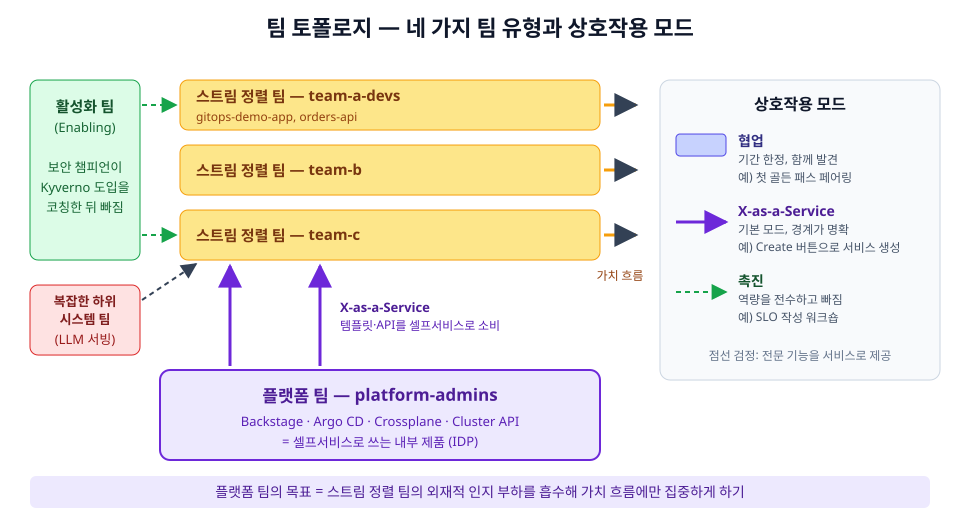
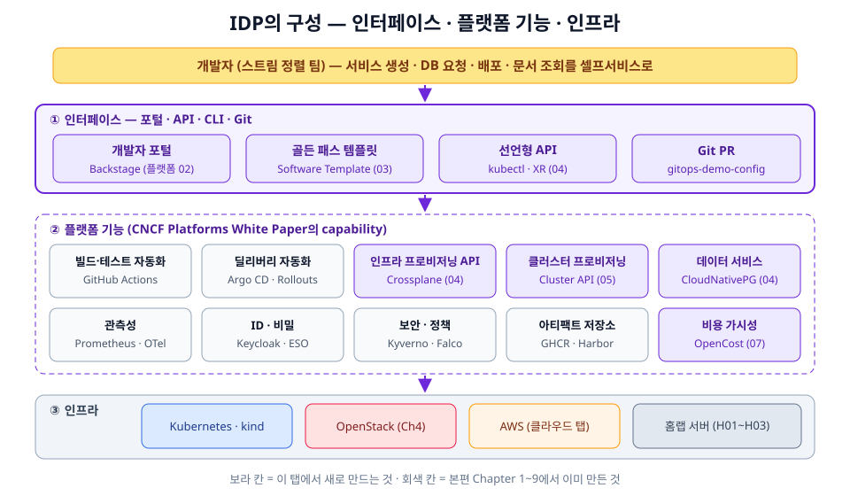
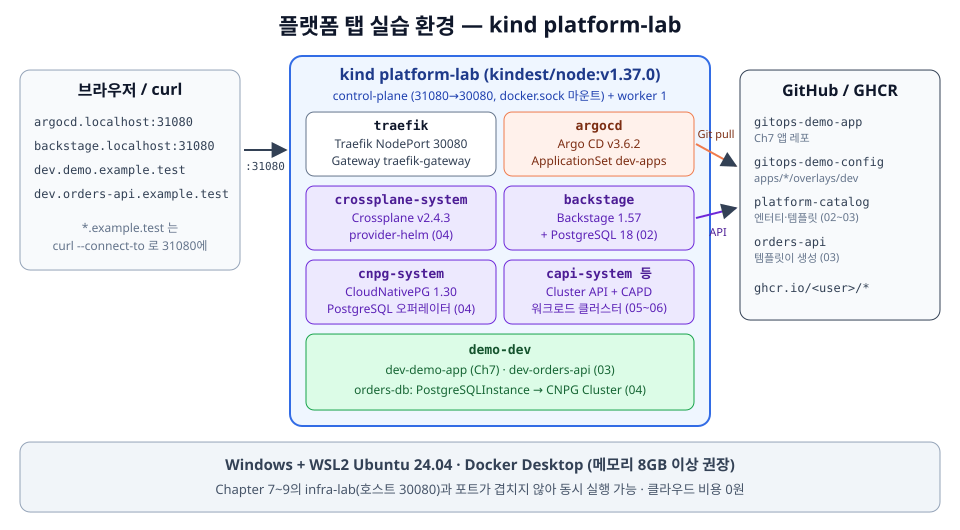

> **플랫폼 엔지니어링** | 난이도 ★★☆☆☆ | 예상 소요 2 ~ 2.5시간 (개념 1시간 + `platform-lab` 구축 1시간)

## 🎯 오늘의 목표

- 플랫폼 엔지니어링이 **왜** 등장했는지 "개발자의 인지 부하"로 설명할 수 있다
- DevOps · SRE · 플랫폼 엔지니어링의 관계를 표로 정리할 수 있다
- 팀 토폴로지의 **플랫폼 팀**, **"플랫폼을 제품으로"**, **골든 패스**가 무엇인지 안다
- CNCF Platforms White Paper의 **IDP 구성 요소**와 **성숙도 모델**로 우리 플랫폼의 위치를 진단할 수 있다
- 이 탭 전체가 쓰는 kind 클러스터 **`platform-lab`** 에 Traefik과 Argo CD를 올리고, 실습 고정값을 확정한다

---

## 1. 왜 플랫폼 엔지니어링인가?

> "서비스 하나 새로 띄우려면 뭘 해야 하죠?"

이 시리즈를 따라온 여러분은 이 질문에 답할 수 있습니다. 문제는 **답이 너무 길다**는 것입니다.

| 단계 | 알아야 하는 것 | 이 시리즈에서 배운 곳 |
|---|---|---|
| 이미지 만들기 | Dockerfile, 멀티 스테이지, 비루트 사용자 | Day 03, [CKAD A01](../certs/ckad/a01-design-build.md) |
| CI | GitHub Actions, GHCR, `sha-` 태그, 멀티 아키텍처 | [Day 51](../07-gitops/day51-github-actions.md) |
| 매니페스트 | Deployment·Service·HTTPRoute, 프로브, 리소스 | Day 11~15 |
| 환경 분리 | Kustomize base/overlay, `namePrefix` | [Day 52](../07-gitops/day52-kustomize.md) |
| 배포 | Argo CD Application, Auto-sync, Self-heal | [Day 53](../07-gitops/day53-argocd.md) |
| 비밀 | SOPS / External Secrets | Day 55 |
| 공급망 | Trivy, cosign, Kyverno | Day 57 |
| 관측성 | Prometheus 메트릭, OTel, SLO 알림 | Day 58~59 |
| 인증 | Keycloak OIDC, RBAC | [Day 73](../09-security/day73-keycloak-sso-audit.md) |
| DB가 필요하면 | ...인프라 팀에 티켓 → 며칠 대기 | — |

이 표를 **모든 제품 개발자**가 외워야 한다면 어떻게 될까요? 팀마다 조금씩 다른 Dockerfile과 매니페스트가 생기고, 보안 설정은 누군가는 빠뜨리고, 새 입사자는 첫 배포까지 2주가 걸립니다. DevOps의 구호였던 **"You build it, you run it"** 이 "You build it, you run it, **you also learn 40 tools**"가 된 것입니다.

플랫폼 엔지니어링의 해법은 이것입니다.

> **반복되는 인프라 작업을 "내부 제품"으로 만들어, 개발자가 셀프서비스로 쓰게 한다.**
> 개발자는 "Spring Boot 서비스 하나 주세요", "PostgreSQL 하나 주세요"라고 요청하고, 위 표의 10단계는 플랫폼이 **검증된 기본값**으로 채워 준다.

이 "내부 제품"을 **IDP(Internal Developer Platform, 내부 개발자 플랫폼)** 라고 부르고, IDP의 얼굴(웹 화면)을 **개발자 포털(Developer Portal)** 이라고 부릅니다. 둘은 자주 혼용되지만 다릅니다. Backstage(플랫폼 02)는 **포털**이고, 그 뒤에서 실제로 일하는 Argo CD·Crossplane·Cluster API가 **플랫폼**입니다.

---

## 2. DevOps · SRE · 플랫폼 엔지니어링

셋은 경쟁 관계가 아니라 **서로 다른 질문에 답하는** 관계입니다.

| 구분 | DevOps | SRE | 플랫폼 엔지니어링 |
|---|---|---|---|
| 정체 | 문화·원칙 (개발과 운영의 벽 허물기) | DevOps를 구현하는 **엔지니어링 방법론** | DevOps를 **조직 규모로 확장**하는 방법 |
| 핵심 질문 | "어떻게 함께 빠르게 배포하나?" | "얼마나 안정적이어야 하나? 어떻게 측정하나?" | "개발자가 인프라를 몰라도 되게 하려면?" |
| 대표 도구·산출물 | CI/CD, IaC, 협업 문화 | SLO, 에러 버짓, 장애 대응, 토일 제거 | IDP, 골든 패스, 셀프서비스 API, 포털 |
| 고객 | 팀 자기 자신 | 서비스의 최종 사용자 (신뢰성) | **내부 개발자** |
| 이 시리즈 | Chapter 7 (GitOps & CI/CD) | Chapter 8 (SRE & 관측성) | **이 탭** |

> 💡 SRE가 "토일(toil)을 줄여라"라고 말한다면, 플랫폼 엔지니어링은 "줄인 결과를 **다른 팀이 쓸 수 있게** 제품으로 포장하라"고 말합니다. Day 58에서 만든 SLO 알림 규칙도, 팀마다 복사하는 대신 플랫폼이 서비스 생성 시 자동으로 붙여 주면 플랫폼 기능이 됩니다.

---

## 3. 인지 부하와 팀 토폴로지

### 3-1. 인지 부하(Cognitive Load) — 세 종류

플랫폼 엔지니어링의 이론적 뿌리는 책 *Team Topologies*(Matthew Skelton, Manuel Pais)입니다. 이 책은 심리학의 인지 부하 이론을 팀에 적용합니다.

| 종류 | 뜻 | 예시 | 플랫폼의 목표 |
|---|---|---|---|
| **내재적(intrinsic)** | 일 자체의 본질적 난이도 | Java, Spring, 도메인 로직 | 유지 (교육으로 지원) |
| **외재적(extraneous)** | 일과 무관하게 환경 때문에 생기는 부하 | "Kustomize `images.name`이 왜 안 먹지?", "GHCR 권한이 뭐더라" | **최소화** ← 플랫폼이 흡수 |
| **본유적(germane)** | 가치를 만드는 깊은 학습 | 주문 도메인 모델링, 성능 개선 | **최대화** |

플랫폼 팀이 하는 일을 한 줄로 요약하면 **"제품 팀의 외재적 부하를 플랫폼으로 옮기는 것"** 입니다.

### 3-2. 네 가지 팀 유형과 세 가지 상호작용



| 팀 유형 | 역할 | 이 시리즈 속 예 |
|---|---|---|
| **스트림 정렬 팀(Stream-aligned)** | 비즈니스 가치 흐름 하나를 끝까지 책임 (조직의 대부분) | `team-a-devs` — `gitops-demo-app`, `orders-api` 개발 |
| **플랫폼 팀(Platform)** | 스트림 정렬 팀이 **셀프서비스로 쓰는 내부 제품**을 제공 | `platform-admins` — Backstage, Argo CD, Crossplane 운영 |
| **활성화 팀(Enabling)** | 전문가가 일정 기간 붙어 역량을 전수하고 빠짐 | 보안 챔피언이 Kyverno 정책 도입을 코칭 |
| **복잡한 하위 시스템 팀(Complicated-subsystem)** | 깊은 전문성이 필요한 부분을 전담 | LLM 서빙(Chapter 6 vLLM) 팀 |

| 상호작용 모드 | 언제 | 예 |
|---|---|---|
| **협업(Collaboration)** | 새로운 것을 함께 발견할 때, **기간 한정** | 플랫폼 팀이 첫 골든 패스를 만들며 `team-a-devs`와 페어링 |
| **X-as-a-Service** | 경계가 명확해진 뒤의 **기본 모드** | 개발자가 Backstage 템플릿 버튼으로 서비스 생성 |
| **촉진(Facilitating)** | 활성화 팀이 다른 팀을 도울 때 | SLO 작성법 워크숍 |

> 💡 그룹 이름 `platform-admins`와 `team-a-devs`는 Day 73 Keycloak realm `infra`에서 만든 그룹과 **같은 이름**입니다. 플랫폼 02에서 Backstage 카탈로그의 Group 엔터티로 그대로 옮깁니다.

---

## 4. "플랫폼을 제품으로" (Platform as a Product)

플랫폼이 실패하는 가장 흔한 이유는 기술이 아니라 **아무도 안 쓰는 것**입니다. 인프라 팀이 "좋은 도구를 만들었으니 쓰세요"라고 공지하는 방식은 대개 실패합니다. 그래서 플랫폼을 **고객(내부 개발자)이 있는 제품**처럼 다룹니다.

| 관점 | 프로젝트로서의 플랫폼 | **제품으로서의 플랫폼** |
|---|---|---|
| 끝 | 구축 완료 = 끝 | 출시 후가 시작 (수명 주기 관리) |
| 요구사항 | 인프라 팀이 결정 | 사용자 인터뷰, 피드백, 사용 데이터 |
| 채택 | 강제(mandate) | **자발적 선택**(더 편하니까 쓴다) |
| 담당 | 엔지니어만 | 플랫폼 PM, UX, 문서, 지원 채널 |
| 성공 지표 | "Backstage 설치함" | 활성 사용자, 첫 배포까지 걸린 시간, NPS |

CNCF Platforms White Paper는 성공 측정을 세 묶음으로 제안합니다.

| 묶음 | 지표 예 |
|---|---|
| 사용자 만족·생산성 | 활성 사용자와 유지율, NPS·설문, SPACE 프레임워크 |
| 조직 효율 | 요청 → 제공까지 시간, 새 서비스를 운영까지 올리는 시간, **신규 입사자의 첫 커밋까지 시간** |
| 제품 딜리버리 | **DORA 4지표** — 배포 빈도, 변경 리드 타임, 복구 시간, 변경 실패율 |

> 💡 **TVP(Thinnest Viable Platform, 가장 얇은 실행 가능 플랫폼)** — Team Topologies가 강조하는 출발점입니다. 첫 플랫폼은 "Wiki 페이지 한 장 + 템플릿 레포 하나"여도 됩니다. 이 탭도 같은 순서로 키웁니다. 카탈로그(02) → 템플릿 하나(03) → 인프라 API 하나(04) → ...

---

## 5. 골든 패스(Golden Path)

**골든 패스**(Netflix는 *paved road*라고 부름)는 "이 길로 가면 보안·관측성·배포가 이미 맞춰져 있다"는 **권장 경로**입니다.

| 특징 | 설명 |
|---|---|
| 선택적이다 | 막는 게 아니라 **가장 쉬운 길**로 만든다. 벗어날 수 있지만 그러면 직접 책임진다 |
| 의견이 있다(opinionated) | Java 21 + Spring Boot 4.1 + Gradle + Kustomize + Argo CD처럼 **선택을 대신** 해 준다 |
| 끝까지 이어진다 | 코드 생성에서 멈추지 않고 CI·배포·카탈로그 등록·문서까지 |
| 살아 있다 | 템플릿도 버전이 있는 제품. 피드백으로 개선 |

플랫폼 03에서 만들 골든 패스의 모습을 미리 보면 이렇습니다.

```text
개발자: Backstage에서 "Spring Boot 서비스" 템플릿 → 이름 orders-api, 소유 팀 team-a-devs 입력 → [Create]

플랫폼이 알아서:
 ① GitHub에 orders-api 레포 생성 (Spring Boot 4.1.2 / Java 21 / Dockerfile / CI / catalog-info.yaml / docs)
 ② gitops-demo-config 에 apps/orders-api/{base,overlays/dev} 를 PR로 추가
 ③ Backstage 카탈로그에 Component 등록 (소유자 team-a-devs, System gitops-demo)
 ④ PR 머지 → Argo CD ApplicationSet이 orders-api-dev Application을 자동 생성 → demo-dev 에 배포
```

---

## 6. IDP의 구성 요소 — CNCF Platforms White Paper

CNCF TAG App Delivery의 **Platforms White Paper**는 플랫폼을 "플랫폼 사용자의 필요에 맞게 정의되고 제공되는, 통합된 기능(capability)의 모음"으로 정의하고, 13개의 기능 영역을 제시합니다. 이 시리즈에서 만든 것과 짝지어 보면 우리는 이미 IDP의 재료 대부분을 갖고 있습니다.



| 기능 영역 (White Paper) | 대표 프로젝트 예 | 이 시리즈 |
|---|---|---|
| 웹 포털 (기능 프로비저닝·관찰) | Backstage | **플랫폼 02~03** |
| 기능을 자동 프로비저닝하는 API | Kubernetes, Crossplane, Operator, Helm | Day 16 Helm, **플랫폼 04 Crossplane**, 05 Cluster API |
| 골든 패스 템플릿과 문서 | (Artifact Hub 등) | **플랫폼 03 Software Template, TechDocs** |
| 빌드·테스트 자동화 | Tekton, Buildpacks, ko | Day 51 GitHub Actions |
| 딜리버리·검증 자동화 | Argo, Flux, Flagger, OpenFeature | Day 53~56 Argo CD·Rollouts, **플랫폼 06** |
| 개발 환경 | Devfile, Telepresence, DevSpace | (범위 밖) |
| 애플리케이션 관측성 | OpenTelemetry, Prometheus, Grafana, **OpenCost** | Day 17, Chapter 8, **플랫폼 07** |
| 인프라 서비스 | Kubernetes, KEDA, Cilium, Istio, CoreDNS, Rook | Chapter 2·4·6 |
| 데이터 서비스 | TiKV, Vitess, SchemaHero | 플랫폼 04 (CloudNativePG로 대체) |
| 메시징·이벤트 | Strimzi, NATS, Dapr | (범위 밖) |
| ID·비밀 | **Keycloak**, Dex, External Secrets, cert-manager | Day 55, 71, 73 |
| 보안 | Falco, OPA, **Kyverno** | Day 57, Chapter 9 |
| 아티팩트 저장소 | Harbor, Distribution | GHCR, CKAD A00 `registry:2` |

White Paper는 좋은 플랫폼의 **속성 7가지**도 꼽습니다. 플랫폼을 설계할 때 체크리스트로 쓰세요.

1. 제품으로서의 플랫폼 2. 사용자 경험 3. 문서와 온보딩 4. **셀프서비스** 5. 사용자의 **인지 부하 감소** 6. 선택적이고 조합 가능(optional & composable) 7. **기본이 안전(secure by default)**

---

## 7. 성숙도 모델 — 우리는 어디쯤인가

CNCF의 **Platform Engineering Maturity Model**은 다섯 측면을 네 단계로 나눕니다. 점수표가 아니라 **"다음에 무엇을 할지"** 를 고르는 지도입니다.

| 측면 | ① Provisional (임시) | ② Operationalized (운영화) | ③ Scalable (확장) | ④ Optimizing (최적화) |
|---|---|---|---|---|
| **투자** | 자원봉사·임시 | 전담 팀 (비용 센터) | **제품처럼** 투자 (PM·UX·데이터) | 전문가 생태계가 플랫폼을 확장 |
| **채택** | 산발적, 입소문 | 외부 압력 (지시·인센티브) | **내재적 끌림** (편해서 씀) | 참여형 (제품 팀이 기여) |
| **인터페이스** | 요청마다 맞춤 수작업 | 표준 도구·템플릿 (paved road) | **셀프서비스** | 일상 도구에 통합, 자동 조합 |
| **운영** | 요청 시 구축 | 중앙에서 목록·소유자 추적 | 중앙에서 표준·업그레이드 조율 | 수명 주기 자동 관리 (관리형 서비스) |
| **측정** | 즉흥적, 일화 | 피드백·사용 데이터 수집 | 전략적 질문에 답하는 인사이트 | 정량+정성 측정이 문화로 |

> 💡 Chapter 7을 끝낸 상태는 대략 **인터페이스 ②** 입니다. `gitops-demo-config`라는 표준이 있지만, 새 서비스는 사람이 디렉터리를 복사해 만듭니다. 이 탭의 목표는 인터페이스·운영을 **③ 셀프서비스**까지 끌어올리고(플랫폼 03·04), 측정을 ②로 올리는 것(플랫폼 07 비용 가시성)입니다.

---

## 8. 이 탭의 로드맵

| 편 | 주제 | 성숙도 측면 | 결과물 |
|---|---|---|---|
| **01** | 플랫폼 엔지니어링·IDP 개념 (오늘) | — | `platform-lab` 클러스터, Argo CD, ApplicationSet `dev-apps` |
| 02 | Backstage 설치와 소프트웨어 카탈로그 | 운영(목록·소유자) | `platform-catalog` 레포, Backstage on kind |
| 03 | Software Template로 골든 패스 | 인터페이스 ③ | `spring-boot-service` 템플릿 → `orders-api` |
| 04 | Crossplane으로 셀프서비스 인프라 | 인터페이스 ③ | `PostgreSQLInstance` API |
| 05 | Cluster API로 클러스터 찍어내기 | 운영 ③ | kind 기반 CAPD 워크로드 클러스터 |
| 06 | 멀티 클러스터 GitOps (ApplicationSet cluster generator) | 운영 ③ | 여러 클러스터에 같은 앱 배포 |
| 07 | FinOps — OpenCost, rightsizing | 측정 ② | 네임스페이스별 비용 |
| 08 | 종합 — 개발자 셀프서비스 플랫폼 데모와 회고 | 전체 | 데모 시나리오 |

---

## 9. 실습 ① `platform-lab` 클러스터 만들기



### 9-1. 준비물

| 항목 | 내용 |
|---|---|
| 작업 터미널 | Windows 11/10 + **WSL2 Ubuntu 24.04** (CKAD A00과 같은 `base`), macOS·Linux도 명령은 같음 |
| Docker | Docker Desktop (WSL integration), **메모리 8 GB 이상** 할당 권장 (Backstage + Argo CD + Crossplane + PostgreSQL) |
| CLI | `kubectl` v1.37.x, `helm`, `kind` **v0.33.0**, `gh`(GitHub CLI), `jq` |
| GitHub | Chapter 7의 `gitops-demo-app` · `gitops-demo-config` 레포 (Public), `apps/demo-app/overlays/dev`의 이미지가 GHCR에 공개 상태 |

```bash
kind version            # kind v0.33.0 go1.xx linux/amd64
kubectl version --client
mkdir -p ~/platform-lab && cd ~/platform-lab
```

> 💡 Chapter 7~9의 `infra-lab`(호스트 30080)과 **동시에 띄울 수 있도록** `platform-lab`은 호스트 포트 **31080**을 씁니다. 메모리가 부족하면 `docker stop infra-lab-control-plane infra-lab-worker infra-lab-worker2`로 잠시 꺼 두세요.

### 9-2. kind 설정

```yaml
# ~/platform-lab/kind-platform-lab.yaml
kind: Cluster
apiVersion: kind.x-k8s.io/v1alpha4
name: platform-lab
nodes:
- role: control-plane
  image: kindest/node:v1.37.0
  extraPortMappings:
  - containerPort: 30080        # Traefik web NodePort
    hostPort: 31080             # 내 PC의 localhost:31080
    protocol: TCP
  extraMounts:
  - hostPath: /var/run/docker.sock          # 플랫폼 05 Cluster API(CAPD)가 노드 안에서 Docker를 부를 때 필요
    containerPath: /var/run/docker.sock
- role: worker
  image: kindest/node:v1.37.0
```

| 설정 | 이유 |
|---|---|
| `name: platform-lab` | context 이름은 `kind-platform-lab` |
| `hostPort: 31080` | `infra-lab`의 30080과 충돌 방지. 클러스터 안 NodePort는 Day 15와 같은 30080 |
| `extraMounts` docker.sock | 지금은 쓰지 않지만 `extraMounts`는 **생성 시에만** 지정 가능하므로 미리 넣어 둠 |
| worker 1대 | 노트북 메모리를 고려한 최소 구성 |

```bash
kind create cluster --config kind-platform-lab.yaml
kubectl config current-context      # kind-platform-lab
kubectl get nodes
# NAME                         STATUS   ROLES           AGE   VERSION
# platform-lab-control-plane   Ready    control-plane   60s   v1.37.0
# platform-lab-worker          Ready    <none>          40s   v1.37.0
```

### 9-3. Gateway API + Traefik (Day 15와 같은 버전)

```bash
kubectl apply --server-side -f https://github.com/kubernetes-sigs/gateway-api/releases/download/v1.6.3/standard-install.yaml
```

```yaml
# ~/platform-lab/traefik-values.yaml  (Day 15 values와 동일)
service:
  spec:
    type: NodePort
ports:
  web:
    nodePort: 30080
providers:
  kubernetesIngress:
    strictPrefixMatching: true
  kubernetesGateway:
    enabled: true
gateway:
  listeners:
    web:
      port: 8000
      protocol: HTTP
      namespacePolicy:
        from: All
```

```bash
helm repo add traefik https://traefik.github.io/charts
helm repo update
helm install traefik traefik/traefik --version 42.4.0 \
  --namespace traefik --create-namespace -f traefik-values.yaml
kubectl -n traefik rollout status deployment/traefik
kubectl -n traefik get gateway
# NAME              CLASS     ADDRESS   PROGRAMMED   AGE
# traefik-gateway   traefik             True         30s
```

---

## 10. 실습 ② Argo CD와 ApplicationSet `dev-apps`

### 10-1. Argo CD 설치 (Day 53과 같은 방법)

Day 53은 v3.6.1이었고, 2026-11-19 기준 최신 패치는 **v3.6.2**입니다. 같은 마이너이므로 설치 방법은 동일합니다.

```bash
kubectl create namespace argocd
kubectl apply -n argocd --server-side --force-conflicts \
  -f https://raw.githubusercontent.com/argoproj/argo-cd/v3.6.2/manifests/install.yaml
kubectl -n argocd rollout status deploy/argocd-server

# Traefik 뒤에서 HTTP로 응답하도록 (Day 53 5-4)
kubectl -n argocd patch configmap argocd-cmd-params-cm --type merge -p '{"data":{"server.insecure":"true"}}'
kubectl -n argocd rollout restart deploy/argocd-server
```

```yaml
# ~/platform-lab/argocd-route.yaml
apiVersion: gateway.networking.k8s.io/v1
kind: HTTPRoute
metadata:
  name: argocd-server
  namespace: argocd
spec:
  parentRefs:
  - name: traefik-gateway
    namespace: traefik
  hostnames:
  - "argocd.localhost"
  rules:
  - backendRefs:
    - name: argocd-server
      port: 80
```

```bash
kubectl apply -f argocd-route.yaml
kubectl -n argocd get secret argocd-initial-admin-secret -o jsonpath='{.data.password}' | base64 -d; echo
```

브라우저에서 **http://argocd.localhost:31080** → `admin` / 위 비밀번호.

### 10-2. ApplicationSet — "dev overlay가 생기면 자동으로 배포"

Day 53에서는 앱마다 Application을 **손으로** 만들었습니다. 골든 패스(플랫폼 03)가 새 서비스를 찍어낼 때마다 사람이 Application을 만들어야 한다면 셀프서비스가 아니겠죠. 그래서 지금 **Git 디렉터리 생성기(git directory generator)** 를 쓰는 ApplicationSet을 하나 깔아 둡니다. `gitops-demo-config`에 `apps/<앱>/overlays/dev` 디렉터리가 생기면 Application `<앱>-dev`가 자동으로 생깁니다.

```yaml
# ~/platform-lab/appset-dev-apps.yaml
apiVersion: argoproj.io/v1alpha1
kind: ApplicationSet
metadata:
  name: dev-apps
  namespace: argocd
spec:
  goTemplate: true
  goTemplateOptions: ["missingkey=error"]
  generators:
  - git:
      repoURL: https://github.com/<user>/gitops-demo-config.git
      revision: main
      directories:
      - path: apps/*/overlays/dev          # apps/demo-app/overlays/dev, apps/orders-api/overlays/dev ...
  template:
    metadata:
      name: '{{index .path.segments 1}}-dev'     # apps/<앱>/overlays/dev → "<앱>-dev"
      finalizers:
      - resources-finalizer.argocd.argoproj.io
    spec:
      project: default
      source:
        repoURL: https://github.com/<user>/gitops-demo-config.git
        targetRevision: main
        path: '{{.path.path}}'
      destination:
        server: https://kubernetes.default.svc
        namespace: demo-dev
      syncPolicy:
        automated:
          prune: true
          selfHeal: true
        syncOptions:
        - CreateNamespace=true
```

```bash
sed -i "s/<user>/$GH_USER/g" appset-dev-apps.yaml     # GH_USER=<your-github-username>
kubectl apply -f appset-dev-apps.yaml
kubectl -n argocd get applicationset,application
# NAME                                     AGE
# applicationset.argoproj.io/dev-apps      10s
# NAME                                     SYNC STATUS   HEALTH STATUS
# application.argoproj.io/demo-app-dev     Synced        Healthy
```

| 필드 | 의미 |
|---|---|
| `directories.path` | 글롭으로 매칭되는 **디렉터리마다** 파라미터 한 세트 생성 |
| `.path.path` / `.path.segments` | 매칭된 경로 전체 / `/`로 나눈 배열. `segments[1]`이 앱 이름 |
| `goTemplate: true` | Go 템플릿 문법(`{{.path.path}}`) 사용. `missingkey=error`로 오타를 즉시 실패시킴 |

```bash
kubectl -n demo-dev get deploy
# NAME           READY   UP-TO-DATE   AVAILABLE   AGE
# dev-demo-app   1/1     1            1           40s
curl -s --connect-to dev.demo.example.test:80:127.0.0.1:31080 http://dev.demo.example.test/
# {"app":"gitops-demo-app","version":"sha-1a2b3c4","env":"dev",...}
```

> 💡 ApplicationSet의 생성기는 git 말고도 list·cluster·matrix 등이 있습니다. **cluster 생성기**로 여러 클러스터에 뿌리는 것은 플랫폼 06에서 다룹니다.

> ⚠️ Argo CD는 기본 약 3분 주기로 Git을 폴링합니다. PR 머지 직후 바로 안 보이면 UI의 **Refresh** 또는 `kubectl -n argocd annotate applicationset dev-apps argocd.argoproj.io/application-set-refresh=true --overwrite`.

---

## 11. 실습 고정값 — 플랫폼 02~08 공통

이후 모든 편은 아래 값을 그대로 씁니다. `<user>`는 각자의 GitHub 사용자 이름(GHCR 이미지 경로에서는 **소문자**)입니다.

| 항목 | 값 |
|---|---|
| 작업 환경 | WSL2 Ubuntu 24.04, 작업 디렉터리 `~/platform-lab/`, 환경 변수 `GH_USER` |
| 클러스터 | kind v0.33.0 · `kindest/node:v1.37.0` · 이름 **`platform-lab`** (control-plane 1 + worker 1) · context `kind-platform-lab` |
| 진입점 | 호스트 **`localhost:31080`** → 노드 30080 → Traefik(chart 42.4.0) Gateway `traefik-gateway`(ns `traefik`), Gateway API v1.6.3 |
| 호스트 이름 | Argo CD `argocd.localhost:31080` · Backstage `backstage.localhost:31080` · demo-app `dev.demo.example.test` · 새 서비스 `dev.<이름>.example.test` |
| Argo CD | **v3.6.2**, ns `argocd`, ApplicationSet **`dev-apps`** (`apps/*/overlays/dev` → Application `<앱>-dev`, ns `demo-dev`) |
| GitOps 레포 | `gitops-demo-app`, `gitops-demo-config` (Ch7 규약 그대로: `apps/<앱>/base`, `overlays/{dev,stage,prod}`, `namePrefix` `dev-`, ns `demo-dev`) |
| 카탈로그 레포 | **`platform-catalog`** (플랫폼 02에서 생성: `all.yaml`, `org.yaml`, `systems.yaml` / 03에서 `templates/spring-boot-service/` 추가) |
| Backstage | **1.57** (`@backstage/create-app` 0.9.4), Node.js **24** LTS, 앱 디렉터리 `~/platform-lab/backstage`, 이미지 `backstage:0.1.0`(kind load), ns `backstage`, DB `postgres:18` StatefulSet `backstage-postgres` |
| 조직 | Day 73 realm `infra`와 같은 이름 — Group `platform-admins`(bob), `team-a-devs`(alice), System `gitops-demo` |
| 골든 패스 | 템플릿 `spring-boot-service` → 예시 서비스 **`orders-api`** (Spring Boot 4.1.2, Java 21, 포트 8080, CKAD A00 `hello-spring`과 같은 스택) |
| Crossplane | **v2.4.3**, ns `crossplane-system`, provider-helm v1.5.0, function-go-templating v0.13.2, CloudNativePG chart 0.29.2(operator 1.30.2), XRD `PostgreSQLInstance` (`platform.infra.test/v1alpha1`) |

### 정리와 재시작

```bash
# 잠시 끄기 / 다시 켜기 (상태 유지)
docker stop platform-lab-control-plane platform-lab-worker
docker start platform-lab-control-plane platform-lab-worker
# 완전히 지우기 (탭을 처음부터 다시 할 때만)
kind delete cluster --name platform-lab
```

---

## 트러블슈팅

| 증상 | 원인 | 해결 |
|---|---|---|
| `kind create cluster` 시 `port is already allocated` | 31080을 다른 프로세스가 사용 중 | `docker ps --format '{{.Names}} {{.Ports}}' \| grep 31080` 으로 찾아 정리하거나 `hostPort`를 바꾸고 고정값 표도 함께 수정 |
| `helm install traefik` 시 `no matches for kind "Gateway"` | Gateway API CRD 미설치 | 9-3의 CRD를 먼저 설치 |
| `argocd.localhost:31080`이 404 | HTTPRoute 미적용 또는 `server.insecure` 미설정으로 리다이렉트 루프 | `kubectl -n argocd get httproute`, 10-1의 patch 후 `rollout restart` |
| ApplicationSet은 있는데 Application이 0개 | `repoURL`의 `<user>` 미치환, 브랜치가 `main`이 아님, 경로 글롭 불일치 | `kubectl -n argocd describe applicationset dev-apps`의 Conditions(`ErrorOccurred`) 확인 |
| `demo-app-dev`가 `ImagePullBackOff` | GHCR 패키지가 Private | Day 51처럼 패키지 설정에서 Public으로 변경 (또는 Day 53 10장의 pull secret) |
| 노드가 `NotReady`로 오래 머묾 | Docker Desktop 메모리 부족 | Docker Desktop 메모리 상향, `infra-lab` 정지 |

---

## 핵심 정리

- 플랫폼 엔지니어링 = 반복되는 인프라 작업을 **내부 제품(IDP)** 으로 만들어 개발자의 **외재적 인지 부하**를 흡수하는 일
- DevOps는 문화, SRE는 신뢰성 엔지니어링, 플랫폼 엔지니어링은 이를 **셀프서비스 제품으로 확장**하는 방법
- Team Topologies: 스트림 정렬 · 플랫폼 · 활성화 · 복잡한 하위 시스템 팀, 기본 상호작용은 **X-as-a-Service**
- **플랫폼을 제품으로** — 자발적 채택, 사용자 피드백, DORA·첫 배포 시간 같은 지표. 시작은 **TVP**
- **골든 패스** = 강제가 아닌 가장 쉬운 권장 경로, 코드 생성부터 배포·카탈로그·문서까지
- CNCF White Paper의 13개 기능 영역과 성숙도 모델(투자·채택·인터페이스·운영·측정 × 4단계)로 현재 위치와 다음 목표를 정한다
- 실습 기반: kind `platform-lab`(호스트 31080) + Traefik + Argo CD v3.6.2 + ApplicationSet `dev-apps`

---

## 셀프 체크

<details>
<summary>Q1. IDP와 개발자 포털은 어떻게 다른가?</summary>

IDP(내부 개발자 플랫폼)는 셀프서비스 기능 전체(배포 자동화, 인프라 API, 템플릿, 관측성 등)이고, 개발자 포털은 그 기능에 접근하는 **화면(인터페이스)** 입니다. Backstage는 포털이고, 그 뒤에서 Argo CD·Crossplane 같은 도구가 실제 기능을 제공합니다. CLI나 Git PR도 플랫폼의 인터페이스가 될 수 있습니다.
</details>

<details>
<summary>Q2. 플랫폼이 줄여야 하는 인지 부하는 세 종류 중 무엇인가? 이유는?</summary>

**외재적(extraneous)** 부하. 업무 본질과 무관하게 도구·환경 때문에 생기는 부하라 제품 팀의 가치 창출에 기여하지 않습니다. 내재적 부하(일 자체의 난이도)는 없앨 수 없고, 본유적 부하(가치를 만드는 학습)는 오히려 늘려야 합니다.
</details>

<details>
<summary>Q3. 플랫폼 팀과 스트림 정렬 팀의 기본 상호작용 모드는? 협업 모드는 언제 쓰나?</summary>

기본은 **X-as-a-Service**(플랫폼을 셀프서비스로 소비). 협업 모드는 새 기능(예: 첫 골든 패스)을 함께 발견할 때 **기간을 정해** 쓰고, 경계가 명확해지면 X-as-a-Service로 전환합니다. 협업이 계속되면 두 팀의 인지 부하가 모두 커집니다.
</details>

<details>
<summary>Q4. "골든 패스는 강제 규칙이 아니다"라는 말의 의미와 그 이유는?</summary>

골든 패스는 막는 게 아니라 **가장 쉬운 길**로 만드는 권장 경로입니다. 강제(mandate)하면 성숙도 모델의 채택 측면이 "외부 압력" 단계에 머물고, 개발자가 불편을 우회하려 합니다. 더 편하기 때문에 스스로 선택하는 "내재적 끌림"이 목표입니다. 단, 보안 같은 최소 기준은 정책(Kyverno 등)으로 별도로 강제할 수 있습니다.
</details>

<details>
<summary>Q5. ApplicationSet `dev-apps`가 골든 패스에 필요한 이유는?</summary>

Git 디렉터리 생성기가 `apps/*/overlays/dev` 디렉터리마다 Application을 자동으로 만들기 때문에, 템플릿이 설정 레포에 overlay를 추가(PR 머지)하기만 하면 배포까지 이어집니다. 사람이 Application을 손으로 만들 필요가 없어 셀프서비스가 끊기지 않습니다.
</details>

---

## ⏭️ 다음 예고 — [플랫폼 02. Backstage 설치와 소프트웨어 카탈로그](./plat02-backstage-catalog.md)

"이 서비스 주인이 누구죠?", "이 API를 쓰는 곳이 어디죠?" — 플랫폼의 첫 단추는 **무엇이 있는지 아는 것**입니다. `npx @backstage/create-app`으로 Backstage를 만들고, PostgreSQL을 붙이고, Chapter 7의 `gitops-demo-app`을 `catalog-info.yaml`로 카탈로그에 등록합니다. Group·System·Component·API 엔터티로 소유 관계를 그리고, Keycloak OIDC 로그인 개념을 본 뒤, 이미지로 빌드해 오늘 만든 `platform-lab`에 올립니다.
