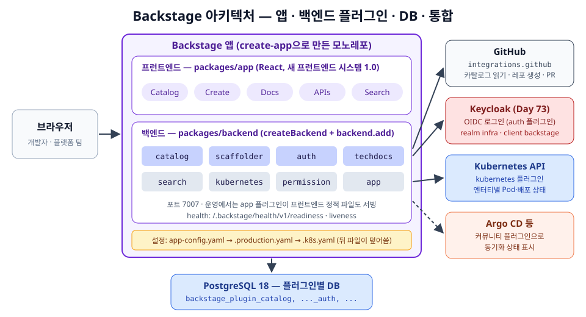
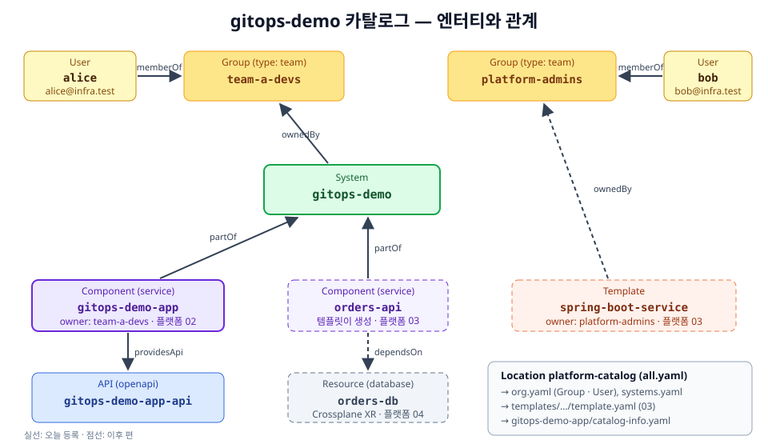

> **플랫폼 엔지니어링** | 난이도 ★★★☆☆ | 예상 소요 3 ~ 4시간 (첫 `yarn install`과 이미지 빌드에 시간이 걸림)

## 🎯 오늘의 목표

- Backstage의 구성(프런트엔드 앱, 백엔드 플러그인, DB, 통합)을 그림으로 설명할 수 있다
- `npx @backstage/create-app`으로 앱을 만들고 로컬에서 실행한 뒤 **PostgreSQL**을 붙인다
- `catalog-info.yaml`로 Chapter 7의 `gitops-demo-app`을 등록하고 **System · Component · API · Group · User** 관계를 만든다
- GitHub 통합(토큰은 **환경 변수**)과 **Keycloak OIDC 로그인**의 구조를 안다
- Backstage를 컨테이너 이미지로 빌드해 `platform-lab`에 배포하고 `http://backstage.localhost:31080`으로 접속한다

---

## 1. 왜 카탈로그부터인가?

플랫폼 01의 성숙도 모델에서 **운영 ②(Centrally tracked)** 는 "기능이 목록화되고 소유자가 기록된 상태"였습니다. 셀프서비스(템플릿, 인프라 API)보다 먼저 필요한 것이 **"무엇이 있고 누구 것인가"** 를 아는 것입니다.

| 질문 | 카탈로그 없이 | 카탈로그로 |
|---|---|---|
| 이 서비스 주인은? | Slack에서 수소문 | Component의 `owner` → Group → 멤버 |
| 이 API를 누가 쓰나? | 코드 검색 | API의 `consumedBy` 관계 |
| 장애 시 영향 범위는? | 아키텍처 위키(대개 낡음) | System · `dependsOn` 그래프 |
| 소스·문서·배포 상태는 어디? | 북마크 모음 | 엔터티 한 페이지 (링크·TechDocs·플러그인 탭) |

핵심은 **메타데이터가 코드 옆(레포 안 `catalog-info.yaml`)에 산다**는 점입니다. 위키처럼 따로 관리하면 낡지만, 코드와 같은 PR로 고치면 살아 있습니다. GitOps(Chapter 7)와 같은 철학입니다.

---

## 2. Backstage 한눈에 보기

Backstage는 Spotify가 만들어 2020년 CNCF에 기부한 **개발자 포털 프레임워크**입니다. "설치하면 끝나는 제품"이 아니라 **자기 회사용 앱을 만들어 빌드하는 프레임워크**라는 점이 중요합니다. 그래서 설치 명령이 `helm install`이 아니라 `npx @backstage/create-app`입니다.

| 핵심 기능 | 하는 일 | 이 탭 |
|---|---|---|
| **Software Catalog** | 모든 소프트웨어·팀·관계를 한곳에 | 오늘 |
| **Software Templates (Scaffolder)** | 골든 패스로 새 프로젝트 생성 | 플랫폼 03 |
| **TechDocs** | 레포 안 Markdown을 문서 사이트로 | 플랫폼 03 |
| **Search** | 카탈로그·문서 통합 검색 | 기본 포함 |
| **플러그인** | Kubernetes, Argo CD, GitHub Actions, 비용 등 | 기본 Kubernetes 플러그인 포함 |

2026-11-19 기준 최신은 **Backstage 1.57**(1.57.1, 11월 18일)입니다. 1.57에서 **새 프런트엔드 시스템이 1.0**이 되었고, `create-app`이 만드는 앱도 새 프런트엔드 시스템(확장 extensions + `app-config.yaml`의 `app.extensions`로 화면 구성)을 기본으로 씁니다. 백엔드는 이미 몇 년 전부터 **새 백엔드 시스템**(`createBackend()` + `backend.add(import(...))`)이 기본입니다.



| 구성 요소 | 위치 (생성된 앱 기준) | 설명 |
|---|---|---|
| 프런트엔드 앱 | `packages/app` | React SPA. 개발 시 `:3000`, 운영에서는 백엔드가 정적 파일로 서빙 |
| 백엔드 | `packages/backend` | Node.js. 플러그인(catalog, scaffolder, auth, techdocs, search, kubernetes...)을 `backend.add()`로 조립. `:7007` |
| DB | 설정 `backend.database` | 개발 기본은 `better-sqlite3` 인메모리, 운영은 **PostgreSQL** (플러그인마다 DB 하나: `backstage_plugin_catalog` 등) |
| 통합(integrations) | 설정 `integrations.github` | 카탈로그·스캐폴더가 GitHub API를 부를 때 쓰는 자격 증명 |
| 설정 | `app-config.yaml` → `app-config.production.yaml` → (추가 파일) | 뒤에 오는 파일이 앞을 덮음. 객체는 병합, **배열은 통째로 교체** |

---

## 3. 소프트웨어 카탈로그 모델

카탈로그의 단위는 **엔터티(entity)** 이고, K8s 매니페스트처럼 `apiVersion / kind / metadata / spec`을 가집니다.

| kind | 뜻 | 오늘 만들 것 |
|---|---|---|
| **Component** | 소프트웨어 조각 (service, website, library) | `gitops-demo-app` |
| **API** | Component가 제공·소비하는 인터페이스 (openapi, grpc, asyncapi...) | `gitops-demo-app-api` |
| **System** | 함께 하나의 기능을 이루는 Component·API·Resource 묶음 | `gitops-demo` |
| Domain | 비즈니스 영역 (System의 묶음) | (생략) |
| Resource | 인프라 (DB, 버킷, 클러스터) | 플랫폼 04에서 언급 |
| **Group** | 팀 | `platform-admins`, `team-a-devs` |
| **User** | 사람 | `alice`, `bob` |
| **Location** | 다른 엔터티 파일을 가리키는 포인터 | `platform-catalog` |
| Template | 스캐폴더 템플릿 | 플랫폼 03 |



관계는 `spec`의 필드로 선언하고, Backstage가 **양방향 관계**를 자동으로 만듭니다.

| 선언 (spec 필드) | 생성되는 관계 쌍 |
|---|---|
| Component `owner: group:team-a-devs` | `ownedBy` ↔ `ownerOf` |
| Component `system: gitops-demo` | `partOf` ↔ `hasPart` |
| Component `providesApis: [...]` | `providesApi` ↔ `apiProvidedBy` |
| Component `consumesApis: [...]` | `consumesApi` ↔ `apiConsumedBy` |
| Component `dependsOn: [resource:...]` | `dependsOn` ↔ `dependencyOf` |
| User `memberOf: [team-a-devs]` | `memberOf` ↔ `hasMember` |

> 💡 엔터티 참조(entity ref)는 `kind:namespace/name` 형식입니다. `group:default/team-a-devs`를 줄여 `group:team-a-devs`, 문맥상 kind가 분명하면 `team-a-devs`만 써도 됩니다.

---

## 4. 실습 ① 준비 — Node.js 24와 빌드 도구

Backstage 1.57은 **Node.js 24 또는 26**만 지원합니다(루트 `package.json`의 `engines.node`가 `^24.15.0 || ^26.13.0`). Node 22는 지원 목록에서 빠졌습니다. 운영 이미지의 베이스(`node:24-trixie-slim`)와 맞추기 위해 **24 LTS**를 씁니다.

```bash
# WSL2 Ubuntu 24.04 — nvm으로 Node 24 설치
curl -o- https://raw.githubusercontent.com/nvm-sh/nvm/v0.41.0/install.sh | bash
source ~/.bashrc
nvm install 24
node -v              # v24.x.x (24.15.0 이상)

# Yarn은 corepack이 레포의 packageManager 필드대로 맞춰 줌
corepack enable

# 네이티브 모듈(better-sqlite3, isolated-vm 등) 빌드용
sudo apt-get update && sudo apt-get install -y build-essential python3 git
```

> ⚠️ Windows의 PowerShell이 아니라 **WSL2 안**에서 진행하세요. 레포도 `/mnt/c/...`가 아니라 `~/platform-lab/` (리눅스 파일 시스템)에 두어야 `yarn install`과 파일 감시가 수십 배 빠릅니다.

---

## 5. 실습 ② 앱 만들기와 로컬 실행

```bash
cd ~/platform-lab
npx @backstage/create-app@latest
# ? Enter a name for the app [required] backstage
# ...
# 🥇  Successfully created backstage
```

```text
backstage/
├── app-config.yaml               # 공통 설정 (로컬 개발 기본)
├── app-config.production.yaml    # 운영 덮어쓰기 (pg DB 등)
├── catalog-info.yaml             # 이 Backstage 앱 자신의 카탈로그 정보
├── examples/                     # 예제 엔터티·템플릿 (org.yaml, entities.yaml, template/)
├── packages/
│   ├── app/                      # 프런트엔드 (새 프런트엔드 시스템)
│   └── backend/                  # 백엔드 (src/index.ts, Dockerfile)
└── plugins/                      # 직접 만드는 플러그인 자리
```

```bash
cd backstage
yarn start
# [app]     webpack compiled successfully ... http://localhost:3000
# [backend] ... Listening on :7007
```

브라우저에서 **http://localhost:3000** → **Enter as a Guest**. 카탈로그에 `examples/`의 예제 엔터티가 보이면 성공입니다.

> 💡 Guest 로그인은 **개발 환경 전용**입니다. guest 공급자는 운영(`NODE_ENV=production`)에서는 명시적으로 막혀 있고, `dangerouslyAllowOutsideDevelopment`를 켜야만 동작합니다(9장에서 실습용으로만 켭니다).

---

## 6. 실습 ③ PostgreSQL 연결

기본 설정은 `better-sqlite3` **인메모리** DB라 백엔드를 재시작하면 카탈로그가 비었다가 다시 채워집니다. 운영과 같은 PostgreSQL로 바꿉니다.

```bash
export POSTGRES_PASSWORD='backstage-lab-pw'      # 실습용
docker run -d --name backstage-pg --restart unless-stopped \
  -e POSTGRES_USER=backstage -e POSTGRES_PASSWORD="$POSTGRES_PASSWORD" \
  -p 5432:5432 -v backstage-pg:/var/lib/postgresql \
  postgres:18
```

> ⚠️ **PostgreSQL 18 공식 이미지부터 데이터 디렉터리가 바뀌었습니다.** `PGDATA`가 `/var/lib/postgresql/18/docker`이고 볼륨은 **`/var/lib/postgresql`** 에 붙입니다. 예전 글처럼 `/var/lib/postgresql/data`에 마운트하면 컨테이너가 경고를 내고 시작하지 않습니다.

로컬 전용 덮어쓰기 파일을 만듭니다. `create-app`의 `.gitignore`에 `*.local.yaml` 패턴이 들어 있어 Git에 올라가지 않습니다(`git check-ignore -v app-config.local.yaml`로 확인).

```yaml
# ~/platform-lab/backstage/app-config.local.yaml
backend:
  database:
    client: pg
    connection:
      host: localhost
      port: 5432
      user: backstage
      password: ${POSTGRES_PASSWORD}     # 환경 변수에서 읽음 — 파일에 비밀번호를 쓰지 않음
```

```bash
yarn start          # app-config.yaml → app-config.local.yaml 순으로 자동 로드
docker exec backstage-pg psql -U backstage -c '\l' | grep backstage_plugin
#  backstage_plugin_app        | backstage | ...
#  backstage_plugin_auth       | backstage | ...
#  backstage_plugin_catalog    | backstage | ...
#  backstage_plugin_scaffolder | backstage | ...
#  ...
```

플러그인마다 DB가 따로 생깁니다. 그래서 DB 사용자에게 **CREATEDB 권한**이 필요합니다(공식 이미지의 `POSTGRES_USER`는 슈퍼유저라 문제없음). 운영에서 권한을 좁히려면 `backend.database.pluginDivisionMode: schema`로 DB 하나에 스키마를 나누는 방법도 있습니다.

---

## 7. 실습 ④ GitHub 통합 — 토큰은 환경 변수로

`app-config.yaml`에는 이미 이렇게 들어 있습니다.

```yaml
integrations:
  github:
    - host: github.com
      token: ${GITHUB_TOKEN}
```

GitHub에서 **Fine-grained personal access token**을 만듭니다(Settings → Developer settings → Fine-grained tokens).

| 항목 | 오늘(플랫폼 02) | 플랫폼 03에서 추가 |
|---|---|---|
| Repository access | `gitops-demo-app`, `gitops-demo-config`, `platform-catalog` | **All repositories** (새 레포를 만들어야 하므로) |
| Contents | Read-only | Read and write |
| Metadata | Read-only (자동) | — |
| Administration / Pull requests / Workflows | — | Read and write |

```bash
# 화면에 남지 않게 입력 → 현재 셸에만 존재
read -rs GITHUB_TOKEN && export GITHUB_TOKEN
yarn start
```

> ⚠️ 토큰을 `app-config*.yaml`, `.env`, 셸 히스토리에 **평문으로 남기지 마세요.** 토큰 없이도 Public 레포는 읽히지만 비인증 GitHub API 한도(시간당 60회)에 금방 걸려 카탈로그 갱신이 멈춥니다. 운영에서는 개인 토큰 대신 **GitHub App**(`integrations.github[].apps`)을 권장합니다 — 조직 단위 권한, 짧은 수명 토큰, 높은 한도.

---

## 8. 실습 ⑤ 카탈로그에 Ch7 데모 앱 등록

### 8-1. 레포 `platform-catalog` — 팀·시스템·진입점

플랫폼 팀이 관리하는 레포를 하나 만듭니다. 이후 템플릿(플랫폼 03)도 여기에 둡니다.

```yaml
# ~/platform-lab/platform-catalog/org.yaml — Day 73 realm `infra`와 같은 이름
apiVersion: backstage.io/v1alpha1
kind: Group
metadata:
  name: platform-admins
  title: 플랫폼 팀
spec:
  type: team
  children: []
---
apiVersion: backstage.io/v1alpha1
kind: Group
metadata:
  name: team-a-devs
  title: A팀 (제품 개발)
spec:
  type: team
  children: []
---
apiVersion: backstage.io/v1alpha1
kind: User
metadata:
  name: alice
spec:
  profile:
    displayName: Alice Kim
    email: alice@infra.test          # 10장 OIDC 로그인에서 이메일로 사용자를 찾음
  memberOf: [team-a-devs]
---
apiVersion: backstage.io/v1alpha1
kind: User
metadata:
  name: bob
spec:
  profile:
    displayName: Bob Lee
    email: bob@infra.test
  memberOf: [platform-admins]
```

```yaml
# ~/platform-lab/platform-catalog/systems.yaml
apiVersion: backstage.io/v1alpha1
kind: System
metadata:
  name: gitops-demo
  title: GitOps 데모 시스템
  description: Chapter 7 GitOps 데모 앱과 플랫폼 탭에서 골든 패스로 만든 서비스들
spec:
  owner: group:team-a-devs
```

```yaml
# ~/platform-lab/platform-catalog/all.yaml — Backstage가 읽는 단 하나의 진입점
apiVersion: backstage.io/v1alpha1
kind: Location
metadata:
  name: platform-catalog
  description: 플랫폼 팀이 관리하는 카탈로그 진입점
spec:
  targets:
    - ./org.yaml
    - ./systems.yaml
    - https://github.com/<user>/gitops-demo-app/blob/main/catalog-info.yaml
```

```bash
cd ~/platform-lab/platform-catalog
sed -i "s/<user>/$GH_USER/g" all.yaml
git init -b main && git add . && git commit -m "feat: platform-catalog 초기 엔터티"
gh repo create platform-catalog --public --source=. --remote=origin --push
```

### 8-2. 앱 레포에 `catalog-info.yaml`

메타데이터는 **코드 옆**에 둡니다. `gitops-demo-app` 레포 루트에 추가합니다.

```yaml
# ~/gitops-lab/gitops-demo-app/catalog-info.yaml
apiVersion: backstage.io/v1alpha1
kind: Component
metadata:
  name: gitops-demo-app
  title: GitOps 데모 앱
  description: Chapter 7의 FastAPI 데모 앱 (Argo CD로 demo-dev/stage/prod 배포)
  annotations:
    github.com/project-slug: <user>/gitops-demo-app
  tags: [python, fastapi]
  links:
    - url: https://github.com/<user>/gitops-demo-config/tree/main/apps/demo-app
      title: 배포 설정 (gitops-demo-config)
spec:
  type: service
  lifecycle: experimental
  owner: group:team-a-devs
  system: gitops-demo
  providesApis: [gitops-demo-app-api]
---
apiVersion: backstage.io/v1alpha1
kind: API
metadata:
  name: gitops-demo-app-api
  description: gitops-demo-app의 HTTP API
spec:
  type: openapi
  lifecycle: experimental
  owner: group:team-a-devs
  system: gitops-demo
  definition: |
    openapi: 3.1.0
    info:
      title: gitops-demo-app
      version: 0.1.0
    paths:
      /:
        get:
          summary: 앱 이름·버전·환경·Pod 이름
          responses:
            '200': { description: OK }
      /healthz:
        get:
          summary: 헬스 체크 (프로브용)
          responses:
            '200': { description: OK }
```

```bash
cd ~/gitops-lab/gitops-demo-app
sed -i "s/<user>/$GH_USER/g" catalog-info.yaml
git add catalog-info.yaml && git commit -m "chore: Backstage catalog-info 추가" && git push
```

> 💡 FastAPI는 `/openapi.json`을 자동 생성합니다. 실무에서는 CI가 이 파일을 레포에 커밋하고 `definition: { $text: ./openapi.json }`처럼 **파일을 참조**하게 하면 API 문서가 코드와 함께 갱신됩니다.

### 8-3. Backstage가 `platform-catalog`를 읽게 하기

`app-config.yaml`의 `catalog` 부분을 고칩니다. 기본 규칙은 Component·System·API·Resource·Location만 허용하므로 **Group·User도 허용**해야 합니다.

```yaml
# app-config.yaml (catalog 부분)
catalog:
  rules:
    - allow: [Component, System, API, Resource, Location, Domain, Group, User, Template]
  locations:
    - type: url
      target: https://github.com/<user>/platform-catalog/blob/main/all.yaml
    # (예제는 로컬 학습용으로 남겨 둠)
    - type: file
      target: ../../examples/entities.yaml
    # ...
```

운영 설정(`app-config.production.yaml`)은 `catalog.locations` 배열을 **통째로 덮어씁니다.** 9장의 이미지에서도 같은 카탈로그를 보도록 여기도 바꿉니다.

```yaml
# app-config.production.yaml (catalog 부분 전체 교체)
catalog:
  locations:
    - type: url
      target: https://github.com/<user>/platform-catalog/blob/main/all.yaml
```

```bash
sed -i "s/<user>/$GH_USER/g" app-config.yaml app-config.production.yaml
yarn start
```

카탈로그 화면에서 확인할 것:

- **Kind: Component** → `gitops-demo-app` (Owner `team-a-devs`, System `gitops-demo`)
- 엔터티 페이지 **Relations** 그래프: Component → API, Component → System, Component → Group
- **Kind: Group** → `team-a-devs` 페이지에 Alice와 소유 엔터티 목록
- **APIs** 메뉴 → `gitops-demo-app-api` → Definition 탭에 Swagger UI

> 💡 카탈로그는 기본 약 100~200초 주기로 Location을 다시 읽습니다. 레포를 고친 뒤 바로 보고 싶으면 엔터티 페이지 우측 상단 **⟳ (Schedule entity refresh)**.

---

## 9. 실습 ⑥ 이미지로 빌드해 `platform-lab`에 배포

### 9-1. 이미지 빌드 (호스트 빌드 방식)

생성된 `packages/backend/Dockerfile`은 **호스트에서 먼저 빌드한 결과물**을 이미지에 담는 방식입니다. 그래서 호스트 Node 버전이 베이스 이미지(`node:24-trixie-slim`)와 같아야 합니다.

```bash
cd ~/platform-lab/backstage
yarn install --immutable
yarn tsc
yarn build:backend          # packages/backend/dist/{skeleton,bundle}.tar.gz
yarn build-image            # = docker build ../.. -f Dockerfile --tag backstage
docker tag backstage:latest backstage:0.1.0
kind load docker-image backstage:0.1.0 --name platform-lab
```

> 💡 이미지에는 `app-config*.yaml`이 모두 복사되지만 실행 시 읽는 파일은 명령(`--config`)으로 지정한 것뿐입니다. 그래도 `app-config.local.yaml`이 섞여 들어가는 것이 싫다면 `.dockerignore`에 추가하세요. 멀티 스테이지 빌드 방식(호스트 Node 불필요)은 공식 문서 *Deployment → Docker*에 있습니다.

### 9-2. 매니페스트

```bash
kubectl create namespace backstage
kubectl -n backstage create secret generic backstage-secrets \
  --from-literal=POSTGRES_PASSWORD="$POSTGRES_PASSWORD" \
  --from-literal=GITHUB_TOKEN="$GITHUB_TOKEN"
```

```yaml
# ~/platform-lab/backstage-k8s.yaml
apiVersion: v1
kind: Service
metadata: { name: backstage-postgres, namespace: backstage }
spec:
  selector: { app: backstage-postgres }
  ports: [{ port: 5432, targetPort: 5432 }]
---
apiVersion: apps/v1
kind: StatefulSet
metadata: { name: backstage-postgres, namespace: backstage }
spec:
  serviceName: backstage-postgres
  replicas: 1
  selector: { matchLabels: { app: backstage-postgres } }
  template:
    metadata: { labels: { app: backstage-postgres } }
    spec:
      containers:
      - name: postgres
        image: postgres:18
        env:
        - { name: POSTGRES_USER, value: backstage }
        - name: POSTGRES_PASSWORD
          valueFrom: { secretKeyRef: { name: backstage-secrets, key: POSTGRES_PASSWORD } }
        ports: [{ containerPort: 5432 }]
        readinessProbe:
          exec: { command: ["pg_isready", "-U", "backstage"] }
        volumeMounts:
        - { name: data, mountPath: /var/lib/postgresql }    # PG 18 규칙
  volumeClaimTemplates:
  - metadata: { name: data }
    spec:
      accessModes: [ReadWriteOnce]
      resources: { requests: { storage: 1Gi } }
---
apiVersion: v1
kind: ConfigMap
metadata: { name: backstage-app-config, namespace: backstage }
data:
  app-config.k8s.yaml: |
    app:
      baseUrl: http://backstage.localhost:31080
    backend:
      baseUrl: http://backstage.localhost:31080
      csp:
        upgrade-insecure-requests: false      # HTTP로 서비스하므로 https 강제 업그레이드 끔
    auth:
      providers:
        guest:
          dangerouslyAllowOutsideDevelopment: true   # ⚠️ 실습 전용. 운영은 10장의 OIDC
---
apiVersion: apps/v1
kind: Deployment
metadata: { name: backstage, namespace: backstage }
spec:
  replicas: 1
  selector: { matchLabels: { app: backstage } }
  template:
    metadata: { labels: { app: backstage } }
    spec:
      containers:
      - name: backstage
        image: backstage:0.1.0
        imagePullPolicy: IfNotPresent        # kind load로 넣은 이미지 사용
        command: ["node", "packages/backend",
                  "--config", "app-config.yaml",
                  "--config", "app-config.production.yaml",
                  "--config", "/config/app-config.k8s.yaml"]
        env:
        - { name: POSTGRES_HOST, value: backstage-postgres }
        - { name: POSTGRES_PORT, value: "5432" }
        - { name: POSTGRES_USER, value: backstage }
        - name: POSTGRES_PASSWORD
          valueFrom: { secretKeyRef: { name: backstage-secrets, key: POSTGRES_PASSWORD } }
        - name: GITHUB_TOKEN
          valueFrom: { secretKeyRef: { name: backstage-secrets, key: GITHUB_TOKEN } }
        ports: [{ containerPort: 7007 }]
        readinessProbe:
          httpGet: { path: /.backstage/health/v1/readiness, port: 7007 }
          initialDelaySeconds: 20
        livenessProbe:
          httpGet: { path: /.backstage/health/v1/liveness, port: 7007 }
          initialDelaySeconds: 60
        resources:
          requests: { cpu: 250m, memory: 512Mi }
          limits: { memory: 1Gi }
        volumeMounts:
        - { name: app-config, mountPath: /config, readOnly: true }
      volumes:
      - name: app-config
        configMap: { name: backstage-app-config }
---
apiVersion: v1
kind: Service
metadata: { name: backstage, namespace: backstage }
spec:
  selector: { app: backstage }
  ports: [{ port: 80, targetPort: 7007 }]
---
apiVersion: gateway.networking.k8s.io/v1
kind: HTTPRoute
metadata: { name: backstage, namespace: backstage }
spec:
  parentRefs:
  - { name: traefik-gateway, namespace: traefik }
  hostnames: ["backstage.localhost"]
  rules:
  - backendRefs:
    - { name: backstage, port: 80 }
```

```bash
kubectl apply -f backstage-k8s.yaml
kubectl -n backstage rollout status statefulset/backstage-postgres
kubectl -n backstage rollout status deploy/backstage --timeout=5m
kubectl -n backstage logs deploy/backstage | grep -iE "listening|catalog" | head
curl -s --connect-to backstage.localhost:80:127.0.0.1:31080 http://backstage.localhost/.backstage/health/v1/readiness
# {"status":"ok"}
```

브라우저에서 **http://backstage.localhost:31080** → Guest로 들어가 `gitops-demo-app`이 보이면 완료입니다.

| 설정 | 이유 |
|---|---|
| `app.baseUrl` = `backend.baseUrl` | 운영에서는 백엔드(`app-backend` 플러그인)가 프런트엔드를 같은 주소로 서빙 |
| 설정 파일 3개를 순서대로 | 기본 → 운영(pg, 카탈로그) → 클러스터 고유값(URL). **이미지는 그대로, 환경 차이는 ConfigMap**으로 |
| 비밀은 `secretKeyRef` | 설정 파일의 `${POSTGRES_PASSWORD}`, `${GITHUB_TOKEN}`이 환경 변수에서 채워짐 |
| `/.backstage/health/v1/*` | 새 백엔드 시스템이 제공하는 프로브 엔드포인트 |

> 💡 이 매니페스트도 결국 Git에 있어야 합니다. 플랫폼 08에서 Backstage 자체를 `gitops-demo-config`(또는 플랫폼 전용 설정 레포)의 Argo CD Application으로 옮기고, Secret은 Day 55의 SOPS/External Secrets로 바꿉니다.

---

## 10. Keycloak OIDC 로그인 — 구조와 설정 (선택 실습)

운영에서 guest 대신 **Day 73의 Keycloak**(realm `infra`)으로 로그인하게 하는 구조입니다. 흐름은 Day 73의 Grafana·Argo CD SSO와 같습니다.

```text
브라우저 ──(1) Sign in with Keycloak──▶ Backstage auth 백엔드 /api/auth/oidc/start
        ◀─(2) 302 Keycloak 로그인 페이지 (realm infra)
        ──(3) alice / alice-pass ──▶ Keycloak
        ◀─(4) code → /api/auth/oidc/handler/frame
Backstage auth 백엔드 ──(5) code로 토큰 교환, id_token 검증──▶ Keycloak
                     ──(6) 로그인 리졸버: email alice@infra.test ↔ 카탈로그 User alice
                     ──(7) Backstage 토큰 발급 (sub=user:default/alice, ent=[user:..., group:team-a-devs])
```

핵심은 (6)의 **로그인 리졸버(sign-in resolver)** 입니다. Keycloak이 "이 사람은 alice@infra.test"라고 알려 주면, Backstage는 카탈로그에서 그 이메일을 가진 User 엔터티를 찾아 **소유권(ownership)** 을 결정합니다. 8-1에서 User에 `profile.email`을 넣은 이유입니다. 카탈로그에 없는 사람은 로그인할 수 없습니다(기본 동작).

**① Keycloak** — realm `infra`에 confidential client `backstage`를 추가합니다(Day 73의 Clients → Create client, Client authentication ON). Valid redirect URI:

- 로컬 개발: `http://localhost:7007/api/auth/oidc/handler/frame`
- kind: `http://backstage.localhost:31080/api/auth/oidc/handler/frame`

**② 백엔드 모듈**

```bash
yarn --cwd packages/backend add @backstage/plugin-auth-backend-module-oidc-provider
```

```ts
// packages/backend/src/index.ts
backend.add(import('@backstage/plugin-auth-backend'));
backend.add(import('@backstage/plugin-auth-backend-module-oidc-provider'));   // 추가
```

**③ 설정** (`app-config.local.yaml`에 추가 — 비밀은 환경 변수)

```yaml
auth:
  environment: development
  session:
    secret: ${AUTH_SESSION_SECRET}
  providers:
    oidc:
      development:
        metadataUrl: https://keycloak.infra.test:8443/realms/infra/.well-known/openid-configuration
        clientId: backstage
        clientSecret: ${AUTH_OIDC_CLIENT_SECRET}
        prompt: auto
        signIn:
          resolvers:
            - resolver: emailMatchingUserEntityProfileEmail
```

```bash
# Day 73 6-3의 port-forward(keycloak.infra.test:8443)를 켜 둔 상태에서
export AUTH_SESSION_SECRET=$(openssl rand -hex 32)
read -rs AUTH_OIDC_CLIENT_SECRET && export AUTH_OIDC_CLIENT_SECRET
export NODE_EXTRA_CA_CERTS=~/k8s-lab/day73/ca.crt     # Day 73 실습용 CA를 Node가 신뢰하도록
yarn start
```

**④ 프런트엔드** — OIDC는 내장 API ref가 없어서 `App.tsx`에서 **커스텀 API ref**(`OAuth2.create({ provider: { id: 'oidc', title: 'Keycloak' } ... })`)를 만들고 `SignInPageBlueprint`로 로그인 페이지에 "Keycloak" 버튼을 추가합니다. 코드 전체는 공식 문서 *Authentication → OIDC provider from scratch*의 새 프런트엔드 시스템 예시를 그대로 따르세요. 문서는 일반 이름 `oidc` 대신 사용자가 아는 이름(Keycloak)으로 **다시 브랜딩**하라고 권합니다.

> ⚠️ Backstage 1.57부터 auth 백엔드가 **PKCE(S256)를 필수**로 요구하고, 실험 기능이던 동적 클라이언트 등록(DCR)은 제거되었습니다. 오래된 블로그의 설정을 옮길 때 주의하세요.

> 💡 kind 안의 Backstage가 `infra-lab`의 Keycloak에 닿으려면 클러스터 간 네트워크(같은 Docker 네트워크 `kind`의 노드 IP, CoreDNS rewrite, CA 신뢰)를 맞춰야 합니다. 이 탭에서는 **로컬 `yarn start`로 OIDC를 확인**하는 데까지만 하고, kind 배포는 guest로 둡니다.

---

## 트러블슈팅

| 증상 | 원인 | 해결 |
|---|---|---|
| `yarn install` 중 `The engine "node" is incompatible` | Node 22 이하 | `nvm install 24 && nvm use 24` |
| `better-sqlite3`·`isolated-vm` 빌드 실패 (`gyp ERR!`) | 컴파일러·Python 없음 | `sudo apt-get install -y build-essential python3` 후 `yarn install` |
| 카탈로그에 `NotAllowedError: Forbidden: entity of kind Group is not allowed from that location` | `catalog.rules`에 Group/User 없음 | 8-3처럼 `rules.allow`에 추가 |
| 카탈로그에 아무것도 안 생기고 로그에 `401` / `403 rate limit` | `GITHUB_TOKEN` 미설정·만료·레포 접근 권한 없음 | 같은 셸에서 `echo ${GITHUB_TOKEN:0:4}` 확인, 토큰의 Repository access 확인 |
| Pod 로그 `The guest provider is disabled outside of development` 류 오류, 로그인 불가 | 운영 모드에서 guest 비활성 | ConfigMap의 `dangerouslyAllowOutsideDevelopment: true`(실습 전용) 또는 OIDC 설정 |
| 브라우저가 `https://backstage.localhost...`로 리소스를 요청하며 깨짐 | CSP `upgrade-insecure-requests` | `backend.csp.upgrade-insecure-requests: false` |
| postgres Pod가 `CrashLoopBackOff`, 로그에 데이터 디렉터리 경고 | PG 18에서 `/var/lib/postgresql/data`에 마운트 | `mountPath: /var/lib/postgresql` |
| `ErrImageNeverPull` / `ImagePullBackOff` `backstage:0.1.0` | `kind load`를 안 했거나 다른 클러스터에 넣음 | `kind load docker-image backstage:0.1.0 --name platform-lab` |
| 컨테이너에서 `Error: The module ... was compiled against a different Node.js version` | 호스트 Node와 이미지 Node 메이저가 다름 | 호스트를 Node 24로 맞추고 `yarn install` → 재빌드 |

---

## 핵심 정리

- Backstage는 "설치하는 제품"이 아니라 **자기 앱을 만들어 빌드하는 프레임워크** — `npx @backstage/create-app@latest`
- 1.57 기준 **Node 24/26**, 새 프런트엔드 시스템 1.0, 새 백엔드 시스템(`backend.add`)이 기본
- 개발은 인메모리 SQLite, 운영은 **PostgreSQL**(플러그인별 DB). PG 18 이미지는 `/var/lib/postgresql`에 마운트
- 카탈로그 메타데이터는 **코드 옆 `catalog-info.yaml`**, 진입점은 `platform-catalog/all.yaml` Location 하나
- `owner`·`system`·`providesApis`·`memberOf`로 선언하면 **양방향 관계**가 자동 생성된다
- 토큰·비밀은 `${ENV}`로만 참조하고 파일에 쓰지 않는다. 운영은 GitHub App 권장
- OIDC 로그인은 **로그인 리졸버**가 IdP의 신원(이메일)을 카탈로그 User로 연결하는 것이 핵심
- kind 배포: 호스트 빌드 → `kind load` → 설정 3단(기본·운영·ConfigMap) + Secret 환경 변수

---

## 셀프 체크

<details>
<summary>Q1. Backstage를 Helm 한 줄로 설치하지 않고 create-app으로 "앱을 만드는" 이유는?</summary>

Backstage는 플러그인을 코드로 조립하는 프레임워크이기 때문입니다. 어떤 플러그인을 쓸지(`backend.add`, 프런트엔드 확장), 로그인 화면, 리졸버 같은 것이 **회사마다 다른 코드**라서 각자 앱을 만들어 빌드하고 이미지로 배포합니다. (Helm 차트는 그렇게 만든 이미지를 배포하는 수단일 뿐입니다.)
</details>

<details>
<summary>Q2. app-config.production.yaml에서 catalog.locations를 다시 써야 했던 이유는?</summary>

Backstage 설정 병합은 객체는 깊게 병합하지만 **배열은 뒤 파일이 통째로 교체**합니다. 운영 설정에 예제용 `locations` 배열이 있으므로, `app-config.yaml`에 추가한 `platform-catalog` 위치는 운영에서 사라집니다. 그래서 운영 설정의 배열도 바꿔야 합니다.
</details>

<details>
<summary>Q3. Component에 owner: group:team-a-devs를 쓰면 Group 페이지에서도 그 Component가 보이는 이유는?</summary>

카탈로그가 선언된 관계에서 **역방향 관계**(`ownerOf`)를 자동으로 만들기 때문입니다. Group 엔터티 파일에는 아무것도 적지 않아도 됩니다.
</details>

<details>
<summary>Q4. OIDC 로그인에서 Keycloak 인증에 성공했는데도 Backstage 로그인이 실패할 수 있는 경우는?</summary>

로그인 리졸버(`emailMatchingUserEntityProfileEmail`)가 그 이메일을 가진 **User 엔터티를 카탈로그에서 찾지 못한** 경우입니다. 그 밖에 redirect URI 불일치, Node가 Keycloak의 자체 서명 CA를 신뢰하지 않음(`NODE_EXTRA_CA_CERTS`), `auth.session.secret` 누락도 원인입니다.
</details>

<details>
<summary>Q5. 같은 이미지(backstage:0.1.0)를 로컬·kind·운영에서 다르게 동작시키는 방법은?</summary>

이미지에는 공통 설정만 넣고, 환경마다 다른 값은 **추가 `--config` 파일(ConfigMap 마운트)** 과 **환경 변수(Secret)** 로 주입합니다. 오늘은 URL·CSP·guest 허용을 `app-config.k8s.yaml`로, DB 비밀번호와 GitHub 토큰을 Secret으로 넣었습니다.
</details>

---

## ⏭️ 다음 예고 — [플랫폼 03. Software Template로 골든 패스 만들기](./plat03-software-templates-golden-path.md)

카탈로그는 "있는 것"을 보여 줍니다. 이제 "**새로 만드는 것**"을 셀프서비스로 바꿉니다. Spring Boot 4.1 서비스 스켈레톤을 Software Template으로 만들고, 버튼 한 번에 **GitHub 레포 생성 → `catalog-info.yaml` 포함 → `gitops-demo-config`에 Kustomize overlay PR → 카탈로그 등록**, PR을 머지하면 플랫폼 01의 ApplicationSet이 Argo CD로 배포까지 이어 갑니다. `fetch:template`, `publish:github`, `catalog:register` 액션과 TechDocs도 함께 봅니다.
