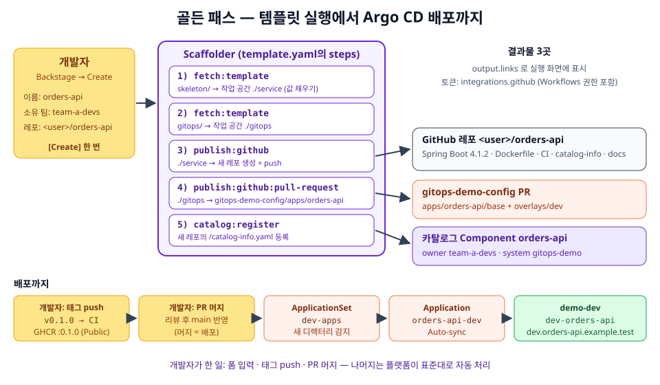
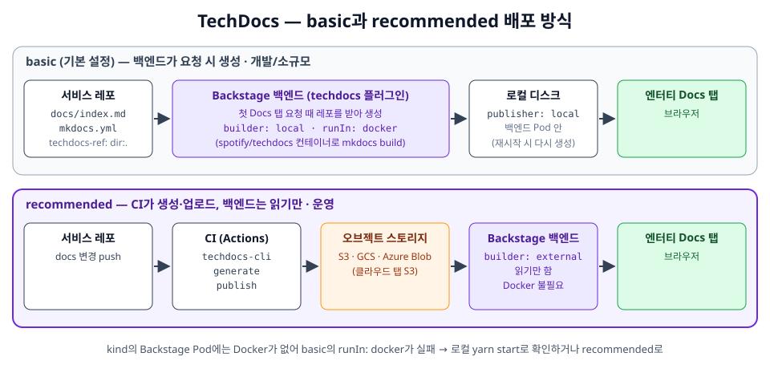

> **플랫폼 엔지니어링** | 난이도 ★★★☆☆ | 예상 소요 3 ~ 4시간

## 🎯 오늘의 목표

- Backstage **Software Template**의 구조(`parameters` → `steps` → `output`)를 읽고 쓸 수 있다
- 핵심 액션 **`fetch:template`**, **`publish:github`**, **`publish:github:pull-request`**, **`catalog:register`** 의 입력과 출력을 안다
- Spring Boot 4.1 서비스 스켈레톤으로 템플릿을 만들어, 버튼 한 번에 **새 GitHub 레포 + `catalog-info.yaml` + `gitops-demo-config` overlay PR + 카탈로그 등록**을 끝낸다
- PR 머지 후 플랫폼 01의 ApplicationSet `dev-apps`가 **Argo CD로 자동 배포**하는 흐름을 확인한다
- **TechDocs**(docs-like-code)의 구조와 basic/recommended 배포 방식의 차이를 안다

---

## 1. 지금까지 온 길, 그리고 남은 수작업

Chapter 7에서 `gitops-demo-app`을 만들 때 손으로 한 일을 세어 보면 이렇습니다.

| 수작업 | 한 곳 | 실수하기 쉬운 지점 |
|---|---|---|
| 앱 뼈대·Dockerfile 작성 | Day 50 | 비루트 사용자, 멀티 스테이지 누락 |
| CI 워크플로 복사 | Day 51 | `permissions`, 이미지 이름 소문자 |
| base/overlay 디렉터리 복사 | Day 52 | `images.name` 매칭, HTTPRoute `backendRefs`의 접두사 이름 |
| Argo CD Application 작성 | Day 53 | 경로 오타, `CreateNamespace` |
| 카탈로그 등록 | 플랫폼 02 | `owner`, `system` 누락 |

새 서비스마다 이걸 반복하면 서비스 수만큼 **조금씩 다른 변종**이 생깁니다. 오늘은 이 전부를 **템플릿 하나**에 담아, 개발자는 이름과 팀만 고르게 만듭니다. 플랫폼 01에서 본 성숙도 모델의 **인터페이스 ② 표준 도구 → ③ 셀프서비스**로 올라가는 단계입니다.



---

## 2. Software Template 해부

템플릿도 카탈로그 엔터티(`kind: Template`)입니다. 세 부분으로 이루어집니다.

```yaml
apiVersion: scaffolder.backstage.io/v1beta3
kind: Template
metadata:
  name: ...
spec:
  owner: group:platform-admins     # 템플릿도 소유자가 있는 "제품"
  type: service
  parameters: [...]                # ① 입력 폼 (JSON Schema → 화면)
  steps: [...]                     # ② 순서대로 실행할 액션
  output: {...}                    # ③ 끝난 뒤 보여 줄 링크·텍스트
```

| 부분 | 내용 | 비유 |
|---|---|---|
| `parameters` | JSON Schema(+ `ui:` 확장)로 폼 정의. 배열 원소 하나가 마법사의 한 페이지 | GitHub Actions의 `workflow_dispatch.inputs` |
| `steps` | `id`, `action`, `input`. 앞 단계 출력은 `${{ steps['id'].output.x }}`로 참조 | Actions의 `steps` |
| `output` | `links`(URL·entityRef), `text`(Markdown) | 실행 요약 |

### 2-1. 템플릿 문법 — `${{ }}`는 Nunjucks

| 표현 | 뜻 |
|---|---|
| `${{ parameters.name }}` | 폼 입력값 |
| `${{ steps['publish'].output.remoteUrl }}` | 앞 단계의 출력 |
| `${{ (parameters.repoUrl \| parseRepoUrl).owner }}` | 내장 필터. `github.com?owner=a&repo=b` → `{host, owner, repo}` |
| `${{ values.name \| lower }}` | `fetch:template`가 파일 안에서 쓰는 값 (`values`로 넘긴 것) |

> ⚠️ **GitHub Actions 워크플로도 `${{ }}`를 씁니다.** 스켈레톤의 `.github/workflows/*.yaml`을 그대로 템플릿 처리하면 `${{ secrets.GITHUB_TOKEN }}`을 Nunjucks가 먼저 해석해 빈 문자열로 만들거나 오류를 냅니다. `fetch:template`의 **`copyWithoutTemplating`** 으로 그 파일들을 건너뛰거나, 파일 안을 ` ... `로 감쌉니다.

### 2-2. 오늘 쓰는 액션

| 액션 | 하는 일 | 주요 입력 | 주요 출력 |
|---|---|---|---|
| `fetch:template` | 템플릿 디렉터리를 값으로 채워 **작업 공간**에 복사 (파일 경로도 템플릿 처리, 바이너리는 그대로 복사) | `url`, `targetPath`, `values`, `copyWithoutTemplating` | — |
| `fetch:plain` | 템플릿 처리 없이 복사 | `url`, `targetPath` | — |
| `publish:github` | GitHub에 **새 레포**를 만들고 작업 공간 내용을 push | `repoUrl`, `sourcePath`, `defaultBranch`, `repoVisibility`, `description` | `remoteUrl`, `repoContentsUrl`, `commitHash` |
| `publish:github:pull-request` | **기존 레포**에 브랜치를 만들고 PR 생성 | `repoUrl`, `branchName`, `title`, `description`, `sourcePath`, `targetPath` | `remoteUrl`(PR URL), `pullRequestNumber`, `targetBranchName` |
| `catalog:register` | 새 `catalog-info.yaml`을 Location으로 카탈로그에 등록 | `repoContentsUrl` + `catalogInfoPath` (또는 `catalogInfoUrl`) | `entityRef` |
| `debug:log` | 값 출력 (템플릿 디버깅) | `message` | — |

> 💡 설치된 Backstage에서 실제로 쓸 수 있는 액션과 정확한 입력 스키마는 **`/create/actions`** 페이지(예: `http://backstage.localhost:31080/create/actions`)에 나옵니다. 버전마다 입력이 추가되므로 블로그보다 이 페이지를 믿으세요. 1.57에서는 `github:repo:rulesets:create` 액션이 새로 생겼고, 템플릿 파라미터 단계를 조건(`when`)으로 숨기는 기능도 추가되었습니다.

---

## 3. 설계 — 템플릿이 만들 것

| 산출물 | 어디에 | 내용 |
|---|---|---|
| 서비스 레포 `<이름>` | GitHub `<user>/<이름>` | Spring Boot 4.1.2 / Java 21 / Gradle, `HelloController`, Actuator 프로브, Dockerfile, CI(`ghcr.io/<user>/<이름>`), `catalog-info.yaml`, `mkdocs.yml` + `docs/` |
| 배포 설정 PR | `gitops-demo-config` `apps/<이름>/` | `base`(Deployment·Service) + `overlays/dev`(ns `demo-dev`, `namePrefix: dev-`, 이미지 `0.1.0`, HTTPRoute `dev.<이름>.example.test`) |
| 카탈로그 엔터티 | Backstage | Component `<이름>` (owner 선택한 팀, System `gitops-demo`) |
| 배포 | `platform-lab` | PR 머지 → ApplicationSet `dev-apps`가 `<이름>-dev` Application 생성 |

예시 서비스 이름은 **`orders-api`** 로 고정합니다. 스택은 CKAD A00의 `hello-spring`과 같습니다(Spring Boot 4.1.2, Java 21, 포트 8080).

---

## 4. 실습 ① GitHub 토큰 권한 넓히기

스캐폴더는 Backstage의 `integrations.github` 토큰으로 **레포를 만들고, 워크플로 파일을 push하고, PR을 엽니다.** 플랫폼 02의 읽기 전용 토큰으로는 부족합니다. Fine-grained 토큰을 새로 만듭니다.

| 권한 | 값 | 이유 |
|---|---|---|
| Repository access | **All repositories** | 아직 없는 레포를 만들어야 함 |
| Administration | Read and write | 레포 생성 |
| Contents | Read and write | 스켈레톤 push, PR 브랜치 push |
| Pull requests | Read and write | `gitops-demo-config`에 PR |
| **Workflows** | Read and write | `.github/workflows/` 파일 push (없으면 push가 거부됨) |

```bash
read -rs GITHUB_TOKEN && export GITHUB_TOKEN
kubectl -n backstage create secret generic backstage-secrets \
  --from-literal=POSTGRES_PASSWORD="$POSTGRES_PASSWORD" \
  --from-literal=GITHUB_TOKEN="$GITHUB_TOKEN" \
  --dry-run=client -o yaml | kubectl apply -f -
kubectl -n backstage rollout restart deploy/backstage
```

> ⚠️ 이 토큰은 사실상 "계정의 모든 레포에 쓰기"입니다. **실습 계정에서만** 쓰고, 운영에서는 조직에 설치한 **GitHub App**(설치 범위를 조직·레포로 제한)으로 바꾸세요. 개발자 본인 권한으로 레포를 만들게 하려면 `RepoUrlPicker`의 `requestUserCredentials`(사용자 GitHub 로그인 토큰 사용)도 있습니다.

---

## 5. 실습 ② 템플릿 디렉터리 만들기

`platform-catalog` 레포에 템플릿을 둡니다.

```text
platform-catalog/
├── all.yaml                          # targets에 템플릿 추가
└── templates/spring-boot-service/
    ├── template.yaml
    ├── skeleton/                     # → 새 서비스 레포가 됨
    │   ├── catalog-info.yaml
    │   ├── mkdocs.yml  docs/index.md
    │   ├── Dockerfile  .dockerignore
    │   ├── .github/workflows/ci.yaml
    │   ├── build.gradle  settings.gradle  gradlew  gradlew.bat  gradle/wrapper/...
    │   └── src/main/{java/dev/platform/service/..., resources/application.yaml}
    └── gitops/                       # → gitops-demo-config/apps/<이름>/ 이 됨
        ├── base/{deployment.yaml, service.yaml, kustomization.yaml}
        └── overlays/dev/{kustomization.yaml, httproute.yaml}
```

### 5-1. 스켈레톤 — Spring Initializr에서 받아 이름만 값으로

```bash
cd ~/platform-lab/platform-catalog
mkdir -p templates/spring-boot-service && cd templates/spring-boot-service

curl -s https://start.spring.io/starter.tgz \
  -d type=gradle-project -d language=java \
  -d bootVersion=4.1.2 -d javaVersion=21 \
  -d groupId=dev.platform -d artifactId=service -d name=service \
  -d packageName=dev.platform.service \
  -d dependencies=web,actuator \
  -d baseDir=skeleton | tar -xzf -

rm skeleton/HELP.md skeleton/src/main/resources/application.properties
sed -i "s/rootProject.name = 'service'/rootProject.name = '\${{ values.name }}'/" skeleton/settings.gradle
cat skeleton/settings.gradle      # rootProject.name = '${{ values.name }}'
```

> 💡 Spring Boot 4에서 `web` 의존성은 `spring-boot-starter-webmvc`로 들어옵니다(`build.gradle` 확인). Java 패키지(`dev.platform.service`)는 모든 서비스에 공통으로 두어, 디렉터리 이름을 템플릿 처리하는 복잡함을 피했습니다.

```yaml
# skeleton/src/main/resources/application.yaml
spring:
  application:
    name: ${{ values.name }}
management:
  endpoint:
    health:
      probes:
        enabled: true        # 로컬에서도 /actuator/health/{liveness,readiness} 사용
```

```java
// skeleton/src/main/java/dev/platform/service/HelloController.java
package dev.platform.service;

import java.net.InetAddress;
import java.net.UnknownHostException;
import java.util.Map;

import org.springframework.beans.factory.annotation.Value;
import org.springframework.web.bind.annotation.GetMapping;
import org.springframework.web.bind.annotation.RestController;

@RestController
public class HelloController {

    @Value("${spring.application.name}")
    private String name;

    @Value("${app.version:dev}")          // 환경 변수 APP_VERSION (Dockerfile ARG로 주입)
    private String version;

    @Value("${app.message:hello}")
    private String message;

    @GetMapping("/")
    public Map<String, String> hello() throws UnknownHostException {
        return Map.of("app", name, "version", version, "message", message,
                      "pod", InetAddress.getLocalHost().getHostName());
    }
}
```

> 💡 `@Value("${app.version:dev}")`의 `${`는 Nunjucks 구분자(`${{`)가 아니므로 그대로 남습니다. 템플릿 처리 대상은 **`${{`로 시작하는 것만**입니다.

```dockerfile
# skeleton/Dockerfile — CKAD A01의 hello-spring Dockerfile과 같은 구조
FROM docker.io/library/eclipse-temurin:21-jdk AS build
WORKDIR /src
COPY gradlew settings.gradle build.gradle ./
COPY gradle ./gradle
RUN ./gradlew --no-daemon dependencies > /dev/null
COPY src ./src
RUN ./gradlew --no-daemon bootJar && cp build/libs/*-SNAPSHOT.jar /app.jar

FROM docker.io/library/eclipse-temurin:21-jre
ARG APP_VERSION=dev
ENV APP_VERSION=${APP_VERSION}
RUN useradd --system --uid 10001 spring
WORKDIR /app
COPY --from=build /app.jar app.jar
USER 10001
EXPOSE 8080
ENTRYPOINT ["java", "-jar", "/app/app.jar"]
```

```text
# skeleton/.dockerignore
build
.gradle
.git
```

CI는 Day 51 워크플로를 Spring Boot용으로 줄인 것입니다. 이미지 이름은 레포 이름에서 계산하므로 **템플릿 값이 필요 없고**, 그래서 `copyWithoutTemplating`으로 통째로 건너뜁니다.

```yaml
# skeleton/.github/workflows/ci.yaml
name: ci
on:
  push:
    branches: [main]
    tags: ['v*.*.*']
  pull_request:
permissions:
  contents: read
jobs:
  build:
    runs-on: ubuntu-latest
    permissions:
      contents: read
      packages: write
    steps:
      - uses: actions/checkout@v7
      - uses: docker/setup-buildx-action@v4
      - uses: docker/login-action@v4
        if: github.event_name != 'pull_request'
        with:
          registry: ghcr.io
          username: ${{ github.actor }}
          password: ${{ secrets.GITHUB_TOKEN }}
      - id: image
        run: echo "name=ghcr.io/${GITHUB_REPOSITORY,,}" >> "$GITHUB_OUTPUT"   # 소문자로
      - id: meta
        uses: docker/metadata-action@v6
        with:
          images: ${{ steps.image.outputs.name }}
          tags: |
            type=sha
            type=semver,pattern={{version}}
      - uses: docker/build-push-action@v7
        with:
          context: .
          push: ${{ github.event_name != 'pull_request' }}
          tags: ${{ steps.meta.outputs.tags }}
          labels: ${{ steps.meta.outputs.labels }}
          build-args: APP_VERSION=${{ steps.meta.outputs.version }}
          cache-from: type=gha
          cache-to: type=gha,mode=max
```

카탈로그 정보와 문서도 스켈레톤에 들어갑니다. **"레포가 태어날 때부터 카탈로그에 있다"** 가 골든 패스의 핵심입니다.

```yaml
# skeleton/catalog-info.yaml
apiVersion: backstage.io/v1alpha1
kind: Component
metadata:
  name: ${{ values.name }}
  description: ${{ values.description }}
  annotations:
    github.com/project-slug: ${{ values.repoOwner }}/${{ values.repoName }}
    backstage.io/techdocs-ref: dir:.          # 이 레포의 mkdocs.yml로 TechDocs 생성
  tags: [java, spring-boot]
  links:
    - url: https://github.com/${{ values.repoOwner }}/gitops-demo-config/tree/main/apps/${{ values.name }}
      title: 배포 설정 (gitops-demo-config)
spec:
  type: service
  lifecycle: experimental
  owner: ${{ values.owner }}
  system: gitops-demo
```

```yaml
# skeleton/mkdocs.yml
site_name: ${{ values.name }}
nav:
  - 소개: index.md
plugins:
  - techdocs-core
```

```markdown
<!-- skeleton/docs/index.md -->
# ${{ values.name }}

${{ values.description }}

- 소유 팀: `${{ values.owner }}`
- 로컬 실행: `./gradlew bootRun` → http://localhost:8080/
- dev 주소: `http://dev.${{ values.name }}.example.test` (platform-lab의 localhost:31080 경유)
- 배포 설정: `gitops-demo-config/apps/${{ values.name }}/`
```

### 5-2. GitOps 조각 — Ch7 규약 그대로

```yaml
# gitops/base/deployment.yaml
apiVersion: apps/v1
kind: Deployment
metadata:
  name: ${{ values.name }}
spec:
  replicas: 1
  selector:
    matchLabels:
      app.kubernetes.io/name: ${{ values.name }}
  template:
    metadata:
      labels:
        app.kubernetes.io/name: ${{ values.name }}
    spec:
      containers:
      - name: app
        image: ${{ values.name }}          # Kustomize images.name과 매칭되는 자리표시자
        ports:
        - { name: http, containerPort: 8080 }
        env:
        - { name: APP_MESSAGE, value: "hello from ${{ values.name }}" }
        readinessProbe:
          httpGet: { path: /actuator/health/readiness, port: http }
        livenessProbe:
          httpGet: { path: /actuator/health/liveness, port: http }
          initialDelaySeconds: 30
        resources:
          requests: { cpu: 100m, memory: 256Mi }
          limits: { memory: 512Mi }
        securityContext:
          runAsNonRoot: true
          allowPrivilegeEscalation: false
```

```yaml
# gitops/base/service.yaml
apiVersion: v1
kind: Service
metadata:
  name: ${{ values.name }}
spec:
  selector:
    app.kubernetes.io/name: ${{ values.name }}
  ports:
  - { port: 80, targetPort: http }
```

```yaml
# gitops/base/kustomization.yaml
apiVersion: kustomize.config.k8s.io/v1beta1
kind: Kustomization
resources:
- deployment.yaml
- service.yaml
labels:
- pairs:
    app.kubernetes.io/part-of: gitops-demo
  includeTemplates: true
```

```yaml
# gitops/overlays/dev/kustomization.yaml
apiVersion: kustomize.config.k8s.io/v1beta1
kind: Kustomization
namespace: demo-dev
namePrefix: dev-
resources:
- ../../base
- httproute.yaml
labels:
- pairs:
    environment: dev
  includeTemplates: true
images:
- name: ${{ values.name }}
  newName: ghcr.io/${{ values.repoOwner | lower }}/${{ values.repoName | lower }}
  newTag: "0.1.0"                      # 첫 릴리스 태그 v0.1.0이 만드는 이미지
```

```yaml
# gitops/overlays/dev/httproute.yaml
apiVersion: gateway.networking.k8s.io/v1
kind: HTTPRoute
metadata:
  name: ${{ values.name }}
spec:
  parentRefs:
  - name: traefik-gateway
    namespace: traefik
  hostnames:
  - "dev.${{ values.name }}.example.test"
  rules:
  - backendRefs:
    - name: dev-${{ values.name }}     # Day 52: CRD의 backendRefs는 namePrefix가 안 붙으므로 직접
      port: 80
```

---

## 6. 실습 ③ `template.yaml`

```yaml
# templates/spring-boot-service/template.yaml
apiVersion: scaffolder.backstage.io/v1beta3
kind: Template
metadata:
  name: spring-boot-service
  title: Spring Boot 서비스 (GitOps dev 배포 포함)
  description: Spring Boot 4.1 / Java 21 서비스 레포를 만들고, gitops-demo-config에 dev overlay PR을 열고, 카탈로그에 등록합니다.
  tags: [java, spring-boot, recommended]
spec:
  owner: group:platform-admins
  type: service

  parameters:
    - title: 서비스 정보
      required: [name, owner]
      properties:
        name:
          title: 서비스 이름
          type: string
          description: 소문자·숫자·하이픈 (레포·K8s 리소스·호스트 이름에 그대로 쓰임)
          pattern: '^[a-z][a-z0-9-]{2,30}$'
          ui:field: EntityNamePicker
          ui:autofocus: true
        description:
          title: 설명
          type: string
          default: 골든 패스로 만든 Spring Boot 서비스
        owner:
          title: 소유 팀
          type: string
          ui:field: OwnerPicker
          ui:options:
            catalogFilter:
              kind: Group
    - title: 저장소
      required: [repoUrl]
      properties:
        repoUrl:
          title: GitHub 레포
          type: string
          ui:field: RepoUrlPicker
          ui:options:
            allowedHosts: [github.com]

  steps:
    - id: fetch-service
      name: 서비스 스켈레톤 생성
      action: fetch:template
      input:
        url: ./skeleton
        targetPath: ./service
        copyWithoutTemplating:
          - .github/workflows/*
          - gradlew
          - gradlew.bat
          - gradle/wrapper/*
        values:
          name: ${{ parameters.name }}
          description: ${{ parameters.description }}
          owner: ${{ parameters.owner }}
          repoOwner: ${{ (parameters.repoUrl | parseRepoUrl).owner }}
          repoName: ${{ (parameters.repoUrl | parseRepoUrl).repo }}

    - id: fetch-gitops
      name: 배포 설정 생성
      action: fetch:template
      input:
        url: ./gitops
        targetPath: ./gitops
        values:
          name: ${{ parameters.name }}
          repoOwner: ${{ (parameters.repoUrl | parseRepoUrl).owner }}
          repoName: ${{ (parameters.repoUrl | parseRepoUrl).repo }}

    - id: publish
      name: GitHub 레포 생성
      action: publish:github
      input:
        repoUrl: ${{ parameters.repoUrl }}
        sourcePath: ./service
        description: ${{ parameters.description }}
        defaultBranch: main
        repoVisibility: public

    - id: gitops-pr
      name: gitops-demo-config에 PR
      action: publish:github:pull-request
      input:
        repoUrl: github.com?owner=${{ (parameters.repoUrl | parseRepoUrl).owner }}&repo=gitops-demo-config
        branchName: add-${{ parameters.name }}
        title: 'feat(${{ parameters.name }}): dev overlay 추가'
        description: Backstage 템플릿 spring-boot-service가 생성한 PR입니다. 머지하면 ApplicationSet dev-apps가 ${{ parameters.name }}-dev를 배포합니다.
        sourcePath: ./gitops
        targetPath: apps/${{ parameters.name }}

    - id: register
      name: 카탈로그 등록
      action: catalog:register
      input:
        repoContentsUrl: ${{ steps['publish'].output.repoContentsUrl }}
        catalogInfoPath: /catalog-info.yaml

  output:
    links:
      - title: 소스 레포
        url: ${{ steps['publish'].output.remoteUrl }}
      - title: 배포 설정 PR
        url: ${{ steps['gitops-pr'].output.remoteUrl }}
      - title: 카탈로그에서 열기
        icon: catalog
        entityRef: ${{ steps['register'].output.entityRef }}
    text:
      - title: 다음 할 일
        content: |
          1. 소스 레포에 첫 릴리스 태그를 push 하세요: `git tag v0.1.0 && git push origin v0.1.0`
          2. CI가 끝나면 GHCR 패키지를 Public으로 바꾸세요 (kind가 인증 없이 받도록)
          3. 배포 설정 PR을 리뷰·머지하면 Argo CD가 demo-dev에 배포합니다
```

| 포인트 | 이유 |
|---|---|
| `pattern` | 이름이 레포·리소스·호스트 이름에 쓰이므로 **입력 단계에서** 형식을 막음 (가드레일) |
| `OwnerPicker` + `kind: Group` | 소유자를 카탈로그의 실제 팀 중에서만 고르게 함 → 카탈로그 정합성 |
| 작업 공간을 `./service`, `./gitops`로 분리 | 한 템플릿 실행에서 **두 레포**에 서로 다른 내용을 보내기 위해 `sourcePath`로 구분 |
| 설정은 PR, 앱은 직접 push | 새 레포는 비어 있으니 바로 만들지만, **공유 설정 레포는 리뷰를 거친다**(Ch7 원칙) |
| `copyWithoutTemplating` | GitHub Actions의 `${{ }}`와 Gradle 래퍼 스크립트를 보호 |

`all.yaml`에 템플릿을 추가합니다(플랫폼 02의 `catalog.rules`에 이미 `Template`을 허용해 두었습니다).

```yaml
# platform-catalog/all.yaml — targets에 한 줄 추가
spec:
  targets:
    - ./org.yaml
    - ./systems.yaml
    - ./templates/spring-boot-service/template.yaml
    - https://github.com/<user>/gitops-demo-app/blob/main/catalog-info.yaml
```

```bash
cd ~/platform-lab/platform-catalog
git add . && git commit -m "feat: spring-boot-service 골든 패스 템플릿" && git push
```

> 💡 템플릿을 고칠 때마다 push하고 기다리기는 느립니다. Backstage의 **템플릿 편집기**(Create 화면 우측 상단 메뉴 → *Template Editor*)는 로컬 디렉터리를 열어 폼 미리보기와 **dry-run**(실제 publish 없이 생성될 파일 확인)을 할 수 있습니다.

---

## 7. 실습 ④ 실행 — 개발자의 시간 3분

1. http://backstage.localhost:31080 → 왼쪽 메뉴 **Create** → *Spring Boot 서비스 (GitOps dev 배포 포함)* → **Choose**
2. 서비스 정보: 이름 `orders-api`, 소유 팀 `team-a-devs`
3. 저장소: Owner `<user>`, Repository `orders-api`
4. **Review → Create**

실행 화면에 단계별 로그가 흐르고, 끝나면 `output`의 세 링크와 "다음 할 일"이 보입니다.

```text
✔ 서비스 스켈레톤 생성
✔ 배포 설정 생성
✔ GitHub 레포 생성          → https://github.com/<user>/orders-api
✔ gitops-demo-config에 PR   → https://github.com/<user>/gitops-demo-config/pull/7
✔ 카탈로그 등록             → component:default/orders-api
```

확인:

```bash
gh repo view $GH_USER/orders-api --json name,visibility -q '.name+" "+.visibility'
# orders-api PUBLIC
gh pr list -R $GH_USER/gitops-demo-config
# 7  feat(orders-api): dev overlay 추가  add-orders-api  OPEN
gh pr diff 7 -R $GH_USER/gitops-demo-config --name-only
# apps/orders-api/base/deployment.yaml
# apps/orders-api/base/kustomization.yaml
# apps/orders-api/base/service.yaml
# apps/orders-api/overlays/dev/httproute.yaml
# apps/orders-api/overlays/dev/kustomization.yaml
```

카탈로그의 `orders-api` 페이지: Owner `team-a-devs`, System `gitops-demo`, 링크 "배포 설정". `team-a-devs` 그룹 페이지에도 새 Component가 나타납니다.

---

## 8. 실습 ⑤ 첫 릴리스와 PR 머지 → Argo CD 배포

```bash
cd ~/platform-lab
gh repo clone $GH_USER/orders-api && cd orders-api
./gradlew --no-daemon test          # (선택) 로컬 테스트 — Java 21 필요
git tag v0.1.0 && git push origin v0.1.0
gh run watch                        # CI: ghcr.io/<user>/orders-api:0.1.0, :sha-xxxxxxx
```

CI가 끝나면 GitHub → Packages → `orders-api` → Package settings → **Change visibility → Public** (Day 51과 같음). 그다음 PR을 머지합니다.

```bash
cd ~/gitops-lab/gitops-demo-config && git pull
gh pr merge 7 --squash --delete-branch -R $GH_USER/gitops-demo-config
git pull && kubectl kustomize apps/orders-api/overlays/dev | grep -E "name: dev-|image:"
#   name: dev-orders-api
#         image: ghcr.io/<user>/orders-api:0.1.0
```

ApplicationSet이 새 디렉터리를 발견하면 Application이 생깁니다(최대 약 3분, 급하면 플랫폼 01 10-2의 refresh 어노테이션).

```bash
kubectl -n argocd get application
# NAME             SYNC STATUS   HEALTH STATUS
# demo-app-dev     Synced        Healthy
# orders-api-dev   Synced        Healthy
kubectl -n demo-dev get deploy dev-orders-api
curl -s --connect-to dev.orders-api.example.test:80:127.0.0.1:31080 http://dev.orders-api.example.test/
# {"app":"orders-api","version":"0.1.0","message":"hello from orders-api","pod":"dev-orders-api-7c9d..."}
```

**개발자가 한 일**: 폼 입력, 태그 push, PR 머지. **플랫폼이 한 일**: 나머지 전부. 이것이 골든 패스입니다.

---

## 9. TechDocs — 문서도 코드처럼



**TechDocs**는 Spotify의 docs-like-code 방식입니다. 문서를 레포 안 Markdown(`docs/`)으로 쓰고, **MkDocs + `techdocs-core` 플러그인**이 정적 사이트로 만들어 Backstage 엔터티의 **Docs 탭**에 보여 줍니다. 위치는 `backstage.io/techdocs-ref: dir:.` 어노테이션으로 알립니다(스켈레톤에 이미 넣었습니다).

| 방식 | 누가 생성하나 | 어디에 저장하나 | 용도 |
|---|---|---|---|
| **basic** (기본 설정) | Backstage 백엔드가 요청 시 생성 (`techdocs.builder: local`, `generator.runIn: docker`) | 백엔드 로컬 디스크 (`publisher.type: local`) | 개발·소규모 |
| **recommended** | **CI**가 `techdocs-cli generate` → `publish` | S3·GCS·Azure Blob 등 (`builder: external`) | 운영 (백엔드는 읽기만) |

로컬 `yarn start`(호스트에 Docker 있음)에서는 basic 방식이 그대로 동작합니다. `orders-api` → **Docs** 탭을 열면 첫 요청에 `spotify/techdocs` 컨테이너로 문서를 빌드해 보여 줍니다.

> ⚠️ kind에 올린 Backstage Pod 안에는 Docker가 없어 `runIn: docker`가 실패합니다. Pod에서 생성하려면 이미지에 Python·`mkdocs-techdocs-core`를 설치하고 `techdocs.generator.runIn: local`로 바꿔야 하지만, 운영 권장안은 **recommended 방식**(CI가 생성·업로드, Backstage는 읽기만)입니다. 클라우드 탭의 S3를 쓰면 그대로 옮겨집니다.

---

## 트러블슈팅

| 증상 | 원인 | 해결 |
|---|---|---|
| Create 화면에 템플릿이 안 보임 | `all.yaml`에 경로 누락, `catalog.rules`에 Template 없음, 카탈로그 갱신 전 | 카탈로그에서 Kind=Template 검색, `platform-catalog` Location 엔터티의 오류 탭 확인 |
| `publish` 단계 `Resource not accessible by personal access token` | 토큰에 Administration 권한 없음 | 4장 표대로 토큰 재발급, Secret 갱신 후 `rollout restart` |
| push 단계 `refusing to allow a Personal Access Token to create or update workflow ... without workflow scope` | Workflows 권한 없음 | 토큰에 **Workflows: Read and write** |
| 생성된 `ci.yaml`의 `${{ github.actor }}`가 빈 값 | `copyWithoutTemplating` 경로 불일치 | 경로가 `skeleton/` 기준 상대 경로인지 확인, 또는 ``로 감싸기 |
| `gitops-pr` 단계에서 `Not Found` | `repoUrl`의 owner가 다름, 설정 레포 이름 오타 | `github.com?owner=<user>&repo=gitops-demo-config` 형식 확인 |
| 같은 이름으로 다시 실행 시 `Repository already exists` / 브랜치 충돌 | 이전 실행 잔재 | `gh repo delete <user>/orders-api`, PR 브랜치 `add-orders-api` 삭제 후 재실행 (카탈로그 엔터티도 Unregister) |
| `orders-api-dev`가 `ImagePullBackOff` | 태그 v0.1.0 미push 또는 GHCR 패키지 Private | 8장 순서대로 태그 → CI 완료 → Public → (필요시) Pod 삭제 |
| Pod가 `CrashLoopBackOff`, readiness 실패 | 메모리 limit 부족(JVM) 또는 프로브 경로 오타 | `kubectl logs`, limit을 768Mi로, `/actuator/health/readiness` 확인 |
| Docs 탭 `Failed to generate docs` (kind) | Pod 안에 Docker 없음 | 9장 — 로컬 `yarn start`로 확인하거나 recommended 방식 |

---

## 핵심 정리

- Software Template = `parameters`(폼) → `steps`(액션) → `output`(링크·텍스트)인 **카탈로그 엔터티**. 템플릿도 소유자가 있는 제품
- `fetch:template`로 작업 공간에 파일을 만들고, `publish:github`로 새 레포, `publish:github:pull-request`로 공유 설정 레포에 PR, `catalog:register`로 카탈로그 등록
- `${{ }}`는 Nunjucks — GitHub Actions 파일은 **`copyWithoutTemplating`** 또는 ``로 보호
- 골든 패스의 가드레일은 입력 단계에서: `pattern`, `OwnerPicker`(실제 팀만), 고정된 스택(Spring Boot 4.1.2 / Java 21)
- 공유 설정 레포는 **PR로** — 리뷰를 거친 뒤 ApplicationSet `dev-apps`가 자동으로 Argo CD Application을 만든다
- 정확한 액션 스키마는 **`/create/actions`**, 미리보기·dry-run은 템플릿 편집기
- TechDocs = `docs/` + `mkdocs.yml` + `techdocs-ref` 어노테이션. 운영은 CI가 생성·외부 저장소에 업로드하는 **recommended** 방식

---

## 셀프 체크

<details>
<summary>Q1. 한 번의 템플릿 실행으로 서로 다른 두 레포에 서로 다른 파일을 보낼 수 있었던 방법은?</summary>

`fetch:template`의 `targetPath`로 작업 공간을 `./service`와 `./gitops`로 나누고, `publish:github`에는 `sourcePath: ./service`, `publish:github:pull-request`에는 `sourcePath: ./gitops` + `targetPath: apps/<이름>`을 주었습니다.
</details>

<details>
<summary>Q2. 새 서비스 레포는 바로 push하면서 gitops-demo-config에는 PR을 여는 이유는?</summary>

새 레포는 비어 있고 그 팀만 쓰지만, 설정 레포는 **여러 팀이 공유하고 머지가 곧 배포**(GitOps)이기 때문입니다. 리뷰·CI 검증(예: `kubectl kustomize` 렌더링 확인)을 거친 뒤에만 클러스터에 반영되게 합니다.
</details>

<details>
<summary>Q3. 템플릿에 Argo CD Application을 만드는 단계가 없는데도 배포되는 이유는?</summary>

플랫폼 01에서 만든 ApplicationSet `dev-apps`의 Git 디렉터리 생성기가 `apps/*/overlays/dev`를 감시하다가, PR 머지로 `apps/orders-api/overlays/dev`가 생기자 Application `orders-api-dev`를 자동으로 만들었기 때문입니다.
</details>

<details>
<summary>Q4. 스켈레톤의 CI 파일을 템플릿 처리하면 어떤 일이 생기고, 어떻게 막나?</summary>

`${{ github.actor }}`, `${{ secrets.GITHUB_TOKEN }}` 같은 GitHub Actions 표현식을 Nunjucks가 먼저 해석해 빈 값이 되거나 오류가 납니다. `fetch:template`의 `copyWithoutTemplating`에 `.github/workflows/*`를 넣거나 파일 내용을 `...`로 감쌉니다.
</details>

<details>
<summary>Q5. TechDocs의 basic과 recommended 방식의 차이와, 운영에서 recommended를 권하는 이유는?</summary>

basic은 Backstage 백엔드가 요청 시 문서를 생성(보통 Docker 컨테이너 실행)해 로컬 디스크에 저장하고, recommended는 CI가 생성해 S3·GCS 같은 외부 저장소에 올리고 Backstage는 읽기만 합니다. 운영에서는 백엔드가 Docker를 실행할 필요가 없고, 생성 부하·보안 위험이 줄고, 여러 백엔드 인스턴스가 같은 결과를 공유할 수 있어 recommended를 권합니다.
</details>

---

## ⏭️ 다음 예고 — [플랫폼 04. Crossplane으로 셀프서비스 인프라](./plat04-crossplane-self-service.md)

`orders-api`는 이제 버튼 한 번으로 태어나지만, **데이터베이스가 필요하면** 여전히 티켓을 써야 합니다. Crossplane v2를 설치하고, **XRD와 Composition**으로 "PostgreSQL 데이터베이스 주세요"라는 **추상 API**(`PostgreSQLInstance`)를 만듭니다. 개발자는 YAML 몇 줄을 `demo-dev`에 올리기만 하면 CloudNativePG 클러스터와 접속 Secret이 생깁니다. 클라우드 비용 없이 provider-helm으로 실습하고, 같은 API 뒤에 AWS RDS를 붙이는 방법은 개념으로 봅니다.
