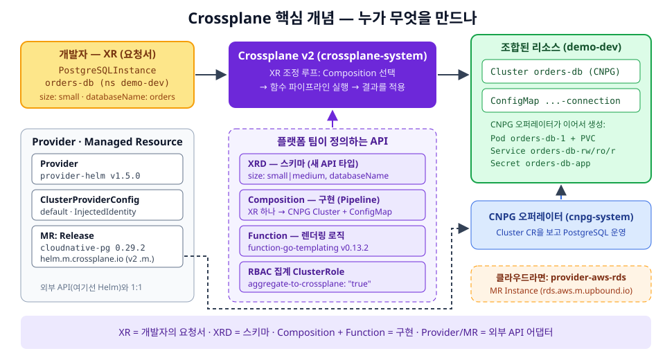
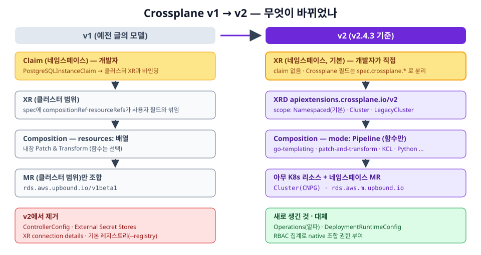
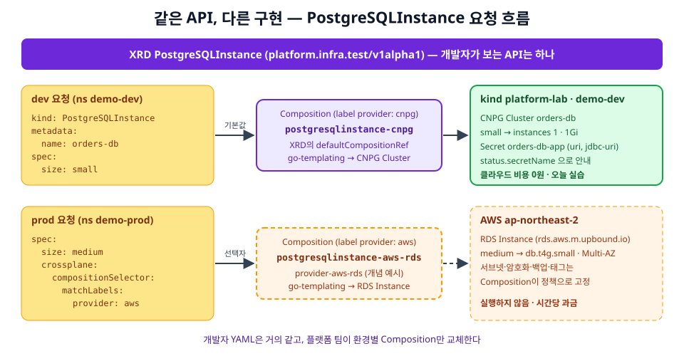

> **플랫폼 엔지니어링** | 난이도 ★★★★☆ | 예상 소요 2.5 ~ 3시간 | 💰 클라우드 비용 없음 (kind + provider-helm + CloudNativePG)

## 🎯 오늘의 목표

- Crossplane이 **"쿠버네티스 API로 인프라를 다루는 컨트롤 플레인"** 이라는 의미를 Terraform과 비교해 설명할 수 있다
- Provider · Managed Resource · XRD · Composition · Function · XR의 관계를 그림으로 설명할 수 있다
- **Crossplane v2의 변경점**(네임스페이스 XR, claim 제거, `spec.crossplane`, 함수 전용 Composition 등)을 안다
- provider-helm으로 CloudNativePG 오퍼레이터를 설치하고, XRD + Composition으로 추상 API **`PostgreSQLInstance`** 를 만든다
- 개발자가 YAML 하나(XR)를 `demo-dev`에 올리면 PostgreSQL 클러스터와 접속 Secret이 생기는 흐름을 확인하고, 같은 API 뒤에 **AWS RDS**를 붙이는 방법을 개념으로 안다

---

## 1. 남은 티켓 하나 — "DB 하나만 만들어 주세요"

플랫폼 03으로 `orders-api`는 버튼 한 번에 생깁니다. 그런데 주문을 저장하려면 DB가 필요합니다. 지금까지의 방법은 이랬습니다.

| 방법 | 문제 |
|---|---|
| 인프라 팀에 티켓 | 며칠 대기. 성숙도 모델 인터페이스 ① "요청마다 수작업" |
| 개발자가 Terraform 직접 작성 (Day 35) | 상태 파일·프로바이더·네트워크·백업 옵션까지 알아야 함 → 인지 부하 |
| 개발자가 Helm 차트·StatefulSet 직접 배포 | 백업·복제·버전 업그레이드가 팀마다 제각각 |

플랫폼 팀이 원하는 것은 이것입니다.

```yaml
# 개발자가 쓰는 전부
apiVersion: platform.infra.test/v1alpha1
kind: PostgreSQLInstance
metadata:
  name: orders-db
  namespace: demo-dev
spec:
  size: small
  databaseName: orders
```

**"무엇을(what)"만 개발자가 말하고, "어떻게(how)" — 어떤 오퍼레이터, 몇 개 복제본, 어느 클라우드, 어떤 백업 정책 — 은 플랫폼 팀이 정한다.** 이 추상 API를 쿠버네티스 위에 만드는 도구가 **Crossplane**입니다.

---

## 2. Crossplane — 쿠버네티스를 인프라 컨트롤 플레인으로

Crossplane은 CNCF 프로젝트로, 쿠버네티스의 **CRD + 컨트롤러(조정 루프)** 를 인프라 전체로 넓힙니다. Day 08에서 본 "원하는 상태 ↔ 실제 상태를 계속 맞추는 루프"가 이제 RDS·S3·VPC·Helm 릴리스까지 다룹니다.

| 비교 | Terraform / OpenTofu (Day 35) | Crossplane |
|---|---|---|
| 실행 방식 | `plan` → `apply` 할 때만 | 컨트롤러가 **계속** 조정 (드리프트 자동 복구) |
| 상태 저장 | 상태 파일 (S3 백엔드 + 잠금) | 쿠버네티스 etcd의 리소스 자체 |
| 인터페이스 | HCL + CLI | **쿠버네티스 API** (kubectl, Argo CD, RBAC, 정책 그대로) |
| 추상화 | 모듈 (변수 입력) | **XRD**로 새 API 타입을 만들고 **Composition**으로 구현 |
| 셀프서비스 | 개발자가 HCL·파이프라인 이해 필요 | 개발자는 자기 네임스페이스에 YAML 하나, RBAC로 권한 제어 |
| 잘 맞는 곳 | 기반 인프라(계정·VPC·EKS) 일회성 구축 | 앱 팀이 **반복적으로** 요청하는 리소스(DB·버킷·큐) |

> 💡 둘은 경쟁보다 분업인 경우가 많습니다. 클라우드 탭의 [cloud05 Terraform](../cloud/cloud05-terraform-aws.md)처럼 계정·VPC·EKS 같은 **기반**은 Terraform으로, 그 위에서 앱 팀이 요청하는 DB·버킷은 Crossplane으로 나누는 구성이 흔합니다.

---

## 3. 핵심 개념 여섯 가지



| 개념 | 누가 만드나 | 설명 | 오늘의 예 |
|---|---|---|---|
| **Provider** | 플랫폼 팀이 설치 | 외부 API(AWS, Helm, K8s...)를 다루는 컨트롤러 패키지. Managed Resource CRD를 등록 | `provider-helm` v1.5.0 |
| **Managed Resource (MR)** | Composition 또는 플랫폼 팀 | 외부 리소스 하나와 1:1. `spec.forProvider`가 원하는 상태 | Helm `Release` (CNPG 오퍼레이터) |
| **ProviderConfig** | 플랫폼 팀 | Provider의 자격 증명·접속 정보 | `ClusterProviderConfig` `default` (InjectedIdentity) |
| **XRD** (CompositeResourceDefinition) | 플랫폼 팀 | **새 API 타입의 스키마**. CRD를 만들어 줌 | `PostgreSQLInstance` |
| **Composition** + **Function** | 플랫폼 팀 | XR 하나를 **어떤 리소스들로 풀어낼지**. 함수 파이프라인으로 작성 | CNPG `Cluster` + 접속 정보 ConfigMap |
| **XR** (Composite Resource) | **개발자** | XRD로 만든 API의 인스턴스 = "요청서" | `orders-db` |

### 3-1. Crossplane v2에서 달라진 것

2025년 v2.0이 나오면서 모델이 크게 단순해졌습니다. 2026-11-19 기준 안정 버전은 **v2.4.3**(10월 22일)이고 v2.5는 RC 단계입니다. 예전 v1 글을 볼 때 아래 차이를 알아야 헷갈리지 않습니다.



| 항목 | v1 | **v2** |
|---|---|---|
| XR 범위 | 클러스터 범위 XR + 네임스페이스 **Claim**(XRC) 두 겹 | **XR이 기본으로 네임스페이스 범위** (`scope: Namespaced`). 개발자가 XR을 직접 만듦 |
| Claim | 핵심 개념 | 새 XR에서는 **지원 안 함**. `scope: LegacyCluster`(v1 XRD API 기본값)에서만 유지 |
| XRD API | `apiextensions.crossplane.io/v1` | **`apiextensions.crossplane.io/v2`** (`scope`: `Namespaced` 기본 / `Cluster` / `LegacyCluster`) |
| Crossplane 전용 필드 | `spec.compositionRef`, `spec.resourceRefs` 등이 사용자 필드와 섞임 | **`spec.crossplane.*`** 아래로 분리 (`spec.crossplane.compositionSelector` 등) |
| 조합 대상 | Crossplane MR만 | **아무 쿠버네티스 리소스**나 조합 가능 (Deployment, 다른 오퍼레이터의 CR...) — RBAC만 주면 됨 |
| Managed Resource | 클러스터 범위 | **네임스페이스 범위** (API 그룹에 `.m.` — 예: `s3.aws.m.upbound.io`, `helm.m.crossplane.io`). 클러스터 범위 MR은 레거시 |
| Composition 작성법 | 내장 Patch & Transform (`resources:` 배열) | **함수 파이프라인만** (`mode: Pipeline`). 내장 P&T는 제거 → `function-patch-and-transform`으로 대체 |
| 제거된 것 | — | ControllerConfig(→ DeploymentRuntimeConfig), External Secret Stores, **XR 연결 정보(connection details)**, 기본 레지스트리 `--registry` 플래그(패키지는 `xpkg.crossplane.io/...` 처럼 **전체 주소**로) |
| 새 기능 | — | **Operations**(알파): 함수 파이프라인을 Job처럼 한 번/주기적/이벤트로 실행 |

> 💡 요청에서 "claim으로 요청"이라는 표현을 자주 보게 되는데, v2에서는 **네임스페이스 XR이 그 역할을 직접** 합니다. 개발자에게 자기 네임스페이스에서 `postgresqlinstances`만 만들 수 있는 Role을 주면 v1의 claim과 같은 셀프서비스 경계가 됩니다.

---

## 4. 오늘의 설계



| 층 | 무엇 | 왜 이렇게 |
|---|---|---|
| 개발자 API | `PostgreSQLInstance` (`platform.infra.test/v1alpha1`, 네임스페이스 범위) | 개발자는 `size`, `databaseName`만 고른다 |
| 구현 (Composition) | **CloudNativePG `Cluster`** + 접속 정보 ConfigMap | CNPG는 CNCF 샌드박스 프로젝트인 PostgreSQL 오퍼레이터. 복제·페일오버·접속 Secret 자동 생성 |
| 백엔드 설치 | **provider-helm**의 `Release` MR로 CNPG 차트 0.29.2(오퍼레이터 1.30.2) | "오퍼레이터 설치"도 Crossplane 리소스로 선언 → 플랫폼 구성 전체가 YAML |
| 함수 | `function-go-templating` v0.13.2 | 익숙한 YAML + Go 템플릿으로 조합 |
| 클라우드로 갈 때 | 같은 XRD, **다른 Composition**(AWS RDS) | 개발자 YAML은 그대로 |

> 💡 v2에서는 CNPG `Cluster`를 **직접(native) 조합**할 수 있어서 provider-kubernetes의 `Object`로 감쌀 필요가 없습니다. provider-kubernetes는 **다른 클러스터**에 리소스를 만들 때 씁니다(9장).

---

## 5. 실습 ① Crossplane 설치

```bash
kubectl config use-context kind-platform-lab
helm repo add crossplane-stable https://charts.crossplane.io/stable
helm repo update
helm install crossplane crossplane-stable/crossplane --version 2.4.3 \
  --namespace crossplane-system --create-namespace

kubectl -n crossplane-system get pods
# NAME                                       READY   STATUS    RESTARTS   AGE
# crossplane-6d8f7c9b5d-x2kqp                1/1     Running   0          50s
# crossplane-rbac-manager-7b9c6f8d4b-m8w2z   1/1     Running   0          50s

kubectl api-resources --api-group=apiextensions.crossplane.io
# compositeresourcedefinitions   xrd,xrds   apiextensions.crossplane.io/v2   false   CompositeResourceDefinition
# compositions                   comp       apiextensions.crossplane.io/v1   false   Composition
# ...
```

| 파드 | 역할 |
|---|---|
| `crossplane` | 패키지 관리자 + XR 조정 컨트롤러 |
| `crossplane-rbac-manager` | Provider·XRD가 생길 때 필요한 ClusterRole을 만들고 **집계(aggregation)** |

---

## 6. 실습 ② provider-helm으로 CloudNativePG 오퍼레이터 설치

### 6-1. Provider 설치와 권한

provider-helm은 차트를 **이 클러스터**에 설치하므로 자기 ServiceAccount에 권한이 필요합니다. 서비스 계정 이름을 고정하기 위해 `DeploymentRuntimeConfig`를 씁니다(v1의 ControllerConfig는 v2에서 제거됨).

```yaml
# ~/platform-lab/crossplane/provider-helm.yaml
apiVersion: pkg.crossplane.io/v1beta1
kind: DeploymentRuntimeConfig
metadata:
  name: provider-helm
spec:
  serviceAccountTemplate:
    metadata:
      name: provider-helm
---
apiVersion: pkg.crossplane.io/v1
kind: Provider
metadata:
  name: provider-helm
spec:
  package: xpkg.crossplane.io/crossplane-contrib/provider-helm:v1.5.0
  runtimeConfigRef:
    apiVersion: pkg.crossplane.io/v1beta1
    kind: DeploymentRuntimeConfig
    name: provider-helm
---
# ⚠️ 실습 전용: 공식 예제와 같이 cluster-admin. 운영에서는 설치할 차트에 필요한 권한만
apiVersion: rbac.authorization.k8s.io/v1
kind: ClusterRoleBinding
metadata:
  name: provider-helm-cluster-admin
subjects:
- kind: ServiceAccount
  name: provider-helm
  namespace: crossplane-system
roleRef:
  kind: ClusterRole
  name: cluster-admin
  apiGroup: rbac.authorization.k8s.io
```

```bash
mkdir -p ~/platform-lab/crossplane && cd ~/platform-lab/crossplane
kubectl apply -f provider-helm.yaml
kubectl wait provider/provider-helm --for=condition=Healthy --timeout=5m
kubectl get providers
# NAME            INSTALLED   HEALTHY   PACKAGE                                                       AGE
# provider-helm   True        True      xpkg.crossplane.io/crossplane-contrib/provider-helm:v1.5.0   70s
```

### 6-2. ProviderConfig — "이 클러스터에, 내 ServiceAccount로"

```yaml
# ~/platform-lab/crossplane/helm-providerconfig.yaml
apiVersion: helm.m.crossplane.io/v1beta1
kind: ClusterProviderConfig
metadata:
  name: default
spec:
  credentials:
    source: InjectedIdentity       # Pod에 주입된 ServiceAccount 토큰 사용 (= 같은 클러스터)
```

v2의 MR은 네임스페이스 범위라서 ProviderConfig도 두 종류입니다. **`ProviderConfig`(네임스페이스)** 는 같은 네임스페이스의 MR만, **`ClusterProviderConfig`** 는 모든 네임스페이스의 MR이 참조할 수 있습니다.

### 6-3. `Release` MR — CNPG 오퍼레이터를 선언으로 설치

```yaml
# ~/platform-lab/crossplane/release-cnpg.yaml
apiVersion: helm.m.crossplane.io/v1beta1
kind: Release
metadata:
  name: cloudnative-pg
  namespace: crossplane-system        # MR 자신이 사는 네임스페이스 (플랫폼 팀 영역)
spec:
  forProvider:
    chart:
      name: cloudnative-pg
      repository: https://cloudnative-pg.github.io/charts
      version: 0.29.2                 # 오퍼레이터 1.30.2
    namespace: cnpg-system            # 차트가 설치될 네임스페이스 (없으면 생성)
  providerConfigRef:
    kind: ClusterProviderConfig
    name: default
```

```bash
kubectl apply -f helm-providerconfig.yaml -f release-cnpg.yaml
kubectl -n crossplane-system get release
# NAME             CHART            VERSION   SYNCED   READY   STATE      REVISION   AGE
# cloudnative-pg   cloudnative-pg   0.29.2    True     True    deployed   1          60s
kubectl -n cnpg-system get deploy
# NAME                         READY   UP-TO-DATE   AVAILABLE   AGE
# cloudnative-pg               1/1     1            1           50s
kubectl get crd clusters.postgresql.cnpg.io
```

> 💡 `helm install`을 직접 하는 것과의 차이: 누군가 `helm uninstall`하거나 값을 바꾸면 provider-helm이 **원래대로 되돌립니다**(드리프트 복구). 그리고 이 YAML 자체를 Argo CD로 관리하면 "플랫폼 구성"도 GitOps가 됩니다.

---

## 7. 실습 ③ 추상 API 만들기 — XRD, Function, RBAC, Composition

### 7-1. XRD — 개발자에게 보여 줄 스키마

```yaml
# ~/platform-lab/crossplane/xrd-postgresqlinstance.yaml
apiVersion: apiextensions.crossplane.io/v2
kind: CompositeResourceDefinition
metadata:
  name: postgresqlinstances.platform.infra.test      # <plural>.<group>
spec:
  scope: Namespaced                                  # v2 기본값. 개발자 네임스페이스에 생성
  group: platform.infra.test
  names:
    kind: PostgreSQLInstance
    plural: postgresqlinstances
  defaultCompositionRef:
    name: postgresqlinstance-cnpg                    # 선택자가 없으면 이 구현 사용
  versions:
  - name: v1alpha1
    served: true
    referenceable: true
    schema:
      openAPIV3Schema:
        type: object
        properties:
          spec:
            type: object
            properties:
              size:
                type: string
                enum: [small, medium]
                default: small
                description: "small = 인스턴스 1개, medium = 2개(스트리밍 복제, 자동 페일오버)"
              databaseName:
                type: string
                default: app
                pattern: '^[a-z][a-z0-9_]{0,30}$'
                description: 생성할 DB 이름 (소유 사용자 이름도 같음)
          status:
            type: object
            properties:
              secretName:
                type: string
                description: 접속 정보 Secret (user, password, host, port, dbname, uri, jdbc-uri)
              host:
                type: string
              readyInstances:
                type: integer
```

| 설계 포인트 | 이유 |
|---|---|
| `enum` + `default` | 개발자가 고를 수 있는 선택지 자체를 플랫폼이 정함 (가드레일). 스토리지 크기·백업·버전은 **노출하지 않음** |
| `pattern` | 잘못된 DB 이름을 **API 서버가** 거부 (컨트롤러까지 가지 않음) |
| `status` 필드 | Composition이 채워 줌 → 개발자는 `kubectl get`만으로 Secret 이름을 알 수 있음 |
| 버전 `v1alpha1` | API도 제품. 바꿀 때는 새 버전을 추가하고 이전 버전을 지원 |

```bash
kubectl apply -f xrd-postgresqlinstance.yaml
kubectl get xrd
# NAME                                     ESTABLISHED   OFFERED   AGE
# postgresqlinstances.platform.infra.test  True                    10s
kubectl get crd postgresqlinstances.platform.infra.test -o jsonpath='{.spec.scope}'; echo
# Namespaced
```

> 💡 `OFFERED` 칸이 비어 있는 것은 정상입니다. OFFERED는 v1의 claim CRD를 만들었는지를 뜻하는데, v2 네임스페이스 XR은 claim이 없습니다.

### 7-2. Function 설치와 RBAC 집계

```yaml
# ~/platform-lab/crossplane/function-and-rbac.yaml
apiVersion: pkg.crossplane.io/v1
kind: Function
metadata:
  name: crossplane-contrib-function-go-templating
spec:
  package: xpkg.crossplane.io/crossplane-contrib/function-go-templating:v0.13.2
---
# Crossplane이 CNPG Cluster를 "조합"할 수 있도록 권한 부여 — 라벨이 핵심
apiVersion: rbac.authorization.k8s.io/v1
kind: ClusterRole
metadata:
  name: cnpg:aggregate-to-crossplane
  labels:
    rbac.crossplane.io/aggregate-to-crossplane: "true"
rules:
- apiGroups: ["postgresql.cnpg.io"]
  resources: ["clusters"]
  verbs: ["*"]
- apiGroups: [""]
  resources: ["configmaps"]
  verbs: ["*"]
```

```bash
kubectl apply -f function-and-rbac.yaml
kubectl wait function/crossplane-contrib-function-go-templating --for=condition=Healthy --timeout=3m
```

> ⚠️ v2는 아무 리소스나 조합할 수 있지만 **권한은 자동으로 생기지 않습니다.** `rbac.crossplane.io/aggregate-to-crossplane: "true"` 라벨이 붙은 ClusterRole이 Crossplane의 주 ClusterRole에 집계되어야 합니다(Day 19의 ClusterRole aggregation과 같은 원리). 빠뜨리면 XR 이벤트에 `cannot ... clusters.postgresql.cnpg.io ... forbidden`이 뜹니다.

### 7-3. Composition — XR을 무엇으로 풀어낼지

```yaml
# ~/platform-lab/crossplane/composition-cnpg.yaml
apiVersion: apiextensions.crossplane.io/v1
kind: Composition
metadata:
  name: postgresqlinstance-cnpg
  labels:
    provider: cnpg
spec:
  compositeTypeRef:
    apiVersion: platform.infra.test/v1alpha1
    kind: PostgreSQLInstance
  mode: Pipeline
  pipeline:
  - step: render-cnpg
    functionRef:
      name: crossplane-contrib-function-go-templating
    input:
      apiVersion: gotemplating.fn.crossplane.io/v1beta1
      kind: GoTemplate
      source: Inline
      inline:
        template: |
          {{- $xr := .observed.composite.resource }}
          {{- $name := $xr.metadata.name }}
          {{- $ns := $xr.metadata.namespace }}
          ---
          apiVersion: postgresql.cnpg.io/v1
          kind: Cluster
          metadata:
            name: {{ $name }}
            annotations:
              gotemplating.fn.crossplane.io/composition-resource-name: cluster
              {{- if eq (.observed.resources.cluster | getResourceCondition "Ready").Status "True" }}
              gotemplating.fn.crossplane.io/ready: "True"
              {{- end }}
          spec:
            instances: {{ if eq $xr.spec.size "medium" }}2{{ else }}1{{ end }}
            storage:
              size: 1Gi
            bootstrap:
              initdb:
                database: {{ $xr.spec.databaseName }}
                owner: {{ $xr.spec.databaseName }}
          ---
          apiVersion: v1
          kind: ConfigMap
          metadata:
            name: {{ $name }}-connection
            annotations:
              gotemplating.fn.crossplane.io/composition-resource-name: connection-info
              gotemplating.fn.crossplane.io/ready: "True"
          data:
            host: {{ $name }}-rw.{{ $ns }}.svc
            port: "5432"
            database: {{ $xr.spec.databaseName }}
            secretName: {{ $name }}-app
          ---
          apiVersion: platform.infra.test/v1alpha1
          kind: PostgreSQLInstance
          status:
            secretName: {{ $name }}-app
            host: {{ $name }}-rw.{{ $ns }}.svc
            readyInstances: {{ get (getComposedResource . "cluster").status "readyInstances" | default 0 }}
```

| 부분 | 의미 |
|---|---|
| `.observed.composite.resource` | 개발자가 만든 XR (현재 상태) |
| `composition-resource-name` 어노테이션 | 조합된 리소스의 **식별자**. 다음 조정 때 `.observed.resources.cluster`로 다시 찾음 |
| `gotemplating.fn.crossplane.io/ready` | 이 리소스가 준비됐는지 함수가 판단해 알림. CNPG `Cluster`의 `Ready` 조건이 True일 때만 |
| 마지막 문서 (XR 자신) | XR의 `status`를 채움 → `kubectl get`에 보임 |
| `{{ $name }}-app` Secret | CNPG가 **자동으로 만드는** 앱 사용자 Secret. Crossplane이 만들지 않음 |
| `storage.size: 1Gi` 고정 | kind의 `standard`(local-path) 스토리지는 볼륨 확장을 지원하지 않으므로 크기 변경을 노출하지 않음 |

```bash
kubectl apply -f composition-cnpg.yaml
kubectl get composition
# NAME                      XR-KIND              XR-APIVERSION                  AGE
# postgresqlinstance-cnpg   PostgreSQLInstance   platform.infra.test/v1alpha1   5s
```

---

## 8. 실습 ④ 개발자 입장에서 요청하기

### 8-1. XR 하나로 요청

```yaml
# ~/platform-lab/crossplane/orders-db.yaml  ← 개발자가 쓰는 파일은 이것뿐
apiVersion: platform.infra.test/v1alpha1
kind: PostgreSQLInstance
metadata:
  name: orders-db
  namespace: demo-dev
spec:
  size: small
  databaseName: orders
```

```bash
kubectl apply -f orders-db.yaml
kubectl -n demo-dev get postgresqlinstance -w
# NAME        SYNCED   READY   COMPOSITION               AGE
# orders-db   True     False   postgresqlinstance-cnpg   5s
# orders-db   True     True    postgresqlinstance-cnpg   75s
```

무엇이 생겼는지 봅니다.

```bash
kubectl -n demo-dev get clusters.postgresql.cnpg.io orders-db
# NAME        AGE   INSTANCES   READY   STATUS                     PRIMARY
# orders-db   80s   1           1       Cluster in healthy state   orders-db-1
kubectl -n demo-dev get svc | grep orders-db
# orders-db-r    ClusterIP   ...   5432/TCP
# orders-db-ro   ClusterIP   ...   5432/TCP
# orders-db-rw   ClusterIP   ...   5432/TCP     ← 쓰기(프라이머리)
kubectl -n demo-dev get postgresqlinstance orders-db -o jsonpath='{.status}'; echo
# {"conditions":[...],"host":"orders-db-rw.demo-dev.svc","readyInstances":1,"secretName":"orders-db-app"}
kubectl -n demo-dev get secret orders-db-app -o jsonpath='{.data}' | jq 'keys'
# ["dbname","host","jdbc-uri","password","pgpass","port","uri","user","username"]
```

### 8-2. 접속해 보기

```bash
URI=$(kubectl -n demo-dev get secret orders-db-app -o jsonpath='{.data.uri}' | base64 -d)
kubectl -n demo-dev run psql --rm -it --restart=Never --image=postgres:18 \
  --env="DATABASE_URL=$URI" -- sh -c 'psql "$DATABASE_URL" -c "select current_database(), current_user;"'
#  current_database | current_user
# ------------------+--------------
#  orders           | orders
```

> 💡 Spring Boot라면 Secret의 `jdbc-uri` 키를 환경 변수 `SPRING_DATASOURCE_URL`로 넣으면 됩니다(`valueFrom.secretKeyRef`). 비밀번호가 Git에 한 번도 등장하지 않습니다.

### 8-3. 바꾸기, 되돌려지기, 지우기

```bash
# ① 요청 변경: small → medium  (Composition이 instances: 2로 다시 렌더링)
kubectl -n demo-dev patch postgresqlinstance orders-db --type merge -p '{"spec":{"size":"medium"}}'
kubectl -n demo-dev get clusters.postgresql.cnpg.io orders-db -w
# orders-db   ...   2   1   Creating a new replica   orders-db-1
# orders-db   ...   2   2   Cluster in healthy state orders-db-1

# ② 드리프트: 누군가 조합된 리소스를 직접 수정 → Crossplane이 XR 기준으로 되돌림
kubectl -n demo-dev patch clusters.postgresql.cnpg.io orders-db --type merge -p '{"spec":{"instances":3}}'
sleep 90; kubectl -n demo-dev get clusters.postgresql.cnpg.io orders-db -o jsonpath='{.spec.instances}'; echo
# 2

# ③ 잘못된 요청은 API 서버가 거부
kubectl -n demo-dev patch postgresqlinstance orders-db --type merge -p '{"spec":{"size":"huge"}}'
# The PostgreSQLInstance "orders-db" is invalid: spec.size: Unsupported value: "huge": supported values: "small", "medium"
```

삭제는 XR 하나만 지우면 조합된 리소스가 함께 정리됩니다(CNPG가 Pod·PVC·Secret을 정리).

```bash
kubectl -n demo-dev delete postgresqlinstance orders-db
kubectl -n demo-dev get clusters.postgresql.cnpg.io     # No resources found
```

### 8-4. 셀프서비스 경계 — 개발자에게 줄 권한

```yaml
# 개발자(team-a-devs)는 자기 네임스페이스에서 PostgreSQLInstance만 다룸 — CNPG Cluster는 직접 못 만짐
apiVersion: rbac.authorization.k8s.io/v1
kind: Role
metadata: { name: request-databases, namespace: demo-dev }
rules:
- apiGroups: ["platform.infra.test"]
  resources: ["postgresqlinstances"]
  verbs: ["get", "list", "watch", "create", "update", "patch", "delete"]
---
apiVersion: rbac.authorization.k8s.io/v1
kind: RoleBinding
metadata: { name: team-a-devs-request-databases, namespace: demo-dev }
subjects:
- { kind: Group, name: team-a-devs, apiGroup: rbac.authorization.k8s.io }   # Day 73 OIDC groups 클레임
roleRef: { kind: Role, name: request-databases, apiGroup: rbac.authorization.k8s.io }
```

---

## 9. GitOps·Backstage와 잇기, 그리고 provider-kubernetes

**GitOps로 요청하기** — XR도 그냥 쿠버네티스 리소스이므로 `gitops-demo-config`에 넣으면 됩니다.

```text
gitops-demo-config/apps/orders-api/overlays/dev/
├── kustomization.yaml     # resources 에 database.yaml 추가
├── httproute.yaml
└── database.yaml          # PostgreSQLInstance orders-db (namePrefix로 dev-orders-db가 됨)
```

PR 머지 → ApplicationSet `dev-apps`의 `orders-api-dev`가 XR을 만들고 → Crossplane이 DB를 만듭니다. 플랫폼 08에서는 이 `database.yaml`을 만드는 **Backstage 템플릿**("DB 요청")까지 붙여, 개발자가 YAML도 쓰지 않게 합니다.

> ⚠️ Kustomize `namePrefix`는 XR 이름에도 붙으므로 Secret 이름은 `dev-orders-db-app`이 됩니다. Deployment의 `secretKeyRef`는 CRD 참조가 아니라 Kustomize가 자동으로 바꿔 주지 않으니, Day 52의 HTTPRoute `backendRefs`처럼 **접두사가 붙은 이름을 직접** 쓰세요.

**provider-kubernetes는 언제?** v2에서는 같은 클러스터의 리소스는 native로 조합하면 됩니다. provider-kubernetes(v1.4.1)는 **원격 클러스터**에 리소스를 만들 때 씁니다. 예를 들어 플랫폼 05에서 Cluster API로 만들 워크로드 클러스터에 네임스페이스와 기본 정책을 깔아 주는 Composition이라면, kubeconfig Secret을 가리키는 ProviderConfig와 `Object`를 씁니다.

```yaml
# 개념 예시 — 원격 클러스터에 매니페스트 하나를 "MR"로 감싸 만들기
apiVersion: kubernetes.m.crossplane.io/v1alpha1
kind: Object
metadata:
  name: orders-namespace
  namespace: crossplane-system
spec:
  forProvider:
    manifest:
      apiVersion: v1
      kind: Namespace
      metadata:
        name: orders
  providerConfigRef:
    kind: ClusterProviderConfig
    name: workload-dev-1        # credentials.source: Secret (워크로드 클러스터 kubeconfig)
```

| 방식 | 대상 | 장점 | 언제 |
|---|---|---|---|
| **Native 조합** (v2) | Crossplane이 도는 클러스터 | 추가 Provider 불필요, 리소스가 그대로 보임 | 오늘처럼 같은 클러스터의 오퍼레이터 CR |
| **provider-kubernetes `Object`** | 아무 클러스터 (kubeconfig) | 원격 클러스터 관리, 상태 관찰 옵션 | 멀티 클러스터 (플랫폼 05·06) |
| **provider-helm `Release`** | 아무 클러스터 | 차트 단위 설치·업그레이드 | 오퍼레이터·애드온 설치 (6장) |

---

## 10. 같은 API, 클라우드 구현 — AWS RDS (개념)

클라우드 탭(cloud04 RDS, [cloud05 Terraform](../cloud/cloud05-terraform-aws.md), [cloud06 EKS](../cloud/cloud06-eks-cluster.md))과 연결되는 부분입니다. **개발자 YAML은 그대로 두고 Composition만 추가**합니다. 이 절은 비용이 드는 리소스라 **실행하지 않는 개념 예시**입니다.

```yaml
# 개념 예시 — 실행하지 않음 (RDS는 시간당 과금)
# Provider: xpkg.upbound.io/upbound/provider-aws-rds:v2.9.5 (+ 자격 증명: EKS Pod Identity/IRSA)
apiVersion: apiextensions.crossplane.io/v1
kind: Composition
metadata:
  name: postgresqlinstance-aws-rds
  labels:
    provider: aws
spec:
  compositeTypeRef:
    apiVersion: platform.infra.test/v1alpha1
    kind: PostgreSQLInstance
  mode: Pipeline
  pipeline:
  - step: render-rds
    functionRef:
      name: crossplane-contrib-function-go-templating
    input:
      apiVersion: gotemplating.fn.crossplane.io/v1beta1
      kind: GoTemplate
      source: Inline
      inline:
        template: |
          {{- $xr := .observed.composite.resource }}
          ---
          apiVersion: rds.aws.m.upbound.io/v1beta1     # v2: 네임스페이스 MR (.m.)
          kind: Instance
          metadata:
            name: {{ $xr.metadata.name }}
            annotations:
              gotemplating.fn.crossplane.io/composition-resource-name: rds
          spec:
            forProvider:
              region: ap-northeast-2
              engine: postgres
              instanceClass: {{ if eq $xr.spec.size "medium" }}db.t4g.small{{ else }}db.t4g.micro{{ end }}
              multiAz: {{ eq $xr.spec.size "medium" }}
              allocatedStorage: 20
              dbName: {{ $xr.spec.databaseName }}
              # 서브넷 그룹·보안 그룹·비밀번호 Secret 참조 등은 생략 — 필드는 Marketplace의 CRD 문서로 확인
```

개발자는 같은 XR에 선택자만 붙입니다(v2에서는 `spec.crossplane` 아래).

```yaml
apiVersion: platform.infra.test/v1alpha1
kind: PostgreSQLInstance
metadata: { name: orders-db, namespace: demo-prod }
spec:
  size: medium
  databaseName: orders
  crossplane:
    compositionSelector:
      matchLabels:
        provider: aws        # dev는 기본값(cnpg), prod는 RDS
```

| 관점 | 의미 |
|---|---|
| 개발자 | `size`, `databaseName`만 앎. 로컬·dev·prod가 같은 API |
| 플랫폼 팀 | 환경별 구현(Composition)을 교체·개선. 서브넷·암호화·백업·태그(cloud11 FinOps 태깅) 정책을 한곳에 |
| 보안 | 클라우드 자격 증명은 Crossplane Provider에만. 개발자에게는 AWS 권한이 없음 |

---

## 트러블슈팅

| 증상 | 원인 | 해결 |
|---|---|---|
| `kubectl get providers`에서 `HEALTHY False` 오래 지속 | 패키지 이미지 pull 실패(주소 오타, 네트워크) | `kubectl describe providerrevision`, 패키지는 `xpkg.crossplane.io/...` **전체 주소**로 (v2는 기본 레지스트리 없음) |
| Release `SYNCED False`, `forbidden` | provider-helm SA 권한 없음 / SA 이름 불일치 | `DeploymentRuntimeConfig`의 SA 이름과 ClusterRoleBinding subject 일치 확인 |
| XR `SYNCED False`, 이벤트 `cannot apply composed resource ... clusters.postgresql.cnpg.io ... forbidden` | RBAC 집계 ClusterRole 없음·라벨 누락 | 7-2의 ClusterRole과 `rbac.crossplane.io/aggregate-to-crossplane: "true"` |
| XR `SYNCED False`, `no matches for kind "Cluster"` | CNPG CRD 미설치 (Release가 아직 Ready 아님) | `kubectl -n crossplane-system get release` READY 확인 후 재시도 |
| XR이 계속 `READY False` | CNPG 클러스터 미준비 (PVC Pending 등) 또는 ready 어노테이션 조건 오타 | `kubectl -n demo-dev describe clusters.postgresql.cnpg.io orders-db`, `kubectl get pvc` |
| `kubectl get cluster`가 엉뚱한 리소스를 보여 줌 | `cluster`라는 이름의 리소스가 여러 API 그룹에 존재 (플랫폼 05의 CAPI `Cluster`도 있음) | 항상 `clusters.postgresql.cnpg.io`처럼 **그룹까지** 적기 |
| v1 시절 예제의 `kind: ...Claim`, `spec.compositionRef`가 동작 안 함 | v2 네임스페이스 XR에는 claim이 없고 Crossplane 필드는 `spec.crossplane` 아래 | 3-1 표대로 변환 |
| `function-go-templating` 렌더링 오류 (`template: ... nil pointer`) | 템플릿에서 아직 없는 관찰 값 참조 | `default`·`if`로 첫 조정(관찰 값 없음)을 처리, `kubectl describe` 이벤트의 함수 메시지 확인 |

---

## 핵심 정리

- Crossplane = 쿠버네티스 조정 루프를 인프라 전체로 넓힌 **컨트롤 플레인**. Terraform과 달리 계속 조정하고 쿠버네티스 API로 소비
- **XRD**(스키마) + **Composition**(구현, 함수 파이프라인) = 플랫폼 팀이 만드는 **추상 API**, **XR** = 개발자의 요청서
- **v2.4.3** 기준: XR은 기본 **네임스페이스 범위**, 새 XR에 claim 없음, Crossplane 필드는 `spec.crossplane`, MR도 네임스페이스 범위(`.m.` 그룹), 내장 P&T 제거 → 함수, 아무 리소스나 native 조합(RBAC 집계 필요)
- 클라우드 없이: **provider-helm** `Release`로 CNPG 오퍼레이터 설치 → Composition이 CNPG `Cluster` 조합 → CNPG가 `<이름>-app` 접속 Secret 생성
- 가드레일은 스키마에서: `enum`, `default`, `pattern`. 노출하지 않은 옵션은 플랫폼 팀의 정책
- 같은 XRD에 **Composition만 바꿔** AWS RDS로 — 개발자 YAML은 그대로 (`spec.crossplane.compositionSelector`)
- provider-kubernetes `Object`는 **원격 클러스터**용, 같은 클러스터는 native 조합

---

## 셀프 체크

<details>
<summary>Q1. Crossplane v2에서 "claim으로 DB를 요청한다"는 v1의 흐름은 어떻게 바뀌었나?</summary>

v2의 새 XRD(`apiextensions.crossplane.io/v2`)는 기본 `scope: Namespaced`라서 XR 자체가 네임스페이스 리소스입니다. 개발자는 claim 대신 **자기 네임스페이스에 XR을 직접** 만듭니다. claim은 `scope: LegacyCluster` XRD에서만 남아 있습니다. 셀프서비스 경계는 XR 리소스에 대한 Role/RoleBinding으로 줍니다.
</details>

<details>
<summary>Q2. Composition이 CNPG Cluster를 만들 때 RBAC 설정이 따로 필요했던 이유는?</summary>

v2는 Crossplane MR이 아닌 아무 쿠버네티스 리소스나 조합할 수 있지만, Crossplane의 ServiceAccount가 그 리소스 타입에 권한을 가지고 있어야 합니다. `rbac.crossplane.io/aggregate-to-crossplane: "true"` 라벨이 붙은 ClusterRole이 Crossplane의 주 ClusterRole로 집계되어 권한이 생깁니다.
</details>

<details>
<summary>Q3. 접속 비밀번호가 들어 있는 orders-db-app Secret은 누가 만들었나? Crossplane v2에서 XR 연결 정보(connection details)를 쓰지 않은 이유와 함께 답하라.</summary>

CloudNativePG 오퍼레이터가 `Cluster`를 부트스트랩하면서 앱 사용자 Secret(`<이름>-app`)을 자동으로 만듭니다. v2에서는 XR 수준의 connection details 기능이 제거되었으므로, 하위 리소스가 만드는 Secret의 이름을 XR `status.secretName`으로 알려 주는 방식을 썼습니다.
</details>

<details>
<summary>Q4. 조합된 CNPG Cluster의 instances를 손으로 3으로 바꾸면 어떻게 되고, 그 이유는?</summary>

잠시 뒤 XR의 `size`가 뜻하는 값(medium이면 2)으로 **되돌아갑니다.** Crossplane이 주기적으로 XR을 조정하면서 Composition을 다시 렌더링하고 조합된 리소스에 적용(서버 사이드 적용)하기 때문입니다. 원하는 상태의 원천은 XR(그리고 그 XR이 들어 있는 Git)입니다.
</details>

<details>
<summary>Q5. dev는 CNPG, prod는 AWS RDS로 만들면서 개발자 YAML을 거의 바꾸지 않는 방법은?</summary>

같은 XRD(`PostgreSQLInstance`)에 Composition을 두 개(`provider: cnpg`, `provider: aws` 라벨) 두고, XRD의 `defaultCompositionRef`는 CNPG로, prod XR에는 `spec.crossplane.compositionSelector.matchLabels.provider: aws`를 붙입니다. 또는 환경별 Kustomize overlay에서 이 선택자만 패치합니다.
</details>

---

## ⏭️ 다음 예고 — [플랫폼 05. Cluster API로 클러스터 찍어내기](./plat05-cluster-api.md)

DB는 YAML 하나로 생기게 됐습니다. 그렇다면 **쿠버네티스 클러스터 자체**도 그렇게 만들 수 있을까요? Cluster API는 "클러스터를 쿠버네티스 리소스로 선언"하는 프로젝트입니다. `platform-lab`을 관리 클러스터로 만들고, Docker provider(CAPD)로 워크로드 클러스터 `dev-1`, `prod-1`을 찍어 냅니다. 플랫폼 01의 kind 설정에 미리 넣어 둔 `docker.sock` 마운트가 여기서 쓰입니다.
