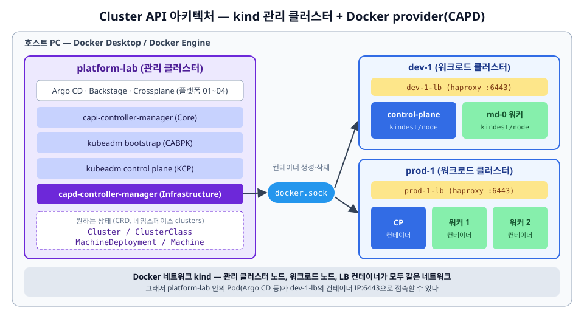
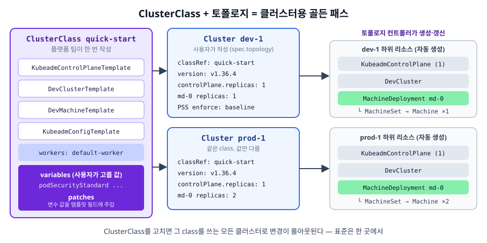
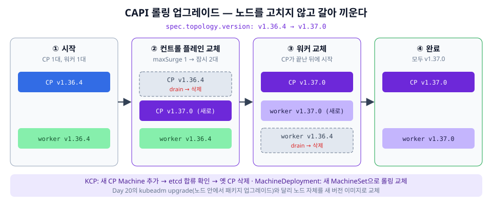

> **플랫폼 엔지니어링** | 난이도 ★★★★☆ | 예상 소요 2.5 ~ 3시간

> 💡 **플랫폼 01 고정값 기준**으로 진행합니다. 관리 클러스터는 kind `platform-lab`(context `kind-platform-lab`)이고 Argo CD·Backstage·Crossplane이 이미 설치되어 있습니다. 모든 실습은 내 PC의 Docker 안에서만 돌아가며 **클라우드 비용이 들지 않습니다.**

## 🎯 오늘의 목표

- Day 20(kubeadm)·Day 34(OpenStack 위 K8s)에서 손으로 하던 클러스터 구축을 **Kubernetes 리소스(선언형)** 로 바꾸는 Cluster API의 구조를 설명할 수 있다
- `clusterctl`로 `platform-lab`을 **관리 클러스터**로 만들고, Docker provider(CAPD)로 워크로드 클러스터 `dev-1`, `prod-1`을 만든다
- **ClusterClass와 토폴로지**(Cluster `spec.topology`)로 "클러스터 모양"을 템플릿화하는 이유를 안다
- MachineDeployment 스케일과 **Kubernetes 버전 업그레이드**를 YAML 한 줄 수정으로 해 본다

---

## 1. 왜 Cluster API인가 — "클러스터도 Pod처럼"

지금까지 클러스터를 만든 방법을 떠올려 봅시다.

| 언제 | 방법 | 불편한 점 |
|---|---|---|
| Day 09 | `kind create cluster` | 로컬 전용, 노드 교체·업그레이드 개념이 없음 |
| Day 20 | VM 3대 + `kubeadm init/join` | 순서 있는 수작업. 노드 추가·업그레이드도 SSH로 한 대씩 |
| Day 34 | OpenStack VM + kubeadm + OCCM | 인프라(Nova)와 클러스터(kubeadm)를 따로 관리 |
| Day 35 | Terraform으로 VM 생성 | VM은 코드화했지만 "클러스터의 상태"는 Terraform이 모름 |

플랫폼 팀이 "개발팀마다 클러스터를 하나씩" 주려면 이 작업이 **API 호출 한 번**이어야 합니다. Cluster API(CAPI)는 Kubernetes SIG Cluster Lifecycle 프로젝트로, **클러스터·노드(Machine)를 CRD로 표현하고 컨트롤러가 조정(reconcile)** 합니다. Day 08에서 본 "Deployment가 Pod를 원하는 개수로 맞춘다"와 똑같은 원리를 한 층 위, **클러스터 단위**에 적용한 것입니다.

| Pod 세계 | Cluster API 세계 |
|---|---|
| Deployment | **MachineDeployment** — 워커 노드 묶음 |
| ReplicaSet | **MachineSet** |
| Pod | **Machine** — VM(또는 컨테이너) 한 대 + kubeadm으로 join된 노드 |
| kubelet이 컨테이너 실행 | **Infrastructure provider**가 VM 생성 (Docker, OpenStack, AWS, vSphere …) |
| 롤링 업데이트 | 노드 **교체**로 업그레이드 (in-place 수정이 아니라 새 Machine → 옛 Machine 삭제) |

> 💡 "노드를 고치지 않고 **갈아 끼운다**(immutable infrastructure)"가 CAPI 업그레이드의 핵심입니다. Day 20의 `kubeadm upgrade`처럼 노드에 들어가 패키지를 올리는 대신, 새 버전 이미지로 노드를 새로 만들고 옛 노드를 drain 후 지웁니다.

---

## 2. 구조 — 관리 클러스터와 워크로드 클러스터



| 구분 | 오늘의 실체 | 하는 일 |
|---|---|---|
| **관리 클러스터** (management) | kind `platform-lab` | CAPI 컨트롤러가 돌며 Cluster·Machine 리소스를 조정 |
| **워크로드 클러스터** (workload) | `dev-1`, `prod-1` | 실제 앱이 배포될 클러스터. CAPI가 만들고 지움 |
| Core provider | `capi-controller-manager` | Cluster, Machine, MachineDeployment 등 공통 로직 |
| Bootstrap provider | `capi-kubeadm-bootstrap-controller-manager` (CABPK) | 노드가 부팅할 때 실행할 `kubeadm init/join` 설정(cloud-init) 생성 |
| Control plane provider | `capi-kubeadm-control-plane-controller-manager` (KCP) | 컨트롤 플레인 노드 수·버전·etcd를 관리 |
| Infrastructure provider | `capd-controller-manager` (CAPD) | "머신 한 대"를 **Docker 컨테이너**로 만듦 (kind 노드 이미지 사용) |

CAPD는 **테스트·학습용** provider입니다. 머신 하나가 `kindest/node` 이미지로 뜬 컨테이너이고, 컨트롤 플레인 앞에는 HAProxy 컨테이너(`<클러스터>-lb`)가 로드밸런서 역할을 합니다. 그래서 CAPD 컨트롤러는 **호스트의 Docker 소켓**에 접근할 수 있어야 합니다.

### Day 34와 연결 — Cluster API OpenStack provider (개념)

오늘 CAPD 자리에 **CAPO**(cluster-api-provider-openstack)를 넣으면 Day 34의 작업이 그대로 자동화됩니다.

| Day 34에서 손으로 한 일 | CAPO에서는 |
|---|---|
| 네트워크·서브넷·라우터·보안 그룹 생성 (Neutron) | `OpenStackCluster` 리소스가 생성 |
| VM 3대 + Floating IP (Nova) | `OpenStackMachineTemplate`(flavor, image, sshKey)로 Machine마다 생성 |
| kubeadm init / join | 동일하게 CABPK·KCP가 처리 |
| API 서버 앞 로드밸런서 | Octavia LB를 생성 (옵션) |
| OCCM·Cinder CSI 설치 | 클러스터 생성 후 애드온으로 설치 (ClusterResourceSet 또는 GitOps — 플랫폼 06) |
| Application Credential | `clouds.yaml`을 Secret으로 넣어 CAPO가 사용 |

```bash
# 개념 예시 — 오늘은 실행하지 않음
clusterctl init --infrastructure openstack
clusterctl generate cluster os-dev-1 --infrastructure openstack --kubernetes-version v1.36.4 ...
```

> ⚠️ CAPO는 노드용 **OpenStack 이미지(kubeadm·containerd가 미리 들어 있는 이미지, image-builder로 생성)** 가 필요하고 DevStack 한 대로는 자원이 빠듯합니다. 오늘은 같은 API를 Docker로 연습하고, provider만 바꾸면 된다는 점을 기억해 두세요.

---

## 3. 실습 준비

| 항목 | 값 |
|---|---|
| 관리 클러스터 | kind `platform-lab` (플랫폼 01) |
| Cluster API / clusterctl | **v1.14.4** (2026-11 기준 최신 안정. v1.15는 beta) |
| kind | v0.33.0 이상 권장 (CAPI 퀵스타트 요구: v0.32.0 이상) |
| 워크로드 Kubernetes | **v1.36.4**로 생성 → 9장에서 **v1.37.0**으로 업그레이드 (kind v0.33.0이 이미지를 제공하는 버전) |
| CNI | Calico **v3.33.1** |
| 워크로드 클러스터 | `dev-1`(CP 1 + 워커 1), `prod-1`(CP 1 + 워커 2), 네임스페이스 `clusters` |
| 작업 폴더 | `~/platform-lab/` (WSL2 Ubuntu 또는 Linux 셸) |

> ⚠️ **자원**: `platform-lab` 노드 2개(Argo CD·Backstage·Crossplane·PostgreSQL) + 워크로드 노드 컨테이너 5개 + LB 2개가 동시에 뜹니다. 플랫폼 01의 권장치(8GB)보다 많은 **10GB 이상**을 Docker Desktop(Settings → Resources)에 주세요. 부족하면 `prod-1` 워커를 1개로 줄이고, Chapter 7~9의 `infra-lab`은 `docker stop`으로 꺼 둡니다.

### 3-1. platform-lab에 Docker 소켓이 마운트되어 있나?

CAPD 컨트롤러는 `platform-lab` 노드 **안에서** 호스트 Docker에 명령을 보냅니다. 플랫폼 01의 `kind-platform-lab.yaml`에 이 마운트를 미리 넣어 두었으니 확인만 합니다(kind의 `extraMounts`는 클러스터 생성 시에만 지정 가능).

```bash
docker inspect platform-lab-control-plane \
  --format '{{range .Mounts}}{{.Source}} -> {{.Destination}}{{"\n"}}{{end}}'
# /var/run/docker.sock -> /var/run/docker.sock     ← 이 줄이 있으면 통과
```

줄이 없다면 플랫폼 01 9장의 설정 파일로 클러스터를 만들지 않은 것입니다. 그 파일의 control-plane 노드에는 CAPI 퀵스타트의 kind 설정과 같은 블록이 들어 있습니다.

```yaml
# ~/platform-lab/kind-platform-lab.yaml (플랫폼 01) 의 control-plane 노드
  extraMounts:
  - hostPath: /var/run/docker.sock
    containerPath: /var/run/docker.sock
```

> 💡 `platform-lab`을 다시 만들기 싫다면 CAPI 전용 관리 클러스터(`kind create cluster --name capi-mgmt --config ...`)를 따로 두고 오늘 실습만 그쪽에서 해도 됩니다. 단, 플랫폼 06부터는 Argo CD가 있는 `platform-lab`이 관리 클러스터라는 전제로 이어지므로 가능하면 `platform-lab`을 쓰세요.

### 3-2. clusterctl 설치

```bash
# Linux / WSL2 (amd64)
curl -L https://github.com/kubernetes-sigs/cluster-api/releases/download/v1.14.4/clusterctl-linux-amd64 -o clusterctl
sudo install -o root -g root -m 0755 clusterctl /usr/local/bin/clusterctl
clusterctl version
# clusterctl version: &version.Info{Major:"1", Minor:"14", GitVersion:"v1.14.4", ...}

# macOS
brew install clusterctl
```

---

## 4. 실습 ① 관리 클러스터 초기화 — `clusterctl init`

```bash
kubectl config use-context kind-platform-lab
mkdir -p ~/platform-lab/capi && cd ~/platform-lab/capi

export CLUSTER_TOPOLOGY=true          # ClusterClass(토폴로지) 기능 사용
clusterctl init --infrastructure docker
```

```
Fetching providers
Installing cert-manager version="..."
Waiting for cert-manager to be available...
Installing provider="cluster-api" version="v1.14.4" targetNamespace="capi-system"
Installing provider="bootstrap-kubeadm" version="v1.14.4" targetNamespace="capi-kubeadm-bootstrap-system"
Installing provider="control-plane-kubeadm" version="v1.14.4" targetNamespace="capi-kubeadm-control-plane-system"
Installing provider="infrastructure-docker" version="v1.14.4" targetNamespace="capd-system"

Your management cluster has been initialized successfully!
```

`clusterctl init`은 **cert-manager**(웹훅 인증서용)와 4종 provider를 설치합니다. 2장 표의 컨트롤러가 그대로 보입니다.

```bash
kubectl get deploy -A | grep -E "cap|cert-manager"
# capd-system                         capd-controller-manager                         1/1
# capi-kubeadm-bootstrap-system       capi-kubeadm-bootstrap-controller-manager       1/1
# capi-kubeadm-control-plane-system   capi-kubeadm-control-plane-controller-manager   1/1
# capi-system                         capi-controller-manager                         1/1
# cert-manager                        cert-manager / cainjector / webhook             1/1

kubectl get crd | grep cluster.x-k8s.io | wc -l     # 수십 개의 CRD
```

> ⚠️ `platform-lab`에 다른 이유로 cert-manager를 이미 설치해 두었다면 `clusterctl init`이 기존 cert-manager를 감지하고 설치를 건너뜁니다. 버전이 너무 낮으면 경고가 나오니 메시지를 읽어 보세요.

---

## 5. ClusterClass와 토폴로지 — "클러스터 모양"을 템플릿으로



CAPI 초기에는 클러스터 하나를 만들 때 Cluster, KubeadmControlPlane, DockerCluster, MachineDeployment, DockerMachineTemplate, KubeadmConfigTemplate … 를 **전부 직접** 써야 했습니다. 클러스터가 10개면 거의 같은 YAML이 10벌입니다. 이 반복을 없앤 것이 **ClusterClass**입니다.

| 리소스 | 누가 쓰나 | 내용 |
|---|---|---|
| **ClusterClass** | 플랫폼 팀이 1번 | 컨트롤 플레인 템플릿, 인프라 템플릿, 워커 클래스(`default-worker`), **변수(variables)** 와 **패치(patches)** |
| **Cluster** (`spec.topology`) | 클러스터를 원하는 사람 | "어떤 class로, 어떤 버전, 컨트롤 플레인 몇 대, 워커 몇 대" — 10줄 남짓 |
| 생성되는 리소스 | **토폴로지 컨트롤러** | KubeadmControlPlane, MachineDeployment, 인프라 리소스를 자동 생성·갱신 |

플랫폼 엔지니어링 관점에서는 ClusterClass가 곧 **클러스터용 골든 패스**입니다. 플랫폼 03의 Software Template이 "서비스의 모양"을 고정하듯, ClusterClass는 "회사 표준 클러스터의 모양"(PSA 정책, 이미지 저장소, 노드 크기)을 고정하고, 사용자는 변수만 고릅니다.

### 5-1. 템플릿 생성 — development flavor

CAPD의 `development` flavor는 ClusterClass `quick-start`를 쓰는 토폴로지 기반 템플릿입니다.

```bash
kubectl create namespace clusters

clusterctl generate cluster dev-1 --flavor development \
  --target-namespace clusters \
  --kubernetes-version v1.36.4 \
  --control-plane-machine-count=1 \
  --worker-machine-count=1 \
  > dev-1.yaml
```

생성된 파일에는 ClusterClass `quick-start`와 그것이 참조하는 템플릿들, 그리고 맨 아래 **Cluster** 하나가 들어 있습니다. Cluster 부분만 보면 이렇게 짧습니다.

```yaml
apiVersion: cluster.x-k8s.io/v1beta2
kind: Cluster
metadata:
  name: dev-1
  namespace: clusters
spec:
  clusterNetwork:
    services:
      cidrBlocks: ["10.128.0.0/12"]
    pods:
      cidrBlocks: ["192.168.0.0/16"]      # Calico 기본값과 같음
    serviceDomain: cluster.local
  topology:
    classRef:
      name: quick-start                   # ← 어떤 ClusterClass로
    version: v1.36.4                      # ← Kubernetes 버전
    controlPlane:
      replicas: 1
    variables:
    - name: podSecurityStandard           # ClusterClass가 정의한 변수
      value:
        enabled: true
        enforce: "baseline"
        audit: "restricted"
        warn: "restricted"
    # (imageRepository, etcdImageTag, coreDNSImageTag 변수는 빈 값)
    workers:
      machineDeployments:
      - class: default-worker             # ← ClusterClass의 워커 클래스
        name: md-0
        replicas: 1
```

ClusterClass 쪽의 뼈대는 다음과 같습니다(전체는 `dev-1.yaml`에서 확인).

```yaml
apiVersion: cluster.x-k8s.io/v1beta2
kind: ClusterClass
metadata:
  name: quick-start
spec:
  controlPlane:
    templateRef:                 # KubeadmControlPlaneTemplate quick-start-control-plane
    machineInfrastructure:
      templateRef:               # DevMachineTemplate (CAPD 머신 템플릿)
  infrastructure:
    templateRef:                 # DevClusterTemplate quick-start-cluster
  workers:
    machineDeployments:
    - class: default-worker
      bootstrap:
        templateRef:             # KubeadmConfigTemplate
      infrastructure:
        templateRef:             # DevMachineTemplate
  variables: [...]               # imageRepository, etcdImageTag, coreDNSImageTag, podSecurityStandard
  patches: [...]                 # 변수 값을 실제 템플릿 필드에 끼워 넣는 규칙
```

> 💡 v1.11부터 CAPI의 주 API 버전은 `v1beta2`입니다. 블로그의 오래된 예제가 `v1beta1`과 `ref:` 필드를 쓰고 있다면 지금은 `templateRef:` 형태라는 점을 기억하세요. 정확한 필드는 `clusterctl generate` 결과가 기준입니다.

---

## 6. 실습 ② 워크로드 클러스터 `dev-1`, `prod-1` 만들기

```bash
clusterctl generate cluster prod-1 --flavor development \
  --target-namespace clusters \
  --kubernetes-version v1.36.4 \
  --control-plane-machine-count=1 \
  --worker-machine-count=2 \
  > prod-1.yaml

kubectl apply -f dev-1.yaml
kubectl apply -f prod-1.yaml      # ClusterClass는 이미 있으므로 unchanged
```

```
clusterclass.cluster.x-k8s.io/quick-start created
...
cluster.cluster.x-k8s.io/dev-1 created
```

### 6-1. 진행 상황 보기

```bash
kubectl -n clusters get cluster
# NAME     CLUSTERCLASS   AVAILABLE   CP DESIRED   CP AVAILABLE   W DESIRED   W AVAILABLE   PHASE         AGE   VERSION
# dev-1    quick-start    False       1            0              1           0             Provisioned   40s   v1.36.4
# prod-1   quick-start    False       1            0              2           0             Provisioned   35s   v1.36.4

clusterctl describe cluster dev-1 -n clusters
```

```
NAME                                                 REPLICAS  AVAILABLE  READY  ...
Cluster/dev-1                                        2/2                         
├─ClusterInfrastructure - DevCluster/dev-1-xxxxx                                  
├─ControlPlane - KubeadmControlPlane/dev-1-xxxxx    1/1                          
│ └─Machine/dev-1-xxxxx-yyyyy                                                    
└─Workers                                                                        
  └─MachineDeployment/dev-1-md-0-xxxxx              1/1                          
    └─Machine/dev-1-md-0-xxxxx-zzzzz                                             
```

호스트의 Docker에서도 "머신"이 컨테이너로 보입니다.

```bash
docker ps --format '{{.Names}}\t{{.Image}}' | grep -E "dev-1|prod-1"
# dev-1-lb                     kindest/haproxy:...
# dev-1-xxxxx-yyyyy            kindest/node:v1.36.4
# dev-1-md-0-xxxxx-zzzzz       kindest/node:v1.36.4
# prod-1-lb                    kindest/haproxy:...
# ...
```

> 💡 출력의 열 이름·접미사는 버전에 따라 다릅니다. 중요한 것은 **Cluster → ControlPlane/MachineDeployment → Machine → 컨테이너**로 이어지는 소유 관계입니다. Day 11에서 Deployment → ReplicaSet → Pod를 따라가던 것과 같습니다.

### 6-2. kubeconfig 꺼내기

CAPI는 워크로드 클러스터의 관리자 kubeconfig를 관리 클러스터의 Secret `<클러스터>-kubeconfig`에 저장합니다.

```bash
mkdir -p ~/platform-lab/kubeconfigs

# Docker Engine(Linux)
clusterctl get kubeconfig dev-1 -n clusters > ~/platform-lab/kubeconfigs/dev-1.kubeconfig

# Docker Desktop(Windows·macOS) — 컨테이너 IP로는 호스트에서 못 들어가므로 kind로 꺼냄
kind get kubeconfig --name dev-1  > ~/platform-lab/kubeconfigs/dev-1.kubeconfig
kind get kubeconfig --name prod-1 > ~/platform-lab/kubeconfigs/prod-1.kubeconfig
```

| 방법 | 들어 있는 `server:` | 접근 가능한 곳 |
|---|---|---|
| `clusterctl get kubeconfig` (= Secret 내용) | `https://<dev-1-lb 컨테이너 IP>:6443` | Docker 네트워크 `kind` 안 (예: `platform-lab` 안의 Pod), Linux 호스트 |
| `kind get kubeconfig` | `https://127.0.0.1:<게시된 포트>` | 호스트 PC |

> 💡 이 차이는 플랫폼 06에서 중요합니다. Argo CD는 `platform-lab` **안**에서 돌기 때문에 Secret에 들어 있는 **컨테이너 IP 주소**가 오히려 정답입니다.

### 6-3. CNI 설치 — 노드를 Ready로

kubeadm으로 만든 클러스터라 Day 20처럼 CNI가 없으면 노드가 `NotReady`입니다.

```bash
export KUBECONFIG=~/platform-lab/kubeconfigs/dev-1.kubeconfig
kubectl get nodes
# dev-1-xxxxx-yyyyy        NotReady   control-plane   2m   v1.36.4
# dev-1-md-0-xxxxx-zzzzz   NotReady   <none>          1m   v1.36.4

for c in dev-1 prod-1; do
  kubectl --kubeconfig ~/platform-lab/kubeconfigs/$c.kubeconfig apply \
    -f https://raw.githubusercontent.com/projectcalico/calico/v3.33.1/manifests/calico.yaml
done

kubectl --kubeconfig ~/platform-lab/kubeconfigs/prod-1.kubeconfig get nodes
# prod-1-xxxxx-yyyyy        Ready   control-plane   4m   v1.36.4
# prod-1-md-0-xxxxx-aaaaa   Ready   <none>          3m   v1.36.4
# prod-1-md-0-xxxxx-bbbbb   Ready   <none>          3m   v1.36.4
unset KUBECONFIG
```

> 💡 클러스터마다 CNI를 손으로 까는 것도 반복 작업입니다. CAPI의 **ClusterResourceSet**(라벨이 맞는 클러스터에 매니페스트 자동 적용)이나, 플랫폼 06의 **Argo CD ApplicationSet**으로 애드온을 자동 배포하는 방식이 쓰입니다. 오늘은 원리를 보기 위해 손으로 했습니다.

관리 클러스터 쪽에서 상태가 바뀐 것도 확인합니다.

```bash
kubectl -n clusters get cluster
# dev-1    quick-start   True   1   1   1   1   Provisioned   6m   v1.36.4
# prod-1   quick-start   True   1   1   2   2   Provisioned   6m   v1.36.4
```

---

## 7. 실습 ③ MachineDeployment 스케일

토폴로지로 만든 클러스터는 **Cluster의 `spec.topology`가 진실의 원천**입니다. MachineDeployment를 직접 `kubectl scale` 하는 대신 Cluster를 고칩니다.

```bash
kubectl config use-context kind-platform-lab

# dev-1 워커 1 → 2
kubectl -n clusters patch cluster dev-1 --type json -p \
  '[{"op":"replace","path":"/spec/topology/workers/machineDeployments/0/replicas","value":2}]'

kubectl -n clusters get machinedeployment -w
# NAME               CLUSTER  DESIRED  CURRENT  READY  AVAILABLE  UP-TO-DATE  PHASE      AGE  VERSION
# dev-1-md-0-xxxxx   dev-1    2        2        1      1          2           ScalingUp  8m   v1.36.4
# dev-1-md-0-xxxxx   dev-1    2        2        2      2          2           Running    9m   v1.36.4

kubectl --kubeconfig ~/platform-lab/kubeconfigs/dev-1.kubeconfig get nodes   # 워커 2대
```

새 Machine이 생기는 순서: MachineSet이 Machine 생성 → CAPD가 컨테이너 생성 → 부트스트랩 데이터(`kubeadm join`)로 노드 join → 노드 Ready. 줄일 때는 반대로 **drain 후** Machine 삭제입니다. 실험이 끝나면 다시 1로 돌려 두세요(자원 절약).

```bash
kubectl -n clusters patch cluster dev-1 --type json -p \
  '[{"op":"replace","path":"/spec/topology/workers/machineDeployments/0/replicas","value":1}]'
```

> ⚠️ `kubectl scale machinedeployment dev-1-md-0-xxxxx --replicas=3`처럼 생성된 MD를 직접 바꾸면, 토폴로지 컨트롤러가 Cluster의 값으로 **되돌립니다**. Argo CD selfHeal(Day 53)과 같은 관계입니다. 오토스케일러(cluster-autoscaler)가 MD 레플리카를 관리하게 하려면 topology에서 `replicas`를 빼고 MD 어노테이션으로 최소·최대를 지정합니다.

### 7-1. 선언형이니 GitOps도 된다

`dev-1.yaml`, `prod-1.yaml`의 Cluster 부분은 평범한 Kubernetes 리소스입니다. 플랫폼 레포(예: `gitops-demo-config/clusters/`)에 넣고 Argo CD Application이 `platform-lab`의 `clusters` 네임스페이스로 Sync하게 하면 **"클러스터 추가 = Git 커밋"** 이 됩니다. 플랫폼 06에서 이 흐름을 완성합니다.

---

## 8. 셀프 서비스로 감싸기 (개념)

| 노출 방식 | 사용자가 하는 일 | 연결되는 편 |
|---|---|---|
| Git PR | `clusters/team-a-dev.yaml`(Cluster 10줄) 추가 PR | Argo CD (플랫폼 06) |
| Backstage 템플릿 | 폼에서 "팀, 환경, 워커 수" 선택 → 위 PR을 자동 생성 | 플랫폼 03 |
| Crossplane XR | `KubernetesCluster` 같은 추상 리소스 → Composition이 CAPI Cluster 생성 | 플랫폼 04 |

어느 방식이든 **사용자는 ClusterClass가 허락한 변수만** 고릅니다. 회사 표준(PSA 정책, 노드 이미지, 버전 범위)은 플랫폼 팀이 ClusterClass로 강제합니다.

---

## 9. 실습 ④ 클러스터 업그레이드 v1.36.4 → v1.37.0



CAPI v1.14는 워크로드 클러스터 v1.31~v1.37을 지원하고, Kubernetes 버전 스큐 정책대로 **마이너 버전은 한 단계씩** 올립니다. 토폴로지 클러스터는 `spec.topology.version` 한 줄이면 됩니다.

```bash
kubectl -n clusters patch cluster dev-1 --type merge -p '{"spec":{"topology":{"version":"v1.37.0"}}}'
```

```bash
kubectl -n clusters get kcp,md -w
# KubeadmControlPlane dev-1-xxxxx   ... VERSION v1.37.0  UPDATED 0 → 1      ← 컨트롤 플레인 먼저
# MachineDeployment  dev-1-md-0-…   ... VERSION v1.37.0                     ← CP 완료 후 워커

kubectl --kubeconfig ~/platform-lab/kubeconfigs/dev-1.kubeconfig get nodes -w
# dev-1-xxxxx-yyyyy        Ready                       control-plane   20m   v1.36.4
# dev-1-xxxxx-nnnnn        Ready                       control-plane   1m    v1.37.0   ← 새 CP
# dev-1-xxxxx-yyyyy        Ready,SchedulingDisabled    control-plane   21m   v1.36.4   ← drain
# (옛 CP 삭제) → 워커도 같은 방식으로 교체
```

| 단계 | 누가 | 무엇을 |
|---|---|---|
| 1 | 토폴로지 컨트롤러 | KCP의 `version`을 v1.37.0으로 갱신 |
| 2 | KCP 컨트롤러 | 새 버전 CP Machine 1대 **추가**(기본 `rollingUpdate.maxSurge: 1`) → etcd 멤버 합류 확인 → 옛 CP drain·삭제 |
| 3 | 토폴로지 컨트롤러 | CP가 전부 새 버전이 된 뒤에야 MachineDeployment 버전 갱신 |
| 4 | MachineDeployment | 새 MachineSet 생성 → 롤링 교체 (Day 11의 Deployment와 동일) |

> ⚠️ 컨트롤 플레인이 1대인 `dev-1`에서도 maxSurge 덕분에 **잠시 2대**가 되었다가 1대로 돌아옵니다. 그 사이 자원이 더 필요하니 Docker Desktop 메모리가 빠듯하면 실패할 수 있습니다. CAPD는 `kindest/node:v1.37.0` 이미지를 받아야 하므로, 해당 태그가 없는 버전으로 올리면 Machine이 계속 Provisioning에 머뭅니다.

Day 20의 `kubeadm upgrade` 절차(CP에서 `kubeadm upgrade apply` → 워커마다 drain → 패키지 업그레이드 → uncordon)를 CAPI가 **노드 교체 방식으로 자동화**한 것입니다. `prod-1`도 같은 명령으로 올려 두면 플랫폼 06에서 두 클러스터 버전이 같아집니다.

---

## 10. 정리 (삭제)

오늘 만든 클러스터는 플랫폼 06·07·08에서 계속 씁니다. **지금은 지우지 마세요.** 시리즈를 끝낸 뒤에는 다음 순서로 정리합니다.

```bash
kubectl config use-context kind-platform-lab
kubectl -n clusters delete cluster dev-1 prod-1    # Cluster 객체만 지움 → 하위 리소스·컨테이너 정리
docker ps | grep -E "dev-1|prod-1"                  # 남은 컨테이너가 없어야 함
```

> ⚠️ `kubectl delete -f dev-1.yaml`처럼 **파일 전체를 지우지 마세요.** ClusterClass·템플릿이 Cluster보다 먼저 지워지면 정리 컨트롤러가 참조를 잃어 컨테이너가 고아로 남을 수 있습니다(퀵스타트의 경고). 남았다면 `docker rm -f <이름>`으로 지웁니다.

---

## 11. 트러블슈팅

| 증상 | 원인 | 해결 |
|---|---|---|
| Machine이 계속 `Provisioning`, capd 로그에 `Cannot connect to the Docker daemon` | `platform-lab`에 docker.sock 마운트 없음 | 3-1의 `extraMounts`로 관리 클러스터 재생성 |
| `clusterctl init` 중 cert-manager 대기 시간 초과 | 이미지 pull이 느림 | 다시 실행(멱등). `kubectl -n cert-manager get pods`로 상태 확인 |
| `kubectl get nodes`(호스트)가 타임아웃 | Docker Desktop에서 `clusterctl get kubeconfig`의 컨테이너 IP 사용 | `kind get kubeconfig --name dev-1` 사용 |
| 노드가 계속 `NotReady` | CNI 미설치 | 6-3의 Calico 적용, `kubectl -n kube-system get pods`로 calico-node 확인 |
| 새 노드 컨테이너가 바로 죽음 / `too many open files` | 호스트 inotify 한도 | WSL2·Linux에서 `sudo sysctl fs.inotify.max_user_watches=524288 fs.inotify.max_user_instances=512` |
| MD 레플리카를 바꿨는데 원래대로 돌아감 | 토폴로지 클러스터는 Cluster가 원천 | `spec.topology.workers.machineDeployments[].replicas` 수정 |
| 업그레이드가 CP에서 멈춤 | 메모리 부족 또는 `kindest/node` 태그 없음 | Docker 메모리 증가, kind 릴리스 노트의 이미지 목록과 버전 대조 |
| 삭제 후 `dev-1-*` 컨테이너가 남음 | 템플릿을 Cluster보다 먼저 삭제 | `docker rm -f`로 수동 정리, 다음부터 Cluster만 삭제 |

---

## 12. 핵심 정리

- Cluster API = **클러스터와 노드를 CRD로** 표현하고 컨트롤러가 조정하는 프로젝트. 관리 클러스터가 워크로드 클러스터를 만든다
- provider 4종: **Core / Bootstrap(kubeadm) / Control plane(KCP) / Infrastructure(Docker·OpenStack·AWS…)**. provider만 바꾸면 같은 API로 다른 인프라에 클러스터를 만든다
- **ClusterClass**(플랫폼 팀) + **Cluster `spec.topology`**(사용자) = 클러스터용 골든 패스
- 스케일·업그레이드는 Cluster의 `topology` 값을 바꾸는 것. 업그레이드는 **노드 교체**(CP 먼저, 워커 나중)
- kubeconfig는 Secret `<클러스터>-kubeconfig`에. 그 안의 주소는 Docker 네트워크 안에서만 통한다(Argo CD에게는 정답)

---

## 13. 셀프 체크

<details>
<summary>Q1. CAPI에서 Machine, MachineSet, MachineDeployment의 관계를 Pod 세계에 빗대어 설명하라.</summary>

Pod ↔ Machine, ReplicaSet ↔ MachineSet, Deployment ↔ MachineDeployment입니다. MachineDeployment가 원하는 노드 수·버전을 선언하면 MachineSet이 그 수만큼 Machine을 유지하고, 버전이 바뀌면 새 MachineSet을 만들어 롤링 교체합니다.
</details>

<details>
<summary>Q2. 같은 클러스터 정의로 Docker 대신 OpenStack에 클러스터를 만들려면 무엇을 바꿔야 하나?</summary>

Infrastructure provider를 CAPO로 바꾸고(`clusterctl init --infrastructure openstack`), 인프라 템플릿(DevClusterTemplate/DevMachineTemplate 자리)을 OpenStackCluster/OpenStackMachineTemplate으로 바꿉니다. Bootstrap(kubeadm)과 Control plane(KCP), Cluster·MachineDeployment 개념은 그대로입니다. 추가로 OpenStack 자격 증명(clouds.yaml)과 kubeadm이 든 노드 이미지가 필요합니다.
</details>

<details>
<summary>Q3. ClusterClass를 쓰면 플랫폼 팀과 사용자 각각 무엇을 관리하나?</summary>

플랫폼 팀은 ClusterClass(템플릿·변수·패치 = 회사 표준)를, 사용자는 Cluster의 `topology`(class 이름, 버전, 레플리카, 허용된 변수 값)만 씁니다. ClusterClass를 고치면 그 class를 쓰는 클러스터들에 변경이 롤아웃되므로 표준을 한 곳에서 바꿀 수 있습니다.
</details>

<details>
<summary>Q4. dev-1의 생성된 MachineDeployment를 <code>kubectl scale</code>로 3으로 바꿨더니 다시 1이 되었다. 왜인가?</summary>

토폴로지로 관리되는 클러스터에서는 Cluster의 `spec.topology.workers.machineDeployments[].replicas`가 원하는 상태이고, 토폴로지 컨트롤러가 생성된 MD를 그 값으로 계속 맞추기 때문입니다. Cluster 쪽을 고쳐야 합니다.
</details>

<details>
<summary>Q5. Argo CD(platform-lab 안)에서 dev-1에 접속할 때 <code>kind get kubeconfig</code>의 주소를 쓰면 안 되는 이유는?</summary>

`kind get kubeconfig`의 주소는 `127.0.0.1:<포트>`로 **호스트 PC 기준**입니다. Argo CD Pod 안에서 127.0.0.1은 Pod 자신이므로 연결되지 않습니다. Docker 네트워크 `kind` 안에서 통하는 LB 컨테이너 IP가 든 CAPI Secret의 주소를 써야 합니다.
</details>

---

## ⏭️ 다음 예고 — [플랫폼 06. 멀티 클러스터 GitOps — Argo CD ApplicationSet cluster generator](./plat06-multicluster-gitops.md)

클러스터는 API 한 번으로 생기게 됐지만, 새 클러스터에 앱을 까는 일은 아직 손으로 해야 합니다. 다음 편에서는 `dev-1`, `prod-1`을 `platform-lab`의 Argo CD에 `env=dev/prod` 라벨과 함께 등록하고, **ApplicationSet의 cluster·matrix generator**로 Ch7의 `apps/demo-app/overlays/{dev,prod}`를 클러스터 라벨에 맞춰 자동 배포합니다. 마지막에는 CAPI로 `dev-2`를 하나 더 찍어 **"클러스터를 추가했더니 앱이 알아서 깔리는"** 장면과 점진적 동기화(progressive sync)를 확인합니다.
