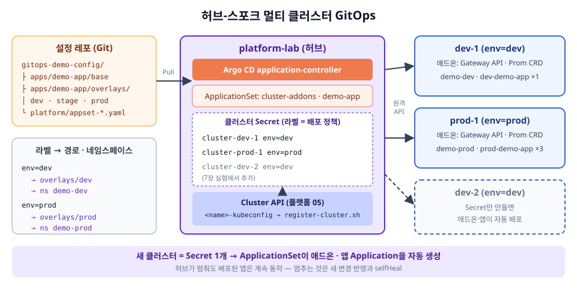
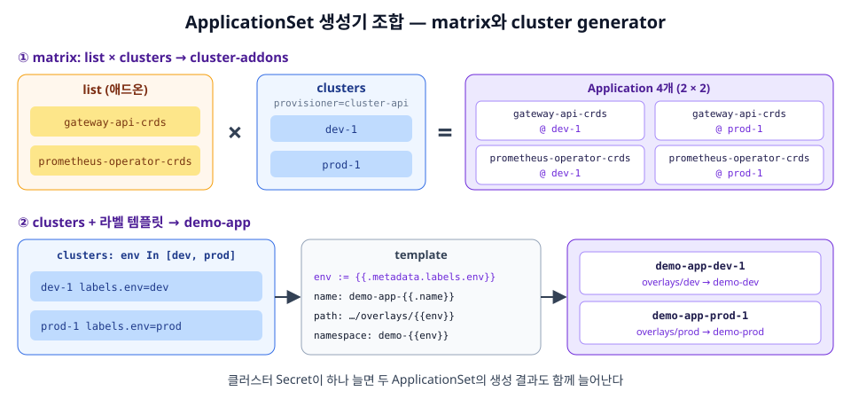
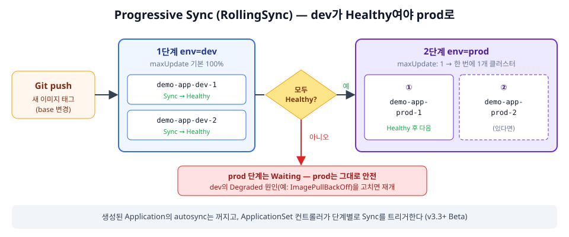

> **플랫폼 엔지니어링** | 난이도 ★★★★☆ | 예상 소요 2.5 ~ 3시간

> 💡 **플랫폼 01 고정값 기준**으로 진행합니다. 관리 클러스터는 kind `platform-lab`(Argo CD·Backstage·Crossplane 설치됨)이고, 플랫폼 05에서 Cluster API로 만든 워크로드 클러스터 `dev-1`, `prod-1`(네임스페이스 `clusters`)을 이어 씁니다. 모두 로컬 Docker 안에서 돌아 **클라우드 비용은 0원**입니다.

## 🎯 오늘의 목표

- 허브-스포크(중앙 Argo CD 하나가 여러 클러스터 관리) 구조의 장단점을 설명할 수 있다
- CAPI가 만든 kubeconfig Secret으로 `dev-1`, `prod-1`을 **선언형 클러스터 Secret**으로 Argo CD에 등록하고 `env=dev/prod` 라벨을 붙인다
- **cluster generator**로 Ch7 규약 `apps/demo-app/overlays/{dev,prod}`를 클러스터 라벨에 맞춰 자동 배포한다
- **matrix generator**로 "애드온 × 클러스터", "앱 × 클러스터"를 한 번에 찍어 낸다
- **점진적 동기화(progressive sync)** 의 개념과 설정을 알고, 클러스터를 추가하면 앱이 저절로 깔리는 것을 실험으로 확인한다

---

## 1. 클러스터가 여러 개가 되면 생기는 문제

Day 53에서 Argo CD는 **자기가 설치된 클러스터**(`https://kubernetes.default.svc`)에만 배포했습니다. 플랫폼 05 이후로는 클러스터가 셋입니다.

| 질문 | 클러스터 1개일 때 | 클러스터 N개일 때 |
|---|---|---|
| 어디에 배포하나 | 고민 없음 | 환경(dev/prod)·지역·팀마다 다른 클러스터 |
| Application 수 | 앱 수만큼 | **앱 수 × 클러스터 수** |
| 새 클러스터 준비 | 해당 없음 | CNI·CRD·모니터링 에이전트·앱을 다시 깔아야 함 |
| 같은 버전이 깔렸나 | 한 곳만 보면 됨 | 클러스터마다 확인 |

### 1-1. 두 가지 배치 방식

| | **허브-스포크** (오늘) | **클러스터마다 Argo CD** |
|---|---|---|
| 구조 | `platform-lab`의 Argo CD 하나가 `dev-1`, `prod-1`에 원격 배포 | 각 클러스터가 자기 Argo CD로 자기 자신만 Pull |
| 장점 | 화면 하나로 전체 현황, ApplicationSet으로 일괄 관리, 설치·업그레이드 1회 | 허브 장애 영향 없음, 클러스터에 외부에서 들어오는 접속 불필요 |
| 단점 | 허브가 모든 클러스터의 **관리자 자격 증명**을 가짐(보안 핵심 자산), 허브 장애 시 배포 정지 | Argo CD N벌 운영, 전체 현황은 따로 모아야 함 |
| 어울리는 곳 | 플랫폼 팀이 클러스터를 찍어 내는 환경(오늘) | 망 분리, 엣지, 규제 환경 |

> 💡 허브가 멈춰도 **이미 배포된 앱은 그대로 돕니다.** 멈추는 것은 "새 변경의 반영"과 selfHeal입니다. 그래도 허브는 모든 클러스터의 열쇠를 가지므로 Day 19의 RBAC, Day 73의 SSO로 접근을 좁히는 것이 필수입니다.

---

## 2. 오늘 만들 구조



| 구성 | 값 |
|---|---|
| 허브 | `platform-lab`의 Argo CD **v3.6.2** (네임스페이스 `argocd`, 플랫폼 01) |
| 스포크 | `dev-1` (라벨 `env=dev`), `prod-1` (라벨 `env=prod`), 실험에서 `dev-2` 추가 |
| 설정 레포 | Ch7의 `https://github.com/<user>/gitops-demo-config` — `apps/demo-app/overlays/{dev,prod}` |
| 애드온 | Gateway API CRD(dev overlay의 HTTPRoute용), Prometheus Operator CRD(Day 58의 ServiceMonitor·PrometheusRule용) |
| ApplicationSet | `cluster-addons`(matrix: 애드온 × 클러스터), `demo-app`(cluster generator) |
| 기존 것 | 플랫폼 01의 `dev-apps`(git generator, `platform-lab` 자신의 `demo-dev`에 배포)는 **그대로 둡니다** — 개발자가 PR 머지 직후 바로 확인하는 샌드박스 역할 |

ApplicationSet YAML은 설정 레포 `gitops-demo-config`의 `platform/` 폴더에 두고(App of Apps로 관리 가능), 아래 `kubectl apply -f platform/...` 명령은 **그 레포를 클론한 폴더에서** 실행합니다.

---

## 3. 실습 준비

```bash
kubectl config use-context kind-platform-lab
kubectl -n clusters get cluster
# dev-1    quick-start   True ... v1.37.0
# prod-1   quick-start   True ... v1.37.0

kubectl -n argocd get pods | grep -E "server|applicationset|application-controller"
argocd version --short           # 플랫폼 01에서 로그인해 둔 CLI
```

Day 52·58에서 정한 설정 레포 구조를 다시 봅니다. 오늘은 **경로를 바꾸지 않고** 클러스터만 늘립니다.

```
gitops-demo-config/
└── apps/demo-app/
    ├── base/               # Deployment·Service·ConfigMap + ServiceMonitor·PrometheusRule(Day 58)
    └── overlays/
        ├── dev/            # namespace demo-dev, namePrefix dev-, HTTPRoute dev.demo.example.test
        ├── stage/
        └── prod/           # namespace demo-prod, namePrefix prod-
```

> ⚠️ base에 ServiceMonitor·PrometheusRule(Day 58)이, dev overlay에 HTTPRoute(Day 53)가 들어 있습니다. 새로 만든 `dev-1`·`prod-1`에는 이 **CRD가 없으므로** 앱보다 먼저 애드온(5장)을 깔아야 Sync가 성공합니다. "앱이 기대하는 바닥(CRD·CNI·에이전트)을 플랫폼이 깔아 준다"가 오늘의 핵심 패턴입니다.

---

## 4. 실습 ① 클러스터 등록 — CAPI Secret → Argo CD 클러스터 Secret

### 4-1. `argocd cluster add`를 쓰지 않는 이유

일반적인 등록 방법은 `argocd cluster add <context>`입니다. 이 명령은 kubeconfig의 context로 접속해 대상 클러스터에 `argocd-manager` ServiceAccount를 만들고, **kubeconfig에 적힌 server 주소**를 Argo CD에 저장합니다.

| 주소 | 호스트 CLI에서 | Argo CD Pod(platform-lab 안)에서 |
|---|---|---|
| `https://127.0.0.1:<포트>` (`kind get kubeconfig`) | 접속 됨 | **안 됨** (Pod 자신의 127.0.0.1) |
| `https://<dev-1-lb IP>:6443` (CAPI Secret) | Docker Desktop에서는 안 됨 | **접속 됨** (같은 Docker 네트워크 `kind`) |

그래서 오늘은 Argo CD의 **선언형 클러스터 Secret**을 직접 만듭니다. 재료는 플랫폼 05에서 본 CAPI Secret `<클러스터>-kubeconfig`에 다 들어 있습니다.

### 4-2. 등록 스크립트

```bash
# ~/platform-lab/register-cluster.sh
#!/usr/bin/env bash
set -euo pipefail
NAME=$1          # dev-1
ENV=$2           # dev | prod
TMP=$(mktemp)
kubectl --context kind-platform-lab -n clusters get secret "${NAME}-kubeconfig" \
  -o jsonpath='{.data.value}' | base64 -d > "$TMP"

jp() { kubectl config view --kubeconfig "$TMP" --raw -o jsonpath="$1"; }
SERVER=$(jp '{.clusters[0].cluster.server}')
CA=$(jp '{.clusters[0].cluster.certificate-authority-data}')
CERT=$(jp '{.users[0].user.client-certificate-data}')
KEY=$(jp '{.users[0].user.client-key-data}')
rm -f "$TMP"

kubectl --context kind-platform-lab apply -f - <<EOF
apiVersion: v1
kind: Secret
metadata:
  name: cluster-${NAME}
  namespace: argocd
  labels:
    argocd.argoproj.io/secret-type: cluster    # ← 이 라벨이 있어야 Argo CD가 클러스터로 인식
    env: ${ENV}                                # ← cluster generator가 고를 라벨
    provisioner: cluster-api
type: Opaque
stringData:
  name: ${NAME}
  server: ${SERVER}
  config: |
    {"tlsClientConfig":{"caData":"${CA}","certData":"${CERT}","keyData":"${KEY}"}}
EOF
echo "registered ${NAME} (${SERVER}) env=${ENV}"
```

```bash
chmod +x ~/platform-lab/register-cluster.sh
~/platform-lab/register-cluster.sh dev-1 dev
~/platform-lab/register-cluster.sh prod-1 prod
# registered dev-1 (https://172.18.0.7:6443) env=dev
# registered prod-1 (https://172.18.0.10:6443) env=prod

argocd cluster list
# SERVER                          NAME        VERSION  STATUS   MESSAGE
# https://172.18.0.7:6443         dev-1                Unknown  Cluster has no applications and is not being monitored.
# https://172.18.0.10:6443        prod-1               Unknown  Cluster has no applications and is not being monitored.
# https://kubernetes.default.svc  in-cluster  1.3x     Successful
```

`Unknown`은 정상입니다. Argo CD는 **Application이 하나라도 그 클러스터를 대상으로 할 때부터** 연결을 감시합니다.

| Secret 필드 | 의미 |
|---|---|
| `name` | Argo CD 화면·ApplicationSet의 `{{.name}}` |
| `server` | API 서버 주소 = Application `destination.server` |
| `config.tlsClientConfig` | CA와 클라이언트 인증서(kubeconfig의 `*-data` 값은 이미 base64라 그대로 씀) |
| 라벨 `env` | 오늘의 핵심. cluster generator의 `selector`가 이 라벨을 봄 |

> ⚠️ 오늘은 CAPI가 만든 **클러스터 관리자 인증서**를 그대로 넣었습니다. 학습용으로는 간단하지만 운영에서는 대상 클러스터에 권한을 좁힌 ServiceAccount를 만들고 그 토큰(`bearerToken`)을 쓰거나, `argocd cluster add`처럼 `argocd-manager` SA를 쓰세요. 또 이 Secret 자체를 Git에 평문으로 두면 안 됩니다(Day 55의 SOPS/External Secrets).

> 💡 **등록 자동화 아이디어** — "CAPI가 `<이름>-kubeconfig` Secret을 만들면 Argo CD 클러스터 Secret을 자동 생성"하는 일을 작은 컨트롤러나 Job, 또는 정책 엔진(Day 57의 Kyverno `generate` 규칙)으로 맡기는 패턴이 많이 쓰입니다. 오늘은 원리를 보려고 스크립트로 했습니다.

---

## 5. 실습 ② matrix generator — 애드온 × 클러스터



matrix generator는 **두 생성기의 곱집합**을 만듭니다. "애드온 2개 × 클러스터 2개 = Application 4개"입니다.

```yaml
# platform/appset-cluster-addons.yaml  (gitops-demo-config 레포에 두는 것을 권장)
apiVersion: argoproj.io/v1alpha1
kind: ApplicationSet
metadata:
  name: cluster-addons
  namespace: argocd
spec:
  goTemplate: true
  goTemplateOptions: ["missingkey=error"]
  generators:
  - matrix:
      generators:
      - list:
          elements:
          - addon: gateway-api-crds
            repoURL: https://github.com/kubernetes-sigs/gateway-api.git
            revision: v1.6.3
            path: config/crd                       # standard 채널 CRD (kustomization.yaml 포함)
          - addon: prometheus-operator-crds
            repoURL: https://github.com/prometheus-community/helm-charts.git
            revision: prometheus-operator-crds-33.0.2
            path: charts/prometheus-operator-crds  # Git 안의 Helm 차트를 Argo CD가 렌더링
      - clusters:
          selector:
            matchLabels:
              provisioner: cluster-api             # CAPI로 만든 클러스터 전부 (in-cluster 제외)
  template:
    metadata:
      name: '{{.addon}}-{{.name}}'
      labels:
        role: addon
    spec:
      project: default
      source:
        repoURL: '{{.repoURL}}'
        targetRevision: '{{.revision}}'
        path: '{{.path}}'
      destination:
        server: '{{.server}}'
        namespace: kube-system
      syncPolicy:
        automated:
          prune: false                             # CRD는 실수로 지우면 모든 CR이 사라짐
          selfHeal: true
        syncOptions:
        - ServerSideApply=true                     # 큰 CRD (Day 53의 annotation 한도 문제)
```

```bash
kubectl apply -f platform/appset-cluster-addons.yaml
argocd app list -l role=addon
# NAME                                   CLUSTER                   STATUS  HEALTH
# argocd/gateway-api-crds-dev-1          https://172.18.0.7:6443   Synced  Healthy
# argocd/gateway-api-crds-prod-1         https://172.18.0.10:6443  Synced  Healthy
# argocd/prometheus-operator-crds-dev-1  https://172.18.0.7:6443   Synced  Healthy
# argocd/prometheus-operator-crds-prod-1 https://172.18.0.10:6443  Synced  Healthy

kubectl --kubeconfig ~/platform-lab/kubeconfigs/dev-1.kubeconfig get crd | grep -E "httproutes|servicemonitors"
```

> 💡 버전 고정(`v1.6.3`, `prometheus-operator-crds-33.0.2`)을 list 요소에 둔 덕분에, 애드온 업그레이드는 **이 YAML의 한 줄을 바꾸는 PR**이 됩니다. 클러스터가 50개여도 같습니다. 플랫폼 05에서 손으로 깐 Calico도 같은 방식으로 이 목록에 넣을 수 있습니다(단, CNI는 노드가 Ready가 되기 전에 필요하므로 ClusterResourceSet이 더 자연스러운 경우가 많습니다).

---

## 6. 실습 ③ cluster generator — 라벨로 overlay 자동 매핑

이제 앱입니다. 클러스터 Secret의 `env` 라벨을 **overlay 경로와 네임스페이스에 그대로 끼워 넣는** 것이 전부입니다.

```yaml
# platform/appset-demo-app.yaml
apiVersion: argoproj.io/v1alpha1
kind: ApplicationSet
metadata:
  name: demo-app
  namespace: argocd
spec:
  goTemplate: true
  goTemplateOptions: ["missingkey=error"]
  generators:
  - clusters:
      selector:
        matchExpressions:
        - key: env
          operator: In
          values: [dev, prod]
  template:
    metadata:
      name: 'demo-app-{{.name}}'                     # demo-app-dev-1, demo-app-prod-1
      labels:
        app: demo-app
        env: '{{.metadata.labels.env}}'              # 9장 progressive sync가 이 라벨을 씀
    spec:
      project: default
      source:
        repoURL: https://github.com/<user>/gitops-demo-config.git
        targetRevision: main
        path: 'apps/demo-app/overlays/{{.metadata.labels.env}}'   # ← Ch7 규약 그대로
      destination:
        server: '{{.server}}'
        namespace: 'demo-{{.metadata.labels.env}}'   # demo-dev / demo-prod
      syncPolicy:
        automated:
          prune: true
          selfHeal: true
        syncOptions:
        - CreateNamespace=true
        retry:                                       # 애드온 CRD가 아직 없을 때를 대비
          limit: 5
          backoff:
            duration: 20s
            factor: 2
            maxDuration: 5m
```

```bash
kubectl apply -f platform/appset-demo-app.yaml
argocd app list -l app=demo-app
# NAME                    CLUSTER                   NAMESPACE  STATUS  HEALTH
# argocd/demo-app-dev-1   https://172.18.0.7:6443   demo-dev   Synced  Healthy
# argocd/demo-app-prod-1  https://172.18.0.10:6443  demo-prod  Synced  Healthy

kubectl --kubeconfig ~/platform-lab/kubeconfigs/dev-1.kubeconfig  -n demo-dev  get deploy
# dev-demo-app    1/1
kubectl --kubeconfig ~/platform-lab/kubeconfigs/prod-1.kubeconfig -n demo-prod get deploy
# prod-demo-app   3/3      (Day 52 prod overlay의 replicas: 3)
```

| 클러스터 Secret | `{{.name}}` | `{{.metadata.labels.env}}` | 만들어진 Application |
|---|---|---|---|
| `cluster-dev-1` | dev-1 | dev | `demo-app-dev-1` → `overlays/dev` → `demo-dev` |
| `cluster-prod-1` | prod-1 | prod | `demo-app-prod-1` → `overlays/prod` → `demo-prod` |
| (in-cluster) | — | 라벨 없음 | selector에 안 걸려 생성 안 됨 |

`argocd cluster list`를 다시 보면 두 클러스터가 이제 `Successful`과 버전(1.37)을 표시합니다.

> ⚠️ dev overlay의 HTTPRoute는 Day 15의 `traefik-gateway`를 parentRef로 가리키는데, `dev-1`에는 Traefik이 없습니다. 리소스는 만들어지지만 아무 Gateway에도 붙지 않습니다. 워크로드 클러스터에서도 외부 노출이 필요하면 Traefik을 5장의 애드온 목록에 추가하세요. 오늘은 `kubectl port-forward`로 확인합니다.

```bash
kubectl --kubeconfig ~/platform-lab/kubeconfigs/dev-1.kubeconfig -n demo-dev port-forward svc/dev-demo-app 8000:80 &
curl -s localhost:8000/healthz; kill %1
```

### 6-1. (확장) matrix로 "앱 × 클러스터"

설정 레포의 `apps/` 아래 앱이 늘어나면(Ch6의 rag-api 등) git directories 생성기와 곱합니다.

```yaml
  generators:
  - matrix:
      generators:
      - git:
          repoURL: https://github.com/<user>/gitops-demo-config.git
          revision: main
          directories:
          - path: apps/*
          - path: apps/rag-api          # overlays/{dev,prod}가 아직 없는 앱은 제외
            exclude: true
      - clusters:
          selector:
            matchExpressions:
            - {key: env, operator: In, values: [dev, prod]}
  template:
    metadata:
      name: '{{.path.basename}}-{{.name}}'                        # demo-app-dev-1
    spec:
      source:
        path: '{{.path.path}}/overlays/{{.metadata.labels.env}}'  # apps/demo-app/overlays/dev
      destination:
        server: '{{.server}}'
        namespace: '{{.path.basename}}-{{.metadata.labels.env}}'  # overlay의 namespace가 우선
      # (나머지는 위 demo-app과 동일)
```

"새 앱 = `apps/<이름>/overlays/{dev,prod}` 폴더 커밋, 새 클러스터 = Secret 하나"가 되면, 플랫폼 팀은 Application YAML을 더 이상 손으로 쓰지 않습니다. 이 규약이 곧 **골든 패스**이고, 플랫폼 03의 Backstage 템플릿이 이 폴더 구조로 서비스를 만들어 주면 앞뒤가 이어집니다(플랫폼 08).

---

## 7. 실습 ④ 클러스터를 추가하면 앱이 알아서 깔린다

플랫폼 05의 방법으로 `dev-2`를 만들고, 등록만 해 봅니다. **ApplicationSet은 건드리지 않습니다.**

```bash
cd ~/platform-lab/capi
clusterctl generate cluster dev-2 --flavor development \
  --target-namespace clusters --kubernetes-version v1.37.0 \
  --control-plane-machine-count=1 --worker-machine-count=1 > dev-2.yaml
kubectl --context kind-platform-lab apply -f dev-2.yaml
kubectl --context kind-platform-lab -n clusters wait cluster/dev-2 \
  --for=condition=ControlPlaneInitialized --timeout=10m   # 컨트롤 플레인 초기화 대기

kind get kubeconfig --name dev-2 > ~/platform-lab/kubeconfigs/dev-2.kubeconfig
kubectl --kubeconfig ~/platform-lab/kubeconfigs/dev-2.kubeconfig apply \
  -f https://raw.githubusercontent.com/projectcalico/calico/v3.33.1/manifests/calico.yaml

~/platform-lab/register-cluster.sh dev-2 dev       # ← 오늘의 유일한 "등록" 동작
```

```bash
argocd app list | grep dev-2
# argocd/gateway-api-crds-dev-2          https://172.18.0.13:6443  kube-system  Synced  Healthy
# argocd/prometheus-operator-crds-dev-2  https://172.18.0.13:6443  kube-system  Synced  Healthy
# argocd/demo-app-dev-2                  https://172.18.0.13:6443  demo-dev     Synced  Healthy
```

1~3분 안에 애드온 2개와 데모 앱이 생깁니다. ApplicationSet 컨트롤러가 클러스터 Secret의 생성·라벨 변경을 감시하다가 생성기 결과가 바뀌자 Application을 새로 만든 것입니다.

| 실험 | 결과 |
|---|---|
| `kubectl -n argocd label secret cluster-dev-2 env=prod --overwrite` | `demo-app-dev-2`가 `overlays/prod`·`demo-prod`로 바뀜 (라벨 = 환경) |
| `kubectl -n argocd delete secret cluster-dev-2` | dev-2용 Application 3개가 삭제됨 |
| 다시 `register-cluster.sh dev-2 dev` | 다시 생성됨 |

> ⚠️ ApplicationSet이 Application을 지울 때, 템플릿에 `resources-finalizer`가 있으면 대상 클러스터의 리소스까지 지웁니다. 실수로 라벨을 바꿔 운영 앱이 지워지는 사고를 막으려면 ApplicationSet에 `spec.syncPolicy.preserveResourcesOnDeletion: true`를 두거나, `applicationsSync: create-update`로 삭제를 막는 정책을 검토하세요.

실험이 끝나면 자원 절약을 위해 `dev-2`를 지웁니다(Secret 먼저, 그다음 클러스터).

```bash
kubectl --context kind-platform-lab -n argocd delete secret cluster-dev-2
kubectl --context kind-platform-lab -n clusters delete cluster dev-2
```

---

## 8. 점진적 동기화(Progressive Sync) — dev가 건강해야 prod로



지금 `demo-app` ApplicationSet은 Git이 바뀌면 **dev와 prod를 동시에** Sync합니다. 잘못된 이미지 태그가 머지되면 prod도 함께 깨집니다. Day 54의 승격 흐름(PR로 overlay별 태그 변경)이 한 방법이고, ApplicationSet 차원의 방법이 **Progressive Syncs의 RollingSync**입니다.

| 항목 | 내용 (Argo CD v3.6 문서 기준) |
|---|---|
| 상태 | v3.3부터 **Beta**. 명시적으로 켜야 함 |
| 켜는 법 | `argocd-cmd-params-cm`에 `applicationsetcontroller.enable.progressive.syncs: "true"` (또는 컨트롤러 플래그 `--enable-progressive-syncs`) |
| 동작 | `steps`를 순서대로. 각 단계의 Application을 Sync → **모두 Healthy가 되어야** 다음 단계 |
| `maxUpdate` | 한 단계 안에서 동시에 Sync할 개수(정수 또는 %). 기본 100% |
| 주의 | 생성된 Application의 **autosync는 컨트롤러가 강제로 끔**(설정해도 경고만). 어떤 단계에도 안 걸린 앱은 수동 Sync |

```bash
kubectl -n argocd patch configmap argocd-cmd-params-cm --type merge \
  -p '{"data":{"applicationsetcontroller.enable.progressive.syncs":"true"}}'
kubectl -n argocd rollout restart deploy/argocd-applicationset-controller
```

`demo-app` ApplicationSet에 `strategy`를 추가합니다. 단계는 **Application의 라벨**(6장 템플릿의 `env`)로 고릅니다.

```yaml
spec:
  strategy:
    type: RollingSync
    rollingSync:
      steps:
      - matchExpressions:
        - key: env
          operator: In
          values: [dev]            # 1단계: dev 클러스터 전부
      - matchExpressions:
        - key: env
          operator: In
          values: [prod]
        maxUpdate: 1               # 2단계: prod는 한 번에 1개 클러스터씩
```

```bash
kubectl apply -f platform/appset-demo-app.yaml
# 설정 레포에서 base의 이미지 태그를 바꿔 push한 뒤
kubectl -n argocd get applicationset demo-app -o jsonpath='{range .status.applicationStatus[*]}{.application}{"\t"}{.step}{"\t"}{.status}{"\n"}{end}'
# demo-app-dev-1    1   Progressing
# demo-app-prod-1   2   Waiting        ← dev가 Healthy가 될 때까지 대기
```

dev의 새 Pod가 `ImagePullBackOff`로 Healthy가 되지 못하면 prod는 **계속 Waiting**입니다. 이것이 플랫폼 수준의 안전장치입니다.

| 방법 | 단위 | 판단 기준 | 다루는 Day |
|---|---|---|---|
| PR 승격 | 환경(overlay) | 사람의 승인 | Day 54 |
| Argo Rollouts Canary | 한 클러스터 안의 Pod 비율 | 메트릭 분석(SLO) | Day 56·63 |
| **RollingSync** | **클러스터(Application) 묶음** | Application Health | 오늘 |

> 💡 세 가지는 겹쳐 쓸 수 있습니다. "dev 클러스터들 → prod 클러스터 1개씩(RollingSync)" 안에서 각 클러스터는 Canary(Rollouts)로 배포하고, Canary 분석은 Day 63의 SLO 쿼리를 쓰는 식입니다. 단, Beta 기능이므로 운영 도입 전에 현재 버전 문서의 제약을 다시 확인하세요.

실습을 마치면 RollingSync를 빼고 6장의 자동 Sync로 돌려 두어도 됩니다(플랫폼 08은 두 방식 모두 동작).

---

## 9. 트러블슈팅

| 증상 | 원인 | 해결 |
|---|---|---|
| `argocd cluster list`에서 `dial tcp 127.0.0.1:xxxxx: connect: connection refused` | `kind get kubeconfig`의 호스트 주소로 등록 | 4-2 스크립트로 CAPI Secret의 LB IP 주소 사용 |
| `x509: certificate signed by unknown authority` | `caData` 누락·잘못 복사 | 스크립트의 `certificate-authority-data` 추출 확인, Secret 재적용 |
| ApplicationSet이 Application을 0개 만듦 | Secret에 `env` 라벨 없음 / selector 오타 | `kubectl -n argocd get secret -l argocd.argoproj.io/secret-type=cluster --show-labels` |
| `missingkey=error`로 생성 실패 | 라벨이 없는 클러스터가 selector에 걸림 | selector를 `matchExpressions`로 좁히거나 라벨 추가 |
| 앱 Sync 실패 `no matches for kind "ServiceMonitor"` | 애드온 CRD보다 앱이 먼저 Sync | `cluster-addons` 먼저 적용, 앱에 `retry` 설정(6장) |
| CRD Sync 시 `metadata.annotations: Too long` | client-side apply | `ServerSideApply=true` |
| RollingSync를 켰는데 동시에 Sync됨 | 기능 플래그 미적용 | ConfigMap 확인 후 applicationset-controller 재시작 |
| RollingSync에서 prod가 영원히 Waiting | dev 단계 앱이 Degraded/Progressing | dev 앱 Health 원인 해결(Day 53 8장 참고) |

---

## 10. 핵심 정리

- 허브-스포크: Argo CD 하나가 여러 클러스터를 관리. 편하지만 허브는 **모든 클러스터의 열쇠** — 접근 통제 필수
- 클러스터 등록 = `argocd.argoproj.io/secret-type: cluster` 라벨이 붙은 Secret. **라벨(env 등)이 곧 배포 정책**
- **cluster generator**: 등록된 클러스터마다 Application 하나. `{{.name}}`, `{{.server}}`, `{{.metadata.labels.<키>}}`
- **matrix generator**: 생성기의 곱. 애드온 × 클러스터, 앱 디렉터리 × 클러스터
- 클러스터를 추가하면(=Secret 생성) 애드온과 앱이 **자동으로** 깔린다 — CAPI(플랫폼 05)와 합치면 "클러스터 요청 → 사용 가능한 클러스터"가 사람 손 없이 이어진다
- **RollingSync**: 라벨로 단계를 나눠 dev가 Healthy여야 prod로 진행(Beta, autosync 비활성)

---

## 11. 셀프 체크

<details>
<summary>Q1. 허브-스포크 구조에서 허브 Argo CD가 30분간 멈췄다. 워크로드 클러스터의 앱은 어떻게 되나?</summary>

이미 배포된 앱은 계속 동작합니다. 그 30분 동안 Git 변경이 반영되지 않고, 누군가 클러스터를 손으로 바꿔도 selfHeal이 되돌리지 못할 뿐입니다. 허브가 돌아오면 다시 비교해 Sync합니다.
</details>

<details>
<summary>Q2. CAPD 클러스터를 등록할 때 <code>kind get kubeconfig</code>가 아니라 CAPI Secret의 주소를 쓴 이유는?</summary>

Argo CD는 `platform-lab` 안의 Pod에서 접속합니다. `kind get kubeconfig`의 `127.0.0.1:<포트>`는 호스트 기준 주소라 Pod에서는 자기 자신을 가리킵니다. CAPI Secret에는 Docker 네트워크 `kind` 안에서 통하는 LB 컨테이너 IP가 들어 있어 Pod에서 접속할 수 있습니다.
</details>

<details>
<summary>Q3. 새 클러스터 <code>qa-1</code>을 만들어 qa 환경으로 쓰고 싶다. 무엇을 준비해야 6장의 ApplicationSet이 그대로 동작하나?</summary>

설정 레포에 `apps/demo-app/overlays/qa`(namespace `demo-qa`)를 만들고, ApplicationSet selector의 `values`에 `qa`를 추가한 뒤, 클러스터 Secret에 `env=qa` 라벨을 붙여 등록합니다. 템플릿의 경로·네임스페이스는 라벨에서 계산되므로 고칠 필요가 없습니다.
</details>

<details>
<summary>Q4. 애드온과 앱을 하나의 ApplicationSet에 넣지 않고 나눈 이유는?</summary>

수명 주기와 정책이 다르기 때문입니다. CRD 같은 애드온은 앱보다 **먼저** 있어야 하고, 실수로 지우면 모든 CR이 사라지므로 `prune: false`가 안전합니다. 앱은 `prune: true`로 Git과 정확히 맞추고 RollingSync 같은 배포 전략을 적용합니다. 소유 팀(플랫폼 팀 vs 서비스 팀)도 다릅니다.
</details>

<details>
<summary>Q5. RollingSync를 켰더니 템플릿의 <code>automated</code> 설정이 무시된다. 버그인가?</summary>

아닙니다. Progressive Syncs가 켜지면 ApplicationSet 컨트롤러가 단계 순서를 지키기 위해 생성된 Application의 autosync를 끄고, 자신이 단계별로 Sync를 트리거합니다. 문서에 명시된 동작이며 컨트롤러가 경고 로그를 남깁니다.
</details>

---

## ⏭️ 다음 예고 — [플랫폼 07. FinOps — OpenCost, 리소스 rightsizing, 네임스페이스별 비용](./plat07-finops-opencost.md)

클러스터가 버튼 하나로 늘어나기 시작하면 다음 질문은 "**그래서 이게 얼마짜리인가?**"입니다. 다음 편에서는 `platform-lab`에 Day 17의 kube-prometheus-stack을 재사용해 **OpenCost**를 설치하고, 클라우드 가격 대신 홈랩 장비 값으로 만든 **사용자 정의 단가**로 네임스페이스·라벨별 비용을 계산합니다. 이어서 **Goldilocks(VPA 추천 모드)** 로 requests/limits가 실제 사용량보다 얼마나 부풀려져 있는지 찾아 rightsizing하고, 비용을 Backstage 서비스 페이지에 보여 주는 방법을 살펴봅니다.
