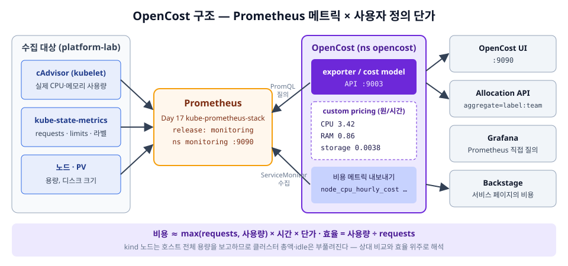
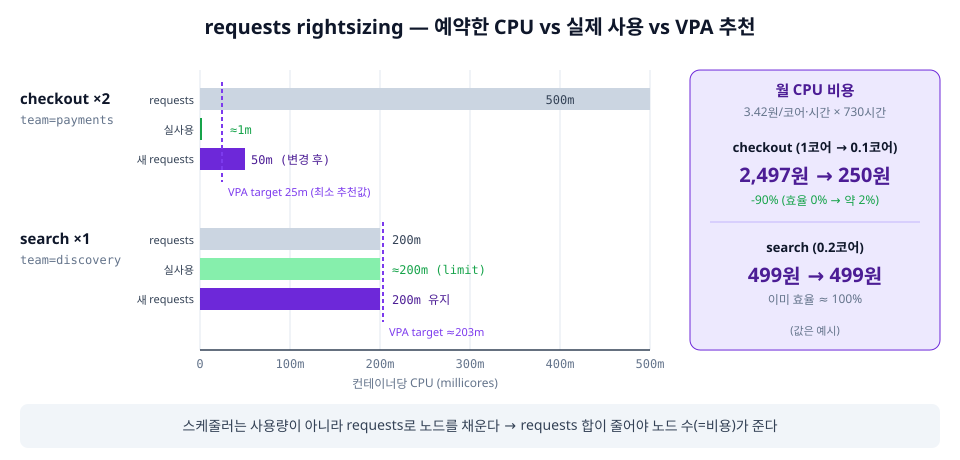

> **플랫폼 엔지니어링** | 난이도 ★★★☆☆ | 예상 소요 2 ~ 2.5시간

> 💡 **플랫폼 01 고정값 기준**으로 진행합니다. 관리 클러스터 kind `platform-lab`(Argo CD·Backstage·Crossplane 설치됨)에서 실습하고, 플랫폼 05·06의 `dev-1`·`prod-1`은 개념 확장에만 씁니다. 클라우드 청구서는 없습니다 — 대신 **홈랩 장비 값으로 단가를 직접 만들어** 비용을 계산합니다.

## 🎯 오늘의 목표

- FinOps의 세 단계(**Inform → Optimize → Operate**)와 showback/chargeback의 차이를 설명할 수 있다
- Day 17의 kube-prometheus-stack을 데이터 소스로 **OpenCost**를 Helm으로 설치한다
- 클라우드 가격표 대신 **사용자 정의 단가**(감가상각 + 전기료)를 넣고, **네임스페이스·라벨별 비용**을 API와 UI로 조회한다
- **Goldilocks(VPA 추천 모드)** 로 requests/limits가 실제 사용량보다 얼마나 큰지 찾아 rightsizing한다
- 비용 대시보드를 Grafana와 Backstage 서비스 페이지에 연결하는 방법을 안다

---

## 1. 왜 플랫폼 팀이 비용을 다루나

플랫폼 05·06으로 클러스터와 앱을 "버튼 하나"로 만들 수 있게 되었습니다. 셀프서비스의 부작용은 **아무도 비용을 보지 않는 것**입니다. 개발자는 Day 18에서 배운 requests를 넉넉하게 잡고, 실습용 클러스터는 지워지지 않고, 플랫폼 자체(Argo CD, Backstage, 모니터링)도 자원을 씁니다.

| FinOps 단계 | 질문 | 오늘의 도구 |
|---|---|---|
| **Inform** (가시화) | 누가 얼마나 쓰나? | OpenCost — 네임스페이스·라벨·클러스터별 비용 |
| **Optimize** (최적화) | 어디서 줄일 수 있나? | Goldilocks/VPA 추천 → requests rightsizing |
| **Operate** (운영) | 계속 지켜지게 하려면? | 대시보드, Backstage 노출, 정책(쿼터·기본값), 정기 리뷰 |

| 방식 | 의미 | 홈랩·사내 플랫폼에서 |
|---|---|---|
| **Showback** | 비용을 **보여 주기만** | 팀별 리포트로 "우리가 쓰는 양"을 인식 — 오늘의 목표 |
| **Chargeback** | 실제로 팀 예산에서 **차감** | 회계 연동 필요, 단가 합의가 먼저 |

> 💡 FinOps는 "돈을 아끼자"가 아니라 **"비용을 엔지니어링 지표로 다루자"** 입니다. Day 58에서 신뢰성을 SLO라는 숫자로 약속했듯, 비용도 서비스별 숫자가 있어야 트레이드오프(가용성 99.9% vs 레플리카 3개 비용)를 논의할 수 있습니다.

---

## 2. OpenCost 구조



OpenCost는 CNCF 프로젝트로, Kubernetes 비용 배분 방식(무엇을 얼마로 나눌지)을 정의한 **OpenCost 명세**와 그 구현체입니다.

| 구성 | 역할 |
|---|---|
| Prometheus (Day 17) | cAdvisor(실제 사용량), kube-state-metrics(requests·limits·라벨) 수집 |
| **OpenCost exporter** (`:9003`) | 노드 단가 × 자원 할당량을 계산해 `node_cpu_hourly_cost` 같은 메트릭을 내보내고, Prometheus를 질의해 **Allocation API** 제공 |
| 가격 소스 | AWS·GCP·Azure 가격 API 또는 **custom pricing**(오늘) |
| OpenCost UI (`:9090`) | 네임스페이스·컨트롤러·라벨별 비용 화면 |
| 소비자 | Grafana 대시보드, `kubectl cost` 플러그인, Backstage 플러그인 |

비용은 대략 이렇게 계산됩니다.

| 항목 | 계산 |
|---|---|
| CPU 비용 | max(requests, 사용량) 코어 × 시간 × **CPU 단가(코어·시간)** |
| 메모리 비용 | max(requests, 사용량) GB × 시간 × **RAM 단가(GB·시간)** |
| 스토리지 | PV 크기 GB × 시간 × storage 단가 |
| 효율(efficiency) | 실제 사용량 ÷ requests — 낮을수록 "자리를 잡아 놓고 안 쓴다" |
| idle | 노드 전체 비용 − 배분된 비용 (아무도 예약하지 않은 용량) |

> ⚠️ **kind의 함정**: kind 노드는 컨테이너라서 각 노드가 **호스트 PC의 CPU·메모리 전체**를 자기 용량으로 보고합니다. `platform-lab`은 노드가 2개(control-plane + worker)라 노드 비용과 idle이 2배로 부풀어 보입니다. 오늘은 **네임스페이스·라벨 사이의 상대 비교와 효율**에 집중하고, 클러스터 총액은 참고만 하세요.

---

## 3. 실습 준비 — Prometheus (Day 17 재사용)

| 항목 | 값 |
|---|---|
| 클러스터 | kind `platform-lab` (context `kind-platform-lab`) |
| Prometheus | Day 17의 kube-prometheus-stack, 릴리스 이름 `monitoring`, 네임스페이스 `monitoring` |
| OpenCost | Helm 차트 `opencost-charts/opencost` **2.5.34** (앱 v1.121.4, 2026-11 기준) |
| Goldilocks | Helm 차트 `fairwinds-stable/goldilocks` **11.3.1** (VPA 서브차트 포함) |
| metrics-server | Day 18과 동일 (`--kubelet-insecure-tls`) |

플랫폼 01은 `platform-lab`에 모니터링을 넣지 않았으므로, Day 17의 `monitoring-values.yaml`을 `~/platform-lab/`에 복사해 같은 릴리스 이름으로 설치합니다. 이미 설치했다면 건너뜁니다.

```bash
kubectl config use-context kind-platform-lab
helm list -n monitoring          # monitoring ... kube-prometheus-stack-... deployed 이면 통과

# 없을 때만 — Day 17의 monitoring-values.yaml(controller-manager·scheduler·etcd·proxy 수집 끔) 재사용
helm repo add prometheus-community https://prometheus-community.github.io/helm-charts
helm repo update
helm install monitoring prometheus-community/kube-prometheus-stack \
  --namespace monitoring --create-namespace -f monitoring-values.yaml
```

Prometheus 서비스 이름을 확인해 둡니다. OpenCost values에 그대로 들어갑니다.

```bash
kubectl -n monitoring get svc | grep prometheus
# monitoring-kube-prometheus-prometheus   ClusterIP   10.96.x.x   <none>   9090/TCP,8080/TCP
```

### 3-1. 비용 실험용 워크로드

`platform-lab`에는 플랫폼 컴포넌트만 있으니, 성격이 다른 "팀 서비스" 두 개를 띄웁니다.

```yaml
# cost-lab.yaml
apiVersion: v1
kind: Namespace
metadata:
  name: cost-lab
---
apiVersion: apps/v1
kind: Deployment
metadata:
  name: checkout            # 넉넉하게 잡고 거의 안 쓰는 서비스
  namespace: cost-lab
spec:
  replicas: 2
  selector:
    matchLabels: {app: checkout}
  template:
    metadata:
      labels: {app: checkout, team: payments}
    spec:
      containers:
      - name: app
        image: registry.k8s.io/pause:3.10
        resources:
          requests: {cpu: 500m, memory: 512Mi}
          limits: {memory: 512Mi}
---
apiVersion: apps/v1
kind: Deployment
metadata:
  name: search              # 요청한 만큼 실제로 쓰는 서비스
  namespace: cost-lab
spec:
  replicas: 1
  selector:
    matchLabels: {app: search}
  template:
    metadata:
      labels: {app: search, team: discovery}
    spec:
      containers:
      - name: app
        image: busybox:1.37
        command: ["sh", "-c", "while true; do :; done"]   # CPU를 계속 씀
        resources:
          requests: {cpu: 200m, memory: 32Mi}
          limits: {cpu: 200m, memory: 64Mi}
```

```bash
kubectl apply -f cost-lab.yaml
kubectl -n cost-lab get pods -L team
```

> 💡 `team` 라벨이 곧 **비용 배분 키**입니다. 플랫폼 03의 Software Template이 생성하는 매니페스트에 `team`(= Backstage `spec.owner`) 라벨을 강제로 넣어 두면, 오늘의 라벨별 비용이 별도 작업 없이 팀별 showback이 됩니다.

---

## 4. 실습 ① 사용자 정의 단가 만들기

클라우드라면 가격표가 있지만 홈랩은 직접 정해야 합니다. 홈랩 서버(H01 기준) 한 대를 예로 계산합니다. **숫자는 예시**이니 자기 장비 값으로 바꾸세요.

| 항목 | 가정 | 월 비용 |
|---|---|---|
| 서버 구입비 | 8코어 · 32GB, 120만 원을 36개월 감가상각 | 33,333원 |
| 전기료 | 평균 60W × 730시간 = 43.8kWh × 약 150원/kWh (요금제·누진에 따라 다름) | 6,570원 |
| SSD | 1TB, 10만 원을 36개월 | 2,778원 |
| **합계(컴퓨트)** | 서버 + 전기 | **약 39,900원 → 시간당 약 54.7원** |

컴퓨트 비용을 CPU와 메모리에 반씩 나누면(관례적인 단순화):

| 단가 키 | 계산 | 값 (원) |
|---|---|---|
| `CPU` (코어·시간) | 54.7 × 0.5 ÷ 8코어 | **3.42** |
| `RAM` (GB·시간) | 54.7 × 0.5 ÷ 32GB | **0.86** |
| `storage` (GB·시간) | 2,778 ÷ 1,000GB ÷ 730시간 | **0.0038** |

OpenCost 기본 단가 파일(`default.json`, GCP us-central1 기반)도 같은 단위입니다(CPU `0.031611` 달러/코어·시간, RAM `0.004237` 달러/GB·시간, storage `0.00005479452` 달러/GB·시간 = 월 0.04달러/GB). 우리는 이 자리에 **원 단위 숫자**를 넣습니다.

> ⚠️ OpenCost 화면은 통화 기호를 `$`로 표시할 수 있습니다. 오늘은 숫자를 **원**으로 읽기로 약속합니다. 팀 간 비교(showback)에는 통화 단위보다 **일관된 단가**가 중요합니다.

---

## 5. 실습 ② OpenCost 설치

```yaml
# opencost-values.yaml
opencost:
  exporter:
    defaultClusterId: platform-lab           # 여러 클러스터 비용을 합칠 때 구분 키
  prometheus:
    internal:
      enabled: true
      namespaceName: monitoring
      serviceName: monitoring-kube-prometheus-prometheus   # 3장에서 확인한 이름
      port: 9090
  metrics:
    serviceMonitor:
      enabled: true                          # OpenCost 메트릭을 Prometheus가 수집하도록
      additionalLabels:
        release: monitoring                  # Day 17: 이 라벨이 있어야 Prometheus가 선택
  customPricing:
    enabled: true
    provider: custom
    costModel:
      description: "homelab H01 - 감가상각+전기료 (원/시간)"
      CPU: 3.42
      spotCPU: 3.42
      RAM: 0.86
      spotRAM: 0.86
      GPU: 0
      storage: 0.0038
      zoneNetworkEgress: 0
      regionNetworkEgress: 0
      internetNetworkEgress: 0
  ui:
    enabled: true
```

```bash
helm repo add opencost-charts https://opencost.github.io/opencost-helm-chart
helm repo update
helm install opencost opencost-charts/opencost --version 2.5.34 \
  --namespace opencost --create-namespace -f opencost-values.yaml

kubectl -n opencost rollout status deploy/opencost
kubectl -n opencost get pods
# opencost-xxxxxxxxxx-xxxxx   2/2   Running   (exporter + ui)
```

| 값 | 이유 |
|---|---|
| `prometheus.internal.*` | 차트 기본값(`prometheus-server` / `prometheus-system` / 80)은 kube-prometheus-stack과 다름 → Day 17의 서비스로 교체 |
| `metrics.serviceMonitor` | OpenCost가 계산한 `node_cpu_hourly_cost` 등을 Prometheus가 다시 수집해야 Allocation 계산과 Grafana 대시보드가 동작 |
| `customPricing` | ConfigMap `custom-pricing-model`로 만들어져 exporter에 마운트됨 |

```bash
kubectl -n opencost port-forward deployment/opencost 9003 9090
# 9003 = API, 9090 = UI
```

브라우저에서 **http://localhost:9090** 을 엽니다. 설치 직후에는 데이터가 거의 없으니 **15~30분** 정도 기다린 뒤 보세요. Prometheus Targets에 `serviceMonitor/opencost/opencost/0`이 UP인지 확인하면 수집 문제를 먼저 걸러낼 수 있습니다.

> 💡 OpenCost UI 포트 9090은 Prometheus의 9090과 같습니다. Day 17처럼 Prometheus를 동시에 port-forward 하려면 한쪽 로컬 포트를 바꾸세요(예: `9091:9090`).

---

## 6. 실습 ③ 네임스페이스·라벨별 비용 조회

### 6-1. Allocation API

```bash
# 최근 1일, 네임스페이스별
curl -s "http://localhost:9003/allocation?window=1d&aggregate=namespace" \
  | jq -r '.data[0] | to_entries[] | [.key, (.value.totalCost*100|round/100), (.value.totalEfficiency*100|round)] | @tsv' \
  | sort -k2 -nr | column -t
```

```
monitoring          31.52   18
argocd              14.10   9
backstage           12.87   11
cost-lab            11.60   41
demo-dev             9.95   14     ← dev-demo-app, dev-orders-api(JVM), orders-db(CNPG, 플랫폼 04)
crossplane-system    6.33   7
capd-system          2.05   12
cnpg-system          1.72   10
opencost             1.48   22
__idle__            ...
```

(값은 예시, 단위는 원, 마지막 열은 효율 %)

| 관찰 | 의미 |
|---|---|
| `monitoring`, `argocd`, `backstage`가 상위 | **플랫폼 자체 비용**("플랫폼 세금"). 플랫폼 팀도 자기 비용을 공개해야 신뢰를 얻음 |
| `__idle__` | 노드 용량 중 아무도 예약하지 않은 부분. kind에서는 2장의 이유로 과대 |
| 효율이 한 자릿수 | requests가 실제 사용보다 훨씬 큼 → 7장 rightsizing 후보 |

### 6-2. 라벨(팀)별

```bash
curl -s "http://localhost:9003/allocation?window=1d&aggregate=label:team" \
  | jq -r '.data[0] | to_entries[] | [.key, (.value.cpuCost*100|round/100), (.value.ramCost*100|round/100), (.value.cpuEfficiency*100|round)] | @tsv' \
  | column -t
```

```
payments    9.61   1.97   0      ← checkout: 1 코어 예약, 사용 ≈ 0
discovery   1.64   0.01   97     ← search: 예약한 만큼 사용
__unallocated__  ...              ← team 라벨이 없는 Pod 전부
```

`__unallocated__`가 크다면 **라벨 규약이 지켜지지 않고 있다**는 뜻입니다. 이것이 플랫폼 팀이 템플릿(플랫폼 03)과 정책(Day 57의 Kyverno로 `team` 라벨 필수)을 두는 이유입니다.

```bash
# 그 밖의 집계 예
curl -s "http://localhost:9003/allocation?window=7d&aggregate=namespace,label:team"
curl -s "http://localhost:9003/allocation?window=today&aggregate=controller"
```

### 6-3. UI에서 보기

UI의 **Allocations** 화면에서 기간(Window)과 집계 기준(Breakdown: Namespace, Controller, Pod, Label …)을 바꿔 가며 같은 내용을 확인합니다. 효율 열을 정렬하면 rightsizing 후보가 바로 보입니다.

### 6-4. 여러 클러스터로 확장 (개념)

`dev-1`·`prod-1`의 비용도 보려면 각 클러스터에 수집기와 OpenCost가 있어야 합니다. 플랫폼 06의 `cluster-addons` ApplicationSet 목록에 "Prometheus 에이전트 + OpenCost"를 추가하고 `defaultClusterId`를 `{{.name}}`으로 주면, 클러스터가 생길 때 비용 측정도 함께 깔립니다. 결과를 한곳에서 보려면 각 클러스터 메트릭을 중앙 Prometheus(또는 Thanos·Mimir)로 모아 `aggregate=cluster`로 봅니다(플랫폼 08에서 SLO 메트릭에 같은 방식을 씀).

---

## 7. 실습 ④ Rightsizing — Goldilocks(VPA 추천 모드)



### 7-1. VPA와 Goldilocks

| 도구 | 하는 일 |
|---|---|
| **VPA**(Vertical Pod Autoscaler) recommender | 과거 사용량 히스토그램으로 컨테이너별 **권장 requests**(target, lowerBound, upperBound) 계산 |
| VPA `updateMode: "Off"` | **추천만** 하고 Pod는 건드리지 않음 — 오늘의 모드 |
| VPA updater/admission | 추천값으로 Pod를 재생성·수정(Auto 등). GitOps 환경에서는 Git과 충돌하므로 신중히 |
| **Goldilocks** (Fairwinds) | 라벨 붙은 네임스페이스의 모든 Deployment에 `updateMode: Off` VPA를 **자동 생성**하고 대시보드로 보여 줌 |

> ⚠️ 같은 Deployment에 **CPU 기반 HPA(Day 18)와 VPA Auto**를 같이 걸면 서로 싸웁니다. HPA를 쓰는 서비스는 VPA를 추천(Off)으로만 쓰고, 사람이 requests를 고칩니다.

### 7-2. 설치

VPA recommender는 Metrics API를 씁니다. `platform-lab`에 metrics-server가 없다면 Day 18 8장의 방법(공식 `components.yaml` + `--kubelet-insecure-tls`)으로 먼저 설치하세요.

```bash
kubectl top nodes                   # 숫자가 나오면 metrics-server OK

helm repo add fairwinds-stable https://charts.fairwinds.com/stable
helm repo update
helm install goldilocks fairwinds-stable/goldilocks --version 11.3.1 \
  --namespace goldilocks --create-namespace \
  --set vpa.enabled=true            # VPA 서브차트(추천기 중심) 함께 설치

kubectl -n goldilocks get pods
# goldilocks-controller-...          1/1 Running
# goldilocks-dashboard-...           1/1 Running
# goldilocks-vpa-recommender-...     1/1 Running   (서브차트 리소스 이름은 차트 버전에 따라 다를 수 있음)
```

이미 VPA를 따로 설치했다면 `vpa.enabled`를 빼세요(두 벌이 되면 안 됨).

### 7-3. 네임스페이스 켜기와 추천값 확인

```bash
kubectl label ns cost-lab goldilocks.fairwinds.com/enabled=true
kubectl -n cost-lab get vpa
# NAME                  MODE   CPU    MEM         PROVIDED   AGE
# goldilocks-checkout   Off    25m    262144k     True       10m
# goldilocks-search     Off    203m   262144k     True       10m

kubectl -n cost-lab describe vpa goldilocks-checkout | sed -n '/Recommendation/,$p'
```

```
  Recommendation:
    Container Recommendations:
      Container Name:  app
      Lower Bound:     Cpu: 25m   Memory: 262144k
      Target:          Cpu: 25m   Memory: 262144k
      Upper Bound:     Cpu: ...   Memory: ...
```

(값은 예시) checkout은 `pause` 컨테이너라 거의 0을 쓰는데도 25m / 256MiB(262144k)가 나옵니다. VPA recommender에는 **최소 추천값**(기본 CPU 25m, 메모리 250MiB — `--pod-recommendation-min-cpu-millicores`, `--pod-recommendation-min-memory-mb`)이 있기 때문입니다. 작은 서비스에서는 이 바닥값을 그대로 믿지 말고 실제 사용량(`kubectl top pods`)과 같이 봅니다.

대시보드도 봅니다.

```bash
kubectl -n goldilocks port-forward svc/goldilocks-dashboard 8080:80
# http://localhost:8080 → cost-lab → Guaranteed / Burstable QoS별 권장 YAML 조각
```

| 서비스 | 현재 requests | VPA target | 판단 |
|---|---|---|---|
| checkout | 500m / 512Mi ×2 | 25m / 256MiB (바닥값) | CPU **과다 예약**. 50m 정도로 줄이기, 메모리는 실제 사용량 보고 결정 |
| search | 200m / 32Mi | ≈200m / 256MiB (바닥값) | CPU 적정(limit까지 사용 → throttling 확인, Day 18). 메모리 추천은 바닥값이라 무시 |

> 💡 VPA 추천은 관측 기간이 길수록 정확합니다. 실습에서는 몇 분 만에 값이 나오지만, 운영에서는 **최소 하루, 가능하면 주간 피크가 포함된 1~2주**를 본 뒤 결정합니다. 메모리는 OOMKilled 위험이 있으니 target보다 upperBound 쪽에 가깝게 잡는 편이 안전합니다.

### 7-4. GitOps로 반영 — 추천은 PR이 된다

`platform-lab`의 `cost-lab`은 손으로 만든 실험이지만, 실제 서비스는 Git이 원천입니다. Day 52의 prod overlay를 예로 들면:

```yaml
# gitops-demo-config/apps/demo-app/overlays/prod/patch-resources.yaml (Day 52)
        resources:
          requests:
            cpu: 200m      # → VPA target(예: 40m)에 여유를 둔 60m 으로
            memory: 128Mi  # → upperBound 근처 유지
          limits:
            memory: 256Mi
```

| 변경 | 절감(이 단가 기준) |
|---|---|
| CPU requests 200m → 60m, 레플리카 3 | 0.42코어 × 3.42원 × 730시간 ≈ **월 1,050원** |

홈랩에서는 작은 금액이지만, **클러스터 노드 수를 줄일 수 있느냐**를 결정하는 것은 requests의 합입니다(스케줄러는 사용량이 아니라 requests로 배치). 클라우드라면 같은 계산이 노드 대수 = 청구서로 바로 이어집니다.

> 💡 직접 VPA 객체를 만들 수도 있습니다. Goldilocks 없이 한 Deployment만 볼 때 유용합니다.
>
> ```yaml
> apiVersion: autoscaling.k8s.io/v1
> kind: VerticalPodAutoscaler
> metadata:
>   name: checkout-vpa
>   namespace: cost-lab
> spec:
>   targetRef:
>     apiVersion: apps/v1
>     kind: Deployment
>     name: checkout
>   updatePolicy:
>     updateMode: "Off"
> ```

---

## 8. 비용 대시보드와 Backstage 연동 (개념)

### 8-1. Grafana

OpenCost가 내보내는 메트릭으로 Day 17의 Grafana에 패널을 만들 수 있습니다. 네임스페이스별 **시간당 할당 비용** 예시입니다.

```promql
sum by (namespace) (
  container_cpu_allocation * on (node) group_left node_cpu_hourly_cost
)
+
sum by (namespace) (
  container_memory_allocation_bytes / 1024 / 1024 / 1024 * on (node) group_left node_ram_hourly_cost
)
```

| 패널 | 쿼리 아이디어 |
|---|---|
| 네임스페이스별 월 환산 | 위 식 × 730 |
| 팀별 | `kube_pod_labels`의 `label_team`과 조인 |
| 효율 | 실제 사용(`container_cpu_usage_seconds_total` rate) ÷ requests |

### 8-2. Backstage 서비스 페이지에 비용 붙이기

플랫폼의 목표는 개발자가 **자기 서비스 페이지에서** 비용을 보는 것입니다.

| 방법 | 내용 |
|---|---|
| 링크 | `catalog-info.yaml`의 `metadata.links`에 OpenCost UI(라벨 필터) 또는 Grafana 대시보드 링크 |
| 라벨 규약 | 매니페스트에 `team: <Backstage owner>`, `backstage.io/kubernetes-id: <컴포넌트 이름>` — 비용 집계와 Kubernetes 플러그인이 같은 키를 씀 |
| 플러그인 | 커뮤니티 플러그인 `@backstage-community/plugin-opencost`(OpenCost API를 Backstage 화면에 표시), 비용 트렌드용 `@backstage-community/plugin-cost-insights` — 설치·설정은 각 플러그인 README 기준 |

```yaml
# catalog-info.yaml (플랫폼 03 템플릿이 생성하는 파일에 추가)
apiVersion: backstage.io/v1alpha1
kind: Component
metadata:
  name: checkout
  labels:
    team: payments
  annotations:
    backstage.io/kubernetes-id: checkout
  links:
    - url: http://localhost:9090/allocation?window=7d&agg=label:team
      title: OpenCost — 팀 비용
    - url: http://localhost:3000/d/cost-by-team
      title: Grafana — 비용 대시보드
spec:
  type: service
  owner: payments
  lifecycle: experimental
```

> ⚠️ 위 링크 URL은 port-forward 기준 예시이고, OpenCost UI의 쿼리 파라미터 형식은 버전에 따라 다를 수 있습니다. 실제로는 Day 15의 Gateway로 노출한 주소와, UI에서 필터를 적용한 뒤 주소창에 나온 URL을 쓰세요.

---

## 9. 트러블슈팅

| 증상 | 원인 | 해결 |
|---|---|---|
| OpenCost 로그 `Failed to query Prometheus` / UI가 비어 있음 | `prometheus.internal` 서비스 이름·포트 불일치 | `kubectl -n monitoring get svc`로 이름 확인 후 values 수정, `helm upgrade` |
| 비용이 모두 0 | 설치 직후 데이터 부족, 또는 ServiceMonitor 미수집 | 15~30분 대기, Prometheus Targets에서 opencost UP 확인, `release: monitoring` 라벨 |
| 단가가 기본값(달러)으로 나옴 | `customPricing.enabled` 누락 | `kubectl -n opencost get cm custom-pricing-model -o yaml` 확인 |
| 클러스터 총비용·idle이 비현실적으로 큼 | kind 노드마다 호스트 전체 용량 보고 | 정상(2장). 상대 비교·효율 위주로 해석 |
| `aggregate=label:team`에 `__unallocated__`만 | Pod 템플릿에 `team` 라벨 없음 | Deployment `spec.template.metadata.labels`에 추가 |
| VPA 객체가 안 생김 | 네임스페이스 라벨 누락 | `goldilocks.fairwinds.com/enabled=true` 라벨 확인 |
| VPA `PROVIDED False`, 추천 없음 | metrics-server 없음/실패 | `kubectl top pods`, Day 18의 `--kubelet-insecure-tls` |
| 포트 9090 충돌 | Prometheus와 OpenCost UI 동시 port-forward | 로컬 포트 변경 `9091:9090` |

---

## 10. 핵심 정리

- FinOps = **Inform → Optimize → Operate**. 사내 플랫폼은 우선 **showback**(보여 주기)부터
- OpenCost = Prometheus 메트릭 × 단가로 **네임스페이스·컨트롤러·라벨·클러스터별 비용**과 효율 계산. 홈랩은 **custom pricing**(감가상각 + 전기료)
- 비용 배분의 열쇠는 **라벨 규약**(`team` 등) — 템플릿과 정책으로 강제한다
- 스케줄링과 노드 수를 결정하는 것은 사용량이 아니라 **requests의 합**. VPA(Off)·Goldilocks 추천 → Git PR로 rightsizing
- 플랫폼 자체 비용도 공개하고, 비용은 Grafana와 **Backstage 서비스 페이지**에서 개발자가 보게 한다

---

## 11. 셀프 체크

<details>
<summary>Q1. 서비스 A는 requests 1코어에 실제 0.05코어를 쓰고, 서비스 B는 requests 0.2코어에 0.2코어를 쓴다. OpenCost에서 어느 쪽 비용이 더 크게 나오나?</summary>

A입니다. CPU 비용은 대략 max(requests, 사용량)으로 계산되므로 A는 1코어, B는 0.2코어만큼 비용이 잡힙니다. A의 효율은 5%로, 예약해 놓고 쓰지 않는 용량이 비용으로 드러납니다.
</details>

<details>
<summary>Q2. kind 클러스터에서 OpenCost의 idle 비용이 매우 크게 나왔다. 단가 설정이 잘못된 것인가?</summary>

꼭 그렇지는 않습니다. kind 노드는 컨테이너라 각 노드가 호스트 PC 전체 CPU·메모리를 용량으로 보고하므로, 노드 수만큼 총용량과 idle이 부풀어 보입니다. 학습 환경에서는 네임스페이스·라벨 간 상대 비교와 효율을 위주로 봅니다.
</details>

<details>
<summary>Q3. GitOps로 관리되는 Deployment에 VPA <code>updateMode: Auto</code>를 켜면 어떤 문제가 생길 수 있나?</summary>

VPA가 Pod의 requests를 바꾸면 Git의 매니페스트와 실제 값이 달라집니다(Pod 수준 변경이라 Argo CD가 항상 감지하지는 않지만, 원천이 두 곳이 됨). 또 CPU 기반 HPA와 함께 쓰면 서로 충돌합니다. 그래서 추천(Off) 모드로 값을 얻고, 사람이 Git PR로 반영하는 방식이 GitOps와 잘 맞습니다.
</details>

<details>
<summary>Q4. 팀별 비용을 보여 주려는데 <code>__unallocated__</code>가 전체의 절반이다. 플랫폼 팀이 할 일은?</summary>

라벨 규약을 강제합니다. 서비스 생성 템플릿(Backstage)이 `team` 라벨을 넣게 하고, Kyverno 같은 정책으로 `team` 라벨이 없는 워크로드 생성을 경고·거부하며, 기존 워크로드는 라벨을 보강하는 PR을 만듭니다.
</details>

<details>
<summary>Q5. 사용자 정의 단가를 만들 때 CPU와 메모리에 비용을 반씩 나눴다. 이 방식의 한계는?</summary>

실제 장비 가격에서 CPU와 메모리의 비중은 장비마다 다르고, 전기료는 부하에 따라 변합니다. 단가는 "정확한 원가"라기보다 **팀 간 비교를 위한 합의된 기준**입니다. 중요한 것은 모두에게 같은 단가를 적용하고, 바꿀 때는 공지하는 것입니다.
</details>

---

## ⏭️ 다음 예고 — [플랫폼 08. 종합 — 개발자 셀프서비스 플랫폼 데모와 회고](./plat08-capstone-self-service-platform.md)

이제 조각이 모두 모였습니다. 마지막 편에서는 개발자 한 명의 시선으로 **Backstage 템플릿으로 서비스 생성 → Crossplane으로 DB 요청 → ApplicationSet으로 dev·prod 클러스터에 배포 → OpenCost로 비용 확인 → SLO 대시보드**까지 한 번에 따라가는 데모를 하고, 우리 플랫폼이 어디쯤 와 있는지 **성숙도 자가 점검표**로 진단한 뒤 플랫폼 엔지니어링 탭 전체를 회고합니다.
