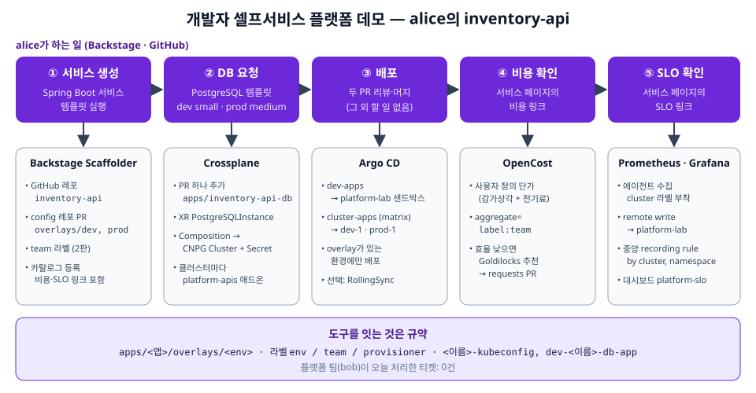
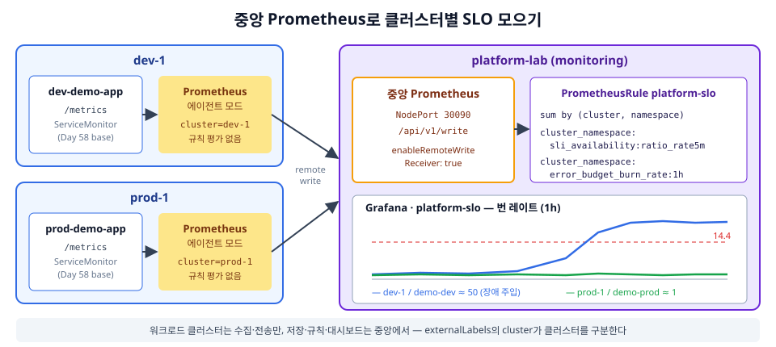
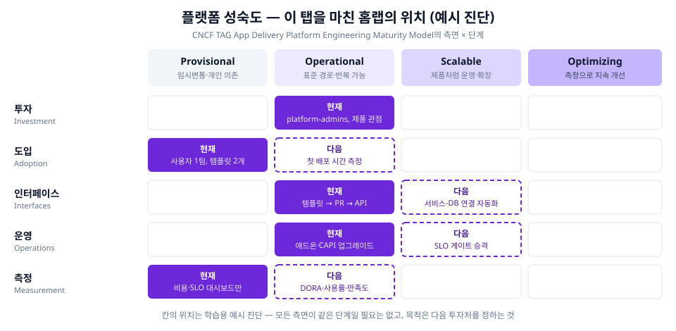

> **플랫폼 엔지니어링** | 난이도 ★★★★☆ | 예상 소요 3 ~ 4시간

> 💡 **플랫폼 01 고정값 기준**으로 진행합니다. 관리 클러스터 kind `platform-lab`(Argo CD v3.6.2·Backstage 1.57·Crossplane v2.4.3), 플랫폼 05의 워크로드 클러스터 `dev-1`·`prod-1`, 플랫폼 06의 클러스터 Secret(`env=dev/prod`)과 `cluster-addons`, 플랫폼 07의 kube-prometheus-stack `monitoring`·OpenCost를 그대로 씁니다. 전부 내 PC의 Docker 안이라 **클라우드 비용은 0원**입니다.

## 🎯 오늘의 목표

- 개발자 한 명의 시선으로 **서비스 생성 → DB 요청 → dev·prod 클러스터 배포 → 비용 확인 → SLO 대시보드**를 끊김 없이 따라간다
- 플랫폼 03의 골든 패스를 **prod overlay·`team` 라벨**까지 넣은 2판으로 올리고, 플랫폼 04가 예고한 **"DB 요청" Backstage 템플릿**을 만든다
- ApplicationSet **matrix(클러스터 × Git 디렉터리)** 로 "overlay가 있는 환경에만 배포"를 구현한다
- 워크로드 클러스터 메트릭을 중앙 Prometheus로 모아 **클러스터별 SLO**를 본다
- **플랫폼 성숙도 자가 점검표**로 현재 위치를 진단하고 탭 전체를 회고한다

---

## 1. 지금까지 만든 것

| 편 | 만든 것 | 오늘의 역할 |
|---|---|---|
| 01 | `platform-lab`, Argo CD, ApplicationSet `dev-apps`, 실습 고정값 | 허브·dev 샌드박스 |
| 02 | Backstage, `platform-catalog`, 조직(`team-a-devs`) | 개발자 포털 |
| 03 | 템플릿 `spring-boot-service`, 예시 서비스 `orders-api` | ① 서비스 생성 |
| 04 | Crossplane `PostgreSQLInstance` API (CNPG) | ② DB 요청 |
| 05 | Cluster API로 `dev-1`, `prod-1` | 배포 대상 클러스터 |
| 06 | 클러스터 Secret 라벨, `cluster-addons`, cluster·matrix generator, RollingSync | ③ 멀티 클러스터 배포 |
| 07 | OpenCost(사용자 정의 단가), Goldilocks | ④ 비용 확인 |
| Ch8 Day 58 | SLI 메트릭·recording rule·SLO 99.9% | ⑤ SLO 대시보드 |

---

## 2. 데모 시나리오 한눈에



**등장인물**: `team-a-devs`의 alice(Day 73 Keycloak 사용자). 새 서비스 **`inventory-api`** 가 필요합니다. 플랫폼 팀(bob, `platform-admins`)은 오늘 **아무 티켓도 처리하지 않습니다.**

| 단계 | alice가 하는 일 | 뒤에서 일하는 것 |
|---|---|---|
| ① | Backstage에서 "Spring Boot 서비스" 템플릿 실행 | Scaffolder → GitHub 레포 + `gitops-demo-config` PR + 카탈로그 등록 |
| ② | Backstage에서 "PostgreSQL 데이터베이스" 템플릿 실행 | PR로 `apps/inventory-api-db/overlays/{dev,prod}` 추가 → Crossplane XR |
| ③ | 두 PR 머지 | ApplicationSet이 `platform-lab`(샌드박스)·`dev-1`·`prod-1`에 Application 생성 |
| ④ | 서비스 페이지의 비용 링크 클릭 | OpenCost가 `team=team-a-devs` 라벨로 집계 |
| ⑤ | 서비스 페이지의 SLO 링크 클릭 | 워크로드 클러스터 Prometheus 에이전트 → 중앙 Prometheus → Grafana |

---

## 3. 실습 준비 — 상태 점검

```bash
kubectl config use-context kind-platform-lab
kubectl -n argocd get applicationset
# NAME             AGE
# cluster-addons   ...      (플랫폼 06)
# demo-app         ...      (플랫폼 06 — 오늘 6장에서 cluster-apps로 교체)
# dev-apps         ...      (플랫폼 01)
kubectl -n argocd get secret -l argocd.argoproj.io/secret-type=cluster -L env
# cluster-dev-1    dev
# cluster-prod-1   prod
kubectl -n clusters get cluster                                # dev-1, prod-1  Available True
kubectl get xrd postgresqlinstances.platform.infra.test         # 플랫폼 04
helm list -A | grep -E "monitoring|opencost|goldilocks"         # 플랫폼 07
```

> ⚠️ 오늘은 플랫폼 전체가 동시에 돕니다. Docker Desktop 메모리를 **12GB 이상** 권장합니다. 부족하면 `infra-lab`을 `docker stop`으로 끄고, `prod-1`의 워커를 1개로 줄이세요(플랫폼 05 7장). 7장의 "워크로드 클러스터에 DB API 설치"는 가장 무거운 단계이니 자원이 모자라면 `prod-1`에만 적용합니다.

---

## 4. ① Backstage 템플릿으로 서비스 생성 — 골든 패스 2판

플랫폼 03의 템플릿은 dev overlay만 만들었습니다. 멀티 클러스터·비용·SLO를 위해 **세 가지**를 추가해 `platform-catalog`에 커밋합니다. 템플릿을 고치는 일은 플랫폼 팀의 일이고, 이후 만들어지는 **모든** 서비스가 혜택을 받습니다.

### 4-1. `team` 라벨 — 비용 배분 키 (플랫폼 07)

```yaml
# templates/spring-boot-service/template.yaml — fetch-service와 fetch-gitops 두 단계의 values에 같은 한 줄 추가
    - id: fetch-gitops
      name: 배포 설정 생성
      action: fetch:template
      input:
        url: ./gitops
        targetPath: ./gitops
        values:
          name: ${{ parameters.name }}
          team: ${{ (parameters.owner | parseEntityRef).name }}   # group:default/team-a-devs → team-a-devs
          repoOwner: ${{ (parameters.repoUrl | parseRepoUrl).owner }}
          repoName: ${{ (parameters.repoUrl | parseRepoUrl).repo }}
```

```yaml
# templates/spring-boot-service/gitops/base/kustomization.yaml
labels:
- pairs:
    app.kubernetes.io/part-of: gitops-demo
    team: ${{ values.team }}            # ← 추가 (Pod 템플릿까지)
  includeTemplates: true
```

> 💡 `parseEntityRef`는 Scaffolder 내장 필터로, `OwnerPicker`가 돌려주는 엔터티 참조에서 이름만 꺼냅니다. 라벨 값에는 `:`와 `/`를 쓸 수 없으므로 꼭 필요합니다.

### 4-2. prod overlay — 멀티 클러스터 배포 대상 (플랫폼 06)

```yaml
# templates/spring-boot-service/gitops/overlays/prod/kustomization.yaml  (새 파일)
apiVersion: kustomize.config.k8s.io/v1beta1
kind: Kustomization
namespace: demo-prod
namePrefix: prod-
resources:
- ../../base
labels:
- pairs:
    environment: prod
  includeTemplates: true
replicas:
- name: ${{ values.name }}
  count: 2
images:
- name: ${{ values.name }}
  newName: ghcr.io/${{ values.repoOwner | lower }}/${{ values.repoName | lower }}
  newTag: "0.1.0"
```

prod에는 HTTPRoute를 넣지 않습니다(`prod-1`에 Traefik이 없음, 플랫폼 06 6장).

### 4-3. 카탈로그 링크 — 비용·SLO로 가는 길 (플랫폼 07 8장)

```yaml
# templates/spring-boot-service/skeleton/catalog-info.yaml — metadata에 추가
  labels:
    team: ${{ values.team }}            # 4-1에서 fetch-service에도 넘긴 값
  links:
    - url: https://github.com/${{ values.repoOwner }}/gitops-demo-config/tree/main/apps/${{ values.name }}
      title: 배포 설정 (gitops-demo-config)
    - url: http://localhost:9090/allocation?window=7d&agg=label:team
      title: 비용 (OpenCost)
    - url: http://localhost:3000/d/platform-slo
      title: SLO 대시보드 (Grafana)
```

> ⚠️ 링크의 `localhost` 주소는 port-forward 기준 예시입니다. 플랫폼 01의 Traefik Gateway(`*.localhost:31080`)로 OpenCost·Grafana를 노출했다면 그 주소를 쓰세요.

### 4-4. alice의 실행

```bash
cd ~/platform-lab/platform-catalog
git add templates/spring-boot-service && git commit -m "feat(template): prod overlay, team 라벨, 비용·SLO 링크" && git push
```

Backstage(`http://backstage.localhost:31080`) → **Create** → "Spring Boot 서비스" → 이름 `inventory-api`, 소유 팀 `team-a-devs`, 레포 `<user>/inventory-api` → **Create**. 결과는 플랫폼 03과 같고, PR에 `overlays/prod`가 하나 더 들어 있습니다. 플랫폼 03 8장처럼 `v0.1.0` 태그 → CI → GHCR Public까지 마친 뒤 **PR은 아직 머지하지 않습니다**(6장에서 머지).

```bash
gh pr view add-inventory-api -R $GH_USER/gitops-demo-config --json files -q '.files[].path'
# apps/inventory-api/base/deployment.yaml
# apps/inventory-api/base/kustomization.yaml
# apps/inventory-api/base/service.yaml
# apps/inventory-api/overlays/dev/httproute.yaml
# apps/inventory-api/overlays/dev/kustomization.yaml
# apps/inventory-api/overlays/prod/kustomization.yaml     ← 2판에서 추가
```

---

## 5. ② "PostgreSQL 데이터베이스" 템플릿 — DB 요청도 버튼으로

플랫폼 04에서 개발자는 `PostgreSQLInstance` YAML을 직접 썼습니다. 오늘은 그 YAML을 Backstage가 만들어 PR로 올립니다.

### 5-1. DB를 "앱 디렉터리 하나"로 두는 이유

`apps/inventory-api/overlays/dev/kustomization.yaml`에 `database.yaml`을 추가하려면 **기존 파일을 수정**해야 하는데, Scaffolder의 PR 액션은 파일을 덮어쓰는 방식이라 개발자가 손댄 내용을 지울 수 있습니다. 그래서 DB를 별도 디렉터리 `apps/<서비스>-db/overlays/{dev,prod}`로 만듭니다.

| 장점 | 설명 |
|---|---|
| 기존 파일 수정 없음 | PR이 새 파일만 추가 → 충돌·덮어쓰기 걱정 없음 |
| 배포 규약 재사용 | `dev-apps`(`apps/*/overlays/dev`)와 6장의 `cluster-apps`가 **자동으로** 집어 감 |
| 수명 주기 분리 | 앱을 다시 배포해도 DB Application은 영향 없음. DB 삭제는 별도 PR로 신중하게 |

### 5-2. 템플릿

```
platform-catalog/templates/postgres-database/
├── template.yaml
└── content/overlays/
    ├── dev/{kustomization.yaml, database.yaml}
    └── prod/{kustomization.yaml, database.yaml}
```

```yaml
# templates/postgres-database/template.yaml
apiVersion: scaffolder.backstage.io/v1beta3
kind: Template
metadata:
  name: postgres-database
  title: PostgreSQL 데이터베이스 (Crossplane)
  description: 서비스용 PostgreSQLInstance를 dev·prod에 요청하는 PR을 gitops-demo-config에 엽니다.
  tags: [database, crossplane, recommended]
spec:
  owner: group:platform-admins
  type: resource
  parameters:
    - title: 어떤 서비스의 DB인가요?
      required: [service, configRepoOwner]
      properties:
        service:
          title: 서비스
          type: string
          ui:field: EntityPicker
          ui:options:
            catalogFilter:
              kind: Component
              spec.type: service
        configRepoOwner:
          title: gitops-demo-config 소유자 (GitHub 사용자)
          type: string
    - title: 크기
      properties:
        devSize:
          title: dev 크기
          type: string
          enum: [small, medium]          # 플랫폼 04 XRD의 enum과 같아야 함
          default: small
        prodSize:
          title: prod 크기
          type: string
          enum: [small, medium]
          default: medium
  steps:
    - id: fetch
      name: DB 요청 매니페스트 생성
      action: fetch:template
      input:
        url: ./content
        targetPath: ./db
        values:
          name: ${{ (parameters.service | parseEntityRef).name }}-db
          databaseName: ${{ (parameters.service | parseEntityRef).name | replace('-', '_') }}
          devSize: ${{ parameters.devSize }}
          prodSize: ${{ parameters.prodSize }}
    - id: pr
      name: gitops-demo-config에 PR
      action: publish:github:pull-request
      input:
        repoUrl: github.com?owner=${{ parameters.configRepoOwner }}&repo=gitops-demo-config
        branchName: add-${{ (parameters.service | parseEntityRef).name }}-db
        title: 'feat(${{ (parameters.service | parseEntityRef).name }}): PostgreSQL 요청'
        description: Backstage 템플릿 postgres-database가 생성한 PR입니다.
        sourcePath: ./db
        targetPath: apps/${{ (parameters.service | parseEntityRef).name }}-db
  output:
    links:
      - title: DB 요청 PR
        url: ${{ steps['pr'].output.remoteUrl }}
```

```yaml
# content/overlays/dev/database.yaml
apiVersion: platform.infra.test/v1alpha1
kind: PostgreSQLInstance
metadata:
  name: ${{ values.name }}             # namePrefix로 dev-inventory-api-db가 됨
spec:
  size: ${{ values.devSize }}
  databaseName: ${{ values.databaseName }}
```

```yaml
# content/overlays/dev/kustomization.yaml   (prod는 demo-prod / prod- / prodSize)
apiVersion: kustomize.config.k8s.io/v1beta1
kind: Kustomization
namespace: demo-dev
namePrefix: dev-
resources:
- database.yaml
```

> 💡 `databaseName`에서 하이픈을 밑줄로 바꾼 것은 PostgreSQL 식별자 규칙 때문입니다. `size`의 선택지를 XRD의 `enum`과 똑같이 둔 것도 중요합니다 — **포털의 폼과 플랫폼 API의 스키마가 어긋나면** 개발자는 PR 머지 후에야 오류를 봅니다. 규모가 커지면 XRD 스키마에서 폼을 생성하는 방식을 검토합니다.

`platform-catalog/all.yaml`의 `targets`에 `./templates/postgres-database/template.yaml`을 추가해 push하면 Create 화면에 나타납니다. alice는 서비스 `inventory-api`, dev `small`, prod `medium`을 고르고 실행합니다.

```
✔ DB 요청 매니페스트 생성
✔ gitops-demo-config에 PR   → https://github.com/<user>/gitops-demo-config/pull/9
```

> ⚠️ 서비스 코드가 DB에 붙으려면 Deployment에 `dev-inventory-api-db-app` Secret(플랫폼 04 9장의 접두사 주의)을 `envFrom`/`secretKeyRef`로 연결해야 합니다. 이 연결까지 템플릿이 해 주는 것은 성숙도 점검표의 다음 단계 과제로 남깁니다(9장).

---

## 6. ③ ApplicationSet으로 dev·prod 클러스터에 배포

### 6-1. 워크로드 클러스터에 "플랫폼 API" 깔기

`inventory-api-db`의 `PostgreSQLInstance`가 `dev-1`·`prod-1`에서도 동작하려면 그 클러스터에 **Crossplane + CNPG 오퍼레이터 + XRD/Composition**이 있어야 합니다. 플랫폼 06의 애드온 패턴을 그대로 씁니다.

```
gitops-demo-config/platform/crossplane-apis/     # 플랫폼 04 파일을 복사 (provider-helm 관련 제외)
├── kustomization.yaml       # resources: 아래 3개
├── function-and-rbac.yaml   # function-go-templating v0.13.2 + cnpg:aggregate-to-crossplane
├── xrd-postgresqlinstance.yaml
└── composition-cnpg.yaml
```

```yaml
# platform/appset-platform-apis.yaml
apiVersion: argoproj.io/v1alpha1
kind: ApplicationSet
metadata:
  name: platform-apis
  namespace: argocd
spec:
  goTemplate: true
  goTemplateOptions: ["missingkey=error"]
  generators:
  - matrix:
      generators:
      - list:
          elements:
          - component: crossplane
            repoURL: https://charts.crossplane.io/stable
            chart: crossplane
            revision: 2.4.3
            namespace: crossplane-system
          - component: cnpg
            repoURL: https://cloudnative-pg.github.io/charts
            chart: cloudnative-pg
            revision: 0.29.2              # 오퍼레이터 1.30.2 (플랫폼 04와 동일)
            namespace: cnpg-system
      - clusters:
          selector:
            matchLabels:
              provisioner: cluster-api
  template:
    metadata:
      name: '{{.component}}-{{.name}}'
      labels: {role: platform-api}
    spec:
      project: default
      source:
        repoURL: '{{.repoURL}}'
        chart: '{{.chart}}'
        targetRevision: '{{.revision}}'
      destination:
        server: '{{.server}}'
        namespace: '{{.namespace}}'
      syncPolicy:
        automated: {prune: false, selfHeal: true}
        syncOptions: [CreateNamespace=true, ServerSideApply=true]
---
apiVersion: argoproj.io/v1alpha1
kind: ApplicationSet
metadata:
  name: platform-api-defs
  namespace: argocd
spec:
  goTemplate: true
  goTemplateOptions: ["missingkey=error"]
  generators:
  - clusters:
      selector:
        matchLabels:
          provisioner: cluster-api
  template:
    metadata:
      name: 'crossplane-apis-{{.name}}'
      labels: {role: platform-api}
    spec:
      project: default
      source:
        repoURL: https://github.com/<user>/gitops-demo-config.git
        targetRevision: main
        path: platform/crossplane-apis
      destination:
        server: '{{.server}}'
      syncPolicy:
        automated: {prune: false, selfHeal: true}
        retry:                               # Crossplane CRD가 먼저 생길 때까지 재시도
          limit: 10
          backoff: {duration: 30s, factor: 2, maxDuration: 5m}
```

```bash
cd ~/platform-lab/gitops-demo-config
git add platform/ && git commit -m "feat(platform): 워크로드 클러스터에 DB API 배포" && git push
kubectl apply -f platform/appset-platform-apis.yaml
argocd app list -l role=platform-api
# crossplane-dev-1, crossplane-prod-1, cnpg-dev-1, cnpg-prod-1,
# crossplane-apis-dev-1, crossplane-apis-prod-1   → 모두 Synced/Healthy (수 분 소요)
```

> 💡 이것이 플랫폼 팀이 말하는 **"플랫폼 API를 배포한다"** 입니다. 개발자가 쓰는 `PostgreSQLInstance`라는 계약은 그대로이고, 그 계약을 구현하는 부품(Crossplane, CNPG, Composition)을 클러스터마다 깔아 줍니다. prod용으로 AWS RDS Composition을 쓰는 클러스터라면 이 목록의 구성만 바뀝니다(플랫폼 04 개념).

### 6-2. `cluster-apps` — overlay가 있는 환경에만 배포

플랫폼 06의 `demo-app` ApplicationSet은 demo-app 하나만 다뤘습니다. 이제 **모든 앱**을 다루되, 앱에 해당 환경 overlay가 **있을 때만** 배포합니다. matrix 안에서 **앞 생성기(clusters)의 값으로 뒤 생성기(git)의 경로를 만드는** 기능을 씁니다(소비하는 생성기가 뒤에 와야 함).

```yaml
# platform/appset-cluster-apps.yaml
apiVersion: argoproj.io/v1alpha1
kind: ApplicationSet
metadata:
  name: cluster-apps
  namespace: argocd
spec:
  goTemplate: true
  goTemplateOptions: ["missingkey=error"]
  generators:
  - matrix:
      generators:
      - clusters:                                   # ① 클러스터와 env 라벨
          selector:
            matchExpressions:
            - {key: env, operator: In, values: [dev, prod]}
      - git:                                        # ② 그 env의 overlay가 있는 앱만
          repoURL: https://github.com/<user>/gitops-demo-config.git
          revision: main
          directories:
          - path: 'apps/*/overlays/{{.metadata.labels.env}}'
  template:
    metadata:
      name: '{{index .path.segments 1}}-{{.name}}'  # inventory-api-dev-1, inventory-api-db-prod-1 …
      labels:
        env: '{{.metadata.labels.env}}'
        app: '{{index .path.segments 1}}'
    spec:
      project: default
      source:
        repoURL: https://github.com/<user>/gitops-demo-config.git
        targetRevision: main
        path: '{{.path.path}}'
      destination:
        server: '{{.server}}'
        namespace: 'demo-{{.metadata.labels.env}}'
      syncPolicy:
        automated: {prune: true, selfHeal: true}
        syncOptions: [CreateNamespace=true]
        retry:
          limit: 5
          backoff: {duration: 20s, factor: 2, maxDuration: 5m}
```

플랫폼 06의 `demo-app` ApplicationSet은 같은 이름(`demo-app-dev-1` 등)의 Application을 만들므로 먼저 지웁니다. 템플릿에 `resources-finalizer`가 없었으므로 **Application만 지워지고 클러스터의 리소스는 남으며**, `cluster-apps`가 같은 이름으로 다시 만들어 그대로 관리를 이어받습니다.

```bash
kubectl -n argocd delete applicationset demo-app
kubectl apply -f platform/appset-cluster-apps.yaml
```

### 6-3. PR 머지 → 세 곳에 배포

alice가 두 PR(`add-inventory-api`, `add-inventory-api-db`)을 머지합니다.

```bash
argocd app list | grep inventory
# argocd/inventory-api-dev        in-cluster                demo-dev   Synced  Healthy   ← dev-apps (샌드박스)
# argocd/inventory-api-db-dev         in-cluster                demo-dev   Synced  Healthy
# argocd/inventory-api-dev-1      https://172.18.0.7:6443   demo-dev   Synced  Healthy   ← cluster-apps
# argocd/inventory-api-db-dev-1       https://172.18.0.7:6443   demo-dev   Synced  Healthy
# argocd/inventory-api-prod-1     https://172.18.0.10:6443  demo-prod  Synced  Healthy
# argocd/inventory-api-db-prod-1      https://172.18.0.10:6443  demo-prod  Synced  Healthy

kubectl --kubeconfig ~/platform-lab/kubeconfigs/prod-1.kubeconfig -n demo-prod get postgresqlinstance,deploy
# postgresqlinstance.platform.infra.test/prod-inventory-api-db   True   True   postgresqlinstance-cnpg
# deployment.apps/prod-inventory-api   2/2
```

`orders-api`(플랫폼 03)는 `overlays/prod`가 없으므로 `prod-1`에는 생기지 않습니다. **"prod overlay를 만드는 PR = prod 승격 요청"** 이라는 규약이 저절로 생긴 것입니다. 승격 순서를 강제하고 싶다면 플랫폼 06 8장의 RollingSync(`env` 라벨로 dev → prod 단계)를 `cluster-apps`에 그대로 붙이면 됩니다.

---

## 7. ④ OpenCost로 비용 확인

플랫폼 07의 OpenCost는 `platform-lab`에 있으므로 샌드박스(`demo-dev`)의 비용부터 봅니다.

```bash
kubectl -n opencost port-forward deployment/opencost 9003 9090 &
curl -s "http://localhost:9003/allocation?window=1d&aggregate=label:team" \
  | jq -r '.data[0] | to_entries[] | [.key, (.value.totalCost*100|round/100), (.value.totalEfficiency*100|round)] | @tsv' | column -t
```

```
team-a-devs       7.84   12     ← inventory-api (4-1의 team 라벨 덕분)
payments          11.58  9      ← 플랫폼 07의 cost-lab
discovery         1.65   97
__unallocated__   58.20  ...    ← 플랫폼 컴포넌트, orders-api(1판 템플릿), CNPG Pod
```

| 관찰 | 다음 행동 |
|---|---|
| `inventory-api`는 `team-a-devs`로 잡힘 | 골든 패스 2판의 효과. 1판으로 만든 `orders-api`는 라벨 보강 PR 필요 |
| CNPG Pod(`dev-inventory-api-db-1`)는 `__unallocated__` | Composition에서 CNPG `Cluster`의 `spec.inheritedMetadata.labels`로 `team`을 전달하도록 개선(XR에 owner 필드 추가) |
| JVM 서비스의 효율이 낮음 | Goldilocks 추천(플랫폼 07 7장) 확인 후 `base`의 requests 조정 PR |

`dev-1`·`prod-1`의 비용은 플랫폼 07 6-4처럼 OpenCost를 `cluster-addons`에 추가하고 `defaultClusterId: '{{.name}}'`로 구분하면 같은 방식으로 볼 수 있습니다. 다음 장에서 만드는 "에이전트 → 중앙 Prometheus" 경로가 그 기반이 됩니다.

---

## 8. ⑤ SLO 대시보드 — 클러스터별 SLI를 한곳에

Day 58의 SLI 메트릭(`http_requests_total`, `http_request_duration_seconds`)과 ServiceMonitor는 demo-app의 `base`에 있어 `dev-1`·`prod-1`에도 이미 배포되어 있습니다(CRD는 플랫폼 06의 애드온). 빠진 것은 **수집기**와 **중앙 저장소**입니다.



### 8-1. 중앙 Prometheus가 remote write를 받게

```yaml
# ~/platform-lab/monitoring-values.yaml 에 추가 (Day 17 values + 아래)
prometheus:
  service:
    type: NodePort
    nodePort: 30090                     # 워크로드 클러스터가 Docker 네트워크 kind로 접근
  prometheusSpec:
    enableRemoteWriteReceiver: true     # /api/v1/write 수신
```

```bash
helm upgrade monitoring prometheus-community/kube-prometheus-stack -n monitoring -f ~/platform-lab/monitoring-values.yaml
docker inspect -f '{{.NetworkSettings.Networks.kind.IPAddress}}' platform-lab-worker
# 172.18.0.3   ← 워크로드 클러스터에서 볼 platform-lab 주소
```

### 8-2. 워크로드 클러스터에 Prometheus 에이전트

```yaml
# platform/appset-monitoring-agent.yaml
apiVersion: argoproj.io/v1alpha1
kind: ApplicationSet
metadata:
  name: monitoring-agent
  namespace: argocd
spec:
  goTemplate: true
  goTemplateOptions: ["missingkey=error"]
  generators:
  - clusters:
      selector:
        matchLabels: {provisioner: cluster-api}
  template:
    metadata:
      name: 'monitoring-agent-{{.name}}'
      labels: {role: addon}
    spec:
      project: default
      source:
        repoURL: https://prometheus-community.github.io/helm-charts
        chart: kube-prometheus-stack
        targetRevision: 93.4.1
        helm:
          releaseName: monitoring           # ServiceMonitor의 release: monitoring 라벨과 맞춤 (Day 17·58)
          skipCrds: true                    # CRD는 플랫폼 06의 prometheus-operator-crds가 관리
          valuesObject:
            prometheus:
              agentMode: true               # 저장·규칙 평가 없이 수집 후 전송만
              prometheusSpec:
                externalLabels:
                  cluster: '{{.name}}'      # ← 중앙에서 클러스터 구분
                remoteWrite:
                - url: http://172.18.0.3:30090/api/v1/write
            grafana: {enabled: false}
            alertmanager: {enabled: false}
            kubeControllerManager: {enabled: false}
            kubeScheduler: {enabled: false}
            kubeEtcd: {enabled: false}
            kubeProxy: {enabled: false}
            prometheus-node-exporter:
              hostRootFsMount: {enabled: false}   # Docker Desktop 마운트 전파 문제 (Day 17 트러블슈팅)
      destination:
        server: '{{.server}}'
        namespace: monitoring
      syncPolicy:
        automated: {prune: true, selfHeal: true}
        syncOptions: [CreateNamespace=true, ServerSideApply=true]
```

> ⚠️ `172.18.0.3`은 예시입니다. 위 `docker inspect` 결과로 바꾸세요. kind 노드 IP는 Docker를 재시작하면 바뀔 수 있으니, 실제 운영이라면 고정 주소(LB·DNS)를 씁니다. 에이전트 모드에서는 **규칙 평가·알림이 동작하지 않으므로** 워크로드 클러스터에 배포된 Day 58의 PrometheusRule은 쓰이지 않습니다. 규칙은 중앙에서 평가합니다.

### 8-3. 중앙 recording rule — `cluster` 차원 추가

Day 58의 규칙은 `sum by (namespace)`였습니다. 클러스터가 여럿이면 `cluster`를 더합니다.

```yaml
# ~/platform-lab/platform-slo-rules.yaml  (platform-lab의 monitoring 네임스페이스)
apiVersion: monitoring.coreos.com/v1
kind: PrometheusRule
metadata:
  name: platform-slo
  namespace: monitoring
  labels:
    release: monitoring
spec:
  groups:
  - name: platform.sli
    interval: 30s
    rules:
    - record: cluster_namespace:http_requests_errors:ratio_rate5m
      expr: |
        sum by (cluster, namespace) (rate(http_requests_total{cluster!="", route!="/healthz", code=~"5.."}[5m]))
        /
        sum by (cluster, namespace) (rate(http_requests_total{cluster!="", route!="/healthz"}[5m]))
    - record: cluster_namespace:sli_availability:ratio_rate5m
      expr: 1 - cluster_namespace:http_requests_errors:ratio_rate5m
    - record: cluster_namespace:error_budget_burn_rate:1h
      expr: |
        (
          sum by (cluster, namespace) (rate(http_requests_total{cluster!="", route!="/healthz", code=~"5.."}[1h]))
          /
          sum by (cluster, namespace) (rate(http_requests_total{cluster!="", route!="/healthz"}[1h]))
        ) / 0.001
      labels:
        slo: availability-99.9
```

```bash
kubectl apply -f ~/platform-lab/platform-slo-rules.yaml
# Day 58 7-1의 loadgen을 dev-1·prod-1의 demo-app에 각각 띄운 뒤
```

Grafana(`kubectl -n monitoring port-forward svc/monitoring-grafana 3000:80`)에서 대시보드 `platform-slo`를 만들고 두 패널을 둡니다.

| 패널 | 쿼리 | 범례 |
|---|---|---|
| 가용성 SLI | `cluster_namespace:sli_availability:ratio_rate5m` | `{{cluster}} / {{namespace}}` |
| 번 레이트(1h) | `cluster_namespace:error_budget_burn_rate:1h` | 임계선 14.4(빠른 소진, Day 62) |

`dev-1`에서 Day 58의 `error_rate=0.05` 장애를 내면 `dev-1 / demo-dev`의 번 레이트만 50 근처로 오르고 `prod-1 / demo-prod`는 그대로입니다. 플랫폼 06의 RollingSync가 "dev가 Healthy여야 prod"를 Health로 판단했다면, 다음 단계는 이 **SLO 숫자로 승격을 막는 것**입니다(Day 63의 Canary 분석과 같은 아이디어).

> 💡 `inventory-api` 같은 Spring Boot 서비스는 Micrometer의 `http_server_requests_seconds_*`를 노출합니다(`micrometer-registry-prometheus` 의존성과 `/actuator/prometheus` 필요). SLI 메트릭 이름이 서비스마다 다르면 플랫폼 대시보드가 깨지므로, **템플릿에서 메트릭·ServiceMonitor까지 표준화**하는 것이 다음 골든 패스 과제입니다.

---

## 9. 플랫폼 성숙도 자가 점검표



CNCF TAG App Delivery의 **Platform Engineering Maturity Model**은 플랫폼을 다섯 측면(투자, 도입, 인터페이스, 운영, 측정)과 네 단계(**Provisional → Operational → Scalable → Optimizing**)로 봅니다. 아래 표는 이 모델의 측면을 이 탭의 실습에 맞춰 풀어 쓴 **자가 점검용 질문**입니다(모델 원문의 문장이 아닙니다).

| 측면 | 질문 | 이 탭에서 한 것 | 다음 단계 |
|---|---|---|---|
| **투자** (Investment) | 플랫폼을 맡는 팀과 로드맵이 있나? | `platform-admins` 그룹, 플랫폼을 제품으로(플랫폼 01) | 분기 로드맵, 플랫폼 백로그 공개 |
| **도입** (Adoption) | 개발자가 스스로 쓰고 싶어 하나? | 골든 패스 2개(서비스, DB) | 첫 배포까지 걸린 시간 측정, 사용자 인터뷰 |
| **인터페이스** (Interfaces) | 셀프서비스 수단이 일관적인가? | Backstage 템플릿 → Git PR → API(XRD, ClusterClass) | 서비스-DB 연결 자동화, XRD 스키마 → 폼 생성 |
| **운영** (Operations) | 플랫폼 부품을 중앙에서 운영·업그레이드하나? | ApplicationSet 애드온, CAPI 업그레이드 | 애드온 버전 매트릭스, RollingSync + SLO 게이트 |
| **측정** (Measurement) | 성과를 숫자로 보나? | OpenCost(팀 비용), SLO 대시보드 | DORA 지표, 템플릿 사용률, 개발자 만족도 |

### 9-1. 체크리스트 (예 = 1점)

| # | 항목 | 관련 편 |
|---|---|---|
| 1 | 새 서비스를 **티켓 없이** 30분 안에 dev에 배포할 수 있다 | 03 |
| 2 | 모든 서비스가 카탈로그에 **소유 팀**과 함께 등록되어 있다 | 02 |
| 3 | DB 같은 인프라를 **추상 API**로 요청하고, 구현은 플랫폼 팀이 바꿀 수 있다 | 04 |
| 4 | 새 클러스터를 선언형으로 만들고 **업그레이드도 선언형**이다 | 05 |
| 5 | 새 클러스터에 애드온·앱이 **자동으로** 깔린다 | 06 |
| 6 | prod 승격이 PR 또는 단계적 동기화로 **통제**된다 | 06 |
| 7 | 팀별 비용을 **팀이 직접** 볼 수 있다 | 07 |
| 8 | requests rightsizing을 **정기적으로** 검토한다 | 07 |
| 9 | 서비스마다 SLO가 있고 **클러스터별로** 볼 수 있다 | 08, Day 58 |
| 10 | 포털·Argo CD·Grafana에 **SSO**로 로그인하고 권한이 팀 단위다 | Day 73 |
| 11 | 시크릿이 Git에 평문으로 없다 | Day 55 |
| 12 | 플랫폼 자체의 **사용률·만족도**를 측정한다 | — |

| 점수 | 대략의 위치 |
|---|---|
| 0~3 | Provisional — 도구는 있지만 개인의 노력에 의존 |
| 4~7 | Operational — 표준 경로가 있고 반복 가능 (이 탭을 끝낸 홈랩의 위치) |
| 8~10 | Scalable — 여러 팀이 셀프서비스로 쓰고 플랫폼이 제품처럼 운영됨 |
| 11~12 | Optimizing — 측정으로 플랫폼을 계속 개선 |

> ⚠️ 점수 구간은 학습용으로 만든 **임의 기준**입니다. 성숙도 모델의 목적은 점수가 아니라 "다음에 무엇에 투자할지"를 정하는 대화입니다. 모든 측면이 같은 단계일 필요도 없습니다.

---

## 10. 탭 회고 — 플랫폼 엔지니어링

| 편 | 한 줄 요약 | 가장 중요한 개념 |
|---|---|---|
| 01 | 플랫폼은 내부 개발자를 고객으로 둔 **제품** | 골든 패스, 팀 토폴로지, 인지 부하 |
| 02 | 무엇이 있고 누가 주인인지 — **카탈로그** | 엔터티, 소유권, Location |
| 03 | 버튼 하나로 레포·배포 설정·카탈로그 | Software Template, PR 기반 셀프서비스 |
| 04 | 인프라를 **추상 API**로 | XRD(계약)와 Composition(구현)의 분리 |
| 05 | 클러스터도 리소스 | 관리/워크로드 클러스터, ClusterClass, 노드 교체 업그레이드 |
| 06 | 클러스터 라벨이 곧 배포 정책 | cluster·matrix generator, 애드온, RollingSync |
| 07 | 비용도 엔지니어링 지표 | showback, 사용자 정의 단가, requests rightsizing |
| 08 | 다섯 단계를 하나의 흐름으로 | 규약(디렉터리·라벨·이름)이 도구를 잇는다 |

### 10-1. 돌아보며 — 도구보다 규약

이 탭에서 가장 많이 한 일은 도구 설치가 아니라 **규약 정하기**였습니다. `apps/<앱>/overlays/<env>` 디렉터리, `env`·`team`·`provisioner` 라벨, `<이름>-kubeconfig`·`dev-<이름>-db-app` 같은 이름 규칙. Backstage·Crossplane·Cluster API·Argo CD·OpenCost는 서로를 직접 알지 못합니다. **같은 규약을 읽기 때문에** 하나의 플랫폼처럼 동작합니다. 규약이 흔들리면(라벨 누락, 이름 불일치) 비용은 `__unallocated__`로, 배포는 `missingkey` 오류로 곧바로 드러납니다.

### 10-2. 일부러 다루지 않은 것

| 주제 | 이유 / 참고 |
|---|---|
| 멀티 테넌시 강화(vCluster, 계층 네임스페이스) | 팀이 많아지면 필요. Day 19 RBAC의 확장 |
| 시크릿 공급(External Secrets로 DB 자격 증명 전달) | Day 55 방식으로 서비스-DB 연결 자동화 가능 |
| 포털 SSO와 권한 | Day 73 Keycloak을 Backstage·Argo CD에 연결 |
| 플랫폼 지표(DORA, 개발자 만족도) | 측정 측면의 다음 단계 |

---

## 11. 정리 — 실습 자원 내리기

탭을 마쳤다면 무거운 것부터 내립니다. **순서가 중요합니다**(Argo CD가 지운 클러스터에 계속 접속을 시도하지 않도록).

```bash
kubectl config use-context kind-platform-lab
# 1) 워크로드 클러스터 대상 ApplicationSet 제거 (리소스는 클러스터와 함께 사라지므로 preserve 불필요)
kubectl -n argocd delete applicationset cluster-apps platform-apis platform-api-defs monitoring-agent cluster-addons
# 2) 클러스터 등록 해제 → 3) CAPI 클러스터 삭제 (Cluster 객체만!)
kubectl -n argocd delete secret -l provisioner=cluster-api
kubectl -n clusters delete cluster --all
docker ps --format '{{.Names}}' | grep -E "dev-|prod-"     # 남은 컨테이너가 없어야 함
# 4) 관리 클러스터까지 지울 때 (탭을 처음부터 다시 할 때만)
kind delete cluster --name platform-lab
```

GitHub의 `inventory-api` 레포와 GHCR 패키지는 필요 없으면 직접 삭제하세요(`gh repo delete $GH_USER/inventory-api`는 되돌릴 수 없으니 이름을 다시 확인).

---

## 12. 트러블슈팅

| 증상 | 원인 | 해결 |
|---|---|---|
| 템플릿 실행 시 `parseEntityRef` 관련 오류 | 소유자 입력이 엔터티 참조 형식이 아님 | OwnerPicker로 선택했는지 확인. 직접 입력이면 `group:default/team-a-devs` 형식 |
| DB PR 머지 후 `inventory-api-db-dev-1`이 `no matches for kind "PostgreSQLInstance"` | `crossplane-apis-dev-1`이 아직 Sync 전 | `argocd app get crossplane-apis-dev-1`, retry가 끝날 때까지 대기 |
| `crossplane-apis-*`가 계속 실패 | Crossplane CRD 설치 전 Function/XRD 적용 | `crossplane-<클러스터>` 앱이 Healthy인지 확인 후 Sync |
| XR이 `Synced=False`, `forbidden ... clusters.postgresql.cnpg.io` | 집계 ClusterRole 누락 | `function-and-rbac.yaml`이 디렉터리에 포함됐는지 확인(플랫폼 04 7-2) |
| `cluster-apps`가 prod 앱을 안 만듦 | 앱에 `overlays/prod` 없음 | 정상 동작. prod overlay를 추가하는 PR이 곧 승격 요청 |
| `demo-app-dev-1`이 두 ApplicationSet 사이에서 깜빡임 | 플랫폼 06 `demo-app`을 지우지 않음 | `kubectl -n argocd delete applicationset demo-app` |
| 중앙 Prometheus에 `cluster` 라벨 시계열이 없음 | remote write URL·NodePort 오류, 수신 기능 꺼짐 | `enableRemoteWriteReceiver`, `docker inspect`한 IP, 에이전트 Pod 로그의 `remote_write` 오류 확인 |
| 에이전트 앱이 CRD 충돌(SharedResourceWarning) | 차트가 CRD도 렌더링 | `helm.skipCrds: true` |

---

## 13. 핵심 정리

- 셀프서비스 플랫폼 = **포털(Backstage) + Git PR + 플랫폼 API(Crossplane·CAPI) + GitOps(ApplicationSet) + 관측(OpenCost·SLO)**
- 골든 패스는 한 번 만들고 끝이 아니라 **버전을 올리는 제품** — 2판에서 prod overlay·`team` 라벨·링크를 넣자 비용·배포·SLO가 이어졌다
- DB도 **앱 디렉터리 하나**로 두면 기존 배포 규약이 그대로 집어 간다
- matrix에서 앞 생성기 값으로 뒤 생성기 경로를 만들면 **"overlay가 있는 환경에만 배포"** — prod overlay PR이 곧 승격 요청
- 워크로드 클러스터는 **에이전트로 보내고, 규칙은 중앙에서** — `cluster` 라벨로 클러스터별 SLO
- 성숙도 모델은 점수가 아니라 **다음 투자처를 정하는 대화** 도구

---

## 14. 셀프 체크

<details>
<summary>Q1. DB 요청 템플릿이 서비스의 기존 overlay에 파일을 추가하지 않고 <code>apps/&lt;서비스&gt;-db/</code>를 새로 만든 이유는?</summary>

기존 `kustomization.yaml`에 리소스를 추가하려면 파일을 수정해야 하는데, Scaffolder의 PR 액션은 파일을 통째로 쓰므로 개발자가 바꾼 내용을 덮어쓸 수 있습니다. 새 디렉터리는 새 파일만 추가하므로 안전하고, `apps/*/overlays/<env>` 규약 덕분에 `dev-apps`와 `cluster-apps`가 자동으로 Application을 만들어 줍니다. DB의 수명 주기를 앱과 분리하는 효과도 있습니다.
</details>

<details>
<summary>Q2. <code>cluster-apps</code>의 matrix에서 clusters 생성기를 git 생성기보다 먼저 둔 이유는?</summary>

git 생성기의 경로 `apps/*/overlays/{{.metadata.labels.env}}`가 clusters 생성기가 만든 값을 **소비**하기 때문입니다. Argo CD 문서의 규칙대로 값을 소비하는 생성기는 값을 만드는 생성기 뒤에 와야 합니다.
</details>

<details>
<summary>Q3. 워크로드 클러스터의 Prometheus를 에이전트 모드로 두면 Day 58의 PrometheusRule은 어떻게 되나? 대신 무엇을 했나?</summary>

에이전트 모드는 수집과 전송만 하고 규칙 평가·알림을 하지 않으므로, 워크로드 클러스터에 배포된 PrometheusRule은 평가되지 않습니다. 대신 중앙(`platform-lab`) Prometheus에 `sum by (cluster, namespace)`로 바꾼 recording rule을 두고, 에이전트가 붙인 `externalLabels.cluster`로 클러스터를 구분했습니다.
</details>

<details>
<summary>Q4. OpenCost에서 CNPG Pod가 <code>__unallocated__</code>로 잡혔다. 개발자에게 라벨을 붙이라고 하는 대신 플랫폼 팀이 할 일은?</summary>

CNPG Pod는 개발자가 아니라 Composition이 만든 리소스이므로 플랫폼 팀이 고쳐야 합니다. XR에 소유 팀 정보를 받거나(네임스페이스 라벨에서 가져오기 등), Composition이 CNPG `Cluster`의 `inheritedMetadata.labels`에 `team`을 넣도록 바꿉니다. 이후 모든 DB가 자동으로 팀 비용에 포함됩니다.
</details>

<details>
<summary>Q5. 성숙도 점검표에서 "측정" 측면이 가장 낮게 나왔다. 무엇부터 시작하겠나?</summary>

이미 있는 데이터부터 씁니다. Argo CD 이력에서 배포 빈도, Git에서 PR 생성~머지 시간(변경 리드 타임), Backstage 템플릿 실행 수(사용률)를 모으고, 분기마다 짧은 개발자 설문을 합니다. 측정의 목적은 플랫폼 로드맵의 우선순위를 정하는 것이므로, 숫자 몇 개를 꾸준히 보는 것이 많은 숫자를 한 번 보는 것보다 낫습니다.
</details>

---

## ⏭️ 다음 시즌 예고

플랫폼 엔지니어링 탭은 여기까지입니다. 철학(플랫폼을 제품으로)에서 출발해 카탈로그, 골든 패스, 인프라 API, 클러스터 API, 멀티 클러스터 GitOps, 비용까지 쌓고, 오늘 개발자 한 명의 하루로 묶었습니다. 다음 시즌에 이 플랫폼을 이어서 키운다면 이런 방향이 자연스럽습니다.

- **플랫폼을 측정하는 플랫폼** — DORA 지표와 템플릿 사용률을 Backstage에 붙이고, 9장의 "측정" 측면을 Provisional에서 끌어올립니다. Day 58~65의 SRE 도구를 플랫폼 팀 자신에게 적용하는 셈입니다.
- **AI 워크로드를 위한 플랫폼** — Chapter 6의 vLLM·RAG를 골든 패스로 감싸, "모델 서빙 엔드포인트 주세요"를 Crossplane API로, GPU 노드 풀을 ClusterClass 변수로 노출합니다. 비용은 플랫폼 07의 GPU 단가로 계산합니다.
- **멀티 테넌시와 보안 심화** — Day 73 Keycloak SSO를 Backstage·Argo CD에 연결하고, 팀별 AppProject·네임스페이스 정책, External Secrets로 DB 자격 증명을 서비스에 자동 전달합니다.

어떤 방향이든 원칙은 같습니다. **개발자가 티켓 대신 버튼과 PR로 일하게 하고, 그 뒤의 규약은 플랫폼 팀이 지킨다.**
