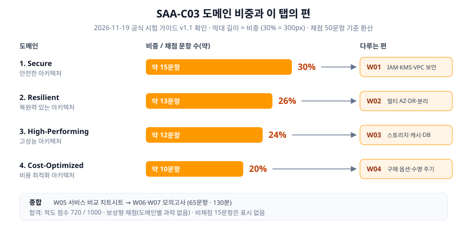
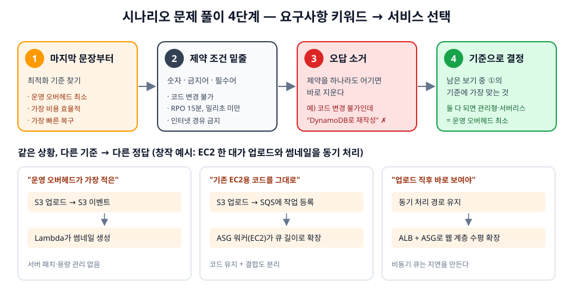
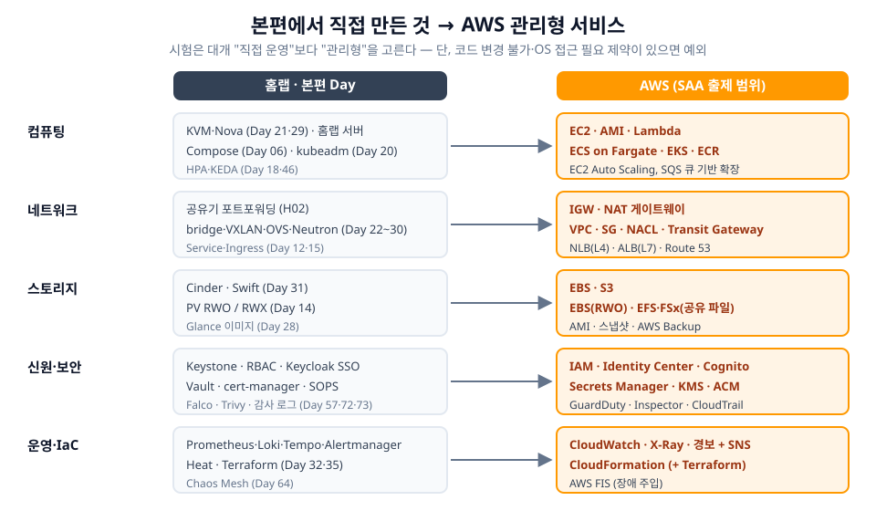

> **자격증 준비 · AWS SAA** | 난이도 ★★☆☆☆ | 예상 소요 2 ~ 3시간 (시험 가이드 정독 포함)

> ⚠️ **이 탭의 모든 문항은 AWS가 공개한 SAA-C03 공식 시험 가이드의 도메인·작업 항목(Task statement)을 바탕으로 직접 만든 창작 문항입니다.** 실제 출제 문제나 유출 문제(덤프)가 아니며, 그런 자료를 재현하지도 않습니다. AWS 자격증 응시자는 시험 내용 비공개(NDA)에 동의하고 치르므로, 실제 문제를 공유하거나 구하는 것은 정책 위반이고 자격 취소 사유입니다. 덤프 암기는 시나리오를 조금만 바꿔도 무너집니다. 이 탭은 **"요구사항을 읽고 서비스를 고르는 근육"** 을 기르는 데 집중합니다.

## 🎯 오늘의 목표

- SAA 시험이 **무엇을, 어떤 방식으로** 평가하는지 공식 시험 가이드 기준으로 설명할 수 있다
- 4개 도메인과 비중이 이 탭의 어느 편과 이어지는지 지도를 그린다
- 시나리오형 문제를 **요구사항 키워드 → 제약 조건 → 오답 소거 → 서비스 선택** 순서로 푸는 습관을 만든다
- 본편(홈랩·Docker·K8s·OpenStack·보안·SRE)에서 직접 만든 것과 **AWS 관리형 서비스**를 1:1로 대응시킬 수 있다
- 자기 상황에 맞는 6~8주 학습 계획을 세운다

---

## 1. SAA는 어떤 시험인가?

CKA·CKS·CKAD가 "명령줄로 직접 고쳐라"였다면, AWS Certified Solutions Architect – Associate(SAA)는 **"이 요구사항에 가장 맞는 설계를 골라라"** 입니다. 실습 시험이 아니라 객관식이지만, 보기 4개가 전부 그럴듯해서 **요구사항 한 단어**가 정답을 가릅니다.

2026-11-19에 AWS의 [SAA 자격증 페이지](https://aws.amazon.com/certification/certified-solutions-architect-associate/)와 공식 [시험 가이드(SAA-C03)](https://docs.aws.amazon.com/aws-certification/latest/solutions-architect-associate-03/solutions-architect-associate-03.html), [시험 가이드 개정 이력](https://docs.aws.amazon.com/aws-certification/latest/solutions-architect-associate-03/saa-03-revisions.html)을 확인한 결과입니다.

| 항목 | 내용 (확인일 2026-11-19) |
|---|---|
| 시험 코드 | **SAA-C03** — 공식 시험 가이드 기준 현행 버전. 후속 코드(SAA-C04)는 AWS 공식 페이지에 **발표되지 않았음** |
| 시험 가이드 버전 | 1.1 (2026-10-29 게시). 공식 안내: 가이드 개정은 시험 반영 **약 1개월 전**에 게시 |
| 문항 수 | **65문항** = 채점 50문항 + 비채점 15문항(어느 문항인지 표시 없음) |
| 문항 유형 | **단일 선택**(보기 4개 중 1개) / **복수 선택**(보기 5개 이상 중 2개 이상) |
| 시험 시간 | **130분** |
| 합격 점수 | 척도 점수 100~1,000 중 **720점 이상**. 보상형 채점(도메인별 과락 없음, 전체 점수만 봄) |
| 오답 감점 | 없음 — **빈칸은 오답 처리되니 모르면 찍기** |
| 응시료 | **150 USD** (환율에 따른 추가 비용 가능) |
| 응시 방식 | Pearson VUE 시험장 또는 온라인 감독 |
| 언어 | 한국어 포함 10개 언어 (영어, 일본어, 중국어 간체·번체 등) |
| 자격 유효기간 | **3년**. 갱신은 최신 버전 재응시 또는 SA Professional 취득 |
| 대상 | AWS로 클라우드 솔루션을 설계한 실무 경험 1년 이상(권장 사항, 응시 자격 아님) |

> 💡 **"시험 코드"를 늘 확인하세요.** 인터넷에는 "SAA-C04 가이드"라는 제목의 비공식 글이 많지만, 2026-11-19 기준 AWS 공식 시험 가이드 URL과 개정 이력은 모두 SAA-C03입니다. 시험 가이드는 2026년에도 두 번(8월, 10월) 개정됐고, 예컨대 범위 내 서비스에서 Amazon Elastic Transcoder가 빠졌습니다. 응시 직전에 이 표와 [범위 내 서비스 목록](https://docs.aws.amazon.com/aws-certification/latest/solutions-architect-associate-03/saa-03-in-scope-services.html)을 한 번 더 확인하세요.

> ⚠️ 한국어로 응시해도 됩니다. 다만 서비스 이름·기능 이름은 영어 그대로 나오고, 번역 문장이 어색할 때가 있으니 공부할 때부터 **영어 서비스 이름**에 익숙해지세요. **영어로 응시**한다면, 영어가 모국어가 아닌 응시자는 **ESL +30(시험 시간 30분 추가)** 편의를 받을 수 있습니다. 시험 등록 **전에** AWS 자격증 계정의 시험 편의(Exam accommodations) 메뉴에서 한 번 신청하면 이후 등록에도 적용됩니다. 조건은 [AWS 자격증 정책 — Before Testing](https://aws.amazon.com/certification/policies/before-testing/)에서 응시 전에 확인하세요.

---

## 2. 4개 도메인과 이 탭의 지도

| 비중 | 도메인 (SAA-C03) | 공식 작업 항목 | 다루는 편 |
|---|---|---|---|
| **30%** | Design Secure Architectures | 1.1 AWS 리소스에 대한 안전한 접근 / 1.2 안전한 워크로드·애플리케이션 / 1.3 데이터 보안 통제 | **W01** |
| **26%** | Design Resilient Architectures | 2.1 확장 가능하고 느슨하게 결합된 아키텍처 / 2.2 고가용성·장애 허용 아키텍처 | **W02** |
| **24%** | Design High-Performing Architectures | 3.1 스토리지 / 3.2 컴퓨팅 / 3.3 데이터베이스 / 3.4 네트워크 / 3.5 데이터 수집·변환 | **W03** |
| **20%** | Design Cost-Optimized Architectures | 4.1 스토리지 / 4.2 컴퓨팅 / 4.3 데이터베이스 / 4.4 네트워크 비용 | [W04](./w04-cost-optimization.md) |
| — | 종합 | 서비스 비교 치트시트, 모의고사 2회(65문항·130분) | W05, W06, W07 |

채점 50문항에 비중을 곱하면 **보안 약 15문항, 복원력 약 13문항, 성능 약 12문항, 비용 약 10문항**입니다. 보안이 가장 크고, 보안·복원력 두 도메인만으로 절반이 넘습니다.

### 2-1. 이 탭 각 편의 구성

W01~W03은 모두 같은 순서로 구성됩니다.

1. **핵심 개념** — 표와 그림. 이론의 뿌리는 본편 Day 링크로
2. **시나리오 키워드 치트시트** — "문제에 이 말이 나오면 → 이 서비스"
3. **헷갈리는 포인트** — 보기에 자주 같이 등장하는 쌍(SG vs NACL, SQS vs SNS, EFS vs FSx…)
4. **창작 시나리오형 객관식 12~15문항** — `
`를 열면 정답·해설·근거 AWS 문서 링크
5. **핵심 정리**, 다음 편 예고

손으로 만들어 봐야 하는 부분(VPC, ALB+ASG, S3·RDS 등)은 같은 시기에 연재되는 **클라우드 탭(AWS 실습)** 으로 넘깁니다. 이 탭은 "고르는 법", 클라우드 탭은 "만드는 법"입니다.

---

## 3. 시나리오형 문제 푸는 법 — 요구사항 키워드 → 서비스 선택

SAA 문항은 거의 다 이런 모양입니다.

> (회사 상황 2~4문장) … **(요구사항 문장)** 솔루션스 아키텍트는 **가장 적은 운영 오버헤드로** 이 요구사항을 충족하려면 무엇을 해야 합니까?

### 3-1. 4단계 풀이 루틴

| 단계 | 할 일 | 예 |
|---|---|---|
| ① 마지막 문장부터 | 질문이 묻는 **최적화 기준**을 먼저 본다 | "가장 비용 효율적", "운영 오버헤드 최소", "가장 빠르게", "가장 안전하게" |
| ② 제약 조건 표시 | 상황 문장에서 **숫자·금지어·필수어**에 밑줄 | "애플리케이션 코드 변경 불가", "RPO 15분", "온프레미스 AD 사용 중", "인터넷 경유 금지" |
| ③ 오답 소거 | 제약을 **하나라도 어기는** 보기부터 지운다 | 코드 변경 불가인데 "DynamoDB로 재작성" → 탈락 |
| ④ 기준으로 결정 | 남은 보기 중 ①의 기준에 가장 맞는 것 | 둘 다 되면 관리형·서버리스가 "운영 오버헤드 최소" |

> 💡 **보기 두 개가 남았을 때의 규칙.** 둘 다 기술적으로 동작한다면 대개 질문의 **최적화 기준 한 단어**가 갈라 줍니다. "운영 오버헤드 최소" → 직접 설치·스크립트·EC2 관리가 들어간 보기는 탈락. "비용 최소" → 상시 가동, 과잉 이중화 보기는 탈락. "가장 빠른 복구" → 백업에서 복원하는 보기는 탈락.

### 3-2. 최적화 기준 키워드 사전

| 문제에 나오는 말 | 출제 의도 | 대개 정답 쪽 |
|---|---|---|
| 가장 적은 운영 오버헤드 / 관리 노력 최소 | 관리형·서버리스 선호 | Lambda, Fargate, Aurora Serverless, DynamoDB, S3, 관리형 규칙 |
| 가장 비용 효율적 | 쓰는 만큼만, 저렴한 계층 | Spot, S3 수명 주기, 서버리스, 예약·Savings Plans(장기·꾸준) |
| 고가용성 / 단일 장애 지점 제거 | AZ 장애에도 동작 | 다중 AZ, ALB + ASG, RDS Multi-AZ |
| 재해 복구, RPO·RTO 숫자 | 리전 장애 대비, 숫자가 전략을 결정 | 백업·복원 → 파일럿 라이트 → 웜 스탠바이 → 다중 사이트 |
| 결합도 낮추기 / 트래픽 급증 흡수 | 비동기 버퍼 | SQS, SNS, EventBridge |
| 전 세계 사용자 / 지연 최소 | 엣지 | CloudFront, Global Accelerator, Route 53 지연 시간 라우팅 |
| 인터넷을 거치지 않고 | 사설 경로 | VPC 엔드포인트(게이트웨이·인터페이스), PrivateLink, Direct Connect |
| 최소 권한 / 여러 계정 통제 | IAM 설계 | 역할, SCP, IAM Identity Center |
| 자격 증명을 코드에 두지 않고 + 자동 교체 | 비밀 관리 | Secrets Manager |
| 코드 변경 없이 / 리프트 앤 시프트 | 기존 앱 그대로 | EC2, RDS(같은 엔진), Application Migration Service |
| 밀리초 미만 / 마이크로초 | 메모리 캐시 | ElastiCache, DynamoDB DAX |

### 3-3. 연습 — 같은 상황, 다른 기준

같은 상황에서 마지막 문장만 바꾸면 정답이 바뀝니다. 아래 세 질문은 직접 만든 예시입니다.

> 상황: 사진 업로드 서비스가 EC2 한 대에서 업로드를 받자마자 썸네일까지 동기 처리한다. 이벤트 시간에 업로드가 10배로 몰리면 요청이 시간 초과된다.

| 마지막 문장 | 정답 방향 | 이유 |
|---|---|---|
| "**운영 오버헤드가 가장 적은** 방법은?" | S3에 직접 업로드 → S3 이벤트 → Lambda로 썸네일 | 서버 관리 없음 |
| "**기존 썸네일 코드(EC2용 바이너리)를 그대로** 쓰려면?" | 업로드는 S3, 작업은 SQS에 넣고 ASG의 EC2 워커가 큐 길이로 확장 | 코드 유지 + 결합도 분리 |
| "**업로드 직후 사용자가 썸네일을 바로 봐야** 한다면?" | 동기 경로 유지 + ASG로 웹 계층 수평 확장 | 비동기 큐는 지연을 만든다 |

---

## 4. 홈랩 시리즈 ↔ AWS 서비스 대응표

본편에서 손으로 만든 구성 요소는 대부분 AWS에 관리형 서비스로 있습니다. 시험은 "이걸 직접 운영하지 말고 무엇을 쓰라"는 문항이 많으므로, 아래 표를 머릿속 번역기로 쓰세요.

| 본편에서 만든 것 | AWS 관리형 대응 | SAA에서 나오는 맥락 |
|---|---|---|
| 홈랩 서버([H01](../../00-homelab/homelab01-ubuntu-server.md)), KVM([Day 21](../../03-virtualization-network/day21-kvm-libvirt.md)), Nova([Day 29](../../04-openstack/day29-nova.md)) | **EC2** (Nitro 하이퍼바이저) | 인스턴스 유형·배치 그룹·구매 옵션 |
| 공유기 포트포워딩([H02](../../00-homelab/homelab02-router-port-forwarding.md)) | **인터넷 게이트웨이, NAT 게이트웨이**, 퍼블릭/프라이빗 서브넷 | 프라이빗 서브넷의 아웃바운드 전용 인터넷 |
| 안전한 외부 노출([H03](../../00-homelab/homelab03-safe-exposure.md)) | **CloudFront + WAF + Shield**, ALB | 엣지에서 차단, 원본 숨기기 |
| 리눅스 브리지·VXLAN·OVS([Day 22](../../03-virtualization-network/day22-linux-networking.md)~[24](../../03-virtualization-network/day24-open-vswitch.md)), Neutron([Day 30](../../04-openstack/day30-neutron.md)) | **VPC**, 라우팅 테이블, 보안 그룹, NACL, Transit Gateway | 네트워크 분리·연결 |
| Keystone([Day 27](../../04-openstack/day27-keystone.md)), K8s RBAC([Day 19](../../02-kubernetes/day19-rbac-namespace.md)) | **IAM**, IAM Identity Center, Organizations SCP | 최소 권한, 다중 계정 |
| Keycloak OIDC SSO([Day 73](../../09-security/day73-keycloak-sso-audit.md)) | **IAM Identity Center**(직원), **Cognito**(앱 사용자) | 페더레이션 |
| K8s 감사 로그(Day 73) | **CloudTrail** | API 호출 감사 |
| Glance 이미지([Day 28](../../04-openstack/day28-glance.md)) | **AMI** | 골든 이미지, 빠른 확장 |
| Cinder / Swift([Day 31](../../04-openstack/day31-cinder-swift.md)) | **EBS** / **S3** | 블록 vs 오브젝트 |
| PV·PVC·StorageClass([Day 14](../../02-kubernetes/day14-storage.md)) | **EBS**(RWO), **EFS**(RWX) | 공유 파일 시스템 필요 여부 |
| Heat([Day 32](../../04-openstack/day32-heat.md)), Terraform([Day 35](../../05-capstone/day35-terraform.md)) | **CloudFormation**(그리고 Terraform) | 불변 인프라, 재현 가능한 DR 환경 |
| Docker 이미지·레지스트리([Day 02](../../01-docker/day02-image-layers.md)) | **ECR** | 컨테이너 이미지 저장 |
| Compose 앱([Day 06](../../01-docker/day06-compose.md)) | **ECS on Fargate** | 서버 관리 없는 컨테이너 |
| kubeadm 클러스터([Day 20](../../02-kubernetes/day20-kubeadm-multinode.md)) | **EKS** | 쿠버네티스 유지가 필요할 때 |
| Service·Ingress([Day 12](../../02-kubernetes/day12-service.md), [15](../../02-kubernetes/day15-ingress.md)) | **NLB**(L4), **ALB**(L7) | 경로·호스트 기반 라우팅 |
| HPA([Day 18](../../02-kubernetes/day18-autoscaling.md)), KEDA 큐 기반 확장([Day 46](../../06-ai-infra/day46-llm-autoscaling.md)) | **EC2 Auto Scaling**, SQS 큐 길이 기반 확장 | 대상 추적 정책 |
| Prometheus·Grafana([Day 17](../../02-kubernetes/day17-monitoring.md)) | **CloudWatch**, Managed Prometheus·Grafana | 지표·경보 |
| Loki([Day 60](../../08-sre-observability/day60-loki-alloy.md)) / Tempo([Day 61](../../08-sre-observability/day61-tempo.md)) | **CloudWatch Logs** / **X-Ray** | 로그·분산 추적 |
| Alertmanager([Day 62](../../08-sre-observability/day62-alerting.md)) | **CloudWatch 경보 + SNS** | 알림 팬아웃 |
| Chaos Mesh([Day 64](../../08-sre-observability/day64-chaos-mesh.md)) | **AWS FIS** | 장애 주입 |
| Vault·cert-manager([Day 71](../../09-security/day71-vault-cert-manager.md)), SOPS·External Secrets([Day 55](../../07-gitops/day55-secrets.md)) | **Secrets Manager, KMS, ACM** | 비밀·키·인증서 |
| Falco([Day 72](../../09-security/day72-falco.md)) | **GuardDuty** | 위협 탐지 |
| Lynis·CIS([Day 67](../../09-security/day67-host-hardening.md)), Trivy([Day 57](../../07-gitops/day57-supply-chain-security.md)) | **Inspector**, Security Hub | 취약점·규정 준수 |
| Qdrant·pgvector([Day 41](../../06-ai-infra/day41-embedding-vectordb.md)) | **OpenSearch Service**, Aurora PostgreSQL(pgvector) | 벡터 검색 |
| vLLM·Ollama([Day 38](../../06-ai-infra/day38-ollama.md), [39](../../06-ai-infra/day39-vllm.md)) | **SageMaker AI**, Bedrock | 모델 서빙 |

> 💡 시험은 거의 항상 **"직접 운영"보다 "관리형"** 을 정답으로 고릅니다. 홈랩에서 Vault를 띄웠다면, 시험장에서는 "Secrets Manager로 자동 교체"를 고르면 됩니다. 반대로 "애플리케이션 변경 불가", "OS 접근 필요" 같은 제약이 있으면 EC2·RDS 쪽이 정답이 됩니다.

---

## 5. 6~8주 학습 계획

하루 1~1.5시간 기준입니다. 본편 Chapter 1~4를 끝냈다면 네트워크·스토리지 개념은 이미 있으니 **AWS 이름으로 번역**하는 데 시간을 씁니다.

| 주차 | 범위 | 핵심 | 주말 점검 |
|---|---|---|---|
| 1주 | W00, W01 전반 | 시험 가이드 정독, IAM 정책 평가·역할·SCP·Identity Center | IAM 평가 순서를 그림 없이 설명 |
| 2주 | W01 후반 + [클라우드 탭 cloud01·cloud02 참고](../../cloud/cloud01-aws-account-setup.md) | KMS·Secrets Manager, SG/NACL·엔드포인트, WAF·Shield, 데이터 보호 | W01 문항 재풀이 90% |
| 3주 | W02 + [클라우드 탭 cloud03 참고](../../cloud/cloud03-ec2-asg-alb.md) | 다중 AZ, ELB·ASG, SQS/SNS/EventBridge, DR 4종, Route 53 | DR 전략을 RPO/RTO로 고르기 |
| 4주 | W03 + [클라우드 탭 cloud04 참고](../../cloud/cloud04-s3-rds.md) | EBS·EFS·FSx·S3, 캐시, DB·컴퓨팅 선택 | 스토리지 결정 트리 손으로 그리기 |
| 5주 | W04, W05 | 비용 최적화, 서비스 비교 치트시트 | 헷갈리는 쌍 30개 1분씩 |
| 6주 | W06 + AWS 공식 연습 문제 | 모의고사 1 (65문항·130분), 오답 노트 | 720/1000 환산 75% 이상 |
| 7주 | W07 | 모의고사 2 (함정 난이도), 약한 도메인 재학습 | 두 번째도 75% 이상 |
| 8주 | 버퍼 | 오답 노트, 시험 가이드 범위 서비스 훑기, 응시 | — |

- **6주 압축안:** 1주에 W00+W01 전체, 2주 W02, 3주 W03, 4주 W04+W05, 5주 W06, 6주 W07+응시.
- **공식 무료 자료:** AWS Skill Builder의 SAA 공식 연습 문제 세트(Official Practice Question Set)와 [시험 가이드](https://docs.aws.amazon.com/aws-certification/latest/solutions-architect-associate-03/solutions-architect-associate-03.html). 외부 "덤프" 사이트는 쓰지 마세요.
- **실습:** 개념이 와닿지 않을 때만 [클라우드 탭](../../cloud/cloud01-aws-account-setup.md)에서 짧게 만들어 보고 **반드시 지웁니다**(비용 경고는 클라우드 탭 각 편 맨 앞 참고).

> 💡 채점 문항은 50개뿐이라 한 문항이 대략 2%입니다. 모의고사에서 **75% 안팎**이 안정적으로 나오면 실제 시험 720점 근처를 기대할 수 있습니다(척도 점수라 정확한 환산표는 공개되지 않음).

---

## 6. 시험 당일 운영

| 시점 | 할 일 |
|---|---|
| 전날 | 온라인 감독이면 Pearson VUE 시스템 점검, 책상 정리, 신분증(영문 이름 일치) 확인 |
| 시작 ~ 100분 | 65문항 1회독. 문항당 평균 2분. **애매하면 표시(Flag)하고 일단 찍고 넘어감** |
| 100 ~ 125분 | 표시한 문항 재검토. 마지막 문장(기준)과 제약 조건 다시 읽기 |
| 마지막 5분 | **빈칸 0개** 확인 (빈칸 = 오답, 찍기 = 25% 이상) |

> ⚠️ 복수 선택 문항은 "**두 개를 고르시오**"처럼 개수를 알려 줍니다. 개수를 맞추지 않으면 오답입니다. 부분 점수는 없다고 생각하고 푸세요.

---

## 7. 워밍업 — 창작 시나리오 5문항

> 아래 문항은 SAA-C03 공식 시험 가이드의 작업 항목을 바탕으로 직접 만든 연습 문항입니다. W01~W03에서 각 주제를 자세히 다루니, 지금은 **풀이 루틴(3장)** 연습에 집중하세요.

**Q1.** 스타트업이 Node.js API를 EC2 한 대에서 운영한다. 요청량이 하루 중 0에 가깝다가 짧게 폭증한다. 팀은 서버 패치와 용량 관리에서 벗어나고 싶다. **운영 오버헤드가 가장 적은** 방법은?

A. EC2를 ASG로 묶고 대상 추적 정책을 설정한다
B. API Gateway와 Lambda로 API를 옮긴다
C. EC2를 더 큰 인스턴스 유형으로 바꾼다
D. EKS 클러스터에 배포하고 HPA를 설정한다

정답·해설

**B.** "패치·용량 관리 탈피" + "운영 오버헤드 최소" = 서버리스. A는 확장은 되지만 OS 패치가 남고, C는 확장 문제를 해결하지 못하며, D는 클러스터 운영 부담이 오히려 늘어납니다.

📖 근거: [AWS Lambda란?](https://docs.aws.amazon.com/lambda/latest/dg/welcome.html)

**Q2.** 프라이빗 서브넷의 EC2가 같은 리전의 S3 버킷에서 대용량 파일을 매일 내려받는다. 현재 NAT 게이트웨이를 거쳐 데이터 처리 요금이 크다. 트래픽이 인터넷을 거치지 않으면서 **추가 비용 없이** 해결하는 방법은?

A. S3용 인터페이스 VPC 엔드포인트
B. S3용 게이트웨이 VPC 엔드포인트
C. NAT 인스턴스로 교체
D. S3 Transfer Acceleration

정답·해설

**B.** S3와 DynamoDB는 **게이트웨이 엔드포인트**를 지원하고 별도 요금이 없습니다. 인터페이스 엔드포인트(A)도 사설 경로지만 시간당·데이터 처리 요금이 붙습니다. C는 여전히 인터넷 경로, D는 장거리 업로드 가속용입니다.

📖 근거: [게이트웨이 엔드포인트](https://docs.aws.amazon.com/vpc/latest/privatelink/gateway-endpoints.html)

**Q3.** 웹 애플리케이션이 단일 AZ의 EC2 두 대와 단일 AZ RDS로 구성되어 있다. **AZ 하나가 장애가 나도** 서비스가 계속되어야 한다. 가장 적절한 조합은? (**두 개를 고르시오**)

A. EC2를 두 AZ에 걸친 ASG로 옮기고 ALB 뒤에 둔다
B. RDS를 Multi-AZ 배포로 바꾼다
C. RDS 읽기 전용 복제본을 같은 AZ에 추가한다
D. EC2에 Elastic IP를 붙인다
E. 매일 RDS 스냅샷을 다른 리전으로 복사한다

정답·해설

**A, B.** 웹 계층과 DB 계층 모두 AZ 장애를 견뎌야 합니다. C는 같은 AZ라 의미가 없고, D는 가용성과 무관하며, E는 리전 DR용 백업이지 AZ 장애 시 서비스 지속이 아닙니다.

📖 근거: [RDS Multi-AZ 배포](https://docs.aws.amazon.com/AmazonRDS/latest/UserGuide/Concepts.MultiAZ.html)

**Q4.** 주문 서비스가 결제 서비스를 동기 HTTP로 호출한다. 결제 서비스가 잠시 느려지면 주문까지 실패한다. 주문은 바로 접수하고 결제는 나중에 처리해도 된다. **결합도를 낮추는** 가장 적절한 방법은?

A. 결제 서비스 EC2를 더 큰 유형으로 바꾼다
B. 주문 서비스가 SQS 큐에 결제 요청을 넣고, 결제 서비스가 큐에서 꺼내 처리한다
C. 두 서비스를 같은 EC2에 배포한다
D. 결제 서비스 앞에 CloudFront를 둔다

정답·해설

**B.** "나중에 처리해도 된다" = 비동기 허용 → 큐. 큐가 버퍼가 되어 결제 쪽이 느려도 주문은 성공합니다.

📖 근거: [Amazon SQS란?](https://docs.aws.amazon.com/AWSSimpleQueueService/latest/SQSDeveloperGuide/welcome.html)

**Q5.** 회사가 DB 비밀번호를 애플리케이션 설정 파일에 평문으로 두고 있다. 비밀번호를 코드 밖에 두고 **30일마다 자동으로 교체**해야 한다. 가장 적합한 서비스는?

A. AWS Secrets Manager
B. S3 버킷에 암호화해 저장
C. EC2 사용자 데이터
D. AWS KMS 키에 비밀번호 저장

정답·해설

**A.** "자동 교체(rotation)"는 Secrets Manager의 핵심 기능입니다. KMS는 **키**를 관리할 뿐 비밀 값을 저장·교체하지 않습니다.

📖 근거: [Secrets Manager 비밀 교체](https://docs.aws.amazon.com/secretsmanager/latest/userguide/rotating-secrets.html)

---

## 8. 핵심 정리

- 현행 시험은 **SAA-C03**(가이드 v1.1, 2026-10-29). **65문항(채점 50 + 비채점 15), 130분, 720/1000 합격, 150 USD, 유효 3년**, 한국어 응시 가능, 오답 감점 없음
- 비중: **보안 30 / 복원력 26 / 고성능 24 / 비용 20**. 보안·복원력이 절반 이상
- 풀이 루틴: **① 마지막 문장(기준) → ② 제약 조건 밑줄 → ③ 제약 위반 보기 소거 → ④ 기준으로 결정**
- "운영 오버헤드 최소" = 관리형·서버리스, "코드 변경 불가" = 기존 형태 유지(EC2·같은 엔진 RDS)
- 본편에서 만든 것(Vault, Falco, Prometheus, Keystone…)을 **AWS 관리형 이름으로 번역**하는 것이 SAA 공부의 절반
- 이 탭의 모든 문항은 **공식 시험 가이드 기반 창작 문항**이다. 덤프는 쓰지 않는다

---

## ⏭️ 다음 예고 — W01. 안전한 아키텍처 설계 (IAM·KMS·VPC 보안)

비중 30%로 가장 큰 도메인입니다. IAM **정책 평가 논리**(명시적 거부 → SCP·RCP → 리소스 정책 → 권한 경계 → 세션 정책 → 자격 증명 정책), 역할과 교차 계정 접근, Organizations SCP와 IAM Identity Center, KMS 봉투 암호화와 키 정책, Secrets Manager, 보안 그룹과 NACL, VPC 엔드포인트, WAF·Shield, 그리고 S3 Object Lock·백업 같은 데이터 보호까지 창작 시나리오 문항으로 정리합니다.
