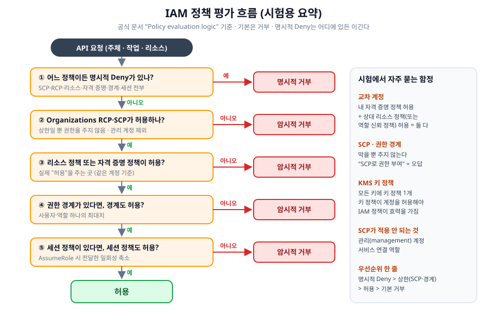
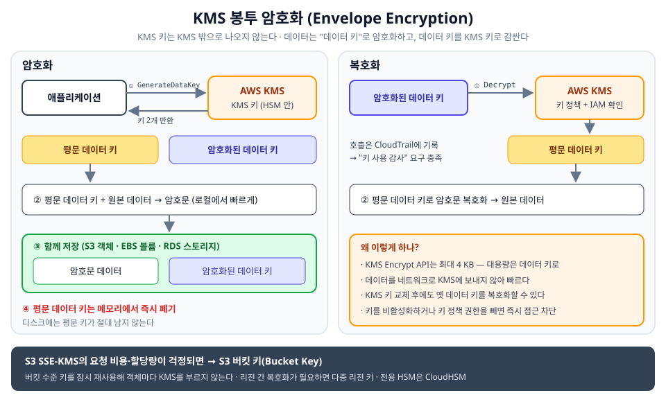
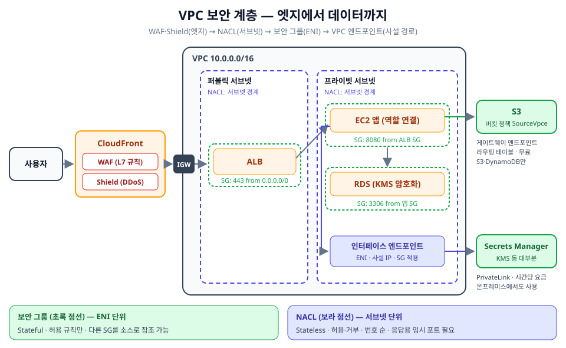

> **자격증 준비 · AWS SAA** | 난이도 ★★★☆☆ | 예상 소요 5 ~ 6시간 (문항 풀이 포함)

> ⚠️ **이 편의 모든 문항은 SAA-C03 공식 시험 가이드의 도메인 1(Design Secure Architectures) 작업 항목을 바탕으로 직접 만든 창작 문항입니다.** 실제 출제 문제나 유출 문제(덤프)가 아니며, 그런 자료를 재현하지 않습니다.

## 🎯 오늘의 목표

- IAM **정책 평가 논리**를 순서대로 말하고, "왜 거부됐는가"를 정책 종류별로 짚을 수 있다
- 역할·교차 계정 접근·SCP·IAM Identity Center 중 **요구사항에 맞는 것**을 고른다
- KMS 키 종류(AWS 관리형·고객 관리형)와 봉투 암호화, Secrets Manager vs Parameter Store를 구분한다
- 보안 그룹과 NACL, 게이트웨이·인터페이스 엔드포인트, WAF와 Shield의 쓰임새를 시나리오에서 바로 고른다
- S3 Object Lock, 버전 관리, AWS Backup, Macie 등 **데이터 보호** 선택지를 정리한다

---

## 1. 도메인 1 한눈에 보기 (비중 30%)

| 작업 항목 | 핵심 질문 | 이 편 절 |
|---|---|---|
| 1.1 AWS 리소스에 대한 안전한 접근 | 누가(사람·서비스·다른 계정) 무엇을 할 수 있나? | 2장 IAM |
| 1.2 안전한 워크로드·애플리케이션 | 트래픽은 어디로 들어오고 어디서 막히나? 자격 증명은 어디에? | 3장 비밀·4장 네트워크 |
| 1.3 데이터 보안 통제 | 저장·전송 중 암호화, 키 관리, 보존·삭제 방지 | 3장 KMS·5장 데이터 보호 |

본편에서 쿠버네티스 RBAC([Day 19](../../02-kubernetes/day19-rbac-namespace.md)), Keystone([Day 27](../../04-openstack/day27-keystone.md)), Vault([Day 71](../../09-security/day71-vault-cert-manager.md)), NetworkPolicy([Day 70](../../09-security/day70-networkpolicy-zero-trust.md))를 직접 다뤘습니다. 이 편은 그 개념을 **AWS 서비스 이름과 시험 문장**으로 번역합니다. 계정 잠금·MFA·Budgets 같은 실습은 [클라우드 탭 cloud01 참고](../../cloud/cloud01-aws-account-setup.md), 보안 서비스(GuardDuty·Security Hub·KMS·CloudTrail) 실습은 [클라우드 탭 cloud09 참고](../../cloud/cloud09-security.md).

---

## 2. IAM — 누가 무엇을 할 수 있는가

### 2-1. 정책 종류

| 정책 | 붙는 곳 | 역할 | 기억할 점 |
|---|---|---|---|
| 자격 증명 기반 정책 | IAM 사용자·그룹·역할 | "이 주체는 무엇을 할 수 있다" | 가장 흔한 허용 수단 |
| 리소스 기반 정책 | S3 버킷, SQS 큐, KMS 키, Lambda 등 | "이 리소스에 누가 접근할 수 있다" | `Principal` 필드가 있음. 교차 계정 공유에 사용 |
| 권한 경계(Permissions boundary) | IAM 사용자·역할 | 자격 증명 정책이 줄 수 있는 **최대치** | 권한을 주지 않음, 상한만 정함 |
| SCP (서비스 제어 정책) | Organizations 루트·OU·계정 | 계정 안 주체들이 쓸 수 있는 **최대치** | 권한을 주지 않음. **관리(management) 계정에는 적용 안 됨** |
| RCP (리소스 제어 정책) | Organizations 루트·OU·계정 | 계정 안 **리소스**에 대한 접근 최대치 | 2024년 추가. 외부 주체 차단에 유용 |
| 세션 정책 | `AssumeRole` 등 세션 생성 시 전달 | 그 세션 동안의 최대치 | 일회성 축소 |

### 2-2. 정책 평가 논리

[공식 평가 논리](https://docs.aws.amazon.com/IAM/latest/UserGuide/reference_policies_evaluation-logic.html)를 시험용으로 줄이면 세 줄입니다.

1. **기본은 거부**(암시적 거부). 아무도 허용하지 않으면 거부.
2. **명시적 거부(`"Effect": "Deny"`)는 어디에 있든 이긴다.** SCP든 버킷 정책이든 하나라도 Deny면 끝.
3. "상한" 역할의 정책(SCP, RCP, 권한 경계, 세션 정책)이 **존재한다면 그 안에도 허용이 있어야** 하고, 실제 허용은 자격 증명 정책 또는 리소스 정책이 준다.

| 상황 | 결과 | 이유 |
|---|---|---|
| 자격 증명 정책 `s3:*` 허용, SCP는 `ec2:*`만 허용 | S3 **거부** | SCP 상한 밖 |
| 자격 증명 정책 허용, 버킷 정책 명시적 Deny | **거부** | 명시적 거부 우선 |
| 같은 계정, 자격 증명 정책 없음, 버킷 정책이 이 역할을 허용 | **허용** | 같은 계정에서는 리소스 정책만으로도 허용 가능 |
| **다른 계정** 역할, 버킷 정책만 허용 | **거부** | 교차 계정은 **양쪽(내 자격 증명 정책 + 상대 리소스 정책)** 모두 허용 필요 |
| 자격 증명 정책 `iam:*` 허용, 권한 경계는 `s3:*`만 | IAM 작업 **거부** | 경계 상한 밖 |

> ⚠️ KMS는 예외처럼 보이는 규칙이 있습니다. **모든 KMS 키에는 키 정책이 정확히 하나** 있고, 키 정책이 계정(또는 그 주체)을 허용하지 않으면 IAM 정책으로 아무리 허용해도 키를 쓸 수 없습니다. ([키 정책](https://docs.aws.amazon.com/kms/latest/developerguide/key-policies.html))

### 2-3. 역할과 임시 자격 증명

| 누가 접근하나 | 정답 패턴 | 피해야 할 오답 |
|---|---|---|
| EC2 위 애플리케이션 | **인스턴스 프로파일(IAM 역할)** | 액세스 키를 환경 변수·코드·AMI에 저장 |
| Lambda, ECS 태스크 | 실행 역할 / **태스크 역할** | 공용 IAM 사용자 키 |
| EKS Pod | EKS Pod Identity 또는 IRSA | 노드 역할에 전부 몰아주기 |
| 다른 AWS 계정 | 상대 계정에 **역할 + 신뢰 정책**, 내 쪽에서 `sts:AssumeRole` | 상대 계정에 IAM 사용자 생성 후 키 공유 |
| 제3자(SaaS) 계정 | 역할 + 신뢰 정책 + **외부 ID(ExternalId)** 조건 | 루트 자격 증명 공유 |
| 사내 직원 수백 명, 계정 수십 개 | **IAM Identity Center** + 권한 세트, 기존 IdP(Entra ID, Okta 등) 또는 AD 연동 | 계정마다 IAM 사용자 생성 |
| 모바일·웹 앱의 최종 사용자 | **Amazon Cognito**(사용자 풀 + 자격 증명 풀) | 사용자마다 IAM 사용자 |

> 💡 본편 Day 73에서 Keycloak으로 OIDC SSO를 붙였지요. AWS에서 **직원**용 SSO는 IAM Identity Center, **고객**(앱 사용자)용 로그인은 Cognito입니다. 시험에서 "직원"과 "고객"을 가르는 단어를 먼저 찾으세요.

### 2-4. 다중 계정 거버넌스

| 도구 | 하는 일 | 시나리오 신호 |
|---|---|---|
| **AWS Organizations** | 계정 묶음, 통합 결제, OU 구조 | "여러 계정을 중앙에서" |
| **SCP** | OU·계정 단위 권한 상한(예방 통제) | "모든 계정에서 특정 리전·서비스 금지", "CloudTrail 끄기 금지" |
| **AWS Control Tower** | 랜딩 존 + 가드레일 자동 구성 | "모범 사례대로 다중 계정 환경을 빠르게" |
| **IAM Identity Center** | 여러 계정에 대한 직원 SSO | "중앙 집중 로그인", "기존 IdP 재사용" |
| **AWS RAM** | 서브넷·Transit Gateway 등 리소스 공유 | "다른 계정과 VPC 서브넷 공유" |
| **AWS Config** | 설정 변경 기록·규칙 평가(탐지 통제) | "규정 위반 리소스를 탐지·기록" |

> ⚠️ SCP는 **막을 뿐 주지 않습니다**. "SCP로 개발자에게 S3 권한을 부여한다"는 보기는 항상 오답입니다.

---

## 3. 암호화와 비밀 — KMS, CloudHSM, Secrets Manager, ACM

### 3-1. KMS 키 종류

| 종류 | 누가 관리 | 키 정책 편집 | 자동 교체 | 시나리오 |
|---|---|---|---|---|
| AWS 소유 키 | AWS (내 계정에 안 보임) | 불가 | AWS가 관리 | SSE-S3 등 기본 암호화 |
| AWS 관리형 키 (`aws/s3` 등) | AWS가 내 계정에 생성 | 불가 | 자동(교체 주기 AWS 관리) | 간편하지만 통제 제한 |
| **고객 관리형 키** | 나 | **가능** | 선택, 기본 365일(90~2,560일 설정 가능) + 온디맨드 교체 | "키 정책 직접 통제", "교차 계정 공유", "사용 감사" |
| 다중 리전 키 | 나 | 가능 | 가능 | "다른 리전에서 재암호화 없이 복호화" |

[키 교체](https://docs.aws.amazon.com/kms/latest/developerguide/rotate-keys.html)는 키 ID는 그대로 두고 **키 구성 요소(key material)** 만 바꿉니다. 예전 데이터도 그대로 복호화됩니다.

### 3-2. 봉투 암호화

KMS는 큰 데이터를 직접 암호화하지 않습니다. KMS 키로 **데이터 키**를 만들고(`GenerateDataKey`), 데이터는 그 데이터 키로 암호화한 뒤 **암호화된 데이터 키를 데이터 옆에** 저장합니다. 그래서 S3·EBS·RDS가 대용량 데이터를 빠르게 암호화할 수 있고, KMS 키는 KMS 밖으로 나오지 않습니다.

> 💡 S3에서 SSE-KMS를 쓰면 객체마다 KMS 호출이 생겨 요청 비용과 할당량이 문제가 될 수 있습니다. **S3 버킷 키(Bucket Key)** 를 켜면 버킷 수준 키를 써서 KMS 호출이 크게 줄어듭니다. ([S3 버킷 키](https://docs.aws.amazon.com/AmazonS3/latest/userguide/bucket-key.html))

### 3-3. 저장 데이터 암호화 선택지

| 선택지 | 키 관리 | 시나리오 신호 |
|---|---|---|
| SSE-S3 | AWS | 2023년부터 S3 신규 객체의 **기본값**. "가장 간단히" |
| SSE-KMS | KMS (AWS 관리형 또는 고객 관리형) | "키 사용 감사(CloudTrail)", "키 권한 분리" |
| DSSE-KMS | KMS, 이중 계층 | "두 계층 암호화 규정" |
| SSE-C | 고객이 요청마다 키 제공 | "키를 AWS에 저장하면 안 됨" |
| 클라이언트 측 암호화 | 고객 | "AWS로 보내기 전에 암호화" |
| **CloudHSM** | 고객 전용 HSM(단일 테넌트) | "FIPS 140 레벨 3 HSM을 직접 통제", "키를 AWS가 접근할 수 없게" |

### 3-4. 비밀·인증서

| 서비스 | 하는 일 | 고르는 신호 |
|---|---|---|
| **Secrets Manager** | 비밀 저장 + **자동 교체**(RDS·Aurora 등 관리형 교체, 또는 Lambda 교체), 교차 리전 복제 | "DB 비밀번호 자동 교체", "코드에서 자격 증명 제거" |
| SSM Parameter Store | 설정 값·SecureString 저장, 표준 파라미터 무료 | "설정 값 중앙 관리", "비용 최소", 교체 요구 없음 |
| **ACM** | 공인 TLS 인증서 무료 발급·**자동 갱신**, ALB·CloudFront·API Gateway에 연결 | "전송 중 암호화", "인증서 만료 관리 부담 제거" |

> ⚠️ CloudFront에 붙일 ACM 인증서는 **us-east-1(버지니아 북부)** 에서 요청·가져와야 합니다. ALB용 인증서는 ALB와 같은 리전에 있어야 합니다.

---

## 4. 네트워크 보안 — SG, NACL, 엔드포인트, WAF, Shield

### 4-1. 보안 그룹 vs 네트워크 ACL

| 구분 | 보안 그룹 (SG) | 네트워크 ACL (NACL) |
|---|---|---|
| 적용 위치 | ENI(인스턴스·ALB·RDS 등) | **서브넷** |
| 상태 | **Stateful** — 응답 트래픽 자동 허용 | **Stateless** — 응답 방향도 규칙 필요(임시 포트 1024–65535) |
| 규칙 | **허용만** | 허용·**거부** 모두 |
| 평가 | 모든 규칙 합집합 | **번호 순서**, 처음 일치한 규칙 적용 |
| 참조 | 다른 SG를 소스로 지정 가능 | IP CIDR만 |
| 기본값 | 새 SG: 인바운드 없음, 아웃바운드 전체 | 기본 NACL: 전체 허용 / 사용자 지정 NACL: 전체 거부 |

> 💡 시험 단골: "특정 IP 대역을 **차단**하라" → SG는 거부 규칙이 없으니 **NACL(또는 WAF IP 세트)**. "웹 계층에서 오는 트래픽만 DB에 허용" → DB SG의 소스로 **웹 계층 SG ID**를 지정.

### 4-2. 서브넷 설계와 외부 연결

| 요구 | 정답 패턴 |
|---|---|
| DB·앱 서버는 인터넷에서 직접 닿지 않게 | **프라이빗 서브넷** + 앞단 ALB만 퍼블릭 |
| 프라이빗 서브넷에서 OS 업데이트(아웃바운드만) | **NAT 게이트웨이**(AZ마다 하나가 고가용성) |
| 서버에 SSH 포트 열지 않고 접속 | **Systems Manager Session Manager** |
| 온프레미스와 암호화 연결, 빠르게 | **Site-to-Site VPN** |
| 온프레미스와 일정한 대역폭·지연, 전용선 | **Direct Connect**(기본은 암호화 안 됨 → VPN over DX 또는 MACsec) |
| VPC 수십 개와 온프레미스를 허브로 연결 | **Transit Gateway** |
| VPC 간 트래픽 검사(상태 기반 방화벽, 도메인 필터) | **AWS Network Firewall** |

### 4-3. VPC 엔드포인트

| 구분 | 게이트웨이 엔드포인트 | 인터페이스 엔드포인트 (PrivateLink) |
|---|---|---|
| 대상 | **S3, DynamoDB** 만 | 대부분의 AWS 서비스, 다른 계정의 서비스(엔드포인트 서비스) |
| 방식 | 라우팅 테이블에 접두사 목록 경로 추가 | 서브넷에 **ENI**(사설 IP) 생성, 보안 그룹 적용 |
| 비용 | **무료** | 시간당 + 데이터 처리 요금 |
| 온프레미스에서 사용 | 불가 | **가능**(VPN·DX 경유) |
| 접근 제한 | 엔드포인트 정책 + 버킷 정책 `aws:SourceVpce` | 엔드포인트 정책 + SG |

> 💡 "S3에 사설로 접근 + 추가 비용 없음" → 게이트웨이 엔드포인트. "온프레미스에서 S3에 사설로" 또는 "다른 계정의 내부 서비스를 노출" → 인터페이스 엔드포인트(PrivateLink).

### 4-4. 엣지 보호 — WAF, Shield, Firewall Manager

| 서비스 | 계층 | 하는 일 | 붙는 곳 |
|---|---|---|---|
| **AWS WAF** | L7 | SQL 인젝션·XSS 관리형 규칙, **속도 기반 규칙**, IP·지역 차단, 봇 제어 | CloudFront, ALB, API Gateway, AppSync, Cognito 사용자 풀 등 |
| **Shield Standard** | L3/L4 | 일반적 DDoS 자동 방어 | 모든 고객 **무료·자동** |
| **Shield Advanced** | L3/L4/L7 | 고급 DDoS 탐지, **Shield 대응팀(SRT)** 지원, DDoS로 인한 확장 비용 보호 | CloudFront, Route 53, ALB, NLB·EIP, Global Accelerator |
| **Firewall Manager** | — | 여러 계정에 WAF·Shield·SG·Network Firewall 정책을 **중앙 일괄 적용** | Organizations 연동 |

---

## 5. 데이터 보호

| 요구 | 정답 패턴 | 근거 문서 |
|---|---|---|
| 실수·악의적 삭제 후 복구 | **S3 버전 관리**(+ MFA Delete) | [버전 관리](https://docs.aws.amazon.com/AmazonS3/latest/userguide/Versioning.html) |
| **누구도(루트 포함) 보존 기간 동안 삭제 불가** | **S3 Object Lock 규정 준수(Compliance) 모드** | [Object Lock](https://docs.aws.amazon.com/AmazonS3/latest/userguide/object-lock.html) |
| 특수 권한자는 해제 가능한 보존 | Object Lock **거버넌스(Governance)** 모드 | 같은 문서 |
| 기간 없이 소송 대비 보존 | Object Lock **법적 보존(Legal hold)** | 같은 문서 |
| 여러 서비스(EBS·RDS·EFS·DynamoDB…) 백업 중앙화 | **AWS Backup** 백업 계획, 교차 리전·계정 복사 | [AWS Backup](https://docs.aws.amazon.com/aws-backup/latest/devguide/whatisbackup.html) |
| 백업 자체를 삭제 불가하게 | AWS Backup **Vault Lock** | [Vault Lock](https://docs.aws.amazon.com/aws-backup/latest/devguide/vault-lock.html) |
| S3에서 개인정보(PII) 자동 발견 | **Amazon Macie** | [Macie](https://docs.aws.amazon.com/macie/latest/user/what-is-macie.html) |
| 계정 위협 탐지(이상 API, 악성 IP 통신) | **GuardDuty** | [GuardDuty](https://docs.aws.amazon.com/guardduty/latest/ug/what-is-guardduty.html) |
| EC2·컨테이너 이미지·Lambda 취약점 스캔 | **Inspector** | [Inspector](https://docs.aws.amazon.com/inspector/latest/user/what-is-inspector.html) |
| S3 정적 콘텐츠를 CloudFront로만 제공 | **원본 액세스 제어(OAC)** + 버킷 퍼블릭 차단 | [S3 원본 접근 제한](https://docs.aws.amazon.com/AmazonCloudFront/latest/DeveloperGuide/private-content-restricting-access-to-s3.html) |
| 모든 API 호출 감사 | **CloudTrail**(조직 트레일, 로그 파일 무결성 검증) | [CloudTrail](https://docs.aws.amazon.com/awscloudtrail/latest/userguide/cloudtrail-user-guide.html) |

---

## 6. 시나리오 키워드 치트시트

| 문제에 이런 말이 나오면 | 먼저 떠올릴 것 |
|---|---|
| 액세스 키를 코드에 두지 않고 EC2에서 S3 접근 | IAM 역할(인스턴스 프로파일) |
| 다른 계정의 리소스에 접근 | 역할 + 신뢰 정책 + `sts:AssumeRole` |
| 제3자 공급업체에 계정 접근 허용 | 역할 + ExternalId |
| 모든 계정에서 ○○을 금지 | SCP (명시적 Deny) |
| 개발자가 만든 역할이 관리자 권한을 넘지 못하게 | 권한 경계 |
| 직원 SSO, 여러 계정, 기존 IdP | IAM Identity Center |
| 앱 사용자 회원가입·로그인, 소셜 로그인 | Cognito |
| 키 정책 직접 관리, 키 사용 감사 | KMS 고객 관리형 키 |
| 다른 리전에서 같은 키로 복호화 | KMS 다중 리전 키 |
| 전용 HSM, FIPS 140 레벨 3 | CloudHSM |
| 비밀번호 자동 교체 | Secrets Manager |
| 인증서 자동 갱신, HTTPS | ACM |
| IP 대역 차단 | NACL Deny (또는 WAF IP 세트) |
| SQL 인젝션, XSS, 초당 요청 제한 | WAF (관리형 규칙, 속도 기반 규칙) |
| 대규모 DDoS, 대응팀, 비용 보호 | Shield Advanced |
| 인터넷 없이 S3·DynamoDB | 게이트웨이 엔드포인트 |
| 인터넷 없이 그 밖의 AWS 서비스, 온프레미스에서 사설 접근 | 인터페이스 엔드포인트 |
| 삭제·덮어쓰기 불가(WORM) | S3 Object Lock 규정 준수 모드 |
| 민감 데이터 발견 | Macie |

---

## 7. 헷갈리는 포인트

| 헷갈리는 쌍 | 가르는 기준 |
|---|---|
| SCP vs 권한 경계 | SCP는 **계정·OU 전체**, 경계는 **사용자·역할 하나**. 둘 다 상한일 뿐 권한을 주지 않음 |
| SCP vs IAM 정책 | SCP는 관리 계정에 적용 안 됨, 서비스 연결 역할에도 적용 안 됨 |
| AWS 관리형 키 vs 고객 관리형 키 | 키 정책 편집·교차 계정 공유·교체 주기 설정이 필요하면 고객 관리형 |
| KMS vs CloudHSM | 단일 테넌트 전용 HSM을 내가 통제해야 하면 CloudHSM, 그 외 대부분 KMS |
| Secrets Manager vs Parameter Store | **자동 교체**가 나오면 Secrets Manager. 단순 설정·비용 최소면 Parameter Store |
| SG vs NACL | 거부가 필요하거나 서브넷 단위면 NACL. 응답 트래픽이 막혔다 → NACL 아웃바운드 임시 포트 |
| 게이트웨이 vs 인터페이스 엔드포인트 | S3·DynamoDB + 무료 → 게이트웨이. 온프레미스·다른 서비스 → 인터페이스 |
| WAF vs Shield vs Network Firewall | L7 웹 공격 = WAF, DDoS = Shield, VPC 트래픽 상태 기반 검사 = Network Firewall |
| GuardDuty vs Inspector vs Macie | 위협 탐지 / 취약점 스캔 / S3 민감 데이터 |
| Object Lock 거버넌스 vs 규정 준수 | 특수 권한으로 해제 가능 / **루트도 해제 불가** |
| Identity Center vs Cognito | 직원 vs 고객 |

---

## 8. 창작 시나리오형 문항 (15문항)

> 공식 시험 가이드 도메인 1 작업 항목을 바탕으로 직접 만든 문항입니다. 시간을 재고(문항당 2분) 풀어 본 뒤 `
`를 여세요.

**Q1.** 회사 계정 A의 Lambda 함수가 계정 B의 DynamoDB 테이블을 읽어야 한다. 장기 자격 증명은 쓰지 않아야 한다. 가장 적절한 방법은?

A. 계정 B에 IAM 사용자를 만들고 액세스 키를 Lambda 환경 변수에 넣는다
B. 계정 B에 테이블 읽기 권한이 있는 역할을 만들고 신뢰 정책에 계정 A의 Lambda 실행 역할을 지정한다. Lambda 실행 역할에는 그 역할에 대한 `sts:AssumeRole`을 허용한다
C. 계정 A의 Lambda 실행 역할에 `dynamodb:*`를 `"Resource": "*"`로 허용한다
D. 계정 B의 테이블을 계정 A로 매일 내보낸다

정답·해설

**B.** 교차 계정 접근의 표준 패턴입니다. 리소스 쪽(B) 역할의 **신뢰 정책**이 누가 역할을 맡을 수 있는지 정하고, 호출 쪽(A)의 자격 증명 정책이 `AssumeRole`을 허용해야 합니다. C는 내 쪽 허용만 있어 계정 B 리소스에 접근할 수 없습니다.

📖 근거: [IAM 역할을 사용한 교차 계정 접근 자습서](https://docs.aws.amazon.com/IAM/latest/UserGuide/tutorial_cross-account-with-roles.html)

**Q2.** 보안팀은 조직의 모든 멤버 계정에서 `ap-northeast-2`와 `us-east-1`을 제외한 리전의 리소스 생성을 **예방**하고 싶다. 각 계정 관리자가 이를 우회할 수 없어야 한다. 가장 적절한 방법은?

A. 각 계정의 모든 IAM 역할에 리전 제한 정책을 붙인다
B. AWS Config 규칙으로 다른 리전 리소스를 탐지한다
C. 루트 OU에 `aws:RequestedRegion` 조건으로 두 리전 외 요청을 거부하는 SCP를 연결한다(글로벌 서비스는 예외 처리)
D. 권한 경계를 모든 사용자에게 적용한다

정답·해설

**C.** "모든 계정 + 우회 불가 + 예방" = SCP. A·D는 계정 관리자가 바꿀 수 있고, B는 **탐지**일 뿐 막지 못합니다. IAM·CloudFront 같은 글로벌 서비스는 us-east-1 엔드포인트를 쓰므로 예외 목록을 둡니다.

📖 근거: [SCP](https://docs.aws.amazon.com/organizations/latest/userguide/orgs_manage_policies_scps.html), [SCP 예시 — 리전 기반 거부](https://docs.aws.amazon.com/organizations/latest/userguide/orgs_manage_policies_scps_examples_general.html)

**Q3.** 멤버 계정의 개발자 역할에 `s3:*`을 허용하는 자격 증명 정책이 있다. 이 계정이 속한 OU에는 `ec2:*`와 `cloudwatch:*`만 허용하는 SCP가 있다(기본 `FullAWSAccess` SCP는 제거됨). 개발자가 S3 버킷을 나열하면 어떻게 되는가?

A. 허용된다. 자격 증명 정책이 S3를 허용하기 때문이다
B. 거부된다. SCP가 S3를 허용하지 않아 권한 상한 밖이기 때문이다
C. 허용된다. SCP는 거부 문만 효력이 있기 때문이다
D. 버킷 정책에 따라 달라진다

정답·해설

**B.** SCP는 허용 목록 방식으로도 쓸 수 있고, 그 경우 목록에 없는 작업은 계정 안 누구도 할 수 없습니다(관리 계정 제외). 버킷 정책이 허용해도 SCP 상한을 넘지 못합니다.

📖 근거: [정책 평가 논리](https://docs.aws.amazon.com/IAM/latest/UserGuide/reference_policies_evaluation-logic.html)

**Q4.** 직원 400명이 이미 Okta로 로그인한다. 회사는 AWS 계정 25개를 Organizations로 운영하며, 직원이 하나의 포털에서 맡은 계정에 역할별 권한으로 들어가길 원한다. **운영 오버헤드가 가장 적은** 방법은?

A. 각 계정에 IAM 사용자를 만들고 그룹으로 권한을 준다
B. IAM Identity Center를 켜고 Okta를 외부 자격 증명 공급자로 연결한 뒤, 권한 세트를 계정·그룹에 할당한다
C. Cognito 사용자 풀을 만들고 Okta와 페더레이션한다
D. 각 계정에 SAML 공급자를 수동으로 만들고 역할을 매핑한다

정답·해설

**B.** 직원 + 여러 계정 + 기존 IdP = IAM Identity Center. D도 동작하지만 계정 25개마다 수동 구성이라 오버헤드가 큽니다. Cognito(C)는 고객용입니다.

📖 근거: [IAM Identity Center란?](https://docs.aws.amazon.com/singlesignon/latest/userguide/what-is.html)

**Q5.** EC2에서 실행되는 Spring Boot 앱이 S3에 파일을 쓴다. 현재 액세스 키가 `application.yml`에 있다. 가장 안전한 개선책은?

A. 액세스 키를 Base64로 인코딩한다
B. 액세스 키를 Secrets Manager에 넣고 90일마다 교체한다
C. 필요한 S3 권한만 가진 IAM 역할을 인스턴스 프로파일로 EC2에 연결하고, 키를 삭제한다
D. 키를 EC2 사용자 데이터로 옮긴다

정답·해설

**C.** AWS SDK는 인스턴스 메타데이터에서 역할의 **임시 자격 증명**을 자동으로 가져와 교체합니다. B도 나아지긴 하지만 장기 키가 남습니다. A·D는 암호화도 숨김도 아닙니다.

📖 근거: [EC2용 IAM 역할](https://docs.aws.amazon.com/AWSEC2/latest/UserGuide/iam-roles-for-amazon-ec2.html)

**Q6.** 규정상 S3 데이터는 저장 시 암호화되어야 하고, 보안팀이 **키 정책을 직접 관리**하며 **키 사용 내역을 감사**하고 **매년 키를 교체**해야 한다. 가장 적절한 방법은?

A. SSE-S3
B. AWS 관리형 키(`aws/s3`)로 SSE-KMS
C. 고객 관리형 KMS 키로 SSE-KMS, 자동 교체 활성화
D. SSE-C

정답·해설

**C.** 키 정책 편집은 **고객 관리형 키**만 가능합니다. KMS 호출은 CloudTrail에 남아 감사할 수 있고, 자동 교체(기본 365일)를 켤 수 있습니다. B는 키 정책을 편집할 수 없고, D는 키를 고객이 매 요청 제공해야 하며 키 관리가 고객 책임입니다.

📖 근거: [KMS 키 교체](https://docs.aws.amazon.com/kms/latest/developerguide/rotate-keys.html)

**Q7.** 회사가 서울 리전에서 클라이언트 측 암호화한 데이터를 도쿄 리전으로 복제해 DR에 쓴다. 도쿄에서 **서울 리전 KMS를 호출하지 않고**, 재암호화 없이 복호화해야 한다. 가장 적절한 방법은?

A. 도쿄에 새 KMS 키를 만들고 같은 별칭을 붙인다
B. KMS 다중 리전 기본 키를 서울에 만들고 도쿄에 복제본 키를 만든다
C. 키 구성 요소를 내보내 도쿄로 복사한다
D. CloudHSM 클러스터를 두 리전에 만든다

정답·해설

**B.** 다중 리전 키는 같은 키 ID와 키 구성 요소를 가진 **관련 키 세트**라, 한 리전에서 암호화한 것을 다른 리전 복제본으로 복호화할 수 있습니다. A는 별칭만 같을 뿐 다른 키이고, KMS 키 구성 요소는 내보낼 수 없습니다(C).

📖 근거: [KMS 다중 리전 키](https://docs.aws.amazon.com/kms/latest/developerguide/multi-region-keys-overview.html)

**Q8.** Aurora MySQL의 마스터 비밀번호를 애플리케이션 밖에서 관리하고 **자동으로 교체**하되, 교체 로직을 직접 작성하고 싶지 않다. **운영 오버헤드가 가장 적은** 방법은?

A. SSM Parameter Store SecureString에 저장하고 EventBridge 일정으로 Lambda를 돌려 교체한다
B. Secrets Manager의 RDS 관리형 비밀번호(관리형 교체)를 사용한다
C. KMS 키로 비밀번호를 암호화해 S3에 저장한다
D. IAM 데이터베이스 인증을 쓰고 비밀번호를 그대로 둔다

정답·해설

**B.** RDS·Aurora는 Secrets Manager와 통합된 마스터 비밀번호 관리를 지원해 교체 함수를 직접 만들 필요가 없습니다. A는 동작하지만 교체 코드를 직접 관리해야 합니다.

📖 근거: [Secrets Manager 비밀 교체](https://docs.aws.amazon.com/secretsmanager/latest/userguide/rotating-secrets.html), [RDS와 Secrets Manager로 비밀번호 관리](https://docs.aws.amazon.com/AmazonRDS/latest/UserGuide/rds-secrets-manager.html)

**Q9.** 퍼블릭 서브넷의 웹 서버가 특정 IP 대역(`203.0.113.0/24`)에서 지속적인 스캔을 받는다. 이 대역만 **서브넷 수준에서 차단**하고 나머지는 그대로 두고 싶다. 가장 적절한 방법은?

A. 웹 서버 보안 그룹에 해당 대역 거부 규칙을 추가한다
B. 서브넷 NACL에 해당 대역을 거부하는 규칙을, 기존 허용 규칙보다 **작은 번호**로 추가한다
C. 라우팅 테이블에서 해당 대역을 블랙홀로 보낸다
D. 인터넷 게이트웨이를 분리한다

정답·해설

**B.** 보안 그룹에는 거부 규칙이 없습니다(A). NACL은 번호가 작은 규칙부터 평가하므로, 허용 규칙(예: 100)보다 앞선 번호(예: 50)로 거부를 넣어야 합니다.

📖 근거: [네트워크 ACL](https://docs.aws.amazon.com/vpc/latest/userguide/vpc-network-acls.html)

**Q10.** 관리자가 웹 서버 서브넷에 사용자 지정 NACL을 만들어 인바운드 TCP 443(0.0.0.0/0) 허용, 아웃바운드 TCP 443(0.0.0.0/0) 허용 규칙만 넣었다. 보안 그룹은 인바운드 443을 허용한다. 클라이언트가 HTTPS 연결을 맺지 못한다. 원인은?

A. 보안 그룹이 아웃바운드 443을 허용하지 않았다
B. NACL은 stateless라 클라이언트의 임시 포트(1024–65535)로 나가는 응답 트래픽을 아웃바운드에서 허용해야 한다
C. NACL은 443을 지원하지 않는다
D. 인터넷 게이트웨이에 보안 그룹을 붙이지 않았다

정답·해설

**B.** 응답 패킷의 목적지 포트는 클라이언트의 임시 포트입니다. NACL은 상태를 기억하지 않으므로 아웃바운드에 1024–65535를 허용해야 합니다. 보안 그룹은 stateful이라 응답이 자동 허용됩니다(A 오답).

📖 근거: [사용자 지정 네트워크 ACL — 임시 포트](https://docs.aws.amazon.com/vpc/latest/userguide/custom-network-acl.html)

**Q11.** 기밀 데이터가 담긴 S3 버킷은 **특정 VPC 안에서만** 접근 가능해야 하며, 트래픽은 인터넷을 거치지 않아야 한다. 가장 적절한 조합은? (**두 개를 고르시오**)

A. VPC에 S3 게이트웨이 엔드포인트를 만들고 프라이빗 서브넷 라우팅 테이블에 연결한다
B. 버킷 정책에 `aws:SourceVpce`가 그 엔드포인트 ID가 아니면 거부하는 문을 넣는다
C. 버킷 ACL을 퍼블릭 읽기로 바꾼다
D. NAT 게이트웨이를 추가한다
E. S3 Transfer Acceleration을 켠다

정답·해설

**A, B.** 엔드포인트가 사설 경로를 만들고, 버킷 정책의 `aws:SourceVpce`(또는 `aws:SourceVpc`) 조건이 다른 경로의 접근을 막습니다. D는 인터넷 경로, E는 가속 업로드용입니다.

📖 근거: [VPC 엔드포인트로 버킷 접근 제어](https://docs.aws.amazon.com/AmazonS3/latest/userguide/example-bucket-policies-vpc-endpoint.html)

**Q12.** ALB 뒤의 쇼핑몰이 SQL 인젝션 시도와, 일부 IP의 로그인 API 초당 수백 회 호출을 받고 있다. 애플리케이션 코드를 바꾸지 않고 **가장 적은 운영 노력**으로 막으려면?

A. ALB에 AWS WAF 웹 ACL을 연결하고, SQL 데이터베이스 관리형 규칙 그룹과 로그인 경로에 대한 속도 기반 규칙을 추가한다
B. EC2에 오픈소스 WAF를 설치한다
C. 보안 그룹에 공격 IP를 매번 추가한다
D. Shield Standard를 활성화한다

정답·해설

**A.** L7 공격(SQLi)과 속도 제한은 WAF의 몫입니다. 관리형 규칙 그룹은 AWS가 유지합니다. B는 운영 부담이 크고, C는 SG에 거부가 없으며, D(Shield Standard)는 이미 자동 적용되는 L3/L4 방어입니다.

📖 근거: [WAF 속도 기반 규칙](https://docs.aws.amazon.com/waf/latest/developerguide/waf-rule-statement-type-rate-based.html), [AWS 관리형 규칙](https://docs.aws.amazon.com/waf/latest/developerguide/aws-managed-rule-groups.html)

**Q13.** 게임 회사가 CloudFront와 Route 53 뒤에서 서비스한다. 대규모 DDoS가 반복되며, 공격 중 **AWS 전문가의 24시간 대응 지원**과 공격으로 늘어난 **확장 비용에 대한 보호**가 필요하다. 무엇을 써야 하는가?

A. Shield Standard
B. Shield Advanced
C. GuardDuty
D. Network Firewall

정답·해설

**B.** SRT(Shield Response Team) 지원과 DDoS 비용 보호는 Shield Advanced의 기능입니다. Standard는 기본 방어만 제공합니다.

📖 근거: [AWS Shield Advanced](https://docs.aws.amazon.com/waf/latest/developerguide/ddos-advanced-summary.html)

**Q14.** 금융 규정상 거래 로그는 **7년 동안 어떤 사용자도(루트 계정 포함) 삭제·덮어쓰기할 수 없어야** 한다. S3에 저장한다. 가장 적절한 방법은?

A. 버전 관리와 MFA Delete를 켠다
B. Object Lock을 활성화하고 **규정 준수 모드**로 7년 보존 기간을 설정한다
C. Object Lock **거버넌스 모드**로 7년 보존 기간을 설정한다
D. 버킷 정책으로 `s3:DeleteObject`를 거부한다

정답·해설

**B.** 규정 준수 모드는 보존 기간 동안 **루트 사용자도** 보호를 해제하거나 기간을 줄일 수 없습니다. 거버넌스 모드(C)는 특수 권한(`s3:BypassGovernanceRetention`)으로 우회 가능하고, 버킷 정책(D)은 관리자가 바꿀 수 있습니다.

📖 근거: [S3 Object Lock 보존 모드](https://docs.aws.amazon.com/AmazonS3/latest/userguide/object-lock.html)

**Q15.** 회사 S3 버킷 수백 개에 고객 데이터가 흩어져 있다. 개인 식별 정보(PII)가 어느 버킷에 있는지 **자동으로 발견**하고 결과를 Security Hub로 모으고 싶다. 가장 적절한 서비스는?

A. Amazon Inspector
B. Amazon GuardDuty
C. Amazon Macie
D. AWS Config

정답·해설

**C.** Macie는 머신 러닝과 패턴 매칭으로 S3의 민감 데이터를 발견하고 결과를 Security Hub·EventBridge로 보냅니다. Inspector는 취약점, GuardDuty는 위협, Config는 설정 규정 준수입니다.

📖 근거: [Amazon Macie란?](https://docs.aws.amazon.com/macie/latest/user/what-is-macie.html)

### 채점 기준

| 정답 수 | 판단 |
|---|---|
| 13~15 | 도메인 1 준비 완료. W02로 |
| 10~12 | 틀린 문항의 표(2~5장)만 다시 보기 |
| 9 이하 | 2장(정책 평가)과 4장(SG/NACL·엔드포인트)을 다시 읽고 [클라우드 탭 cloud02 참고](../../cloud/cloud02-vpc-networking.md)로 직접 만들어 보기 |

---

## 9. 핵심 정리

- 정책 평가: **기본 거부 → 명시적 Deny 우선 → 상한(SCP·RCP·경계·세션) 안에서 자격 증명/리소스 정책이 허용**. 교차 계정은 양쪽 모두 허용
- SCP·권한 경계는 **권한을 주지 않는다**. SCP는 관리 계정에 적용되지 않는다
- 사람 = Identity Center(직원) / Cognito(고객), 서비스 = **역할**(인스턴스 프로파일, 실행 역할, 태스크 역할), 다른 계정 = 역할 + 신뢰 정책
- KMS: 키 정책 통제·감사·교체 = **고객 관리형 키**, 리전 간 복호화 = 다중 리전 키, 전용 HSM = CloudHSM, 대용량은 **봉투 암호화**
- 비밀 **자동 교체** = Secrets Manager, 인증서 자동 갱신 = ACM(CloudFront용은 us-east-1)
- SG = stateful·허용만·ENI, NACL = stateless·허용/거부·서브넷·번호 순
- S3/DynamoDB 사설 접근 + 무료 = 게이트웨이 엔드포인트, 그 외·온프레미스 = 인터페이스 엔드포인트
- L7 = WAF, DDoS = Shield(Advanced는 SRT·비용 보호), 중앙 정책 = Firewall Manager
- 삭제 불가 = Object Lock 규정 준수 모드, PII 발견 = Macie

---

## ⏭️ 다음 예고 — W02. 복원력 있는 아키텍처 (멀티 AZ·DR·결합도 분리)

비중 26%의 도메인 2로 넘어갑니다. 다중 AZ·다중 리전 설계, ALB·NLB·GWLB와 Auto Scaling 그룹, SQS·SNS·EventBridge로 결합도 낮추기, 백업·복원부터 다중 사이트 액티브-액티브까지 **DR 전략 4종을 RPO·RTO로 고르는 법**, Route 53 라우팅 정책과 상태 확인을 창작 시나리오 문항으로 연습합니다.
