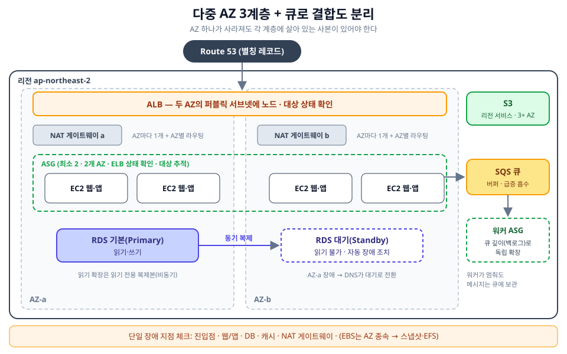
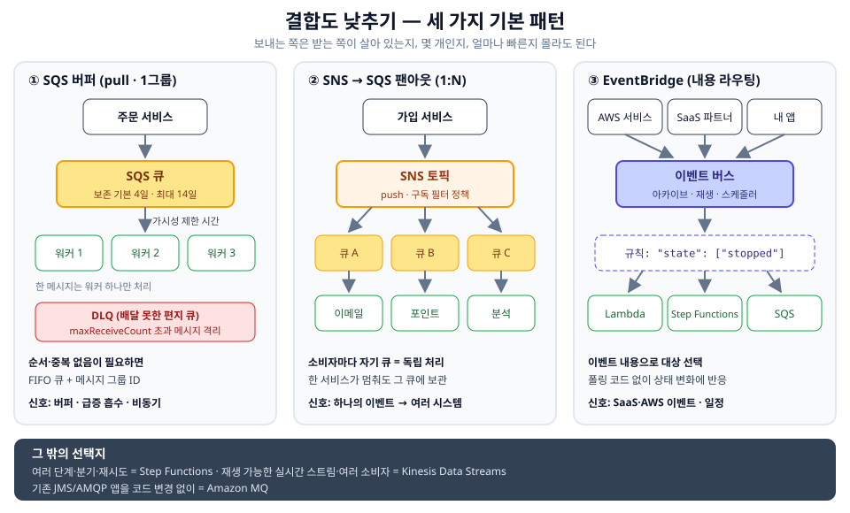
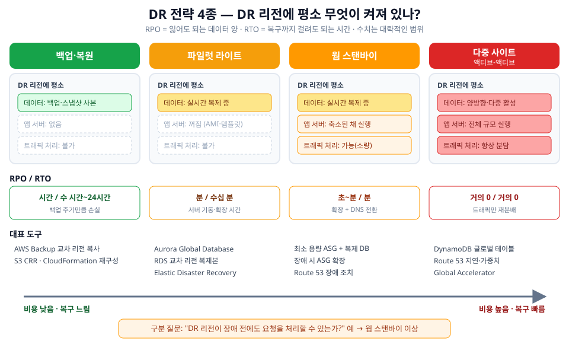

> **자격증 준비 · AWS SAA** | 난이도 ★★★☆☆ | 예상 소요 5 ~ 6시간 (문항 풀이 포함)

> ⚠️ **이 편의 모든 문항은 SAA-C03 공식 시험 가이드의 도메인 2(Design Resilient Architectures) 작업 항목을 바탕으로 직접 만든 창작 문항입니다.** 실제 출제 문제나 유출 문제(덤프)가 아니며, 그런 자료를 재현하지 않습니다.

## 🎯 오늘의 목표

- 계층(웹·앱·DB·캐시·스토리지·NAT)마다 **단일 장애 지점**을 찾고 다중 AZ로 없애는 방법을 고른다
- ALB·NLB·GWLB와 Auto Scaling 그룹의 상태 확인·확장 정책을 시나리오에 맞게 고른다
- SQS·SNS·EventBridge·Step Functions·Kinesis 중 **결합도를 낮추는 도구**를 요구사항으로 구분한다
- DR 전략 4종(백업·복원, 파일럿 라이트, 웜 스탠바이, 다중 사이트 액티브-액티브)을 **RPO·RTO 숫자로** 고른다
- Route 53 라우팅 정책 8종과 상태 확인, 별칭 레코드를 구분한다

---

## 1. 도메인 2 한눈에 보기 (비중 26%)

| 작업 항목 | 핵심 질문 | 이 편 절 |
|---|---|---|
| 2.1 확장 가능하고 느슨하게 결합된 아키텍처 | 부하가 10배가 되면? 한 구성 요소가 느려지면 다른 쪽도 멈추나? | 3장 ELB·ASG, 4장 결합도 |
| 2.2 고가용성·장애 허용 아키텍처 | AZ 하나·리전 하나가 사라지면? 데이터는 얼마나 잃고 얼마 만에 돌아오나? | 2장 멀티 AZ, 5장 DR, 6장 Route 53 |

본편 Day 11(롤링 업데이트), Day 18(HPA), Day 46(큐 기반 확장), Day 58(SLO), Day 64(카오스), Day 65(장애 대응)가 이 도메인의 뿌리입니다. EC2·ALB·ASG를 직접 만드는 실습은 [클라우드 탭 cloud03 참고](../../cloud/cloud03-ec2-asg-alb.md), RDS 실습은 [클라우드 탭 cloud04 참고](../../cloud/cloud04-s3-rds.md).

---

## 2. 멀티 AZ — 계층별 단일 장애 지점 없애기

| 계층 | 단일 장애 지점 예 | 다중 AZ 정답 패턴 |
|---|---|---|
| 진입점 | EC2 한 대에 Elastic IP | **ALB(또는 NLB)** — 여러 AZ 서브넷에 노드 |
| 웹·앱 | 한 AZ의 인스턴스들 | **ASG**가 2개 이상 AZ에 분산, 최소 용량 ≥ 2 |
| 컨테이너 | 단일 노드 Docker | ECS 서비스·EKS 노드 그룹을 여러 AZ에 |
| 관계형 DB | 단일 AZ RDS | **RDS Multi-AZ**(인스턴스: 대기 1개, 읽기 불가 / DB 클러스터: 읽기 가능한 대기 2개) 또는 **Aurora**(스토리지 6개 사본·3개 AZ) |
| 캐시 | 노드 1개 | ElastiCache 복제 그룹 + **Multi-AZ 자동 장애 조치** |
| 블록 스토리지 | EBS는 **한 AZ에 종속** | 스냅샷(리전 S3에 저장) / 공유 필요 시 EFS |
| 파일 스토리지 | — | **EFS 리전(Standard)** 클래스는 여러 AZ에 저장 |
| 오브젝트 | — | S3 Standard는 최소 3개 AZ에 저장 |
| 아웃바운드 인터넷 | NAT 게이트웨이 1개 | **AZ마다 NAT 게이트웨이** + AZ별 라우팅 테이블 |

> 💡 **RDS Multi-AZ와 읽기 전용 복제본은 목적이 다릅니다.** Multi-AZ(인스턴스 배포)의 대기 인스턴스는 **동기 복제·자동 장애 조치용**이라 읽기 트래픽을 받지 않습니다. 읽기 확장은 **읽기 전용 복제본**(비동기)입니다. "읽기 부하 분산"이 나오면 복제본, "AZ 장애 시 자동 장애 조치"가 나오면 Multi-AZ.

---

## 3. ELB와 Auto Scaling

### 3-1. 로드 밸런서 3종

| 구분 | ALB | NLB | GWLB |
|---|---|---|---|
| 계층 | L7 (HTTP/HTTPS/gRPC) | L4 (TCP/UDP/TLS) | L3 (GENEVE 6081) |
| 라우팅 | 경로·호스트·헤더·쿼리 기반, 가중치 대상 그룹 | 포트 기반 | 보안 어플라이언스로 투명하게 전달 |
| 고정 IP | 없음(DNS 이름 사용) | **AZ마다 고정 IP·Elastic IP** 가능 | — |
| 성능 | 일반 웹 | **초고성능·초저지연**, 수백만 RPS | — |
| 대상 | 인스턴스, IP, **Lambda** | 인스턴스, IP, ALB | 방화벽·IDS 어플라이언스 |
| 기타 | WAF 연결, Cognito/OIDC 인증, 고정 세션 | 클라이언트 IP 보존, PrivateLink 엔드포인트 서비스의 앞단 | 서드파티 방화벽 삽입 |

> 💡 **"클라이언트가 방화벽에 IP를 등록해야 한다"**, **"UDP"**, **"TCP 초저지연"** → NLB. **"/api는 A, /images는 B"** → ALB. **"서드파티 가상 방화벽을 투명하게 끼워 넣기"** → GWLB.

### 3-2. Auto Scaling 그룹(ASG)

| 개념 | 핵심 |
|---|---|
| 시작 템플릿 | AMI·인스턴스 유형·SG·사용자 데이터. (시작 구성은 구형) |
| 최소·원하는·최대 용량 | 고가용성이면 **최소 ≥ 2 + 2개 이상 AZ** |
| 상태 확인 | 기본은 **EC2 상태 확인**만. ALB 뒤라면 **ELB 상태 확인을 켜야** 앱이 죽은 인스턴스도 교체 |
| **대상 추적 정책** | "평균 CPU 50% 유지", "대상당 요청 수 1,000 유지" — 가장 권장 |
| 단계 조정 | 경보 크기에 따라 단계별 증감 |
| 예약 조정 | "매주 월요일 9시 트래픽 급증" 같은 예측 가능한 패턴 |
| 예측 조정 | 과거 패턴을 학습해 미리 확장 |
| 웜 풀 | 초기화가 오래 걸리는 인스턴스를 미리 준비 |
| 수명 주기 후크 | 시작·종료 직전에 스크립트(로그 백업 등) 실행 |
| 인스턴스 새로 고침 | 새 시작 템플릿으로 점진적 교체(Day 11 롤링 업데이트와 같은 발상) |

> ⚠️ SQS 워커를 확장할 때는 CPU보다 **큐 깊이(인스턴스당 백로그)** 가 더 정확한 지표입니다. Day 46의 KEDA 큐 기반 확장과 같은 원리입니다. ([SQS 기반 확장](https://docs.aws.amazon.com/autoscaling/ec2/userguide/as-using-sqs-queue.html))

---

## 4. 결합도 낮추기 — SQS, SNS, EventBridge, Step Functions, Kinesis

| 서비스 | 모델 | 고르는 신호 | 기억할 숫자·기능 |
|---|---|---|---|
| **SQS 표준** | 큐(pull), 소비자 1그룹 | "버퍼", "급증 흡수", "비동기 처리" | 최소 1회 전달, 순서 보장 없음, 처리량 사실상 무제한 |
| **SQS FIFO** | 큐 | "**순서 보장**", "중복 없이 한 번 처리" | 메시지 그룹 ID 단위 순서, 중복 제거(5분 간격) |
| **SNS** | pub/sub(push), 구독자 여러 개 | "하나의 이벤트를 **여러 시스템**에", 이메일·SMS 알림 | 구독 필터 정책, FIFO 토픽 |
| **SNS + SQS 팬아웃** | 토픽 → 여러 큐 | "각 소비자가 **독립적으로·내구성 있게** 처리" | 구독자 장애 시에도 큐에 보관 |
| **EventBridge** | 이벤트 버스 + 규칙 | "AWS 서비스·**SaaS** 이벤트", "**내용 기반** 라우팅", "일정 실행" | 아카이브·재생, Scheduler, 파트너 이벤트 소스 |
| **Step Functions** | 워크플로 오케스트레이션 | "여러 단계를 **순서·분기·재시도**로", "사람 승인 대기" | 표준·익스프레스 워크플로 |
| **Kinesis Data Streams** | 스트림(샤드) | "실시간 스트림", "**여러 소비자가 같은 데이터를 재생**", "샤드 내 순서" | 보존 기간 동안 재처리 가능 |
| **Amazon MQ** | 관리형 ActiveMQ·RabbitMQ | "기존 **JMS·AMQP·MQTT** 앱을 코드 변경 없이" | 리프트 앤 시프트용 |

### SQS 꼭 알아야 할 설정

| 설정 | 의미 | 시험 포인트 |
|---|---|---|
| 가시성 제한 시간 | 소비자가 받은 메시지를 다른 소비자에게 숨기는 시간(기본 30초, 최대 12시간) | 처리 시간보다 짧으면 **중복 처리** |
| 메시지 보존 기간 | 기본 4일, 최대 14일 | "주말 동안 소비자가 꺼져도 유실 없음" |
| 긴 폴링 | `ReceiveMessageWaitTimeSeconds` 최대 20초 | 빈 응답·비용 감소 |
| 배달 못한 편지 큐(DLQ) | `maxReceiveCount` 넘게 실패한 메시지를 격리 | "독성 메시지가 계속 재시도됨" |
| 지연 큐 | 메시지를 일정 시간 뒤에 보이게 | "등록 후 5분 뒤 처리" |

📖 [가시성 제한 시간](https://docs.aws.amazon.com/AWSSimpleQueueService/latest/SQSDeveloperGuide/sqs-visibility-timeout.html), [FIFO 큐](https://docs.aws.amazon.com/AWSSimpleQueueService/latest/SQSDeveloperGuide/sqs-fifo-queues.html), [DLQ](https://docs.aws.amazon.com/AWSSimpleQueueService/latest/SQSDeveloperGuide/sqs-dead-letter-queues.html)

---

## 5. 재해 복구(DR) 전략 4종

- **RPO(Recovery Point Objective):** 얼마만큼의 **데이터 손실**을 허용하나 (예: 최근 1시간치까지는 잃어도 됨)
- **RTO(Recovery Time Objective):** 얼마 만에 **서비스를 복구**해야 하나 (예: 4시간 안에)

본편 Day 58의 SLO가 "얼마나 자주 실패해도 되나"였다면, RPO·RTO는 "실패했을 때 얼마나 잃고 얼마나 기다리나"입니다.

| 전략 | DR 리전에 평소 있는 것 | RPO / RTO (대략) | 비용 | 대표 도구 |
|---|---|---|---|---|
| **백업·복원** | 백업만(스냅샷·S3) | 시간 / **수 시간~24시간** | 최저 | AWS Backup 교차 리전 복사, S3 CRR, CloudFormation으로 재구성 |
| **파일럿 라이트** | **데이터는 실시간 복제**, 앱 서버는 꺼짐(AMI·템플릿만) | 분 / **수십 분** | 낮음 | Aurora Global Database·RDS 교차 리전 복제본, Elastic Disaster Recovery |
| **웜 스탠바이** | **축소된 전체 스택이 항상 실행**(트래픽 처리 가능) | 초~분 / **분** | 중간 | 최소 용량 ASG + 복제 DB, 장애 시 확장 |
| **다중 사이트 액티브-액티브** | 전체 스택이 여러 리전에서 **동시에 트래픽 처리** | 거의 0 / **거의 0** | 최고 | DynamoDB 글로벌 테이블, Aurora Global Database(쓰기 전달), Route 53 지연·가중치 라우팅, Global Accelerator |

> 💡 **파일럿 라이트 vs 웜 스탠바이**를 가르는 질문: "DR 리전이 **장애 전에도 요청을 처리할 수 있는가?**" 처리할 수 있으면 웜 스탠바이, 앱 서버를 켜야 하면 파일럿 라이트. ([AWS DR 백서](https://docs.aws.amazon.com/whitepapers/latest/disaster-recovery-workloads-on-aws/disaster-recovery-options-in-the-cloud.html))

> ⚠️ DR 리전도 **서비스 할당량**(EC2 vCPU 한도 등)이 기본값이면 장애 시 확장이 막힐 수 있습니다. 시험 가이드가 직접 언급하는 항목입니다. 대기 환경의 할당량을 미리 올려 두세요.

### 데이터 계층 복제 도구

| 도구 | 범위 | 특징 |
|---|---|---|
| RDS 교차 리전 읽기 전용 복제본 | 리전 간 | 비동기. 승격 시 독립 DB |
| **Aurora Global Database** | 리전 간 | 스토리지 수준 복제, 복제 지연 보통 1초 미만, 보조 리전 승격 |
| **DynamoDB 글로벌 테이블** | 리전 간 | **다중 활성(멀티 리전 쓰기)** |
| S3 복제(CRR/SRR) | 리전 간/내 | 버전 관리 필수. **S3 RTC**는 객체 99.99%를 15분 안에 복제(SLA) |
| AWS Backup | 다중 서비스 | 백업 계획, 교차 리전·교차 계정 복사, Vault Lock |
| AWS Elastic Disaster Recovery | 서버(온프레미스·EC2) | 블록 수준 지속 복제, 저비용 스테이징 → 장애 시 기동 |

---

## 6. Route 53 — 라우팅 정책과 상태 확인

| 정책 | 하는 일 | 시나리오 신호 |
|---|---|---|
| 단순(Simple) | 하나의 값(여러 IP면 무작위) | 상태 확인 없음, 단순 매핑 |
| **장애 조치(Failover)** | 기본이 비정상이면 보조로 | "기본 리전 장애 시 **정적 유지 페이지**나 DR 리전으로" |
| **가중치(Weighted)** | 비율로 분배 | "트래픽 10%만 새 버전으로", A/B 테스트 |
| **지연 시간(Latency)** | 사용자에게 지연이 가장 낮은 리전 | "전 세계 사용자 응답 속도" |
| **지리적 위치(Geolocation)** | 사용자의 **대륙·국가·주** 기준 | "EU 사용자는 반드시 EU 리전", 콘텐츠 현지화·라이선스 |
| 지리 근접성(Geoproximity) | 위치 + **편향 값**으로 범위 조절 | "특정 리전 쪽으로 트래픽을 더 끌어오기" |
| 다중 값 응답(Multivalue) | 정상인 값 최대 8개 반환 | "DNS 수준의 간단한 부하 분산 + 상태 확인" (ELB 대체 아님) |
| IP 기반 | 클라이언트 CIDR 기준 | "특정 ISP 대역은 특정 엔드포인트로" |

- **상태 확인:** 엔드포인트(HTTP/HTTPS/TCP), 다른 상태 확인들의 조합(계산된 상태 확인), **CloudWatch 경보** 기반 상태 확인(프라이빗 리소스용).
- **별칭(Alias) 레코드:** **영역 꼭대기(zone apex, `example.com`)** 를 ALB·CloudFront·S3 웹사이트 등에 연결할 수 있음(CNAME은 꼭대기에 불가). 별칭 쿼리는 무료.
- **Global Accelerator vs Route 53:** GA는 **애니캐스트 고정 IP 2개** + AWS 백본으로 TCP/UDP 가속, DNS 캐시와 무관하게 **빠른 장애 조치**. "고정 IP", "DNS TTL 때문에 장애 조치가 늦다"면 GA.

📖 [라우팅 정책 선택](https://docs.aws.amazon.com/Route53/latest/DeveloperGuide/routing-policy.html), [DNS 장애 조치](https://docs.aws.amazon.com/Route53/latest/DeveloperGuide/dns-failover.html)

---

## 7. 시나리오 키워드 치트시트

| 문제에 이런 말이 나오면 | 먼저 떠올릴 것 |
|---|---|
| AZ 하나가 장애 나도 계속 | 다중 AZ ASG + ALB, RDS Multi-AZ |
| 읽기 부하 분산 | 읽기 전용 복제본(RDS·Aurora), 캐시 |
| 앱이 죽었는데 ASG가 교체 안 함 | ASG에 ELB 상태 확인 활성화 |
| 고정 IP, UDP, 초저지연 TCP | NLB (전 세계라면 Global Accelerator) |
| 경로·호스트 기반 라우팅, Lambda 대상 | ALB |
| 트래픽 급증 흡수, 비동기, 버퍼 | SQS |
| 순서 보장·중복 없음 | SQS FIFO (메시지 그룹 ID) |
| 하나의 이벤트를 여러 소비자가 각각 | SNS → 여러 SQS (팬아웃) |
| SaaS·AWS 이벤트 내용으로 라우팅, 일정 실행 | EventBridge |
| 여러 단계·재시도·분기 워크플로 | Step Functions |
| 실시간 스트림, 여러 소비자가 재생 | Kinesis Data Streams |
| 기존 JMS/AMQP 앱 그대로 | Amazon MQ |
| Lambda가 DB 연결을 고갈시킴 | RDS Proxy |
| RPO·RTO 수 시간, 비용 최소 | 백업·복원 |
| 데이터는 복제, 서버는 꺼둠, RTO 수십 분 | 파일럿 라이트 |
| 축소 스택이 항상 실행, RTO 분 | 웜 스탠바이 |
| RPO·RTO 거의 0, 여러 리전 동시 처리 | 다중 사이트 액티브-액티브 |
| MySQL·PostgreSQL 호환, 리전 간 1초 수준 복제 | Aurora Global Database |
| NoSQL, 여러 리전에서 쓰기 | DynamoDB 글로벌 테이블 |
| 코드 변경 없이 기존 서버를 DR | Elastic Disaster Recovery |
| 국가별로 반드시 특정 리전 | Route 53 지리적 위치 |
| 일부 비율만 새 버전 | Route 53 가중치(또는 ALB 가중치 대상 그룹) |
| 기본 장애 시 보조로 | Route 53 장애 조치 + 상태 확인 |

---

## 8. 헷갈리는 포인트

| 헷갈리는 쌍 | 가르는 기준 |
|---|---|
| RDS Multi-AZ vs 읽기 전용 복제본 | 가용성(동기·자동 장애 조치) vs 읽기 확장(비동기) |
| Multi-AZ 인스턴스 vs Multi-AZ DB 클러스터 | 대기 1개(읽기 불가) vs 읽기 가능한 대기 2개 |
| SQS vs SNS | pull·소비자 1그룹·보관 vs push·구독자 여럿·보관 없음 |
| SNS vs EventBridge | 단순 대량 팬아웃 vs 내용 기반 규칙·SaaS·스키마·재생 |
| SQS vs Kinesis | 처리 후 삭제·독립 확장 vs 보존·재생·여러 소비자·샤드 순서 |
| Step Functions vs SQS | 상태·순서가 있는 **오케스트레이션** vs 단순 버퍼 |
| 파일럿 라이트 vs 웜 스탠바이 | DR 리전 앱 서버가 꺼져 있나 / 축소된 채 돌고 있나 |
| Route 53 지연 시간 vs 지리적 위치 | 성능 기준 vs **위치 규칙**(규정·현지화) |
| Route 53 vs Global Accelerator | DNS 기반(TTL 영향) vs 애니캐스트 고정 IP·빠른 장애 조치 |
| ALB 고정 세션 vs 외부 세션 저장소 | 코드 변경 불가면 고정 세션, 무상태 설계면 ElastiCache·DynamoDB에 세션 |
| ASG EC2 상태 확인 vs ELB 상태 확인 | 하드웨어·OS만 vs 애플리케이션 응답까지 |

---

## 9. 창작 시나리오형 문항 (15문항)

> 공식 시험 가이드 도메인 2 작업 항목을 바탕으로 직접 만든 문항입니다. 문항당 2분 안에 풀어 보세요.

**Q1.** ALB 뒤 ASG의 EC2에서 애플리케이션 프로세스가 멈췄다. ALB 대상 그룹은 이 인스턴스를 비정상으로 표시해 트래픽을 보내지 않지만, ASG는 인스턴스를 교체하지 않아 용량이 줄어든 채로 남는다. 가장 적절한 조치는?

A. ALB 상태 확인 간격을 줄인다
B. ASG의 상태 확인 유형에 ELB 상태 확인을 추가한다
C. 인스턴스 유형을 더 크게 바꾼다
D. CloudWatch 경보로 관리자에게 이메일을 보낸다

정답·해설

**B.** ASG 기본 상태 확인은 EC2 상태(하드웨어·OS)만 봅니다. ELB 상태 확인을 켜면 대상 그룹에서 비정상인 인스턴스도 ASG가 종료·교체합니다.

📖 근거: [Auto Scaling 인스턴스 상태 확인](https://docs.aws.amazon.com/autoscaling/ec2/userguide/ec2-auto-scaling-health-checks.html)

**Q2.** 금융 고객사의 방화벽은 **허용 목록에 등록된 고정 IP**로만 아웃바운드를 허용한다. 고객사가 접속할 TCP 기반 서비스는 여러 AZ의 EC2에서 실행된다. 가장 적절한 진입점은?

A. ALB
B. 각 AZ에 Elastic IP를 할당한 NLB
C. CloudFront
D. Route 53 다중 값 응답

정답·해설

**B.** NLB는 AZ마다 고정 IP(Elastic IP 지정 가능)를 가집니다. ALB는 IP가 바뀔 수 있어 DNS 이름으로 접근해야 합니다. 전 세계 고객이면 고정 애니캐스트 IP를 주는 Global Accelerator도 후보입니다.

📖 근거: [Network Load Balancer](https://docs.aws.amazon.com/elasticloadbalancing/latest/network/introduction.html)

**Q3.** 동영상 인코딩 워커가 SQS 표준 큐에서 메시지를 받아 처리하는 데 약 3분이 걸린다. 같은 동영상이 두세 번씩 인코딩되는 일이 잦다. 큐 설정은 모두 기본값이다. 가장 적절한 조치는?

A. 큐를 FIFO 큐로 바꾼다
B. 가시성 제한 시간을 처리 시간보다 넉넉히(예: 6분) 늘린다
C. 긴 폴링을 켠다
D. 메시지 보존 기간을 14일로 늘린다

정답·해설

**B.** 기본 가시성 제한 시간은 30초입니다. 처리가 끝나기 전에 메시지가 다시 보이면 다른 워커가 또 받아 갑니다. FIFO(A)도 중복 제거는 하지만 근본 원인은 가시성 제한 시간입니다.

📖 근거: [SQS 가시성 제한 시간](https://docs.aws.amazon.com/AWSSimpleQueueService/latest/SQSDeveloperGuide/sqs-visibility-timeout.html)

**Q4.** 주문 처리 시스템에서 **같은 고객의 주문 이벤트는 반드시 들어온 순서대로**, 중복 없이 처리되어야 한다. 서로 다른 고객의 주문은 병렬로 처리해도 된다. 가장 적절한 설계는?

A. SQS 표준 큐, 소비자 1개
B. SQS FIFO 큐, 메시지 그룹 ID = 고객 ID
C. SNS 표준 토픽
D. SQS 표준 큐 + 지연 큐

정답·해설

**B.** FIFO 큐는 **메시지 그룹 단위로 순서**를 보장하고, 그룹이 다르면 병렬 처리됩니다. 고객 ID를 그룹 ID로 쓰면 요구사항과 정확히 맞습니다.

📖 근거: [SQS FIFO 큐 — 메시지 그룹 ID](https://docs.aws.amazon.com/AWSSimpleQueueService/latest/SQSDeveloperGuide/sqs-fifo-queues.html)

**Q5.** 회원 가입 이벤트가 발생하면 이메일 발송, 포인트 지급, 분석 적재 세 서비스가 **각자 독립적으로** 처리해야 한다. 한 서비스가 몇 시간 멈춰도 그 서비스의 이벤트가 유실되면 안 된다. 가장 적절한 설계는?

A. 가입 서비스가 세 서비스를 순서대로 HTTP 호출한다
B. SNS 토픽에 게시하고, 서비스마다 SQS 큐를 만들어 토픽을 구독한다
C. SQS 큐 하나에 넣고 세 서비스가 같은 큐를 소비한다
D. SNS 토픽에 게시하고 세 서비스가 HTTP 엔드포인트로 직접 구독한다

정답·해설

**B.** SNS→SQS 팬아웃입니다. 각 큐가 자기 소비자의 메시지를 보관하므로 한 서비스가 멈춰도 유실이 없습니다. C는 한 메시지를 한 소비자만 가져가므로 세 서비스가 나눠 갖게 됩니다. D는 구독자가 오래 멈추면 재시도 정책이 끝난 뒤 유실 위험이 있습니다.

📖 근거: [SNS 팬아웃 — SQS 구독](https://docs.aws.amazon.com/sns/latest/dg/sns-sqs-as-subscriber.html)

**Q6.** 운영팀은 EC2 인스턴스가 `stopped` 상태가 될 때마다 Lambda로 태그를 확인해 알림을 보내고 싶다. 폴링 코드는 작성하고 싶지 않다. 가장 적절한 방법은?

A. CloudWatch Logs 지표 필터
B. EventBridge 규칙으로 EC2 상태 변경 이벤트(`stopped`)를 매칭해 Lambda를 대상으로 지정한다
C. cron으로 5분마다 `DescribeInstances`를 호출한다
D. SQS 큐를 EC2에 연결한다

정답·해설

**B.** AWS 서비스 이벤트는 기본 이벤트 버스로 들어오고, 이벤트 **내용(상태 값)** 으로 매칭해 대상으로 보낼 수 있습니다.

📖 근거: [Amazon EventBridge란?](https://docs.aws.amazon.com/eventbridge/latest/userguide/eb-what-is.html)

**Q7.** 사내 위키 시스템의 DR 요구는 RPO 12시간, RTO 24시간이며 **비용을 최소화**해야 한다. 가장 적절한 전략은?

A. 다중 사이트 액티브-액티브
B. 웜 스탠바이
C. AWS Backup으로 매일 백업하고 DR 리전으로 교차 리전 복사, 장애 시 CloudFormation으로 재구성 후 복원
D. 파일럿 라이트

정답·해설

**C.** RPO·RTO가 수 시간~하루 수준이면 **백업·복원**으로 충분하고 가장 저렴합니다. 나머지는 요구보다 과한 비용입니다.

📖 근거: [AWS DR 전략](https://docs.aws.amazon.com/whitepapers/latest/disaster-recovery-workloads-on-aws/disaster-recovery-options-in-the-cloud.html)

**Q8.** 결제 시스템은 Aurora PostgreSQL을 쓴다. 리전 장애에 대비해 **RPO는 초 단위, RTO는 분 단위**가 필요하며, 평소 DR 리전에서 읽기 전용 보고서 쿼리도 돌리고 싶다. 가장 적절한 방법은?

A. 매시간 스냅샷을 DR 리전으로 복사한다
B. Aurora Global Database로 DR 리전에 보조 클러스터를 둔다
C. 같은 리전에 Aurora 복제본을 추가한다
D. DMS로 매일 전체 로드한다

정답·해설

**B.** Aurora Global Database는 스토리지 수준 복제로 지연이 보통 1초 미만이고, 보조 리전 클러스터를 읽기에 쓰다가 장애 시 승격할 수 있습니다. A·D는 RPO가 너무 크고, C는 리전 장애를 견디지 못합니다.

📖 근거: [Aurora Global Database](https://docs.aws.amazon.com/AmazonRDS/latest/AuroraUserGuide/aurora-global-database.html)

**Q9.** 회사는 DR 리전에 DB를 계속 복제하되, 애플리케이션 서버는 **평소 실행하지 않아** 비용을 줄이려 한다. 장애가 나면 AMI와 CloudFormation으로 서버를 띄워 **수십 분 안에** 복구하면 된다. 이 전략의 이름은?

A. 백업·복원
B. 파일럿 라이트
C. 웜 스탠바이
D. 다중 사이트 액티브-액티브

정답·해설

**B.** 핵심(데이터)만 켜 두고 나머지는 꺼 두는 것이 파일럿 라이트입니다. 축소된 앱 서버까지 항상 실행 중이라면 웜 스탠바이입니다.

📖 근거: [파일럿 라이트와 웜 스탠바이](https://docs.aws.amazon.com/whitepapers/latest/disaster-recovery-workloads-on-aws/disaster-recovery-options-in-the-cloud.html)

**Q10.** `shop.example.com`은 서울 리전 ALB로 서비스한다. 서울 리전 애플리케이션이 비정상이면 S3 정적 웹사이트의 **점검 안내 페이지**로 자동 전환해야 한다. 가장 적절한 구성은?

A. Route 53 가중치 라우팅 50:50
B. Route 53 장애 조치 라우팅 — 기본 레코드는 ALB 별칭 + 상태 확인, 보조 레코드는 S3 웹사이트 별칭
C. Route 53 지연 시간 라우팅
D. ALB 리스너 규칙으로 S3에 리디렉션

정답·해설

**B.** 장애 조치 라우팅은 기본 레코드의 상태 확인이 실패하면 보조 레코드로 응답합니다. ALB 별칭 레코드는 "대상 상태 평가"로 ALB 뒤 대상의 상태를 반영할 수도 있습니다.

📖 근거: [Route 53 DNS 장애 조치 구성](https://docs.aws.amazon.com/Route53/latest/DeveloperGuide/dns-failover-configuring.html)

**Q11.** 개인정보 규정상 **독일 사용자의 요청은 반드시 프랑크푸르트 리전**에서 처리되어야 하고, 나머지 국가는 서울 리전에서 처리한다. 가장 적절한 Route 53 정책은?

A. 지연 시간 라우팅
B. 지리적 위치 라우팅(독일 → 프랑크푸르트, 기본 → 서울)
C. 가중치 라우팅
D. 다중 값 응답 라우팅

정답·해설

**B.** 지연 시간 라우팅(A)은 네트워크 상황에 따라 독일 사용자가 다른 리전으로 갈 수 있어 **규정을 보장하지 못합니다**. 위치 기반 규칙은 지리적 위치 라우팅이며, 일치하지 않는 위치를 위한 **기본(default) 레코드**를 꼭 둡니다.

📖 근거: [지리적 위치 라우팅](https://docs.aws.amazon.com/Route53/latest/DeveloperGuide/routing-policy-geo.html)

**Q12.** 서버리스 API의 Lambda 함수가 RDS MySQL에 연결한다. 트래픽이 급증하면 동시 실행이 수천 개로 늘어 DB 연결이 고갈되고 오류가 난다. **애플리케이션 변경을 최소화**하며 해결하는 방법은?

A. RDS 인스턴스를 더 큰 유형으로 바꾼다
B. RDS Proxy를 두고 Lambda가 프록시 엔드포인트로 연결하게 한다
C. Lambda 메모리를 늘린다
D. 읽기 전용 복제본을 추가한다

정답·해설

**B.** RDS Proxy는 연결을 풀링·공유해 DB 연결 수를 줄이고, 장애 조치 시간도 줄여 줍니다. 연결 문자열만 바꾸면 됩니다. A는 일시 완화일 뿐이고 D는 쓰기 연결 문제를 풀지 못합니다.

📖 근거: [Amazon RDS Proxy](https://docs.aws.amazon.com/AmazonRDS/latest/UserGuide/rds-proxy.html)

**Q13.** 오래된 Java 웹 앱이 세션을 서버 메모리에 저장한다. ALB 뒤에 EC2 여러 대로 확장했더니 사용자가 수시로 로그아웃된다. **코드를 바꿀 수 없다.** 가장 적절한 조치는?

A. ALB 대상 그룹에서 고정 세션(sticky sessions)을 켠다
B. 세션을 DynamoDB에 저장하도록 코드를 수정한다
C. NLB로 바꾼다
D. 인스턴스를 1대로 줄인다

정답·해설

**A.** "코드 변경 불가" 제약 때문에 B는 탈락입니다. 고정 세션은 같은 사용자를 같은 대상으로 보냅니다. 다만 해당 인스턴스가 사라지면 세션도 사라지니, 코드를 고칠 수 있는 날이 오면 ElastiCache·DynamoDB 같은 외부 세션 저장소가 정석입니다.

📖 근거: [ALB 고정 세션](https://docs.aws.amazon.com/elasticloadbalancing/latest/application/edit-target-group-attributes.html#sticky-sessions)

**Q14.** 3개 AZ에 걸친 VPC에서 프라이빗 서브넷 인스턴스들이 **AZ-a에 있는 NAT 게이트웨이 하나**를 통해 인터넷으로 나간다. AZ-a 장애 시에도 다른 AZ의 아웃바운드가 유지되어야 한다. 가장 적절한 방법은?

A. NAT 게이트웨이의 대역폭을 늘린다
B. 각 AZ에 NAT 게이트웨이를 만들고, AZ별 프라이빗 라우팅 테이블이 같은 AZ의 NAT 게이트웨이를 가리키게 한다
C. 프라이빗 서브넷을 퍼블릭으로 바꾼다
D. NAT 게이트웨이에 Elastic IP를 하나 더 붙인다

정답·해설

**B.** NAT 게이트웨이는 **한 AZ 안에서만** 이중화됩니다. AZ 독립적인 설계를 하려면 AZ마다 하나씩 두고 라우팅도 AZ별로 나눕니다.

📖 근거: [NAT 게이트웨이](https://docs.aws.amazon.com/vpc/latest/userguide/vpc-nat-gateway.html)

**Q15.** 전 세계 사용자를 대상으로 한 모바일 게임 백엔드(UDP)가 서울·버지니아 두 리전에서 운영된다. 리전 장애 시 **DNS 캐시와 무관하게 수십 초 안에** 다른 리전으로 넘어가야 하고, 클라이언트에는 **고정 IP**를 하드코딩하고 싶다. 가장 적절한 서비스는? (**두 개를 고르시오**)

A. AWS Global Accelerator
B. 각 리전의 NLB를 Global Accelerator 엔드포인트 그룹으로 등록
C. Route 53 지연 시간 라우팅
D. CloudFront
E. 각 리전의 ALB

정답·해설

**A, B.** Global Accelerator는 애니캐스트 **고정 IP 2개**를 주고, 엔드포인트 상태에 따라 DNS와 무관하게 트래픽을 돌립니다. UDP이므로 엔드포인트는 NLB입니다. CloudFront(D)는 HTTP 콘텐츠 전송용, ALB(E)는 UDP를 지원하지 않습니다.

📖 근거: [AWS Global Accelerator란?](https://docs.aws.amazon.com/global-accelerator/latest/dg/what-is-global-accelerator.html)

### 채점 기준

| 정답 수 | 판단 |
|---|---|
| 13~15 | 도메인 2 준비 완료. W03으로 |
| 10~12 | 틀린 주제의 표(2~6장)만 다시 보기 |
| 9 이하 | 5장 DR 표를 손으로 다시 그리고, [클라우드 탭 cloud03 참고](../../cloud/cloud03-ec2-asg-alb.md)로 ALB+ASG를 직접 만들어 보기 |

---

## 10. 핵심 정리

- 계층마다 단일 장애 지점을 찾는다: ALB·ASG(2+ AZ), RDS Multi-AZ/Aurora, ElastiCache Multi-AZ, **AZ별 NAT 게이트웨이**, EBS는 AZ 종속
- Multi-AZ = 가용성(동기), 읽기 전용 복제본 = 읽기 확장(비동기)
- ALB = L7·경로/호스트·Lambda, NLB = L4·고정 IP·UDP·초저지연, GWLB = 보안 어플라이언스
- ASG는 **ELB 상태 확인**과 **대상 추적 정책**이 기본기. 큐 워커는 큐 깊이로 확장
- 결합도: 버퍼 = SQS, 순서 = FIFO(그룹 ID), 팬아웃 = SNS→SQS, 이벤트 라우팅·SaaS·일정 = EventBridge, 워크플로 = Step Functions, 재생 가능한 스트림 = Kinesis
- SQS 중복 처리 → **가시성 제한 시간**, 독성 메시지 → DLQ
- DR: **백업·복원(시간) → 파일럿 라이트(데이터만 활성) → 웜 스탠바이(축소 스택 실행) → 액티브-액티브(거의 0)**, 오른쪽일수록 비쌈
- Route 53: 장애 조치·가중치·지연·지리적 위치가 단골. 규정 = 지리적 위치, 성능 = 지연 시간. 고정 IP·빠른 장애 조치 = Global Accelerator

---

## ⏭️ 다음 예고 — W03. 고성능 아키텍처 (스토리지·캐시·DB·컴퓨팅 선택)

비중 24%의 도메인 3입니다. EBS 유형(gp3·io2 Block Express·st1·sc1)과 인스턴스 스토어, EFS와 FSx 4종, S3 스토리지 클래스, ElastiCache·DAX·CloudFront 캐시 전략, RDS·Aurora·DynamoDB 선택 기준, EC2·Lambda·Fargate 컴퓨팅 선택, 그리고 Kinesis·Athena·DataSync 같은 데이터 수집 선택지까지 창작 시나리오 문항으로 정리합니다.
