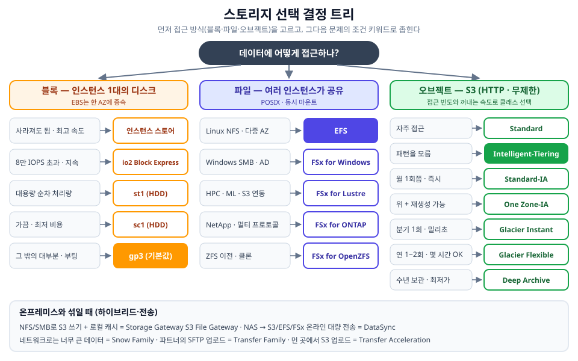
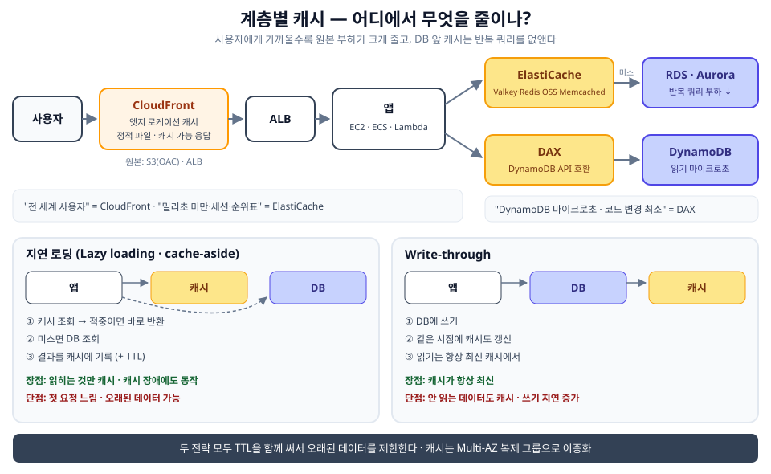
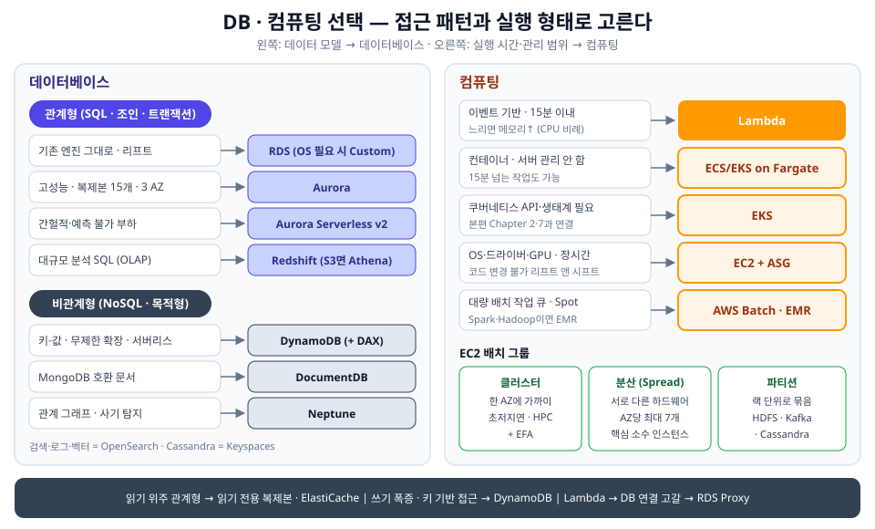

> **자격증 준비 · AWS SAA** | 난이도 ★★★☆☆ | 예상 소요 5 ~ 6시간 (문항 풀이 포함)

> ⚠️ **이 편의 모든 문항은 SAA-C03 공식 시험 가이드의 도메인 3(Design High-Performing Architectures) 작업 항목을 바탕으로 직접 만든 창작 문항입니다.** 실제 출제 문제나 유출 문제(덤프)가 아니며, 그런 자료를 재현하지 않습니다.

## 🎯 오늘의 목표

- 블록·파일·오브젝트 스토리지 중 **워크로드에 맞는 것**을 고르고, EBS 유형·EFS·FSx 4종·S3 스토리지 클래스를 구분한다
- CloudFront·ElastiCache·DAX가 **어느 계층의 무엇을** 캐시하는지 설명하고 캐시 전략(지연 로딩·Write-through·TTL)을 고른다
- RDS·Aurora·Aurora Serverless v2·DynamoDB와 목적형 DB를 **접근 패턴**으로 고른다
- EC2(인스턴스 패밀리·배치 그룹)·Lambda·Fargate·Batch 중 컴퓨팅을 고른다
- Kinesis·Data Firehose·Athena·Glue·DataSync 같은 **데이터 수집·변환** 선택지를 정리한다

---

## 1. 도메인 3 한눈에 보기 (비중 24%)

| 작업 항목 | 핵심 질문 | 이 편 절 |
|---|---|---|
| 3.1 고성능·확장 가능한 스토리지 | IOPS가 필요한가, 처리량이 필요한가, 공유가 필요한가? | 2장 |
| 3.2 고성능·탄력적 컴퓨팅 | 서버를 관리할 것인가, 얼마나 오래 도는가? | 5장 |
| 3.3 고성능 데이터베이스 | 관계형인가, 키-값인가, 읽기 위주인가? | 4장 |
| 3.4 고성능·확장 가능한 네트워크 | 사용자는 어디에 있고, 연결은 무엇으로? | 3장 CloudFront·6장 |
| 3.5 데이터 수집·변환 | 실시간인가, 배치인가, 어떤 형식으로? | 6장 |

본편 Day 04(볼륨), Day 14(PV·PVC·StorageClass), Day 31(Cinder·Swift), Day 06(Compose의 Redis 캐시), Day 18(리소스·HPA)이 이 도메인의 뿌리입니다. S3·RDS 실습은 [클라우드 탭 cloud04 참고](../../cloud/cloud04-s3-rds.md), EKS·Karpenter는 [클라우드 탭 cloud06 참고](../../cloud/cloud06-eks-cluster.md).

---

## 2. 스토리지 선택

### 2-1. 블록·파일·오브젝트

| 유형 | AWS 서비스 | 본편 대응 | 접근 | 고르는 신호 |
|---|---|---|---|---|
| 블록 | **EBS**, 인스턴스 스토어 | Cinder(Day 31), PV RWO(Day 14) | 인스턴스 1대(io1/io2 Multi-Attach 예외) | 부팅 볼륨, DB, 낮은 지연 |
| 파일 | **EFS**, **FSx** | NFS, PV RWX | 여러 인스턴스 동시 | "공유", "POSIX", "SMB" |
| 오브젝트 | **S3** | Swift(Day 31) | HTTP API | 무제한, 정적 파일, 데이터 레이크, 백업 |

### 2-2. EBS 볼륨 유형

[EBS 볼륨 유형](https://docs.aws.amazon.com/ebs/latest/userguide/ebs-volume-types.html) 문서(2026-11-19 확인) 기준입니다.

| 유형 | 매체 | 최대 IOPS | 최대 처리량 | 크기 | 고르는 신호 |
|---|---|---|---|---|---|
| **gp3** | SSD | 80,000 (기본 3,000 포함, **용량과 별도로 IOPS·처리량 설정**) | 2,000 MiB/s | 1 GiB–64 TiB | 대부분의 기본값, 부팅, 중간 규모 DB, "gp2보다 저렴하게" |
| gp2 | SSD | 16,000 (용량에 비례, 버스트) | 250 MiB/s | 1 GiB–16 TiB | 구형. 새로 고를 이유가 거의 없음 |
| **io2 Block Express** | SSD | **256,000** | 4,000 MiB/s | 4 GiB–64 TiB | "지속적인 고IOPS", "밀리초 미만 지연", 99.999% 내구성, **Multi-Attach** |
| io1 | SSD | 64,000 | 1,000 MiB/s | 4 GiB–16 TiB | 구형 고IOPS |
| **st1** | HDD | 500 | 500 MiB/s | 125 GiB–16 TiB | **순차 처리량**, 빅데이터·로그 처리, 부팅 불가 |
| **sc1** | HDD | 250 | 250 MiB/s | 125 GiB–16 TiB | 자주 안 쓰는 대용량, **최저 비용**, 부팅 불가 |

| 인스턴스 스토어 | 특징 |
|---|---|
| 물리 호스트에 붙은 NVMe | **가장 높은 IOPS·최저 지연**, 추가 요금 없음(인스턴스 요금에 포함) |
| 휘발성 | 인스턴스 **중지·종료·호스트 장애 시 데이터 소멸** → 캐시·버퍼·스크래치, 복제되는 분산 DB 노드 |

> 💡 숫자를 다 외울 필요는 없습니다. **"IOPS가 높고 지속적"→io2, "순차 처리량"→st1, "제일 싸고 가끔"→sc1, "휘발돼도 되고 제일 빠름"→인스턴스 스토어, 나머지→gp3**.

### 2-3. EFS와 FSx

| 서비스 | 프로토콜·OS | 고르는 신호 |
|---|---|---|
| **EFS** | NFSv4, **Linux** | 여러 AZ의 Linux 인스턴스·컨테이너·Lambda가 **공유하는 POSIX 파일 시스템**, 자동 확장. 처리량 모드: Elastic(권장)·Provisioned·Bursting. 스토리지 클래스: Standard·IA·Archive(수명 주기 정책) |
| **FSx for Windows File Server** | **SMB, Active Directory 연동** | "Windows 파일 공유", "NTFS 권한", "DFS" |
| **FSx for Lustre** | Lustre(Linux) | **HPC·ML 학습**, 밀리초 미만·초고처리량, **S3 버킷과 연결**(지연 로딩·내보내기) |
| **FSx for NetApp ONTAP** | NFS·SMB·iSCSI 동시 | "온프레미스 NetApp 그대로", 멀티 프로토콜, 스냅샷·복제 |
| **FSx for OpenZFS** | NFS | "온프레미스 ZFS 이전", 스냅샷·클론 |

### 2-4. S3 스토리지 클래스

[S3 스토리지 클래스](https://aws.amazon.com/s3/storage-classes/) 페이지(2026-11-19 확인) 기준입니다.

| 클래스 | AZ | 최소 보관 기간 | 첫 바이트 | 고르는 신호 |
|---|---|---|---|---|
| S3 Standard | ≥3 | 없음 | 밀리초 | 자주 접근 |
| **S3 Intelligent-Tiering** | ≥3 | 없음 | 밀리초(아카이브 계층 선택 시 분~시간) | **접근 패턴을 모르거나 변함**. 소액 모니터링 요금, 128 KB 미만 객체는 자동 계층화 대상 아님 |
| S3 Express One Zone | **1** | 1시간 | **한 자릿수 밀리초** | 초저지연 고성능, 한 AZ에 컴퓨팅과 함께 |
| S3 Standard-IA | ≥3 | 30일 | 밀리초 | 가끔 접근(월 1회 정도), 즉시 필요. 조회 요금 있음 |
| S3 One Zone-IA | **1** | 30일 | 밀리초 | 가끔 접근 + **다시 만들 수 있는** 데이터(AZ 손실 허용) |
| **S3 Glacier Instant Retrieval** | ≥3 | 90일 | **밀리초** | 분기 1회 정도 접근하지만 **즉시** 꺼내야 함 |
| S3 Glacier Flexible Retrieval | ≥3 | 90일 | 분~시간(신속 1~5분, 표준 3~5시간, 대량 5~12시간) | 연 1~2회, 몇 시간 대기 가능 |
| **S3 Glacier Deep Archive** | ≥3 | 180일 | 시간(표준 12시간 이내, 대량 48시간 이내) | **장기 보존 최저 비용**(규정 보관 7~10년) |

> ⚠️ 클래스 이동은 **수명 주기 규칙**으로 자동화합니다(예: 30일 후 Standard-IA, 90일 후 Glacier Flexible Retrieval). 비용 측면은 W04에서 더 다룹니다.

### 2-5. S3 성능 기능

| 요구 | 기능 |
|---|---|
| 큰 파일 업로드가 느림·실패 시 처음부터 | **멀티파트 업로드**(100 MB 이상 권장, 5 GB 초과 단일 PUT 불가) |
| 먼 대륙에서 한 버킷으로 업로드가 느림 | **S3 Transfer Acceleration**(엣지 로케이션 + AWS 백본) |
| 큰 객체 일부만 병렬로 읽기 | 바이트 범위 GET |
| 요청률 | 접두사(prefix)당 초당 **PUT/COPY/POST/DELETE 3,500건, GET/HEAD 5,500건** — 접두사를 나누면 병렬 확장 |

📖 [S3 성능 최적화](https://docs.aws.amazon.com/AmazonS3/latest/userguide/optimizing-performance.html)

### 2-6. 하이브리드 스토리지·전송

| 요구 | 서비스 |
|---|---|
| 온프레미스 앱이 NFS/SMB로 S3를 쓰고 로컬 캐시 | **Storage Gateway — S3 File Gateway** |
| 온프레미스 iSCSI 볼륨을 클라우드 백업 | Storage Gateway — Volume Gateway |
| 테이프 백업 소프트웨어 그대로 클라우드로 | Storage Gateway — Tape Gateway |
| 온프레미스 NAS → S3·EFS·FSx 대량 **온라인 전송·동기화** | **DataSync** |
| 네트워크가 느려 수십 TB 이상을 **오프라인**으로 | Snow Family |
| SFTP로 파트너가 S3에 업로드 | Transfer Family |

---

## 3. 캐시 — CloudFront, ElastiCache, DAX

| 캐시 | 위치 | 무엇을 | 고르는 신호 |
|---|---|---|---|
| **CloudFront** | 전 세계 엣지 로케이션 | 정적 파일, 캐시 가능한 동적 응답, 스트리밍 | "전 세계 사용자", "S3 정적 콘텐츠 지연 감소", "원본 부하 감소" |
| **ElastiCache** (Valkey·Redis OSS·Memcached) | VPC 안, 앱과 DB 사이 | DB 쿼리 결과, **세션**, 순위표 | "읽기 많은 RDS 부하 감소", "밀리초 미만", "세션 저장소" |
| **DAX** | DynamoDB 앞 | DynamoDB 읽기 | "DynamoDB **마이크로초** 읽기", "코드 변경 최소(DynamoDB API 호환)" |
| API Gateway 캐시 | API 스테이지 | API 응답 | "동일 API 응답 반복" |
| RDS 읽기 전용 복제본 | DB 계층 | (캐시는 아님) 읽기 분산 | "보고서 쿼리가 운영 DB를 느리게" |

### 3-1. ElastiCache 엔진과 캐시 전략

| 엔진 | 특징 |
|---|---|
| **Valkey / Redis OSS** | 복제·Multi-AZ 자동 장애 조치, 백업·복원, **정렬 세트(순위표)**, pub/sub, 다양한 자료 구조 |
| Memcached | 단순 키-값, **멀티스레드**, 샤딩만(복제·영속성 없음) |

| 전략 | 동작 | 장점 / 단점 |
|---|---|---|
| **지연 로딩(Lazy loading, cache-aside)** | 캐시 미스 시 DB에서 읽고 캐시에 씀 | 필요한 것만 캐시 / 첫 요청 느림, **오래된 데이터** 가능 |
| **Write-through** | DB에 쓸 때 캐시도 갱신 | 항상 최신 / 안 읽는 데이터도 캐시, 쓰기 지연 증가 |
| **TTL** | 일정 시간 후 만료 | 두 전략과 함께 써서 오래된 데이터를 제한 |

📖 [ElastiCache 캐싱 전략](https://docs.aws.amazon.com/AmazonElastiCache/latest/dg/Strategies.html)

### 3-2. CloudFront 핵심

- 원본: S3(**OAC**로 비공개 유지), ALB, EC2, 사용자 지정 HTTP 서버
- 캐시 정책으로 캐시 키(헤더·쿠키·쿼리 문자열)를 최소화하면 **캐시 적중률**이 올라감
- 엣지 연산: **CloudFront Functions**(가벼운 헤더·URL 조작), **Lambda@Edge**(더 무거운 로직)
- 비HTTP(TCP/UDP)·고정 IP는 CloudFront가 아니라 **Global Accelerator**(W02)

---

## 4. 데이터베이스 선택

| 요구 | 정답 | 기억할 점 |
|---|---|---|
| 기존 MySQL·PostgreSQL·Oracle·SQL Server를 **엔진 그대로** | **RDS** | OS 접근 필요하면 RDS Custom(Oracle·SQL Server) 또는 EC2 |
| 관계형 + 높은 성능·가용성, MySQL/PostgreSQL 호환 | **Aurora** | 스토리지 6개 사본·3개 AZ, 자동 확장 스토리지, **Aurora 복제본 최대 15개**, 리더 엔드포인트 |
| 관계형 + **예측 불가·간헐적** 부하, 용량 관리 싫음 | **Aurora Serverless v2** | ACU 단위로 세밀하게 자동 확장 |
| 키-값·문서, **한 자릿수 밀리초를 규모와 무관하게**, 서버리스 | **DynamoDB** | 온디맨드(트래픽 모름) vs 프로비저닝(예측 가능, Auto Scaling), GSI, Streams, TTL, 글로벌 테이블 |
| DynamoDB 읽기 **마이크로초** | DynamoDB + **DAX** | |
| MongoDB 호환 문서 DB | DocumentDB | |
| 그래프(소셜 관계, 추천, 사기 탐지) | Neptune | |
| Cassandra 호환 | Keyspaces | |
| 데이터 웨어하우스, 대규모 분석 SQL(OLAP) | **Redshift** | OLTP가 아님 |
| 전문 검색·로그 분석·벡터 검색 | OpenSearch Service | 본편 Day 41 벡터 DB와 연결 |
| 인메모리 기본 DB급 지속성이 필요한 Redis 호환 | MemoryDB | (ElastiCache는 캐시) |

> 💡 **"읽기 위주"인가 "쓰기 위주"인가**를 먼저 보세요. 읽기 위주 관계형 → 읽기 전용 복제본·Aurora 복제본·ElastiCache. 쓰기 폭증·키 기반 접근 → DynamoDB. 이기종 이전(Oracle→Aurora PostgreSQL)은 **DMS + Schema Conversion**, 동종 이전은 네이티브 도구나 DMS.

---

## 5. 컴퓨팅 선택

| 요구 | 정답 | 기억할 점 |
|---|---|---|
| OS·드라이버 제어, 장시간 실행, 특수 하드웨어(GPU) | **EC2** | 패밀리: C(컴퓨팅), M(범용), R/X(메모리), I/D(스토리지 IOPS), P/G(GPU), Inf/Trn(ML 가속) |
| 노드 간 **초저지연·고대역폭**(HPC, 밀결합) | **클러스터 배치 그룹** + EFA | 한 AZ에 몰려 있음 → 가용성은 낮아짐 |
| 인스턴스가 **같은 하드웨어를 공유하면 안 됨**(소수 핵심 인스턴스) | **분산(Spread) 배치 그룹** | AZ당 최대 7개 실행 인스턴스 |
| HDFS·Cassandra·Kafka처럼 랙 인식 | **파티션 배치 그룹** | |
| 이벤트 기반, 짧은 실행(최대 15분), 서버 관리 없음 | **Lambda** | 메모리 128 MB~10,240 MB, **메모리에 비례해 CPU 할당** |
| 컨테이너, 서버 관리 없음 | **ECS/EKS on Fargate** | 태스크·Pod 단위 vCPU·메모리 지정 |
| 쿠버네티스 API·생태계 필요 | **EKS** | 본편 Chapter 2·7과 연결 |
| AWS 네이티브 단순 컨테이너 운영 | **ECS** | |
| 대량 배치 작업 큐, Spot 활용 | **AWS Batch** | |
| Spark·Hadoop 빅데이터 | **EMR** | |
| 코드만 올리면 플랫폼이 알아서(웹 앱) | Elastic Beanstalk | |

> ⚠️ Lambda가 CPU 바운드 작업에서 느리면 "**메모리를 늘린다**"가 정답인 경우가 많습니다. CPU는 따로 설정하지 않고 메모리에 비례해 할당됩니다. 15분을 넘는 작업은 Lambda가 아니라 Fargate·Batch·EC2입니다. ([Lambda 메모리 구성](https://docs.aws.amazon.com/lambda/latest/dg/configuration-memory.html))

---

## 6. 네트워크·데이터 수집 한 장 요약

| 요구 | 정답 |
|---|---|
| 전 세계 사용자에게 정적·동적 웹 콘텐츠 빠르게 | CloudFront |
| TCP/UDP 전역 가속, 고정 IP | Global Accelerator |
| 온프레미스와 일정한 고대역폭 전용 연결 | Direct Connect |
| VPC 다수를 허브로 | Transit Gateway |
| 실시간 스트림, 여러 소비자, 직접 처리 코드 | **Kinesis Data Streams** |
| 스트림을 **S3·Redshift·OpenSearch로 거의 실시간 적재**, 관리 최소, 형식 변환(JSON→Parquet) | **Amazon Data Firehose** |
| Kafka 그대로 | MSK |
| S3 데이터에 **서버 없이 SQL** | **Athena** |
| ETL, 데이터 카탈로그, CSV→Parquet 변환 | **Glue** |
| 데이터 레이크 권한(열·행 수준) 중앙 관리 | Lake Formation |
| BI 대시보드 | Amazon Quick(구 QuickSight) |

---

## 7. 시나리오 키워드 치트시트

| 문제에 이런 말이 나오면 | 먼저 떠올릴 것 |
|---|---|
| 지속적 고IOPS, 밀리초 미만, 미션 크리티컬 DB | EBS io2 Block Express |
| IOPS를 용량과 별도로, 비용 효율 | EBS gp3 |
| 대용량 순차 읽기(로그·빅데이터) | EBS st1 |
| 휘발돼도 되는 임시 데이터, 최고 IOPS | 인스턴스 스토어 |
| 여러 Linux 인스턴스가 공유, 다중 AZ | EFS |
| Windows SMB, AD | FSx for Windows File Server |
| HPC·ML, S3 데이터셋, 초고처리량 | FSx for Lustre |
| NetApp, 멀티 프로토콜 | FSx for NetApp ONTAP |
| 접근 패턴 모름 | S3 Intelligent-Tiering |
| 드물게 접근하지만 즉시 | S3 Glacier Instant Retrieval |
| 수년 보관, 최저 비용, 12시간 대기 가능 | S3 Glacier Deep Archive |
| 재생성 가능한 데이터, 가끔 접근 | S3 One Zone-IA |
| 먼 곳에서 업로드 느림 | S3 Transfer Acceleration (+ 멀티파트) |
| 온프레미스 NFS로 S3 사용 | Storage Gateway S3 File Gateway |
| RDS 반복 읽기 부하, 세션, 순위표 | ElastiCache (Valkey/Redis OSS) |
| DynamoDB 마이크로초 | DAX |
| 정적 콘텐츠 전 세계 | CloudFront + OAC |
| 관계형 + 간헐적 부하 | Aurora Serverless v2 |
| 키-값, 무제한 확장, 서버리스 | DynamoDB |
| 노드 간 초저지연 HPC | 클러스터 배치 그룹 + EFA |
| Lambda가 느림(CPU) | 메모리 증가 |
| 15분 넘는 서버리스 컨테이너 | Fargate |
| 스트림 → S3 Parquet, 관리 최소 | Data Firehose |
| S3 데이터 SQL 즉석 분석 | Athena |

---

## 8. 헷갈리는 포인트

| 헷갈리는 쌍 | 가르는 기준 |
|---|---|
| gp3 vs io2 | 8만 IOPS 이하·비용 = gp3, 그 이상·지속성·99.999% 내구성·Multi-Attach = io2 |
| EBS vs 인스턴스 스토어 | 영속성 vs 최고 속도(휘발성) |
| EFS vs FSx for Lustre | 범용 공유 파일 vs HPC 처리량·S3 연동 |
| EFS vs FSx for Windows | Linux NFS vs Windows SMB·AD |
| Standard-IA vs One Zone-IA | 3개 AZ vs 1개 AZ(재생성 가능한 데이터만) |
| Glacier Instant vs Flexible Retrieval | 밀리초 vs 분~시간 |
| ElastiCache vs DAX | 범용 캐시(RDS 등) vs DynamoDB 전용 |
| ElastiCache Redis 계열 vs Memcached | 복제·영속성·자료 구조 vs 단순·멀티스레드 |
| CloudFront vs Global Accelerator | HTTP 캐시 vs TCP/UDP 가속·고정 IP |
| Aurora 복제본 vs RDS Multi-AZ 대기 | 읽기 가능·장애 조치 대상 vs (인스턴스 배포) 읽기 불가 대기 |
| Kinesis Data Streams vs Data Firehose | 직접 소비 코드·재생 vs 관리형 적재(거의 실시간) |
| Athena vs Redshift | 서버리스 즉석 쿼리(S3) vs 상시 데이터 웨어하우스 |
| 클러스터 vs 분산 배치 그룹 | 성능(가까이) vs 가용성(떨어뜨려) |

---

## 9. 창작 시나리오형 문항 (15문항)

> 공식 시험 가이드 도메인 3 작업 항목을 바탕으로 직접 만든 문항입니다. 문항당 2분 안에 풀어 보세요.

**Q1.** EC2에서 자체 운영하는 OLTP 데이터베이스가 **지속적으로 150,000 IOPS**와 밀리초 미만 지연을 요구한다. 데이터는 매우 중요해 높은 내구성이 필요하다. 가장 적절한 EBS 볼륨은?

A. gp3
B. io2 Block Express
C. st1
D. gp2

정답·해설

**B.** gp3 최대치(80,000 IOPS)를 넘고, 지속 성능·밀리초 미만 지연·99.999% 내구성이 필요하므로 io2 Block Express입니다(최대 256,000 IOPS, Nitro 인스턴스 필요).

📖 근거: [EBS 볼륨 유형](https://docs.aws.amazon.com/ebs/latest/userguide/ebs-volume-types.html)

**Q2.** 분산 캐시 클러스터의 각 노드가 **임시 데이터**를 매우 빠르게 읽고 쓴다. 데이터는 다른 노드에 복제되어 있어 노드 하나의 데이터가 사라져도 된다. **가장 높은 IOPS를 가장 저렴하게** 얻는 방법은?

A. io2 Block Express 볼륨
B. 인스턴스 스토어가 있는 스토리지 최적화 인스턴스(I 패밀리)
C. EFS
D. S3 Express One Zone

정답·해설

**B.** 인스턴스 스토어는 호스트에 붙은 NVMe라 지연이 가장 낮고 별도 요금이 없습니다. 휘발성이지만 "사라져도 된다"는 조건이 있으니 정답입니다.

📖 근거: [EC2 인스턴스 스토어](https://docs.aws.amazon.com/AWSEC2/latest/UserGuide/InstanceStorage.html)

**Q3.** 3개 AZ에 걸친 ASG의 Linux 웹 서버들이 사용자가 올린 이미지를 **같은 디렉터리에서 동시에 읽고 써야** 한다. 용량은 예측하기 어렵다. 가장 적절한 스토리지는?

A. 각 인스턴스에 EBS gp3
B. io2 Multi-Attach 볼륨
C. Amazon EFS
D. FSx for Windows File Server

정답·해설

**C.** 여러 AZ의 Linux 인스턴스가 공유하는 POSIX 파일 시스템, 자동 확장 = EFS. io2 Multi-Attach(B)는 **같은 AZ** 안의 인스턴스만, 클러스터 인식 파일 시스템이 필요합니다.

📖 근거: [Amazon EFS란?](https://docs.aws.amazon.com/efs/latest/ug/whatisefs.html)

**Q4.** 회사가 온프레미스 Windows 파일 서버를 AWS로 옮긴다. 사용자는 기존 **Active Directory 계정과 NTFS 권한**으로 SMB 공유에 접근해야 한다. 가장 적절한 서비스는?

A. EFS
B. FSx for Lustre
C. FSx for Windows File Server
D. S3 File Gateway

정답·해설

**C.** SMB + AD + Windows 권한 = FSx for Windows File Server.

📖 근거: [FSx for Windows File Server란?](https://docs.aws.amazon.com/fsx/latest/WindowsGuide/what-is.html)

**Q5.** ML 팀이 S3에 있는 수백 TB 학습 데이터를 GPU 인스턴스 수십 대에서 **초고처리량·밀리초 미만 지연**으로 읽어야 한다. 학습 결과는 다시 S3에 저장한다. 가장 적절한 방법은?

A. S3 버킷에 연결한 FSx for Lustre 파일 시스템을 마운트한다
B. 각 인스턴스에 S3 데이터를 `aws s3 sync`로 복사한다
C. EFS에 데이터를 복사한다
D. S3 Glacier Instant Retrieval에서 읽는다

정답·해설

**A.** FSx for Lustre는 HPC·ML용 병렬 파일 시스템이고, S3 버킷과 연결해 객체를 파일처럼 지연 로딩하고 결과를 S3로 내보낼 수 있습니다.

📖 근거: [FSx for Lustre란?](https://docs.aws.amazon.com/fsx/latest/LustreGuide/what-is.html)

**Q6.** 데이터 분석 팀의 S3 버킷에는 어떤 객체가 언제 다시 읽힐지 **예측할 수 없는** 데이터셋이 쌓인다. 성능 저하나 조회 요금 걱정 없이 비용을 자동으로 최적화하고 싶다. 가장 적절한 클래스는?

A. S3 Standard-IA
B. S3 Intelligent-Tiering
C. S3 One Zone-IA
D. S3 Glacier Flexible Retrieval

정답·해설

**B.** Intelligent-Tiering은 접근 패턴을 모니터링해 계층을 자동으로 옮기고, 조회(retrieval) 요금이 없습니다(객체당 소액 모니터링 요금). Standard-IA는 조회 요금과 30일 최소 보관이 있습니다.

📖 근거: [S3 스토리지 클래스](https://docs.aws.amazon.com/AmazonS3/latest/userguide/storage-class-intro.html)

**Q7.** 병원 영상 데이터는 분기에 한 번 정도만 열람되지만, 의사가 요청하면 **즉시(밀리초)** 보여 줘야 한다. 최소 1년 보관한다. **가장 비용 효율적인** 클래스는?

A. S3 Standard
B. S3 Glacier Instant Retrieval
C. S3 Glacier Flexible Retrieval
D. S3 Glacier Deep Archive

정답·해설

**B.** "드물게 접근 + 밀리초 조회"는 Glacier Instant Retrieval의 정의입니다. C·D는 분~시간 단위 대기가 필요해 요구를 어깁니다.

📖 근거: [S3 Glacier 스토리지 클래스](https://aws.amazon.com/s3/storage-classes/glacier/)

**Q8.** 유럽·남미 지사에서 서울 리전 S3 버킷으로 수 GB 파일을 업로드하는데 매우 느리고 중간에 자주 실패한다. 가장 적절한 조합은? (**두 개를 고르시오**)

A. S3 Transfer Acceleration을 활성화하고 가속 엔드포인트를 쓴다
B. 멀티파트 업로드를 사용한다
C. 버킷을 One Zone-IA로 바꾼다
D. 버킷 정책에 지사 IP를 허용한다
E. 업로드 전에 파일을 Glacier로 옮긴다

정답·해설

**A, B.** Transfer Acceleration은 가까운 엣지 로케이션으로 들어와 AWS 백본으로 전달하고, 멀티파트 업로드는 병렬 전송과 실패한 부분만 재전송을 가능하게 합니다.

📖 근거: [S3 Transfer Acceleration](https://docs.aws.amazon.com/AmazonS3/latest/userguide/transfer-acceleration.html), [멀티파트 업로드](https://docs.aws.amazon.com/AmazonS3/latest/userguide/mpuoverview.html)

**Q9.** 상품 상세 페이지가 RDS MySQL에서 같은 쿼리를 초당 수천 번 실행해 CPU가 90%를 넘는다. 상품 정보는 몇 분 늦게 반영돼도 된다. **DB 부하를 가장 크게** 줄이는 방법은?

A. RDS를 Multi-AZ로 바꾼다
B. ElastiCache(Valkey 또는 Redis OSS)를 두고 지연 로딩 + TTL 5분으로 쿼리 결과를 캐시한다
C. RDS 스토리지를 io2로 바꾼다
D. DB 인스턴스를 재부팅한다

정답·해설

**B.** 반복 읽기 + 약간의 지연 허용 = 캐시. TTL이 오래된 데이터 범위를 제한합니다. Multi-AZ(A)는 가용성용이라 읽기를 분산하지 않습니다.

📖 근거: [ElastiCache 캐싱 전략](https://docs.aws.amazon.com/AmazonElastiCache/latest/dg/Strategies.html)

**Q10.** 게임 순위 서비스가 DynamoDB를 쓴다. 이벤트 기간에 같은 아이템 읽기가 폭증하고, 응답이 **마이크로초 단위**여야 한다. **애플리케이션 코드 변경을 최소화**하는 방법은?

A. DynamoDB 앞에 DAX 클러스터를 두고 DAX 클라이언트로 연결한다
B. ElastiCache를 두고 캐시 로직을 직접 구현한다
C. 테이블을 프로비저닝 모드로 바꾸고 RCU를 늘린다
D. DynamoDB Streams를 켠다

정답·해설

**A.** DAX는 DynamoDB API와 호환되는 인메모리 캐시라 클라이언트만 바꾸면 되고, 읽기를 마이크로초 수준으로 낮춥니다. B도 가능하지만 캐시 로직을 직접 써야 합니다. C는 처리량을 늘릴 뿐 지연을 마이크로초로 만들지 못합니다.

📖 근거: [DynamoDB Accelerator(DAX)](https://docs.aws.amazon.com/amazondynamodb/latest/developerguide/DAX.html)

**Q11.** 사내 정산 시스템은 MySQL 호환 관계형 DB가 필요하다. 월말 며칠만 부하가 크고 나머지는 거의 유휴 상태이며, DBA가 없어 **용량 관리를 하고 싶지 않다**. 가장 적절한 선택은?

A. 가장 큰 RDS MySQL 인스턴스를 상시 운영
B. Aurora Serverless v2 (MySQL 호환)
C. DynamoDB 온디맨드
D. EC2에 MySQL 직접 설치

정답·해설

**B.** 관계형 + 간헐적 부하 + 용량 관리 최소 = Aurora Serverless v2. DynamoDB(C)는 관계형 요구를 어깁니다.

📖 근거: [Aurora Serverless v2](https://docs.aws.amazon.com/AmazonRDS/latest/AuroraUserGuide/aurora-serverless-v2.html)

**Q12.** 기상 시뮬레이션이 EC2 수십 대에서 MPI로 실행되며, 노드 간 통신 **지연이 가장 낮고 대역폭이 커야** 한다. 가장 적절한 구성은?

A. 분산 배치 그룹에 인스턴스를 배치한다
B. 여러 AZ에 걸친 ASG
C. 한 AZ의 클러스터 배치 그룹 + EFA를 지원하는 인스턴스
D. 파티션 배치 그룹을 3개 AZ에 걸쳐 만든다

정답·해설

**C.** 밀결합 HPC는 인스턴스를 물리적으로 가깝게 두는 클러스터 배치 그룹과, OS 우회 통신을 지원하는 EFA가 정석입니다. 분산(A)은 반대로 떨어뜨리는 용도입니다.

📖 근거: [배치 그룹](https://docs.aws.amazon.com/AWSEC2/latest/UserGuide/placement-groups.html), [Elastic Fabric Adapter](https://docs.aws.amazon.com/AWSEC2/latest/UserGuide/efa.html)

**Q13.** 이미지 변환 Lambda 함수(메모리 512 MB)가 CPU 집약적인 처리 때문에 실행 시간이 길다. 코드를 바꾸지 않고 **실행 시간을 줄이는** 가장 간단한 방법은?

A. Lambda 타임아웃을 15분으로 늘린다
B. Lambda 메모리를 늘린다
C. 예약된 동시성을 설정한다
D. Lambda를 VPC에 연결한다

정답·해설

**B.** Lambda는 메모리에 비례해 CPU를 할당하므로 메모리를 늘리면 CPU 바운드 작업이 빨라집니다(요금은 메모리×시간이라 총비용이 오히려 줄기도 함). A는 실패를 막을 뿐 빨라지지 않습니다.

📖 근거: [Lambda 메모리 구성](https://docs.aws.amazon.com/lambda/latest/dg/configuration-memory.html)

**Q14.** 회사가 Spring Boot 마이크로서비스 컨테이너 10개를 운영하려 한다. 일부 작업은 30분 이상 실행되며, 팀은 **서버(EC2) 패치와 클러스터 용량 관리를 하고 싶지 않다**. 쿠버네티스는 필요 없다. 가장 적절한 선택은?

A. Lambda
B. Amazon ECS on AWS Fargate
C. EC2에 Docker 직접 설치
D. EKS 관리형 노드 그룹

정답·해설

**B.** 30분 이상 실행이라 Lambda(최대 15분)는 탈락, 서버 관리 없음 + 쿠버네티스 불필요 = ECS on Fargate. D는 노드(EC2) 관리가 남습니다.

📖 근거: [AWS Fargate](https://docs.aws.amazon.com/AmazonECS/latest/developerguide/AWS_Fargate.html), [Lambda 할당량](https://docs.aws.amazon.com/lambda/latest/dg/gettingstarted-limits.html)

**Q15.** 웹사이트 클릭스트림을 거의 실시간으로 S3 데이터 레이크에 **Parquet 형식**으로 쌓고, 분석가는 서버 없이 SQL로 조회하고 싶다. **운영 오버헤드가 가장 적은** 조합은? (**두 개를 고르시오**)

A. Amazon Data Firehose로 수집하고 레코드 형식 변환(Parquet)을 켜서 S3로 전달한다
B. EC2에 Kafka를 설치한다
C. Amazon Athena로 S3 데이터를 조회한다
D. Redshift 프로비저닝 클러스터를 상시 운영한다
E. Kinesis Data Streams 소비자 애플리케이션을 직접 작성해 Parquet로 변환한다

정답·해설

**A, C.** Firehose는 관리형으로 버퍼링·형식 변환·S3 전달을 해 주고, Athena는 S3에 바로 서버리스 SQL을 실행합니다. E도 가능하지만 소비자 코드를 직접 운영해야 하고, B·D는 운영 부담이 큽니다.

📖 근거: [Amazon Data Firehose](https://docs.aws.amazon.com/firehose/latest/dev/what-is-this-service.html), [Amazon Athena](https://docs.aws.amazon.com/athena/latest/ug/what-is.html)

### 채점 기준

| 정답 수 | 판단 |
|---|---|
| 13~15 | 도메인 3 준비 완료. W04로 |
| 10~12 | 틀린 주제의 표(2~6장)만 다시 보기 |
| 9 이하 | 2장 스토리지 결정 트리를 손으로 다시 그리고, [클라우드 탭 cloud04 참고](../../cloud/cloud04-s3-rds.md)로 S3 수명 주기·RDS를 직접 만들어 보기 |

---

## 10. 핵심 정리

- 블록(EBS·인스턴스 스토어) / 파일(EFS·FSx) / 오브젝트(S3). **공유 + Linux = EFS, Windows = FSx for Windows, HPC = FSx for Lustre**
- EBS: 기본 **gp3**(IOPS·처리량 별도 설정), 초고IOPS·내구성 **io2 Block Express**, 순차 처리량 **st1**, 최저가 **sc1**, 휘발·최고 속도 **인스턴스 스토어**
- S3: 모름 = Intelligent-Tiering, 드물지만 즉시 = Glacier Instant, 장기 최저가 = Deep Archive, 재생성 가능 = One Zone-IA. 업로드 가속 = Transfer Acceleration + 멀티파트
- 캐시: 엣지 = CloudFront, RDS 앞 = ElastiCache(지연 로딩·Write-through·TTL), DynamoDB 앞 = DAX(마이크로초)
- DB: 엔진 그대로 = RDS, 고성능 관계형 = Aurora, 간헐적 = Aurora Serverless v2, 키-값 대규모 = DynamoDB, 분석 = Redshift·Athena
- 컴퓨팅: 제어 = EC2(배치 그룹: 클러스터=성능, 분산=가용성), 15분 이내 이벤트 = Lambda(느리면 메모리↑), 서버 없는 컨테이너 = Fargate
- 수집: 스트림 직접 처리 = Kinesis Data Streams, 관리형 적재·Parquet 변환 = Data Firehose, S3 SQL = Athena, ETL = Glue

---

## ⏭️ 다음 예고 — [W04. 비용 최적화 아키텍처](./w04-cost-optimization.md)

도메인 4(비중 20%)입니다. 지금까지 "가장 안전하게·튼튼하게·빠르게" 고른 서비스를 이번에는 **"가장 싸게"** 다시 고릅니다. EC2 구매 옵션(온디맨드·Savings Plans·예약 인스턴스·Spot), 스토리지 수명 주기와 클래스 이동, 데이터베이스·서버리스 비용 모델, NAT 게이트웨이·데이터 전송 요금처럼 **보이지 않는 네트워크 비용**을 줄이는 법, 그리고 Cost Explorer·Budgets·Compute Optimizer를 시나리오 문항으로 정리합니다.
