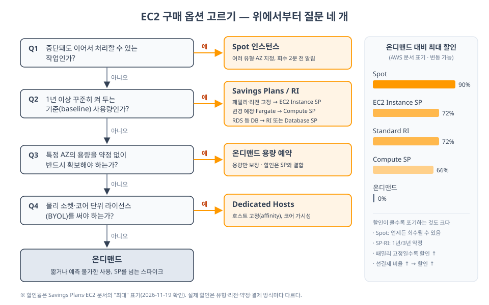
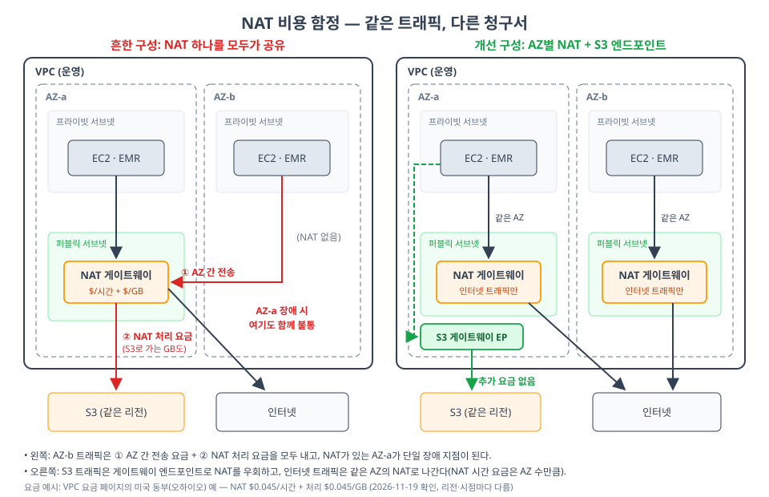

> **자격증 준비 · AWS SAA** | 난이도 ★★★☆☆ | 예상 소요 2.5~3시간 (개념 1.5시간 + 문제 풀이·복습 1~1.5시간)

> ⚠️ **이 편의 모든 문항은 AWS가 공개한 SAA-C03 시험 가이드의 Domain 4(비용 최적화 아키텍처) 과제 설명을 바탕으로 이 시리즈가 직접 창작한 연습 문제입니다.** 실제 시험 문제나 덤프를 재현하지 않으며, 회사 이름·수치·시나리오는 모두 새로 지었습니다. AWS 자격증 시험은 응시 계약(NDA)으로 보호되므로 "실제 출제 문제"라고 주장하는 자료는 믿지도, 퍼뜨리지도 마세요.

> 💡 **확인 기준일 2026-11-19.** 시험 정보는 AWS 공식 시험 가이드(SAA-C03, 가이드 버전 1.1)로, 요금·할인율은 각 서비스의 공식 요금·문서 페이지로 확인했습니다. 요금은 **리전과 시점에 따라 바뀌므로** 숫자는 "감 잡기용"으로만 쓰고, 시험에서는 **상대적인 크기**(무엇이 더 싸고 비싼가)를 묻는다는 점을 기억하세요.

## 🎯 오늘의 목표

- EC2 구매 옵션(온디맨드, Savings Plans, 예약 인스턴스, Spot, 용량 예약, Dedicated Hosts)을 **워크로드 특성 문장 하나**로 골라낼 수 있다
- S3·EBS·EFS 스토리지 계층과 수명 주기 규칙을 **최소 보관 기간·최소 과금 크기·조회 시간**까지 따져서 설계할 수 있다
- 데이터 전송 요금 구조와 **NAT 게이트웨이 비용 함정**(S3 트래픽, AZ 간 경로)을 설명하고 고칠 수 있다
- Cost Explorer, Budgets, Cost Anomaly Detection, Compute Optimizer, CUR(Data Exports)의 **쓰임새 차이**를 구분한다
- 창작 시나리오 15문항으로 "가장 비용 효율적인(MOST cost-effective)" 문구에 반응하는 감각을 기른다

---

## 1. Domain 4 한눈에 보기

SAA-C03의 네 도메인 가운데 비용 최적화는 **채점 대상 문항의 20%** 입니다. 비중은 가장 작지만, 다른 도메인 문제의 선택지에도 "가장 비용 효율적인"이라는 조건이 자주 붙기 때문에 실제 체감 비중은 훨씬 큽니다.

| 과제(Task) | 시험 가이드 표현 | 이 편에서 다루는 곳 |
|---|---|---|
| 4.1 | 비용 최적화된 **스토리지** 설계 | 3절 스토리지 계층과 수명 주기 |
| 4.2 | 비용 최적화된 **컴퓨팅** 설계 | 2절 EC2 구매 옵션, 2-3 그 밖의 컴퓨팅 레버 |
| 4.3 | 비용 최적화된 **데이터베이스** 설계 | 5절 데이터베이스 비용 |
| 4.4 | 비용 최적화된 **네트워크** 설계 | 4절 데이터 전송과 NAT 함정 |
| 공통 | 비용 관리 도구(Cost Explorer, Budgets, CUR), 비용 할당 태그, 다중 계정 결제 | 6절 비용 도구 |

> 💡 시험 가이드의 4.1~4.4는 모두 **"비용 관리 서비스 기능(비용 할당 태그, 다중 계정 결제)"과 "비용 관리 도구(Cost Explorer, Budgets, CUR)"를 공통 지식으로** 적어 두었습니다. 도구 문제는 어느 과제에서든 나올 수 있다는 뜻입니다.

이론 배경은 앞 편과 이어집니다. [W01(보안)](./w01-secure-architectures.md)의 VPC 엔드포인트, [W02(복원력)](./w02-resilient-architectures.md)의 멀티 AZ·DR 전략, [W03(고성능)](./w03-high-performing-architectures.md)의 스토리지·DB 선택을 **같은 요구 사항을 더 싸게** 만족시키는 관점으로 다시 봅니다. 실제 계정에서 비용 가드레일을 손으로 만들어 보는 실습은 클라우드 탭의 [cloud01 — AWS 계정 준비·IAM·비용 가드레일](../../cloud/cloud01-aws-account-setup.md)과 [cloud11 — FinOps와 정리](../../cloud/cloud11-finops-cleanup.md)에서 합니다.

---

## 2. EC2 구매 옵션

### 2-1. 여섯 가지 옵션 비교

| 옵션 | 약정 | 할인(온디맨드 대비, 문서상 최대) | 용량 보장 | 이럴 때 |
|---|---|---|---|---|
| **온디맨드** | 없음 | 없음 | 없음 | 짧은 실험, 예측 불가한 스파이크, 약정분을 넘는 사용 |
| **Compute Savings Plans** | 1년/3년, 시간당 **금액** 약정 | 최대 66% | 없음 | 패밀리·리전·OS를 바꿀 수 있어야 함, **Fargate·Lambda**도 할인받고 싶음 |
| **EC2 Instance Savings Plans** | 1년/3년, 특정 **리전의 패밀리** | 최대 72% | 없음 | 패밀리·리전은 고정, 크기·OS·테넌시는 바뀔 수 있음 |
| **예약 인스턴스(RI)** | 1년/3년, 인스턴스 속성 | Standard 최대 72%, Convertible은 그보다 낮음 | **영역(zonal) RI만** 보장 | 기존 RI 운용, RDS·ElastiCache·Redshift·OpenSearch 같은 **DB·분석 서비스 예약** |
| **Spot** | 없음 | 최대 90% | 없음, **2분 전 알림 후 회수** | 중단에 강한 배치·CI·빅데이터·상태 없는 웹 계층 일부 |
| **온디맨드 용량 예약(ODCR)** | 없음(언제든 해제) | 그 자체로는 없음 | **특정 AZ 보장** | 행사·DR 훈련처럼 정해진 기간에 용량이 꼭 필요할 때. 할인은 SP나 지역 RI와 겹쳐 받음 |
| **Dedicated Hosts** | 온디맨드 또는 예약 | — | 물리 서버 한 대 | 소켓·코어 단위 **BYOL**, 규정상 물리 서버 격리 |



시험 문장에서 정답을 가르는 단서는 대개 한 줄입니다.

- "중단돼도 다시 시작할 수 있다", "체크포인트", "상태 없음(stateless)", "유연한 마감" → **Spot**
- "앞으로 1년(3년) 동안 꾸준히", "24/7 기준 사용량" → **Savings Plans / RI**
  - 여기에 "인스턴스 패밀리를 바꿀 예정", "Graviton으로 이전", "Fargate·Lambda도" → **Compute SP**
  - "패밀리·리전 고정", "가장 큰 할인" → **EC2 Instance SP**(또는 Standard RI)
- "특정 AZ", "용량을 반드시 확보", "약정 없이", "2주 동안" → **ODCR**
- "소켓·코어 기반 라이선스", "같은 물리 서버" → **Dedicated Hosts**
- "기간이 짧고 예측할 수 없다", "중단되면 안 된다" → **온디맨드**

> ⚠️ **함정 1 — Spot은 운영 DB의 답이 아니다.** "비용을 가장 많이 줄인다"는 말에 끌려 Spot을 고르기 쉽지만, 문제에 "중단되면 안 된다", "상태를 유지해야 한다"가 있으면 Spot은 탈락입니다.
>
> ⚠️ **함정 2 — 용량 보장 ≠ 할인.** Savings Plans와 지역(regional) RI는 할인만 줍니다. 특정 AZ의 용량까지 필요하면 ODCR(또는 영역 RI)이 있어야 합니다.

### 2-2. Savings Plans와 RI의 세부 규칙

| 항목 | 내용 |
|---|---|
| 약정 단위 | Savings Plans는 **시간당 사용 금액($/시간)**, RI는 인스턴스 속성(유형·리전·테넌시·플랫폼) |
| 결제 방식 | 전액 선결제 > 부분 선결제 > 선결제 없음 순으로 할인 큼 |
| 다중 계정 | AWS Organizations 통합 결제에서는 기본적으로 **조직 안 다른 계정의 사용량에도 할인이 공유**됨(계정별로 공유를 끌 수 있음) |
| 넘치는 사용 | 약정 금액을 넘는 사용분은 **온디맨드 요금** |
| DB 서비스 | RDS·ElastiCache 등은 **예약 인스턴스(예약 노드)**. 2025-12에는 Aurora·RDS·DynamoDB 등에 쓰는 **Database Savings Plans**(1년)가 새로 나왔지만, SAA-C03 가이드의 Savings Plans 설명은 컴퓨팅 중심이므로 시험에서는 "RDS 장기 운영 → RI"가 기본 답이라고 보면 됩니다 |
| 추천 | Cost Explorer의 **Savings Plans·RI 구매 추천**이 과거 사용량을 바탕으로 약정 금액을 계산해 줌 |

### 2-3. 그 밖의 컴퓨팅 비용 레버

| 레버 | 핵심 | 시험 단서 |
|---|---|---|
| **rightsizing** | 사용률이 낮은 인스턴스를 작은 크기·다른 패밀리로 | "CPU 사용률이 10% 미만", Compute Optimizer |
| **Graviton(Arm)** | 같은 성능에 더 낮은 가격 | "코드 변경 없이(인터프리터 언어·컨테이너 멀티 아키텍처)" |
| **Auto Scaling** | 수요에 맞춰 대수를 조절, 예측 가능한 패턴은 예약(scheduled)·예측(predictive) 스케일링 | "매일 오전 9시 급증" |
| **업무 시간만 켜기** | 개발·테스트 환경을 밤·주말에 중지(EventBridge Scheduler, AWS Instance Scheduler 솔루션) | "평일 근무 시간에만 사용" |
| **최대 절전(hibernation)** | RAM 내용을 EBS 루트 볼륨에 저장하고 중지 → 재개가 빠름, 중지 중에는 EBS 저장 비용만 | "긴 초기화(캐시 워밍)를 다시 하고 싶지 않다" |
| **서버리스·컨테이너** | 유휴 시간에 돈을 내지 않음(Lambda), 작업 단위 과금(Fargate), **Fargate Spot** | "트래픽이 간헐적", "하루 몇 번 실행" |

---

## 3. 스토리지 계층과 수명 주기

### 3-1. S3 스토리지 클래스

| 클래스 | 조회 지연 | 최소 보관 기간 | 최소 과금 크기 | 조회 요금 | AZ | 대표 용도 |
|---|---|---|---|---|---|---|
| **S3 Standard** | 밀리초 | 없음 | 없음 | 없음 | ≥3 | 자주 쓰는 데이터 |
| **S3 Intelligent-Tiering** | 밀리초(선택 아카이브 계층 제외) | 없음 | 128KB 미만은 자동 이동 대상 아님 | 없음(객체당 모니터링 요금) | ≥3 | **접근 패턴을 모름** |
| **S3 Standard-IA** | 밀리초 | 30일 | 128KB | 있음 | ≥3 | 월 1회 정도 |
| **S3 One Zone-IA** | 밀리초 | 30일 | 128KB | 있음 | **1** | 다시 만들 수 있는 사본 |
| **S3 Glacier Instant Retrieval** | 밀리초 | 90일 | 128KB | 있음(IA보다 큼) | ≥3 | **분기 1회**, 바로 열려야 함 |
| **S3 Glacier Flexible Retrieval** | 분~시간(신속 1~5분, 표준 3~5시간, 대량 5~12시간) | 90일 | — | 방식별 | ≥3 | 백업·아카이브, 연 1~2회 |
| **S3 Glacier Deep Archive** | 표준 12시간 이내, 대량 48시간 이내 | 180일 | — | 방식별 | ≥3 | 규정 보존(7~10년) |
| **S3 Express One Zone** | 한 자릿수 밀리초 | — | — | — | **1** | 성능용(비용 절감용 아님) |

> ⚠️ **최소 보관 기간 함정.** Standard-IA에 넣은 객체를 10일 만에 지우면 남은 20일 치 저장 요금이 청구됩니다. "임시 파일을 며칠만 보관" 같은 조건이면 IA·Glacier 계열은 오답입니다.
>
> ⚠️ **작은 객체 함정.** IA·Glacier IR은 128KB보다 작은 객체도 128KB로 과금하고, 수명 주기 규칙은 기본적으로 128KB 미만 객체를 전환하지 않습니다. 수 KB짜리 객체가 수억 개라면 **묶어서 큰 객체로 만든 뒤** 전환하는 것이 정답 방향입니다.

### 3-2. 수명 주기 규칙 설계

수명 주기 규칙은 **전환(transition)** 과 **만료(expiration)** 두 동작으로 이뤄집니다. 시험에서 자주 확인하는 규칙만 추립니다.

| 규칙 | 내용 |
|---|---|
| 전환 방향 | Standard → (IA·Intelligent-Tiering·Glacier 계열)로 **내려가는 방향**만 자동 전환 |
| IA로 전환 | Standard에서 Standard-IA/One Zone-IA로 가려면 객체가 **최소 30일** 지나야 함 |
| 버전 관리 버킷 | 이전 버전(noncurrent)에 대해 따로 전환·만료 규칙을 걸어야 비용이 줄어듦 |
| 미완료 멀티파트 업로드 | `AbortIncompleteMultipartUpload` 규칙으로 정리(보이지 않는 저장 비용의 단골 원인) |
| 필터 | 접두사(prefix)·태그·객체 크기로 대상 지정 |

예를 들어 "생성 후 30일은 자주 조회, 이후 1년은 거의 안 보지만 바로 열려야 하고, 7년 후 삭제"라면:

```json
{
  "Rules": [{
    "ID": "audit-logs",
    "Filter": { "Prefix": "audit/" },
    "Status": "Enabled",
    "Transitions": [
      { "Days": 30,  "StorageClass": "GLACIER_IR" },
      { "Days": 365, "StorageClass": "DEEP_ARCHIVE" }
    ],
    "Expiration": { "Days": 2555 },
    "AbortIncompleteMultipartUpload": { "DaysAfterInitiation": 7 }
  }]
}
```

```bash
aws s3api put-bucket-lifecycle-configuration \
  --bucket <버킷> --lifecycle-configuration file://lifecycle.json
```

### 3-3. EBS·EFS·백업 비용

| 대상 | 비용 레버 | 시험 단서 |
|---|---|---|
| EBS gp2 → **gp3** | gp3는 크기와 별개로 기본 3,000 IOPS·125MiB/s, 필요하면 IOPS·처리량만 따로 추가. 보통 GB당 gp2보다 쌈 | "IOPS를 올리려고 볼륨을 키웠다" |
| EBS **st1/sc1**(HDD) | 순차 처리량 위주 대용량은 SSD보다 훨씬 쌈(부팅 볼륨 불가) | "로그·빅데이터, 순차 읽기" |
| **EBS Snapshots Archive** | 보관 비용 크게 절감, 최소 90일, 복원에 24~72시간 | "수년 보관, 거의 복원 안 함" |
| 사용하지 않는 EBS·EIP | 분리된 볼륨, 연결 안 된 퍼블릭 IPv4도 시간당 과금 | Trusted Advisor·Compute Optimizer가 찾아 줌 |
| **EFS 수명 주기 관리** | Standard → IA → Archive 자동 이동 | "공유 파일 중 대부분은 거의 안 읽음" |
| **EFS One Zone** | 단일 AZ로 저렴 | 개발·재생성 가능한 데이터(운영 핵심 데이터에는 부적절) |
| **AWS Backup** | 백업 계획에 콜드 스토리지 전환·보관 기간을 정책으로 | "여러 서비스 백업을 중앙에서, 보존 기간 자동 삭제" |

---

## 4. 데이터 전송 비용과 NAT 함정

### 4-1. 어디서 어디로 갈 때 돈이 드는가

| 경로 | 과금 | 메모 |
|---|---|---|
| 인터넷 → AWS(수신) | 대부분 **무료** | |
| AWS → 인터넷(송신, DTO) | **과금**(사용량 구간별 단가) | CloudFront로 내보내면 보통 더 쌈, **AWS 오리진 → CloudFront 구간은 무료** |
| 같은 AZ 안, 프라이빗 IP | 무료 | |
| **AZ 간**(같은 리전) | 양방향 각각 GB당 과금 | 멀티 AZ의 숨은 비용, 복제 트래픽 포함 |
| **리전 간** | 송신 쪽 GB당 과금 | CRR, 리전 간 피어링, 글로벌 테이블 복제 |
| EC2 → 같은 리전 S3·DynamoDB | 전송 요금 없음 | 단, **NAT를 거치면 NAT 처리 요금**이 붙음 |
| **NAT 게이트웨이** | **시간당 + 처리 GB당** | 처리 요금은 목적지와 무관 |
| 게이트웨이 엔드포인트(S3·DynamoDB) | **무료** | 라우팅 테이블 대상 |
| 인터페이스 엔드포인트(PrivateLink) | AZ당 시간 요금 + GB당 | 대부분의 서비스, 온프레미스에서도 사용 가능 |
| Transit Gateway | 연결(attachment)당 시간 + 처리 GB당 | VPC 피어링은 GB당 처리 요금 없음(AZ 간 전송 요금만) |
| 퍼블릭 IPv4 주소 | 사용 여부와 관계없이 시간당($0.005/시간) | 2024-02부터. IPv6 전환이 비용 레버 |



### 4-2. 시험에 나오는 네트워크 비용 패턴

| 상황 | 비용 효율적인 답 | 흔한 오답 |
|---|---|---|
| 프라이빗 서브넷 → 같은 리전 S3 대용량 | **S3 게이트웨이 엔드포인트** | NAT 인스턴스로 교체, 인터페이스 엔드포인트 |
| 운영 환경, AZ마다 인터넷 트래픽 많음 | **AZ별 NAT**(같은 AZ 라우팅) | NAT 하나 공유 |
| 개발 환경, 트래픽 적고 AZ 장애 허용 | **NAT 하나 공유** | AZ별 NAT(시간 요금 낭비) |
| 전 세계 사용자에게 큰 파일 배포 | **CloudFront + OAC** | 리전마다 버킷 복제, Global Accelerator |
| VPC 3개, 늘릴 계획 없음, 전송량 많음 | **VPC 피어링** | Transit Gateway(처리 요금) |
| VPC 수십 개 + 온프레미스 | **Transit Gateway**(운영 단순성) | 풀 메시 피어링 |
| 온프레미스 → AWS 매달 수백 TB 꾸준히 | **Direct Connect**(DTO 단가 낮음, 일정한 대역폭) | 인터넷 VPN만 |
| 다른 계정에 데이터 공개, 다운로드 비용은 상대가 | **S3 Requester Pays** | 버킷 복제 |

> 💡 **리전 NAT 게이트웨이.** 최근 VPC 요금 페이지에는 여러 AZ를 NAT 리소스 하나로 다루는 리전(regional) NAT 게이트웨이 요금 항목이 따로 있습니다(활성화된 AZ마다 시간 요금). 시험 가이드 4.4는 여전히 "공유 NAT 하나 vs AZ별 NAT" 비교를 기준으로 하므로, 시험에서는 위 표의 판단을 그대로 쓰면 됩니다.

---

## 5. 데이터베이스 비용

| 선택지 | 싸지는 조건 | 시험 단서 |
|---|---|---|
| **RDS/Aurora 예약 인스턴스** | 엔진·인스턴스 클래스가 1~3년 고정 | "꾸준한 24/7 운영 DB" |
| **Aurora Serverless v2** | 부하 변동이 크고 유휴 시간이 있음. ACU 단위로 세밀하게 확장, 0 ACU까지 자동 일시 중지 가능 | "간헐적·예측 불가", "개발 DB가 하루 몇 시간만" |
| **Aurora I/O-Optimized** | I/O 요금이 Aurora 비용의 큰 몫(공식 안내 기준 25% 초과)일 때 | "I/O 요청 요금이 청구서의 대부분" |
| **DynamoDB 온디맨드** | 트래픽 예측 불가, 새 서비스 | "갑작스러운 급증", "용량 계획 불가" |
| **DynamoDB 프로비저닝 + Auto Scaling** | 트래픽이 예측 가능하고 꾸준함 | "일정한 패턴" |
| **DynamoDB Standard-IA 테이블 클래스** | 저장 비용이 처리량 비용보다 큰 테이블 | "오래된 주문 내역을 거의 안 읽음" |
| **ElastiCache·DAX 캐시** | 같은 읽기가 반복됨 → DB 크기·읽기 용량 감소 | "읽기 비용", "같은 쿼리 반복" |
| **읽기 전용 복제본** | 보고서 쿼리를 분리해 주 DB를 키우지 않음 | "보고서 때문에 운영 DB가 느림" |
| **RDS 중지** | 최대 7일 중지 후 자동 시작 | 장기 미사용이면 스냅숏 후 삭제가 더 쌈 |

---

## 6. 비용 도구

| 도구 | 하는 일 | 이럴 때 | 하지 않는 일 |
|---|---|---|---|
| **AWS Cost Explorer** | 과거 비용·사용량 시각화, 필터·그룹(서비스·계정·태그), **예측**, RI·SP 구매 추천과 사용률·커버리지 보고 | "어느 서비스가 비용을 늘렸나", "다음 달 예측" | 자동 조치 |
| **AWS Budgets** | 비용·사용량·RI/SP 사용률·커버리지 예산, **실제·예측 알림**(이메일·SNS), **예산 작업**(IAM 정책·SCP 적용, EC2·RDS 중지) | "예산을 넘기 전에 알림", "넘으면 자동 차단" | 원인 분석 |
| **AWS Cost Anomaly Detection** | 머신러닝으로 평소와 다른 지출 감지, 근본 원인 후보 | "임계값 없이 이상 급증을 감지" | 고정 예산 관리 |
| **AWS Compute Optimizer** | 사용률 지표로 EC2·Auto Scaling 그룹·EBS·Lambda·ECS on Fargate·RDS 등의 rightsizing 추천 | "과다 프로비저닝 찾기" | 약정 구매 추천(그건 Cost Explorer) |
| **AWS Cost and Usage Report(CUR) / Data Exports** | 가장 세밀한(시간·리소스 단위) 비용 데이터를 S3로, Athena·QuickSight로 분석 | "리소스 단위 상세 분석", "사내 BI와 연동" | 알림 |
| **비용 할당 태그** | 태그별 비용 집계. 사용자 정의 태그는 결제 콘솔에서 **활성화** 필요 | "부서·프로젝트별 비용 배분" | 과거 비용 소급 |
| **Organizations 통합 결제** | 한 장의 청구서, 사용량 합산으로 구간 할인, RI·SP 공유 | "여러 계정의 볼륨 할인" | |
| **AWS Trusted Advisor** | 유휴·미사용 리소스 등 비용 최적화 점검 | "미사용 EIP·유휴 로드 밸런서" | 지원 플랜에 따라 점검 범위가 다름 |

> 💡 **도구 문제 푸는 법.** 질문의 동사를 보세요. "**보여 줘**/분석/예측" → Cost Explorer, "**알려 줘**/막아 줘" → Budgets, "**평소와 다르면**" → Cost Anomaly Detection, "**크기를 줄여도 되나**" → Compute Optimizer, "**가장 자세한 원본 데이터**" → CUR(Data Exports).

---

## 7. 키워드 치트시트

시험 문장 속 표현 → 먼저 떠올릴 답 방향입니다. 선택지 네 개 중 "조건을 하나라도 어기는 것"부터 지우는 데 쓰세요.

| 문제 속 표현 | 먼저 떠올릴 답 | 왜 다른 답이 아닌가 |
|---|---|---|
| "가장 비용 효율적인(MOST cost-effective)" | 요구 사항을 **모두 만족하는 것 중** 가장 싼 것 | 싸지만 요구를 어기는 선택지(Spot·One Zone·Deep Archive)가 함정 |
| "중단 허용", "재시작 가능", "체크포인트" | Spot(+여러 유형·AZ) | 온디맨드·RI는 비쌈 |
| "1년/3년 꾸준히", "패밀리 변경 예정", "Fargate·Lambda도" | Compute Savings Plans | EC2 Instance SP·Standard RI는 패밀리에 묶임 |
| "패밀리·리전 고정", "최대 할인" | EC2 Instance Savings Plans / Standard RI | Compute SP는 할인이 작음 |
| "특정 AZ 용량", "약정 없이" | 온디맨드 용량 예약 | SP·지역 RI는 용량 보장 없음 |
| "소켓·코어 라이선스", "BYOL" | Dedicated Hosts | Dedicated Instances는 호스트 가시성 없음 |
| "접근 패턴을 모른다/바뀐다" | S3 Intelligent-Tiering | IA는 자주 읽으면 비쌈 |
| "분기 1회, 즉시 조회" | S3 Glacier Instant Retrieval | Flexible은 분~시간 대기 |
| "규정 보존 7~10년, 12~48시간 대기 가능" | S3 Glacier Deep Archive | Flexible보다 비쌈 |
| "다시 만들 수 있는 데이터", "단일 AZ 허용" | S3 One Zone-IA / EFS One Zone | 원본·감사 데이터에는 부적절 |
| "NAT 요금이 크다" + S3/DynamoDB | 게이트웨이 엔드포인트 | 인터페이스 엔드포인트는 유료 |
| "전 세계 다운로드", "DTO 요금" | CloudFront | Transfer Acceleration은 업로드용 + 유료 |
| "다운로드 비용은 요청자가" | Requester Pays | |
| "IOPS 때문에 볼륨을 키웠다" | gp3 + IOPS 따로 프로비저닝 | io2는 더 비쌈 |
| "간헐적 DB", "유휴 시간" | Aurora Serverless v2 | 프로비저닝 인스턴스는 유휴에도 과금 |
| "I/O 요금이 대부분" | Aurora I/O-Optimized | |
| "예측 비용이 넘을 것 같으면 알림", "자동 차단" | AWS Budgets(+예산 작업) | Cost Explorer는 알림·조치 없음 |
| "이상 지출 감지" | Cost Anomaly Detection | Budgets는 고정 임계값 |
| "과다 프로비저닝", "메모리 지표" | Compute Optimizer(+CloudWatch 에이전트) | 기본 지표엔 메모리 없음 |
| "부서별 비용" | 비용 할당 태그 활성화 + Cost Explorer/CUR | |
| "가장 자세한 데이터를 Athena로" | CUR / Data Exports | |

---

## 8. 창작 시나리오 문제 (15문항)

> 실제 시험처럼 **보기를 다 읽기 전에 요구 사항부터 밑줄**을 그으세요. "가장 비용 효율적인", "운영 부담이 가장 적은", "중단되면 안 된다", "즉시 조회" 같은 단어가 보기를 지우는 칼입니다. 복수 선택 문항은 문제에 개수가 적혀 있습니다.

### 문제 1. EC2 구매 옵션 — 변화가 예정된 24/7 워크로드

핀테크 스타트업 '모아페이'는 서울 리전에서 m7i 인스턴스 20대를 24시간 돌린다. 내년 안에 절반을 Graviton(m8g)으로 옮기고, 일부 API는 AWS Fargate로 이전할 계획이다. 사용량 자체는 1년 내내 꾸준하다. **유연성을 잃지 않으면서** 컴퓨팅 비용을 가장 많이 줄이는 방법은?

- **A.** 1년 Compute Savings Plans를 꾸준한 시간당 사용 금액만큼 구매한다
- **B.** 1년 EC2 Instance Savings Plans(m7i 패밀리, 서울)를 구매한다
- **C.** 모든 인스턴스를 Spot 인스턴스로 전환한다
- **D.** 1년 Standard 예약 인스턴스(m7i, 서울)를 20대분 구매한다

<details>
<summary>정답과 해설</summary>

**정답: A**

Compute Savings Plans는 **인스턴스 패밀리·크기·OS·리전이 바뀌어도**, 그리고 **Fargate와 Lambda 사용량에도** 자동으로 할인이 적용된다. m7i → m8g, EC2 → Fargate 이전 계획이 있으므로 패밀리에 묶이는 EC2 Instance Savings Plans나 Standard RI는 이전 후 할인이 사라진다. 꾸준한 운영 워크로드를 Spot으로 돌리면 중단 위험을 감수해야 하므로 요구 사항에 맞지 않는다.

📎 근거: [Savings Plans 종류](https://docs.aws.amazon.com/savingsplans/latest/userguide/plan-types.html)

</details>

### 문제 2. EC2 구매 옵션 — 패밀리가 고정된 워크로드

사내 ERP는 앞으로 3년 동안 서울 리전의 r7g 패밀리에서만 운영된다. 인스턴스 **크기**는 분기마다 바뀔 수 있고 OS도 Linux에서 다른 배포판으로 바꿀 수 있다. Savings Plans 중 **할인율이 가장 높은** 선택은?

- **A.** 1년 Compute Savings Plans, 전액 선결제
- **B.** 온디맨드 용량 예약(ODCR)을 3년 동안 유지
- **C.** 3년 EC2 Instance Savings Plans(r7g, 서울), 전액 선결제
- **D.** 3년 Compute Savings Plans, 선결제 없음

<details>
<summary>정답과 해설</summary>

**정답: C**

패밀리와 리전이 확정되어 있으면 EC2 Instance Savings Plans가 Compute Savings Plans보다 할인율이 높다(공식 문서 기준 최대 72% vs 최대 66%). EC2 Instance Savings Plans도 **같은 패밀리 안에서는 크기·OS·테넌시가 바뀌어도** 적용된다. 약정 기간이 길고 선결제 비율이 높을수록 할인이 커진다. ODCR은 용량 보장일 뿐 할인 수단이 아니다.

📎 근거: [Savings Plans 종류](https://docs.aws.amazon.com/savingsplans/latest/userguide/plan-types.html) · [Savings Plans 개요](https://docs.aws.amazon.com/savingsplans/latest/userguide/what-is-savings-plans.html)

</details>

### 문제 3. 용량 보장 — 2주짜리 행사

쇼핑몰 '하루마켓'은 2주 동안 열리는 연말 행사 기간에 **특정 가용 영역(ap-northeast-2a)** 에서 c7i.4xlarge 40대를 반드시 확보해야 한다. 행사가 끝나면 필요 없다. 가장 알맞은 방법은?

- **A.** 행사 기간에만 온디맨드 용량 예약(On-Demand Capacity Reservation)을 만든다
- **B.** 1년 영역(zonal) 예약 인스턴스를 구매한다
- **C.** 1년 Compute Savings Plans를 구매한다
- **D.** Spot 인스턴스를 capacity-optimized 할당 전략으로 요청한다

<details>
<summary>정답과 해설</summary>

**정답: A**

온디맨드 용량 예약은 **기간 약정 없이** 특정 AZ의 용량을 확보하고 언제든 해제할 수 있다. 영역 RI도 용량을 예약하지만 1년 또는 3년 약정이 필요하다. Savings Plans는 할인만 주고 용량은 보장하지 않는다. Spot은 용량 보장이 없다.

📎 근거: [온디맨드 용량 예약](https://docs.aws.amazon.com/AWSEC2/latest/UserGuide/ec2-capacity-reservations.html)

</details>

### 문제 4. Spot — 재시작 가능한 배치

영상 플랫폼 '클립온'은 밤마다 업로드된 영상을 인코딩한다. 작업은 체크포인트를 남겨 중간에 끊겨도 이어서 처리할 수 있고, 아침 9시까지만 끝나면 된다. **비용을 가장 많이 줄이는** 구성은?

- **A.** 인코딩 전용 인스턴스 1대를 3년 Standard RI로 구매한다
- **B.** 여러 인스턴스 유형을 지정한 Auto Scaling 그룹(또는 AWS Batch)에서 Spot 인스턴스를 price-capacity-optimized 전략으로 사용한다
- **C.** 단일 인스턴스 유형만 지정해 Spot 인스턴스를 요청한다
- **D.** 온디맨드 인스턴스를 사용하고 작업이 끝나면 중지한다

<details>
<summary>정답과 해설</summary>

**정답: B**

중단돼도 이어서 처리할 수 있는 배치는 Spot의 전형적인 사용처다. Spot은 회수 2분 전에 중단 알림을 준다. **여러 인스턴스 유형과 AZ**를 열어 두고 price-capacity-optimized 같은 할당 전략을 쓰면 용량 부족과 중단 가능성이 줄어든다. 유형을 하나만 지정하면 그 풀(pool)의 용량이 부족할 때 작업이 멈춘다.

📎 근거: [Spot 인스턴스](https://docs.aws.amazon.com/AWSEC2/latest/UserGuide/using-spot-instances.html) · [Spot 중단 알림](https://docs.aws.amazon.com/AWSEC2/latest/UserGuide/spot-instance-termination-notices.html) · [Auto Scaling 혼합 인스턴스 그룹](https://docs.aws.amazon.com/autoscaling/ec2/userguide/ec2-auto-scaling-mixed-instances-groups.html)

</details>

### 문제 5. 라이선스 — 소켓 단위 BYOL

한 제조사는 **물리 소켓·코어 수 기준**으로 라이선스를 받은 상용 데이터베이스를 AWS로 옮기려 한다(BYOL). 라이선스 조건상 서버의 물리 코어 수를 확인할 수 있어야 하고, 같은 물리 서버를 계속 써야 한다. 알맞은 EC2 옵션은?

- **A.** Spot 인스턴스
- **B.** 기본(공유) 테넌시 온디맨드 인스턴스
- **C.** Dedicated Instances
- **D.** Dedicated Hosts

<details>
<summary>정답과 해설</summary>

**정답: D**

Dedicated Hosts는 물리 서버 한 대를 통째로 할당받고 **소켓·코어 수가 보이며 인스턴스를 같은 호스트에 고정(affinity)** 할 수 있어 소켓·코어 기반 BYOL에 맞는다. Dedicated Instances도 하드웨어를 다른 고객과 공유하지 않지만 호스트 단위 가시성과 배치 제어가 없다.

📎 근거: [Dedicated Hosts](https://docs.aws.amazon.com/AWSEC2/latest/UserGuide/dedicated-hosts-overview.html)

</details>

### 문제 6. S3 수명 주기 — 접근 빈도가 떨어지는 로그

감사 로그는 생성 후 30일 동안 자주 조회되고, 그 뒤 1년 동안은 **분기에 한 번** 조회되지만 조회 시 **밀리초 단위로 바로** 열려야 한다. 1년이 지나면 거의 조회하지 않고(조회 시 48시간 대기 가능) 7년 후 삭제한다. 객체 크기는 모두 수 MB다. 가장 경제적인 수명 주기 규칙은?

- **A.** 처음부터 S3 Glacier Deep Archive에 저장하고 2,555일 후 만료
- **B.** 30일 후 S3 Intelligent-Tiering → 2,555일 후 만료
- **C.** 30일 후 S3 One Zone-IA → 365일 후 S3 Glacier Flexible Retrieval → 2,555일 후 만료
- **D.** 30일 후 S3 Glacier Instant Retrieval → 365일 후 S3 Glacier Deep Archive → 2,555일 후 만료

<details>
<summary>정답과 해설</summary>

**정답: D**

분기 1회 접근 + 밀리초 조회라는 조건은 Glacier Instant Retrieval의 설명과 정확히 맞는다(최소 보관 90일, 조회 요금 있음). 1년 이후 48시간 대기가 가능하면 가장 싼 Deep Archive(최소 보관 180일, 표준 조회 12시간 이내·대량 조회 48시간 이내)가 맞다. 처음 30일 동안은 자주 조회하므로 처음부터 Deep Archive에 넣으면 안 되고, 감사 로그를 단일 AZ(One Zone-IA)에 두는 것은 내구성 측면에서도 부적절하다. 접근 패턴이 **이미 알려져 있으므로** 모니터링 요금이 붙는 Intelligent-Tiering보다 명시적 규칙이 싸다.

📎 근거: [S3 스토리지 클래스](https://docs.aws.amazon.com/AmazonS3/latest/userguide/storage-class-intro.html) · [수명 주기 전환 고려 사항](https://docs.aws.amazon.com/AmazonS3/latest/userguide/lifecycle-transition-general-considerations.html)

</details>

### 문제 7. S3 Intelligent-Tiering — 패턴을 모를 때

데이터 분석 팀이 공유하는 S3 버킷에는 수백 GB짜리 Parquet 파일이 쌓인다. 어떤 파일이 언제 다시 쓰일지 **예측할 수 없고**, 조회할 때는 즉시 열려야 한다. 조회 요금이나 수명 주기 규칙 설계 부담 없이 비용을 줄이려면?

- **A.** S3 Intelligent-Tiering으로 저장한다
- **B.** S3 Glacier Flexible Retrieval로 저장한다
- **C.** S3 One Zone-IA로 저장하고 매달 접근 로그를 분석해 수동으로 옮긴다
- **D.** S3 Standard-IA로 저장한다

<details>
<summary>정답과 해설</summary>

**정답: A**

Intelligent-Tiering은 객체별 접근을 모니터링해 자동으로 계층을 옮기고 **조회 요금이 없다**(객체당 소액의 모니터링·자동화 요금이 있음). 접근 패턴을 모를 때의 정답이다. 단, 128KB보다 작은 객체는 자동 계층 이동 대상이 아니므로 아주 작은 객체가 대부분인 버킷에는 효과가 없다는 점도 기억하자. Standard-IA는 자주 읽히면 조회 요금 때문에 오히려 비싸진다.

📎 근거: [S3 Intelligent-Tiering](https://docs.aws.amazon.com/AmazonS3/latest/userguide/intelligent-tiering-overview.html) · [S3 스토리지 클래스](https://docs.aws.amazon.com/AmazonS3/latest/userguide/storage-class-intro.html)

</details>

### 문제 8. S3 Requester Pays

기상 연구소는 수십 TB의 관측 데이터를 S3로 외부 연구 기관(모두 AWS 계정 보유)에 공개한다. 연구소는 저장 비용만 내고, **다운로드 요청과 데이터 전송 비용은 받아 가는 기관이 내게** 하고 싶다. 가장 간단한 방법은?

- **A.** 데이터를 기관별 버킷에 S3 복제로 복사해 준다
- **B.** 버킷에 Requester Pays를 켜고, 요청자가 요청에 요청자 지불 헤더를 포함하게 한다
- **C.** CloudFront 배포를 만들고 서명된 URL을 발급한다
- **D.** 기관마다 IAM 사용자를 만들어 주고 월말에 비용을 청구한다

<details>
<summary>정답과 해설</summary>

**정답: B**

Requester Pays 버킷은 **요청과 데이터 다운로드 비용을 요청자 계정이** 부담한다. 버킷 소유자는 저장 비용만 낸다. 요청자는 인증된 AWS 사용자여야 하며 요청에 `x-amz-request-payer` 헤더(또는 CLI의 `--request-payer requester`)를 넣어야 한다. CloudFront나 복제는 전송 비용이 여전히 데이터 소유자에게 청구된다.

📎 근거: [Requester Pays 버킷](https://docs.aws.amazon.com/AmazonS3/latest/userguide/RequesterPaysBuckets.html)

</details>

### 문제 9. NAT 비용 함정 — S3 트래픽

프라이빗 서브넷의 EMR 클러스터가 같은 리전의 S3에서 매일 30TB를 읽는다. 청구서에서 **NAT 게이트웨이 데이터 처리 요금**이 가장 큰 항목으로 나왔다. 보안을 유지하면서 이 요금을 없애려면?

- **A.** S3용 인터페이스 VPC 엔드포인트를 AZ마다 만든다
- **B.** S3용 게이트웨이 VPC 엔드포인트를 만들고 프라이빗 서브넷 라우팅 테이블에 연결한다
- **C.** EMR 클러스터를 퍼블릭 서브넷으로 옮기고 퍼블릭 IP를 붙인다
- **D.** NAT 게이트웨이를 NAT 인스턴스로 바꾼다

<details>
<summary>정답과 해설</summary>

**정답: B**

NAT 게이트웨이는 시간당 요금과 함께 **처리한 GB마다** 요금이 붙는다. 같은 리전 S3로 가는 트래픽은 **게이트웨이 엔드포인트**로 보내면 NAT를 거치지 않고, 게이트웨이 엔드포인트 자체는 **추가 요금이 없다**. 인터페이스 엔드포인트도 NAT를 피하지만 시간당·GB당 요금이 있어 대용량에서는 게이트웨이 엔드포인트보다 비싸다(온프레미스·다른 리전에서 접근해야 할 때 쓴다). 퍼블릭 서브넷 이전은 보안 요구를 어긴다.

📎 근거: [게이트웨이 엔드포인트](https://docs.aws.amazon.com/vpc/latest/privatelink/gateway-endpoints.html) · [Amazon VPC 요금](https://aws.amazon.com/vpc/pricing/)

</details>

### 문제 10. NAT 비용 함정 — AZ 경계

3개 AZ에 프라이빗 서브넷이 있지만 NAT 게이트웨이는 AZ-a에 **하나만** 있고, 세 서브넷의 라우팅 테이블이 모두 그 NAT를 가리킨다. 운영 환경이며 인터넷으로 나가는 트래픽이 많다. 비용 보고서와 장애 대응 검토에서 지적될 문제를 **둘 다** 줄이는 방법은?

- **A.** NAT 게이트웨이 앞에 Network Load Balancer를 둔다
- **B.** NAT 게이트웨이의 대역폭을 늘리기 위해 더 큰 크기로 교체한다
- **C.** AZ마다 NAT 게이트웨이를 두고, 각 AZ 프라이빗 서브넷의 라우팅 테이블이 같은 AZ의 NAT를 가리키게 한다
- **D.** 모든 프라이빗 서브넷을 AZ-a로 모은다

<details>
<summary>정답과 해설</summary>

**정답: C**

AZ-b·AZ-c의 인스턴스는 NAT까지 가는 동안 **AZ 간 데이터 전송 요금**을 추가로 내고, AZ-a가 장애 나면 세 AZ 모두 인터넷으로 나가지 못한다. AZ별 NAT 게이트웨이는 시간당 요금이 늘지만 트래픽이 많은 운영 환경에서는 AZ 간 전송 요금이 사라지고 장애 범위가 AZ 하나로 줄어든다(SAA 시험 가이드 4.4가 바로 이 비교를 다룬다). NAT 게이트웨이에는 고를 크기가 없다. 반대로 **트래픽이 적은 개발 환경**이라면 NAT 하나를 공유하는 쪽이 싸다는 점도 함께 기억하자.

📎 근거: [NAT 게이트웨이](https://docs.aws.amazon.com/vpc/latest/userguide/vpc-nat-gateway.html) · [SAA-C03 Domain 4](https://docs.aws.amazon.com/aws-certification/latest/solutions-architect-associate-03/solutions-architect-associate-03-domain4.html)

</details>

### 문제 11. 데이터 전송 — 전 세계 다운로드

게임사 '픽셀포지'는 S3 버킷에서 2GB 설치 파일을 전 세계 사용자에게 직접 내려준다. 매월 **인터넷 송신(Data Transfer Out) 요금**이 크고, 해외 사용자는 다운로드가 느리다고 불만이다. 비용과 성능을 함께 개선하는 방법은?

- **A.** S3 Transfer Acceleration을 켠다
- **B.** AWS Global Accelerator를 S3 앞에 둔다
- **C.** S3 버킷을 오리진으로 하는 CloudFront 배포를 만들고 OAC로 버킷 직접 접근을 막는다
- **D.** 리전마다 버킷을 만들고 S3 복제로 파일을 복사한다

<details>
<summary>정답과 해설</summary>

**정답: C**

CloudFront는 엣지에서 캐시해 오리진까지 가는 요청을 줄이고, **AWS 오리진(S3 등)에서 CloudFront로 가는 전송에는 요금이 붙지 않는다**. 캐시된 파일은 사용자 가까운 엣지에서 나가므로 빠르다. Transfer Acceleration은 주로 **업로드** 가속용이며 추가 요금이 붙는다. 리전별 복제는 복제 전송·저장 비용이 늘어난다. Global Accelerator는 캐시를 하지 않는다.

📎 근거: [CloudFront 요금](https://aws.amazon.com/cloudfront/pricing/) · [S3 오리진 접근 제한(OAC)](https://docs.aws.amazon.com/AmazonCloudFront/latest/DeveloperGuide/private-content-restricting-access-to-s3.html)

</details>

### 문제 12. 비용 도구 — 예산 초과 전 자동 조치

개발 계정의 월 예산은 2,000달러다. 재무팀은 **예측 비용**이 예산의 100%를 넘을 것으로 보이면 알림을 받고 싶고, 실제 비용이 예산을 넘으면 개발자 역할에 **새 EC2 인스턴스를 만들지 못하게 하는 정책을 자동으로 붙이고** 싶다. 가장 적은 개발로 구현하는 방법은?

- **A.** Cost and Usage Report를 Athena로 조회하는 대시보드를 만든다
- **B.** CloudWatch 결제 경보만 만들고 경보가 울리면 운영자가 수동으로 정책을 붙인다
- **C.** AWS Budgets에서 예측(forecasted) 알림과 실제(actual) 알림을 만들고, 실제 초과 알림에 IAM 정책을 적용하는 예산 작업(Budget action)을 연결한다
- **D.** Cost Explorer 보고서를 매일 CSV로 받아 Lambda로 분석한다

<details>
<summary>정답과 해설</summary>

**정답: C**

AWS Budgets는 실제 비용과 **예측 비용** 모두에 대해 알림을 보낼 수 있고, **예산 작업**으로 IAM 정책·SCP 적용이나 특정 EC2·RDS 인스턴스 중지를 자동(또는 승인 후) 실행할 수 있다. Cost Explorer와 CUR은 분석 도구이지 실행 수단이 아니다. CloudWatch 결제 경보는 예측 기반 알림과 자동 정책 적용을 제공하지 않는다.

📎 근거: [AWS Budgets 예산 작업](https://docs.aws.amazon.com/cost-management/latest/userguide/budgets-controls.html) · [AWS Budgets](https://docs.aws.amazon.com/cost-management/latest/userguide/budgets-managing-costs.html)

</details>

### 문제 13. 비용 도구 — 예상치 못한 급증 감지

여러 서비스를 쓰는 계정에서 **평소 패턴과 다른 비용 급증**(예: 누군가 실수로 띄운 대형 GPU 인스턴스)을 임계값을 일일이 정하지 않고 빨리 알아채고 싶다. 알맞은 도구는?

- **A.** Cost Explorer의 Savings Plans 추천
- **B.** AWS Cost Anomaly Detection
- **C.** AWS Compute Optimizer
- **D.** AWS Budgets 고정 금액 예산

<details>
<summary>정답과 해설</summary>

**정답: B**

Cost Anomaly Detection은 머신러닝으로 과거 비용 패턴을 학습해 **이상 지출**을 찾아 근본 원인 후보와 함께 알려 준다. Budgets는 사람이 정한 금액·비율 임계값 기준이라 "평소와 다른" 패턴 감지에는 맞지 않는다. Compute Optimizer는 사용률 기반 rightsizing 추천, Savings Plans 추천은 약정 구매 추천이다.

📎 근거: [Cost Anomaly Detection](https://docs.aws.amazon.com/cost-management/latest/userguide/manage-ad.html)

</details>

### 문제 14. Compute Optimizer — 메모리 지표

운영팀이 AWS Compute Optimizer의 EC2 추천을 봤더니 메모리를 많이 쓰는 Java 서버에도 "더 작은 인스턴스로 줄여도 된다"는 추천이 나왔다. 추천의 정확도를 높이려면 무엇을 해야 하는가?

- **A.** Cost Explorer의 rightsizing 추천을 대신 쓴다
- **B.** CloudWatch 에이전트로 메모리 사용률 지표를 수집하게 해 Compute Optimizer가 메모리 지표를 반영하게 한다
- **C.** 인스턴스에 상세 모니터링(1분 지표)만 켠다
- **D.** Trusted Advisor 검사를 새로 고친다

<details>
<summary>정답과 해설</summary>

**정답: B**

EC2의 기본 CloudWatch 지표에는 **메모리 사용률이 없다**(하이퍼바이저 밖에서는 보이지 않음). CloudWatch 에이전트로 메모리 지표를 보내면 Compute Optimizer가 이를 분석에 포함한다. 상세 모니터링은 수집 주기만 바꾸지 메모리 지표를 추가하지 않는다.

📎 근거: [Compute Optimizer 지표 요구 사항](https://docs.aws.amazon.com/compute-optimizer/latest/ug/metrics.html) · [Compute Optimizer란](https://docs.aws.amazon.com/compute-optimizer/latest/ug/what-is-compute-optimizer.html)

</details>

### 문제 15. 비용 할당 태그 (2개 선택)

회사는 AWS Organizations로 여러 계정을 관리한다. 모든 리소스에 `CostCenter` 태그를 붙였는데 Cost Explorer에서 이 태그로 비용을 나눠 볼 수 없다. 원인과 조치로 옳은 것을 **2개** 고르시오.

- **A.** 활성화 이후에 발생한 비용부터 태그별로 집계되므로, 과거 비용은 바로 태그별로 보이지 않을 수 있다
- **B.** 비용 할당 태그는 각 멤버 계정에서 IAM 정책으로 활성화해야 한다
- **C.** Cost Explorer는 태그를 지원하지 않으므로 CUR만 써야 한다
- **D.** 태그 키는 반드시 `aws:` 접두사로 시작해야 비용 할당에 쓸 수 있다
- **E.** 사용자 정의 태그는 관리(지급인) 계정의 결제 콘솔에서 비용 할당 태그로 **활성화**해야 Cost Explorer와 CUR에 나타난다

<details>
<summary>정답과 해설</summary>

**정답: A, E**

사용자 정의 비용 할당 태그는 결제 콘솔(Organizations라면 관리 계정)에서 **활성화**해야 비용 데이터에 반영되고, 활성화 이후의 사용분부터 태그별로 나타난다(반영까지 최대 24시간 정도 걸릴 수 있다). `aws:` 접두사는 AWS가 생성하는 태그용이며 사용자가 쓸 수 없다. Cost Explorer는 태그 필터·그룹을 지원한다.

📎 근거: [비용 할당 태그](https://docs.aws.amazon.com/awsaccountbilling/latest/aboutv2/cost-alloc-tags.html)

</details>


### 채점과 다시 볼 곳

| 맞힌 개수 | 해석 | 다음 행동 |
|---|---|---|
| 13~15 | 비용 도메인 준비 완료 | W05 서비스 비교 치트시트로 |
| 10~12 | 핵심은 잡힘, 세부 규칙에서 실수 | 틀린 문제의 표(2-1, 3-1, 4-1, 6절)를 다시 보고 키워드 치트시트를 소리 내어 읽기 |
| 9 이하 | 구매 옵션·스토리지 계층 개념이 흔들림 | 2절과 3절을 다시 읽고 문제를 하루 뒤 다시 풀기 |

| 문제 | 다시 볼 절 |
|---|---|
| 1~5 | 2절 EC2 구매 옵션 |
| 6~8 | 3절 스토리지 계층과 수명 주기 |
| 9~11 | 4절 데이터 전송과 NAT 함정 |
| 12~15 | 6절 비용 도구 |

---

## 핵심 정리

- 비용 최적화는 채점 문항의 **20%** 지만, 다른 도메인 문제에도 "가장 비용 효율적인" 조건으로 섞여 나온다. **요구 사항을 모두 만족하는 것 중** 가장 싼 답을 고른다.
- 구매 옵션은 질문 네 개로 끝난다: **중단 허용 → Spot, 꾸준한 1~3년 → SP/RI(바뀔 예정이면 Compute SP), 특정 AZ 용량 → ODCR, 소켓·코어 BYOL → Dedicated Hosts**, 나머지는 온디맨드.
- S3 계층은 **조회 지연·최소 보관 기간·최소 과금 크기(128KB)** 세 가지로 판단한다. 패턴을 모르면 Intelligent-Tiering, 분기 1회 즉시 조회는 Glacier IR, 장기 규정 보존은 Deep Archive.
- NAT 게이트웨이는 **시간 + 처리 GB** 요금이다. 같은 리전 S3·DynamoDB 트래픽은 **무료 게이트웨이 엔드포인트**로 빼고, 운영 환경은 AZ별 NAT로 AZ 간 전송과 단일 장애 지점을 함께 없앤다.
- 도구는 동사로 고른다: 보여 줘(Cost Explorer), 알리고 막아 줘(Budgets), 평소와 달라(Cost Anomaly Detection), 줄여도 돼?(Compute Optimizer), 원본 데이터(CUR). 태그는 **활성화**해야 집계된다.

---

## ⏭️ 다음 예고 — AWS SAA W05. 서비스 비교 치트시트

W05는 SAA에서 가장 많이 헷갈리는 **서비스 쌍**을 표로 정리합니다. SQS·SNS·EventBridge·Kinesis 중 무엇을 언제 쓰는지, EBS·EFS·FSx 네 가지 중 어느 파일 시스템이 맞는지, Global Accelerator와 CloudFront는 무엇이 다른지, 데이터를 옮길 때 DataSync·Transfer Family·Snow Family 중 무엇을 고르는지, 그리고 RDS Proxy·Aurora Serverless·Multi-AZ·읽기 전용 복제본처럼 이름이 비슷한 DB 기능을 한 장에 모읍니다. 마지막에는 **"보기 네 개가 전부 그럴듯한" 판별 문제 15문항**으로 표를 실제로 써 봅니다.
