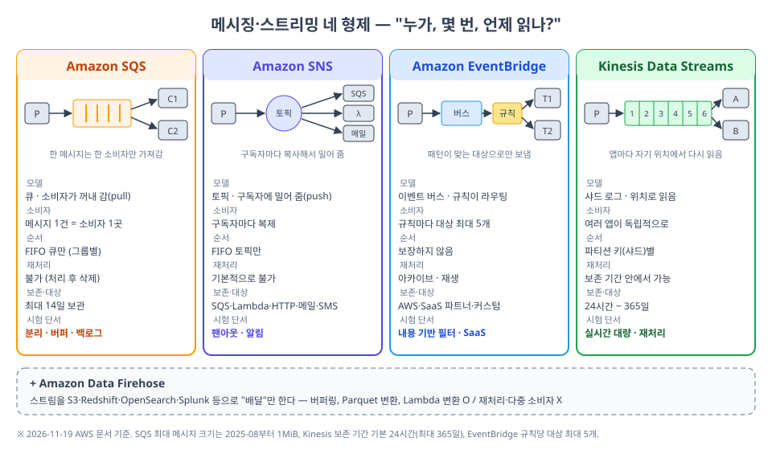
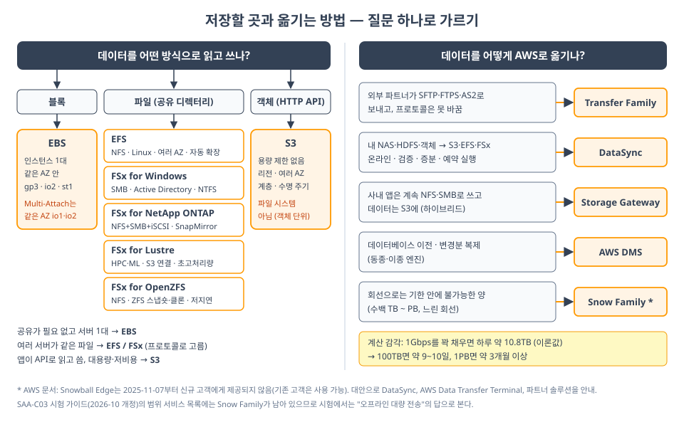

> **자격증 준비 · AWS SAA** | 난이도 ★★★☆☆ | 예상 소요 2.5~3시간 (표 정리 1.5시간 + 판별 문제 1~1.5시간)

> ⚠️ **이 편의 모든 문항은 AWS가 공개한 SAA-C03 시험 가이드(과제 설명, 범위 서비스 목록)를 바탕으로 이 시리즈가 직접 창작한 연습 문제입니다.** 실제 시험 문제나 덤프를 재현하지 않으며, 회사 이름·수치·시나리오는 모두 새로 지었습니다. AWS 자격증 시험은 응시 계약(NDA)으로 보호되므로 "실제 출제 문제"라고 주장하는 자료는 믿지도, 퍼뜨리지도 마세요.

> 💡 **확인 기준일 2026-11-19.** 서비스 기능·한도는 각 서비스의 AWS 공식 문서로 확인했습니다. 서비스는 계속 바뀌므로(예: SQS 최대 메시지 크기 1MiB 상향, Snowball Edge 신규 고객 제공 중단) 시험 직전에 공식 시험 가이드와 서비스 문서로 한 번 더 점검하세요.

## 🎯 오늘의 목표

- SQS·SNS·EventBridge·Kinesis(+Firehose)를 **"누가, 몇 번, 언제 읽나"** 세 질문으로 구분한다
- EBS·EFS·FSx 네 종류·S3를 **접근 방식(블록·파일·객체)과 프로토콜**로 고른다
- Global Accelerator와 CloudFront를 **캐시 여부·프로토콜·고정 IP**로 가른다
- DataSync·Transfer Family·Snow Family·Storage Gateway·DMS를 **누가 보내고 얼마나 많은가**로 고른다
- Multi-AZ·읽기 전용 복제본·RDS Proxy·Aurora Serverless v2·Aurora Global Database의 **해결하는 문제**를 구분한다
- 판별 문제 15문항으로 "보기가 모두 그럴듯할 때" 지우는 연습을 한다

---

## 0. 판별 문제를 푸는 세 단계

SAA의 오답 보기는 대부분 **존재하고, 동작하고, 그럴듯한** 서비스입니다. 그래서 "무엇이 맞나"보다 "**무엇이 조건 하나를 어기나**"로 지우는 편이 빠릅니다.

| 단계 | 볼 것 | 예 |
|---|---|---|
| ① 동사 | 데이터를 **보관**하나, **전달**하나, **변환**하나, **조율**하나 | 전달 → SQS/SNS/EventBridge, 보관 후 재처리 → Kinesis |
| ② 제약 | 프로토콜(NFS·SMB·UDP·SFTP), 순서, 재처리, 고정 IP, AZ 범위, 기간 | "UDP" 한 단어로 CloudFront 탈락 |
| ③ 꼬리표 | "운영 부담이 가장 적은", "가장 비용 효율적인", "코드 변경 최소" | 둘 다 되면 **완전 관리형·추가 코드 없는** 쪽 |

이 편의 표는 각 서비스의 **① 동사와 ② 제약**을 정리한 것입니다. 이론 배경은 [W01](./w01-secure-architectures.md)~[W03](./w03-high-performing-architectures.md)에서 다뤘고, 실제로 만들어 보는 실습은 클라우드 탭의 [cloud02 — VPC 네트워킹](../../cloud/cloud02-vpc-networking.md), [cloud04 — S3·RDS·데이터 서비스](../../cloud/cloud04-s3-rds.md)에서 합니다.

---

## 1. SQS vs SNS vs EventBridge vs Kinesis

| 구분 | Amazon SQS | Amazon SNS | Amazon EventBridge | Kinesis Data Streams |
|---|---|---|---|---|
| 모델 | 큐(소비자가 **꺼내 감**, pull) | 게시·구독(구독자에 **밀어 줌**, push) | 이벤트 버스 + **규칙 라우팅** | 샤드 단위 **로그**(위치로 읽음) |
| 한 메시지를 읽는 곳 | 소비자 **하나** | 구독자 **모두**(복제) | 패턴이 맞는 규칙의 대상 모두 | 여러 앱이 **각자 독립적으로** |
| 순서 | 표준: 최선 노력 / **FIFO: 메시지 그룹별 보장** | FIFO 토픽에서만 | 보장 안 함 | **파티션 키(샤드)별** 보장 |
| 중복 | 표준: 최소 1회 / FIFO: 정확히 1회 처리 | 표준: 최소 1회 | 최소 1회 | 최소 1회(소비자가 멱등 처리) |
| 다시 읽기 | 불가(처리 후 삭제) | 기본 불가 | **아카이브·재생** | **보존 기간 안에서 가능**(기본 24시간, 최대 365일) |
| 보관 | 1분~14일(기본 4일) | 저장하지 않음(재시도 후 DLQ) | 아카이브 설정 시 | 보존 기간 |
| 확장 | 거의 무제한(표준) | 거의 무제한 | 거의 무제한 | 샤드 수(프로비저닝) 또는 온디맨드 모드 |
| 대표 단서 | "분리", "버퍼", "급증 흡수", "백로그로 스케일" | "팬아웃", "여러 구독자", "메일·SMS 알림" | "SaaS 이벤트", "내용 기반 라우팅", "AWS 서비스 이벤트에 반응", "스케줄" | "실시간 분석", "순서", "재처리", "여러 소비자", "초당 수만 건" |

**함께 나오는 친척들**

| 서비스 | 한 줄 정의 | 이럴 때 |
|---|---|---|
| **Amazon Data Firehose** | 스트림을 S3·Redshift·OpenSearch·Splunk 등에 **배달**(버퍼링, 형식·Lambda 변환) | "거의 실시간으로 S3에 적재", "운영 부담 최소" |
| **Amazon MSK** | 관리형 Apache Kafka | "기존 Kafka 애플리케이션을 코드 변경 없이" |
| **Amazon MQ** | 관리형 ActiveMQ·RabbitMQ(AMQP·MQTT·STOMP·OpenWire·JMS) | "온프레미스 메시지 브로커를 **프로토콜 그대로** 이전" |
| **AWS Step Functions** | 상태 머신으로 여러 단계를 **조율**(재시도·분기·대기·사람 승인) | "순서 있는 여러 단계", "실패 시 보상 처리" |
| **EventBridge Pipes / Scheduler** | 소스 → (필터·보강) → 대상 1:1 연결 / 일정 실행 | "SQS 메시지를 필터링해 Step Functions로", "cron 대체" |

> ⚠️ **함정 — SQS 표준 큐 하나를 여러 시스템이 같이 읽기.** 메시지 하나는 한 소비자만 가져가므로 "각 시스템이 모두 처리"가 되지 않습니다. 그럴 땐 **SNS(또는 EventBridge) → 시스템별 SQS** 팬아웃입니다.
>
> ⚠️ **함정 — FIFO의 처리량.** FIFO는 순서를 **메시지 그룹 ID 단위**로 보장합니다. 그룹 ID를 하나로 고정하면 전체가 직렬 처리됩니다. "고객별 순서 + 높은 처리량"이면 고객 ID를 그룹 ID로 씁니다.
>
> 💡 **SQS 운용 키워드:** 가시성 제한 시간(처리 시간보다 길게), 긴 폴링(최대 20초, 빈 응답·비용 감소), 배달 못한 편지 큐(DLQ, maxReceiveCount), 지연 큐(최대 15분). 메시지 최대 크기는 2025-08부터 1MiB이고, 더 큰 데이터는 S3에 두고 포인터를 보내는 패턴을 씁니다.

---

## 2. EBS vs EFS vs FSx (vs S3)

| 구분 | EBS | 인스턴스 스토어 | EFS | FSx for Windows | FSx for Lustre | FSx for NetApp ONTAP | FSx for OpenZFS | S3 |
|---|---|---|---|---|---|---|---|---|
| 유형 | 블록 | 블록(휘발성) | 파일(NFS) | 파일(SMB) | 파일(Lustre) | 파일·블록(NFS·SMB·iSCSI) | 파일(NFS) | 객체 |
| 연결 | 인스턴스 1대(Multi-Attach 예외) | 그 인스턴스만 | 수천 대 동시 | 다수 | 다수(HPC) | 다수 | 다수 | API(HTTP) |
| 범위 | **AZ 하나** | 호스트 | 리전(여러 AZ) / One Zone | 단일·다중 AZ | 단일 AZ | 단일·다중 AZ | 단일·다중 AZ | 리전 |
| OS | 모두 | 모두 | **Linux** | **Windows**(+Linux SMB 클라이언트) | Linux | 모두 | Linux 중심 | 무관 |
| 대표 단서 | "부팅 볼륨", "DB 한 대", "IOPS" | "임시 캐시", "가장 빠른 로컬", "잃어도 됨" | "여러 AZ Linux 서버 공유", "자동 확장" | "SMB", "Active Directory", "NTFS ACL", "DFS" | "HPC", "ML 학습", "S3 데이터 연결" | "NetApp", "SnapMirror", "멀티 프로토콜" | "ZFS", "스냅숏·클론", "저지연 NFS" | "무제한", "정적 파일", "데이터 레이크" |

**EBS 볼륨 유형 요약**

| 유형 | 성능 특징 | 쓰임 |
|---|---|---|
| gp3 | 기본 3,000 IOPS·125MiB/s, IOPS·처리량을 크기와 **따로** 지정 | 대부분의 기본값 |
| io2 Block Express | 가장 높은 IOPS·내구성, 밀리초 미만 지연 | 대형 운영 DB, Multi-Attach 필요 시 |
| st1 | 처리량 최적화 HDD | 순차 대용량(로그·빅데이터), 부팅 불가 |
| sc1 | 콜드 HDD, 가장 쌈 | 거의 안 읽는 순차 데이터, 부팅 불가 |

> ⚠️ **함정 — EBS Multi-Attach.** io1/io2 볼륨을 **같은 AZ 안의** Nitro 인스턴스 여러 대에 붙이는 기능이고, 동시 쓰기를 안전하게 하려면 클러스터 인식 파일 시스템이 필요합니다. "여러 AZ의 서버가 파일 공유"는 EFS입니다.
>
> ⚠️ **함정 — EFS와 Windows.** EFS는 NFS(Linux)용입니다. Windows 서버가 공유 폴더를 써야 하면 FSx for Windows File Server입니다.

---

## 3. Global Accelerator vs CloudFront

| 구분 | AWS Global Accelerator | Amazon CloudFront |
|---|---|---|
| 하는 일 | 사용자 트래픽을 가까운 엣지에서 **AWS 백본**으로 실어 리전 엔드포인트로 | 엣지에서 **콘텐츠를 캐시**하고, 동적 요청도 엣지에서 받아 오리진으로 |
| 프로토콜 | **TCP·UDP** | HTTP·HTTPS(WebSocket 포함) |
| 캐시 | **없음** | **있음**(정적·일부 동적) |
| 진입점 | **애니캐스트 고정 IP 2개**(기본 제공) | 배포 도메인 이름(애니캐스트 고정 IP는 별도 신청 기능) |
| 엔드포인트 | ALB, NLB, EC2, 탄력적 IP | S3, ALB, EC2, API Gateway, 사용자 정의 HTTP 오리진 |
| 장애 조치 | 상태 확인 기반, **DNS TTL과 무관하게 빠름**, 트래픽 다이얼 | 오리진 그룹 페일오버 |
| 보안 | Shield Standard 기본 | Shield Standard 기본, **WAF**, OAC, 서명된 URL·쿠키, 지역 제한 |
| 대표 단서 | "UDP", "게임·VoIP", "고정 IP 허용 목록", "멀티 리전 빠른 장애 조치" | "정적 콘텐츠", "캐시", "DTO 비용 절감", "서명된 URL", "엣지에서 WAF" |

**옆자리 친구들:** Route 53 지연 시간·지리 기반 라우팅은 **DNS 수준**의 선택이라 클라이언트 DNS 캐시(TTL)의 영향을 받습니다. S3 Transfer Acceleration은 엣지를 이용해 **S3로의 업로드**를 빠르게 하는 기능입니다.

> ⚠️ **함정 — "전 세계 사용자 + 빠르게"만 보고 CloudFront 고르기.** 프로토콜이 UDP이거나 "고정 IP"가 나오면 CloudFront가 아니라 Global Accelerator입니다. 반대로 "캐시"나 "정적 파일"이 나오면 Global Accelerator는 탈락입니다.

---

## 4. DataSync vs Transfer Family vs Snow Family (+ Storage Gateway, DMS)

| 구분 | AWS DataSync | AWS Transfer Family | AWS Snow Family | AWS Storage Gateway | AWS DMS |
|---|---|---|---|---|---|
| 누가 보내나 | **내가**(내 스토리지 ↔ AWS) | **외부 파트너·사용자**가 기존 프로토콜로 | 내가, **물리 장비**로 | 사내 **애플리케이션**이 계속 사용 | DB 이전 도구 |
| 방식 | 온라인(에이전트, AWS 간은 에이전트 없이) | SFTP·FTPS·FTP·AS2 관리형 엔드포인트 | 오프라인 배송 | NFS·SMB(S3 File), iSCSI(Volume), VTL(Tape) | 전체 적재 + **변경분 복제(CDC)** |
| 대상 | S3·EFS·FSx(그리고 그 사이) | S3·EFS | S3 | S3(·EBS 스냅숏·Glacier) | RDS·Aurora·DynamoDB·Redshift 등 |
| 장점 | 검증·증분·예약·대역폭 제한 | 클라이언트 변경 없음 | 느린 회선·대용량 | 로컬 캐시로 지연 감소, 클라우드 확장 | 이전 중 다운타임 최소 |
| 대표 단서 | "NAS를 S3/EFS로", "매일 동기화", "무결성 검증" | "협력사가 SFTP로", "스크립트 변경 불가" | "수백 TB~PB", "회선 느림", "기한" | "온프레미스 앱 그대로", "테이프 백업 대체" | "DB 이전", "이종 엔진", "다운타임 최소" |

**얼마나 많으면 오프라인인가?** 1Gbps 회선을 꽉 채우면 하루 약 10.8TB(1×10⁹bit/s × 86,400s ÷ 8)입니다. 회선 사용률·기한을 넣어 계산했을 때 **기한 안에 못 끝나면 오프라인**이라고 보면 됩니다.

> ⚠️ **현실과 시험의 차이 — Snow Family.** AWS 문서에 따르면 **Snowball Edge는 2025-11-07부터 신규 고객에게 제공되지 않습니다**(기존 고객은 계속 사용 가능, 신규 고객에게는 DataSync, AWS Data Transfer Terminal, 파트너 솔루션 안내). 반면 SAA-C03 시험 가이드(2026-10 개정판)의 범위 서비스 목록에는 Snow Family가 그대로 있습니다. 시험에서는 "회선으로 기한 안에 불가능한 양 → Snow Family"로 판단하고, 실무에서는 현재 제공 여부부터 확인하세요.

**서버·애플리케이션 이전**은 별도입니다. 서버를 그대로 옮기는 리호스팅은 **AWS Application Migration Service**, 이전 대상 서버 목록·의존성 조사는 **AWS Application Discovery Service**입니다.

---

## 5. 데이터베이스 기능: 이름은 비슷하고 해결하는 문제는 다르다

| 기능 | 해결하는 문제 | 복제 | 읽기 가능? | 대표 단서 |
|---|---|---|---|---|
| **RDS Multi-AZ DB 인스턴스** | AZ 장애 시 **자동 장애 조치** | 동기, 대기 1개 | **아니오** | "고가용성", "자동 장애 조치" |
| **RDS Multi-AZ DB 클러스터** | 더 빠른 장애 조치 + 읽기 | 반동기, 대기 2개 | 예(리더 엔드포인트) | "장애 조치 빠르게 + 읽기도" |
| **읽기 전용 복제본** | **읽기 확장**, 리전 간 DR(수동 승격) | 비동기 | 예 | "보고서 쿼리 분리", "다른 리전에 복사본" |
| **Aurora 복제본** | 읽기 확장 + 장애 조치 대상 | 공유 스토리지(6개 사본, 3 AZ) | 예 | "최대 15개", "빠른 장애 조치" |
| **Aurora Global Database** | **리전 장애** 대비, 다른 리전 저지연 읽기 | 스토리지 수준 비동기(보통 1초 미만 지연) | 보조 리전에서 예 | "RPO 초 단위, RTO 분 단위, 리전 간" |
| **RDS Proxy** | **연결 폭주**(Lambda), 장애 조치 시간 단축, IAM 인증 | — | — | "Too many connections", "Lambda + RDS" |
| **Aurora Serverless v2** | **용량 자동 조절**(ACU), 유휴 시 축소(0까지 가능) | — | — | "부하 예측 불가", "간헐적", "개발 DB" |
| **DynamoDB 글로벌 테이블** | 다중 리전 **활성-활성** 쓰기 | 리전 간 복제 | 예 | "여러 리전에서 쓰기", "글로벌 사용자" |
| **DAX** | DynamoDB **마이크로초** 읽기 캐시 | — | — | "DynamoDB 읽기 지연 µs", "코드 변경 최소" |
| **ElastiCache (Valkey·Redis OSS / Memcached)** | 범용 인메모리 캐시·세션 저장소 | Valkey·Redis OSS는 복제·Multi-AZ | — | "세션 외부화", "리더보드", "DB 앞 캐시" |

> ⚠️ **함정 — Multi-AZ 대기 인스턴스로 읽기.** Multi-AZ **DB 인스턴스**의 대기 인스턴스는 읽기를 받지 않습니다. 읽기 분리는 읽기 전용 복제본(또는 Multi-AZ DB 클러스터의 리더)입니다.
>
> ⚠️ **함정 — 읽기 전용 복제본을 고가용성 답으로.** 복제본은 비동기이고 승격이 수동(또는 별도 자동화)이라 "자동 장애 조치"의 답이 아닙니다. 리전 간 DR에서는 비용이 싼 답이 될 수 있습니다.
>
> ⚠️ **함정 — Memcached로 고가용성.** Memcached는 복제·자동 장애 조치가 없습니다. 세션을 잃으면 안 되면 Valkey/Redis OSS(복제본 + Multi-AZ)입니다.

---

## 6. 그 밖의 헷갈리는 쌍 (빠른 표)

| 쌍 | 가르는 기준 |
|---|---|
| **ALB vs NLB vs GWLB** | ALB: L7 HTTP/HTTPS·gRPC, 경로·호스트 라우팅, OIDC 인증, Lambda 대상 / NLB: L4 TCP·UDP·TLS, **AZ별 고정 IP(EIP)**, 초저지연, 원본 IP 보존, PrivateLink 서비스 / GWLB: L3, **서드파티 방화벽 어플라이언스** 투명 삽입(GENEVE) |
| **보안 그룹 vs 네트워크 ACL** | SG: ENI 단위, **상태 저장**, 허용만, 다른 SG 참조 가능 / NACL: 서브넷 단위, **상태 비저장**(반환 포트도 허용), 허용+**거부**, 번호 순서 평가 |
| **게이트웨이 엔드포인트 vs 인터페이스 엔드포인트** | 게이트웨이: **S3·DynamoDB만**, 라우팅 테이블, **무료**, 온프레미스에서 못 씀 / 인터페이스(PrivateLink): 대부분 서비스, ENI·프라이빗 IP, 유료, SG 적용, DX·VPN으로 온프레미스에서 사용 가능 |
| **VPC 피어링 vs Transit Gateway vs PrivateLink** | 피어링: 1:1, **전이 안 됨**, CIDR 겹치면 불가, 처리 요금 없음 / TGW: 허브, 전이 라우팅, 수십~수천 VPC·VPN·DX / PrivateLink: **특정 서비스 하나만** 단방향 노출, CIDR 겹쳐도 됨 |
| **Direct Connect vs Site-to-Site VPN** | DX: 전용선, 일정한 대역폭·지연, 개설에 수 주, 기본 암호화 없음(MACsec·DX 위 VPN) / VPN: 인터넷 위 IPsec, 수 분 만에 구성, 터널당 최대 1.25Gbps. "DX 백업" → VPN |
| **Secrets Manager vs Parameter Store** | Secrets Manager: **자동 교체(rotation)** 내장, 리전 간 복제, 비밀당 요금 / Parameter Store: 설정값·계층 구조, 표준 파라미터 무료, SecureString(KMS), 교체는 직접 구현 |
| **KMS vs CloudHSM** | KMS: 관리형·서비스 통합·키 정책 / CloudHSM: **단일 테넌트 전용 HSM**, 키와 HSM 사용자를 고객이 직접 관리, PKCS#11·JCE 등 표준 API |
| **WAF vs Shield vs GuardDuty vs Inspector vs Macie** | WAF: L7 규칙(SQLi·XSS·속도 제한·지역) / Shield: DDoS(Standard 무료, **Advanced**는 대응팀·비용 보호) / GuardDuty: 로그 기반 **위협 탐지** / Inspector: **취약점 스캔**(EC2·ECR·Lambda) / Macie: S3의 **민감 데이터(PII)** 발견 |
| **CloudTrail vs CloudWatch vs Config** | CloudTrail: **누가 어떤 API를** 호출했나 / CloudWatch: 지표·로그·경보 / Config: 리소스 **설정 이력과 규칙 준수** |
| **Athena vs Redshift vs EMR vs Glue** | Athena: S3에 **서버리스 SQL** / Redshift: 데이터 웨어하우스(Spectrum으로 S3도) / EMR: 관리형 Spark·Hadoop 클러스터 / Glue: 서버리스 **ETL + 데이터 카탈로그·크롤러** |
| **Step Functions vs SQS** | Step Functions: 여러 단계를 **조율**(상태·분기·재시도·사람 승인) / SQS: 두 구성 요소 사이를 **분리**하는 버퍼 |
| **ECS vs EKS vs Fargate** | ECS: AWS 고유 오케스트레이터 / EKS: 관리형 Kubernetes / Fargate: 둘 다의 **서버리스 실행 방식**(노드 관리 없음) |
| **Cognito 사용자 풀 vs 자격 증명 풀** | 사용자 풀: 가입·로그인·**토큰(JWT)** / 자격 증명 풀: 토큰을 **임시 AWS 자격 증명**으로 교환 |
| **AWS Backup vs 서비스별 스냅숏** | Backup: 여러 서비스·계정을 **정책으로 중앙 관리**, 볼트 잠금, 교차 계정·리전 복사 / 스냅숏: 서비스 하나에서 수동·개별 |

---

## 7. 판별 문제 (15문항)

> 각 문제의 보기는 **모두 실제로 존재하고 동작하는 서비스**입니다. 0절의 세 단계(동사 → 제약 → 꼬리표)로 지워 보세요. 복수 선택 문항은 문제에 개수가 적혀 있습니다.

### 문제 1. 메시징 — 하나의 이벤트, 독립된 소비자 셋

주문 서비스가 '주문 완료' 메시지를 내보내면 **결제·배송·포인트** 세 시스템이 각자 처리해야 한다. 한 시스템이 몇 시간 멈춰도 다른 시스템은 영향을 받지 않아야 하고, 멈췄던 시스템은 복구 후 **밀린 메시지를 빠짐없이** 처리해야 한다. 가장 알맞은 구성은?

- **A.** Kinesis Data Firehose로 세 시스템에 전달한다
- **B.** SNS 토픽 하나에 시스템별 SQS 큐 세 개를 구독시킨다(팬아웃)
- **C.** SQS 표준 큐 하나를 세 시스템이 함께 폴링한다
- **D.** SNS 토픽에 세 시스템의 HTTP 엔드포인트를 직접 구독시킨다

정답과 해설

**정답: B**

SNS → SQS 팬아웃은 메시지를 **소비자마다 복제**해 각자의 큐에 넣으므로, 한 소비자가 멈춰도 그 큐에 메시지가 쌓였다가 복구 후 처리된다. 큐 하나를 셋이 공유하면 메시지 하나를 한 소비자만 가져가므로 "각자 처리"가 안 된다. HTTP 직접 구독은 재시도 정책이 끝나면 메시지를 잃을 수 있다(DLQ를 따로 붙여야 함). Firehose는 S3·Redshift·OpenSearch 같은 **저장 대상**으로 보내는 서비스다.

📎 근거: [SNS 팬아웃](https://docs.aws.amazon.com/sns/latest/dg/sns-sqs-as-subscriber.html) · [Amazon SQS](https://docs.aws.amazon.com/AWSSimpleQueueService/latest/SQSDeveloperGuide/welcome.html)

### 문제 2. 메시징 — SaaS 이벤트와 내용 기반 라우팅

고객 지원 SaaS(파트너 이벤트 소스 제공)에서 발생한 티켓 이벤트를 받아, **이벤트 본문의 `priority` 값과 `region` 값에 따라** Lambda, Step Functions, 다른 계정의 이벤트 버스로 나눠 보내야 한다. 잘못 처리된 경우를 대비해 과거 이벤트를 **다시 재생**할 수 있으면 좋겠다. 코드 작성을 최소화하는 서비스는?

- **A.** Amazon SQS FIFO 큐
- **B.** Amazon Kinesis Data Streams
- **C.** Amazon SNS 표준 토픽 + 구독 필터 정책
- **D.** Amazon EventBridge(파트너 이벤트 버스 + 규칙의 이벤트 패턴 + 아카이브·재생)

정답과 해설

**정답: D**

EventBridge는 **SaaS 파트너 이벤트 소스**를 바로 받고, 규칙의 이벤트 패턴으로 본문 필드를 기준으로 라우팅하며, 다른 계정의 이벤트 버스·Step Functions·Lambda 등 많은 대상을 지원하고, **아카이브와 재생** 기능이 있다. SNS 필터 정책도 속성(또는 본문) 기반 필터링은 되지만 SaaS 파트너 통합과 아카이브·재생이 없다. SQS와 Kinesis는 라우팅 기능이 없다.

📎 근거: [Amazon EventBridge](https://docs.aws.amazon.com/eventbridge/latest/userguide/eb-what-is.html) · [EventBridge 아카이브와 재생](https://docs.aws.amazon.com/eventbridge/latest/userguide/eb-archive.html)

### 문제 3. 메시징 — 순서·재처리·다중 소비자 스트림

물류 회사의 차량 단말 2만 대가 초당 수천 건의 위치 데이터를 보낸다. **차량별로 순서가 보장**되어야 하고, 실시간 대시보드·이상 탐지·S3 적재 **세 애플리케이션이 같은 데이터를 각자 읽어야** 하며, 버그가 생기면 **지난 7일 데이터를 다시 처리**할 수 있어야 한다. 알맞은 서비스는?

- **A.** Amazon Data Firehose
- **B.** Amazon SNS FIFO 토픽
- **C.** Amazon SQS 표준 큐
- **D.** Amazon Kinesis Data Streams(차량 ID를 파티션 키로, 보존 기간 7일 이상)

정답과 해설

**정답: D**

Kinesis Data Streams는 **파티션 키 단위 순서**, 여러 소비자의 **독립 읽기**(향상된 팬아웃 포함), **보존 기간 내 재처리**(기본 24시간, 최대 365일까지 연장)를 모두 제공한다. SQS는 소비된 메시지가 삭제되어 재처리가 안 되고 소비자끼리 메시지를 나눠 가진다. Firehose는 저장 대상으로 버퍼링해 넣는 서비스로 재처리·다중 소비자 모델이 아니다.

📎 근거: [Kinesis Data Streams](https://docs.aws.amazon.com/streams/latest/dev/introduction.html)

### 문제 4. 메시징 — S3로 거의 실시간 적재

웹 서버 로그를 **거의 실시간(수 분 이내)** 으로 S3에 Parquet 형식으로 쌓아 Athena로 조회하려 한다. 소비자 애플리케이션을 만들거나 샤드를 관리하고 싶지 않다. **운영 부담이 가장 적은** 방법은?

- **A.** Amazon Data Firehose 전송 스트림에서 레코드 형식 변환(Parquet)을 켜고 S3를 대상으로 지정한다
- **B.** SQS에 넣고 Lambda가 메시지를 모아 S3에 쓴다
- **C.** EventBridge 규칙으로 로그 이벤트를 S3에 바로 쓴다
- **D.** Kinesis Data Streams에 넣고 EC2의 KCL 애플리케이션으로 S3에 쓴다

정답과 해설

**정답: A**

Firehose는 완전 관리형 **전송(delivery)** 서비스로, 버퍼링 후 S3·Redshift·OpenSearch 등에 넣고 JSON → Parquet/ORC **형식 변환**도 기본 기능으로 제공한다. 샤드나 소비자 코드를 관리할 필요가 없다. 다른 보기는 직접 만들어야 할 코드나 인프라가 생긴다.

📎 근거: [Amazon Data Firehose](https://docs.aws.amazon.com/firehose/latest/dev/what-is-this-service.html) · [Firehose 레코드 형식 변환](https://docs.aws.amazon.com/firehose/latest/dev/record-format-conversion.html)

### 문제 5. 파일 스토리지 — 여러 AZ의 Linux 서버 공유

Auto Scaling 그룹의 Linux 웹 서버가 3개 AZ에 걸쳐 있고, 업로드된 이미지를 **모든 서버가 같은 디렉터리(POSIX)로** 읽고 써야 한다. 용량은 예측할 수 없이 늘어난다. 알맞은 스토리지는?

- **A.** 인스턴스 스토어에 저장하고 cron으로 서로 동기화한다
- **B.** io2 EBS 볼륨을 Multi-Attach로 모든 서버에 연결한다
- **C.** Amazon EFS(리전 표준 스토리지 클래스)를 각 서버에 NFS로 마운트한다
- **D.** Amazon FSx for Windows File Server를 SMB로 마운트한다

정답과 해설

**정답: C**

EFS는 NFS 기반 완전 관리형 공유 파일 시스템으로 **여러 AZ의 수천 개 클라이언트**가 동시에 마운트할 수 있고 용량이 자동으로 늘어난다. EBS Multi-Attach는 **같은 AZ 안**의 Nitro 인스턴스에만 붙고 클러스터 인식 파일 시스템이 필요하다. 인스턴스 스토어는 휘발성이다. FSx for Windows는 SMB·Windows 워크로드용이다.

📎 근거: [Amazon EFS](https://docs.aws.amazon.com/efs/latest/ug/whatisefs.html) · [EBS Multi-Attach](https://docs.aws.amazon.com/ebs/latest/userguide/ebs-volumes-multi.html)

### 문제 6. 파일 스토리지 — Windows와 Active Directory

회계 부서의 .NET 애플리케이션은 **SMB 공유 폴더**와 **Active Directory 기반 NTFS 권한**, Windows 섀도 복사본(이전 버전 복원)을 그대로 써야 한다. 리프트 앤 시프트로 옮길 때 알맞은 서비스는?

- **A.** Amazon EFS
- **B.** Amazon FSx for Lustre
- **C.** Amazon FSx for Windows File Server
- **D.** Amazon S3 + Mountpoint

정답과 해설

**정답: C**

FSx for Windows File Server는 SMB, AD 통합, NTFS ACL, 섀도 복사본, DFS 네임스페이스 등 **Windows 파일 서버 기능**을 그대로 제공한다. EFS는 NFS(Linux) 전용이고, Lustre는 HPC용 고성능 파일 시스템이다.

📎 근거: [FSx for Windows File Server](https://docs.aws.amazon.com/fsx/latest/WindowsGuide/what-is.html)

### 문제 7. 파일 스토리지 — NetApp에서 옮기기

온프레미스 NetApp 스토리지를 쓰는 회사가 같은 볼륨을 **NFS와 SMB로 동시에** 제공하고 있고, 기존 **SnapMirror** 복제와 스냅숏·클론 기능을 그대로 쓰며 AWS로 옮기고 싶다. 알맞은 서비스는?

- **A.** Amazon FSx for NetApp ONTAP
- **B.** Amazon FSx for OpenZFS
- **C.** Amazon EFS
- **D.** AWS Storage Gateway 볼륨 게이트웨이

정답과 해설

**정답: A**

FSx for NetApp ONTAP은 NFS·SMB·iSCSI **멀티 프로토콜**, 스냅숏·클론, **SnapMirror** 복제 등 ONTAP 기능을 그대로 제공해 NetApp 사용자의 이전 경로가 된다. OpenZFS는 NFS 중심, EFS는 NFS 전용이다. 볼륨 게이트웨이는 블록(iSCSI) 볼륨을 S3에 백업하는 하이브리드 서비스다.

📎 근거: [FSx for NetApp ONTAP](https://docs.aws.amazon.com/fsx/latest/ONTAPGuide/what-is-fsx-ontap.html)

### 문제 8. 파일 스토리지 — HPC와 S3 데이터

유전체 분석 팀이 S3에 있는 200TB 데이터셋을 수백 대의 EC2 인스턴스로 며칠 동안 분석한다. **초당 수백 GB 처리량과 밀리초 미만 지연**이 필요하고, 결과는 다시 S3에 남기며 분석이 끝나면 파일 시스템은 지운다. 가장 알맞은 것은?

- **A.** S3 버킷과 연결(데이터 리포지토리 연결)한 Amazon FSx for Lustre 스크래치 파일 시스템
- **B.** 인스턴스마다 gp3 EBS 볼륨에 데이터 전체를 복사
- **C.** Amazon FSx for Windows File Server
- **D.** Amazon EFS 최대 I/O 성능 모드

정답과 해설

**정답: A**

FSx for Lustre는 HPC·ML용 병렬 파일 시스템으로 **S3 버킷과 연결**해 S3 객체를 파일처럼 읽고 결과를 S3로 내보낼 수 있다. 단기 처리라면 **스크래치** 배포 유형이 싸다(내구성이 필요한 장기 작업은 영구 배포 유형). EFS도 공유되지만 이런 HPC 처리량·지연 요구에는 Lustre가 맞다.

📎 근거: [FSx for Lustre](https://docs.aws.amazon.com/fsx/latest/LustreGuide/what-is.html)

### 문제 9. 엣지 — UDP 게임과 고정 IP

모바일 게임의 실시간 대전 서버는 **UDP**로 통신하고, 서울·도쿄·프랑크푸르트 리전의 NLB 뒤에 있다. 기업 방화벽 때문에 **고정 IP 두 개**만 허용 목록에 넣을 수 있고, 리전 장애 시 **DNS 캐시와 상관없이 수십 초 안에** 다른 리전으로 넘어가야 한다. 알맞은 서비스는?

- **A.** Route 53 지연 시간 기반 라우팅
- **B.** Amazon CloudFront
- **C.** AWS Global Accelerator
- **D.** S3 Transfer Acceleration

정답과 해설

**정답: C**

Global Accelerator는 **애니캐스트 고정 IP 2개**를 주고, TCP·**UDP** 트래픽을 가까운 엣지에서 AWS 백본으로 실어 엔드포인트(NLB·ALB·EC2·EIP)로 보내며, 상태 확인으로 **DNS TTL과 무관하게** 빠르게 장애 조치한다. CloudFront는 HTTP(S)·WebSocket 중심 CDN이라 UDP 게임 트래픽을 다루지 못한다. Route 53은 DNS 캐시 TTL의 영향을 받는다.

📎 근거: [AWS Global Accelerator](https://docs.aws.amazon.com/global-accelerator/latest/dg/what-is-global-accelerator.html)

### 문제 10. 엣지 — 정적 콘텐츠 캐시와 접근 제어

온라인 강의 플랫폼이 S3에 강의 영상과 이미지를 두고 전 세계에 서비스한다. **엣지에서 캐시**해 지연과 송신 비용을 줄이고, 결제한 회원만 **기간 한정 URL로** 볼 수 있게 하며, 버킷에는 직접 접근하지 못하게 하려 한다. 알맞은 조합은?

- **A.** S3 Transfer Acceleration + IAM 사용자
- **B.** Global Accelerator + S3 미리 서명된 URL
- **C.** CloudFront + 오리진 접근 제어(OAC) + CloudFront 서명된 URL(또는 쿠키)
- **D.** S3 정적 웹사이트 호스팅 + 버킷 정책으로 퍼블릭 읽기 허용

정답과 해설

**정답: C**

캐시가 필요하면 CloudFront다. OAC로 S3 버킷을 CloudFront에서만 읽게 하고, **서명된 URL·쿠키**로 기간 한정 접근을 준다. Global Accelerator는 캐시가 없다. 퍼블릭 읽기는 "회원만"을 어긴다. Transfer Acceleration은 업로드 가속이 주목적이다.

📎 근거: [Amazon CloudFront](https://docs.aws.amazon.com/AmazonCloudFront/latest/DeveloperGuide/Introduction.html) · [CloudFront 서명된 URL](https://docs.aws.amazon.com/AmazonCloudFront/latest/DeveloperGuide/private-content-signed-urls.html)

### 문제 11. 데이터 이동 — 협력사 SFTP

수십 곳의 협력사가 매일 밤 **SFTP**로 정산 파일을 올린다. 협력사 쪽 스크립트는 바꿀 수 없고, 받은 파일은 S3에 저장해 Lambda로 처리하려 한다. SFTP 서버를 직접 운영하고 싶지 않다. 알맞은 서비스는?

- **A.** AWS DataSync
- **B.** EC2에 SFTP 서버를 설치하고 s3fs로 마운트
- **C.** AWS Storage Gateway S3 File Gateway
- **D.** AWS Transfer Family(SFTP 엔드포인트, S3 저장)

정답과 해설

**정답: D**

Transfer Family는 **SFTP·FTPS·FTP·AS2** 엔드포인트를 완전 관리형으로 제공하고 S3 또는 EFS에 바로 저장한다. 외부 파트너가 기존 프로토콜 그대로 쓸 수 있다는 점이 핵심이다. DataSync는 **내가 관리하는** 스토리지 사이에서 데이터를 옮기는 서비스이고, File Gateway는 사내 NFS/SMB 클라이언트를 위한 하이브리드 게이트웨이다.

📎 근거: [AWS Transfer Family](https://docs.aws.amazon.com/transfer/latest/userguide/what-is-aws-transfer-family.html)

### 문제 12. 데이터 이동 — 네트워크로 옮길 수 있는 양

연구소가 사내 NFS NAS의 **30TB**를 Amazon EFS로 옮기려 한다. 사내망에서 AWS로 **1Gbps** 인터넷 회선을 쓸 수 있고 마감은 2주 뒤다. 전송 중 무결성 검증과 이후 **변경분만 매일 동기화**도 필요하다. 가장 알맞은 방법은?

- **A.** AWS Transfer Family SFTP 서버로 업로드한다
- **B.** AWS Snowball Edge 장비를 주문한다
- **C.** EC2에서 rsync 스크립트를 cron으로 돌린다
- **D.** AWS DataSync 에이전트를 사내에 배포하고 NFS → EFS 작업을 예약 실행한다

정답과 해설

**정답: D**

30TB를 1Gbps로 보내면 이론상 약 2.8일(30×8,000Gb ÷ 1Gb/s ≈ 240,000초)이라 **온라인 전송으로 충분**하다. DataSync는 NFS·SMB·HDFS·객체 스토리지에서 S3·EFS·FSx로 옮기며 **무결성 검증, 증분 전송, 예약 실행, 대역폭 제한**을 기본 제공한다. 오프라인 장비는 배송·처리 시간이 더 걸린다. rsync 스크립트는 검증·재시도·모니터링을 직접 만들어야 한다.

📎 근거: [AWS DataSync](https://docs.aws.amazon.com/datasync/latest/userguide/what-is-datasync.html)

### 문제 13. 데이터 이동 — 네트워크로는 불가능한 양

방송사가 아카이브 영상 **2PB**를 S3로 옮기려 한다. 인터넷 회선은 **200Mbps**이고 이마저 업무 시간에는 거의 다 쓰인다. 6주 안에 끝내야 한다. SAA 시험의 관점에서 가장 알맞은 방향은?

- **A.** AWS DataSync로 업무 시간 외에만 전송한다
- **B.** AWS Snow Family 같은 **오프라인(물리) 전송**으로 옮기고, 이후 변경분은 온라인으로 동기화한다
- **C.** Site-to-Site VPN을 두 개 연결해 대역폭을 늘린다
- **D.** S3 Transfer Acceleration을 켜고 멀티파트 업로드한다

정답과 해설

**정답: B**

2PB를 200Mbps로 보내면 이론상 약 2.5년(2×8×10¹⁵b ÷ 2×10⁸b/s ≈ 8×10⁷초)이 걸린다. 회선을 아무리 잘 써도 6주 안에 불가능하므로 **물리 장비로 옮기는 것**이 정답 방향이다. Transfer Acceleration·VPN은 회선 자체의 한계를 넘지 못한다.

⚠️ **현실 메모:** AWS 문서에 따르면 Snowball Edge는 **2025-11-07부터 신규 고객에게 제공되지 않고**(기존 고객은 계속 사용), 신규 고객에게는 DataSync, AWS Data Transfer Terminal(물리 전송 시설), 파트너 솔루션을 안내한다. 시험 가이드(2026-10 개정판)는 여전히 Snow Family를 범위에 두고 있으므로 시험에서는 "온라인으로 불가능한 양 → Snow Family"로 판단하고, 실무에서는 현재 제공 여부를 먼저 확인하자.

📎 근거: [Snowball Edge 가용성 변경](https://docs.aws.amazon.com/snowball/latest/developer-guide/snowball-edge-availability-change.html) · [SAA-C03 범위 서비스](https://docs.aws.amazon.com/aws-certification/latest/solutions-architect-associate-03/saa-03-in-scope-services.html)

### 문제 14. DB — Lambda 연결 폭주

트래픽이 몰리면 수천 개의 Lambda 실행 환경이 동시에 RDS for MySQL에 연결하면서 `Too many connections` 오류가 난다. 장애 조치 때 연결이 끊기는 시간도 줄이고 싶다. **코드 변경을 최소화**하는 방법은?

- **A.** RDS 인스턴스 크기를 키워 max_connections를 늘린다
- **B.** 읽기 전용 복제본을 다섯 개 추가한다
- **C.** Lambda 예약 동시성을 1로 제한한다
- **D.** Amazon RDS Proxy를 두고 Lambda가 프록시 엔드포인트로 연결하게 한다

정답과 해설

**정답: D**

RDS Proxy는 **연결 풀링**으로 수많은 짧은 연결을 소수의 DB 연결로 묶고, 장애 조치 때 클라이언트 연결을 유지해 **장애 조치 시간을 줄인다**. IAM 인증·Secrets Manager 연동도 된다. 인스턴스 확장은 비용만 늘고 근본 해결이 아니며, 복제본은 쓰기 연결 문제를 풀지 못한다. 동시성 1은 처리량을 망가뜨린다.

📎 근거: [Amazon RDS Proxy](https://docs.aws.amazon.com/AmazonRDS/latest/UserGuide/rds-proxy.html)

### 문제 15. DB — 고가용성과 읽기 확장 구분 (2개 선택)

RDS for PostgreSQL을 쓰는 서비스에 두 가지 요구가 있다. ① AZ 장애 시 **자동 장애 조치**, ② 야간 보고서 쿼리를 **운영 쓰기 인스턴스와 분리**. 두 요구를 각각 만족하는 기능을 **2개** 고르시오.

- **A.** RDS Proxy의 읽기 전용 엔드포인트만 추가
- **B.** 읽기 전용 복제본을 만들고 보고서 도구가 복제본 엔드포인트에 연결
- **C.** 자동 백업 보존 기간을 35일로 늘림
- **D.** Multi-AZ DB 인스턴스 배포(동기식 대기 인스턴스)
- **E.** Multi-AZ 대기 인스턴스에 보고서 도구를 연결

정답과 해설

**정답: B, D**

**Multi-AZ DB 인스턴스**의 대기 인스턴스는 동기 복제로 고가용성을 주지만 **읽기 트래픽을 받을 수 없다**. 읽기 분리는 비동기 복제인 **읽기 전용 복제본**이 맡는다. (참고: Multi-AZ **DB 클러스터** 배포는 읽기 가능한 대기 인스턴스 두 개를 두는 다른 옵션이다.) 백업 보존 기간은 복구 시점 범위를 늘릴 뿐 장애 조치·읽기 분리와 무관하다.

📎 근거: [RDS Multi-AZ](https://docs.aws.amazon.com/AmazonRDS/latest/UserGuide/Concepts.MultiAZ.html) · [RDS 읽기 전용 복제본](https://docs.aws.amazon.com/AmazonRDS/latest/UserGuide/USER_ReadRepl.html)

### 채점과 다시 볼 곳

| 문제 | 다시 볼 절 |
|---|---|
| 1~4 | 1절 SQS vs SNS vs EventBridge vs Kinesis |
| 5~8 | 2절 EBS vs EFS vs FSx |
| 9~10 | 3절 Global Accelerator vs CloudFront |
| 11~13 | 4절 DataSync vs Transfer Family vs Snow Family |
| 14~15 | 5절 데이터베이스 기능 |

13개 이상이면 W06 모의고사로 넘어가도 좋습니다. 10개 이하라면 틀린 문제의 표에서 **"대표 단서" 행만** 소리 내어 읽고, 하루 뒤 다시 풀어 보세요.

---

## 핵심 정리

- 오답 보기도 대부분 동작하는 서비스다. **동사(보관·전달·변환·조율) → 제약(프로토콜·순서·재처리·범위) → 꼬리표(운영 부담·비용)** 순서로 지운다.
- 메시징: 한 소비자 → **SQS**, 모두에게 복제 → **SNS**(팬아웃은 SNS→SQS), 내용 기반 라우팅·SaaS → **EventBridge**, 순서·재처리·다중 소비자 스트림 → **Kinesis Data Streams**, S3 적재만 → **Firehose**.
- 스토리지: 서버 1대 블록 → **EBS**(Multi-AZ 아님), 여러 AZ Linux 공유 → **EFS**, SMB·AD → **FSx for Windows**, HPC·S3 연결 → **FSx for Lustre**, NetApp → **FSx for ONTAP**.
- 엣지: 캐시·HTTP → **CloudFront**, UDP·고정 IP·빠른 리전 장애 조치 → **Global Accelerator**.
- 이전: 내 스토리지 온라인 → **DataSync**, 파트너 SFTP → **Transfer Family**, 회선으로 불가능한 양 → **Snow Family**(신규 제공 중단은 실무에서 확인), 사내 앱 하이브리드 → **Storage Gateway**, DB → **DMS**.
- DB: 자동 장애 조치 → **Multi-AZ**, 읽기 확장 → **읽기 전용 복제본**, 연결 폭주 → **RDS Proxy**, 변동 부하 → **Aurora Serverless v2**, 리전 DR → **Aurora Global Database**.

---

## ⏭️ 다음 예고 — AWS SAA W06. 모의고사 1

W06은 실제 시험과 같은 규모인 **65문항·130분** 모의고사입니다. 네 도메인을 공식 비중(보안 30%, 복원력 26%, 고성능 24%, 비용 20%)에 맞춰 섞었고, 시나리오형 단일 선택과 복수 선택 문항이 함께 나옵니다. 끝나면 정답표와 문항별 해설, **도메인별 점수표**로 약한 도메인을 찾아 W01~W05 중 어디를 다시 볼지 정합니다. 타이머를 준비하세요.
