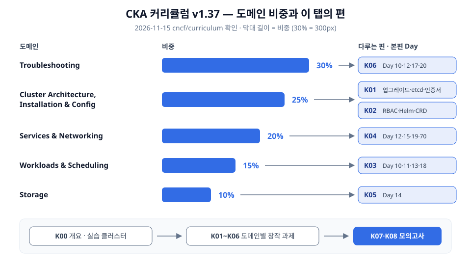
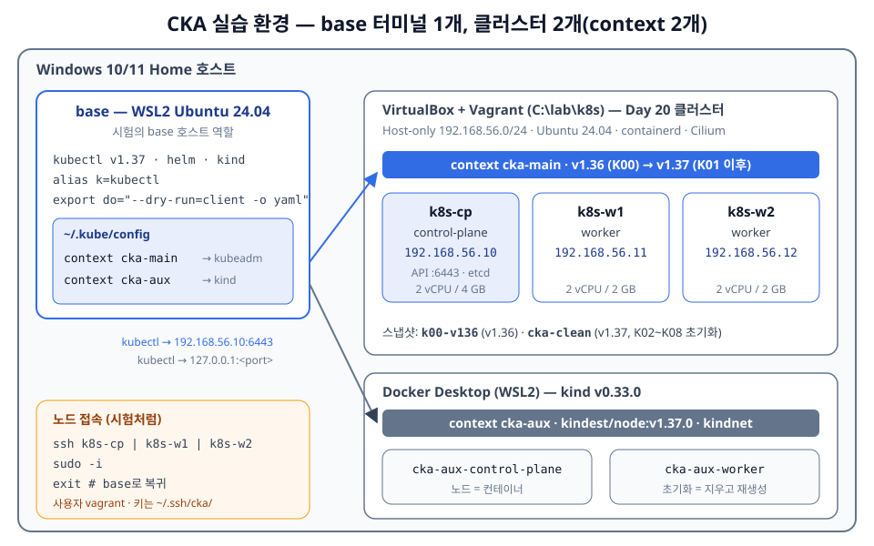

> **자격증 준비 · CKA** | 난이도 ★★☆☆☆ | 예상 소요 3 ~ 4시간 (클러스터 재구축 포함)

> ⚠️ **이 탭의 모든 연습 과제는 CNCF가 공개한 CKA 공식 커리큘럼을 바탕으로 직접 만든 "시험 스타일" 과제입니다.** 실제 출제 문제나 유출 문제(덤프)가 아니며, 그런 자료를 재현하지도 않습니다. Linux Foundation 시험은 응시자가 시험 내용 비공개에 동의하고 치르므로, 실제 문제를 공유하거나 구하는 것은 정책 위반이고 자격 취소 사유입니다.

## 🎯 오늘의 목표

- CKA 시험이 **무엇을, 어떤 방식으로** 평가하는지 공식 페이지 기준으로 설명할 수 있다
- 공식 커리큘럼 5개 도메인이 이 탭의 어느 편, 본편의 어느 Day와 이어지는지 지도를 그린다
- 시험장에서 쓸 **셸 설정(alias, 자동완성, `$do`, vim)** 을 손에 익힌다
- Day 20의 kubeadm 3노드 클러스터를 **시험 직전 마이너 버전(v1.36)** 으로 다시 세우고, kind 보조 클러스터와 함께 **context `cka-main` / `cka-aux`** 로 전환하며 쓸 수 있다
- 스냅샷으로 클러스터를 언제든 깨끗한 상태로 되돌릴 수 있다

---

## 1. CKA는 어떤 시험인가?

CKA(Certified Kubernetes Administrator)는 CNCF와 Linux Foundation이 운영하는 쿠버네티스 **관리자** 자격증입니다. Chapter 2에서 Pod부터 kubeadm까지 한 바퀴 돌았지요. CKA는 그걸 **제한 시간 안에, 명령줄만으로, 정확하게** 해낼 수 있는지 묻습니다.

2026-11-15에 Linux Foundation의 [CKA 페이지](https://training.linuxfoundation.org/certification/certified-kubernetes-administrator-cka/), [CKA·CKAD·CKS FAQ](https://docs.linuxfoundation.org/tc-docs/certification/faq-cka-ckad-cks), [시험 팁(Important Instructions)](https://docs.linuxfoundation.org/tc-docs/certification/tips-cka-and-ckad), [허용 자료](https://docs.linuxfoundation.org/tc-docs/certification/certification-resources-allowed), 그리고 [cncf/curriculum](https://github.com/cncf/curriculum) 저장소의 `CKA_Curriculum_v1.37.pdf`를 확인한 결과입니다.

| 항목 | 내용 (확인일 2026-11-15) |
|---|---|
| 기준 Kubernetes 버전 | **v1.37** — 공식 안내: 새 마이너 버전 출시 후 **약 4~8주 안에** 시험 환경을 맞춤 |
| 형식 | **온라인 감독(proctored), 실기(performance-based)**. 명령줄로 과제 수행. 객관식 없음 |
| 과제 수 | 15~20개 (시험 팁 페이지 기준) |
| 시험 시간 | **2시간** |
| 합격 점수 | **66% 이상** (FAQ) |
| 재응시 | 등록 1건에 **재응시 1회 포함**("One Retake"). 응시 자격은 등록 후 **12개월** |
| killer.sh 시뮬레이터 | **2회** 포함, 회당 **36시간** 이용(활성화 시점부터), 채점 결과 제공. 단 `CKA-SINGLE` 같은 단독 등록 상품에는 미포함(FAQ) |
| 시험 환경 | PSI Secure Browser(Chrome 기반) 안의 **Linux 원격 데스크톱**. 과제마다 지정된 호스트로 `ssh <호스트>` 후 작업, 각 호스트에 `kubectl`·**`k` alias·bash 자동완성**·`yq` 준비 |
| 허용 문서 | `kubernetes.io/docs`, `kubernetes.io/blog`, `helm.sh/docs`, **(CKA만)** `gateway-api.sigs.k8s.io`, 과제의 Quick Reference 상자 링크. 문서 검색은 되지만 **외부 검색 결과를 열면 안 됨** |
| 자격 유효기간 | 2년 |
| 응시료 | 시험 단독 $445 (번들 상품 별도) |

> 💡 **"버전"을 늘 확인하세요.** 2026-11-15 기준 Kubernetes 최신 마이너는 v1.37(최신 패치 v1.37.1)이고 시험도 v1.37입니다. 커리큘럼 PDF 파일 이름(`CKA_Curriculum_v1.37.pdf`)의 숫자가 곧 쿠버네티스 버전입니다. 응시 직전에 이 표의 항목을 공식 페이지에서 한 번 더 확인하세요. 몇 달 사이에 바뀝니다.

> ⚠️ 시험 팁 페이지의 주의 사항 몇 가지: 원격 데스크톱에서 **INSERT 키는 막혀 있습니다**(vim에서 `i`, `a`, `o`로 입력 모드 진입). 탭을 닫을 때는 `Ctrl+W` 대신 **`Ctrl+Alt+W`**. 터미널 복사·붙여넣기는 **`Ctrl+Shift+C` / `Ctrl+Shift+V`**. 기본 호스트(`base`)는 **재부팅 금지**, 중첩 ssh(호스트에서 다시 ssh)는 지원하지 않습니다.

---

## 2. 커리큘럼 5개 도메인과 이 탭의 지도



| 비중 | 도메인 (커리큘럼 v1.37) | 다루는 편 |
|---|---|---|
| **30%** | Troubleshooting | [K06](./k06-troubleshooting.md) |
| **25%** | Cluster Architecture, Installation and Configuration | [K01](./k01-cluster-install-upgrade-etcd.md), [K02](./k02-rbac-helm-kustomize-crd.md) |
| **20%** | Services and Networking | [K04](./k04-services-networking.md) |
| **15%** | Workloads and Scheduling | [K03](./k03-workloads-scheduling.md) |
| **10%** | Storage | [K05](./k05-storage.md) |
| — | 종합 | [K07](./k07-mock-exam-1.md), [K08](./k08-mock-exam-2.md) 모의고사 |

### 2-1. 커리큘럼 항목 ↔ 탭 편 ↔ 본편 Day

이론은 본편에서 이미 다뤘습니다. 이 탭은 **시험 형태로 손을 빠르게 만드는 것**에 집중하고, 개념은 아래 Day를 참조합니다.

| 도메인 | 커리큘럼 항목 | 탭 편 | 본편 Day |
|---|---|---|---|
| Cluster Architecture | Manage role based access control (RBAC) | K02 | [Day 19](../../02-kubernetes/day19-rbac-namespace.md) |
| | Prepare underlying infrastructure for installing a Kubernetes cluster | K01 | [Day 20](../../02-kubernetes/day20-kubeadm-multinode.md) |
| | Create and manage Kubernetes clusters using kubeadm | K01 | Day 20 |
| | Manage the lifecycle of Kubernetes clusters (업그레이드·etcd 백업·인증서) | K01 | Day 20 |
| | Implement and configure a highly-available control plane | K01 | Day 20, [Day 34](../../05-capstone/day34-k8s-on-openstack.md) |
| | Use Helm and Kustomize to install cluster components | K02 | [Day 16](../../02-kubernetes/day16-helm.md), [Day 52](../../07-gitops/day52-kustomize.md) |
| | Understand extension interfaces (CNI, CSI, CRI, etc.) | K02 | Day 20, [Day 14](../../02-kubernetes/day14-storage.md) |
| | Understand CRDs, install and configure operators | K02 | [Day 44](../../06-ai-infra/day44-k8s-gpu.md), [Day 53](../../07-gitops/day53-argocd.md) |
| Workloads & Scheduling | 배포·롤링 업데이트·롤백 | K03 | [Day 11](../../02-kubernetes/day11-deployment.md) |
| | ConfigMap·Secret으로 앱 설정 | K03 | [Day 13](../../02-kubernetes/day13-configmap-secret.md) |
| | 워크로드 오토스케일링 | K03 | [Day 18](../../02-kubernetes/day18-autoscaling.md) |
| | 자가 치유 배포의 기본 요소(프로브, 레플리카 등) | K03 | [Day 10](../../02-kubernetes/day10-pod.md), Day 11 |
| | Pod 승인·스케줄링(limits, node affinity 등) | K03 | Day 18 |
| Services & Networking | Pod 간 연결 | K04 | [Day 12](../../02-kubernetes/day12-service.md) |
| | NetworkPolicy 정의·적용 | K04 | Day 19, [Day 70](../../09-security/day70-networkpolicy-zero-trust.md) |
| | ClusterIP·NodePort·LoadBalancer와 엔드포인트 | K04 | Day 12 |
| | Gateway API로 Ingress 트래픽 관리 | K04 | [Day 15](../../02-kubernetes/day15-ingress.md) |
| | Ingress 컨트롤러와 Ingress 리소스 | K04 | Day 15 |
| | CoreDNS 이해·사용 | K04 | Day 12 |
| Storage | StorageClass와 동적 프로비저닝 | K05 | Day 14 |
| | 볼륨 유형, 접근 모드, 반환 정책 | K05 | Day 14 |
| | PV·PVC 관리 | K05 | Day 14 |
| Troubleshooting | 클러스터·노드 | K06 | Day 20 |
| | 클러스터 컴포넌트 | K06 | Day 20 |
| | 클러스터·앱 리소스 사용량 모니터링 | K06 | [Day 17](../../02-kubernetes/day17-monitoring.md), Day 18 |
| | 컨테이너 출력 스트림 관리·평가(로그) | K06 | Day 10 |
| | 서비스·네트워킹 | K06 | Day 12, Day 15 |

목표 편(K01~K06)은 모두 같은 순서로 구성됩니다.

1. **커리큘럼 항목 요약**
2. **출제 유형** — 과제가 어떤 모양이고, 무엇이 채점되는지
3. **핵심 명령·매니페스트 표** — 명령형 `kubectl create/run ... $do` 위주
4. **시간 절약 팁**, **자주 하는 실수**
5. **창작 연습 과제 6~10개** — `<details>`를 열면 풀이와 **검증 명령**, 그리고 "시험장에서 찾을 문서 페이지"
6. **핵심 정리**, 다음 편 예고

---

## 3. 4주 학습 계획

하루 1~2시간 기준입니다. Chapter 2를 끝냈다는 전제이고, 처음이라면 Chapter 2(Day 08~20)부터 보세요.

| 주차 | 범위 | 핵심 | 주말 점검 |
|---|---|---|---|
| 1주 | K00, K01, K02 | 실습 환경 완성, **업그레이드 1회 완주**, etcd 백업·복원, RBAC·Helm | 업그레이드+etcd 복원을 문서만 보고 30분 안에 |
| 2주 | K03, K04 | 명령형 생성 속도, NetworkPolicy, Gateway API | 과제 10개를 과제당 6분 안에 |
| 3주 | K05, K06 | PV/PVC, **트러블슈팅(30%)** 집중 — 일부러 고장 내고 고치기 | 고장 시나리오 5개 무작위 |
| 4주 | K07, K08, killer.sh | 모의고사 2회 → 틀린 편 재풀이 → killer.sh 1회차 → 약점 → 2회차 | 2시간 타이머, 66% 이상 |

💡 공부 방법 세 가지:

- **스냅샷 복원 → 과제 → 검증.** 클러스터를 망가뜨리는 걸 두려워하지 마세요. 망가뜨리는 연습이 트러블슈팅 30%의 재료입니다.
- **문서 찾기도 연습 대상입니다.** 시험장에서 쓸 수 있는 건 `kubernetes.io/docs`(+helm, gateway-api)뿐입니다. 각 과제의 "📖 문서" 표시를 보고 **실제로 그 페이지를 검색해서 찾아가는** 연습을 같이 하세요. Kustomize 전용 사이트는 허용 목록에 없으니 kubernetes.io의 Kustomize 태스크 페이지를 기억해 둡니다(K02).
- **killer.sh는 아껴 두세요.** 회당 36시간이고 2회뿐입니다. K07·K08까지 끝낸 3~4주 차에 쓰는 게 효과가 큽니다. 실제 시험보다 어렵게 만들어져 있으니 점수에 낙담하지 마세요.

---

## 4. 시험 환경 팁

### 4-1. 셸 준비 — 시작하자마자 30초

공식 팁 페이지에 따르면 각 호스트에는 이미 `k` alias와 bash 자동완성이 설정돼 있습니다. 그래도 **연습 환경에서는 직접 설정**해 두고, 시험장에서는 `alias k`로 존재만 확인합니다. 시험장에서 추가로 치는 것은 아래 두 줄 정도면 충분합니다.

```bash
export do="--dry-run=client -o yaml"      # k run nginx --image=nginx $do > pod.yaml
export now="--force --grace-period=0"     # k delete pod x $now  (즉시 삭제)
```

연습용 base 터미널(6장)의 `~/.bashrc`에는 이렇게 넣어 둡니다.

```bash
# ~/.bashrc 끝에 추가
source <(kubectl completion bash)
alias k=kubectl
complete -o default -F __start_kubectl k   # k 에도 자동완성
export do="--dry-run=client -o yaml"
export now="--force --grace-period=0"
```

| 설정 | 효과 |
|---|---|
| `alias k=kubectl` | 2시간 동안 수백 번 치는 단어를 1글자로 |
| `complete -o default -F __start_kubectl k` | `k get po<Tab>`, `k -n kube-sys<Tab>` 자동완성 |
| `$do` | 명령형 생성 → YAML 뼈대. `k create deploy web --image=nginx $do > web.yaml` |
| `$now` | Pod 즉시 삭제. 재생성 과제에서 30초씩 아낌 |

> ⚠️ `$do`는 **YAML만 출력하고 클러스터에는 아무것도 만들지 않습니다.** 파일로 저장 → 수정 → `k apply -f`까지 해야 점수입니다. 뼈대를 만든 뒤 apply를 잊는 실수가 의외로 많습니다.

### 4-2. vim 설정

YAML 들여쓰기가 망가지면 시간이 가장 많이 샙니다. 호스트에 처음 들어가면 `~/.vimrc`를 만듭니다(호스트마다 따로).

```vim
set expandtab tabstop=2 shiftwidth=2 softtabstop=2
set autoindent number
```

| 키 | 용도 |
|---|---|
| `:set paste` → 붙여넣기 → `:set nopaste` | 문서에서 복사한 YAML이 계단식으로 밀리는 것 방지 |
| `V` + 방향키 → `>` / `<` | 여러 줄 들여쓰기·내어쓰기 |
| `u` / `Ctrl+r` | 실행 취소 / 다시 실행 |
| `:wq` | 저장 후 종료 (INSERT 키 대신 `i`로 입력 모드) |

### 4-3. 과제를 시작하는 습관 — 호스트·context 확인

공식 팁 페이지 기준 현재 시험은 **과제마다 작업할 호스트가 지정되고 `ssh <호스트>`로 들어가서** 풉니다. 과제 상단에 context 전환 명령이 함께 주어지는 형태도 있었으므로, 이 탭의 연습은 둘 다 익힙니다.

```bash
# 과제 시작 루틴 (복사해서 쓰는 습관)
ssh <지정된 호스트>                 # 또는: kubectl config use-context <지정된 context>
k config current-context           # 지금 어디에 명령을 날리는가
k get nodes                        # 노드 이름으로 한 번 더 확인
# ... 과제 수행 ...
exit                               # 다음 과제 전에 base 로 돌아오기
```

> ⚠️ **다른 클러스터에 정답을 만들면 0점입니다.** 과제를 다 풀고 나서야 엉뚱한 context였다는 걸 발견하는 것이 CKA에서 가장 비싼 실수입니다. 이 탭의 모든 과제는 "어느 context(`cka-main` / `cka-aux`)에서 하는가"를 첫 줄에 적어 두었습니다.

### 4-4. 시간 배분

| 원칙 | 구체적으로 |
|---|---|
| 과제당 평균 **6~7분** | 120분 ÷ 15~20개. 10분 넘게 막히면 **표시하고 넘어가기** |
| 배점 큰 과제 먼저 훑기 | 과제마다 비중(%)이 표시됨. 큰 것을 놓치지 않기 |
| 1회차는 "확실한 것"만 | 업그레이드·etcd 복원처럼 오래 걸리는 과제는 2회차에 |
| 마지막 10분은 검증 | `k get`으로 결과 확인, 네임스페이스·이름 오타 점검 |
| 문서는 **검색창**으로 | 사이트 내비게이션을 타고 내려가지 말고 검색. 북마크는 없다고 생각 |

---

## 5. 시험 직전 버전으로 맞추기 — 왜 v1.36으로 세우나

Day 20에서는 v1.34로 클러스터를 만들었습니다. 시험은 v1.37이고, 커리큘럼에는 **클러스터 업그레이드**가 들어 있습니다. 그래서 이 탭은 이렇게 갑니다.

| 시점 | `cka-main` 버전 | 이유 |
|---|---|---|
| K00 끝 | **v1.36.x** | 시험 버전보다 한 마이너 낮게 → K01에서 **실제 시험처럼 한 단계 업그레이드** 연습 |
| K01 끝 ~ K08 | **v1.37.x** | 시험 버전과 동일. 이후 모든 편의 기준 |

> 💡 kubeadm 업그레이드는 **마이너 버전을 건너뛸 수 없습니다**(1.34 → 1.37 한 번에 불가). 기존 v1.34 클러스터를 그대로 쓰려면 1.34 → 1.35 → 1.36을 K01 절차로 두 번 반복해야 합니다. 시간이 더 걸리지만 업그레이드 연습을 세 번 하는 셈이니 나쁘지 않습니다. 이 글은 **새로 세우는 방법(A)** 을 기본으로 설명합니다.

> ⚠️ Kubernetes v1.34는 2026-10-27에 지원이 끝났습니다(EOL). 실습용으로는 동작하지만, 새로 세운다면 v1.36부터 시작하세요.

---

## 6. 실습 환경 구축



### 6-1. 구성 한눈에 보기 — 실습 환경 고정값

이 표는 **K01~K08 전 편이 그대로 쓰는 값**입니다. 바꾸면 이후 편의 명령을 모두 고쳐 읽어야 합니다.

| 항목 | 값 |
|---|---|
| 작업 터미널(시험의 `base` 역할) | Windows 호스트의 **WSL2 Ubuntu 24.04** — kubectl v1.37.x, helm, kind v0.33.0, `~/.kube/config`에 두 context |
| context ① | **`cka-main`** — Day 20 kubeadm 클러스터 (원래 이름 `kubernetes-admin@kubernetes`를 변경) |
| `cka-main` 노드 | `k8s-cp` **192.168.56.10** (control-plane, 2 vCPU / 4 GB) · `k8s-w1` **192.168.56.11** · `k8s-w2` **192.168.56.12** (worker, 2 vCPU / 2 GB) |
| `cka-main` 구성 | Ubuntu 24.04, containerd(`SystemdCgroup = true`), Cilium(`ipam.mode=kubernetes`), Pod CIDR `10.244.0.0/16`, Service CIDR `10.96.0.0/12`, API `https://192.168.56.10:6443` |
| `cka-main` 버전 | K00 끝 **v1.36.x** → K01 이후 **v1.37.x** |
| 노드 접속 | base에서 `ssh k8s-cp` / `ssh k8s-w1` / `ssh k8s-w2` (사용자 `vagrant`, 권한은 `sudo -i`). `k8s-cp`에도 admin kubeconfig 있음 |
| context ② | **`cka-aux`** — kind 보조 클러스터 (원래 이름 `kind-cka-aux`를 변경) |
| `cka-aux` 노드 | `cka-aux-control-plane`, `cka-aux-worker` (kind v0.33.0, `kindest/node:v1.37.0`, CNI kindnet, StorageClass `standard`) |
| Vagrant 폴더 | `C:\lab\k8s` (Day 20의 Vagrantfile 위치. 다른 곳이면 바꿔 읽기) |
| 스냅샷 이름 | `k00-v136`(K00 완료, v1.36) · `cka-clean`(K01 완료, v1.37 — **K02~K08의 초기화 지점**) |

> 💡 kind 보조 클러스터는 주로 **context 전환 연습**과 "다른 클러스터에서 하는 가벼운 과제"용입니다. 업그레이드·etcd·노드 트러블슈팅처럼 노드에 ssh해야 하는 과제는 모두 `cka-main`에서 합니다.

### 6-2. `cka-main` 다시 세우기 (방법 A, 권장)

Day 20의 Vagrantfile과 절차를 **그대로** 쓰되, 버전 변수 하나만 바꿉니다.

```powershell
# Windows PowerShell — 기존 Day 20 VM이 있다면 정리
cd C:\lab\k8s
vagrant destroy -f
vagrant up
```

세 노드 모두에서 Day 20의 5~7장(swap, 모듈, sysctl, containerd, 패키지)을 실행하는데, **7장의 첫 줄만** 다음처럼 바꿉니다.

```bash
K8S_MINOR=v1.36          # Day 20에서는 v1.34
```

이후 8~10장(`kubeadm init` → Cilium → `kubeadm join`)도 Day 20과 똑같습니다. 확인:

```bash
# k8s-cp 에서
kubectl get nodes -o wide
```

```
NAME     STATUS   ROLES           AGE   VERSION   INTERNAL-IP     ...
k8s-cp   Ready    control-plane   9m    v1.36.5   192.168.56.10   ...
k8s-w1   Ready    <none>          3m    v1.36.5   192.168.56.11   ...
k8s-w2   Ready    <none>          2m    v1.36.5   192.168.56.12   ...
```

> 💡 패치 번호(예: v1.36.5)는 시점마다 다릅니다. `apt-cache madison kubeadm`이 보여 주는 최신 v1.36.x면 됩니다. 노드 INTERNAL-IP가 `10.0.2.15`로 보이면 Day 20 7장의 `--node-ip` 설정이 빠진 것입니다.

> 💡 **방법 B(기존 v1.34 유지):** K01 4장의 업그레이드 절차를 v1.35, v1.36 순서로 두 번 수행한 뒤 이 편 6-3부터 이어 가세요. 각 단계 전에 세 노드 모두 `/etc/apt/sources.list.d/kubernetes.list`의 `pkgs.k8s.io/core:/stable:/v1.3x/` 부분을 다음 마이너로 바꾸고 `apt-get update` 해야 새 버전이 보입니다. K01에서 한 번 더(→ v1.37) 하면 시험 버전이 됩니다.

> 💡 **방법 C(업그레이드 연습 없이 바로 시험 버전):** 방법 A에서 `K8S_MINOR=v1.37`로 설치하면 처음부터 v1.37입니다. 이 경우 K01의 업그레이드 과제(과제 2·3)는 읽기만 하고 넘어가며, 바로 `cka-clean` 스냅샷을 찍으세요. 업그레이드는 CKA 단골 과제이므로 가능하면 방법 A를 권합니다.

### 6-3. base 터미널 — WSL2 Ubuntu 24.04

시험의 `base`처럼 **여러 클러스터를 한 곳에서 다루고, 노드에는 ssh로 들어가는** 작업 터미널을 만듭니다. Day 09에서 Docker Desktop(WSL2)을 설치했다면 WSL이 이미 있습니다.

```powershell
# PowerShell — Ubuntu 24.04 배포판이 없다면
wsl --install -d Ubuntu-24.04
```

Docker Desktop → Settings → Resources → **WSL integration**에서 `Ubuntu-24.04`를 켜면 WSL 안에서 `docker`를 쓸 수 있습니다(kind에 필요).

WSL Ubuntu 안에서 도구를 설치합니다. kubectl은 Day 20과 같은 `pkgs.k8s.io` 저장소를 쓰되 **시험 버전 v1.37**로 받습니다(kubectl은 클러스터와 ±1 마이너까지 호환되므로 v1.36 클러스터에도 문제없음).

```bash
# kubectl v1.37
sudo apt-get update && sudo apt-get install -y apt-transport-https ca-certificates curl gpg bash-completion vim
sudo mkdir -p -m 755 /etc/apt/keyrings
curl -fsSL https://pkgs.k8s.io/core:/stable:/v1.37/deb/Release.key \
  | sudo gpg --dearmor -o /etc/apt/keyrings/kubernetes-apt-keyring.gpg
echo "deb [signed-by=/etc/apt/keyrings/kubernetes-apt-keyring.gpg] https://pkgs.k8s.io/core:/stable:/v1.37/deb/ /" \
  | sudo tee /etc/apt/sources.list.d/kubernetes.list
sudo apt-get update && sudo apt-get install -y kubectl

# helm (Helm 4 공식 설치 스크립트)
curl -fsSL https://raw.githubusercontent.com/helm/helm/main/scripts/get-helm-4 | bash

# kind v0.33.0
curl -Lo ./kind https://kind.sigs.k8s.io/dl/v0.33.0/kind-linux-amd64
chmod +x ./kind && sudo mv ./kind /usr/local/bin/kind

kubectl version --client; helm version --short; kind version
```

그리고 4-1의 `~/.bashrc` 설정과 4-2의 `~/.vimrc`를 넣고 `source ~/.bashrc`.

**노드 ssh 설정.** Vagrant가 VM마다 만든 개인 키를 WSL로 복사합니다(`/mnt/c` 아래 파일은 권한이 777로 보여 ssh가 거부하므로 **복사 후 600**).

```bash
VAGRANT_DIR=/mnt/c/lab/k8s
mkdir -p ~/.ssh/cka && chmod 700 ~/.ssh ~/.ssh/cka
for n in k8s-cp:10 k8s-w1:11 k8s-w2:12; do
  name=${n%%:*}; ip=192.168.56.${n##*:}
  cp "$VAGRANT_DIR/.vagrant/machines/$name/virtualbox/private_key" ~/.ssh/cka/$name
  chmod 600 ~/.ssh/cka/$name
  cat >> ~/.ssh/config <<EOF
Host $name
  HostName $ip
  User vagrant
  IdentityFile ~/.ssh/cka/$name
  StrictHostKeyChecking no
  UserKnownHostsFile /dev/null
  LogLevel ERROR
EOF
done
chmod 600 ~/.ssh/config
ssh k8s-cp hostname        # k8s-cp
```

> ⚠️ `vagrant destroy` 후 다시 `vagrant up`하면 개인 키가 새로 만들어집니다. VM을 새로 만들 때마다 위 `cp` 부분을 다시 실행하세요.

### 6-4. `cka-main` context 가져오기와 이름 바꾸기

k8s-cp의 admin kubeconfig를 base로 가져옵니다.

```bash
mkdir -p ~/.kube
ssh k8s-cp 'sudo cat /etc/kubernetes/admin.conf' > ~/.kube/cka-main.conf
chmod 600 ~/.kube/cka-main.conf

kubectl --kubeconfig ~/.kube/cka-main.conf config get-contexts
# CURRENT   NAME                          CLUSTER      AUTHINFO           NAMESPACE
# *         kubernetes-admin@kubernetes   kubernetes   kubernetes-admin

kubectl --kubeconfig ~/.kube/cka-main.conf config rename-context kubernetes-admin@kubernetes cka-main
```

### 6-5. `cka-aux` — kind 보조 클러스터

```yaml
# ~/cka/kind-cka-aux.yaml
kind: Cluster
apiVersion: kind.x-k8s.io/v1alpha4
name: cka-aux
nodes:
- role: control-plane
  image: kindest/node:v1.37.0@sha256:a1ed56cfb0e7b93589bdf97c8cd566405a265939e3620fc4f5de89adff580ae5
- role: worker
  image: kindest/node:v1.37.0@sha256:a1ed56cfb0e7b93589bdf97c8cd566405a265939e3620fc4f5de89adff580ae5
```

```bash
mkdir -p ~/cka && cd ~/cka      # 위 YAML을 이 폴더에 저장한 뒤
kind create cluster --config kind-cka-aux.yaml
# ... Set kubectl context to "kind-cka-aux"
kubectl config rename-context kind-cka-aux cka-aux
```

> 💡 이미지 태그 뒤의 `@sha256:...`는 kind v0.33.0 릴리스 노트에 적힌 공식 다이제스트입니다. kind는 버전에 맞는 이미지를 이렇게 고정해서 쓰라고 권장합니다. 다이제스트를 빼고 `kindest/node:v1.37.0`만 써도 동작합니다.

kind는 `~/.kube/config`에 직접 썼으므로, 여기에 `cka-main` 파일을 합칩니다.

```bash
cp ~/.kube/config ~/.kube/config.bak
KUBECONFIG=~/.kube/config:~/.kube/cka-main.conf kubectl config view --flatten > /tmp/merged
mv /tmp/merged ~/.kube/config && chmod 600 ~/.kube/config

kubectl config get-contexts
```

```
CURRENT   NAME       CLUSTER        AUTHINFO           NAMESPACE
          cka-aux    kind-cka-aux   kind-cka-aux
*         cka-main   kubernetes     kubernetes-admin
```

> 💡 `rename-context`는 **context 이름만** 바꿉니다. CLUSTER·AUTHINFO 열의 이름(`kubernetes`, `kind-cka-aux`)은 그대로라 정상입니다. 두 파일의 cluster·user 이름이 겹치지 않으니 `--flatten` 병합이 안전합니다.

### 6-6. context 전환 연습

```bash
k config use-context cka-main && k get nodes
# k8s-cp / k8s-w1 / k8s-w2

k config use-context cka-aux && k get nodes
# cka-aux-control-plane / cka-aux-worker

k --context cka-main get pods -A | head -3     # 전환하지 않고 한 번만 다른 클러스터
k config set-context --current --namespace=kube-system   # 현재 context의 기본 네임스페이스
k config set-context --current --namespace=default       # 되돌리기
```

| 명령 | 용도 |
|---|---|
| `k config get-contexts` | 목록과 현재(`*`) 확인 |
| `k config current-context` | 현재 context 이름만 |
| `k config use-context <이름>` | 전환 (kubeconfig 파일의 `current-context` 변경) |
| `k --context <이름> ...` | 명령 하나만 다른 클러스터로 |
| `k config set-context --current --namespace=<ns>` | 기본 네임스페이스 변경 |

### 6-7. 스냅샷과 초기화

**`cka-main` (Vagrant).** 세 VM의 시점을 맞추기 위해 **끈 상태에서** 찍습니다.

```powershell
cd C:\lab\k8s
vagrant halt
vagrant snapshot save k00-v136      # VM 이름 생략 → k8s-cp, k8s-w1, k8s-w2 모두
vagrant up
vagrant snapshot list
```

K01에서 v1.37로 올린 뒤에는 `cka-clean`을 같은 방법으로 찍습니다. 이후 편에서 초기화할 때:

```powershell
vagrant halt
vagrant snapshot restore cka-clean --no-provision
```

| 명령 | 용도 |
|---|---|
| `vagrant snapshot save [VM] 이름` | 저장 |
| `vagrant snapshot restore [VM] 이름 --no-provision` | 복원 (프로비저닝 재실행 방지) |
| `vagrant snapshot list` / `delete` | 목록 / 삭제 |

> ⚠️ 켜진 상태로 VM을 하나씩 찍으면 VM마다 시점이 몇 초씩 어긋나, 복원 직후 노드가 잠깐 NotReady가 되거나 Lease가 꼬일 수 있습니다. halt → save가 안전합니다.

**`cka-aux` (kind).** kind는 스냅샷 대신 **지우고 다시 만드는 게** 30초면 끝납니다.

```bash
# ~/cka/reset-aux.sh
set -e
kind delete cluster --name cka-aux
kubectl config delete-context cka-aux 2>/dev/null || true   # 이름을 바꿔 둔 옛 context 정리
kind create cluster --config ~/cka/kind-cka-aux.yaml
kubectl config rename-context kind-cka-aux cka-aux
kubectl config use-context cka-main
```

> 💡 `kind delete cluster`는 kubeconfig에서 **`kind-cka-aux`라는 이름의** context·cluster·user를 지웁니다. 우리가 `cka-aux`로 바꿔 둔 context는 그대로 남기 때문에, 지우지 않으면 다음 `rename-context`가 "already exists"로 실패합니다. 그래서 스크립트에 `delete-context` 한 줄을 넣었습니다.

---

## 7. 첫 연습 — 환경 점검 과제

> 아래 과제는 공식 커리큘럼을 바탕으로 창작한 **환경 점검용** 과제입니다.

### 과제 1. 두 클러스터의 노드 목록을 파일로

context `cka-main`과 `cka-aux`의 노드 이름을 각각 `~/cka/nodes-main.txt`, `~/cka/nodes-aux.txt`에 한 줄에 하나씩 저장하라. 작업 후 현재 context는 `cka-main`이어야 한다.

<details>
<summary>풀이·검증</summary>

```bash
k --context cka-main get nodes -o name | cut -d/ -f2 > ~/cka/nodes-main.txt
k --context cka-aux  get nodes -o jsonpath='{range .items[*]}{.metadata.name}{"\n"}{end}' > ~/cka/nodes-aux.txt
k config use-context cka-main
```

```bash
cat ~/cka/nodes-main.txt ~/cka/nodes-aux.txt
k config current-context        # cka-main
```

📖 문서: kubernetes.io → "kubectl Quick Reference"(jsonpath 예시), "Configure Access to Multiple Clusters"
</details>

### 과제 2. 노드 ssh와 컨트롤 플레인 위치

`cka-main`의 컨트롤 플레인 노드에 ssh로 들어가 static Pod 매니페스트 파일 목록을 `~/cka/static-pods.txt`(base 쪽)에 저장하라.

<details>
<summary>풀이·검증</summary>

```bash
ssh k8s-cp 'ls /etc/kubernetes/manifests' > ~/cka/static-pods.txt
cat ~/cka/static-pods.txt
# etcd.yaml  kube-apiserver.yaml  kube-controller-manager.yaml  kube-scheduler.yaml
```

📖 문서: "Create static Pods"
</details>

### 과제 3. 버전 기록

`cka-main`의 서버 버전과 각 노드의 kubelet 버전을 확인하고, 현재 v1.36.x인지 확인하라.

<details>
<summary>풀이·검증</summary>

```bash
k --context cka-main version
k --context cka-main get nodes -o custom-columns=NAME:.metadata.name,KUBELET:.status.nodeInfo.kubeletVersion
```

📖 문서: "kubectl Quick Reference"(custom-columns)
</details>

---

## 8. 트러블슈팅

| 증상 | 원인 | 해결 |
|---|---|---|
| base에서 `k --context cka-main get nodes`가 timeout | WSL2(NAT 모드)에서 VirtualBox Host-only 대역으로 경로가 안 잡힘 | Windows에서 `ping 192.168.56.10` 먼저 확인. 되는데 WSL만 안 되면 `%UserProfile%\.wslconfig`에 `[wsl2]` + `networkingMode=mirrored` 후 `wsl --shutdown` |
| `ssh k8s-cp`가 `UNPROTECTED PRIVATE KEY FILE` | `/mnt/c`의 키를 그대로 사용 | 6-3처럼 `~/.ssh/cka`로 복사 후 `chmod 600` |
| `ssh`가 `Permission denied (publickey)` | VM 재생성으로 키가 바뀜 | 6-3의 복사 부분 다시 실행 |
| `kind create cluster`가 `Cannot connect to the Docker daemon` | Docker Desktop의 WSL integration 꺼짐 | Docker Desktop → Resources → WSL integration에서 Ubuntu-24.04 켜기 |
| `rename-context`가 `cannot rename the context ... the context doesn't exist` | 이미 이름을 바꿨거나 다른 kubeconfig를 보고 있음 | `k config get-contexts`, `echo $KUBECONFIG` 확인 |
| `apt-get install kubeadm`에 v1.36이 안 보임 | `kubernetes.list`가 다른 마이너를 가리킴 | `cat /etc/apt/sources.list.d/kubernetes.list`의 `v1.3x` 확인 후 `apt-get update` |
| 스냅샷 복원 후 노드 NotReady가 몇 분 지속 | 시간 차이, kubelet 재연결 | 1~2분 대기, `ssh k8s-w1 sudo systemctl restart kubelet` |
| 노드 INTERNAL-IP가 `10.0.2.15` | `--node-ip` 누락 | Day 20 7장 `/etc/default/kubelet` 설정 |

---

## 9. 핵심 정리

- CKA는 **v1.37 기준, 2시간, 온라인 감독 실기 시험**. 15~20개 과제, **66% 이상 합격**, 재응시 1회와 killer.sh 2회(각 36시간) 포함(단독 등록 상품 제외)
- 허용 문서는 `kubernetes.io/docs`·`/blog`, `helm.sh/docs`, **CKA만** `gateway-api.sigs.k8s.io`. 외부 검색 결과 열기 금지
- 비중: Troubleshooting 30 / Cluster Architecture 25 / Services & Networking 20 / Workloads & Scheduling 15 / Storage 10
- 셸 준비: `k` alias, 자동완성, `export do="--dry-run=client -o yaml"`, vim `expandtab ts=2 sw=2`
- 모든 과제는 **호스트·context 확인 → 작업 → 검증 → exit** 루틴으로
- 실습 환경 고정값: `cka-main`(k8s-cp .10 / k8s-w1 .11 / k8s-w2 .12, v1.36 → K01에서 v1.37), `cka-aux`(kind, v1.37.0), base는 WSL2 Ubuntu 24.04
- 초기화: Vagrant `k00-v136` / `cka-clean` 스냅샷, kind는 지우고 다시 만들기
- 이 탭의 과제는 모두 **공식 커리큘럼 기반 창작 과제**다

---

## ⏭️ 다음 예고 — K01. 클러스터 아키텍처 ① kubeadm 설치·업그레이드, etcd 백업·복원

오늘 세운 v1.36 클러스터를 **공식 문서 절차대로 v1.37로 업그레이드**합니다. 컨트롤 플레인과 워커를 drain → `kubeadm upgrade plan/apply/node` → kubelet 교체 → uncordon 순서로 올리고, `etcdctl snapshot save`와 `etcdutl snapshot restore`로 백업·복원을, `kubeadm certs`로 인증서 만료 확인과 갱신을 연습합니다. 업그레이드가 끝나면 이후 모든 편의 출발점이 될 `cka-clean` 스냅샷을 찍습니다.
