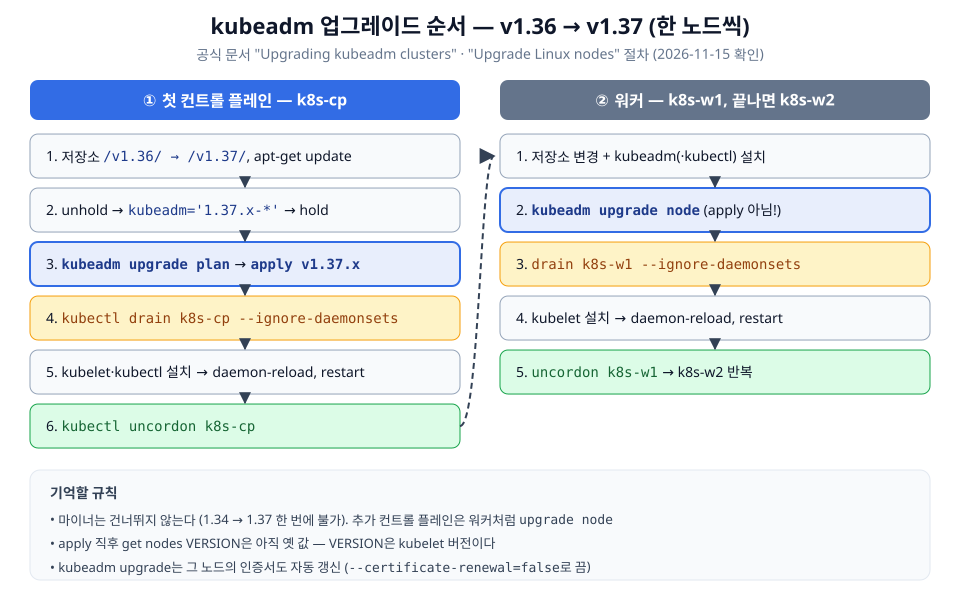
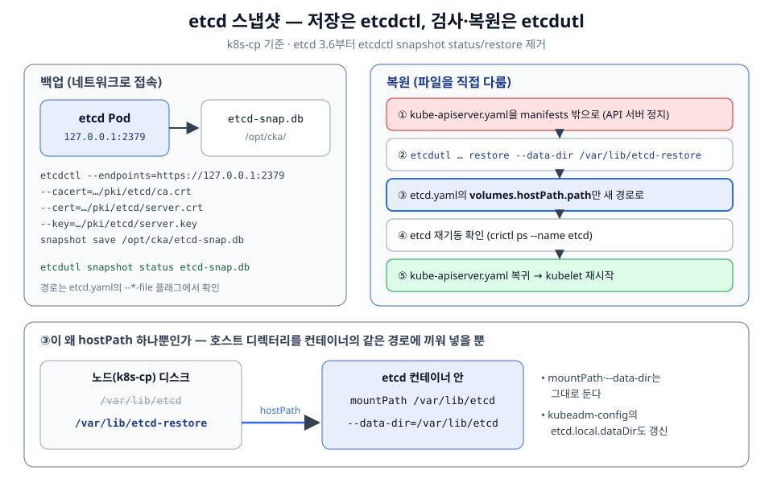

> **자격증 준비 · CKA** | 난이도 ★★★★☆ | 예상 소요 3 ~ 4시간

> ⚠️ 이 편의 모든 연습 과제는 CNCF가 공개한 **CKA 공식 커리큘럼(v1.37)을 바탕으로 직접 창작한** 시험 스타일 과제입니다. 실제 시험 문제(덤프)가 아니며, 실제 출제 내용과 무관합니다.

## 🎯 오늘의 목표

- kubeadm 클러스터의 노드를 **빼고 다시 넣는** 작업을 막힘없이 할 수 있다
- 공식 문서 절차대로 **컨트롤 플레인 → 워커** 순서로 v1.36 → v1.37 업그레이드를 끝낸다
- `etcdctl snapshot save`로 백업하고 `etcdutl snapshot restore`로 **복원해 클러스터 상태를 되돌릴** 수 있다
- `kubeadm certs check-expiration` / `renew`로 인증서 만료를 확인하고 갱신을 반영할 수 있다
- HA 컨트롤 플레인을 kubeadm으로 어떻게 구성하는지 설명할 수 있다

---

## 1. 커리큘럼 항목 요약 — Cluster Architecture, Installation & Configuration (25%) 중

| 커리큘럼 항목 | 이 편의 섹션 |
|---|---|
| Prepare underlying infrastructure for installing a Kubernetes cluster | 3 |
| Create and manage Kubernetes clusters using kubeadm | 3 |
| Manage the lifecycle of Kubernetes clusters | 4(업그레이드), 5(etcd), 6(인증서) |
| Implement and configure a highly-available control plane | 7 |

같은 도메인의 RBAC, Helm·Kustomize, CRD, CNI/CSI/CRI는 [K02](./k02-rbac-helm-kustomize-crd.md)에서 다룹니다. kubeadm의 원리(노드 준비, init 단계, static Pod)는 [Day 20](../../02-kubernetes/day20-kubeadm-multinode.md)을 참조하세요. 여기서는 반복하지 않고 **시험 과제 형태로 손을 빠르게** 만듭니다.

**실습 환경:** [K00](./k00-exam-overview-lab.md)의 고정값 그대로. base(WSL2)에서 context **`cka-main`**, 노드는 `ssh k8s-cp`(192.168.56.10), `ssh k8s-w1`(.11), `ssh k8s-w2`(.12). 시작 상태는 스냅샷 `k00-v136`(v1.36.x).

```powershell
# Windows PowerShell — 시작 전에 깨끗한 상태로
cd C:\lab\k8s
vagrant halt; vagrant snapshot restore k00-v136 --no-provision
```

---

## 2. 출제 유형 — 어떻게 채점되는가

| 과제 형태 | 예시 문장(창작) | 채점 포인트 |
|---|---|---|
| **업그레이드형** | "컨트롤 플레인 노드만 v1.37.x로 올려라. 워커는 그대로" | `kubectl get nodes`의 **해당 노드 VERSION**, 컨트롤 플레인 Pod 이미지 버전, 노드가 **Ready이고 스케줄 가능(uncordon)** |
| **etcd 백업형** | "etcd 스냅샷을 `/opt/...db`에 저장하라" | 지정 경로에 **유효한 스냅샷 파일**이 있는가 |
| **etcd 복원형** | "주어진 스냅샷으로 복원하라" | 스냅샷 시점의 오브젝트가 돌아왔는가, 클러스터가 정상인가 |
| **노드 가입형** | "새 노드를 클러스터에 join시켜라" | 노드가 **Ready**로 목록에 있는가 |
| **인증서형** | "만료일을 파일에 적어라 / 갱신하라" | 파일 내용, 인증서의 새 만료일 |

> ⚠️ 업그레이드·복원 과제는 **혼자 15분 이상** 걸릴 수 있습니다. 1회차에서는 건너뛰고, 쉬운 과제를 먼저 쓸어 담은 뒤 돌아오는 전략이 좋습니다. 대신 연습 때는 문서만 보고 **15분 안에** 끝내는 걸 목표로 반복하세요.

---

## 3. kubeadm 설치·노드 관리 복습

설치 자체는 Day 20(그리고 K00에서 v1.36으로 다시 한 번)에서 끝냈습니다. 시험에서는 처음부터 클러스터를 만드는 것보다, **노드 준비 상태를 점검하거나 노드를 추가·제거**하는 형태가 현실적입니다.

### 3-1. 노드 준비 체크리스트 (Day 20의 5~7장 요약)

| 확인 항목 | 확인 명령 | 기대값 |
|---|---|---|
| swap | `swapon --show` | 출력 없음 |
| 커널 모듈 | `lsmod \| grep -E 'overlay\|br_netfilter'` | 둘 다 보임 |
| sysctl | `sysctl net.ipv4.ip_forward net.bridge.bridge-nf-call-iptables` | 둘 다 `1` |
| 런타임 | `systemctl is-active containerd`, `grep SystemdCgroup /etc/containerd/config.toml` | `active`, `true` |
| 패키지 고정 | `apt-mark showhold` | `kubeadm kubectl kubelet` |
| kubelet | `systemctl is-active kubelet` | join 전에는 재시작 반복이 **정상** |

> 💡 v1.37 kubelet은 기본적으로 **cgroup v2만** 지원합니다(`FailCgroupV1` 기본값 `true`). Ubuntu 24.04는 cgroup v2라 문제없지만, 오래된 배포판 노드면 kubelet이 시작을 거부할 수 있다는 점만 기억하세요. 확인: `stat -fc %T /sys/fs/cgroup` → `cgroup2fs`.

### 3-2. 노드 빼고 다시 넣기

| 단계 | 어디서 | 명령 |
|---|---|---|
| ① 비우기 | base | `k drain k8s-w2 --ignore-daemonsets --delete-emptydir-data` |
| ② 클러스터에서 삭제 | base | `k delete node k8s-w2` |
| ③ 노드 초기화 | k8s-w2 | `sudo kubeadm reset -f` → `sudo rm -rf /etc/cni/net.d` |
| ④ join 명령 생성 | k8s-cp | `sudo kubeadm token create --print-join-command` |
| ⑤ 가입 | k8s-w2 | ④에서 나온 명령을 `sudo`로 |
| ⑥ 확인 | base | `k get nodes -w` → Ready |

```bash
# k8s-cp — 토큰 목록과 만료 확인
sudo kubeadm token list
```

```
TOKEN                     TTL         EXPIRES                USAGES                   ...
h3x9q2.0r8m5k1v7c4d6e2a   23h         2026-11-16T09:12:44Z   authentication,signing   ...
```

> 💡 Vagrant 환경에서는 `kubeadm reset` 후에도 `/etc/default/kubelet`의 `--node-ip` 설정이 남아 있으므로 재가입 후 INTERNAL-IP가 그대로 192.168.56.12입니다. 다른 환경이라면 이 파일부터 확인하세요.

---

## 4. 클러스터 업그레이드 — v1.36 → v1.37



📖 **시험장에서 찾을 문서:** kubernetes.io에서 "Upgrading kubeadm clusters" 검색 → `/docs/tasks/administer-cluster/kubeadm/kubeadm-upgrade/`, 워커는 같은 페이지에서 링크된 "Upgrade Linux nodes", 저장소 변경은 "Changing The Kubernetes Package Repository". 아래 명령은 이 문서(2026-11-15 확인, v1.37 기준)를 그대로 따릅니다.

### 4-1. 전체 규칙

| 규칙 | 내용 |
|---|---|
| 순서 | **첫 컨트롤 플레인 → 나머지 컨트롤 플레인 → 워커** |
| 버전 건너뛰기 | **불가.** 마이너는 한 단계씩(1.36 → 1.37) |
| drain | 마이너 업그레이드에서 kubelet을 올리기 전에 **반드시 drain** |
| 첫 CP vs 나머지 | 첫 CP는 `kubeadm upgrade apply v1.37.x`, 나머지 CP·워커는 `kubeadm upgrade node` |
| 패키지 | `pkgs.k8s.io`는 마이너별 저장소 → **먼저 저장소를 v1.37로** 바꿔야 새 버전이 보임 |
| 인증서 | `kubeadm upgrade`가 그 노드의 kubeadm 관리 인증서를 **자동 갱신**(끄려면 `--certificate-renewal=false`) |

### 4-2. 첫 컨트롤 플레인(k8s-cp)

```bash
ssh k8s-cp
sudo -i

# (1) 패키지 저장소를 v1.37로
sed -i 's|/v1.36/|/v1.37/|' /etc/apt/sources.list.d/kubernetes.list
apt-get update
apt-cache madison kubeadm | head -3          # 최신 1.37.x-* 확인
```

```
   kubeadm | 1.37.1-1.1 | https://pkgs.k8s.io/core:/stable:/v1.37/deb  Packages
   kubeadm | 1.37.0-1.1 | https://pkgs.k8s.io/core:/stable:/v1.37/deb  Packages
```

```bash
# (2) kubeadm만 먼저
apt-mark unhold kubeadm && \
apt-get update && apt-get install -y kubeadm='1.37.1-*' && \
apt-mark hold kubeadm
kubeadm version -o short                     # v1.37.1

# (3) 계획 확인 → 적용
kubeadm upgrade plan
kubeadm upgrade apply v1.37.1                # 확인 질문에 y (또는 -y)
```

```
[upgrade/successful] SUCCESS! Your cluster was upgraded to "v1.37.1". Enjoy!
[upgrade/kubelet] Now that your control plane is upgraded, please proceed with upgrading your kubelets if you haven't already done so.
```

여기까지 하면 **컨트롤 플레인 Pod(apiserver 등)만** v1.37입니다. `kubectl get nodes`의 VERSION은 kubelet 버전이라 아직 v1.36으로 보입니다.

> 💡 공식 문서는 이 시점에 "CNI 플러그인도 필요하면 업그레이드하라"고 합니다. 실습 클러스터의 Cilium은 v1.37과 호환되므로 그대로 둡니다. 시험에서도 과제가 요구하지 않으면 건드리지 않습니다.

```bash
# (4) drain — kubectl은 base에서 (또는 k8s-cp에서 exit 후)
exit; exit
k drain k8s-cp --ignore-daemonsets
```

```bash
# (5) kubelet, kubectl 교체 → 재시작
ssh k8s-cp
sudo -i
apt-mark unhold kubelet kubectl && \
apt-get update && apt-get install -y kubelet='1.37.1-*' kubectl='1.37.1-*' && \
apt-mark hold kubelet kubectl
systemctl daemon-reload
systemctl restart kubelet
exit; exit

# (6) 다시 스케줄 가능하게
k uncordon k8s-cp
k get nodes
```

```
NAME     STATUS   ROLES           AGE   VERSION
k8s-cp   Ready    control-plane   2d    v1.37.1
k8s-w1   Ready    <none>          2d    v1.36.5
k8s-w2   Ready    <none>          2d    v1.36.5
```

### 4-3. 워커(k8s-w1, 그다음 k8s-w2)

공식 "Upgrade Linux nodes" 순서는 **kubeadm 교체 → `kubeadm upgrade node` → drain → kubelet 교체 → uncordon**입니다. 한 번에 한 노드씩.

```bash
# (1) 저장소 + kubeadm(+kubectl)
ssh k8s-w1
sudo -i
sed -i 's|/v1.36/|/v1.37/|' /etc/apt/sources.list.d/kubernetes.list
apt-mark unhold kubeadm kubectl && \
apt-get update && apt-get install -y kubeadm='1.37.1-*' kubectl='1.37.1-*' && \
apt-mark hold kubeadm kubectl

# (2) 노드의 kubelet 설정 업그레이드
kubeadm upgrade node
exit; exit

# (3) drain (base)
k drain k8s-w1 --ignore-daemonsets --delete-emptydir-data

# (4) kubelet 교체
ssh k8s-w1
sudo -i
apt-mark unhold kubelet && \
apt-get update && apt-get install -y kubelet='1.37.1-*' && \
apt-mark hold kubelet
systemctl daemon-reload
systemctl restart kubelet
exit; exit

# (5) uncordon (base)
k uncordon k8s-w1
```

k8s-w2도 같은 순서로 한 뒤, 전체를 확인합니다.

```bash
k get nodes
k -n kube-system get pods -o custom-columns=NAME:.metadata.name,IMAGE:.spec.containers[0].image | grep kube-
```

> ⚠️ **`--delete-emptydir-data`** 는 emptyDir를 쓰는 Pod가 있으면 drain이 `cannot delete Pods with local storage`로 멈추는 것을 풀어 줍니다(그 Pod의 emptyDir 데이터는 사라짐). 컨트롤러 없이 만든 단독 Pod가 있으면 `--force`가 필요하고, 그 Pod는 **다시 생기지 않습니다.** 시험에서 drain이 멈추면 에러 메시지에 나온 옵션을 읽고 판단하세요.

### 4-4. 업그레이드가 끝나면 — `cka-clean` 스냅샷

이후 K02~K08은 이 상태(v1.37.1)에서 시작합니다.

```powershell
cd C:\lab\k8s
vagrant halt
vagrant snapshot save cka-clean
vagrant up
```

---

## 5. etcd 백업과 복원



📖 **시험장에서 찾을 문서:** "Operating etcd clusters for Kubernetes" → `/docs/tasks/administer-cluster/configure-upgrade-etcd/`의 *Backing up an etcd cluster*, *Restoring an etcd cluster* 절.

### 5-1. etcdctl과 etcdutl — 무엇을 쓰나

2026-11-15 공식 문서 기준 정리입니다.

| 작업 | 도구 | 비고 |
|---|---|---|
| 스냅샷 **저장** `snapshot save` | **`etcdctl`** | 살아 있는 etcd에 **네트워크로** 접속 → 엔드포인트·인증서 필요 |
| 스냅샷 **검사** `snapshot status` | **`etcdutl`** | 파일을 직접 읽음. `etcdctl snapshot status`는 v3.5에서 deprecated, **v3.6에서 제거** |
| 스냅샷 **복원** `snapshot restore` | **`etcdutl`** | 파일 → 새 데이터 디렉터리. `etcdctl snapshot restore`도 **v3.6에서 제거** |

kubeadm v1.37이 띄우는 etcd는 3.7 계열이므로 **save는 etcdctl, status·restore는 etcdutl**로 외우면 됩니다. `ETCDCTL_API=3`은 etcd 3.4부터 기본값이라 생략해도 되지만, 붙여도 해가 없습니다.

> 💡 **시험 호스트에 어떤 도구가 있는지는 공식 문서에 나와 있지 않습니다.** 과제를 시작하면 `which etcdctl etcdutl`부터 확인하세요. 연습 클러스터에는 직접 설치합니다.

```bash
# k8s-cp — etcd 버전 확인 후 같은 계열의 클라이언트 도구 설치
k -n kube-system get pod etcd-k8s-cp -o jsonpath='{.spec.containers[0].image}{"\n"}'
# registry.k8s.io/etcd:3.7.0-0  (예시)

ETCD_VER=v3.7.3          # etcd GitHub 릴리스의 3.7.x 최신 (2026-11-15 기준)
curl -fsSL https://github.com/etcd-io/etcd/releases/download/${ETCD_VER}/etcd-${ETCD_VER}-linux-amd64.tar.gz -o /tmp/etcd.tgz
tar xzf /tmp/etcd.tgz -C /tmp
sudo install /tmp/etcd-${ETCD_VER}-linux-amd64/etcdctl /tmp/etcd-${ETCD_VER}-linux-amd64/etcdutl /usr/local/bin/
etcdctl version; etcdutl version
```

### 5-2. 인증서 경로는 외우지 말고 매니페스트에서

```bash
sudo grep -E -- '--(listen-client-urls|cert-file|key-file|trusted-ca-file|data-dir)' /etc/kubernetes/manifests/etcd.yaml
```

```
    - --cert-file=/etc/kubernetes/pki/etcd/server.crt
    - --data-dir=/var/lib/etcd
    - --key-file=/etc/kubernetes/pki/etcd/server.key
    - --listen-client-urls=https://127.0.0.1:2379,https://192.168.56.10:2379
    - --trusted-ca-file=/etc/kubernetes/pki/etcd/ca.crt
```

| etcd 매니페스트 플래그 | etcdctl 옵션 |
|---|---|
| `--listen-client-urls`의 하나 | `--endpoints=https://127.0.0.1:2379` |
| `--trusted-ca-file` | `--cacert` |
| `--cert-file` | `--cert` |
| `--key-file` | `--key` |

### 5-3. 저장과 검사

```bash
sudo mkdir -p /opt/cka
sudo etcdctl --endpoints=https://127.0.0.1:2379 \
  --cacert=/etc/kubernetes/pki/etcd/ca.crt \
  --cert=/etc/kubernetes/pki/etcd/server.crt \
  --key=/etc/kubernetes/pki/etcd/server.key \
  snapshot save /opt/cka/etcd-snap.db
```

```
... Snapshot saved at /opt/cka/etcd-snap.db
```

```bash
sudo etcdutl --write-out=table snapshot status /opt/cka/etcd-snap.db
```

```
+----------+----------+------------+------------+---------+
|   HASH   | REVISION | TOTAL KEYS | TOTAL SIZE | VERSION |
+----------+----------+------------+------------+---------+
| 7a1c2e9b |    48211 |       1187 |     6.1 MB |   3.7.0 |
+----------+----------+------------+------------+---------+
```

> ⚠️ 스냅샷 파일에는 Secret을 포함한 **클러스터의 모든 데이터**가 들어 있습니다. 실무에서는 암호화해 보관하세요(공식 문서도 같은 경고를 합니다).

### 5-4. 복원 — 새 데이터 디렉터리로

공식 문서의 원칙은 **"API 서버를 모두 멈추고 → etcd 복원 → API 서버 재시작"** 입니다. 단일 컨트롤 플레인인 `cka-main`에서는 이렇게 합니다.

```bash
ssh k8s-cp
sudo -i

# (1) API 서버 멈추기 — static Pod는 매니페스트를 치우면 kubelet이 내림
mv /etc/kubernetes/manifests/kube-apiserver.yaml /etc/kubernetes/

# (2) 스냅샷을 새 디렉터리로 복원 (기존 /var/lib/etcd는 건드리지 않음)
etcdutl snapshot restore /opt/cka/etcd-snap.db \
  --data-dir /var/lib/etcd-restore \
  --name k8s-cp \
  --initial-cluster k8s-cp=https://192.168.56.10:2380 \
  --initial-advertise-peer-urls https://192.168.56.10:2380

# (3) etcd 매니페스트의 hostPath만 새 디렉터리로
vim /etc/kubernetes/manifests/etcd.yaml
```

```yaml
  volumes:
  - hostPath:
      path: /var/lib/etcd-restore      # ← /var/lib/etcd 에서 변경
      type: DirectoryOrCreate
    name: etcd-data
```

```bash
# (4) etcd가 새 데이터로 다시 뜰 때까지 대기 → API 서버 복귀
watch crictl ps --name etcd              # 새 컨테이너 ID로 Running 확인 후 Ctrl+C
mv /etc/kubernetes/kube-apiserver.yaml /etc/kubernetes/manifests/
systemctl restart kubelet                # 공식 문서 권장: 컴포넌트 재시작으로 오래된 상태 제거
```

| 포인트 | 이유 |
|---|---|
| 바꾸는 곳은 `volumes.hostPath.path` **하나** | 컨테이너 안의 `--data-dir=/var/lib/etcd`와 `volumeMounts`는 그대로. 호스트의 어느 디렉터리를 그 경로에 붙일지만 바꾸는 것 |
| `--name`, `--initial-cluster`, `--initial-advertise-peer-urls` | 매니페스트의 같은 이름 플래그 값을 그대로. 생략해도 단일 노드에서는 대개 뜨지만, 멤버 정보가 `default`/`localhost`로 기록되므로 맞춰 주는 편이 정확 |
| 새 디렉터리 | 같은 디렉터리로 복원하려면 etcd를 멈추고 기존 디렉터리를 **먼저 지워야** 함(공식 문서). 새 디렉터리 쪽이 실수해도 되돌리기 쉬움 |
| kubeadm-config | 공식 문서: kubeadm 클러스터라면 `kube-system`의 `kubeadm-config` ConfigMap의 `etcd.local.dataDir`도 새 경로로. 안 바꾸면 **다음 `kubeadm upgrade`가 옛 경로로 매니페스트를 다시 씀** |

```bash
# (5) kubeadm-config 동기화 (시험 과제가 요구하지 않으면 생략 가능, 실습에서는 해 두기)
k -n kube-system edit cm kubeadm-config     # etcd.local.dataDir: /var/lib/etcd-restore
```

> 💡 복원 직후 1~2분은 컨트롤러 매니저·스케줄러가 리더 선출을 다시 하느라 `kubectl`이 잠깐 느리거나 에러를 낼 수 있습니다. `k get nodes`가 정상으로 돌아올 때까지 기다리세요.

---

## 6. 인증서 만료 확인과 갱신

📖 **시험장에서 찾을 문서:** "Certificate Management with kubeadm" → `/docs/tasks/administer-cluster/kubeadm/kubeadm-certs/`

```bash
sudo kubeadm certs check-expiration
```

```
CERTIFICATE                EXPIRES                  RESIDUAL TIME   CERTIFICATE AUTHORITY   EXTERNALLY MANAGED
admin.conf                 Nov 15, 2027 09:20 UTC   364d                                    no
apiserver                  Nov 15, 2027 09:20 UTC   364d            ca                      no
apiserver-etcd-client      Nov 15, 2027 09:20 UTC   364d            etcd-ca                 no
...
CERTIFICATE AUTHORITY   EXPIRES                  RESIDUAL TIME   EXTERNALLY MANAGED
ca                      Nov 13, 2036 08:41 UTC   9y              no
```

| 사실 | 내용 |
|---|---|
| 유효기간 | 리프 인증서 기본 **1년**, CA 기본 **10년** |
| 자동 갱신 | `kubeadm upgrade`가 그 노드의 인증서를 갱신 → 1년 안에 한 번씩 업그레이드하면 만료 걱정 없음 (4장 업그레이드 직후라 RESIDUAL TIME이 거의 1년) |
| 목록에 없는 것 | `kubelet.conf` — kubelet 클라이언트 인증서는 `/var/lib/kubelet/pki/`에서 **자동 순환** |
| 수동 갱신 | `kubeadm certs renew all` 또는 `kubeadm certs renew apiserver`처럼 하나만 |
| 갱신 후 | **컨트롤 플레인 Pod 재시작 필요**(인증서를 동적으로 다시 읽지 않는 컴포넌트가 있음). static Pod라 `kubectl delete`가 아니라 매니페스트를 잠시 치웠다가(약 20초) 되돌림 |
| admin.conf | 갱신되면 `~/.kube/config`로 다시 복사해야 새 인증서를 씀 |

```bash
# 하나만 갱신하고 반영 (예: apiserver)
sudo kubeadm certs renew apiserver
sudo mv /etc/kubernetes/manifests/kube-apiserver.yaml /tmp/ && sleep 20
sudo mv /tmp/kube-apiserver.yaml /etc/kubernetes/manifests/

# 파일에서 직접 만료일 확인 (kubeadm 없이도 되는 방법)
sudo openssl x509 -in /etc/kubernetes/pki/apiserver.crt -noout -enddate
# notAfter=Nov 15 09:41:02 2027 GMT
```

> ⚠️ `renew all`을 한 뒤 base의 `~/.kube/config`(admin 인증서를 담고 있음)는 **옛 인증서**입니다. 옛 인증서도 만료 전까지는 동작하지만, 과제가 "kubeconfig도 갱신"을 요구하면 K00 6-4처럼 `admin.conf`를 다시 가져오세요.

---

## 7. HA 컨트롤 플레인 — 구성 방식만 정확히

`cka-main`은 컨트롤 플레인 1대라 직접 실습하지는 않지만, 커리큘럼 항목이므로 **명령과 개념**은 정확히 알아 둡니다. 📖 문서: "Options for Highly Available Topology", "Creating Highly Available Clusters with kubeadm".

| 방식 | etcd 위치 | 특징 |
|---|---|---|
| **Stacked etcd** | 각 컨트롤 플레인 노드에 etcd를 함께 | kubeadm 기본. 노드가 적게 듦. 노드 하나 잃으면 etcd 멤버도 하나 잃음 |
| **External etcd** | 별도 etcd 클러스터 | 장애 영역 분리. 노드가 더 필요 |

| 단계 | 명령 |
|---|---|
| 첫 CP | `kubeadm init --control-plane-endpoint "LB주소:6443" --upload-certs --pod-network-cidr=10.244.0.0/16` |
| 추가 CP | `kubeadm join LB주소:6443 --token ... --discovery-token-ca-cert-hash sha256:... --control-plane --certificate-key <키>` |
| 인증서 키 재발급 | 업로드된 인증서는 **2시간 뒤 삭제** → `kubeadm init phase upload-certs --upload-certs`로 새 키 |
| 워커 | 평소처럼 `kubeadm join LB주소:6443 ...` (`--control-plane` 없이) |

> 💡 핵심은 **`--control-plane-endpoint`** 입니다. 처음 init할 때 로드밸런서(또는 DNS 이름)를 엔드포인트로 지정해야 나중에 CP를 늘릴 수 있습니다. `cka-main`처럼 IP 하나로 init한 클러스터를 HA로 바꾸려면 인증서 SAN과 kubeconfig를 모두 손봐야 해서 사실상 재구축입니다. etcd는 과반수(quorum)가 필요하므로 CP는 **3대, 5대처럼 홀수**로 둡니다. Day 34에서 OpenStack 위에 클러스터를 세울 때도 같은 원리입니다.

---

## 8. 핵심 명령 한눈에

| 하고 싶은 것 | 명령 |
|---|---|
| join 명령 새로 만들기 | `kubeadm token create --print-join-command` |
| 노드 비우기 / 되돌리기 | `k drain <노드> --ignore-daemonsets [--delete-emptydir-data]` / `k uncordon <노드>` |
| 업그레이드 가능 버전 | `kubeadm upgrade plan` |
| 첫 CP 업그레이드 | `kubeadm upgrade apply v1.37.x` |
| 나머지 CP·워커 | `kubeadm upgrade node` |
| 패키지 버전 목록 | `apt-cache madison kubeadm` |
| kubelet 반영 | `systemctl daemon-reload && systemctl restart kubelet` |
| etcd 스냅샷 | `etcdctl --endpoints --cacert --cert --key snapshot save <파일>` |
| 스냅샷 검사 / 복원 | `etcdutl snapshot status <파일>` / `etcdutl snapshot restore <파일> --data-dir <새 경로>` |
| 인증서 만료 / 갱신 | `kubeadm certs check-expiration` / `kubeadm certs renew <이름\|all>` |
| 클러스터 설정 보기 | `k -n kube-system get cm kubeadm-config -o yaml` |

---

## 9. 시간 절약 팁

- **문서의 명령 블록을 복사**하고 버전 부분(`1.37.x-*`)만 고치세요. 업그레이드 명령을 손으로 치는 것보다 빠르고 오타가 없습니다.
- 노드에 들어가면 바로 **`sudo -i`**. 명령마다 `sudo`를 붙이다 하나 빠뜨리는 실수를 줄입니다.
- drain·uncordon은 kubectl이 있는 곳에서. 노드에서 할 일(패키지·kubeadm·kubelet)을 **한 번 ssh에 몰아서** 하고 나오면 왕복이 줄어듭니다(워커는 문서 순서상 drain이 중간에 끼므로 2번 들어감).
- etcd 인증서 경로는 `grep -- '-file' /etc/kubernetes/manifests/etcd.yaml` 한 줄로.
- 복원 후 hostPath 수정은 vim에서 `/etcd-data` 검색으로 바로 이동.

## 10. 자주 하는 실수

| 실수 | 결과 | 바로잡기 |
|---|---|---|
| 저장소를 v1.37로 안 바꿈 | `apt-cache madison`에 1.37이 없음 | `kubernetes.list`의 마이너 버전 수정 → `apt-get update` |
| `apt-mark unhold` 생략 | 설치가 `held packages` 에러로 실패 | unhold → install → hold |
| `upgrade apply`만 하고 kubelet 교체 생략 | `get nodes` VERSION이 그대로 → 감점 | kubelet 설치 + `daemon-reload` + `restart kubelet` |
| uncordon 잊음 | 노드가 `Ready,SchedulingDisabled` | 마지막에 `k get nodes`로 확인 |
| 워커에서 `upgrade apply` 실행 | 에러 또는 의도치 않은 동작 | 워커·추가 CP는 `upgrade node` |
| 지시받지 않은 노드까지 업그레이드 | "CP만" 과제에서 감점 | 과제 문장의 대상 노드 재확인 |
| `etcdctl snapshot restore` 사용 | etcd 3.6+ 도구에는 해당 하위 명령 없음 | `etcdutl snapshot restore` |
| 복원 후 `--data-dir` 플래그를 바꿈 | 컨테이너 안 경로와 마운트가 어긋나 etcd가 빈 디렉터리로 뜸 | **hostPath만** 바꾸기 |
| 인증서 갱신 후 재시작 안 함 | API 서버가 옛 인증서로 계속 서비스 | 매니페스트를 치웠다가 되돌리기 |

---

## 11. 창작 연습 과제

> 아래 과제는 모두 **CKA 공식 커리큘럼을 바탕으로 창작한** 연습 문제입니다. 스냅샷 `k00-v136`에서 시작해 순서대로 풀면 과제 3 뒤에 `cka-clean`을 찍게 됩니다. 모든 과제는 context **`cka-main`**.

### 과제 1. 워커 재가입

`k8s-w2`를 클러스터에서 완전히 제거한 뒤 다시 가입시켜라. 끝났을 때 `k8s-w2`는 Ready이고 스케줄 가능해야 한다.

<details>
<summary>풀이·검증</summary>

```bash
k config use-context cka-main
k drain k8s-w2 --ignore-daemonsets --delete-emptydir-data
k delete node k8s-w2
ssh k8s-w2 'sudo kubeadm reset -f && sudo rm -rf /etc/cni/net.d'
JOIN=$(ssh k8s-cp 'sudo kubeadm token create --print-join-command')
ssh k8s-w2 "sudo $JOIN"
```

```bash
k get nodes -w                     # k8s-w2 NotReady → Ready (Cilium Pod가 뜨면)
k get node k8s-w2 -o jsonpath='{.spec.unschedulable}{"\n"}'   # 빈 값 = 스케줄 가능
```

📖 문서: "kubeadm join", "kubeadm token", "Safely Drain a Node"
</details>

### 과제 2. 컨트롤 플레인만 업그레이드

`k8s-cp`의 컨트롤 플레인 컴포넌트와 kubelet·kubectl을 **v1.37의 최신 패치**로 업그레이드하라. 워커는 건드리지 않는다.

<details>
<summary>풀이·검증</summary>

4-2의 (1)~(6) 그대로. 핵심만:

```bash
ssh k8s-cp
sudo -i
sed -i 's|/v1.36/|/v1.37/|' /etc/apt/sources.list.d/kubernetes.list
apt-mark unhold kubeadm && apt-get update && apt-get install -y kubeadm='1.37.1-*' && apt-mark hold kubeadm
kubeadm upgrade plan
kubeadm upgrade apply v1.37.1 -y
exit; exit
k drain k8s-cp --ignore-daemonsets
ssh k8s-cp "sudo bash -c \"apt-mark unhold kubelet kubectl && apt-get install -y kubelet='1.37.1-*' kubectl='1.37.1-*' && apt-mark hold kubelet kubectl && systemctl daemon-reload && systemctl restart kubelet\""
k uncordon k8s-cp
```

```bash
k get nodes                                         # k8s-cp만 v1.37.1, Ready
k -n kube-system get pod kube-apiserver-k8s-cp -o jsonpath='{.spec.containers[0].image}{"\n"}'
# registry.k8s.io/kube-apiserver:v1.37.1
```

📖 문서: "Upgrading kubeadm clusters"
</details>

### 과제 3. 워커 업그레이드

`k8s-w1`, `k8s-w2`를 한 번에 하나씩 `k8s-cp`와 같은 버전으로 올려라. 작업 중에도 최소 한 워커는 스케줄 가능해야 한다.

<details>
<summary>풀이·검증</summary>

4-3을 k8s-w1에 끝까지(uncordon 포함) 수행한 다음 k8s-w2에 반복합니다.

```bash
k get nodes                       # 세 노드 모두 v1.37.1, Ready, SchedulingDisabled 없음
ssh k8s-w2 'kubelet --version'    # Kubernetes v1.37.1
```

검증이 끝나면 K02 이후의 출발점을 저장합니다.

```powershell
cd C:\lab\k8s; vagrant halt; vagrant snapshot save cka-clean; vagrant up
```

📖 문서: "Upgrade Linux nodes"
</details>

### 과제 4. etcd 스냅샷 저장

`k8s-cp`에서 etcd 스냅샷을 `/opt/cka/etcd-before.db`에 저장하고, 스냅샷의 리비전과 키 개수를 `/opt/cka/etcd-before.txt`에 표 형식으로 저장하라.

<details>
<summary>풀이·검증</summary>

```bash
ssh k8s-cp
sudo -i
mkdir -p /opt/cka
etcdctl --endpoints=https://127.0.0.1:2379 \
  --cacert=/etc/kubernetes/pki/etcd/ca.crt \
  --cert=/etc/kubernetes/pki/etcd/server.crt \
  --key=/etc/kubernetes/pki/etcd/server.key \
  snapshot save /opt/cka/etcd-before.db
etcdutl --write-out=table snapshot status /opt/cka/etcd-before.db > /opt/cka/etcd-before.txt
```

```bash
ls -lh /opt/cka/etcd-before.db; cat /opt/cka/etcd-before.txt
```

📖 문서: "Operating etcd clusters for Kubernetes" → Built-in snapshot / Snapshot using etcdctl options
</details>

### 과제 5. etcd 복원으로 되돌리기

과제 4 직후에 네임스페이스 `after-snap`을 만들고 그 안에 Deployment `oops`(이미지 `nginx`)를 만들어라. 그런 다음 `/opt/cka/etcd-before.db`로 복원해 `after-snap`이 **사라진** 상태로 클러스터를 되돌려라. 복원 데이터는 `/var/lib/etcd-from-backup`에 둔다.

<details>
<summary>풀이·검증</summary>

```bash
k create ns after-snap
k -n after-snap create deploy oops --image=nginx

ssh k8s-cp
sudo -i
mv /etc/kubernetes/manifests/kube-apiserver.yaml /etc/kubernetes/
etcdutl snapshot restore /opt/cka/etcd-before.db \
  --data-dir /var/lib/etcd-from-backup \
  --name k8s-cp \
  --initial-cluster k8s-cp=https://192.168.56.10:2380 \
  --initial-advertise-peer-urls https://192.168.56.10:2380
sed -i 's|path: /var/lib/etcd$|path: /var/lib/etcd-from-backup|' /etc/kubernetes/manifests/etcd.yaml
grep -A1 'hostPath' /etc/kubernetes/manifests/etcd.yaml | grep path
sleep 30; crictl ps --name etcd
mv /etc/kubernetes/kube-apiserver.yaml /etc/kubernetes/manifests/
systemctl restart kubelet
exit; exit
```

```bash
k get ns after-snap               # Error from server (NotFound)
k get nodes                       # 모두 Ready
k -n kube-system get pods         # 컨트롤 플레인 Running
```

> 💡 `sed`의 `$`(줄 끝) 덕분에 `--data-dir=/var/lib/etcd` 같은 다른 줄은 바뀌지 않고 `path: /var/lib/etcd`로 **끝나는** hostPath 줄만 바뀝니다. 자신 없으면 vim으로 직접 고치세요.

📖 문서: "Operating etcd clusters for Kubernetes" → Restoring an etcd cluster
</details>

### 과제 6. 인증서 만료일 기록

`cka-main`의 kube-apiserver 서버 인증서 만료일을 `/opt/cka/apiserver-expiry.txt`(k8s-cp)에 저장하고, 클러스터 CA의 남은 기간도 확인하라.

<details>
<summary>풀이·검증</summary>

```bash
ssh k8s-cp
sudo -i
kubeadm certs check-expiration | grep -E '^apiserver ' > /opt/cka/apiserver-expiry.txt
# 또는: openssl x509 -in /etc/kubernetes/pki/apiserver.crt -noout -enddate > /opt/cka/apiserver-expiry.txt
kubeadm certs check-expiration | grep -A4 'CERTIFICATE AUTHORITY'
cat /opt/cka/apiserver-expiry.txt
```

📖 문서: "Certificate Management with kubeadm" → Check certificate expiration
</details>

### 과제 7. apiserver 인증서만 갱신

kube-apiserver의 서버 인증서**만** 갱신하고, 실행 중인 API 서버가 새 인증서를 쓰게 하라. 다른 인증서의 만료일은 바뀌면 안 된다.

<details>
<summary>풀이·검증</summary>

```bash
ssh k8s-cp
sudo -i
openssl x509 -in /etc/kubernetes/pki/apiserver.crt -noout -enddate      # 이전 값 메모
kubeadm certs renew apiserver
mv /etc/kubernetes/manifests/kube-apiserver.yaml /tmp/ && sleep 20
mv /tmp/kube-apiserver.yaml /etc/kubernetes/manifests/
```

```bash
openssl x509 -in /etc/kubernetes/pki/apiserver.crt -noout -enddate      # 새 값
kubeadm certs check-expiration | head -6       # apiserver 줄만 RESIDUAL TIME이 새로 365d
# 실행 중인 API 서버가 내놓는 인증서 확인
echo | openssl s_client -connect 192.168.56.10:6443 2>/dev/null | openssl x509 -noout -enddate
```

📖 문서: "Certificate Management with kubeadm" → Manual certificate renewal
</details>

### 과제 8. 클러스터 설정값 찾기

`cka-main`의 Pod 대역, Service 대역, etcd 데이터 디렉터리를 `kubeadm-config`에서 찾아 base의 `~/cka/cluster-config.txt`에 `podSubnet=...` 형식으로 한 줄씩 저장하라.

<details>
<summary>풀이·검증</summary>

```bash
k -n kube-system get cm kubeadm-config -o jsonpath='{.data.ClusterConfiguration}' > /tmp/cc.yaml
grep -E 'podSubnet|serviceSubnet|dataDir' /tmp/cc.yaml
{
  echo "podSubnet=$(yq '.networking.podSubnet' /tmp/cc.yaml)"
  echo "serviceSubnet=$(yq '.networking.serviceSubnet' /tmp/cc.yaml)"
  echo "dataDir=$(yq '.etcd.local.dataDir' /tmp/cc.yaml)"
} > ~/cka/cluster-config.txt
cat ~/cka/cluster-config.txt
```

```
podSubnet=10.244.0.0/16
serviceSubnet=10.96.0.0/12
dataDir=/var/lib/etcd
```

> 💡 시험 호스트에는 `yq`가 있다고 공식 팁에 나옵니다. base(WSL)에 없다면 `sudo snap install yq` 또는 `grep`/`awk`로 같은 결과를 만들면 됩니다. 과제 5를 하고 kubeadm-config를 고쳤다면 dataDir이 다르게 나옵니다. 과제가 끝나면 `cka-clean`으로 복원하세요.

📖 문서: "Reconfiguring a kubeadm cluster"(kubeadm-config ConfigMap 구조)
</details>

정리:

```powershell
cd C:\lab\k8s; vagrant halt; vagrant snapshot restore cka-clean --no-provision; vagrant up
```

---

## 12. 핵심 정리

- 업그레이드 순서: **저장소 변경 → kubeadm → `upgrade plan`/`apply`(첫 CP) 또는 `upgrade node`(나머지) → drain → kubelet·kubectl → daemon-reload·restart → uncordon**
- 마이너는 **건너뛸 수 없고**, `pkgs.k8s.io`는 마이너별 저장소다. `apt-mark unhold/hold`로 감싼다
- etcd: **save는 `etcdctl`**(엔드포인트·CA·cert·key), **status·restore는 `etcdutl`**(etcd 3.6부터 etcdctl 쪽 제거)
- 복원: API 서버 멈춤 → `etcdutl snapshot restore --data-dir <새 경로>` → etcd 매니페스트의 **hostPath만** 변경 → API 서버 복귀 (kubeadm-config의 dataDir도)
- 인증서: 리프 1년·CA 10년, 업그레이드가 자동 갱신, 수동은 `kubeadm certs renew`, **갱신 후 static Pod 재시작**
- HA: `--control-plane-endpoint` + `--upload-certs`로 init, 추가 CP는 `join --control-plane --certificate-key`
- 이 편 이후 `cka-main`은 **v1.37.1**, 초기화 지점은 스냅샷 **`cka-clean`**

---

## ⏭️ 다음 예고 — K02. 클러스터 아키텍처 ② RBAC, Helm·Kustomize, CRD·오퍼레이터, CNI/CSI/CRI

같은 도메인의 나머지 절반입니다. ServiceAccount·Role·ClusterRole을 명령형으로 빠르게 만들고 `kubectl auth can-i`로 검증하는 과제, Helm 릴리스 설치·업그레이드·롤백, Kustomize 오버레이 적용, CRD와 오퍼레이터 설치 확인, 그리고 노드가 어떤 CNI·CSI·CRI를 쓰는지 찾아내는 명령을 연습합니다.
