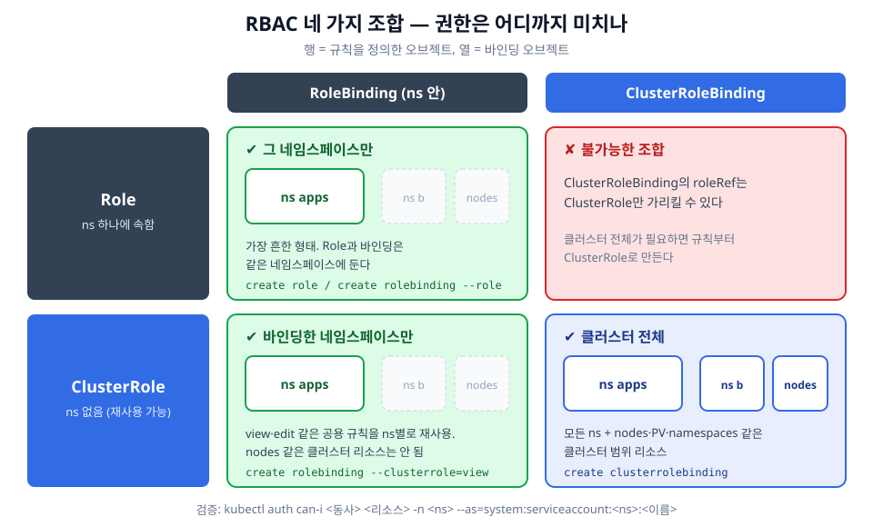
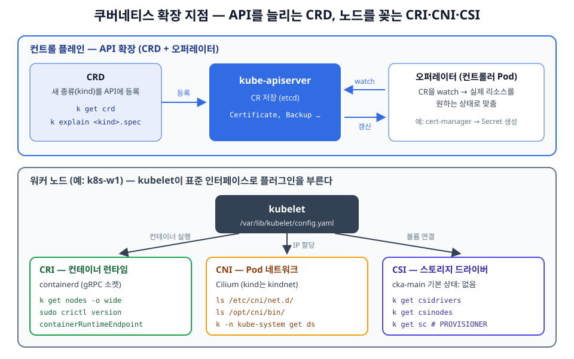

> **자격증 준비 · CKA** | 난이도 ★★★☆☆ | 예상 소요 2.5 ~ 3시간

> ⚠️ 이 편의 모든 연습 과제는 CNCF가 공개한 **CKA 공식 커리큘럼(v1.37)을 바탕으로 직접 창작한** 시험 스타일 과제입니다. 실제 시험 문제(덤프)가 아니며, 실제 출제 내용과 무관합니다.

## 🎯 오늘의 목표

- ServiceAccount·Role·ClusterRole·바인딩을 **명령형 한 줄**로 만들고 `kubectl auth can-i`로 검증한다
- Role/ClusterRole × RoleBinding/ClusterRoleBinding **네 가지 조합의 적용 범위**를 정확히 구분한다
- Helm 릴리스를 **설치 → 업그레이드 → 롤백**하고, Kustomize 오버레이를 `kubectl apply -k`로 적용한다
- CRD와 오퍼레이터가 설치됐는지 확인하고, 커스텀 리소스를 만들 수 있다
- 노드가 쓰는 **CNI·CSI·CRI**를 명령으로 찾아낸다

---

## 1. 커리큘럼 항목 요약 — Cluster Architecture, Installation & Configuration (25%) 중

| 커리큘럼 항목 | 이 편의 섹션 | 이론 참조 |
|---|---|---|
| Manage role based access control (RBAC) | 3 | [Day 19](../../02-kubernetes/day19-rbac-namespace.md) |
| Use Helm and Kustomize to install cluster components | 4, 5 | [Day 16](../../02-kubernetes/day16-helm.md), [Day 52](../../07-gitops/day52-kustomize.md) |
| Understand CRDs, install and configure operators | 6 | [Day 44](../../06-ai-infra/day44-k8s-gpu.md)(GPU Operator), [Day 53](../../07-gitops/day53-argocd.md)(Argo CD CRD) |
| Understand extension interfaces (CNI, CSI, CRI, etc.) | 7 | [Day 20](../../02-kubernetes/day20-kubeadm-multinode.md), [Day 14](../../02-kubernetes/day14-storage.md) |

**실습 환경:** [K00](./k00-exam-overview-lab.md)의 고정값. base(WSL2)에서 context **`cka-main`**(v1.37.1, 스냅샷 `cka-clean`)과 **`cka-aux`**(kind). 과제마다 어느 context인지 첫 줄에 적었습니다.

```powershell
# 시작 전 초기화 (Windows PowerShell)
cd C:\lab\k8s; vagrant halt; vagrant snapshot restore cka-clean --no-provision; vagrant up
```

```bash
# base — kind 보조 클러스터 초기화
bash ~/cka/reset-aux.sh
```

---

## 2. 출제 유형 — 어떻게 채점되는가

| 과제 형태 | 예시 문장(창작) | 채점 포인트 |
|---|---|---|
| **RBAC 생성형** | "네임스페이스 X의 SA가 Deployment를 만들고 지울 수 있게 하라" | Role의 **verbs·resources·apiGroups**, 바인딩의 **subject(종류·이름·네임스페이스)**, 과도한 권한이 없는가 |
| **RBAC 범위형** | "클러스터 전체 노드를 읽을 수 있게" | ClusterRole + **ClusterRoleBinding**(RoleBinding이면 노드 권한 안 됨) |
| **Helm형** | "리포지토리 Y의 차트를 버전 Z, 값 W로 설치/업그레이드/롤백" | 릴리스 이름·네임스페이스·**차트 버전**·값, 리비전 번호 |
| **Kustomize형** | "주어진 오버레이를 적용하라 / 오버레이에 이미지 태그 추가" | 렌더링 결과가 클러스터에 반영됐는가 |
| **CRD·오퍼레이터형** | "오퍼레이터를 설치하고 이 CRD의 리소스를 만들어라 / 설치된 CRD 목록을 파일로" | CRD 존재, 커스텀 리소스 상태, 파일 내용 |
| **확장 인터페이스형** | "노드의 컨테이너 런타임 엔드포인트를 파일에 적어라" | 파일 내용의 정확성 |

> 💡 RBAC 채점은 보통 `kubectl auth can-i`로 됩니다. 그러니 **검증도 똑같이 `can-i`로** 하세요. "되어야 하는 것"뿐 아니라 "**안 되어야 하는 것**"도 하나씩 확인하는 습관이 감점을 막습니다.

---

## 3. RBAC — 명령형으로 빠르게



📖 **시험장에서 찾을 문서:** "Using RBAC Authorization" → `/docs/reference/access-authn-authz/rbac/` (명령형 예시는 같은 페이지의 *Command-line utilities* 절), "Configure Service Accounts for Pods".

### 3-1. 네 가지 조합 — 이 표 하나

| 규칙 정의 | 바인딩 | 권한이 적용되는 범위 | 쓰임 |
|---|---|---|---|
| Role (ns A) | RoleBinding (ns A) | **ns A** | 가장 흔함 |
| ClusterRole | RoleBinding (ns A) | **ns A만** | 공용 규칙(`view`, `edit` 등)을 네임스페이스별로 재사용 |
| ClusterRole | ClusterRoleBinding | **모든 ns + 클러스터 범위 리소스**(nodes, PV, namespaces…) | 노드 조회, 클러스터 관리 |
| Role | ClusterRoleBinding | **불가** — ClusterRoleBinding은 ClusterRole만 참조 | — |

### 3-2. 명령 표

| 하고 싶은 것 | 명령 |
|---|---|
| SA 생성 | `k -n apps create sa deployer` |
| Role | `k -n apps create role deploy-mgr --verb=get,list,create,update,delete --resource=deployments` |
| 하위 리소스 포함 | `--resource=pods,pods/log` |
| 특정 이름만 | `--resource=configmaps --resource-name=app-config` |
| ClusterRole | `k create clusterrole node-reader --verb=get,list,watch --resource=nodes` |
| RoleBinding (SA) | `k -n apps create rolebinding deploy-mgr-rb --role=deploy-mgr --serviceaccount=apps:deployer` |
| RoleBinding (ClusterRole을 ns에) | `k -n apps create rolebinding jane-view --clusterrole=view --user=jane` |
| ClusterRoleBinding | `k create clusterrolebinding node-reader-crb --clusterrole=node-reader --serviceaccount=ops:monitor` |
| 검증 (SA) | `k auth can-i create deployments -n apps --as=system:serviceaccount:apps:deployer` |
| 검증 (하위 리소스) | `k auth can-i get pods --subresource=log -n apps --as=...` |
| 가진 권한 전부 | `k auth can-i --list -n apps --as=...` |
| 누가 어떤 바인딩? | `k get rolebindings,clusterrolebindings -A -o wide \| grep deployer` |

> ⚠️ `--serviceaccount=` 값은 **`<네임스페이스>:<이름>`** 입니다. 네임스페이스를 빠뜨리면 바인딩은 만들어지지만 엉뚱한 주체를 가리켜 권한이 안 생깁니다. `--as=`에서는 **`system:serviceaccount:<ns>:<이름>`** 전체를 씁니다.

> 💡 `--resource=deployments`라고만 써도 kubectl이 API 그룹(`apps`)을 찾아 넣어 줍니다. YAML로 직접 쓸 때는 `apiGroups: ["apps"]`를 빠뜨리지 마세요. Pod·Service·ConfigMap 같은 core 그룹은 `apiGroups: [""]`(빈 문자열)입니다.

### 3-3. Pod에 SA 붙이기

`kubectl run`에는 ServiceAccount를 지정하는 옵션이 없습니다. `$do`로 뼈대를 만들고 한 줄 추가합니다.

```bash
k -n apps run probe --image=bitnami/kubectl:latest $do --command -- sleep 3600 > probe.yaml
# spec: 아래에 한 줄 추가
#   serviceAccountName: deployer
k apply -f probe.yaml
k -n apps get pod probe -o jsonpath='{.spec.serviceAccountName}{"\n"}'
```

---

## 4. Helm — 설치·업그레이드·롤백

📖 **시험장에서 찾을 문서:** `helm.sh/docs`(허용 목록) → *Using Helm*, 그리고 명령 레퍼런스 `helm install`, `helm upgrade`, `helm rollback`. 개념은 Day 16.

| 하고 싶은 것 | 명령 |
|---|---|
| 저장소 추가·갱신 | `helm repo add podinfo https://stefanprodan.github.io/podinfo` → `helm repo update` |
| 차트 버전 목록 | `helm search repo podinfo/podinfo --versions \| head` |
| 바꿀 수 있는 값 | `helm show values podinfo/podinfo \| less` |
| 설치 | `helm install web podinfo/podinfo -n web --create-namespace --version 6.16.0 --set replicaCount=2` |
| 렌더링만 (설치 안 함) | `helm template web podinfo/podinfo --version 6.16.0 --set replicaCount=2` |
| 업그레이드 | `helm upgrade web podinfo/podinfo -n web --version 6.17.0 --reuse-values` |
| 없으면 설치, 있으면 업그레이드 | `helm upgrade --install ...` |
| 목록 / 히스토리 | `helm list -A` / `helm history web -n web` |
| 지정한 값 보기 | `helm get values web -n web` (`--all`이면 기본값 포함) |
| 롤백 | `helm rollback web 1 -n web` |
| 삭제 | `helm uninstall web -n web` |
| OCI 차트 | `helm install <이름> oci://<레지스트리>/<경로>/<차트> --version <버전>` |

> ⚠️ **네임스페이스 `-n`을 매 명령마다.** Helm 릴리스 정보는 네임스페이스별 Secret에 저장되므로 `-n`을 빼면 "release not found"가 납니다. `helm list`가 비어 보이면 `helm list -A`.

> 💡 **Helm 3과 4.** 2026-11-15 기준 최신은 Helm 4(v4.3.x)이고 Helm 3(v3.22.x)도 함께 유지되고 있습니다. 위 표의 명령은 둘 다 같습니다. 다른 점만 기억하세요: Helm 4에서 `--atomic`은 `--rollback-on-failure`로, `--force`는 `--force-replace`로 이름이 바뀌었고(옛 이름은 경고와 함께 동작), **새 설치는 기본으로 server-side apply**를 씁니다. 시험 호스트의 버전은 `helm version`으로 먼저 확인하세요.

> 💡 `helm rollback`은 과거 리비전의 내용으로 **새 리비전을 만듭니다**. 리비전 3 상태에서 1로 롤백하면 리비전 4가 생기고 내용은 1과 같습니다(Day 16).

---

## 5. Kustomize — 오버레이 적용

📖 **시험장에서 찾을 문서:** kubectl.docs나 kustomize.io는 **허용 목록에 없습니다.** kubernetes.io에서 "Declarative Management of Kubernetes Objects Using Kustomize" → `/docs/tasks/manage-kubernetes-objects/kustomization/`. 필드 목록(namePrefix, images, patches, configMapGenerator 등)이 다 있습니다. 개념과 base/overlays 설계는 Day 52.

| 하고 싶은 것 | 명령 |
|---|---|
| 렌더링 결과 보기 | `k kustomize overlays/prod` |
| 적용 | `k apply -k overlays/prod` |
| 차이 비교 | `k diff -k overlays/prod` |
| 삭제 | `k delete -k overlays/prod` |
| 뼈대 만들기 | `k create deploy api --image=nginx:1.27 $do > base/deploy.yaml` |

자주 쓰는 `kustomization.yaml` 필드:

```yaml
apiVersion: kustomize.config.k8s.io/v1beta1
kind: Kustomization
resources:
- ../../base            # 오버레이는 base를 가리킴
namespace: shop-prod     # 모든 리소스의 네임스페이스
namePrefix: prod-        # 이름 앞에 붙임
labels:
- pairs:
    env: prod
images:
- name: nginx            # 매니페스트의 이미지 이름
  newTag: "1.28"         # 태그만 교체
replicas:
- name: api              # Deployment 이름 (namePrefix 붙기 전)
  count: 3
```

> ⚠️ `namespace:` 필드는 리소스의 네임스페이스만 **바꿀 뿐 Namespace 오브젝트를 만들지 않습니다.** 네임스페이스가 없으면 `apply -k`가 `namespaces "shop-prod" not found`로 실패합니다. 먼저 `k create ns`하거나 Namespace 매니페스트를 resources에 넣으세요.

> 💡 `replicas:`와 `images:`의 `name`은 **원래(base의) 이름**으로 씁니다. `prod-api`가 아니라 `api`. 렌더링(`k kustomize`)으로 결과를 먼저 보는 습관이 실수를 잡아 줍니다.

---

## 6. CRD와 오퍼레이터



📖 **시험장에서 찾을 문서:** "Extend the Kubernetes API with CustomResourceDefinitions" → `/docs/tasks/extend-kubernetes/custom-resources/custom-resource-definitions/`, 개념은 "Custom Resources", "Operator pattern".

| 개념 | 한 줄 |
|---|---|
| **CRD** | API 서버에 새 리소스 종류(kind)를 **등록**하는 것. 등록만으로는 아무 동작도 안 함 |
| **커스텀 리소스(CR)** | CRD로 생긴 종류의 실제 오브젝트 (`kind: Certificate` 하나하나) |
| **오퍼레이터** | CR을 지켜보다가(watch) 원하는 상태로 맞추는 **컨트롤러** + 그 CRD 묶음. 보통 Helm 차트나 매니페스트로 설치 |

| 확인하고 싶은 것 | 명령 |
|---|---|
| 설치된 CRD | `k get crd` |
| 특정 그룹의 리소스 | `k api-resources --api-group=cert-manager.io` |
| CR의 필드 설명 | `k explain certificate.spec` (`--recursive`로 전체 트리) |
| CRD의 버전·범위 | `k get crd certificates.cert-manager.io -o jsonpath='{.spec.versions[*].name} {.spec.scope}{"\n"}'` |
| 모든 네임스페이스의 CR | `k get certificates -A` |
| 오퍼레이터 동작 | `k -n cert-manager get deploy,pods`, `k -n cert-manager logs deploy/cert-manager` |

> 💡 **CR을 지워도 CRD는 남고, CRD를 지우면 그 종류의 CR이 모두 지워집니다.** "오퍼레이터를 제거하라"는 과제에서 CRD까지 지우라는 말이 없다면 CRD는 건드리지 마세요.

이 편의 실습 오퍼레이터는 **cert-manager**입니다. 2026-11-15 공식 설치 문서 기준 v1.21.3, OCI 차트 권장, CRD는 `crds.enabled=true`로 함께 설치합니다(과제 7). 시험장에서는 cert-manager 문서를 볼 수 없으므로, 오퍼레이터 과제는 **필요한 저장소·값이 과제 문장에 주어진다**고 생각하고 Helm 명령 형태만 정확히 익혀 두면 됩니다.

---

## 7. CNI·CSI·CRI 확인 명령

📖 **시험장에서 찾을 문서:** "Network Plugins"(`/docs/concepts/extend-kubernetes/compute-storage-net/network-plugins/`), "Container Runtimes", "crictl로 노드 디버깅(Debugging Kubernetes nodes with crictl)", "Volumes"의 CSI 절.

| 인터페이스 | 무엇을 연결 | `cka-main`에서 | 확인 명령 |
|---|---|---|---|
| **CRI** | kubelet ↔ 컨테이너 런타임 | containerd, `unix:///run/containerd/containerd.sock` | `k get nodes -o wide`(CONTAINER-RUNTIME 열), 노드에서 `sudo crictl version`, `sudo grep -r containerRuntimeEndpoint /var/lib/kubelet/` |
| **CNI** | kubelet(런타임) ↔ Pod 네트워크 플러그인 | Cilium | 노드에서 `ls /etc/cni/net.d/`, `ls /opt/cni/bin/`, `k -n kube-system get ds` |
| **CSI** | kubelet·컨트롤러 ↔ 스토리지 드라이버 | **없음**(기본 상태) | `k get csidrivers`, `k get csinodes`, `k get sc`(PROVISIONER 열) |

```bash
ssh k8s-w1 'ls /etc/cni/net.d/; sudo crictl version'
```

```
05-cilium.conflist
Version:  0.1.0
RuntimeName:  containerd
RuntimeVersion:  1.7.x
RuntimeApiVersion:  v1
```

```bash
k --context cka-aux get sc
# NAME                 PROVISIONER             RECLAIMPOLICY   VOLUMEBINDINGMODE      ...
# standard (default)   rancher.io/local-path   Delete          WaitForFirstConsumer   ...
k --context cka-aux get csidrivers
# No resources found
```

> 💡 kind의 기본 StorageClass `standard`는 **CSI 드라이버가 아닙니다**(local-path-provisioner라는 외부 프로비저너). 그래서 `csidrivers`가 비어 있는 게 정상입니다. "StorageClass가 있다 = CSI가 있다"가 아니라는 것, PROVISIONER 열 이름이 CSI 드라이버 이름과 같은지 `get csidrivers`로 확인해야 한다는 것이 포인트입니다.

> 💡 kind 노드는 컨테이너라 ssh 대신 `docker exec -it cka-aux-worker bash`로 들어갑니다. 안에서 `ls /etc/cni/net.d`를 보면 kind 기본 CNI인 kindnet 설정이 보입니다.

---

## 8. 시간 절약 팁

- RBAC는 **YAML을 쓰지 말고** `create role/clusterrole/rolebinding` 한 줄로. 과제가 YAML 수정을 요구할 때만 `$do > x.yaml`.
- 검증 변수를 먼저 만들어 두면 `can-i`를 반복하기 쉽습니다: `SA=system:serviceaccount:apps:deployer`.
- Helm 값 이름이 기억나지 않으면 `helm show values <차트> | grep -n -i <키워드>`. 문서 사이트보다 빠릅니다.
- Kustomize는 **`k kustomize`로 먼저 렌더링** → 이름·네임스페이스·이미지 확인 → `apply -k`.
- CRD 이름이 긴 리소스는 `k api-resources | grep -i <키워드>`로 SHORTNAMES를 찾아 씁니다(예: cert-manager의 `cert`).

## 9. 자주 하는 실수

| 실수 | 결과 | 바로잡기 |
|---|---|---|
| `--serviceaccount=deployer` (ns 생략) | 바인딩이 엉뚱한 주체를 가리킴 | `--serviceaccount=apps:deployer` |
| 노드 권한을 RoleBinding으로 | `can-i list nodes` → no | 클러스터 범위 리소스는 **ClusterRoleBinding** |
| Role을 다른 ns에서 바인딩 | `role.rbac... not found` 또는 권한 없음 | Role과 RoleBinding은 **같은 ns** |
| verbs에 `watch` 누락 | `kubectl get -w` 실패 | 조회 권한은 보통 `get,list,watch` |
| `pods/log` 누락 | `kubectl logs` Forbidden | `--resource=pods,pods/log` |
| `helm upgrade` 때 이전 `--set` 값 유실 | replicaCount 등이 기본값으로 돌아감 | `--reuse-values` 또는 values 파일 |
| Helm 명령에 `-n` 누락 | release not found / default에 설치 | 모든 helm 명령에 `-n` |
| Kustomize `replicas.name`에 prefix 붙은 이름 | 적용 안 됨 | base의 원래 이름 |
| CRD 없이 CR 먼저 apply | `no matches for kind` | CRD(또는 오퍼레이터) 설치 → `k get crd` 확인 후 |

---

## 10. 창작 연습 과제

> 아래 과제는 모두 **CKA 공식 커리큘럼을 바탕으로 창작한** 연습 문제입니다. `cka-clean` 스냅샷과 초기화된 `cka-aux`에서 시작합니다.

### 과제 1. 배포 담당 ServiceAccount

context `cka-main`. 네임스페이스 `apps`에 ServiceAccount `deployer`를 만들고, 이 SA가 `apps` 네임스페이스에서 **Deployment를 get/list/create/update/delete**, **Pod를 get/list** 할 수 있게 하라(Role 이름 `deploy-mgr`, RoleBinding 이름 `deploy-mgr-rb`). Secret은 읽을 수 없어야 한다.

<details>
<summary>풀이·검증</summary>

```bash
k config use-context cka-main
k create ns apps
k -n apps create sa deployer
k -n apps create role deploy-mgr --verb=get,list,create,update,delete --resource=deployments
k -n apps patch role deploy-mgr --type=json \
  -p='[{"op":"add","path":"/rules/-","value":{"apiGroups":[""],"resources":["pods"],"verbs":["get","list"]}}]'
k -n apps create rolebinding deploy-mgr-rb --role=deploy-mgr --serviceaccount=apps:deployer
```

> 💡 리소스마다 verbs가 다르면 `create role` 한 줄로는 안 됩니다. 위처럼 patch하거나, `$do`로 YAML을 뽑아 rules를 하나 더 쓰는 쪽이 더 편할 수 있습니다.

```bash
SA=system:serviceaccount:apps:deployer
k auth can-i create deployments -n apps --as=$SA   # yes
k auth can-i delete deployments -n apps --as=$SA   # yes
k auth can-i list pods -n apps --as=$SA            # yes
k auth can-i delete pods -n apps --as=$SA          # no
k auth can-i get secrets -n apps --as=$SA          # no
k auth can-i create deployments -n default --as=$SA  # no
```

📖 문서: "Using RBAC Authorization" → Command-line utilities (`kubectl create role`, `kubectl create rolebinding`)
</details>

### 과제 2. 클러스터 전체 노드 조회

context `cka-main`. 네임스페이스 `ops`의 ServiceAccount `monitor`가 **모든 노드를 get/list/watch** 할 수 있게 하라. ClusterRole 이름 `node-reader`, ClusterRoleBinding 이름 `node-reader-crb`.

<details>
<summary>풀이·검증</summary>

```bash
k create ns ops
k -n ops create sa monitor
k create clusterrole node-reader --verb=get,list,watch --resource=nodes
k create clusterrolebinding node-reader-crb --clusterrole=node-reader --serviceaccount=ops:monitor
```

```bash
SA=system:serviceaccount:ops:monitor
k auth can-i list nodes --as=$SA        # yes
k auth can-i delete nodes --as=$SA      # no
k auth can-i list pods -A --as=$SA      # no
```

📖 문서: "Using RBAC Authorization" → ClusterRoleBinding example
</details>

### 과제 3. 기본 ClusterRole을 한 네임스페이스에만

context `cka-main`. 사용자 `jane`이 `apps` 네임스페이스에서만 기본 제공 ClusterRole **`view`** 권한을 갖게 하라(RoleBinding 이름 `jane-view`). 다른 네임스페이스에서는 아무것도 볼 수 없어야 한다. 이어서, `jane`이 `apps`에서 **Pod 로그도 읽을 수 있는지** 확인하고, 안 된다면 로그 읽기만 추가로 허용하라(Role `log-reader`, RoleBinding `jane-logs`).

<details>
<summary>풀이·검증</summary>

```bash
k -n apps create rolebinding jane-view --clusterrole=view --user=jane
k auth can-i list pods -n apps --as=jane                       # yes
k auth can-i list pods -n default --as=jane                    # no
k auth can-i get pods --subresource=log -n apps --as=jane      # 확인
```

`view`에 `pods/log`가 포함돼 있다면 yes가 나오고 추가 작업은 필요 없습니다. no라면:

```bash
k -n apps create role log-reader --verb=get --resource=pods/log
k -n apps create rolebinding jane-logs --role=log-reader --user=jane
k auth can-i get pods --subresource=log -n apps --as=jane      # yes
```

```bash
k describe clusterrole view | grep -E 'pods(/log)?\b'          # view가 무엇을 포함하는지 직접 확인
```

> 💡 "확인하고, 필요하면 추가"형 과제는 **먼저 확인한 결과**가 답을 결정합니다. 기본 ClusterRole의 내용을 외우지 말고 `describe`로 보세요.

📖 문서: "Using RBAC Authorization" → Default roles and role bindings / User-facing roles
</details>

### 과제 4. Helm 설치·업그레이드·롤백

context `cka-main`. 저장소 `https://stefanprodan.github.io/podinfo`의 `podinfo` 차트를 **버전 6.16.0**으로 네임스페이스 `web`에 릴리스 이름 `shop`으로 설치하라. 레플리카는 2, UI 메시지(`ui.message`)는 `hello-cka`. 그 다음 **6.17.0**으로 업그레이드하되 값은 유지하고, 마지막으로 **첫 리비전으로 롤백**하라.

<details>
<summary>풀이·검증</summary>

```bash
helm repo add podinfo https://stefanprodan.github.io/podinfo
helm repo update
helm install shop podinfo/podinfo -n web --create-namespace --version 6.16.0 \
  --set replicaCount=2 --set ui.message=hello-cka
helm upgrade shop podinfo/podinfo -n web --version 6.17.0 --reuse-values
helm rollback shop 1 -n web
```

```bash
helm history shop -n web
# REVISION  STATUS      CHART           APP VERSION  DESCRIPTION
# 1         superseded  podinfo-6.16.0  6.16.0       Install complete
# 2         superseded  podinfo-6.17.0  6.17.0       Upgrade complete
# 3         deployed    podinfo-6.16.0  6.16.0       Rollback to 1
helm get values shop -n web          # replicaCount: 2, ui.message: hello-cka
k -n web get deploy shop-podinfo -o jsonpath='{.spec.replicas} {.spec.template.spec.containers[0].image}{"\n"}'
```

📖 문서: helm.sh/docs → `helm install`, `helm upgrade`(--reuse-values), `helm rollback`
</details>

### 과제 5. Helm으로 클러스터 컴포넌트 설치

context `cka-main`. 저장소 `https://kubernetes-sigs.github.io/metrics-server/`의 `metrics-server` 차트를 네임스페이스 `kube-system`에 릴리스 이름 `metrics-server`로 설치하라. 실습 클러스터의 kubelet은 자체 서명 인증서를 쓰므로 컨테이너 인자에 `--kubelet-insecure-tls`를 추가해야 한다. 설치 후 `kubectl top nodes`가 동작해야 한다.

<details>
<summary>풀이·검증</summary>

```bash
helm repo add metrics-server https://kubernetes-sigs.github.io/metrics-server/
helm repo update
helm show values metrics-server/metrics-server | grep -n -A3 '^args'
helm install metrics-server metrics-server/metrics-server -n kube-system \
  --set 'args={--kubelet-insecure-tls}'
```

```bash
k -n kube-system rollout status deploy/metrics-server
k top nodes          # 1~2분 뒤 CPU/메모리 수치
```

> 💡 `--set 'args={a,b}'`는 Helm의 **리스트 문법**입니다. 따옴표로 감싸야 셸이 중괄호를 건드리지 않습니다. `kubectl top`은 K03(HPA)·K06(리소스 모니터링)에서도 쓰므로, 이 과제를 한 뒤 `cka-clean`을 다시 찍어 두는 것도 방법입니다.

📖 문서: helm.sh/docs → Values Files / `--set` 문법("The Format and Limitations of --set"), kubernetes.io → "Resource metrics pipeline"
</details>

### 과제 6. Kustomize 오버레이 적용

context `cka-main`. base에 Deployment `api`(이미지 `nginx:1.27`, 레플리카 1)와 Service `api`(포트 80)를 두고, 오버레이 `prod`에서 **네임스페이스 `shop-prod`, 이름 접두사 `prod-`, 레플리카 3, 이미지 태그 `1.28`, 라벨 `env=prod`** 를 적용해 클러스터에 배포하라. 작업 디렉터리는 base의 `~/cka/kust/`.

<details>
<summary>풀이·검증</summary>

```bash
mkdir -p ~/cka/kust/{base,overlays/prod} && cd ~/cka/kust
k create deploy api --image=nginx:1.27 $do > base/deploy.yaml
k create service clusterip api --tcp=80:80 $do > base/svc.yaml
cat > base/kustomization.yaml <<'EOF'
resources:
- deploy.yaml
- svc.yaml
EOF
cat > overlays/prod/kustomization.yaml <<'EOF'
resources:
- ../../base
namespace: shop-prod
namePrefix: prod-
labels:
- pairs:
    env: prod
replicas:
- name: api
  count: 3
images:
- name: nginx
  newTag: "1.28"
EOF
k kustomize overlays/prod | grep -E 'name:|namespace:|image:|replicas:'
k create ns shop-prod
k apply -k overlays/prod
```

```bash
k -n shop-prod get deploy,svc -l env=prod
k -n shop-prod get deploy prod-api -o jsonpath='{.spec.replicas} {.spec.template.spec.containers[0].image}{"\n"}'
# 3 nginx:1.28
```

> 💡 `labels`의 `pairs`는 기본적으로 셀렉터에는 넣지 않습니다(Day 52에서 본 `commonLabels`와의 차이). 그래서 기존 Deployment의 셀렉터를 바꾸지 않아 안전합니다.

📖 문서: "Declarative Management of Kubernetes Objects Using Kustomize"
</details>

### 과제 7. 오퍼레이터 설치와 CR 확인

context **`cka-aux`**. cert-manager **v1.21.3**을 OCI 차트 `oci://quay.io/jetstack/charts/cert-manager`로 네임스페이스 `cert-manager`에 설치하고 CRD도 함께 설치하라. 설치된 cert-manager CRD 이름을 `~/cka/cm-crds.txt`에 저장한 뒤, 자체 서명 `ClusterIssuer` `selfsigned`와 네임스페이스 `tls-test`의 `Certificate` `demo-cert`(Secret 이름 `demo-cert-tls`, DNS 이름 `demo.cka.test`)를 만들어 Ready 상태를 확인하라.

<details>
<summary>풀이·검증</summary>

```bash
k config use-context cka-aux
helm install cert-manager oci://quay.io/jetstack/charts/cert-manager \
  --version v1.21.3 -n cert-manager --create-namespace --set crds.enabled=true
k -n cert-manager rollout status deploy/cert-manager-webhook
k get crd -o name | grep cert-manager.io > ~/cka/cm-crds.txt
cat ~/cka/cm-crds.txt
k explain certificate.spec.issuerRef      # 필드 이름 확인
```

```yaml
# ~/cka/cm-demo.yaml
apiVersion: cert-manager.io/v1
kind: ClusterIssuer
metadata:
  name: selfsigned
spec:
  selfSigned: {}
---
apiVersion: v1
kind: Namespace
metadata:
  name: tls-test
---
apiVersion: cert-manager.io/v1
kind: Certificate
metadata:
  name: demo-cert
  namespace: tls-test
spec:
  secretName: demo-cert-tls
  dnsNames:
  - demo.cka.test
  issuerRef:
    name: selfsigned
    kind: ClusterIssuer
```

```bash
k apply -f ~/cka/cm-demo.yaml
k -n tls-test get certificate demo-cert        # READY True
k -n tls-test get secret demo-cert-tls         # kubernetes.io/tls
k config use-context cka-main
```

📖 문서: kubernetes.io → "Custom Resources", "Operator pattern"(시험장에서는 cert-manager 문서 대신 `k explain`이 문서 역할)
</details>

### 과제 8. 나만의 CRD 만들기

context `cka-main`. 그룹 `ops.cka.example`, 종류 `Backup`(복수형 `backups`, 단축명 `bk`), **네임스페이스 범위**, 버전 `v1`인 CRD를 만들어라. `spec`에는 문자열 `schedule`과 정수 `retentionDays`(1 이상) 필드가 있다. 그다음 네임스페이스 `apps`에 `Backup` `nightly`(`schedule: "0 2 * * *"`, `retentionDays: 7`)를 만들어라.

<details>
<summary>풀이·검증</summary>

```yaml
# ~/cka/backup-crd.yaml — 문서 예시(CronTab)를 복사해 이름만 바꾼 형태
apiVersion: apiextensions.k8s.io/v1
kind: CustomResourceDefinition
metadata:
  name: backups.ops.cka.example        # <복수형>.<그룹>
spec:
  group: ops.cka.example
  scope: Namespaced
  names:
    plural: backups
    singular: backup
    kind: Backup
    shortNames: ["bk"]
  versions:
  - name: v1
    served: true
    storage: true
    schema:
      openAPIV3Schema:
        type: object
        properties:
          spec:
            type: object
            properties:
              schedule:
                type: string
              retentionDays:
                type: integer
                minimum: 1
```

```bash
k apply -f ~/cka/backup-crd.yaml
k get crd backups.ops.cka.example
cat <<'EOF' | k apply -f -
apiVersion: ops.cka.example/v1
kind: Backup
metadata:
  name: nightly
  namespace: apps
spec:
  schedule: "0 2 * * *"
  retentionDays: 7
EOF
```

```bash
k -n apps get bk
k explain backup.spec.retentionDays
# 스키마 검증 확인: 0은 거부되어야 함
k -n apps patch bk nightly --type=merge -p '{"spec":{"retentionDays":0}}'
# ... spec.retentionDays: Invalid value: 0: spec.retentionDays in body should be greater than or equal to 1
```

📖 문서: "Extend the Kubernetes API with CustomResourceDefinitions" → Create a CustomResourceDefinition (CronTab 예시를 복사해 고치면 가장 빠름)
</details>

### 과제 9. 확장 인터페이스 조사

context `cka-main`. 다음을 base의 `~/cka/interfaces.txt`에 `키=값` 형식으로 저장하라.
1. `k8s-w1`의 컨테이너 런타임 이름과 버전 (`runtime=`)
2. `k8s-w1`의 CNI 설정 파일 이름 (`cni=`)
3. `cka-main`에 등록된 CSI 드라이버 개수 (`csi=`)
4. kubelet이 쓰는 컨테이너 런타임 엔드포인트 (`cri-endpoint=`)

<details>
<summary>풀이·검증</summary>

```bash
{
  echo "runtime=$(k get node k8s-w1 -o jsonpath='{.status.nodeInfo.containerRuntimeVersion}')"
  echo "cni=$(ssh k8s-w1 'ls /etc/cni/net.d/' | head -1)"
  echo "csi=$(k get csidrivers --no-headers 2>/dev/null | wc -l)"
  echo "cri-endpoint=$(ssh k8s-w1 'sudo grep -rh containerRuntimeEndpoint /var/lib/kubelet/ 2>/dev/null' | head -1 | awk '{print $2}')"
} > ~/cka/interfaces.txt
cat ~/cka/interfaces.txt
```

```
runtime=containerd://1.7.x
cni=05-cilium.conflist
csi=0
cri-endpoint=unix:///var/run/containerd/containerd.sock
```

> 💡 엔드포인트가 kubelet 설정 파일에서 안 나오면 `ssh k8s-w1 'ps -ef | grep [k]ubelet'`로 실행 인자를 보거나, `sudo crictl info`가 접속하는 소켓(`/etc/crictl.yaml`)을 확인하세요. `/run`과 `/var/run`은 같은 곳(심볼릭 링크)입니다. 값이 환경마다 조금씩 다를 수 있으니 **자기 클러스터에서 실제로 나온 값**이 정답입니다.

📖 문서: "Network Plugins", "Container Runtimes", "Debugging Kubernetes nodes with crictl"
</details>

정리:

```powershell
cd C:\lab\k8s; vagrant halt; vagrant snapshot restore cka-clean --no-provision; vagrant up
```

```bash
bash ~/cka/reset-aux.sh
```

---

## 11. 핵심 정리

- RBAC는 **명령형**(`create sa/role/clusterrole/rolebinding/clusterrolebinding`)으로 만들고 **`auth can-i --as`로 되는 것·안 되는 것 모두** 검증
- 조합: Role+RB = 그 ns, ClusterRole+RB = 그 ns만, ClusterRole+CRB = 클러스터 전체. 노드·PV 같은 클러스터 범위 리소스는 **CRB** 필요
- SA 주체는 `--serviceaccount=<ns>:<이름>`, `--as=system:serviceaccount:<ns>:<이름>`. 로그는 `pods/log` 하위 리소스
- Helm: `install/upgrade(--version, --reuse-values)/history/rollback`, 매번 `-n`. Helm 4는 `--atomic`→`--rollback-on-failure`
- Kustomize: `k kustomize`로 렌더링 확인 → `k apply -k`. `namespace:`는 네임스페이스를 만들지 않는다. 문서는 kubernetes.io의 Kustomize 태스크 페이지
- CRD는 종류 등록, 오퍼레이터는 그 CR을 맞추는 컨트롤러. `get crd`, `api-resources --api-group`, `explain`으로 확인
- CRI는 `get nodes -o wide`·`crictl`, CNI는 `/etc/cni/net.d`, CSI는 `get csidrivers`(StorageClass가 있다고 CSI가 있는 건 아님)

---

## ⏭️ 다음 예고 — K03. 워크로드·스케줄링

도메인이 바뀝니다. Deployment 롤아웃과 롤백, ConfigMap·Secret을 환경 변수와 볼륨으로 주입하기, HPA 오토스케일링, requests/limits와 LimitRange, 그리고 nodeSelector·affinity·taint/toleration으로 Pod를 원하는 노드에 보내는 과제를 `$do` 뼈대 생성 속도와 함께 연습합니다.
