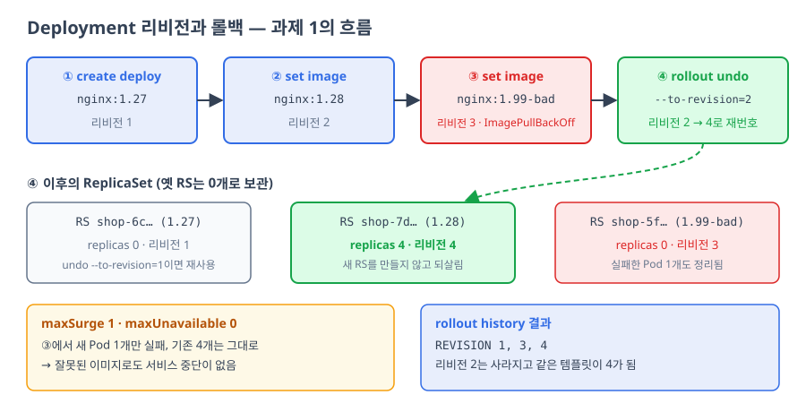
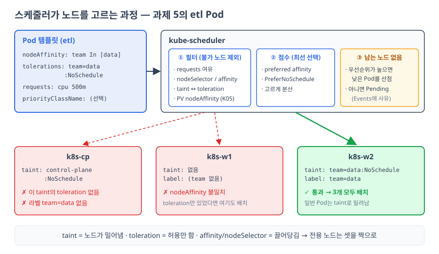

> **자격증 준비 · CKA** | 난이도 ★★★☆☆ | 예상 소요 3 ~ 3.5시간

> ⚠️ 이 편의 모든 연습 과제는 CNCF가 공개한 **CKA 공식 커리큘럼(github.com/cncf/curriculum)을 바탕으로 직접 창작한** 시험 스타일 과제입니다. 실제 시험 문제(유출 문제·덤프)가 아니며 실제 출제 내용과 무관합니다.

## 🎯 오늘의 목표

- Deployment를 **명령형으로 만들고**, 이미지 변경 → 롤아웃 확인 → 특정 리비전으로 **롤백**까지 2분 안에 끝낼 수 있다
- ConfigMap·Secret을 **환경 변수와 볼륨** 두 방식으로 주입하고, 주입이 됐는지 Pod 안에서 확인할 수 있다
- metrics-server를 kubeadm 클러스터에 올리고 **HPA**를 명령형·YAML(`autoscaling/v2`) 두 방식으로 만들 수 있다
- requests/limits, **LimitRange·ResourceQuota**가 Pod 생성에 어떤 영향을 주는지 예측할 수 있다
- nodeSelector·affinity·taint/toleration·PriorityClass·**정적 Pod**·DaemonSet·**네이티브 사이드카**로 "어디에, 무엇을 먼저" 띄울지 정할 수 있다

---

## 1. 커리큘럼 항목 요약 — Workloads and Scheduling (15%)

2026-11-15 기준 cncf/curriculum 저장소의 최신 문서는 `CKA_Curriculum_v1.37.pdf`이고, Linux Foundation CKA 페이지도 시험 기준을 **Kubernetes v1.37**로 안내합니다. 이 도메인의 공식 항목과 이 편의 섹션은 다음과 같습니다.

| 공식 커리큘럼 항목 | 이 편의 섹션 |
|---|---|
| Understand application deployments and how to perform rolling update and rollbacks | 4-1 |
| Use ConfigMaps and Secrets to configure applications | 4-2 |
| Configure workload autoscaling | 4-3 |
| Understand the primitives used to create robust, self-healing, application deployments | 4-1, 4-6 (DaemonSet·정적 Pod·사이드카) |
| Configure Pod admission and scheduling (limits, node affinity, etc.) | 4-4, 4-5 |

비중은 15%로 크지 않지만, 여기서 익히는 **명령형 생성 + YAML 다듬기** 손놀림이 다른 모든 도메인(특히 30%인 트러블슈팅)의 속도를 좌우합니다.

> 💡 이론은 본편에서 이미 다뤘습니다. 이 편은 **시험 속도**에 집중합니다. 개념이 흐릿하면 먼저 본편을 보세요: Deployment·롤백은 [Day 11](../../02-kubernetes/day11-deployment.md), ConfigMap·Secret은 [Day 13](../../02-kubernetes/day13-configmap-secret.md), requests/limits·LimitRange·ResourceQuota·HPA는 [Day 18](../../02-kubernetes/day18-autoscaling.md), 네임스페이스 쿼터는 [Day 19](../../02-kubernetes/day19-rbac-namespace.md), 정적 Pod와 컨트롤 플레인 taint는 [Day 20](../../02-kubernetes/day20-kubeadm-multinode.md).

### 실습 환경

K00에서 시험 버전(**v1.37.1**)에 맞춰 둔 **Day 20의 kubeadm 3노드 클러스터**, 컨텍스트 `cka-main`을 씁니다(CNI Cilium, Pod CIDR `10.244.0.0/16`, Service CIDR `10.96.0.0/12`). 시작 전 K00의 스냅샷 **`cka-clean`** 으로 되돌려 두면 앞 편의 잔여물 없이 시작할 수 있습니다.

| 노드 | 역할 | IP |
|---|---|---|
| `k8s-cp` | control-plane (taint `node-role.kubernetes.io/control-plane:NoSchedule`) | 192.168.56.10 |
| `k8s-w1` | worker | 192.168.56.11 |
| `k8s-w2` | worker | 192.168.56.12 |

모든 `kubectl` 명령은 `ssh k8s-cp` → `sudo -i` 후 작업 폴더 `~/cka/`에서 실행합니다. 시작 전에 컨텍스트와 별칭을 확인하세요(K00에서 설정했다면 생략).

```bash
kubectl config use-context cka-main      # kubeadm 클러스터 (kind 보조 클러스터 cka-aux가 아님!)
mkdir -p ~/cka/k03 && cd ~/cka/k03
alias k=kubectl
export do="--dry-run=client -o yaml"                     # k create deploy x --image=y $do > x.yaml
export now="--force --grace-period=0"                    # k delete pod x $now
kubectl create namespace k03
```

---

## 2. 출제 유형 — 어떻게 채점되는가

| 과제 형태 | 예시 문장(창작) | 채점 포인트 |
|---|---|---|
| **배포·롤아웃형** | "Deployment `shop`의 이미지를 `nginx:1.28`로 바꾸고, 실패하면 리비전 1로 되돌려라" | 최종 이미지, `rollout history`의 리비전, 전략 값(`maxSurge` 등) |
| **설정 주입형** | "ConfigMap의 키 `MODE`를 환경 변수 `APP_MODE`로, Secret을 `/etc/db`에 읽기 전용으로" | 환경 변수 **이름**, 마운트 경로, 파일 권한 |
| **오토스케일형** | "CPU 평균 60%를 목표로 2~8개 사이에서 자동 확장" | HPA의 대상·min/max·목표값, `behavior` 같은 세부 필드 |
| **리소스·정책형** | "네임스페이스에 기본 requests/limits를 주고, Pod는 최대 6개까지만" | LimitRange `default`/`defaultRequest`, ResourceQuota `hard` |
| **스케줄링형** | "라벨 `disk=ssd` 노드에만", "taint가 있는 노드에도 뜨게", "모든 노드에 하나씩" | Pod가 **실제로 어느 노드에** 있는가 |
| **정적 Pod형** | "`k8s-w1`에 kubelet이 직접 관리하는 Pod를" | 해당 노드의 매니페스트 파일, `<이름>-k8s-w1` Pod 존재 |

> ⚠️ 채점은 대부분 **리소스의 최종 상태**를 봅니다. 과제가 지정한 **이름·네임스페이스·컨테이너 이름**이 하나라도 다르면 나머지가 완벽해도 0점일 수 있습니다. 특히 `kubectl create deployment`는 컨테이너 이름을 **이미지 이름에서 따서** 만든다는 점을 기억하세요(`--image=nginx:1.27` → 컨테이너 이름 `nginx`).

---

## 3. 핵심 명령·매니페스트 표

시험에서 YAML을 처음부터 손으로 치는 것은 시간 낭비입니다. **명령형으로 뼈대를 만들고(`$do`), 필요한 필드만 덧붙인다**가 기본 전략입니다.

| 하고 싶은 것 | 명령(명령형 우선) | YAML로 덧붙일 것 |
|---|---|---|
| Deployment 생성 | `k create deploy web --image=nginx:1.27 --replicas=3 --port=80 -n k03` | `strategy.rollingUpdate`, `resources`, 스케줄링 필드 |
| 이미지 변경 | `k set image deploy/web nginx=nginx:1.28` | — |
| 변경 사유 기록 | `k annotate deploy/web kubernetes.io/change-cause="v1.28"` | (`--record`는 폐기 예정이라 쓰지 않음) |
| 롤아웃 관리 | `k rollout status/history/undo/pause/resume/restart deploy/web` | `undo --to-revision=N`, `history --revision=N` |
| 스케일 | `k scale deploy/web --replicas=5` | — |
| ConfigMap | `k create cm app-cfg --from-literal=MODE=prod --from-file=app.properties` | `immutable: true` |
| Secret | `k create secret generic db --from-literal=PASS=s3cr3t` | `stringData`(YAML로 쓸 때) |
| 환경 변수로 주입 | `k set env deploy/web --from=configmap/app-cfg` (전체 키) | 키 하나만·이름 바꾸기: `valueFrom.configMapKeyRef` |
| 리소스 | `k set resources deploy/web --requests=cpu=100m,memory=64Mi --limits=cpu=200m,memory=128Mi` | — |
| HPA | `k autoscale deploy web --cpu=50% --min=2 --max=6` | `behavior`, 메모리 메트릭 |
| ResourceQuota | `k create quota q1 --hard=pods=6,requests.cpu=1,limits.memory=2Gi -n k03` | — |
| LimitRange | (명령형 없음) | 문서 예제 복사 |
| PriorityClass | `k create priorityclass high --value=100000 --description="..."` | `preemptionPolicy` 도 `--preemption-policy`로 가능 |
| 노드 라벨·taint | `k label node k8s-w1 disk=ssd` / `k taint node k8s-w2 team=data:NoSchedule` | 제거는 끝에 `-` (`disk-`, `team=data:NoSchedule-`) |
| DaemonSet | `k create deploy x --image=... $do`로 만든 뒤 `kind: DaemonSet`으로 바꾸고 `replicas`·`strategy`·`status` 삭제 | 컨트롤 플레인 toleration |
| 정적 Pod | `k run x --image=... $do > x.yaml` → 대상 노드의 `/etc/kubernetes/manifests/`에 복사 | — |
| 단일 Pod | `k run tmp --image=busybox:1.37 --restart=Never -it --rm -- sh` | — |

> 💡 `kubectl autoscale`의 CPU 목표 플래그는 최신 kubectl 문서 기준 **`--cpu=50%`** 입니다(백분율이면 utilization, `500m`처럼 수량이면 average value). 예전 자료의 `--cpu-percent`는 구버전 플래그이니, 헷갈리면 시험장에서 `k autoscale --help`로 확인하세요.

---

## 4. 영역별 핵심 — 시험에서 필요한 만큼만

### 4-1. 롤링 업데이트와 롤백



```bash
k -n k03 create deploy web --image=nginx:1.27 --replicas=4 --port=80
k -n k03 annotate deploy/web kubernetes.io/change-cause="1.27 최초 배포"
k -n k03 set image deploy/web nginx=nginx:1.28
k -n k03 annotate deploy/web kubernetes.io/change-cause="1.28 업데이트"
k -n k03 rollout status deploy/web
k -n k03 rollout history deploy/web
```

```
REVISION  CHANGE-CAUSE
1         1.27 최초 배포
2         1.28 업데이트
```

| 필드 | 기본값 | 시험에서 의미 |
|---|---|---|
| `strategy.type` | `RollingUpdate` | `Recreate`면 전부 내리고 다시 올림(다운타임 있음) |
| `rollingUpdate.maxSurge` | 25% | 업데이트 중 **초과로** 띄울 수 있는 Pod 수 |
| `rollingUpdate.maxUnavailable` | 25% | 업데이트 중 **부족해도 되는** Pod 수. `0`이면 무중단 |
| `revisionHistoryLimit` | 10 | 남겨 둘 옛 ReplicaSet 수 |

전략 필드는 명령형 플래그가 없으니 `k edit` 또는 `k patch`로 바꿉니다.

```bash
k -n k03 patch deploy web -p '{"spec":{"strategy":{"rollingUpdate":{"maxSurge":1,"maxUnavailable":0}}}}'
```

> 💡 `rollout undo`는 **새 리비전 번호를 만들며** 옛 템플릿을 되살립니다. 리비전 1로 돌아가면 history에서 1이 사라지고 3이 생깁니다. "리비전 N으로 되돌려라"는 과제에서 `--to-revision`을 빼먹으면 직전 리비전으로만 돌아갑니다.

### 4-2. ConfigMap·Secret 주입

| 주입 방식 | YAML 위치 | 값이 바뀌면 |
|---|---|---|
| 전체 키 → 환경 변수 | `envFrom[].configMapRef` / `secretRef` | Pod 재시작 전엔 그대로 |
| 키 하나 → 다른 이름의 변수 | `env[].valueFrom.configMapKeyRef` / `secretKeyRef` | Pod 재시작 전엔 그대로 |
| 파일로 마운트 | `volumes[].configMap` / `secret` + `volumeMounts` | 잠시 뒤 파일 갱신(`subPath`면 갱신 안 됨) |

자주 나오는 "키 하나만, 이름 바꿔서" 형태는 문서의 *Define container environment variables using ConfigMap data* 예제를 복사해 고치면 빠릅니다.

```yaml
        env:
        - name: APP_MODE              # 컨테이너 안 변수 이름
          valueFrom:
            configMapKeyRef:
              name: app-cfg
              key: MODE               # ConfigMap의 키
        volumeMounts:
        - name: db
          mountPath: /etc/db
          readOnly: true
      volumes:
      - name: db
        secret:
          secretName: db
          defaultMode: 0400           # YAML에서 0으로 시작하면 8진수
```

### 4-3. HPA — metrics-server가 먼저

HPA는 `metrics.k8s.io` API가 있어야 동작합니다. kubeadm 클러스터에는 기본으로 없고, **K00의 스냅샷 `cka-clean`에도 metrics-server가 없습니다.** K02 과제 5에서 Helm으로 설치해 두었다면 `kubectl top nodes`로 확인만 하고, 스냅샷으로 되돌렸거나 설치한 적이 없다면 아래처럼 매니페스트로 설치합니다(둘 중 하나만). kubelet 서빙 인증서가 자체 서명이라 학습 환경에서는 `--kubelet-insecure-tls`를 붙입니다(원리는 Day 18 8장).

```bash
kubectl apply -f https://github.com/kubernetes-sigs/metrics-server/releases/latest/download/components.yaml
kubectl -n kube-system patch deployment metrics-server --type=json \
  -p '[{"op":"add","path":"/spec/template/spec/containers/0/args/-","value":"--kubelet-insecure-tls"}]'
kubectl -n kube-system rollout status deploy/metrics-server
kubectl top nodes
```

```
NAME     CPU(cores)   CPU(%)   MEMORY(bytes)   MEMORY(%)
k8s-cp   182m         9%       1490Mi          39%
k8s-w1   61m          3%       702Mi           37%
k8s-w2   55m          2%       688Mi           36%
```

> ⚠️ Vagrant 환경에서 `kubectl top`이 비어 있고 metrics-server 로그에 `10.0.2.15`가 보이면 Day 20 7장의 `--node-ip` 설정이 빠진 노드가 있는 것입니다.

```bash
k -n k03 set resources deploy/web --requests=cpu=50m --limits=cpu=200m   # 백분율 목표는 requests 기준
k -n k03 autoscale deploy web --cpu=50% --min=2 --max=6
k -n k03 get hpa web
```

```
NAME   REFERENCE        TARGETS       MINPODS   MAXPODS   REPLICAS   AGE
web    Deployment/web   cpu: 0%/50%   2         6         4          30s
```

`behavior`(축소 안정화 창 등)를 요구하면 명령형 결과를 `$do`로 뽑아 덧붙입니다.

```yaml
apiVersion: autoscaling/v2
kind: HorizontalPodAutoscaler
spec:
  behavior:
    scaleDown:
      stabilizationWindowSeconds: 60     # 기본 300초
```

### 4-4. requests/limits, LimitRange, ResourceQuota

| 오브젝트 | 언제 작동 | 시험 포인트 |
|---|---|---|
| `resources.requests` | 스케줄링 | 노드의 allocatable에서 requests 합계가 넘치면 **Pending** (`Insufficient cpu`) |
| `resources.limits` | 실행 중 | 메모리 초과 → OOMKilled, CPU 초과 → 스로틀 |
| **LimitRange** | Pod **생성 시**(어드미션) | 값이 없으면 **기본값을 채워 줌**, `max`를 넘으면 생성 거부 |
| **ResourceQuota** | Pod **생성 시**(어드미션) | 네임스페이스 합계 초과 시 거부. `requests.cpu` 쿼터가 있으면 **requests 없는 Pod는 거부** |

> 💡 Deployment로 만든 Pod가 쿼터 때문에 거부되면 **Deployment는 성공**하고 Pod만 안 생깁니다. 원인은 `k describe rs`나 `k get events`에 `exceeded quota`로 남습니다. Deployment만 보고 "됐다"고 넘어가지 마세요.

### 4-5. 스케줄링 — 끌어당기기와 밀어내기



| 도구 | 방향 | 누가 설정 | 한 줄 설명 |
|---|---|---|---|
| `nodeName` | 강제 지정 | Pod | 스케줄러를 **건너뜀**. taint도 무시(단, NoExecute는 적용) |
| `nodeSelector` | 끌어당김(필수) | Pod | 라벨 일치 노드만 |
| `nodeAffinity` required / preferred | 끌어당김(필수/선호) | Pod | `In`, `NotIn`, `Exists` 등 표현식 |
| `podAffinity` / `podAntiAffinity` | 다른 Pod 기준 | Pod | `topologyKey: kubernetes.io/hostname`이면 "같은/다른 노드" |
| **taint** | 밀어냄 | 노드 | `NoSchedule`, `PreferNoSchedule`, `NoExecute`(실행 중 Pod도 축출) |
| **toleration** | taint 허용 | Pod | **허용일 뿐 끌어당기지 않음** → 특정 노드 전용이면 affinity와 함께 |
| **PriorityClass** | 순서·선점 | Pod | 자리가 없으면 낮은 우선순위 Pod를 **선점(preempt)** |

```yaml
      affinity:
        nodeAffinity:
          requiredDuringSchedulingIgnoredDuringExecution:
            nodeSelectorTerms:
            - matchExpressions:
              - key: disk
                operator: In
                values: ["ssd"]
      tolerations:
      - key: team
        operator: Equal
        value: data
        effect: NoSchedule
```

> ⚠️ `nodeSelectorTerms` 아래 **여러 term은 OR**, 한 term 안의 **여러 `matchExpressions`는 AND**입니다. 들여쓰기 하이픈 하나로 의미가 바뀝니다.

### 4-6. DaemonSet, 정적 Pod, 네이티브 사이드카

| 원시 객체 | 누가 관리 | 특징 |
|---|---|---|
| DaemonSet | 컨트롤러 | 노드마다 1개. 컨트롤 플레인에도 띄우려면 `node-role.kubernetes.io/control-plane` toleration |
| 정적 Pod | **각 노드의 kubelet** | kubelet 설정 `staticPodPath`(kubeadm 기본 `/etc/kubernetes/manifests`)의 파일. API에는 **미러 Pod**(`이름-노드명`)로만 보이며 `kubectl delete`로는 지울 수 없음 |
| 네이티브 사이드카 | Pod | `initContainers`에 `restartPolicy: Always`. 앱보다 **먼저 시작**하고 Pod가 끝날 때까지 계속 실행. v1.33에서 GA |

```yaml
spec:
  initContainers:
  - name: log-agent
    image: busybox:1.37
    restartPolicy: Always            # ← 이 한 줄이 "사이드카"로 만든다
    command: ["sh", "-c", "touch /var/log/app/app.log; tail -F /var/log/app/app.log"]
    volumeMounts:
    - {name: logs, mountPath: /var/log/app}
  containers:
  - name: app
    image: busybox:1.37
    command: ["sh", "-c", "while true; do date >> /var/log/app/app.log; sleep 5; done"]
    volumeMounts:
    - {name: logs, mountPath: /var/log/app}
  volumes:
  - {name: logs, emptyDir: {}}
```

> 💡 정적 Pod의 경로는 노드마다 다를 수 있습니다. 확인은 해당 노드에서 `sudo grep staticPodPath /var/lib/kubelet/config.yaml`. 시험에서는 경로를 **가정하지 말고 확인**하세요.

---

## 5. 시간 절약 팁

- **문서 검색어를 외워 두기**: kubernetes.io/docs 검색창에 `configmap env` → *Configure a Pod to Use a ConfigMap*, `node affinity` → *Assign Pods to Nodes using Node Affinity*, `sidecar` → *Sidecar Containers*. 예제 YAML을 복사하는 편이 손으로 치는 것보다 빠르고 정확합니다.
- **`k explain`으로 필드 경로 확인**: `k explain deploy.spec.strategy.rollingUpdate`, `k explain pod.spec.affinity.nodeAffinity --recursive | less`.
- **`$do`로 뽑고 vim에서 덧붙이기**: `k create deploy api --image=nginx:1.27 $do > api.yaml` → affinity·tolerations 붙이기 → `k apply -f api.yaml`. vim에 `set et sw=2 ts=2`를 넣어 두면 YAML 들여쓰기 사고가 줄어듭니다.
- **이미 있는 리소스 수정은 `k edit`보다 `k set`/`k patch`**: 실수로 다른 필드를 건드릴 위험이 적습니다. 다만 Pod 스펙의 대부분은 수정 불가라 `k get pod x -o yaml > x.yaml` → 고치기 → `k replace --force -f x.yaml`.
- **검증을 습관으로**: 모든 과제 끝에 `-o wide`(노드 확인), `k describe`의 `Events`, `k exec ... -- env`/`cat`으로 **결과를 눈으로** 확인합니다.

---

## 6. 자주 하는 실수

| 실수 | 결과 | 바로잡기 |
|---|---|---|
| `set image deploy/web web=...` (컨테이너 이름을 Deployment 이름으로 착각) | `unable to find container named "web"` | `k get deploy web -o jsonpath='{.spec.template.spec.containers[*].name}'` |
| `rollout undo`에 `--to-revision` 누락 | 원하는 리비전이 아닌 직전으로 복귀 | `rollout history`로 번호 확인 후 지정 |
| requests 없이 HPA 생성 | `TARGETS`가 `<unknown>`, `FailedGetResourceMetric` | `k set resources`로 requests 추가 |
| metrics-server 미설치 / Ready 0/1 | HPA 동작 안 함 | 설치 + `--kubelet-insecure-tls`(학습 환경) |
| `requests.cpu` 쿼터가 있는데 requests 없는 Pod 배포 | Pod 생성 거부(Deployment는 성공처럼 보임) | LimitRange로 기본값 주기, `k get events` 확인 |
| toleration만 주고 "전용 노드"라고 생각 | 다른 노드에도 배치됨 | toleration + nodeAffinity/nodeSelector |
| taint 제거 시 `-` 누락 | 같은 taint를 또 추가하려다 에러 | `k taint node k8s-w2 team=data:NoSchedule-` |
| 정적 Pod를 `kubectl delete`로 삭제 | 바로 다시 생김 | 노드의 매니페스트 파일을 지움 |
| DaemonSet YAML에 `replicas`·`strategy` 남김 | `unknown field` 오류 | Deployment 뼈대에서 두 필드 삭제 |
| 사이드카를 `containers`에 넣음 | 시작 순서 보장 없음, Job이 끝나지 않음 | `initContainers` + `restartPolicy: Always` |

---

## 7. 창작 연습 과제

> 아래 과제는 모두 **공식 커리큘럼을 바탕으로 창작한** 연습 문제입니다. `k8s-cp`(root)의 `~/cka/k03`에서 `cka-main` 컨텍스트로 작업합니다. 한 과제당 목표 시간은 4~7분입니다. 끝난 뒤 정리는 7장 맨 아래에 있습니다.

### 과제 1. 무중단 롤링 업데이트와 지정 리비전 롤백 (목표 5분)

네임스페이스 `k03`에 Deployment `shop`(이미지 `nginx:1.27`, 레플리카 4, 컨테이너 포트 80)을 만들어라. 업데이트 중 **사용 불가 Pod가 0개, 초과 Pod는 최대 1개**가 되도록 전략을 설정한 뒤 이미지를 `nginx:1.28`로, 이어서 존재하지 않는 `nginx:1.99-bad`로 바꿔라. 마지막으로 **`nginx:1.28` 리비전**으로 되돌려라.

📖 참고 문서: kubernetes.io/docs/concepts/workloads/controllers/deployment/ (*Rolling Back a Deployment*)

<details>
<summary>풀이·검증</summary>

```bash
k -n k03 create deploy shop --image=nginx:1.27 --replicas=4 --port=80
k -n k03 patch deploy shop -p '{"spec":{"strategy":{"rollingUpdate":{"maxSurge":1,"maxUnavailable":0}}}}'
k -n k03 set image deploy/shop nginx=nginx:1.28
k -n k03 rollout status deploy/shop
k -n k03 set image deploy/shop nginx=nginx:1.99-bad
k -n k03 rollout status deploy/shop --timeout=30s     # 진행되지 않음 → Ctrl+C 또는 타임아웃
k -n k03 rollout history deploy/shop                   # 1: 1.27, 2: 1.28, 3: 1.99-bad
k -n k03 rollout history deploy/shop --revision=2 | grep Image
k -n k03 rollout undo deploy/shop --to-revision=2
```

```bash
k -n k03 get deploy shop -o jsonpath='{.spec.template.spec.containers[0].image}{"\n"}'   # nginx:1.28
k -n k03 get deploy shop -o jsonpath='{.spec.strategy.rollingUpdate}{"\n"}'              # {"maxSurge":1,"maxUnavailable":0}
k -n k03 get pods -l app=shop                                                           # 4개 모두 Running
```

`maxUnavailable: 0` 덕분에 잘못된 이미지로 업데이트하는 동안에도 기존 4개 Pod는 하나도 내려가지 않았습니다. 새 Pod 1개만 `ImagePullBackOff`였습니다.
</details>

### 과제 2. ConfigMap 키 하나와 Secret 파일 주입 (목표 6분)

`k03`에 ConfigMap `shop-cfg`(키 `MODE=prod`, `LOG_LEVEL=info`)와 Secret `shop-db`(키 `user=app`, `password=Ch4ngeMe`)를 만들어라. Pod `cfg-check`(이미지 `busybox:1.37`, 명령 `sleep 3600`)에 다음을 주입하라.
- ConfigMap의 `MODE`만 환경 변수 **`APP_MODE`** 로
- ConfigMap의 모든 키를 접두사 없이 환경 변수로
- Secret을 `/etc/shop-db`에 **읽기 전용**, 파일 권한 `0400`으로

📖 참고 문서: kubernetes.io/docs/tasks/configure-pod-container/configure-pod-configmap/, kubernetes.io/docs/tasks/inject-data-application/distribute-credentials-secure/

<details>
<summary>풀이·검증</summary>

```bash
k -n k03 create cm shop-cfg --from-literal=MODE=prod --from-literal=LOG_LEVEL=info
k -n k03 create secret generic shop-db --from-literal=user=app --from-literal=password=Ch4ngeMe
k -n k03 run cfg-check --image=busybox:1.37 $do -- sleep 3600 > cfg-check.yaml
```

`cfg-check.yaml`의 컨테이너 아래에 덧붙입니다.

```yaml
    env:
    - name: APP_MODE
      valueFrom:
        configMapKeyRef: {name: shop-cfg, key: MODE}
    envFrom:
    - configMapRef: {name: shop-cfg}
    volumeMounts:
    - {name: db, mountPath: /etc/shop-db, readOnly: true}
  volumes:
  - name: db
    secret: {secretName: shop-db, defaultMode: 0400}
```

```bash
k apply -n k03 -f cfg-check.yaml
k -n k03 exec cfg-check -- env | grep -E 'APP_MODE|^MODE|LOG_LEVEL'
# APP_MODE=prod / MODE=prod / LOG_LEVEL=info
k -n k03 exec cfg-check -- ls -lL /etc/shop-db       # -r-------- password, user
k -n k03 exec cfg-check -- cat /etc/shop-db/user     # app
```

`ls -l`만 하면 심볼릭 링크(`lrwxrwxrwx`)가 보입니다. Secret 볼륨 파일은 `..data` 디렉터리를 가리키는 링크이므로 `-L`로 실제 파일 권한을 봅니다.
</details>

### 과제 3. HPA — 명령형 생성 후 behavior 추가 (목표 7분)

metrics-server가 동작하는지 확인하고(없으면 4-3의 설치 단계나 K02 과제 5의 Helm 설치를 먼저 수행), `k03`의 Deployment `shop`에 CPU requests `50m`, limits `200m`을 설정하라. HPA `shop`을 **CPU 평균 사용률 60%**, 최소 2, 최대 8로 만들고, **축소 안정화 창을 30초**로 설정하라. 부하를 줘서 확장되는 것을 확인하라.

📖 참고 문서: kubernetes.io/docs/tasks/run-application/horizontal-pod-autoscale-walkthrough/

<details>
<summary>풀이·검증</summary>

```bash
k top nodes || echo "metrics-server 설치 필요 (4-3 참고)"
k -n k03 set resources deploy/shop --requests=cpu=50m --limits=cpu=200m
k -n k03 autoscale deploy shop --cpu=60% --min=2 --max=8 $do > hpa-shop.yaml
```

`hpa-shop.yaml`의 `spec:` 아래에 추가 후 적용합니다.

```yaml
  behavior:
    scaleDown:
      stabilizationWindowSeconds: 30
```

```bash
k apply -n k03 -f hpa-shop.yaml
k -n k03 expose deploy shop --port=80
k -n k03 run load --image=busybox:1.37 --restart=Never -- \
  sh -c 'while true; do wget -q -O- http://shop >/dev/null; done'
k -n k03 get hpa shop -w            # TARGETS가 60%를 넘으면 REPLICAS 증가
```

```bash
k -n k03 get hpa shop -o jsonpath='{.spec.metrics[0].resource.target}{"\n"}'          # {"averageUtilization":60,"type":"Utilization"}
k -n k03 get hpa shop -o jsonpath='{.spec.behavior.scaleDown.stabilizationWindowSeconds}{"\n"}'   # 30
k -n k03 delete pod load $now       # 부하 중지 → 30초 창 이후 축소 시작
```
</details>

### 과제 4. LimitRange와 ResourceQuota로 네임스페이스 통제 (목표 6분)

네임스페이스 `k03-quota`를 만들고 다음을 설정하라.
- LimitRange `defaults`: 컨테이너 기본 requests `cpu=100m, memory=64Mi`, 기본 limits `cpu=200m, memory=128Mi`, 컨테이너당 최대 memory `256Mi`
- ResourceQuota `cap`: Pod 최대 3개, `requests.cpu` 합계 `500m`

그다음 resources를 쓰지 않은 Deployment `filler`(nginx:1.27, 레플리카 5)를 만들고 **몇 개가 뜨는지, 왜 그런지** 확인하라.

📖 참고 문서: kubernetes.io/docs/concepts/policy/limit-range/, kubernetes.io/docs/concepts/policy/resource-quotas/

<details>
<summary>풀이·검증</summary>

```bash
k create ns k03-quota
cat <<'EOF' | k apply -f -
apiVersion: v1
kind: LimitRange
metadata:
  name: defaults
  namespace: k03-quota
spec:
  limits:
  - type: Container
    defaultRequest: {cpu: 100m, memory: 64Mi}
    default: {cpu: 200m, memory: 128Mi}
    max: {memory: 256Mi}
EOF
k -n k03-quota create quota cap --hard=pods=3,requests.cpu=500m
k -n k03-quota create deploy filler --image=nginx:1.27 --replicas=5
```

```bash
k -n k03-quota get pods                          # 3개만 Running
k -n k03-quota describe quota cap                # pods 3/3, requests.cpu 300m/500m
k -n k03-quota get events --field-selector reason=FailedCreate | tail -2
# ... forbidden: exceeded quota: cap, requested: pods=1, used: pods=3, limited: pods=3
k -n k03-quota get pod -o jsonpath='{.items[0].spec.containers[0].resources}{"\n"}'
# LimitRange가 채운 기본값: requests 100m/64Mi, limits 200m/128Mi
```

CPU 합계(3 × 100m = 300m)는 여유가 있지만 **Pod 개수 쿼터**가 먼저 막았습니다. LimitRange가 없었다면 `requests.cpu` 쿼터 때문에 Pod가 **하나도** 만들어지지 않았을 것입니다.
</details>

### 과제 5. 전용 노드 — taint + toleration + nodeAffinity (목표 7분)

`k8s-w2`를 데이터 팀 전용으로 만들어라. 노드에 라벨 `team=data`와 taint `team=data:NoSchedule`을 걸고, `k03`에 Deployment `etl`(nginx:1.27, 레플리카 3)을 **모두 `k8s-w2`에만** 배치하라. 이후 다른 일반 Deployment는 `k8s-w2`에 배치되지 않아야 한다.

📖 참고 문서: kubernetes.io/docs/concepts/scheduling-eviction/taint-and-toleration/, kubernetes.io/docs/tasks/configure-pod-container/assign-pods-nodes-using-node-affinity/

<details>
<summary>풀이·검증</summary>

```bash
k label node k8s-w2 team=data
k taint node k8s-w2 team=data:NoSchedule
k -n k03 create deploy etl --image=nginx:1.27 --replicas=3 $do > etl.yaml
```

`etl.yaml`의 Pod 템플릿 `spec:`(containers와 같은 들여쓰기)에 추가합니다.

```yaml
      tolerations:
      - {key: team, operator: Equal, value: data, effect: NoSchedule}
      affinity:
        nodeAffinity:
          requiredDuringSchedulingIgnoredDuringExecution:
            nodeSelectorTerms:
            - matchExpressions:
              - {key: team, operator: In, values: [data]}
```

```bash
k apply -n k03 -f etl.yaml
k -n k03 get pods -l app=etl -o wide                 # NODE 모두 k8s-w2
k -n k03 create deploy plain --image=nginx:1.27 --replicas=4
k -n k03 get pods -l app=plain -o wide               # 모두 k8s-w1 (cp는 control-plane taint)
```

toleration만 넣었다면 `etl`이 `k8s-w1`에도 퍼졌을 것이고, affinity만 넣었다면 taint 때문에 모두 `Pending`이었을 것입니다. **두 가지가 짝**입니다.
</details>

### 과제 6. PriorityClass와 선점 (목표 6분)

PriorityClass `critical-batch`(값 `100000`, 기본 클래스 아님)를 만들어라. 그리고 과제 5에서 전용으로 만든 `k8s-w2`의 자리가 부족한 상황에서, 이 클래스를 쓴 Pod가 낮은 우선순위 Pod를 **선점**하는 것을 확인하라.

📖 참고 문서: kubernetes.io/docs/concepts/scheduling-eviction/pod-priority-preemption/

<details>
<summary>풀이·검증</summary>

```bash
k create priorityclass critical-batch --value=100000 --description="CKA K03 practice"
k describe node k8s-w2 | grep -A6 'Allocatable' | grep cpu      # 예: cpu: 2
```

`etl`의 CPU requests를 키워 `k8s-w2`를 거의 채운 뒤, 같은 노드를 원하는 높은 우선순위 Pod를 넣습니다.

```bash
k -n k03 set resources deploy/etl --requests=cpu=500m          # 3 × 500m = 1.5 CPU
k -n k03 rollout status deploy/etl
k -n k03 run urgent --image=nginx:1.27 $do > urgent.yaml
```

`urgent.yaml`을 다음처럼 고칩니다(`$do`가 만든 `resources: {}`·`status: {}` 등은 지워도 됩니다).

```yaml
apiVersion: v1
kind: Pod
metadata:
  name: urgent
  namespace: k03
spec:
  priorityClassName: critical-batch
  nodeSelector: {team: data}
  tolerations:
  - {key: team, operator: Equal, value: data, effect: NoSchedule}
  containers:
  - name: urgent
    image: nginx:1.27
    resources:
      requests: {cpu: 900m}
```

```bash
k apply -f urgent.yaml
k -n k03 get pod urgent -o wide                     # k8s-w2에서 Running
k -n k03 get events --sort-by=.lastTimestamp | grep -i preempt
# ... Preempted by pod ... on node k8s-w2
k -n k03 get pod urgent -o jsonpath='{.spec.priority}{"\n"}'   # 100000
```

선점당한 `etl` Pod는 다시 만들어지지만 자리가 없어 `Pending`으로 남습니다. 노드 allocatable은 환경마다 다르니 `describe node`의 `Allocated resources`를 보고 requests 값을 조절하세요.
</details>

### 과제 7. 모든 노드에 하나씩 — DaemonSet (목표 5분)

`k03`에 DaemonSet `node-agent`(이미지 `busybox:1.37`, 명령 `sleep 3600`)를 만들어 **컨트롤 플레인을 포함한 3개 노드 모두**에서 실행되게 하라. (과제 5의 taint가 남아 있다.)

📖 참고 문서: kubernetes.io/docs/concepts/workloads/controllers/daemonset/

<details>
<summary>풀이·검증</summary>

```bash
k -n k03 create deploy node-agent --image=busybox:1.37 $do -- sleep 3600 > ds.yaml
# vim ds.yaml: kind를 DaemonSet으로, replicas·strategy·status 줄 삭제
```

Pod 템플릿 `spec:`에 toleration 두 개를 추가합니다.

```yaml
      tolerations:
      - {key: node-role.kubernetes.io/control-plane, operator: Exists, effect: NoSchedule}
      - {key: team, operator: Exists, effect: NoSchedule}
```

```bash
k apply -n k03 -f ds.yaml
k -n k03 get ds node-agent                     # DESIRED 3, READY 3
k -n k03 get pods -l app=node-agent -o wide    # k8s-cp, k8s-w1, k8s-w2 각 1개
```

`operator: Exists`에 `key`만 주면 값과 상관없이 그 키의 taint를 모두 허용합니다.
</details>

### 과제 8. 워커 노드의 정적 Pod (목표 5분)

`k8s-w1`에 kubelet이 직접 관리하는 정적 Pod `pinger`(이미지 `busybox:1.37`, 명령 `sleep 3600`)를 만들어라. API에서 보이는 이름을 확인하고, **kubectl로 지웠을 때와 파일을 지웠을 때**의 차이를 확인하라.

📖 참고 문서: kubernetes.io/docs/tasks/configure-pod-container/static-pod/

<details>
<summary>풀이·검증</summary>

```bash
k run pinger --image=busybox:1.37 $do -- sleep 3600 > pinger.yaml
cat pinger.yaml        # 내용을 복사해 둠

ssh k8s-w1          # 시험에서도 과제에 안내된 ssh 명령으로 노드 접속
sudo -i
grep staticPodPath /var/lib/kubelet/config.yaml          # /etc/kubernetes/manifests
vi /etc/kubernetes/manifests/pinger.yaml                 # 붙여 넣기 (namespace 생략 → default)
exit; exit                                               # root → k8s-w1 → k8s-cp로 복귀
```

```bash
k get pod pinger-k8s-w1 -o wide        # 노드 이름이 붙은 미러 Pod
k delete pod pinger-k8s-w1             # 지워도…
k get pod pinger-k8s-w1                # 곧 다시 나타남
# ssh k8s-w1 → sudo -i → rm /etc/kubernetes/manifests/pinger.yaml → 그제야 사라짐
```
</details>

### 과제 9. 네이티브 사이드카로 로그 수집 (목표 6분)

`k03`에 Pod `app-with-agent`를 만들어라. 앱 컨테이너 `app`(busybox:1.37)은 5초마다 `/var/log/app/app.log`에 날짜를 기록하고, **네이티브 사이드카** `log-agent`(busybox:1.37)는 앱보다 먼저 시작해 그 파일을 `tail -F`로 출력한다. 두 컨테이너는 `emptyDir` 볼륨을 공유한다.

📖 참고 문서: kubernetes.io/docs/concepts/workloads/pods/sidecar-containers/, kubernetes.io/docs/tutorials/configuration/pod-sidecar-containers/

<details>
<summary>풀이·검증</summary>

4-6의 YAML에 `metadata: {name: app-with-agent, namespace: k03}`를 붙여 적용합니다.

```bash
k apply -f app-with-agent.yaml
k -n k03 get pod app-with-agent                 # READY 2/2
k -n k03 logs app-with-agent -c log-agent --tail=3
k -n k03 get pod app-with-agent -o jsonpath='{.spec.initContainers[0].restartPolicy}{"\n"}'   # Always
k -n k03 describe pod app-with-agent | grep -A3 'Init Containers'
```

READY가 `2/2`로 보이는 것이 핵심입니다. 일반 init 컨테이너는 끝나야 다음으로 넘어가지만, `restartPolicy: Always`인 사이드카는 **시작(started) 상태만 되면** 앱 컨테이너가 시작되고 계속 함께 실행됩니다.
</details>

### 정리

```bash
k delete ns k03 k03-quota
k delete priorityclass critical-batch
k taint node k8s-w2 team=data:NoSchedule-
k label node k8s-w2 team-
# k8s-w1의 /etc/kubernetes/manifests/pinger.yaml 이 남아 있다면 삭제
```

metrics-server는 K06(트러블슈팅)의 `kubectl top`에서도 쓰니 **남겨 두세요**.

---

## 8. 핵심 정리

- 뼈대는 `k create/run ... $do`, 세부 필드는 문서 예제에서 복사. 컨테이너 이름은 **이미지 이름**에서 나온다
- 롤아웃: `set image` → `rollout status` → `history` → `undo --to-revision=N`. 무중단은 `maxUnavailable: 0`
- 주입: 전체 키는 `envFrom`, 키 하나·이름 변경은 `valueFrom`, 파일은 볼륨(+`defaultMode`, `readOnly`)
- HPA: metrics-server + **requests** 필수. `k autoscale ... --cpu=60%`, 세부는 `autoscaling/v2`의 `behavior`
- LimitRange는 **기본값 채우기·최대값 검사**, ResourceQuota는 **합계 제한**. 거부는 Deployment가 아니라 RS의 이벤트에 남는다
- 전용 노드 = **taint(밀어냄) + toleration(허용) + affinity(끌어당김)**. PriorityClass는 자리 부족 시 선점
- DaemonSet은 Deployment 뼈대 변환, 정적 Pod는 노드의 `staticPodPath`, 사이드카는 `initContainers` + `restartPolicy: Always`

---

## ⏭️ 다음 예고 — K04. 서비스·네트워킹

비중 20%의 서비스·네트워킹 도메인으로 넘어갑니다. `kubectl expose`와 `kubectl create service`로 ClusterIP·NodePort를 빠르게 만들고, EndpointSlice를 직접 확인합니다. "특정 라벨·네임스페이스·포트만 허용하라"는 NetworkPolicy 과제를 유형별로 연습하고, Traefik 위에서 Gateway API(HTTPRoute)와 Ingress를 모두 다룹니다. CoreDNS 설정을 바꿔 보고, `nslookup` Pod로 DNS를 디버깅하며, 클러스터의 Pod·Service IP 대역을 찾는 방법도 정리합니다.
