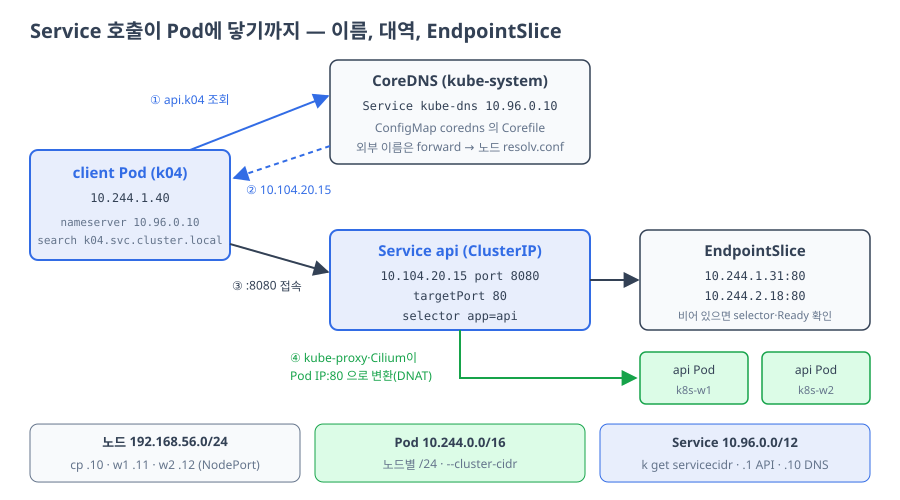
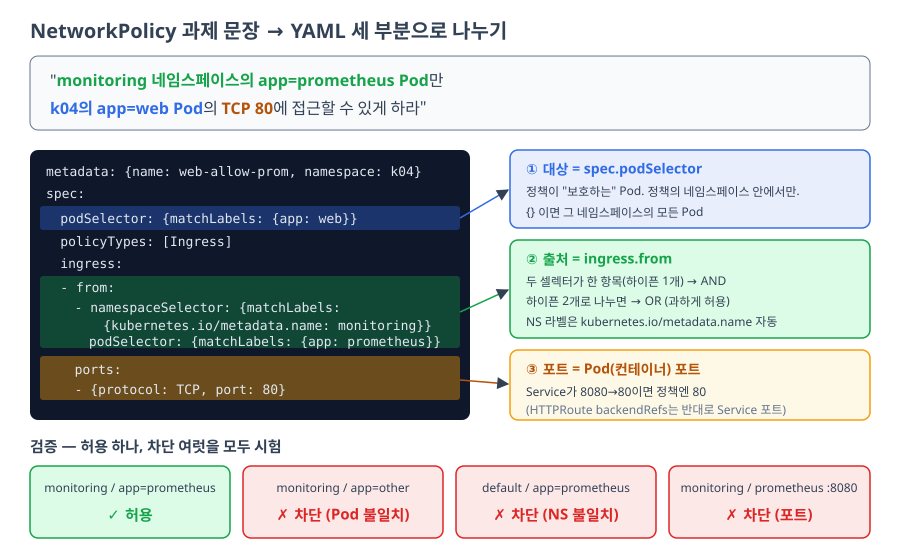

> **자격증 준비 · CKA** | 난이도 ★★★★☆ | 예상 소요 3.5 ~ 4시간

> ⚠️ 이 편의 모든 연습 과제는 CNCF가 공개한 **CKA 공식 커리큘럼(github.com/cncf/curriculum)을 바탕으로 직접 창작한** 시험 스타일 과제입니다. 실제 시험 문제(유출 문제·덤프)가 아니며 실제 출제 내용과 무관합니다.

## 🎯 오늘의 목표

- `kubectl expose`와 `kubectl create service`로 ClusterIP·NodePort를 1분 안에 만들고, **EndpointSlice**로 연결을 확인할 수 있다
- "특정 라벨·네임스페이스·포트만 허용" 유형의 **NetworkPolicy**를 실수 없이 쓰고, 허용·차단을 직접 검증할 수 있다
- 이미 설치된 컨트롤러 위에 **Gateway API(HTTPRoute)** 와 **Ingress**를 만들고 상태(status)로 연결을 확인할 수 있다
- **CoreDNS** 설정(Corefile)을 고치고, `nslookup` Pod로 DNS 문제를 좁혀 갈 수 있다
- 클러스터의 **Pod·Service IP 대역**을 세 가지 이상의 방법으로 찾을 수 있다

---

## 1. 커리큘럼 항목 요약 — Services and Networking (20%)

2026-11-15 기준 cncf/curriculum의 `CKA_Curriculum_v1.37.pdf` 항목입니다. (PDF 제목은 "Servicing and Networking"으로 표기되어 있습니다.)

| 공식 커리큘럼 항목 | 이 편의 섹션 |
|---|---|
| Understand connectivity between Pods | 4-1, 4-5 |
| Define and enforce Network Policies | 4-2 |
| Use ClusterIP, NodePort, LoadBalancer service types and endpoints | 4-1 |
| Use the Gateway API to manage Ingress traffic | 4-3 |
| Know how to use Ingress controllers and Ingress resources | 4-3 |
| Understand and use CoreDNS | 4-4 |

> 💡 이론은 본편 참조: Service 유형과 EndpointSlice는 [Day 12](../../02-kubernetes/day12-service.md), Ingress·Gateway API와 Traefik은 [Day 15](../../02-kubernetes/day15-ingress.md), NetworkPolicy의 AND/OR와 기본 거부 설계는 [Day 70](../../09-security/day70-networkpolicy-zero-trust.md)(입문은 [Day 19](../../02-kubernetes/day19-rbac-namespace.md) 6-7). 이 편은 같은 내용을 **시험 속도로** 다시 손에 익히는 데 집중합니다.

> 💡 시험 중 열 수 있는 문서는 Linux Foundation *Resources Allowed* 페이지 기준 `kubernetes.io/docs`, `kubernetes.io/blog`, `helm.sh/docs`, 그리고 **CKA에 한해 `gateway-api.sigs.k8s.io`** 입니다(2026-11-15 확인, 응시 전 재확인). HTTPRoute 예제는 Gateway API 문서에서 찾는 것이 가장 빠릅니다.

### 실습 환경

K00의 kubeadm 3노드 클러스터, 컨텍스트 `cka-main`(v1.37.1, `k8s-cp` 192.168.56.10, `k8s-w1` .11, `k8s-w2` .12, CNI **Cilium**, Pod CIDR `10.244.0.0/16`, Service CIDR `10.96.0.0/12`)을 씁니다. `ssh k8s-cp` → `sudo -i` 후 작업 폴더 `~/cka/k04`에서 진행합니다. Cilium은 NetworkPolicy를 실제로 집행하므로 차단 결과를 그대로 확인할 수 있습니다. (Flannel만 깔린 클러스터라면 정책을 만들어도 **아무것도 막히지 않습니다**.)

```bash
kubectl config use-context cka-main        # cka-aux(kind, kindnet)는 NetworkPolicy를 집행하는 CNI 구성이 다르니 혼동 금지
mkdir -p ~/cka/k04 && cd ~/cka/k04
alias k=kubectl; export do="--dry-run=client -o yaml"; export now="--force --grace-period=0"
k create ns k04
```

#### Gateway API CRD + Traefik 준비 (한 번만)

시험 환경에는 컨트롤러가 미리 설치되어 있는 경우가 대부분이지만, 우리 클러스터에는 없습니다. Day 15에서 kind에 했던 설치를 **kubeadm 클러스터에 그대로** 반복합니다. 버전도 Day 15와 같게 맞춥니다(Gateway API v1.6.3, Traefik 차트 42.4.0). 2026-11-15 현재 Gateway API 최신 릴리스는 v1.7.0이지만, 컨트롤러가 지원하는 CRD 버전에 맞추는 것이 원칙입니다.

```bash
kubectl apply --server-side -f https://github.com/kubernetes-sigs/gateway-api/releases/download/v1.6.3/standard-install.yaml

cat > traefik-values.yaml <<'EOF'
service:
  spec:
    type: NodePort
ports:
  web:
    nodePort: 30080
providers:
  kubernetesIngress:
    strictPrefixMatching: true
  kubernetesGateway:
    enabled: true
gateway:
  listeners:
    web:
      port: 8000
      protocol: HTTP
      namespacePolicy:
        from: All
EOF

helm repo add traefik https://traefik.github.io/charts && helm repo update
helm install traefik traefik/traefik --version 42.4.0 -n traefik --create-namespace -f traefik-values.yaml
kubectl -n traefik rollout status deploy/traefik
kubectl get gatewayclass,ingressclass
kubectl -n traefik get gateway
```

```
NAME                                      CONTROLLER                      ACCEPTED   AGE
gatewayclass.gateway.networking.k8s.io/traefik   traefik.io/gateway-controller   True   40s

NAME                                    CONTROLLER                      PARAMETERS   AGE
ingressclass.networking.k8s.io/traefik   traefik.io/ingress-controller   <none>       40s

NAME              CLASS     ADDRESS   PROGRAMMED   AGE
traefik-gateway   traefik             True         40s
```

이제 **어느 노드 IP의 30080**으로 들어와도 Traefik이 받습니다(예: `curl http://192.168.56.11:30080/` → 404).

---

## 2. 출제 유형 — 어떻게 채점되는가

| 과제 형태 | 예시 문장(창작) | 채점 포인트 |
|---|---|---|
| **Service 노출형** | "Deployment `api`를 포트 8080→컨테이너 80, NodePort 30088로 노출" | type, port/targetPort/nodePort, **selector가 Pod 라벨과 일치**해 엔드포인트가 있는가 |
| **NetworkPolicy형** | "`role=frontend` Pod만 `app=api`의 TCP 80에 접근 허용, 나머지 차단" | 정책의 `podSelector`, `from` 조건(AND/OR), 포트, **실제 연결 결과** |
| **Gateway API형** | "호스트 `shop.example.test`의 `/api`는 `api`로, 나머지는 `web`으로" | HTTPRoute의 `parentRefs`, hostnames, matches, backendRefs, `Accepted` 상태 |
| **Ingress형** | "IngressClass `traefik`으로 경로 기반 Ingress 생성" / "Ingress를 HTTPRoute로 이전" | `ingressClassName`, pathType, 백엔드 서비스·포트 |
| **DNS형** | "CoreDNS가 `lab.test` 이름을 해석하게", "Service의 FQDN을 파일에 기록" | Corefile 변경 내용, 해석 결과 |
| **조회형** | "Service IP 대역을 `/opt/...` 파일에 써라" | 파일 내용의 정확성 |

> ⚠️ NetworkPolicy는 **잘못 써도 오류가 나지 않습니다.** 문법이 맞으면 그대로 생성되고, 의도와 다르게 "다 열리거나 다 막힐" 뿐입니다. 반드시 허용 대상 하나, 차단 대상 하나로 **양쪽을 모두 테스트**하세요.

---

## 3. 핵심 명령·매니페스트 표

| 하고 싶은 것 | 명령(명령형 우선) | 비고 |
|---|---|---|
| Deployment를 Service로 | `k expose deploy api --port=8080 --target-port=80 -n k04` | selector는 Deployment의 selector를 복사 |
| NodePort | `k expose deploy api --type=NodePort --port=80 --name=api-np` | **nodePort 지정 플래그 없음** → `k create service nodeport` 또는 `k patch` |
| NodePort 번호 지정 | `k create svc nodeport api-np --tcp=80:80 --node-port=30088` | selector가 `app=api-np`로 생성됨 → 필요하면 수정 |
| Pod 생성과 동시에 노출 | `k run web --image=nginx:1.27 --port=80 --expose` | ClusterIP Service `web` 함께 생성 |
| 셀렉터 없는 Service | `k create svc clusterip legacy --tcp=80:30080` 후 selector 제거 | EndpointSlice를 직접 작성 |
| 엔드포인트 확인 | `k get endpointslices -l kubernetes.io/service-name=api` | `Endpoints` API는 v1.33부터 **폐기 예정**(경고 출력) |
| NetworkPolicy | (명령형 없음) | 문서 예제 복사가 가장 빠름 |
| Ingress | `k create ingress web --class=traefik --rule="web.k04.test/*=web:80"` | `/*` → `pathType: Prefix`, `/path` → `Exact` |
| HTTPRoute | (명령형 없음) | gateway-api.sigs.k8s.io의 *HTTP routing* 가이드 복사 |
| DNS 확인 | `k run dns --image=busybox:1.37 --rm -it --restart=Never -- nslookup api.k04` | 문서의 `dnsutils` Pod도 가능 |
| CoreDNS 설정 | `k -n kube-system edit cm coredns` | `reload` 플러그인이 잠시 뒤 반영 |
| Service 대역 | `k get servicecidr` / `grep service-cluster-ip-range /etc/kubernetes/manifests/kube-apiserver.yaml` | 4-5 참고 |
| Pod 대역 | `k get nodes -o custom-columns=NAME:.metadata.name,CIDR:.spec.podCIDR` | `kube-controller-manager`의 `--cluster-cidr` |

---

## 4. 영역별 핵심

### 4-1. Service와 EndpointSlice — 이름과 대역이 이어지는 길



| 유형 | 접근 경로 | 이 클러스터에서 |
|---|---|---|
| ClusterIP | 클러스터 안에서 `서비스IP:port` | `10.96.0.0/12`에서 할당 |
| NodePort | `아무노드IP:nodePort` (30000~32767) | `192.168.56.10~12:30xxx` |
| LoadBalancer | 외부 LB IP | 클라우드 LB나 MetalLB가 없으면 **EXTERNAL-IP `<pending>`**(NodePort는 동작) |
| Headless(`clusterIP: None`) | DNS가 Pod IP 목록을 직접 반환 | StatefulSet과 짝 |

```bash
k -n k04 create deploy api --image=nginx:1.27 --replicas=2 --port=80
k -n k04 expose deploy api --port=8080 --target-port=80
k -n k04 get endpointslices -l kubernetes.io/service-name=api
```

```
NAME        ADDRESSTYPE   PORTS   ENDPOINTS                 AGE
api-7x2kq   IPv4          80      10.244.1.31,10.244.2.18   5s
```

> 💡 EndpointSlice가 **비어 있으면** Service 자체가 아니라 selector·라벨·Pod Ready 상태가 문제입니다. `k get pods -l <selector> --show-labels`부터 보세요. 이것은 K06 트러블슈팅에서도 첫 번째 확인 항목입니다.

### 4-2. NetworkPolicy — 시험 과제 유형별 템플릿



시험 문장은 거의 다음 네 가지의 조합입니다. **"누가(podSelector) / 어디서(from·to) / 어느 포트(ports)"** 를 문장에서 먼저 뽑아낸 뒤 쓰세요.

| 문장 | `spec.podSelector` | `ingress.from` | `ports` |
|---|---|---|---|
| "네임스페이스의 모든 인바운드 차단" | `{}` | (ingress 규칙 없음) + `policyTypes: [Ingress]` | — |
| "같은 NS의 `role=frontend`만 허용" | 대상 Pod 라벨 | `- podSelector: {matchLabels: {role: frontend}}` | 지정 포트 |
| "NS `ops`의 모든 Pod 허용" | 대상 Pod 라벨 | `- namespaceSelector: {matchLabels: {kubernetes.io/metadata.name: ops}}` | 지정 포트 |
| "NS `monitoring`의 `app=prometheus`만" | 대상 Pod 라벨 | `- namespaceSelector: ...` **+ 같은 항목 안의** `podSelector: ...` (AND) | 지정 포트 |

```yaml
apiVersion: networking.k8s.io/v1
kind: NetworkPolicy
metadata:
  name: api-allow-frontend
  namespace: k04
spec:
  podSelector:
    matchLabels: {app: api}          # 이 정책이 "보호하는" Pod
  policyTypes: [Ingress]
  ingress:
  - from:
    - podSelector:
        matchLabels: {role: frontend}
    ports:
    - {protocol: TCP, port: 80}      # Service 포트(8080)가 아니라 Pod(컨테이너) 포트!
```

> ⚠️ NetworkPolicy의 `ports`는 **Pod가 실제로 듣는 포트**입니다. Service가 8080→80이라면 정책에는 80을 씁니다. 이것이 시험에서 가장 흔한 함정입니다.

> 💡 egress를 막는 정책에는 거의 항상 **DNS(UDP·TCP 53) 허용**이 함께 필요합니다. 빠뜨리면 이름 해석부터 실패해 "다 막힌" 것처럼 보입니다(Day 70 2-2).

### 4-3. Gateway API와 Ingress

| 리소스 | 누가 만드나(시험 관점) | 확인 명령 |
|---|---|---|
| GatewayClass | 이미 있음(컨트롤러 설치 시) | `k get gatewayclass` |
| Gateway | 과제에 따라 직접 또는 이미 있음 | `k get gateway -A`, `PROGRAMMED=True` |
| **HTTPRoute** | **대부분 직접** | `k describe httproute` → `Accepted`, `ResolvedRefs` |
| IngressClass | 이미 있음 | `k get ingressclass` |
| **Ingress** | 직접(`k create ingress`) | `k describe ingress` |

```yaml
apiVersion: gateway.networking.k8s.io/v1
kind: HTTPRoute
metadata:
  name: shop
  namespace: k04
spec:
  parentRefs:
  - name: traefik-gateway
    namespace: traefik                  # Gateway가 다른 NS에 있으면 반드시 명시
  hostnames: ["shop.k04.test"]
  rules:
  - matches:
    - path: {type: PathPrefix, value: /api}
    backendRefs:
    - {name: api, port: 8080}           # Service 이름과 "Service 포트"
  - backendRefs:
    - {name: web, port: 80}
```

> 💡 Ingress-NGINX 컨트롤러는 2025년 11월 Kubernetes 블로그 공지대로 2026년 3월까지만 best-effort 유지보수를 받고 은퇴했습니다. 새 구성은 Gateway API가 기본이고, 시험에서도 "Ingress를 Gateway API로 옮겨라" 같은 과제를 대비해 두면 좋습니다. Ingress 리소스 자체는 여전히 GA API로 남아 있습니다.

### 4-4. CoreDNS

kubeadm은 CoreDNS를 `kube-system`의 Deployment `coredns`와 ConfigMap `coredns`(키 `Corefile`)로 설치하고, Service `kube-dns`는 **Service 대역의 10번째 주소**(`10.96.0.10`)를 받습니다.

```bash
k -n kube-system get cm coredns -o yaml
```

```
.:53 {
    errors
    health { lameduck 5s }
    ready
    kubernetes cluster.local in-addr.arpa ip6.arpa {
       pods insecure
       fallthrough in-addr.arpa ip6.arpa
       ttl 30
    }
    prometheus :9153
    forward . /etc/resolv.conf { max_concurrent 1000 }
    cache 30
    loop
    reload
    loadbalance
}
```

| DNS 이름 | 해석 결과 |
|---|---|
| `api` (같은 NS) / `api.k04` / `api.k04.svc.cluster.local` | Service ClusterIP |
| `<pod-ip-대시>.k04.pod.cluster.local` (예: `10-244-1-31.k04.pod.cluster.local`) | Pod IP |
| Headless Service 이름 | Pod IP 목록 |

DNS 디버깅은 **안쪽부터 바깥으로** 좁힙니다.

| 단계 | 명령 | 실패하면 |
|---|---|---|
| ① Pod의 resolv.conf | `k exec dns -- cat /etc/resolv.conf` | `nameserver 10.96.0.10`, `search k04.svc.cluster.local ...` 확인 |
| ② 클러스터 내부 이름 | `nslookup kubernetes.default` | CoreDNS Pod·Service·EndpointSlice 확인 |
| ③ 대상 Service | `nslookup api.k04` | Service 이름·NS 오타 |
| ④ 외부 이름 | `nslookup kubernetes.io` | `forward` 대상(노드의 resolv.conf) 확인 |
| ⑤ CoreDNS 로그 | `k -n kube-system logs -l k8s-app=kube-dns` | Corefile 문법 오류, loop 감지 |

### 4-5. 클러스터 IP 대역 찾기

```bash
# Service 대역 (세 가지 방법)
kubectl get servicecidr                       # ServiceCIDR API (v1.33 GA)
sudo grep service-cluster-ip-range /etc/kubernetes/manifests/kube-apiserver.yaml
kubectl -n kube-system get cm kubeadm-config -o yaml | grep -E 'podSubnet|serviceSubnet'

# Pod 대역
sudo grep cluster-cidr /etc/kubernetes/manifests/kube-controller-manager.yaml
kubectl get nodes -o custom-columns=NAME:.metadata.name,PODCIDR:.spec.podCIDR
```

```
NAME         CIDRS          AGE
kubernetes   10.96.0.0/12   30d

    podSubnet: 10.244.0.0/16
    serviceSubnet: 10.96.0.0/12

NAME     PODCIDR
k8s-cp   10.244.0.0/24
k8s-w1   10.244.1.0/24
k8s-w2   10.244.2.0/24
```

> ⚠️ 노드의 `spec.podCIDR`는 kube-controller-manager가 나눠 준 값입니다. CNI가 자체 IPAM을 쓰면 실제 Pod IP가 이 값과 다를 수 있으므로(예: Cilium 기본 `cluster-pool` 모드), "Pod 대역" 질문에는 **실제 Pod IP(`k get pods -A -o wide`)와도 대조**하세요. 우리 클러스터는 Day 20에서 `ipam.mode=kubernetes`로 맞춰 두어 일치합니다.

---

## 5. 시간 절약 팁

- **테스트 Pod 한 줄을 외워 두기**: `k -n k04 run t --image=busybox:1.37 -l role=frontend --rm -it --restart=Never -- wget -qO- -T 2 http://api:8080`. 라벨(`-l`)만 바꿔 허용/차단을 번갈아 시험합니다. `-T 2`가 없으면 차단 시 오래 기다립니다.
- **문서 검색어**: `network policy` → *Network Policies*(예제 YAML 전체가 있음), `dns debugging` → *Debugging DNS Resolution*, `customizing dns` → *Customizing DNS Service*, `gateway` → *Gateway API*(그리고 gateway-api.sigs.k8s.io의 *HTTP routing*).
- **Service의 `selector`는 `k get svc -o wide`의 SELECTOR 열**로 한눈에 봅니다. Pod 쪽은 `--show-labels`.
- **HTTPRoute는 만들고 바로 `k describe`**: `Accepted: True`와 `ResolvedRefs: True` 두 줄을 확인하면 curl 전에 문제를 대부분 잡습니다.
- **CoreDNS 수정 후 기다리기 싫다면** `k -n kube-system rollout restart deploy coredns`. `reload` 플러그인만으로도 반영되지만 ConfigMap 전파까지 1분 남짓 걸릴 수 있습니다.

---

## 6. 자주 하는 실수

| 실수 | 결과 | 바로잡기 |
|---|---|---|
| `expose`에 `--target-port` 누락 | Service 포트 = 컨테이너 포트로 가정 → 8080으로 접속 시 실패 | `--port`(서비스)와 `--target-port`(컨테이너) 구분 |
| `k create svc nodeport`의 selector를 그대로 둠 | EndpointSlice 비어 있음 | `k set selector svc api-np app=api` |
| NetworkPolicy `ports`에 Service 포트 기입 | 허용 대상도 차단됨 | 컨테이너 포트 사용 |
| `namespaceSelector`와 `podSelector`를 별도 항목(`-` 두 개)으로 작성 | OR가 되어 과하게 허용 | 한 항목 안에 두 키(AND) |
| 네임스페이스에 라벨이 없다고 생각 | 직접 라벨 붙이다 시간 낭비 | 모든 NS에 자동 라벨 `kubernetes.io/metadata.name` 존재 |
| egress 정책에 DNS 허용 누락 | 모든 이름 해석 실패 | UDP/TCP 53 → `kube-system`의 `k8s-app=kube-dns` |
| HTTPRoute `parentRefs`에 namespace 누락 | `Accepted` 조건 없음(Gateway를 못 찾음) | Gateway의 네임스페이스 명시 |
| HTTPRoute `backendRefs.port`에 컨테이너 포트 | `ResolvedRefs False` | **Service 포트** 사용 (NetworkPolicy와 반대!) |
| Ingress의 `pathType` 혼동 | `/api/v1`이 매칭 안 됨 | 하위 경로까지면 `Prefix` (`--rule="host/api*=svc:port"`) |
| Corefile 들여쓰기·중괄호 오류 | CoreDNS `CrashLoopBackOff` → 클러스터 전체 DNS 장애 | 수정 전 `k -n kube-system get cm coredns -o yaml > coredns-backup.yaml` |

---

## 7. 창작 연습 과제

> 아래 과제는 모두 **공식 커리큘럼을 바탕으로 창작한** 연습 문제입니다. 과제 1을 먼저 하면 이후 과제가 그 리소스를 이어 씁니다.

### 과제 1. Service 세 가지 노출 (목표 5분)

`k04`에 Deployment `web`(nginx:1.27, 레플리카 2)과 `api`(nginx:1.27, 레플리카 2)를 만들어라(4-1에서 만들었다면 `api`는 재사용).
- `web`: ClusterIP Service `web`, 포트 80
- `api`: ClusterIP Service `api`, 포트 **8080** → 컨테이너 80
- `api`: NodePort Service `api-np`, 포트 80, **nodePort 30088**

호스트 PC에서 `http://192.168.56.12:30088`로 nginx 페이지가 보여야 한다.

📖 참고 문서: kubernetes.io/docs/concepts/services-networking/service/

<details>
<summary>풀이·검증</summary>

```bash
k -n k04 create deploy web --image=nginx:1.27 --replicas=2 --port=80
k -n k04 expose deploy web --port=80
k -n k04 get deploy api || k -n k04 create deploy api --image=nginx:1.27 --replicas=2 --port=80
k -n k04 get svc api || k -n k04 expose deploy api --port=8080 --target-port=80
k -n k04 create svc nodeport api-np --tcp=80:80 --node-port=30088
k -n k04 set selector svc api-np app=api
```

```bash
k -n k04 get svc -o wide                                       # SELECTOR 열 확인
k -n k04 get endpointslices -l kubernetes.io/service-name=api-np   # ENDPOINTS 2개
k -n k04 run t --image=busybox:1.37 --rm -it --restart=Never -- wget -qO- -T 2 http://api:8080 | head -4
curl -s http://192.168.56.12:30088 | grep title                # <title>Welcome to nginx!</title>
```

`k8s-w2`에 `api` Pod가 없어도 응답합니다. NodePort는 **모든 노드**에서 열리고, 노드가 다른 노드의 Pod로 넘겨 주기 때문입니다.
</details>

### 과제 2. 셀렉터 없는 Service와 수동 EndpointSlice (목표 6분)

클러스터 밖(이라고 가정한) 레거시 백엔드 `192.168.56.11:30080`(Traefik NodePort)을 클러스터 안에서 `legacy.k04:80`으로 부를 수 있게 하라. Service `legacy`에는 **selector가 없어야** 한다.

📖 참고 문서: kubernetes.io/docs/concepts/services-networking/service/ (*Services without selectors*), kubernetes.io/docs/concepts/services-networking/endpoint-slices/

<details>
<summary>풀이·검증</summary>

```bash
cat <<'EOF' | k apply -f -
apiVersion: v1
kind: Service
metadata:
  name: legacy
  namespace: k04
spec:
  ports:
  - {name: http, protocol: TCP, port: 80, targetPort: 30080}
---
apiVersion: discovery.k8s.io/v1
kind: EndpointSlice
metadata:
  name: legacy-1
  namespace: k04
  labels:
    kubernetes.io/service-name: legacy          # 이 라벨로 Service와 연결
    endpointslice.kubernetes.io/managed-by: cluster-admins
addressType: IPv4
ports:
- {name: http, protocol: TCP, port: 30080}      # Service 포트의 name과 같아야 함
endpoints:
- addresses: ["192.168.56.11"]
EOF
```

```bash
k -n k04 get svc legacy -o jsonpath='{.spec.selector}{"\n"}'     # 빈 값
k -n k04 get endpointslices -l kubernetes.io/service-name=legacy
k -n k04 run t --image=busybox:1.37 --rm -it --restart=Never -- wget -qO- -T 2 http://legacy 2>&1 | head -2
# wget: server returned error: HTTP/1.1 404 Not Found   ← Traefik까지 도달했다는 뜻
```
</details>

### 과제 3. 기본 거부 + 특정 라벨·포트만 허용 (목표 7분)

`k04`의 `app=api` Pod로 들어오는 트래픽은 **같은 네임스페이스의 `role=frontend` Pod에서 오는 TCP 80만** 허용하고 나머지는 모두 차단하라. 또한 `k04` 네임스페이스에는 모든 Pod의 인바운드를 막는 기본 거부 정책 `default-deny-ingress`를 둔다.

📖 참고 문서: kubernetes.io/docs/concepts/services-networking/network-policies/

<details>
<summary>풀이·검증</summary>

```bash
cat <<'EOF' | k apply -f -
apiVersion: networking.k8s.io/v1
kind: NetworkPolicy
metadata: {name: default-deny-ingress, namespace: k04}
spec:
  podSelector: {}
  policyTypes: [Ingress]
---
apiVersion: networking.k8s.io/v1
kind: NetworkPolicy
metadata: {name: api-allow-frontend, namespace: k04}
spec:
  podSelector: {matchLabels: {app: api}}
  policyTypes: [Ingress]
  ingress:
  - from:
    - podSelector: {matchLabels: {role: frontend}}
    ports:
    - {protocol: TCP, port: 80}
EOF
```

```bash
# 허용: role=frontend
k -n k04 run t1 -l role=frontend --image=busybox:1.37 --rm -it --restart=Never -- wget -qO- -T 2 http://api:8080 | grep -o 'Welcome to nginx'
# 차단: 라벨 없음
k -n k04 run t2 --image=busybox:1.37 --rm -it --restart=Never -- wget -qO- -T 2 http://api:8080
# wget: download timed out
# 차단: 다른 네임스페이스의 role=frontend
k run t3 -l role=frontend --image=busybox:1.37 --rm -it --restart=Never -- wget -qO- -T 2 http://api.k04:8080
# wget: download timed out
```

세 번째 경우가 핵심입니다. `namespaceSelector` 없이 `podSelector`만 쓰면 **정책과 같은 네임스페이스**의 Pod만 뜻합니다. 과제 1의 NodePort 접속(`curl 192.168.56.12:30088`)도 이제 막혔는지 확인해 보세요(노드에서 오는 트래픽도 정책 대상).
</details>

### 과제 4. 다른 네임스페이스의 특정 Pod만 — AND 조건 (목표 6분)

네임스페이스 `monitoring`을 만들어라. `k04`의 `app=web` Pod는 **`monitoring` 네임스페이스의 `app=prometheus` Pod에서 오는 TCP 80만** 받아야 한다. `monitoring`의 다른 Pod나 다른 네임스페이스의 `app=prometheus`는 차단된다.

📖 참고 문서: kubernetes.io/docs/concepts/services-networking/network-policies/ (*Behavior of to and from selectors*)

<details>
<summary>풀이·검증</summary>

```bash
k create ns monitoring
cat <<'EOF' | k apply -f -
apiVersion: networking.k8s.io/v1
kind: NetworkPolicy
metadata: {name: web-allow-prometheus, namespace: k04}
spec:
  podSelector: {matchLabels: {app: web}}
  policyTypes: [Ingress]
  ingress:
  - from:
    - namespaceSelector:
        matchLabels: {kubernetes.io/metadata.name: monitoring}
      podSelector:                      # ← 하이픈 없음: 같은 항목 = AND
        matchLabels: {app: prometheus}
    ports:
    - {protocol: TCP, port: 80}
EOF
```

```bash
k -n monitoring run p1 -l app=prometheus --image=busybox:1.37 --rm -it --restart=Never -- wget -qO- -T 2 http://web.k04 | grep -o 'Welcome to nginx'   # 허용
k -n monitoring run p2 -l app=other --image=busybox:1.37 --rm -it --restart=Never -- wget -qO- -T 2 http://web.k04        # timed out
k run p3 -l app=prometheus --image=busybox:1.37 --rm -it --restart=Never -- wget -qO- -T 2 http://web.k04                 # timed out
```
</details>

### 과제 5. egress 제한 — DNS와 특정 서비스만 (목표 7분)

`k04`의 `role=frontend` Pod는 **DNS 조회와 `app=api` Pod의 TCP 80**으로만 나갈 수 있어야 한다. 인터넷(`kubernetes.io`)이나 `app=web`으로는 나갈 수 없다.

📖 참고 문서: kubernetes.io/docs/concepts/services-networking/network-policies/, kubernetes.io/docs/tasks/administer-cluster/declare-network-policy/

<details>
<summary>풀이·검증</summary>

```bash
cat <<'EOF' | k apply -f -
apiVersion: networking.k8s.io/v1
kind: NetworkPolicy
metadata: {name: frontend-egress, namespace: k04}
spec:
  podSelector: {matchLabels: {role: frontend}}
  policyTypes: [Egress]
  egress:
  - to:
    - namespaceSelector:
        matchLabels: {kubernetes.io/metadata.name: kube-system}
      podSelector:
        matchLabels: {k8s-app: kube-dns}
    ports:
    - {protocol: UDP, port: 53}
    - {protocol: TCP, port: 53}
  - to:
    - podSelector: {matchLabels: {app: api}}
    ports:
    - {protocol: TCP, port: 80}
EOF
```

```bash
k -n k04 run f -l role=frontend --image=busybox:1.37 --restart=Never -- sleep 3600
k -n k04 wait --for=condition=Ready pod/f
k -n k04 exec f -- nslookup api                          # 해석 성공 (DNS 허용)
k -n k04 exec f -- wget -qO- -T 2 http://api:8080 | grep -o 'Welcome to nginx'   # 허용
k -n k04 exec f -- wget -qO- -T 2 http://web               # timed out
k -n k04 exec f -- wget -qO- -T 2 http://kubernetes.io     # 이름은 풀리지만 timed out
k -n k04 delete pod f $now
```

Service `api`의 포트는 8080이지만 egress 정책에도 **Pod 포트 80**을 씁니다. Service 주소로의 연결은 kube-proxy(또는 Cilium)가 Pod IP·포트로 바꾼 뒤 정책이 평가되기 때문입니다.
</details>

### 과제 6. HTTPRoute — 호스트·경로 라우팅과 가중치 (목표 7분)

기존 Gateway `traefik-gateway`(네임스페이스 `traefik`)에 HTTPRoute `shop`(네임스페이스 `k04`)을 붙여라.
- 호스트 `shop.k04.test`의 `/api`로 시작하는 요청 → Service `api`(포트 8080)
- 그 외 요청 → Service `web`(포트 80) **90%**, 새 Service `web-v2`(nginx:1.28 Deployment, 포트 80) **10%**

과제 3·4의 NetworkPolicy가 남아 있다면, Traefik(네임스페이스 `traefik`)이 두 백엔드에 닿을 수 있도록 필요한 허용 정책도 추가하라.

📖 참고 문서: gateway-api.sigs.k8s.io/guides/user-guides/http-routing/, gateway-api.sigs.k8s.io/guides/user-guides/traffic-splitting/, kubernetes.io/docs/concepts/services-networking/gateway/

<details>
<summary>풀이·검증</summary>

```bash
k -n k04 create deploy web-v2 --image=nginx:1.28 --replicas=1 --port=80
k -n k04 expose deploy web-v2 --port=80
cat <<'EOF' | k apply -f -
apiVersion: gateway.networking.k8s.io/v1
kind: HTTPRoute
metadata: {name: shop, namespace: k04}
spec:
  parentRefs:
  - {name: traefik-gateway, namespace: traefik}
  hostnames: ["shop.k04.test"]
  rules:
  - matches:
    - path: {type: PathPrefix, value: /api}
    backendRefs:
    - {name: api, port: 8080}
  - backendRefs:
    - {name: web, port: 80, weight: 90}
    - {name: web-v2, port: 80, weight: 10}
---
apiVersion: networking.k8s.io/v1
kind: NetworkPolicy
metadata: {name: allow-from-traefik, namespace: k04}
spec:
  podSelector: {}
  policyTypes: [Ingress]
  ingress:
  - from:
    - namespaceSelector:
        matchLabels: {kubernetes.io/metadata.name: traefik}
    ports:
    - {protocol: TCP, port: 80}
EOF
```

```bash
k -n k04 describe httproute shop | grep -E 'Reason|Type' | head -4    # Accepted True, ResolvedRefs True
curl -s -H 'Host: shop.k04.test' http://192.168.56.11:30080/api -o /dev/null -w '%{http_code}\n'   # 404 (nginx: /api 파일 없음 = api까지 도달)
for i in $(seq 1 20); do curl -sI -H 'Host: shop.k04.test' http://192.168.56.11:30080/ | grep -i '^server'; done | sort | uniq -c
#  18 Server: nginx/1.27.x
#   2 Server: nginx/1.28.x      ← 대략 9:1
```

NetworkPolicy는 **추가될수록 허용이 늘어나는(합집합)** 구조라, 기존 정책을 고치지 않고 `allow-from-traefik`을 더하는 것으로 충분합니다. `web`의 `web-allow-prometheus`와도 충돌하지 않습니다.
</details>

### 과제 7. Ingress 생성과 Gateway API로의 이전 (목표 6분)

IngressClass `traefik`을 쓰는 Ingress `blog`(네임스페이스 `k04`)를 만들어 호스트 `blog.k04.test`의 모든 경로(`/` 이하)를 Service `web:80`으로 보내라. 동작을 확인한 뒤, 같은 라우팅을 HTTPRoute `blog`로 옮기고 Ingress는 삭제하라.

📖 참고 문서: kubernetes.io/docs/concepts/services-networking/ingress/, kubernetes.io/docs/concepts/services-networking/gateway/ (*Migrating from Ingress*), gateway-api.sigs.k8s.io/guides/getting-started/migrating-from-ingress/

<details>
<summary>풀이·검증</summary>

```bash
k -n k04 create ingress blog --class=traefik --rule="blog.k04.test/*=web:80"
k -n k04 get ingress blog -o jsonpath='{.spec.rules[0].http.paths[0].pathType}{"\n"}'    # Prefix
curl -s -H 'Host: blog.k04.test' http://192.168.56.10:30080/ | grep -o 'Welcome to nginx'
```

```bash
cat <<'EOF' | k apply -f -
apiVersion: gateway.networking.k8s.io/v1
kind: HTTPRoute
metadata: {name: blog, namespace: k04}
spec:
  parentRefs:
  - {name: traefik-gateway, namespace: traefik}
  hostnames: ["blog.k04.test"]
  rules:
  - matches:
    - path: {type: PathPrefix, value: /}
    backendRefs:
    - {name: web, port: 80}
EOF
k -n k04 delete ingress blog
curl -s -H 'Host: blog.k04.test' http://192.168.56.10:30080/ | grep -o 'Welcome to nginx'   # 여전히 응답
k -n k04 get ingress                                                                  # No resources found
```

대응 관계: `ingressClassName` → `parentRefs`(Gateway), `rules[].host` → `hostnames`, `pathType: Prefix` → `PathPrefix`, `backend.service.port.number` → `backendRefs[].port`.
</details>

### 과제 8. CoreDNS에 사내 이름 추가 (목표 6분)

클러스터 안의 모든 Pod가 `registry.lab.test`를 `192.168.56.10`으로 해석하게 CoreDNS를 설정하라. 다른 이름 해석에는 영향이 없어야 한다. 수정 전 원본을 `~/cka/coredns-backup.yaml`에 저장하라.

📖 참고 문서: kubernetes.io/docs/tasks/administer-cluster/dns-custom-nameservers/

<details>
<summary>풀이·검증</summary>

```bash
k -n kube-system get cm coredns -o yaml > ~/cka/coredns-backup.yaml
k -n kube-system edit cm coredns
```

`.:53 {` 블록 안, `kubernetes ...` 블록 **앞**에 추가합니다.

```
    hosts {
       192.168.56.10 registry.lab.test
       fallthrough
    }
```

```bash
k -n kube-system rollout restart deploy coredns          # 또는 reload 플러그인 반영을 1~2분 대기
k -n kube-system rollout status deploy coredns
k run d --image=busybox:1.37 --rm -it --restart=Never -- nslookup registry.lab.test
# Name:   registry.lab.test
# Address: 192.168.56.10
k run d --image=busybox:1.37 --rm -it --restart=Never -- nslookup kubernetes.default   # 여전히 10.96.0.1
```

`fallthrough`가 없으면 `hosts`에 없는 이름에 대해 다음 플러그인으로 넘어가지 않아 문제가 생길 수 있습니다. CoreDNS Pod가 `CrashLoopBackOff`가 되면 `k -n kube-system logs -l k8s-app=kube-dns`로 문법 오류를 확인하고, 백업으로 `k replace -f`해 되돌립니다.
</details>

### 과제 9. DNS 장애 좁히기와 IP 대역 기록 (목표 7분)

(장애 만들기) `k -n kube-system scale deploy coredns --replicas=0`을 실행하라. 그다음, **시험 과제처럼** 다음을 수행하라.
1. 문서의 `dnsutils` Pod를 `k04`에 띄워 `nslookup api.k04`가 실패하는 단계를 찾고 원인을 복구하라.
2. Service IP 대역을 `~/cka/svc-cidr.txt`에, 노드 `k8s-w1`의 Pod CIDR을 `~/cka/w1-pod-cidr.txt`에 한 줄로 기록하라.

📖 참고 문서: kubernetes.io/docs/tasks/administer-cluster/dns-debugging-resolution/, kubernetes.io/docs/tasks/network/extend-service-ip-ranges/

<details>
<summary>풀이·검증</summary>

```bash
k -n kube-system scale deploy coredns --replicas=0        # 장애 주입
curl -sL https://k8s.io/examples/admin/dns/dnsutils.yaml | sed 's/namespace: default/namespace: k04/' | k apply -f -
k -n k04 exec dnsutils -- cat /etc/resolv.conf            # nameserver 10.96.0.10 → 설정은 정상
k -n k04 exec dnsutils -- nslookup api.k04                # ;; connection timed out; no servers could be reached
k -n kube-system get svc kube-dns                         # Service는 있음
k -n kube-system get endpointslices -l kubernetes.io/service-name=kube-dns   # ENDPOINTS <unset> → 백엔드 없음
k -n kube-system get deploy coredns                       # 0/0 ← 원인
k -n kube-system scale deploy coredns --replicas=2
k -n k04 exec dnsutils -- nslookup api.k04                # 해석 성공
```

```bash
k get servicecidr kubernetes -o jsonpath='{.spec.cidrs[0]}' > ~/cka/svc-cidr.txt
k get node k8s-w1 -o jsonpath='{.spec.podCIDR}' > ~/cka/w1-pod-cidr.txt
cat ~/cka/svc-cidr.txt ~/cka/w1-pod-cidr.txt   # 10.96.0.0/12  10.244.1.0/24
```

> 💡 `k04`에는 과제 3의 기본 거부(ingress)만 있으므로 dnsutils의 DNS 질의는 막히지 않습니다. 반대로 egress 기본 거부가 있는 네임스페이스라면 같은 증상(timeout)이 **NetworkPolicy** 때문일 수도 있습니다. 증상이 같아도 원인은 여러 곳이라, ①~⑤ 단계로 좁혀 가는 습관이 중요합니다.
</details>

### 정리

```bash
k delete ns k04 monitoring
k -n kube-system get deploy coredns        # READY 2/2 확인
```

Traefik과 Gateway API CRD는 K06·K07에서도 쓰니 **남겨 두세요**. CoreDNS의 `hosts` 블록은 남겨도 무해하지만, 원래대로 하려면 `k replace -f ~/cka/coredns-backup.yaml`.

---

## 8. 핵심 정리

- Service: `expose`(selector 자동) vs `create svc`(selector를 이름으로 추측). **nodePort 지정은 `create svc nodeport --node-port`**
- 연결 확인 순서: Service → **EndpointSlice가 비었나** → Pod 라벨·Ready
- NetworkPolicy: 문장에서 **대상(podSelector) / 출처(from) / 포트**를 뽑는다. 같은 항목의 두 셀렉터 = AND, `-` 두 개 = OR. 포트는 **Pod 포트**
- egress 제한에는 **DNS 53 허용**을 함께. 정책은 합집합이라 "허용 추가"로 해결
- Gateway API: GatewayClass → Gateway → **HTTPRoute**(parentRefs에 NS, backendRefs는 **Service 포트**). `describe`의 `Accepted`·`ResolvedRefs`
- Ingress: `k create ingress --class --rule="host/path*=svc:port"`. Ingress-NGINX는 지원 종료 → Gateway API로 이전 연습
- CoreDNS: ConfigMap `coredns`의 Corefile, Service `kube-dns`(10.96.0.10). 디버깅은 resolv.conf → 내부 이름 → 대상 → 외부 → 로그
- 대역: `k get servicecidr`, kube-apiserver `--service-cluster-ip-range`, kube-controller-manager `--cluster-cidr`, 노드 `spec.podCIDR`

---

## ⏭️ 다음 예고 — K05. 스토리지

비중 10%지만 점수를 확실히 챙길 수 있는 스토리지 도메인입니다. kubeadm 클러스터에는 기본 StorageClass가 없으니, 먼저 **local-path-provisioner**를 설치해 동적 프로비저닝 환경을 만듭니다. 그 위에서 StorageClass 만들기, PV/PVC 수동 바인딩, 접근 모드·반환 정책·volumeMode, PVC 확장, hostPath·local 정적 PV까지 창작 과제로 연습합니다.
