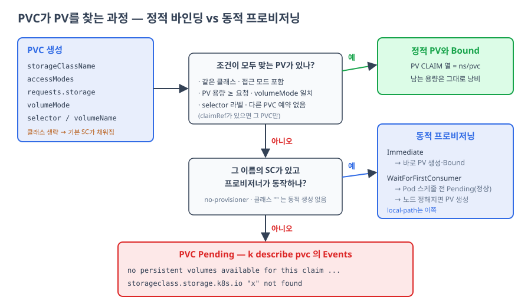
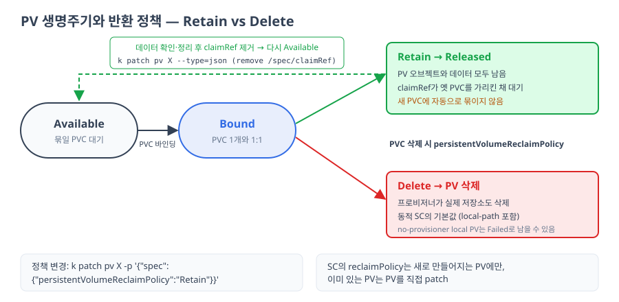

> **자격증 준비 · CKA** | 난이도 ★★★☆☆ | 예상 소요 2.5 ~ 3시간

> ⚠️ 이 편의 모든 연습 과제는 CNCF가 공개한 **CKA 공식 커리큘럼(github.com/cncf/curriculum)을 바탕으로 직접 창작한** 시험 스타일 과제입니다. 실제 시험 문제(유출 문제·덤프)가 아니며 실제 출제 내용과 무관합니다.

## 🎯 오늘의 목표

- kubeadm 클러스터에 **local-path-provisioner**를 설치해 동적 프로비저닝 환경을 만들 수 있다
- StorageClass의 `provisioner`·`reclaimPolicy`·`volumeBindingMode`·`allowVolumeExpansion`을 과제 문장에 맞게 고를 수 있다
- PV와 PVC가 **바인딩되는 조건**(클래스·접근 모드·용량·volumeMode·claimRef)을 설명하고 원하는 쌍으로 **수동 바인딩**할 수 있다
- 반환 정책 `Retain`/`Delete`의 차이를 보고, **Released PV를 다시 쓰는** 절차를 수행할 수 있다
- hostPath·local 정적 PV, Block 볼륨, PVC 확장을 다루고 막혔을 때 이벤트로 원인을 찾을 수 있다

---

## 0. 먼저 — kubeadm 클러스터에 동적 프로비저너 설치

kind는 `standard` StorageClass(내부적으로 local-path-provisioner)가 기본으로 들어 있어 Day 14에서 PVC만 만들어도 PV가 생겼습니다. 하지만 **kubeadm으로 직접 만든 클러스터에는 StorageClass가 하나도 없습니다.** 이 상태에서 PVC를 만들면 영원히 `Pending`입니다.

```bash
kubectl get storageclass
# No resources found
```

시험 환경에는 보통 프로비저너가 준비되어 있지만, 우리 클러스터에서 연습하려면 직접 설치해야 합니다. 가장 가벼운 선택은 Rancher의 **local-path-provisioner**입니다. 각 노드의 디렉터리(`/opt/local-path-provisioner`)를 hostPath PV로 잘라 주는 단순한 프로비저너입니다. K00의 스냅샷 `cka-clean`에는 기본 StorageClass가 **없으므로**, 이 설치는 이 편에서 한 번 하고 **K06 이후 편은 이것이 설치되어 있다고 전제**합니다. (스냅샷으로 되돌렸다면 이 0장을 다시 실행하세요.)

```bash
# 2026-11-15 기준 최신 릴리스 v0.0.37
kubectl apply -f https://raw.githubusercontent.com/rancher/local-path-provisioner/v0.0.37/deploy/local-path-storage.yaml
kubectl -n local-path-storage rollout status deploy/local-path-provisioner
kubectl get storageclass
```

```
NAME         PROVISIONER             RECLAIMPOLICY   VOLUMEBINDINGMODE      ALLOWVOLUMEEXPANSION   AGE
local-path   rancher.io/local-path   Delete          WaitForFirstConsumer   false                  20s
```

`storageClassName`을 생략한 PVC도 이 클래스를 쓰도록 **기본 StorageClass**로 지정합니다.

```bash
kubectl patch storageclass local-path \
  -p '{"metadata":{"annotations":{"storageclass.kubernetes.io/is-default-class":"true"}}}'
kubectl get sc          # local-path (default)
```

| local-path-provisioner의 성질 | 시험·실습에서의 의미 |
|---|---|
| `WaitForFirstConsumer` | PVC는 **Pod가 생길 때까지 Pending**이 정상 |
| 노드 로컬 디렉터리 | PV에 nodeAffinity가 붙어, 그 Pod는 이후 **같은 노드에만** 스케줄 |
| 접근 모드 | `ReadWriteOnce` 계열만. RWX는 NFS·CephFS 같은 공유 스토리지가 필요 |
| 용량 | PV에 요청 크기가 적히지만 **실제로 제한하지는 않음** |
| 확장(resize) | 리사이저가 없어 **실제 용량 확장은 되지 않음**(과제 8에서 확인) |

> ⚠️ 이 편의 실습은 모두 컨텍스트 **`cka-main`**(kubeadm v1.37.1)에서 `ssh k8s-cp` → `sudo -i` 후 `~/cka/k05` 폴더에서 합니다. K00의 kind 보조 클러스터 `cka-aux`에는 이미 `standard` 클래스가 있어 결과가 다르게 보일 수 있으니 `kubectl config current-context`부터 확인하세요.

---

## 1. 커리큘럼 항목 요약 — Storage (10%)

2026-11-15 기준 cncf/curriculum의 `CKA_Curriculum_v1.37.pdf` 항목입니다.

| 공식 커리큘럼 항목 | 이 편의 섹션 |
|---|---|
| Implement storage classes and dynamic volume provisioning | 0, 4-1 |
| Configure volume types, access modes and reclaim policies | 4-2, 4-3, 4-4 |
| Manage persistent volumes and persistent volume claims | 4-2, 4-5 |

> 💡 이론은 [Day 14](../../02-kubernetes/day14-storage.md)(Volume·PV·PVC·StorageClass, 정적·동적 프로비저닝, StatefulSet 맛보기)를 참조하세요. 이 편은 **바인딩 규칙을 정확히 맞추는 손놀림**과 **막혔을 때 이벤트 읽기**에 집중합니다.

```bash
kubectl config use-context cka-main
mkdir -p ~/cka/k05 && cd ~/cka/k05
alias k=kubectl; export do="--dry-run=client -o yaml"; export now="--force --grace-period=0"
k create ns k05
```

---

## 2. 출제 유형 — 어떻게 채점되는가

| 과제 형태 | 예시 문장(창작) | 채점 포인트 |
|---|---|---|
| **StorageClass 생성형** | "프로비저너 X, 반환 정책 Retain, 확장 허용인 SC를 만들고 기본 클래스로" | SC 필드 값, 기본 클래스 어노테이션(**하나만** 기본인가) |
| **정적 PV/PVC형** | "hostPath `/srv/data`로 2Gi PV, RWO, Retain. PVC로 묶어 Pod에 마운트" | PV 필드, PVC `Bound`, **바인딩 대상이 맞는가**, Pod 안 파일 |
| **동적 PVC형** | "SC `fast`로 500Mi PVC를 만들어 Deployment에 마운트" | PVC 클래스·크기, Pod Running, 마운트 경로 |
| **반환·재사용형** | "PVC를 지워도 데이터가 남게", "Released PV를 새 PVC에 연결" | `persistentVolumeReclaimPolicy`, PV 상태 전이 |
| **확장형** | "PVC를 1Gi로 늘려라" | PVC `spec.resources.requests.storage`, SC `allowVolumeExpansion` |
| **문제 해결형** | "PVC가 Pending이다. 원인을 고쳐라" | 고친 뒤 `Bound`가 되는가(K06과 연결) |

> ⚠️ PV는 **클러스터 범위**, PVC는 **네임스페이스 범위**입니다. 과제가 PVC의 네임스페이스를 지정했다면 `-n`을 빼먹지 마세요. 반대로 PV 매니페스트에 `namespace:`를 넣어도 무시될 뿐 도움이 되지 않습니다.

---

## 3. 핵심 명령·매니페스트 표

스토리지 리소스는 `kubectl create`로 만들 수 없는 것이 대부분입니다. **문서 예제 복사 → 필드 수정**이 가장 빠르고, 명령형은 확인·수정에 씁니다.

| 하고 싶은 것 | 방법 | 비고 |
|---|---|---|
| SC·PV·PVC 생성 | 문서 예제 복사 | *Configure a Pod to Use a PersistentVolume for Storage* 튜토리얼에 PV·PVC·Pod가 한 번에 있음 |
| Pod 뼈대 | `k run app --image=busybox:1.37 $do -- sleep 3600 > app.yaml` | `volumes`·`volumeMounts` 덧붙이기 |
| 기본 SC 지정/해제 | `k patch sc NAME -p '{"metadata":{"annotations":{"storageclass.kubernetes.io/is-default-class":"true"}}}'` | 해제는 `"false"` |
| PV 반환 정책 변경 | `k patch pv NAME -p '{"spec":{"persistentVolumeReclaimPolicy":"Retain"}}'` | 동적 PV에도 가능 |
| Released PV 재사용 | `k patch pv NAME --type=json -p '[{"op":"remove","path":"/spec/claimRef"}]'` | → `Available` |
| PVC 확장 | `k patch pvc NAME -p '{"spec":{"resources":{"requests":{"storage":"2Gi"}}}}'` | 또는 `k edit pvc` |
| 상태 보기 | `k get pv,pvc -A`, `k describe pvc NAME`(Events) | PV의 `CLAIM` 열로 짝 확인 |
| 필드 경로 | `k explain pv.spec --recursive \| less`, `k explain pvc.spec.volumeMode` | — |



---

## 4. 영역별 핵심

### 4-1. StorageClass

```yaml
apiVersion: storage.k8s.io/v1
kind: StorageClass
metadata:
  name: local-retain
provisioner: rancher.io/local-path        # 이 클러스터에 실제로 있는 프로비저너
reclaimPolicy: Retain                     # 생략하면 Delete
volumeBindingMode: WaitForFirstConsumer   # 생략하면 Immediate
allowVolumeExpansion: true                # 생략하면 false
```

| 필드 | 기본값 | 바꾸면 |
|---|---|---|
| `reclaimPolicy` | `Delete` | 이 SC로 **새로 만들어지는 PV**에만 적용. 기존 PV는 `k patch pv` |
| `volumeBindingMode` | `Immediate` | `WaitForFirstConsumer`면 Pod의 스케줄 결과(노드)를 보고 볼륨 생성 → 로컬 스토리지에 필수 |
| `allowVolumeExpansion` | `false` | `true`여야 PVC 크기 증가 요청이 **API에서 허용**됨 |
| `parameters` | — | 프로비저너마다 다름(문서·README 확인) |

> 💡 SC의 `provisioner`, `parameters`, `reclaimPolicy`, `volumeBindingMode`는 **만든 뒤 수정할 수 없습니다.** 틀렸다면 지우고 다시 만드세요. (이미 그 SC로 만들어진 PV·PVC에는 영향 없음)

### 4-2. PV·PVC 바인딩 규칙

PVC 하나에 맞는 PV를 찾을 때 컨트롤러가 보는 조건입니다. **하나라도 어긋나면 PVC는 `Pending`** 입니다.

| 조건 | PV | PVC | 흔한 어긋남 |
|---|---|---|---|
| 클래스 | `storageClassName` | `storageClassName` | PVC에 클래스를 생략 → **기본 SC가 자동으로 채워져** 클래스 없는 PV와 불일치 |
| 접근 모드 | `accessModes` | `accessModes` | PVC가 RWX인데 PV는 RWO |
| 용량 | `capacity.storage` | `resources.requests.storage` | PV가 요청보다 **작음**(크면 OK, 남는 용량은 낭비) |
| 볼륨 모드 | `volumeMode` | `volumeMode` | 한쪽만 `Block` (기본값은 `Filesystem`) |
| 셀렉터 | `metadata.labels` | `selector.matchLabels` | 라벨 오타 |
| 예약 | `claimRef` | `volumeName` | 다른 PVC에 예약된 PV |

> ⚠️ 기본 StorageClass가 있는 클러스터에서 **정적 PV에 묶고 싶다면** PV와 PVC 양쪽에 같은 `storageClassName`(예: `manual`)을 쓰거나, 양쪽 모두 `storageClassName: ""`(빈 문자열)로 명시하세요. PVC에서 필드를 **생략**하는 것과 **빈 문자열**을 주는 것은 다릅니다. 이름만 맞으면 `manual`이라는 SC 오브젝트가 실제로 없어도 바인딩됩니다.

| 접근 모드 | 약어 | 의미 |
|---|---|---|
| `ReadWriteOnce` | RWO | **한 노드**에서 읽기·쓰기(같은 노드의 여러 Pod는 가능) |
| `ReadOnlyMany` | ROX | 여러 노드에서 읽기 전용 |
| `ReadWriteMany` | RWX | 여러 노드에서 읽기·쓰기 |
| `ReadWriteOncePod` | RWOP | **한 Pod**만 읽기·쓰기 (CSI 볼륨, v1.29 GA) |

### 4-3. 반환 정책과 PV 상태



| 정책 | PVC 삭제 후 PV | 실제 데이터 | 다시 쓰려면 |
|---|---|---|---|
| `Delete` | PV 삭제 | 프로비저너가 삭제 | — |
| `Retain` | **`Released`** 로 남음 | 남음 | 데이터 확인·정리 → `claimRef` 제거 → `Available` |
| `Recycle` | (폐기됨) | — | 쓰지 말 것. 동적 프로비저닝으로 대체 |

> 💡 `Released` PV는 **자동으로 다른 PVC에 묶이지 않습니다.** 이전 사용자의 데이터가 남아 있을 수 있기 때문입니다. 관리자가 의도적으로 `claimRef`를 지워야 다시 `Available`이 됩니다.

### 4-4. 볼륨 유형 — hostPath, local, Block

| 유형 | 노드 고정 방법 | 특징 |
|---|---|---|
| `hostPath` (PV) | (선택) PV `nodeAffinity` | 테스트용. `type: DirectoryOrCreate`로 디렉터리 자동 생성. Pod가 다른 노드에 뜨면 **다른 디렉터리**를 봄 |
| `local` (PV) | **`nodeAffinity` 필수** | 디렉터리·디스크가 **미리 있어야** 함. 스케줄러가 PV의 노드를 고려 → SC를 `kubernetes.io/no-provisioner` + `WaitForFirstConsumer`로 |
| `volumeMode: Block` | — | 파일 시스템 없이 **원시 블록 장치**로 전달. Pod는 `volumeMounts`가 아니라 **`volumeDevices`** 사용 |

> ⚠️ hostPath는 노드 파일 시스템을 그대로 노출하므로 운영에서는 피해야 합니다(Day 69). 시험에서는 정적 PV 연습용으로 자주 쓰입니다.

### 4-5. PVC 확장

```bash
k -n k05 patch pvc data -p '{"spec":{"resources":{"requests":{"storage":"2Gi"}}}}'
k -n k05 get pvc data -o jsonpath='{.spec.resources.requests.storage} {.status.capacity.storage}{"\n"}'
k -n k05 describe pvc data | sed -n '/Conditions/,$p'
```

| 단계 | 누가 | 어디서 보이나 |
|---|---|---|
| ① 요청 허용 | API 서버(어드미션) | SC가 `allowVolumeExpansion: true`가 아니면 즉시 거부 |
| ② 볼륨 확장 | 프로비저너 쪽 리사이저(CSI `external-resizer` 등) | PVC 이벤트, `Resizing` 조건 |
| ③ 파일 시스템 확장 | 노드의 kubelet | `FileSystemResizePending` → 완료되면 `status.capacity` 증가 |

축소는 지원되지 않습니다. PVC 크기를 **줄이는** 요청은 거부됩니다.

---

## 5. 시간 절약 팁

- **문서 한 페이지에서 세 개를 복사**: kubernetes.io/docs/tutorials/configuration/configure-persistent-volume-storage/ 에는 hostPath PV, PVC, 그 PVC를 쓰는 Pod가 순서대로 있습니다. 이름·크기·경로만 바꾸면 정적 PV 과제의 80%가 끝납니다.
- **`---`로 묶어 한 번에 적용**: PV·PVC·Pod를 한 파일에 넣으면 수정·재적용이 빠릅니다. Pod 스펙은 대부분 수정 불가라 `k replace --force -f`를 쓰세요.
- **`k get pv,pvc -A`를 상시 확인**: PV의 `STATUS`와 `CLAIM` 열, PVC의 `VOLUME` 열로 **누가 누구와 묶였는지** 한눈에 봅니다.
- **Pending이면 바로 `k describe pvc`**: 이벤트에 `waiting for first consumer`(정상), `no persistent volumes available for this claim and no storage class is set`(정적 PV 불일치), `storageclass.storage.k8s.io "x" not found` 등이 그대로 나옵니다.
- **데이터 검증은 한 줄로**: `k exec app -- sh -c 'echo ok > /data/t && cat /data/t'`.

---

## 6. 자주 하는 실수

| 실수 | 결과 | 바로잡기 |
|---|---|---|
| kubeadm 클러스터에서 SC 없이 동적 PVC | 영원히 Pending | 프로비저너 설치(0장) 또는 정적 PV |
| `WaitForFirstConsumer`인데 PVC만 만들고 "Pending이라 실패"로 판단 | 불필요한 수정 | Pod를 만들면 Bound. 이벤트 `waiting for first consumer` 확인 |
| 기본 SC가 있는데 PVC의 `storageClassName` 생략 | 정적 PV와 안 묶임(새 PV가 동적으로 생김) | 양쪽에 같은 클래스명 또는 `""` |
| PV 크기 < PVC 요청 | Pending | PV를 요청 이상으로 |
| 기본 SC 어노테이션을 두 개 SC에 | 가장 최근 것이 쓰이지만 채점·운영 혼란 | 이전 기본 SC는 `"false"`로 |
| `Retain` PV를 지우고 끝 | PV 오브젝트는 사라져도 **노드 데이터는 남음** | 데이터 정리는 별도 작업 |
| Released PV에 새 PVC가 붙길 기다림 | 계속 Pending | `claimRef` 제거 |
| local PV에 `nodeAffinity` 누락 | 생성 거부(필수 필드) | `required.nodeSelectorTerms` 추가 |
| Block PV를 `volumeMounts`로 사용 | Pod 생성 실패 | `volumeDevices`의 `devicePath` |
| `allowVolumeExpansion: false`인 SC의 PVC 확장 | `only dynamically provisioned pvc can be resized and the storageclass that provisions the pvc must support resize` | SC에 `allowVolumeExpansion: true` 패치(이 필드는 수정 가능) |
| Pod가 PVC를 쓰는 중에 PVC 삭제 | `Terminating`에서 멈춤 | 정상(보호 finalizer). Pod를 먼저 지우면 완료 |

---

## 7. 창작 연습 과제

> 아래 과제는 모두 **공식 커리큘럼을 바탕으로 창작한** 연습 문제입니다. 0장의 local-path-provisioner 설치가 끝난 상태에서 시작합니다. hostPath·local 경로를 만들 때는 `k8s-cp`에서 `ssh k8s-w1`(또는 `k8s-w2`) → `sudo -i`로 노드에 접속합니다.

### 과제 1. 기본 SC로 동적 프로비저닝 (목표 4분)

`k05`에 PVC `cache`(500Mi, RWO, **클래스 지정 없음**)를 만들고, 이를 `/cache`에 마운트한 Pod `cache-user`(busybox:1.37, `sleep 3600`)를 만들어라. PVC가 Pod 생성 **전과 후**에 어떤 상태인지 확인하라.

📖 참고 문서: kubernetes.io/docs/concepts/storage/dynamic-provisioning/, kubernetes.io/docs/concepts/storage/persistent-volumes/

<details>
<summary>풀이·검증</summary>

```bash
cat <<'EOF' | k apply -f -
apiVersion: v1
kind: PersistentVolumeClaim
metadata: {name: cache, namespace: k05}
spec:
  accessModes: [ReadWriteOnce]
  resources: {requests: {storage: 500Mi}}
EOF
k -n k05 get pvc cache                 # STATUS Pending
k -n k05 describe pvc cache | tail -2  # waiting for first consumer to be created before binding
```

```bash
k -n k05 run cache-user --image=busybox:1.37 $do -- sleep 3600 > cache-user.yaml
```

컨테이너와 Pod `spec`에 추가합니다.

```yaml
    volumeMounts:
    - {name: cache, mountPath: /cache}
  volumes:
  - name: cache
    persistentVolumeClaim: {claimName: cache}
```

```bash
k apply -n k05 -f cache-user.yaml
k -n k05 get pvc cache                                  # Bound, STORAGECLASS local-path
k get pv -o custom-columns=NAME:.metadata.name,CLAIM:.spec.claimRef.name,NODE:.spec.nodeAffinity.required.nodeSelectorTerms[0].matchExpressions[0].values[0]
k -n k05 exec cache-user -- sh -c 'echo hi > /cache/t && cat /cache/t'
```

PV의 nodeAffinity에 Pod가 뜬 노드가 적혀 있습니다. 이 PVC를 쓰는 Pod는 앞으로도 그 노드에만 배치됩니다.
</details>

### 과제 2. 반환 정책 Retain인 StorageClass (목표 5분)

StorageClass `local-retain`을 만들어라: 프로비저너 `rancher.io/local-path`, 반환 정책 **Retain**, 바인딩 모드 `WaitForFirstConsumer`, **확장 허용**. 이 클래스로 PVC `reports`(300Mi)를 만들고 Pod `reporter`가 `/reports/today.txt`에 `v1`을 쓰게 한 뒤, Pod와 PVC를 지웠을 때 PV가 어떻게 되는지 확인하라.

📖 참고 문서: kubernetes.io/docs/concepts/storage/storage-classes/

<details>
<summary>풀이·검증</summary>

```bash
cat <<'EOF' | k apply -f -
apiVersion: storage.k8s.io/v1
kind: StorageClass
metadata: {name: local-retain}
provisioner: rancher.io/local-path
reclaimPolicy: Retain
volumeBindingMode: WaitForFirstConsumer
allowVolumeExpansion: true
---
apiVersion: v1
kind: PersistentVolumeClaim
metadata: {name: reports, namespace: k05}
spec:
  storageClassName: local-retain
  accessModes: [ReadWriteOnce]
  resources: {requests: {storage: 300Mi}}
---
apiVersion: v1
kind: Pod
metadata: {name: reporter, namespace: k05}
spec:
  containers:
  - name: reporter
    image: busybox:1.37
    command: ["sh", "-c", "echo v1 > /reports/today.txt; sleep 3600"]
    volumeMounts: [{name: r, mountPath: /reports}]
  volumes:
  - {name: r, persistentVolumeClaim: {claimName: reports}}
EOF
k -n k05 wait --for=condition=Ready pod/reporter
k get sc local-retain                    # RECLAIMPOLICY Retain, ALLOWVOLUMEEXPANSION true
```

```bash
PV=$(k -n k05 get pvc reports -o jsonpath='{.spec.volumeName}'); echo $PV
k -n k05 delete pod reporter $now; k -n k05 delete pvc reports
k get pv $PV                             # STATUS Released, CLAIM k05/reports
```

이 PV는 과제 5에서 다시 씁니다. **지우지 마세요.**
</details>

### 과제 3. hostPath 정적 PV와 수동 바인딩 (목표 6분)

`k8s-w1`의 `/srv/k05/logs` 디렉터리를 쓰는 PV `pv-logs`를 만들어라: 용량 1Gi, RWO, 반환 정책 Retain, 클래스 `manual`, **`k8s-w1`에서만** 쓰이도록. PVC `logs`(`k05`, 1Gi, 클래스 `manual`)를 이 PV에 묶고, Pod `log-writer`가 `/var/log/app`에 마운트해 파일을 쓰게 하라. 노드에서 파일이 보여야 한다.

📖 참고 문서: kubernetes.io/docs/tutorials/configuration/configure-persistent-volume-storage/, kubernetes.io/docs/concepts/storage/volumes/ (*hostPath*)

<details>
<summary>풀이·검증</summary>

```bash
cat <<'EOF' | k apply -f -
apiVersion: v1
kind: PersistentVolume
metadata: {name: pv-logs}
spec:
  capacity: {storage: 1Gi}
  accessModes: [ReadWriteOnce]
  persistentVolumeReclaimPolicy: Retain
  storageClassName: manual
  hostPath: {path: /srv/k05/logs, type: DirectoryOrCreate}
  nodeAffinity:
    required:
      nodeSelectorTerms:
      - matchExpressions:
        - {key: kubernetes.io/hostname, operator: In, values: [k8s-w1]}
---
apiVersion: v1
kind: PersistentVolumeClaim
metadata: {name: logs, namespace: k05}
spec:
  storageClassName: manual
  accessModes: [ReadWriteOnce]
  resources: {requests: {storage: 1Gi}}
---
apiVersion: v1
kind: Pod
metadata: {name: log-writer, namespace: k05}
spec:
  containers:
  - name: w
    image: busybox:1.37
    command: ["sh", "-c", "while true; do date >> /var/log/app/w.log; sleep 10; done"]
    volumeMounts: [{name: l, mountPath: /var/log/app}]
  volumes:
  - {name: l, persistentVolumeClaim: {claimName: logs}}
EOF
```

```bash
k get pv pv-logs                         # Bound, CLAIM k05/logs
k -n k05 get pod log-writer -o wide      # NODE k8s-w1 (PV nodeAffinity 때문)
# ssh k8s-w1 → sudo -i → tail -2 /srv/k05/logs/w.log
```

`storageClassName: manual`을 PVC에서 빼면 기본 클래스 `local-path`가 채워져 **새 동적 PV에 묶이고** `pv-logs`는 `Available`로 남습니다. 직접 시험해 보세요.
</details>

### 과제 4. 여러 PV 중 특정 PV로 예약 바인딩 (목표 5분)

클래스 `manual`, 용량 500Mi, RWO인 hostPath PV 두 개 `pv-a`(`/srv/k05/a`), `pv-b`(`/srv/k05/b`)를 만들어라(노드 `k8s-w2`). PVC `claim-b`(`k05`)가 **반드시 `pv-b`에** 묶이게 하라.

📖 참고 문서: kubernetes.io/docs/concepts/storage/persistent-volumes/#reserving-a-persistentvolume

<details>
<summary>풀이·검증</summary>

PV 두 개는 과제 3의 PV에서 이름·경로·크기·노드만 바꿔 만듭니다. 예약은 **양쪽**에서 하는 것이 가장 확실합니다.

```yaml
# pv-b 의 spec 에 추가 — 다른 PVC가 먼저 가져가지 못하게
  claimRef: {name: claim-b, namespace: k05}
---
apiVersion: v1
kind: PersistentVolumeClaim
metadata: {name: claim-b, namespace: k05}
spec:
  storageClassName: manual
  volumeName: pv-b                       # PVC 쪽에서도 지정
  accessModes: [ReadWriteOnce]
  resources: {requests: {storage: 500Mi}}
```

```bash
k get pv pv-a pv-b                       # pv-a Available, pv-b Bound (k05/claim-b)
k -n k05 get pvc claim-b -o jsonpath='{.spec.volumeName}{"\n"}'   # pv-b
```

`volumeName`만 쓰면 PVC는 pv-b를 원하지만, 그 사이 다른 PVC가 pv-b를 먼저 가져갈 수 있습니다. `claimRef`는 PV를 그 PVC 전용으로 잡아 둡니다.
</details>

### 과제 5. Released PV 다시 쓰기 (목표 5분)

과제 2에서 `Released`가 된 PV를 새 PVC `reports-v2`(`k05`, 클래스 `local-retain`, 300Mi)에 연결하고, 새 Pod에서 이전 데이터 `today.txt`(`v1`)가 그대로 보이는지 확인하라.

📖 참고 문서: kubernetes.io/docs/concepts/storage/persistent-volumes/#retain

<details>
<summary>풀이·검증</summary>

```bash
PV=$(k get pv -o jsonpath='{range .items[?(@.spec.claimRef.name=="reports")]}{.metadata.name}{end}'); echo $PV
k patch pv $PV --type=json -p '[{"op":"remove","path":"/spec/claimRef"}]'
k get pv $PV                             # Available
```

```bash
cat <<EOF | k apply -f -
apiVersion: v1
kind: PersistentVolumeClaim
metadata: {name: reports-v2, namespace: k05}
spec:
  storageClassName: local-retain
  volumeName: $PV
  accessModes: [ReadWriteOnce]
  resources: {requests: {storage: 300Mi}}
---
apiVersion: v1
kind: Pod
metadata: {name: reader, namespace: k05}
spec:
  containers:
  - name: r
    image: busybox:1.37
    command: ["sleep", "3600"]
    volumeMounts: [{name: r, mountPath: /reports}]
  volumes:
  - {name: r, persistentVolumeClaim: {claimName: reports-v2}}
EOF
k -n k05 wait --for=condition=Ready pod/reader
k -n k05 exec reader -- cat /reports/today.txt     # v1
```

`volumeName`으로 이 PV를 직접 지정해야 프로비저너가 **새 PV를 또 만들지** 않습니다(클래스가 동적 SC이기 때문).
</details>

### 과제 6. local PV와 no-provisioner StorageClass (목표 6분)

StorageClass `local-disk`(프로비저너 `kubernetes.io/no-provisioner`, `WaitForFirstConsumer`)를 만들고, `k8s-w2`의 `/mnt/k05-disk`(미리 생성)를 쓰는 **local** PV `pv-local`(2Gi, RWO, Delete)을 만들어라. PVC `fastdata`를 이 클래스로 만들고, Deployment `db`(nginx:1.27, 레플리카 1)가 `/usr/share/nginx/html`에 마운트하게 하라.

📖 참고 문서: kubernetes.io/docs/concepts/storage/volumes/ (*local*), kubernetes.io/docs/concepts/storage/storage-classes/ (*Local*)

<details>
<summary>풀이·검증</summary>

```bash
# ssh k8s-w2 → sudo -i → mkdir -p /mnt/k05-disk && echo local-ok > /mnt/k05-disk/index.html
cat <<'EOF' | k apply -f -
apiVersion: storage.k8s.io/v1
kind: StorageClass
metadata: {name: local-disk}
provisioner: kubernetes.io/no-provisioner
volumeBindingMode: WaitForFirstConsumer
---
apiVersion: v1
kind: PersistentVolume
metadata: {name: pv-local}
spec:
  capacity: {storage: 2Gi}
  accessModes: [ReadWriteOnce]
  persistentVolumeReclaimPolicy: Delete
  storageClassName: local-disk
  local: {path: /mnt/k05-disk}
  nodeAffinity:
    required:
      nodeSelectorTerms:
      - matchExpressions:
        - {key: kubernetes.io/hostname, operator: In, values: [k8s-w2]}
---
apiVersion: v1
kind: PersistentVolumeClaim
metadata: {name: fastdata, namespace: k05}
spec:
  storageClassName: local-disk
  accessModes: [ReadWriteOnce]
  resources: {requests: {storage: 1Gi}}
EOF
k -n k05 create deploy db --image=nginx:1.27 $do > db.yaml
# db.yaml: 컨테이너에 volumeMounts(/usr/share/nginx/html), Pod spec에 volumes(persistentVolumeClaim: fastdata) 추가
k apply -n k05 -f db.yaml
```

```bash
k -n k05 get pvc fastdata                    # Bound → pv-local (2Gi: 요청 1Gi보다 큰 PV도 OK)
k -n k05 get pod -l app=db -o wide           # NODE k8s-w2
k -n k05 exec deploy/db -- cat /usr/share/nginx/html/index.html   # local-ok
```

> 💡 `no-provisioner`의 `Delete` 정책은 PV 오브젝트만 정리하고 **디스크 내용을 지우지 않습니다**(실제로 지워 줄 프로비저너가 없으므로). PVC를 지우면 PV가 `Failed`로 남을 수 있습니다.
</details>

### 과제 7. Block 모드 볼륨 (목표 7분)

`k8s-w2`에 256MiB 루프 장치를 만들고, 그 장치를 **`volumeMode: Block`** local PV `pv-block`(클래스 `local-disk`, RWO, Retain)으로 등록하라. PVC `raw`(`k05`, Block)를 만들어 Pod `raw-user`에 **`/dev/xvdb`** 로 붙여라.

📖 참고 문서: kubernetes.io/docs/concepts/storage/persistent-volumes/#raw-block-volume-support

<details>
<summary>풀이·검증</summary>

```bash
# ssh k8s-w2 → sudo -i (재부팅하면 루프 장치는 사라짐 — 연습용)
truncate -s 256M /var/lib/k05-block.img
losetup -f --show /var/lib/k05-block.img        # 출력된 장치명 기록, 예: /dev/loop8
```

```bash
LOOP=/dev/loop8                                       # 위에서 확인한 값으로
cat <<EOF | k apply -f -
apiVersion: v1
kind: PersistentVolume
metadata: {name: pv-block}
spec:
  capacity: {storage: 256Mi}
  volumeMode: Block
  accessModes: [ReadWriteOnce]
  persistentVolumeReclaimPolicy: Retain
  storageClassName: local-disk
  local: {path: $LOOP}
  nodeAffinity:
    required:
      nodeSelectorTerms:
      - matchExpressions:
        - {key: kubernetes.io/hostname, operator: In, values: [k8s-w2]}
---
apiVersion: v1
kind: PersistentVolumeClaim
metadata: {name: raw, namespace: k05}
spec:
  storageClassName: local-disk
  volumeMode: Block
  accessModes: [ReadWriteOnce]
  resources: {requests: {storage: 256Mi}}
---
apiVersion: v1
kind: Pod
metadata: {name: raw-user, namespace: k05}
spec:
  containers:
  - name: u
    image: busybox:1.37
    command: ["sleep", "3600"]
    volumeDevices:                         # volumeMounts 아님!
    - {name: blk, devicePath: /dev/xvdb}
  volumes:
  - {name: blk, persistentVolumeClaim: {claimName: raw}}
EOF
```

```bash
k -n k05 get pvc raw -o custom-columns=NAME:.metadata.name,STATUS:.status.phase,MODE:.spec.volumeMode,VOLUME:.spec.volumeName
# raw   Bound   Block   pv-block
k -n k05 exec raw-user -- ls -l /dev/xvdb      # brw-... ← 첫 글자 b = 블록 장치
```

PVC에서 `volumeMode: Block`을 빼면 기본값 `Filesystem`이 되어, 클래스·크기가 맞아도 `pv-block`과 묶이지 않습니다.
</details>

### 과제 8. PVC 확장 — 허용 여부와 실제 동작 (목표 5분)

1. 과제 1의 PVC `cache`(클래스 `local-path`)를 1Gi로 늘려 보고 어떤 오류가 나는지 확인하라.
2. `local-path` 클래스가 확장을 허용하도록 바꾼 뒤 다시 요청하고, `spec`과 `status`의 용량을 비교하라.

📖 참고 문서: kubernetes.io/docs/concepts/storage/persistent-volumes/#expanding-persistent-volumes-claims

<details>
<summary>풀이·검증</summary>

```bash
k -n k05 patch pvc cache -p '{"spec":{"resources":{"requests":{"storage":"1Gi"}}}}'
# Error from server (Forbidden): ... only dynamically provisioned pvc can be resized and
#   the storageclass that provisions the pvc must support resize
k patch sc local-path -p '{"allowVolumeExpansion":true}'      # 이 필드는 수정 가능
k -n k05 patch pvc cache -p '{"spec":{"resources":{"requests":{"storage":"1Gi"}}}}'
```

```bash
k -n k05 get pvc cache -o jsonpath='spec={.spec.resources.requests.storage} status={.status.capacity.storage}{"\n"}'
# spec=1Gi status=500Mi
k -n k05 describe pvc cache | tail -4        # 외부 리사이저를 기다린다는 이벤트(예: ExternalExpanding)
```

API는 요청을 받아들였지만 `status.capacity`는 그대로입니다. local-path-provisioner에는 볼륨을 실제로 늘려 줄 **리사이저가 없기** 때문입니다. 확장을 지원하는 CSI 드라이버(클라우드 디스크, Ceph RBD, Longhorn 등)라면 잠시 뒤 `status.capacity`가 1Gi로 바뀝니다. 채점은 보통 **PVC의 요청 크기**와 SC 설정을 봅니다.

연습이 끝나면 `k patch sc local-path -p '{"allowVolumeExpansion":false}'`로 되돌려도 됩니다.
</details>

### 과제 9. Pending PVC 고치기 (목표 5분)

다음을 그대로 적용한 뒤, PVC `broken`이 **`pv-fix`에 묶이도록** PVC만 수정하라(PV는 수정 금지).

```bash
cat <<'EOF' | k apply -f -
apiVersion: v1
kind: PersistentVolume
metadata: {name: pv-fix}
spec:
  capacity: {storage: 1Gi}
  accessModes: [ReadWriteOnce]
  storageClassName: slow
  hostPath: {path: /srv/k05/fix, type: DirectoryOrCreate}
---
apiVersion: v1
kind: PersistentVolumeClaim
metadata: {name: broken, namespace: k05}
spec:
  accessModes: [ReadWriteMany]
  resources: {requests: {storage: 2Gi}}
EOF
```

📖 참고 문서: kubernetes.io/docs/concepts/storage/persistent-volumes/#binding

<details>
<summary>풀이·검증</summary>

```bash
k -n k05 get pvc broken -o yaml | grep -E 'storageClassName|ReadWrite|storage:'
# storageClassName: local-path  ← 생략했더니 기본 SC가 채워짐
# - ReadWriteMany               ← PV는 RWO
# storage: 2Gi                  ← PV는 1Gi
```

PVC의 `storageClassName`·`accessModes`·용량은 바인딩 전이라도 **수정할 수 없는 필드**이므로 지우고 다시 만듭니다.

```bash
k -n k05 get pvc broken -o yaml > broken.yaml
# broken.yaml: storageClassName: slow, accessModes: [ReadWriteOnce], storage: 1Gi 로 수정
#              (status, metadata.uid/resourceVersion/annotations 정리)
k replace --force -f broken.yaml
k -n k05 get pvc broken                  # Bound → pv-fix
```

세 가지가 동시에 틀려 있었습니다: 클래스(생략 → 기본 SC), 접근 모드(RWX vs RWO), 용량(2Gi > 1Gi). 하나씩만 고치면 계속 Pending입니다. `k describe pvc`의 이벤트는 "맞는 PV가 없다"까지만 알려 주므로, **표 4-2의 조건을 순서대로 대조**하는 습관이 중요합니다.
</details>

### 과제 10. 동적 PV의 반환 정책 바꾸기 (목표 3분)

과제 1의 PVC `cache`에 묶인 PV는 반환 정책이 `Delete`다. PVC를 지워도 데이터가 남도록 **그 PV만** `Retain`으로 바꿔라. StorageClass `local-path`는 바꾸지 않는다.

📖 참고 문서: kubernetes.io/docs/tasks/administer-cluster/change-pv-reclaim-policy/

<details>
<summary>풀이·검증</summary>

```bash
PV=$(k -n k05 get pvc cache -o jsonpath='{.spec.volumeName}')
k patch pv $PV -p '{"spec":{"persistentVolumeReclaimPolicy":"Retain"}}'
k get pv $PV -o jsonpath='{.spec.persistentVolumeReclaimPolicy}{"\n"}'   # Retain
k get sc local-path -o jsonpath='{.reclaimPolicy}{"\n"}'                  # Delete (그대로)
```
</details>

### 정리

```bash
k delete ns k05                                     # Pod·PVC 삭제
k get pv                                            # Retain PV는 Released로 남음
k delete pv pv-logs pv-a pv-b pv-local pv-block pv-fix
# 이 편에서 Retain으로 남긴 동적 PV(Released)만 골라 삭제
k get pv --no-headers | awk '$5=="Released" && ($7=="local-retain" || $7=="local-path") {print $1}' | xargs -r kubectl delete pv
k delete sc local-retain local-disk
# 노드 정리(각 노드에서 sudo -i 후): k8s-w1 rm -rf /srv/k05
#   k8s-w2 rm -rf /srv/k05 /mnt/k05-disk; losetup -d /dev/loop8 && rm /var/lib/k05-block.img
```

local-path-provisioner와 기본 SC 설정은 K06·K07에서도 쓰니 **남겨 두세요**.

---

## 8. 핵심 정리

- kubeadm 클러스터엔 SC가 없다 → **local-path-provisioner v0.0.37** 설치 + 기본 SC 어노테이션
- SC 핵심 필드: `provisioner`, `reclaimPolicy`(기본 Delete), `volumeBindingMode`(기본 Immediate), `allowVolumeExpansion`(기본 false). 앞의 셋은 **수정 불가**
- 바인딩 조건: **클래스 · 접근 모드 · 용량(PV ≥ PVC) · volumeMode · selector · 예약(claimRef/volumeName)**. 기본 SC가 있으면 PVC의 클래스 **생략 ≠ 빈 문자열**
- `WaitForFirstConsumer`의 Pending은 정상. Pod를 만들어야 Bound
- Retain: PVC 삭제 → `Released` → 데이터 확인 → `claimRef` 제거 → `Available`
- local PV는 `nodeAffinity` 필수 + `no-provisioner` SC. Block은 `volumeMode: Block` 양쪽 + Pod는 `volumeDevices`
- 확장: SC `allowVolumeExpansion: true` → PVC 요청 증가. 실제 증가는 **리사이저가 있는 드라이버**에서만. 축소 불가

---

## ⏭️ 다음 예고 — K06. 트러블슈팅

비중 30%로 가장 큰 도메인입니다. 노드가 `NotReady`일 때 kubelet·컨테이너 런타임을 살피는 법, 컨트롤 플레인 정적 Pod 매니페스트가 망가졌을 때 `crictl`과 로그로 되살리는 법, `kubectl logs`·`events`·`top`으로 애플리케이션과 리소스 사용량을 진단하는 법을 다룹니다. K03~K05에서 만들어 본 Deployment·Service·NetworkPolicy·PVC를 **일부러 고장 내고 고치는** 창작 과제로, 앞 편들의 내용을 "증상 → 원인 → 해결" 순서로 다시 엮습니다.
