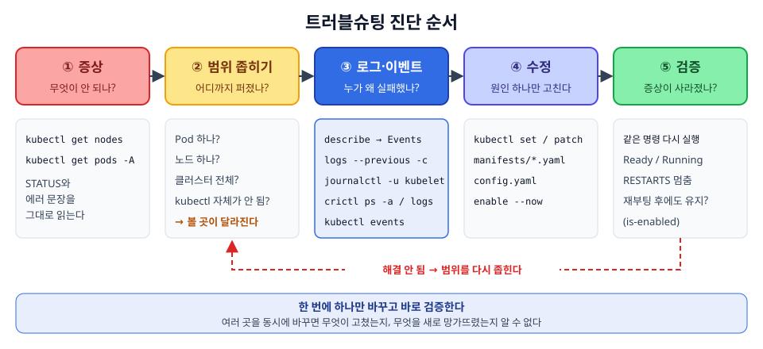
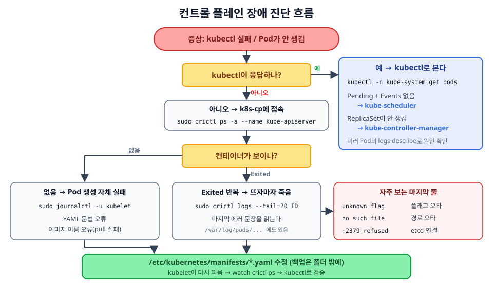
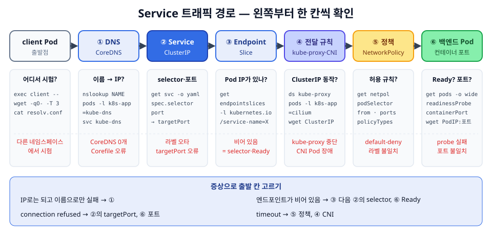

> **자격증 준비 · CKA** | 난이도 ★★★★★ | 예상 소요 4 ~ 5시간 (과제 16개 포함)

> ⚠️ 이 편의 모든 연습 과제는 CNCF가 공개한 **CKA 커리큘럼(github.com/cncf/curriculum)을 바탕으로 직접 창작한** 시험 스타일 과제입니다. 실제 시험 문제(덤프)가 아니며, 실제 출제 내용과 무관합니다. 각 과제에는 실습자가 **일부러 클러스터를 망가뜨리는 "고장 주입 스크립트"**가 들어 있으니, 반드시 K00의 실습 클러스터(학습용)에서만 실행하세요.

## 🎯 오늘의 목표

- 증상 → 범위 좁히기 → 로그·이벤트 → 수정 → 검증의 **진단 순서**를 몸에 익힌다
- 노드가 `NotReady`일 때 **kubelet·containerd·디스크**를 `systemctl`, `journalctl`, `crictl`, `df`로 순서대로 확인할 수 있다
- `kubectl`이 아예 안 될 때 컨트롤 플레인 노드에 들어가 **정적 Pod 매니페스트**와 `crictl ps -a` / `crictl logs`로 kube-apiserver·etcd·scheduler·controller-manager 장애를 고칠 수 있다
- `CrashLoopBackOff`, `ImagePullBackOff`, `Pending`, `OOMKilled`, probe 실패를 **STATUS와 Events만 보고** 원인 후보를 바로 떠올린다
- Service의 selector·targetPort, DNS, CNI, NetworkPolicy를 **트래픽 경로 순서대로** 점검하고, `kubectl top`으로 자원 사용량을 확인한다

---

## 1. 커리큘럼 요약 — 가장 큰 도메인, Troubleshooting 30%

Linux Foundation CKA 페이지와 CNCF 공개 커리큘럼(2026-11-15 확인, 시험 버전 v1.37)에서 **Troubleshooting은 30%로 5개 도메인 중 비중이 가장 큽니다.** 버전·시간·합격선 같은 시험 정보는 K00에 정리해 두었습니다. 이 도메인의 세부 항목과 이 편의 섹션은 다음과 같습니다.

| 커리큘럼 항목 | 이 편의 섹션 | 연습 과제 |
|---|---|---|
| Troubleshoot clusters and nodes | 4 | 1 ~ 4 |
| Troubleshoot cluster components | 5 | 5 ~ 8 |
| Monitor cluster and application resource usage | 8 | 16 |
| Manage and evaluate container output streams | 6, 8 | 9, 10 |
| Troubleshoot services and networking | 7 | 13 ~ 15 |

애플리케이션 장애(6장, 과제 9~12)는 위 항목 여러 개에 걸쳐 있고, 실제로는 Workloads·Storage 도메인 지식이 함께 필요합니다. 30%라는 숫자보다 더 중요한 점은 **다른 도메인의 과제도 "만들었는데 안 뜬다"에서 결국 트러블슈팅이 된다**는 것입니다. 이 편을 가장 오래 연습하세요.

이론은 본편을 참고합니다. 컴포넌트 역할은 [Day 08](../../02-kubernetes/day08-k8s-architecture.md), Pod 생명주기·probe·OOMKilled는 [Day 10](../../02-kubernetes/day10-pod.md), 정적 Pod와 kubelet 설정 위치는 [Day 20](../../02-kubernetes/day20-kubeadm-multinode.md) 11-2절에 있습니다.

### 실습 환경

Day 20의 kubeadm 3노드 클러스터를 그대로 씁니다.

| 노드 | 역할 | IP |
|---|---|---|
| `k8s-cp` | control-plane | 192.168.56.10 |
| `k8s-w1` | worker | 192.168.56.11 |
| `k8s-w2` | worker | 192.168.56.12 |

containerd, Cilium(CNI), Kubernetes v1.37.1이고 kubeconfig 컨텍스트는 `cka-main`입니다(K00 실습 환경 고정값). 노드 안 작업은 내 PC(base)에서 `ssh k8s-cp`(또는 `k8s-w1`, `k8s-w2`) 후 `sudo -i`로 합니다.

> 💡 **시작 전에 스냅숏부터 뜨세요.** K00의 초기화 지점 `cka-clean`에서 시작해, K05의 local-path-provisioner 설치까지 마친 상태를 `vagrant snapshot save k06-start`처럼 3대를 한꺼번에 저장해 두면, 고장을 못 고쳐도 `vagrant snapshot restore k06-start`로 돌아올 수 있습니다. 컨트롤 플레인 과제는 특히 그렇습니다.

```bash
# 내 PC(base)에서 — 이 편 공용 준비. 노드 안 작업은 ssh k8s-cp 후 sudo -i
kubectl config use-context cka-main
kubectl create namespace k06
kubectl -n k06 run client --image=busybox:1.36 --labels=role=client -- sleep 1d
mkdir -p ~/cka/k06                                       # 답안 파일 저장용
```

---

## 2. 출제 유형 — 어떻게 채점되는가

| 과제 형태 | 예시 문장(창작) | 채점 포인트 |
|---|---|---|
| **복구형** | "노드 `xxx`가 NotReady다. 원인을 찾아 고치고, 재부팅 후에도 유지되게 하라." | 노드 `Ready`, 서비스 `enabled` 상태. **재부팅 후에도** 정상인가 |
| **컨트롤 플레인 복구형** | "클러스터의 kubectl이 응답하지 않는다. 고쳐라." | 컴포넌트 Pod `Running`, `kubectl` 정상 응답 |
| **앱 수정형** | "네임스페이스 `xxx`의 Deployment가 Ready가 아니다. 원래 스펙의 의도를 유지하며 고쳐라." | READY 수, 지정한 이미지·리소스 값이 바뀌지 않았는가 |
| **조사·기록형** | "CPU를 가장 많이 쓰는 Pod 이름을 `/opt/...`에 써라", "죽기 직전 로그를 파일로 저장하라" | 파일 경로·내용이 **정확히** 일치하는가 |
| **연결 복구형** | "Service로 접속이 안 된다. Pod는 건드리지 말고 고쳐라." | 다른 Pod에서 `curl` 성공, 허용 범위 밖의 수정이 없는가 |

> 💡 트러블슈팅 과제는 "고쳐라"만 말하고 **원인은 알려 주지 않습니다.** 그래서 정답보다 **순서**가 중요합니다. 아무거나 바꿔 보다가 다른 곳을 망가뜨리면 다른 과제 점수까지 잃습니다.

---

## 3. 진단 순서 — 증상에서 검증까지



| 단계 | 질문 | 대표 명령 |
|---|---|---|
| ① 증상 | 무엇이 안 되나? 정확한 STATUS·에러 문장은? | `kubectl get pods -o wide`, `kubectl get nodes` |
| ② 범위 좁히기 | Pod 하나? 노드 하나? 클러스터 전체? `kubectl`이 되긴 하나? | `kubectl get pods -A`, `kubectl get nodes`, `kubectl -n kube-system get pods` |
| ③ 로그·이벤트 | 누가 왜 실패했다고 말하나? | `kubectl describe`, `kubectl events`, `kubectl logs --previous`, `journalctl -u kubelet`, `crictl logs` |
| ④ 수정 | 원인 **하나만** 고친다 | `kubectl edit/patch/set`, 매니페스트 편집, `systemctl` |
| ⑤ 검증 | 처음 증상이 사라졌나? 재부팅에도 유지되나? | 같은 명령 다시 실행, `systemctl is-enabled` |

②가 핵심입니다. 범위에 따라 다음에 볼 곳이 완전히 달라집니다.

| 범위 | 의심 대상 | 다음에 볼 곳 |
|---|---|---|
| Pod 하나만 이상 | 이미지, command, 설정, probe, 리소스 | `describe pod`의 Events, `logs --previous` |
| 한 노드의 Pod만 이상 / 노드 NotReady | kubelet, containerd, 디스크, CNI Pod | 그 노드에 접속해 `systemctl`, `journalctl`, `crictl`, `df` |
| 새 Pod가 모두 Pending, Events 없음 | kube-scheduler | `kube-system`의 scheduler Pod |
| Deployment를 만들어도 Pod가 안 생김 | kube-controller-manager | `kube-system`의 controller-manager Pod |
| `kubectl` 자체가 안 됨 | kube-apiserver, etcd, kubeconfig | 컨트롤 플레인 노드에서 `crictl ps -a`, `crictl logs` |
| Pod는 Running인데 접속이 안 됨 | Service, DNS, kube-proxy, CNI, NetworkPolicy | 7장의 트래픽 경로 순서 |

---

## 4. 노드 문제

노드가 `NotReady`면 **그 노드의 kubelet이 API 서버에 "나 괜찮다"는 보고를 못 하고 있다**는 뜻입니다. 원인은 대부분 kubelet 자신, 컨테이너 런타임, 자원 압박, CNI 중 하나입니다.

### 4-1. 증상부터 읽기

```bash
kubectl get nodes
kubectl describe node k8s-w1 | sed -n '/Conditions:/,/Addresses:/p'
kubectl describe node k8s-w1 | grep -i taints -A2
```

| Conditions에 보이는 것 | 뜻 | 먼저 볼 곳 |
|---|---|---|
| `Ready Unknown` + `Kubelet stopped posting node status.` | kubelet이 아예 보고를 안 함 | 노드의 `systemctl status kubelet` |
| `Ready False` + `container runtime is down` 계열 | kubelet은 살아 있지만 런타임과 통신 실패 | `systemctl status containerd`, `crictl ps` |
| `Ready False` + `network plugin not ready` / `cni plugin not initialized` | CNI 미설치·CNI Pod 장애 | `kubectl -n kube-system get pods -o wide`(cilium) |
| `DiskPressure True` / `MemoryPressure True` / `PIDPressure True` | 자원 압박, 축출(eviction) 진행 중 | `df -h`, `free -m` |

`Ready Unknown`이 되면 노드 컨트롤러가 `node.kubernetes.io/unreachable` taint를 붙이고, 기본 toleration(300초)이 지나면 그 노드의 Pod를 다른 곳으로 옮깁니다. 압박 상태에서는 `node.kubernetes.io/disk-pressure:NoSchedule` 같은 taint가 붙어 **새 Pod가 그 노드로 가지 않습니다.**

### 4-2. kubelet — systemd 서비스

kubelet은 Pod가 아니라 **systemd 서비스**입니다. 그래서 `kubectl`로는 고칠 수 없고 노드에 들어가야 합니다.

```bash
# 해당 노드에서
systemctl status kubelet                       # active (running)? enabled?
sudo journalctl -u kubelet --no-pager -n 50    # 최근 50줄
sudo journalctl -u kubelet -f                  # 실시간 (Ctrl+C)
sudo journalctl -u kubelet --since "10 min ago" -p err
systemctl cat kubelet                          # 유닛 + drop-in 전체 (설정 출처 확인)
```

kubelet 설정은 세 군데에서 옵니다. `systemctl cat kubelet`을 보면 드롭인 파일(`kubelet.service.d/10-kubeadm.conf`)이 아래 파일들을 연결한다는 것을 확인할 수 있습니다.

| 파일 | 내용 | 누가 만드나 |
|---|---|---|
| `/var/lib/kubelet/config.yaml` | `KubeletConfiguration` — cgroupDriver, clientCAFile, staticPodPath, eviction 값 등 | kubeadm |
| `/etc/kubernetes/kubelet.conf` | kubelet이 API 서버에 접속할 kubeconfig | kubeadm |
| `/var/lib/kubelet/kubeadm-flags.env` | 런타임 소켓 등 명령줄 플래그 | kubeadm |
| `/etc/default/kubelet` | 사용자 추가 플래그(Day 20의 `--node-ip`) | 사용자 |

| kubelet 상태 | 흔한 원인 | 조치 |
|---|---|---|
| `inactive (dead)`, `disabled` | 누가 멈추고 끔 | `sudo systemctl enable --now kubelet` |
| `activating (auto-restart)` 반복 | 설정 파일 오류(경로 오타, 잘못된 값), 인증서 경로 오류 | `journalctl -u kubelet`에서 **마지막 에러 문장** 읽고 해당 파일 수정 → `systemctl restart kubelet` |
| `active`인데 노드 NotReady | 런타임·CNI 문제, API 서버 접속 실패 | 로그에서 `runtime`, `cni`, `x509`, `connection refused` 검색 |
| 실행 파일 경로 오류(`status=203/EXEC`) | 드롭인의 `ExecStart` 경로 변경 | `which kubelet`과 비교 후 수정, `systemctl daemon-reload` |

> ⚠️ systemd 유닛·드롭인 파일을 고쳤다면 `sudo systemctl daemon-reload`가 필요합니다. `/var/lib/kubelet/config.yaml`만 고쳤다면 `restart`면 충분합니다.

### 4-3. containerd — `crictl`로 런타임 보기

kubelet은 CRI로 containerd에 일을 시킵니다. containerd가 멈추면 kubelet은 살아 있어도 노드가 `NotReady`가 됩니다. 이때 노드 안에서 쓰는 도구가 `crictl`입니다(Day 20에서 소켓을 설정해 두었습니다).

| 명령 | 용도 |
|---|---|
| `sudo crictl ps` / `sudo crictl ps -a` | 실행 중 / 종료된 것까지 포함한 컨테이너 목록 |
| `sudo crictl ps --name kube-apiserver` | 이름으로 거르기 |
| `sudo crictl pods` / `sudo crictl pods --name <pod>` | Pod 샌드박스 목록 |
| `sudo crictl logs <컨테이너ID>` / `--tail=20` | 컨테이너 로그 (API 서버 없이도 됨) |
| `sudo crictl inspect <컨테이너ID>` | 상세(종료 코드, 마운트, 명령) |
| `sudo crictl images` | 노드에 있는 이미지 |
| `systemctl status containerd`, `journalctl -u containerd` | 런타임 서비스 자체 |

`crictl ps`가 `connect: connection refused`나 `no such file or directory`(소켓 없음)로 실패하면 containerd 서비스부터 보세요. Day 20의 cgroup driver 불일치(`SystemdCgroup = false`)처럼 **설정 파일이 잘못된 경우**는 `/etc/containerd/config.toml`을 확인합니다.

### 4-4. 디스크 압박

kubelet은 노드 자원을 계속 감시하다가 임계값 아래로 내려가면 **이미지·종료된 컨테이너를 먼저 정리하고, 그래도 부족하면 Pod를 축출**합니다. 리눅스 기본 hard 임계값은 다음과 같습니다.

| 신호 | 기본 임계값 | 넘으면 |
|---|---|---|
| `memory.available` | `< 100Mi` | `MemoryPressure` |
| `nodefs.available` | `< 10%` | `DiskPressure` |
| `nodefs.inodesFree` | `< 5%` | `DiskPressure` |
| `imagefs.available` | `< 15%` | `DiskPressure` |

```bash
df -h / ; df -i /                                        # 용량, inode
sudo du -xh / --max-depth=2 2>/dev/null | sort -h | tail  # 범인 찾기
kubectl get pods -A --field-selector=status.phase=Failed  # Evicted Pod
```

> 💡 원인을 지워도 `DiskPressure`가 바로 `False`로 돌아오지 않을 수 있습니다. kubelet은 상태가 깜빡이지 않도록 `evictionPressureTransitionPeriod`(기본 5분)만큼 기다립니다. 시험에서는 **원인 제거 후 잠깐 기다렸다가** 검증하세요.

---

## 5. 컨트롤 플레인 문제



kubeadm 클러스터의 컨트롤 플레인 4개(kube-apiserver, etcd, kube-scheduler, kube-controller-manager)는 모두 `/etc/kubernetes/manifests/`의 **정적 Pod**입니다. kubelet이 이 폴더를 감시하다가 파일이 바뀌면 Pod를 다시 만듭니다. 그래서 고치는 방법도 같습니다. **매니페스트 파일을 고치고 kubelet이 다시 띄울 때까지 기다리면** 됩니다.

### 5-1. 정적 Pod 매니페스트 다루는 규칙

```bash
# 반드시 백업은 manifests 폴더 "밖"에
sudo cp /etc/kubernetes/manifests/kube-apiserver.yaml /root/kube-apiserver.yaml.bak
sudo vi /etc/kubernetes/manifests/kube-apiserver.yaml
watch sudo crictl ps --name kube-apiserver      # 새 컨테이너가 뜨는지 지켜보기
```

> ⚠️ 백업을 `manifests/kube-apiserver.yaml.bak`처럼 **같은 폴더에 두면 kubelet이 그것도 Pod로 읽으려고 합니다.** 백업은 `/root`나 `/tmp`에 두세요.

> 💡 `kubectl edit pod kube-apiserver-k8s-cp -n kube-system`은 소용이 없습니다. 거기 보이는 것은 kubelet이 API 서버에 올려 둔 **미러 Pod(mirror Pod)**라서, 진짜 원본은 노드의 파일입니다.

### 5-2. kube-apiserver가 죽어서 `kubectl`이 안 될 때

```
The connection to the server 192.168.56.10:6443 was refused - did you specify the right host or port?
```

`kubectl`이 안 되니 `kubectl logs`도 못 씁니다. 컨트롤 플레인 노드에서 런타임에게 직접 묻습니다.

```bash
# k8s-cp 에서
sudo crictl ps -a --name kube-apiserver     # Exited 컨테이너가 계속 새로 생기나?
sudo crictl logs --tail=20 <컨테이너ID>      # 마지막 에러 문장
ls /var/log/pods/ | grep apiserver          # 파일로 남은 로그 (crictl이 안 될 때)
sudo tail -n 20 /var/log/pods/kube-system_kube-apiserver-k8s-cp_*/kube-apiserver/*.log
```

| 관찰 | 해석 | 다음 행동 |
|---|---|---|
| Exited 컨테이너가 계속 생김 | 프로세스가 뜨자마자 죽음(잘못된 플래그, 파일 경로 오타, etcd 접속 실패) | `crictl logs`의 마지막 줄 |
| 컨테이너가 **아예 없음** | kubelet이 매니페스트를 Pod로 못 만듦(YAML 문법 오류, 이미지 pull 실패) | `sudo journalctl -u kubelet -n 50`에서 manifest·image 관련 에러 |
| 컨테이너 `Running`인데 kubectl 실패 | kubeconfig 문제, 포트·인증서 문제 | `kubectl config view`, `curl -k https://192.168.56.10:6443/livez` |

`crictl logs`에서 자주 보는 마지막 줄은 이런 종류입니다.

| 에러 문장 (일부) | 원인 |
|---|---|
| `Error: unknown flag: --xxx` | 플래그 이름 오타 |
| `open /etc/kubernetes/pki/xxx.crt: no such file or directory` | 인증서·파일 경로 오타 (볼륨 마운트 경로도 확인) |
| `dial tcp 127.0.0.1:2379: connect: connection refused` | etcd가 죽었거나 `--etcd-servers` 주소·포트 오류 |
| `x509: certificate signed by unknown authority` | `--etcd-cafile` / `--client-ca-file` 등 CA 경로가 다른 파일을 가리킴 |

### 5-3. etcd 연결 문제

API 서버와 etcd 사이는 **mTLS**입니다. 주소·포트·인증서 셋 중 하나만 틀려도 API 서버가 뜨지 못합니다. 두 매니페스트의 값을 나란히 놓고 비교하세요.

| kube-apiserver.yaml | etcd.yaml에서 짝이 되는 값 |
|---|---|
| `--etcd-servers=https://127.0.0.1:2379` | `--listen-client-urls=https://127.0.0.1:2379,https://192.168.56.10:2379` (2380은 peer용) |
| `--etcd-cafile=/etc/kubernetes/pki/etcd/ca.crt` | `--trusted-ca-file=/etc/kubernetes/pki/etcd/ca.crt` |
| `--etcd-certfile=/etc/kubernetes/pki/apiserver-etcd-client.crt` | (etcd CA가 서명한 클라이언트 인증서) |
| `--etcd-keyfile=/etc/kubernetes/pki/apiserver-etcd-client.key` | — |

etcd 자체가 살아 있는지는 etcd 컨테이너 안의 `etcdctl`로 확인할 수 있습니다(etcd 이미지에 들어 있음).

```bash
ETCD_ID=$(sudo crictl ps --name etcd -q)
sudo crictl exec $ETCD_ID etcdctl \
  --endpoints=https://127.0.0.1:2379 \
  --cacert=/etc/kubernetes/pki/etcd/ca.crt \
  --cert=/etc/kubernetes/pki/etcd/server.crt \
  --key=/etc/kubernetes/pki/etcd/server.key \
  endpoint health
# https://127.0.0.1:2379 is healthy: successfully committed proposal: took = ...
```

etcd 컨테이너 자체가 죽는다면 `crictl logs`로 보고, `etcd.yaml`의 `--data-dir`와 hostPath 볼륨(`/var/lib/etcd`)이 일치하는지 확인합니다. etcd 백업·복원은 K01에서 다뤘습니다.

### 5-4. scheduler와 controller-manager — `kubectl`은 되는데 이상할 때

이 둘은 죽어도 `kubectl`은 정상입니다. 그래서 **증상으로 알아채는 것**이 중요합니다.

| 죽은 컴포넌트 | 증상 | 확인 |
|---|---|---|
| kube-scheduler | 새 Pod가 전부 `Pending`, NODE `<none>`, **Events가 비어 있음**(FailedScheduling조차 없음) | `kubectl -n kube-system get pods | grep scheduler` |
| kube-controller-manager | Deployment를 만들어도 ReplicaSet·Pod가 안 생김, scale이 반영 안 됨, 노드가 죽어도 Pod가 안 옮겨짐 | `kubectl get rs`가 비어 있음, `kubectl -n kube-system get pods | grep controller` |

이 둘은 미러 Pod가 보이므로 `kubectl -n kube-system logs kube-scheduler-k8s-cp`와 `describe`로 원인을 볼 수 있습니다. 미러 Pod조차 안 보이면 5-2처럼 `crictl`로 내려갑니다.

```bash
kubectl get --raw='/readyz?verbose' | tail -5   # API 서버 자체 점검 항목
kubectl -n kube-system get pods -o wide        # 컨트롤 플레인 + CoreDNS + CNI + kube-proxy 한눈에
```

---

## 6. 애플리케이션 문제

### 6-1. STATUS별 원인 후보

| STATUS / Reason | 대표 원인 | 어디서 확인 |
|---|---|---|
| `Pending` | 자원 부족(`Insufficient cpu/memory`), taint, nodeSelector·affinity 불일치, PVC 미바인딩 | `describe pod`의 `FailedScheduling` 메시지 |
| `ContainerCreating`에서 멈춤 | 볼륨 마운트 실패(없는 ConfigMap·Secret·PVC), CNI 문제 | `describe pod` Events (`FailedMount`, `FailedCreatePodSandBox`) |
| `ErrImagePull` → `ImagePullBackOff` | 이미지 이름·태그 오타, 비공개 레지스트리 인증 | Events의 `Failed to pull image ...` |
| `CreateContainerConfigError` | env가 참조하는 ConfigMap·Secret·키가 없음 | Events |
| `RunContainerError` / `StartError` | command 실행 파일이 이미지에 없음(`executable file not found`) | `describe`의 Last State·Message (logs는 비어 있음) |
| `CrashLoopBackOff` | 앱이 뜨자마자 종료(설정 누락, 잘못된 인자), liveness 실패 반복 | `logs --previous`, `describe`의 Exit Code |
| `OOMKilled` (Exit 137) | 메모리 limit 초과 | `describe`의 Last State Reason |
| `Running`인데 `READY 0/1` | readinessProbe 실패 | Events의 `Readiness probe failed` |
| `RESTARTS`만 계속 늘어남 | livenessProbe 실패 | Events의 `Liveness probe failed ... will be restarted` |
| `Evicted` / `Error` (Failed) | 노드 자원 압박 축출 | `describe`의 Message |

### 6-2. 종료 코드 읽기

| Exit Code | 의미 |
|---|---|
| 0 | 정상 종료 (`restartPolicy: Always`면 그래도 재시작 → CrashLoopBackOff 가능) |
| 1, 2 | 앱이 스스로 에러 종료 → 로그를 볼 것 |
| 126 / 127 | 실행 권한 없음 / 명령을 못 찾음 |
| 137 | 128 + 9(SIGKILL) — OOMKilled, 또는 liveness 실패 후 강제 종료 |
| 143 | 128 + 15(SIGTERM) — 정상적인 중지 요청 |

### 6-3. Pending 메시지 해석

```
0/3 nodes are available: 1 node(s) had untolerated taint {node-role.kubernetes.io/control-plane: },
2 Insufficient cpu. preemption: 0/3 nodes are available: ...
```

메시지는 **노드 수를 이유별로 나눠** 보여 줍니다. 위 예는 "cp는 taint 때문에, 워커 2대는 CPU 부족 때문에 탈락"이라는 뜻입니다. 이유별 조치는 다음과 같습니다.

| 메시지 | 조치 |
|---|---|
| `Insufficient cpu` / `memory` | requests 낮추기 (또는 다른 Pod 정리) |
| `had untolerated taint {key: value}` | taint 제거(`kubectl taint node N key=value:NoSchedule-`) 또는 toleration 추가 — **과제가 무엇을 허락하는지** 읽을 것 |
| `didn't match Pod's node affinity/selector` | 라벨 오타 확인, 노드 라벨 추가 |
| `pod has unbound immediate PersistentVolumeClaims` | `kubectl get pvc`, `describe pvc` — StorageClass 이름, 크기, 접근 모드 |

> 💡 kubeadm 클러스터에는 원래 기본 StorageClass가 없습니다. 이 시리즈는 K05에서 local-path를 기본 클래스로 설치했지만, 시험 클러스터에는 없을 수 있습니다. 존재하지 않는 클래스를 가리키는 PVC나, 기본 클래스가 없는 클러스터에서 `storageClassName`이 빠진 PVC는 맞는 PV가 생길 때까지 `Pending`입니다(K05 참고).

---

## 7. 서비스·네트워크 문제



"접속이 안 된다"는 과제는 **클라이언트에서 Pod까지 경로를 따라가며** 한 칸씩 확인합니다. 순서를 건너뛰면 엉뚱한 곳을 고치게 됩니다.

| 순서 | 체크포인트 | 명령 | 정상 모습 |
|---|---|---|---|
| ① | 백엔드 Pod가 Ready인가 | `kubectl get pods -l app=X -o wide` | `1/1 Running` |
| ② | Pod IP로 직접 되나 | `kubectl -n k06 exec client -- wget -qO- -T 2 <PodIP>:<포트>` | 응답 옴 |
| ③ | Service에 엔드포인트가 있나 | `kubectl get endpointslices -l kubernetes.io/service-name=X` | Pod IP가 보임 |
| ④ | selector와 라벨이 일치하나 | `kubectl get svc X -o jsonpath='{.spec.selector}'`, `kubectl get pods --show-labels` | 같은 키·값 |
| ⑤ | port / targetPort가 맞나 | `kubectl get svc X -o yaml`, 컨테이너가 실제 듣는 포트 | targetPort = 컨테이너 포트 |
| ⑥ | ClusterIP로 되나 | `wget -qO- -T 2 <ClusterIP>:<port>` | 응답 옴 |
| ⑦ | 이름(DNS)으로 되나 | `nslookup X.k06.svc.cluster.local` | ClusterIP 반환 |
| ⑧ | NetworkPolicy가 막나 | `kubectl get networkpolicy -n k06` | 허용 규칙 존재 |

| 증상 | 의심 | 확인 |
|---|---|---|
| EndpointSlice가 비어 있음 | selector 오타, Pod가 Not Ready | ③④, ① |
| 엔드포인트는 있는데 `connection refused` | targetPort가 컨테이너 포트와 다름 | ⑤ |
| IP로는 되는데 이름으로 안 됨 | CoreDNS 장애 | `kubectl -n kube-system get pods -l k8s-app=kube-dns`, `kube-dns` 엔드포인트, `/etc/resolv.conf` |
| ClusterIP만 안 되고 Pod IP는 됨 | kube-proxy(또는 CNI의 Service 처리) 장애 | `kubectl -n kube-system get ds kube-proxy`, `logs` |
| Pod IP로도 노드 간 통신이 안 됨 | CNI Pod 장애 | `kubectl -n kube-system get pods -l k8s-app=cilium -o wide`, `cilium status` |
| 특정 Pod에서만 timeout | NetworkPolicy | 정책의 `podSelector`, `from`, `ports` |

> 💡 DNS 확인용으로 `busybox:1.36`의 `nslookup`을 쓰면 됩니다. 조회가 실패하면 먼저 `kubectl -n k06 exec client -- cat /etc/resolv.conf`의 `nameserver`가 `kube-dns` Service의 ClusterIP(`kubectl -n kube-system get svc kube-dns`)와 같은지 보세요.

---

## 8. 로그와 메트릭

### 8-1. 컨테이너 출력 스트림

| 하고 싶은 일 | 명령 |
|---|---|
| 현재 로그 | `kubectl logs POD` |
| **죽기 직전(이전 컨테이너)** 로그 | `kubectl logs POD --previous` (`-p`) |
| 멀티 컨테이너 중 하나 | `kubectl logs POD -c CONTAINER` |
| 모든 컨테이너 | `kubectl logs POD --all-containers` |
| 마지막 N줄 / 실시간 | `--tail=20` / `-f` |
| Deployment의 Pod 하나 | `kubectl logs deploy/NAME` |
| 라벨로 여러 Pod | `kubectl logs -l app=X --prefix` |
| 파일로 저장(과제용) | `kubectl logs POD -c app --previous > ~/cka/k06/x.log` |

### 8-2. 이벤트

```bash
kubectl events -n k06                                   # 최근 이벤트 (시간순)
kubectl events -n k06 --for pod/k06-api-xxxx --watch     # 특정 리소스만
kubectl events -A --types=Warning                       # 경고만, 전체 네임스페이스
kubectl get events -n k06 --sort-by=.metadata.creationTimestamp
```

> ⚠️ `kubectl get events`는 기본 정렬이 시간순이 아닙니다. `--sort-by=.metadata.creationTimestamp`를 붙이거나 `kubectl events`를 쓰세요. 이벤트는 기본 1시간만 보관됩니다.

### 8-3. `kubectl top` — metrics-server

`kubectl top`은 Metrics API를 쓰므로 **metrics-server가 있어야** 합니다(Day 18). kubeadm 클러스터는 kubelet 서빙 인증서가 자체 서명이라, 학습용으로는 `--kubelet-insecure-tls`를 더해야 metrics-server가 Ready가 됩니다(과제 16).

```bash
kubectl top nodes
kubectl top pods -A --sort-by=cpu
kubectl top pods -n k06 --sort-by=memory --containers
kubectl top pods -n k06 -l app=X --no-headers | sort -k2 -nr | head -1
```

---

## 9. 핵심 명령 한눈에

| 범위 | 명령 |
|---|---|
| 전체 상황 | `kubectl get nodes`, `kubectl get pods -A -o wide`, `kubectl events -A --types=Warning` |
| 노드 | `kubectl describe node N`, `systemctl status kubelet containerd`, `journalctl -u kubelet`, `df -h` |
| 런타임 | `crictl ps -a`, `crictl logs`, `crictl pods`, `crictl inspect` |
| 컨트롤 플레인 | `/etc/kubernetes/manifests/*.yaml`, `/var/log/pods/`, `kubectl get --raw='/readyz?verbose'` |
| 앱 | `kubectl describe pod`, `kubectl logs --previous -c`, `kubectl get pod -o yaml` |
| 서비스 | `kubectl get svc,endpointslices`, `kubectl exec ... -- wget/nslookup` |
| 네트워크 | `kubectl -n kube-system get pods`(CoreDNS·cilium·kube-proxy), `kubectl get networkpolicy` |
| 자원 | `kubectl top nodes/pods --sort-by` |

수정할 때 자주 쓰는 명령형 도구도 정리해 둡니다.

| 하고 싶은 일 | 명령 |
|---|---|
| 이미지 교체 | `kubectl set image deploy/D C=img:tag` |
| 환경 변수 | `kubectl set env deploy/D -c C KEY=VAL` |
| 리소스 | `kubectl set resources deploy/D -c C --limits=memory=256Mi --requests=cpu=100m` |
| 필드 하나 바꾸기 | `kubectl patch svc S -p '{"spec":{"selector":{"app":"x"}}}'` |
| 바꿀 수 없는 Pod 필드 | `kubectl get pod P -o yaml > p.yaml` → 편집 → `kubectl replace --force -f p.yaml` |
| 복제 수 | `kubectl scale deploy/D --replicas=N` |
| 재시작 | `kubectl rollout restart deploy/D` |

### 시험 중 허용 문서에서 찾을 곳

시험 중에는 `kubernetes.io/docs`, `kubernetes.io/blog`, `helm.sh/docs`, `gateway-api.sigs.k8s.io`만 열 수 있습니다(Linux Foundation 공식 안내 확인). 이 편에서 쓸 페이지는 다음과 같습니다(kubernetes.io/docs 검색창에 제목을 입력).

| 과제 | 찾을 문서 제목 |
|---|---|
| 노드·클러스터 | *Troubleshooting Clusters*, *Debugging Kubernetes nodes with crictl* |
| kubelet 설정 | *Set Kubelet Parameters Via A Configuration File*, *Kubelet Configuration (v1beta1)* |
| 디스크 압박 | *Node-pressure Eviction* |
| 정적 Pod | *Create static Pods* |
| etcd | *Operating etcd clusters for Kubernetes* |
| 앱 | *Debug Pods*, *Debug Running Pods*, *Determine the Reason for Pod Failure* |
| probe | *Configure Liveness, Readiness and Startup Probes* |
| 서비스·DNS | *Debug Services*, *Debugging DNS Resolution* |
| NetworkPolicy | *Network Policies*, *Declare Network Policy* |
| 메트릭 | *Resource metrics pipeline*, *Tools for Monitoring Resources* |

---

## 10. 시간 절약 팁

- **처음 2분은 전체를 훑는다.** `kubectl get nodes; kubectl get pods -A | grep -v Running`이면 무엇이 이상한지 대부분 보입니다.
- `describe`는 **맨 아래 Events부터** 읽습니다. `kubectl describe pod P | tail -20`.
- 컨트롤 플레인 매니페스트를 고친 뒤에는 `watch sudo crictl ps`로 지켜보세요. kubelet이 다시 띄우기까지 **수십 초에서 1분**은 걸립니다. 기다리는 동안 다른 과제를 읽으면 시간이 아깝지 않습니다.
- `vi`로 YAML을 고치기 전에 `/`로 문제 키워드를 바로 검색합니다. 예: `/etcd-servers`, `/kubeconfig`.
- 노드에 `ssh`로 들어갔다면 **작업 후 반드시 `exit`** 합니다. 다음 과제를 워커 노드 셸에서 시작하면 `kubectl`이 없거나 엉뚱한 곳에 파일이 생깁니다.
- 매 과제 시작 시 문제에 적힌 **`kubectl config use-context ...`를 복사해 실행**합니다. 트러블슈팅 과제는 특히 다른 클러스터를 쓰는 경우가 많습니다.
- 답을 파일로 내는 과제는 `cat /opt/...`로 내용을 한 번 더 확인합니다.

---

## 11. 자주 하는 실수

| 실수 | 결과 | 바로잡기 |
|---|---|---|
| `systemctl start kubelet`만 하고 enable 안 함 | 재부팅 후 다시 NotReady → 0점 | `systemctl enable --now kubelet`, `is-enabled`로 확인 |
| 매니페스트 백업을 `manifests/` 안에 둠 | 같은 이름의 Pod가 두 번 정의되어 이상 동작 | 백업은 `/root`, `/tmp` |
| 미러 Pod를 `kubectl edit`/`delete` | 원본 파일이 그대로라 원상복구 | 노드의 `/etc/kubernetes/manifests` 파일 수정 |
| `kubectl logs`만 보고 "로그가 없다" | 재시작 후 새 컨테이너 로그만 봄 | `--previous` |
| `kubectl logs`에 컨테이너 이름 생략 | 멀티 컨테이너 Pod에서 기본 컨테이너만 보거나 에러 | `-c`, `--all-containers` |
| Pending Pod를 고친다고 Pod를 지움 | Deployment가 같은 Pod를 다시 만들어 또 Pending | 원인(taint·requests·PVC)을 고칠 것 |
| Service 문제에서 Pod 라벨을 바꿈 | 다른 Service·Deployment selector까지 깨짐 | 과제가 허락한 쪽(대개 Service)을 고칠 것 |
| 디스크 정리 직후 `DiskPressure` 검증 | 아직 True라서 다른 원인으로 착각 | 5분 전환 기간 대기 |
| containerd 고친 뒤 kubelet 상태 확인 안 함 | 노드가 계속 NotReady | `systemctl status kubelet`, 필요하면 `restart` |
| 다른 노드 셸에서 다음 과제 시작 | 엉뚱한 클러스터·노드 작업 | 작업 후 `exit`, 프롬프트의 호스트명 확인 |

---

## 12. 창작 연습 과제

> 아래 과제는 모두 **공식 커리큘럼을 바탕으로 창작한** 연습 문제입니다. 순서는 다음과 같습니다. ① 지시한 노드에서 **고장 주입 스크립트**를 실행합니다. ② 스크립트 내용을 잊고 증상만 보고 고칩니다. ③ 풀이와 비교합니다. 특별한 말이 없으면 내 PC(base)에서 컨텍스트 `cka-main`으로 작업하고, 노드 작업은 지시한 노드에 `ssh` 후 `sudo -i`로 합니다. 한 과제를 끝내고 검증까지 통과한 뒤 다음 과제로 넘어가세요(고장이 겹치면 원인을 찾기 어렵습니다).

### 과제 1. 사라진 워커 (노드)

노드 `k8s-w1`이 `NotReady`다. 원인을 찾아 고치고, 노드가 **재부팅되어도** 정상 상태가 유지되게 하라.

<details>
<summary>고장 주입 스크립트 (k8s-w1에서 실행)</summary>

```bash
sudo systemctl disable --now kubelet
```
</details>

**증상**: 약 40~50초 뒤 `kubectl get nodes`에서 `k8s-w1   NotReady`. `describe node`의 Ready 조건은 `Unknown`이고 메시지는 `Kubelet stopped posting node status.`

<details>
<summary>풀이·검증</summary>

```bash
kubectl describe node k8s-w1 | grep -A6 Conditions   # Unknown → kubelet 의심
# k8s-w1 접속 (호스트에서 vagrant ssh k8s-w1)
systemctl status kubelet          # inactive (dead), disabled
sudo systemctl enable --now kubelet
systemctl is-enabled kubelet      # enabled
exit
```

```bash
kubectl get nodes                 # k8s-w1 Ready (수십 초 대기)
kubectl describe node k8s-w1 | grep Taints   # unreachable taint가 사라졌는지
```
</details>

### 과제 2. kubelet이 계속 재시작한다 (노드)

노드 `k8s-w2`가 `NotReady`다. kubelet 서비스는 enabled 상태인데도 정상 동작하지 않는다. 원인을 찾아 고쳐라. kubelet 설정 파일 이외의 파일은 수정하지 말라.

<details>
<summary>고장 주입 스크립트 (k8s-w2에서 실행)</summary>

```bash
sudo cp /var/lib/kubelet/config.yaml /root/kubelet-config.yaml.bak
sudo sed -i 's#/etc/kubernetes/pki/ca.crt#/etc/kubernetes/pki/ca-k06.crt#' /var/lib/kubelet/config.yaml
sudo systemctl restart kubelet
```
</details>

**증상**: `k8s-w2 NotReady`. 노드에서 `systemctl status kubelet`을 보면 `activating (auto-restart)`가 반복된다.

<details>
<summary>풀이·검증</summary>

```bash
# k8s-w2 에서
systemctl status kubelet                         # auto-restart, status=1/FAILURE
sudo journalctl -u kubelet --no-pager -n 30 | grep -iE 'error|fail'
# ... unable to load client CA file /etc/kubernetes/pki/ca-k06.crt: open ...: no such file or directory
systemctl cat kubelet | grep -- --config         # 설정 파일 위치 = /var/lib/kubelet/config.yaml
ls /etc/kubernetes/pki/                          # ca.crt만 있음
sudo grep -n clientCAFile /var/lib/kubelet/config.yaml
sudo sed -i 's#ca-k06.crt#ca.crt#' /var/lib/kubelet/config.yaml
sudo systemctl restart kubelet
systemctl is-active kubelet                      # active
exit
```

```bash
kubectl get nodes                                # k8s-w2 Ready
```

에러 메시지 문구는 버전마다 조금 다를 수 있지만, **존재하지 않는 파일 경로**가 찍힌다는 점은 같습니다. 그 경로를 config.yaml에서 찾으면 됩니다.
</details>

### 과제 3. 런타임이 응답하지 않는다 (노드)

노드 `k8s-w1`이 `NotReady`인데 kubelet은 `active (running)`이다. 원인을 찾아 고치고, 재부팅 후에도 유지되게 하라.

<details>
<summary>고장 주입 스크립트 (k8s-w1에서 실행)</summary>

```bash
sudo systemctl disable --now containerd
```
</details>

**증상**: `k8s-w1 NotReady`. `describe node`의 Ready 조건이 `False`이고, 메시지에 런타임(container runtime) 관련 문구가 보인다. 이미 떠 있던 컨테이너 일부는 shim 프로세스 덕분에 잠시 살아 있을 수 있다.

<details>
<summary>풀이·검증</summary>

```bash
kubectl describe node k8s-w1 | grep -A8 Conditions   # runtime 관련 메시지
# k8s-w1 에서
systemctl is-active kubelet           # active → kubelet 자체는 정상
sudo crictl ps                        # ... connect: ... containerd.sock ... (실패)
systemctl status containerd           # inactive (dead), disabled
sudo systemctl enable --now containerd
sudo crictl ps                        # 컨테이너 목록 정상 출력
sudo journalctl -u kubelet -n 20 --no-pager   # 런타임 에러가 멈췄는지
exit
```

```bash
kubectl get nodes                     # k8s-w1 Ready
kubectl -n kube-system get pods -o wide | grep k8s-w1   # cilium, kube-proxy Running
```

kubelet이 오래 실패 상태였다면 `sudo systemctl restart kubelet`으로 상태를 빨리 갱신할 수 있습니다.
</details>

### 과제 4. 디스크가 가득 찬 노드 (노드)

노드 `k8s-w2`에 새 Pod가 배치되지 않고 일부 Pod가 `Evicted`되었다. 원인을 찾아 해결하고, Evicted 상태로 남은 Pod를 정리하라.

<details>
<summary>고장 주입 스크립트 (k8s-w2에서 실행)</summary>

```bash
# 루트 파일시스템 여유 공간을 약 500MB만 남기고 채운다 (15GB 디스크 기준 10% 임계값 아래)
AVAIL=$(df --output=avail -B1 / | tail -1)
sudo fallocate -l $(( AVAIL - 500*1024*1024 )) /var/k06-filler.img
df -h /
```

> ⚠️ kubelet이 공간 확보를 위해 **사용하지 않는 이미지를 지웁니다.** 다음 과제에서 이미지를 다시 받느라 조금 느려질 수 있습니다.
</details>

**증상**: 1분쯤 뒤 `kubectl describe node k8s-w2`에서 `DiskPressure True`와 taint `node.kubernetes.io/disk-pressure:NoSchedule`. 이벤트에 `EvictionThresholdMet`가 보일 수 있다.

<details>
<summary>풀이·검증</summary>

```bash
kubectl describe node k8s-w2 | grep -E 'DiskPressure|Taints'
kubectl events -A --types=Warning | grep -iE 'evict|disk' | tail
# k8s-w2 에서
df -h /                                                  # Use% 97% 근처
sudo du -xh /var --max-depth=1 2>/dev/null | sort -h | tail -3
ls -lh /var/k06-filler.img
sudo rm /var/k06-filler.img
df -h /
exit
```

```bash
kubectl get pods -A --field-selector=status.phase=Failed
kubectl delete pods -A --field-selector=status.phase=Failed
# 최대 5분(evictionPressureTransitionPeriod) 기다린 뒤
kubectl describe node k8s-w2 | grep -E 'DiskPressure|Taints'   # False, <none>
```
</details>

### 과제 5. kubectl이 안 된다 ① (컨트롤 플레인)

`kubectl get nodes`가 `connection refused`로 실패한다. 클러스터를 복구하라.

<details>
<summary>고장 주입 스크립트 (k8s-cp에서 실행)</summary>

```bash
sudo cp /etc/kubernetes/manifests/kube-apiserver.yaml /root/k06-apiserver.yaml.bak
sudo sed -i 's/--advertise-address=/--advertize-address=/' /etc/kubernetes/manifests/kube-apiserver.yaml
```
</details>

**증상**: 30초~1분 뒤 `The connection to the server 192.168.56.10:6443 was refused - did you specify the right host or port?`

<details>
<summary>풀이·검증</summary>

```bash
sudo crictl ps -a --name kube-apiserver      # Exited 컨테이너가 반복 생성
sudo crictl logs --tail=5 $(sudo crictl ps -a --name kube-apiserver -q | head -1)
# Error: unknown flag: --advertize-address
sudo grep -n advertize /etc/kubernetes/manifests/kube-apiserver.yaml
sudo sed -i 's/--advertize-address=/--advertise-address=/' /etc/kubernetes/manifests/kube-apiserver.yaml
watch sudo crictl ps --name kube-apiserver   # Running 이 되면 Ctrl+C
```

```bash
kubectl get nodes
kubectl -n kube-system get pod kube-apiserver-k8s-cp   # 1/1 Running
```

`crictl ps -a`에 컨테이너가 하나도 없다면 YAML 문법 오류 등으로 kubelet이 Pod 자체를 못 만든 경우입니다. 그때는 `sudo journalctl -u kubelet -n 50`을 보세요.
</details>

### 과제 6. kubectl이 안 된다 ② — etcd와의 연결 (컨트롤 플레인)

다시 `kubectl`이 응답하지 않는다. 이번에는 etcd 컨테이너는 `Running`이다. 클러스터를 복구하라. etcd 매니페스트는 수정하지 말라.

<details>
<summary>고장 주입 스크립트 (k8s-cp에서 실행)</summary>

```bash
sudo cp /etc/kubernetes/manifests/kube-apiserver.yaml /root/k06-apiserver2.yaml.bak
sudo sed -i 's#--etcd-servers=https://127.0.0.1:2379#--etcd-servers=https://127.0.0.1:2399#' /etc/kubernetes/manifests/kube-apiserver.yaml
```
</details>

**증상**: `kubectl`이 `connection refused`이거나 타임아웃. `sudo crictl ps --name etcd`는 Running이다.

<details>
<summary>풀이·검증</summary>

```bash
sudo crictl ps --name etcd                      # Running → etcd 자체는 살아 있음
sudo crictl ps -a --name kube-apiserver         # Exited 반복
sudo crictl logs --tail=10 $(sudo crictl ps -a --name kube-apiserver -q | head -1)
# ... dial tcp 127.0.0.1:2399: connect: connection refused
sudo grep -n etcd-servers /etc/kubernetes/manifests/kube-apiserver.yaml
sudo grep -n listen-client-urls /etc/kubernetes/manifests/etcd.yaml   # 2379
sudo sed -i 's#127.0.0.1:2399#127.0.0.1:2379#' /etc/kubernetes/manifests/kube-apiserver.yaml
watch sudo crictl ps --name kube-apiserver
```

```bash
kubectl get nodes
ETCD_ID=$(sudo crictl ps --name etcd -q)
sudo crictl exec $ETCD_ID etcdctl --endpoints=https://127.0.0.1:2379 \
  --cacert=/etc/kubernetes/pki/etcd/ca.crt --cert=/etc/kubernetes/pki/etcd/server.crt \
  --key=/etc/kubernetes/pki/etcd/server.key endpoint health    # is healthy
```

API 서버는 etcd 접속을 일정 시간 재시도한 뒤 종료하므로, 로그 마지막에 타임아웃 문구가 함께 보일 수 있습니다. 핵심은 **어느 주소로 접속하려 했는지**입니다.
</details>

### 과제 7. 아무 Pod도 배치되지 않는다 (컨트롤 플레인)

네임스페이스 `k06`에 `nginx:1.27` 이미지로 Pod `k06-sched`를 만들었더니 `Pending`에서 움직이지 않는다. 클러스터 문제를 찾아 고치고, `k06-sched`가 Running이 되게 하라.

<details>
<summary>고장 주입 스크립트 (k8s-cp에서 실행)</summary>

```bash
sudo cp /etc/kubernetes/manifests/kube-scheduler.yaml /root/k06-scheduler.yaml.bak
sudo sed -i 's#--kubeconfig=/etc/kubernetes/scheduler.conf#--kubeconfig=/etc/kubernetes/scheduler.cnf#' /etc/kubernetes/manifests/kube-scheduler.yaml
sleep 40
kubectl -n k06 run k06-sched --image=nginx:1.27
```
</details>

**증상**: `k06-sched`가 `Pending`, NODE `<none>`. `describe`의 Events가 **비어 있다**.

<details>
<summary>풀이·검증</summary>

```bash
kubectl -n k06 describe pod k06-sched | tail -3     # Events: <none> → 스케줄러가 아예 안 봄
kubectl -n kube-system get pods | grep scheduler    # CrashLoopBackOff 또는 Error
kubectl -n kube-system logs kube-scheduler-k8s-cp
# ... /etc/kubernetes/scheduler.cnf: no such file or directory  (문구는 버전마다 조금 다름)
sudo sed -i 's#scheduler.cnf#scheduler.conf#' /etc/kubernetes/manifests/kube-scheduler.yaml
```

```bash
kubectl -n kube-system get pods | grep scheduler    # 1/1 Running
kubectl -n k06 get pod k06-sched -o wide            # Running, NODE = k8s-w1 또는 w2
```

미러 Pod의 로그가 안 나온다면 `sudo crictl logs $(sudo crictl ps -a --name kube-scheduler -q | head -1)`로 같은 내용을 볼 수 있습니다.
</details>

### 과제 8. Deployment를 만들어도 Pod가 생기지 않는다 (컨트롤 플레인)

`kubectl -n k06 create deployment k06-cm --image=nginx:1.27 --replicas=2`를 실행했는데 READY가 `0/2`이고 Pod가 하나도 없다. 원인을 찾아 고쳐라.

<details>
<summary>고장 주입 스크립트 (k8s-cp에서 실행)</summary>

```bash
sudo cp /etc/kubernetes/manifests/kube-controller-manager.yaml /root/k06-kcm.yaml.bak
sudo sed -i 's#registry.k8s.io/kube-controller-manager:#registry.k8s.io/kube-controller-manegar:#' /etc/kubernetes/manifests/kube-controller-manager.yaml
sleep 40
kubectl -n k06 create deployment k06-cm --image=nginx:1.27 --replicas=2
```
</details>

**증상**: `kubectl -n k06 get deploy k06-cm`이 `0/2`, `kubectl -n k06 get rs`에 ReplicaSet이 없다.

<details>
<summary>풀이·검증</summary>

```bash
kubectl -n k06 get rs,pods -l app=k06-cm            # 아무것도 없음 → controller-manager 의심
kubectl -n kube-system get pods | grep controller   # ErrImagePull / ImagePullBackOff
kubectl -n kube-system describe pod kube-controller-manager-k8s-cp | grep -E 'Image:|Failed'
sudo grep -n image: /etc/kubernetes/manifests/kube-controller-manager.yaml
sudo sed -i 's#kube-controller-manegar:#kube-controller-manager:#' /etc/kubernetes/manifests/kube-controller-manager.yaml
```

```bash
kubectl -n kube-system get pods | grep controller   # 1/1 Running
kubectl -n k06 get deploy k06-cm                    # 2/2
```

ReplicaSet이 생기지 않으면 **controller-manager**, Pod는 생겼는데 Pending + Events 없음이면 **scheduler**라고 구분하면 됩니다.
</details>

### 과제 9. 죽기 직전 로그를 남겨라 (애플리케이션)

네임스페이스 `k06`의 Deployment `k06-api`가 `CrashLoopBackOff`다.

1. `app` 컨테이너가 **마지막으로 죽기 직전에 남긴 로그**를 `~/cka/k06/api-crash.log`에 저장하라.
2. 원인을 고쳐 Pod가 `2/2 Running`이 되게 하라. 필요한 값은 `DB_HOST=db.k06.svc.cluster.local`이다.

<details>
<summary>고장 주입 스크립트 (k8s-cp에서 실행)</summary>

```bash
kubectl apply -f - <<'EOF'
apiVersion: apps/v1
kind: Deployment
metadata:
  name: k06-api
  namespace: k06
spec:
  replicas: 1
  selector:
    matchLabels: {app: k06-api}
  template:
    metadata:
      labels: {app: k06-api}
    spec:
      containers:
      - name: app
        image: busybox:1.36
        command: ["sh", "-c", "echo booting api; echo DB_HOST=${DB_HOST:?DB_HOST is not set}; sleep 3600"]
      - name: sidecar
        image: busybox:1.36
        command: ["sh", "-c", "while true; do echo sidecar alive; sleep 10; done"]
EOF
```
</details>

**증상**: `k06-api-xxxx   1/2   CrashLoopBackOff`. `kubectl logs`를 그냥 치면 어느 컨테이너인지 묻거나 sidecar 로그만 보인다.

<details>
<summary>풀이·검증</summary>

```bash
POD=$(kubectl -n k06 get pod -l app=k06-api -o jsonpath='{.items[0].metadata.name}')
kubectl -n k06 describe pod $POD | grep -A5 'Last State'     # Exit Code: 2
kubectl -n k06 logs $POD -c app --previous
# booting api
# sh: DB_HOST: DB_HOST is not set
kubectl -n k06 logs $POD -c app --previous > ~/cka/k06/api-crash.log
cat ~/cka/k06/api-crash.log

kubectl -n k06 set env deploy/k06-api -c app DB_HOST=db.k06.svc.cluster.local
```

```bash
kubectl -n k06 rollout status deploy/k06-api
kubectl -n k06 get pods -l app=k06-api                  # 2/2 Running
kubectl -n k06 logs deploy/k06-api -c app               # DB_HOST=db.k06.svc.cluster.local
```

`--previous` 없이 저장하면 **지금 막 다시 뜬 컨테이너**의 로그가 들어가 채점에서 틀릴 수 있습니다.
</details>

### 과제 10. 이미지와 명령 (애플리케이션)

네임스페이스 `k06`의 Pod `k06-img`와 `k06-cmd`가 Running이 아니다. 두 Pod 모두 **이름과 나머지 스펙은 유지하고** 고쳐라. `k06-img`는 nginx 1.27 alpine 이미지를, `k06-cmd`는 1시간 동안 대기하는 컨테이너를 의도했다.

<details>
<summary>고장 주입 스크립트 (k8s-cp에서 실행)</summary>

```bash
kubectl -n k06 run k06-img --image=nginx:1.27-alpinee
kubectl -n k06 run k06-cmd --image=busybox:1.36 --command -- slep 3600
```
</details>

**증상**: `k06-img`는 `ErrImagePull`/`ImagePullBackOff`, `k06-cmd`는 `RunContainerError` 또는 `CrashLoopBackOff`이고 `kubectl logs`가 비어 있다.

<details>
<summary>풀이·검증</summary>

```bash
kubectl -n k06 describe pod k06-img | tail -5
# Failed to pull image "nginx:1.27-alpinee": ... not found
kubectl -n k06 set image pod/k06-img k06-img=nginx:1.27-alpine   # 컨테이너 이미지는 Pod에서도 변경 가능

kubectl -n k06 describe pod k06-cmd | grep -A4 'Last State\|State:'
# ... exec: "slep": executable file not found in $PATH
kubectl -n k06 get pod k06-cmd -o yaml > ~/cka/k06/k06-cmd.yaml
sed -i 's/- slep/- sleep/' ~/cka/k06/k06-cmd.yaml                  # command는 변경 불가 → replace
kubectl replace --force -f ~/cka/k06/k06-cmd.yaml
```

```bash
kubectl -n k06 get pod k06-img k06-cmd       # 둘 다 1/1 Running
kubectl -n k06 get pod k06-cmd -o jsonpath='{.spec.containers[0].command}'   # ["sleep","3600"]
```

명령을 못 찾는 오류는 컨테이너가 **시작조차 못 한** 것이라 로그가 없습니다. 이럴 때는 `logs`가 아니라 `describe`의 State·Message를 봅니다.
</details>

### 과제 11. 세 가지 Pending (애플리케이션)

네임스페이스 `k06`에서 다음 셋이 모두 `Pending`이다. 각각 원인을 찾아 해결하라.

- Deployment `k06-web` — 워커 노드에 걸린 **유지보수용 taint는 이미 작업이 끝났으므로 제거**해도 된다.
- Deployment `k06-big` — CPU requests는 `100m`이 원래 의도였다.
- Pod `k06-db` — PVC `k06-data`를 쓴다. PVC는 수정하지 말고, `k8s-w1`의 `/srv/k06-data`를 쓰는 1Gi PV `k06-pv`를 만들어 해결하라.

<details>
<summary>고장 주입 스크립트 (k8s-cp에서 실행)</summary>

```bash
kubectl taint node k8s-w1 k06=maintenance:NoSchedule
kubectl taint node k8s-w2 k06=maintenance:NoSchedule
kubectl -n k06 create deployment k06-web --image=nginx:1.27 --replicas=2
kubectl -n k06 create deployment k06-big --image=nginx:1.27
kubectl -n k06 set resources deploy/k06-big --requests=cpu=64
kubectl apply -f - <<'EOF'
apiVersion: v1
kind: PersistentVolumeClaim
metadata:
  name: k06-data
  namespace: k06
spec:
  storageClassName: fast-ssd
  accessModes: ["ReadWriteOnce"]
  resources:
    requests:
      storage: 1Gi
---
apiVersion: v1
kind: Pod
metadata:
  name: k06-db
  namespace: k06
spec:
  containers:
  - name: db
    image: busybox:1.36
    command: ["sh", "-c", "date >> /data/boot.log; sleep 3600"]
    volumeMounts:
    - {name: data, mountPath: /data}
  volumes:
  - name: data
    persistentVolumeClaim:
      claimName: k06-data
EOF
```
</details>

**증상**: 세 워크로드 모두 `Pending`. `describe`의 `FailedScheduling` 메시지가 각각 다르다.

<details>
<summary>풀이·검증</summary>

```bash
kubectl -n k06 describe pod -l app=k06-web | grep -A2 FailedScheduling
# ... 1 node(s) had untolerated taint {node-role.kubernetes.io/control-plane: }, 2 node(s) had untolerated taint {k06: maintenance} ...
kubectl taint node k8s-w1 k06=maintenance:NoSchedule-
kubectl taint node k8s-w2 k06=maintenance:NoSchedule-

kubectl -n k06 describe pod -l app=k06-big | grep -A2 FailedScheduling
# ... 2 Insufficient cpu ...
kubectl -n k06 set resources deploy/k06-big -c nginx --requests=cpu=100m

kubectl -n k06 describe pod k06-db | grep -A2 FailedScheduling
# ... pod has unbound immediate PersistentVolumeClaims ...
kubectl -n k06 describe pvc k06-data | tail -3     # storageclass "fast-ssd" not found
kubectl apply -f - <<'EOF'
apiVersion: v1
kind: PersistentVolume
metadata:
  name: k06-pv
spec:
  capacity:
    storage: 1Gi
  accessModes: ["ReadWriteOnce"]
  storageClassName: fast-ssd          # PVC와 같은 이름이면 정적 바인딩 (StorageClass 객체 없어도 됨)
  persistentVolumeReclaimPolicy: Retain
  hostPath:
    path: /srv/k06-data
    type: DirectoryOrCreate
  nodeAffinity:
    required:
      nodeSelectorTerms:
      - matchExpressions:
        - {key: kubernetes.io/hostname, operator: In, values: ["k8s-w1"]}
EOF
```

```bash
kubectl -n k06 get pvc k06-data                       # Bound  k06-pv
kubectl -n k06 get pods -o wide | grep -E 'k06-web|k06-big|k06-db'   # 모두 Running, k06-db는 k8s-w1
kubectl describe node k8s-w1 | grep Taints            # <none>
```

> 💡 PV의 `nodeAffinity` 덕분에 스케줄러가 `k06-db`를 `/srv/k06-data`가 있는 `k8s-w1`로 보냅니다. hostPath PV에 이것이 없으면 Pod가 다른 노드에 떠서 데이터가 엉뚱한 곳에 쌓입니다.
</details>

### 과제 12. 메모리와 probe (애플리케이션)

네임스페이스 `k06`의 두 Deployment를 고쳐라.

- `k06-hog` — 계속 재시작된다. 앱은 실제로 약 150MB를 쓰는 것이 정상이다. **requests는 그대로 두고** limit만 `256Mi`로 조정하라.
- `k06-probe` — RESTARTS가 계속 늘고 READY가 `0/1`이다. nginx는 80번 포트의 `/`에서 응답한다. probe 설정을 고쳐라.

<details>
<summary>고장 주입 스크립트 (k8s-cp에서 실행)</summary>

```bash
kubectl apply -f - <<'EOF'
apiVersion: apps/v1
kind: Deployment
metadata: {name: k06-hog, namespace: k06}
spec:
  selector: {matchLabels: {app: k06-hog}}
  template:
    metadata: {labels: {app: k06-hog}}
    spec:
      containers:
      - name: stress
        image: polinux/stress
        command: ["stress"]
        args: ["--vm", "1", "--vm-bytes", "150M", "--vm-hang", "1"]
        resources:
          requests: {memory: 64Mi}
          limits: {memory: 100Mi}
---
apiVersion: apps/v1
kind: Deployment
metadata: {name: k06-probe, namespace: k06}
spec:
  selector: {matchLabels: {app: k06-probe}}
  template:
    metadata: {labels: {app: k06-probe}}
    spec:
      containers:
      - name: web
        image: nginx:1.27
        ports: [{containerPort: 80}]
        livenessProbe:
          httpGet: {path: /, port: 8080}
          initialDelaySeconds: 5
          periodSeconds: 5
        readinessProbe:
          httpGet: {path: /healthz, port: 80}
          periodSeconds: 5
EOF
```
</details>

**증상**: `k06-hog`는 `OOMKilled` ↔ `CrashLoopBackOff`를 오가고, `k06-probe`는 `0/1 Running`에 RESTARTS가 증가한다.

<details>
<summary>풀이·검증</summary>

```bash
kubectl -n k06 describe pod -l app=k06-hog | grep -A4 'Last State'
#   Reason: OOMKilled   Exit Code: 137
kubectl -n k06 set resources deploy/k06-hog -c stress --limits=memory=256Mi

kubectl -n k06 describe pod -l app=k06-probe | grep -E 'Liveness|Readiness|Unhealthy'
# Liveness probe failed: ... dial tcp 10.244.x.x:8080: connect: connection refused
# Readiness probe failed: HTTP probe failed with statuscode: 404
kubectl -n k06 patch deploy k06-probe --type=json -p '[
  {"op":"replace","path":"/spec/template/spec/containers/0/livenessProbe/httpGet/port","value":80},
  {"op":"replace","path":"/spec/template/spec/containers/0/readinessProbe/httpGet/path","value":"/"}
]'
```

```bash
kubectl -n k06 rollout status deploy/k06-hog
kubectl -n k06 rollout status deploy/k06-probe
kubectl -n k06 get pods -l 'app in (k06-hog,k06-probe)'     # 1/1 Running, RESTARTS 증가 멈춤
kubectl -n k06 get deploy k06-hog -o jsonpath='{.spec.template.spec.containers[0].resources}'
# {"limits":{"memory":"256Mi"},"requests":{"memory":"64Mi"}}
```

liveness 실패는 **재시작**, readiness 실패는 **트래픽 제외**입니다. 둘 다 Events에 `Unhealthy`로 기록되니 문구의 `Liveness`/`Readiness`를 구분해서 읽으세요.
</details>

### 과제 13. 엔드포인트가 비어 있는 Service (네트워크)

네임스페이스 `k06`의 Service `k06-shop`으로 접속하면 응답이 없다. 백엔드 Deployment `k06-shop`(nginx, 80번 포트)은 정상이다. **Deployment는 수정하지 말고** Service만 고쳐 `client` Pod에서 `http://k06-shop`이 응답하게 하라.

<details>
<summary>고장 주입 스크립트 (k8s-cp에서 실행)</summary>

```bash
kubectl -n k06 create deployment k06-shop --image=nginx:1.27 --replicas=2
kubectl apply -f - <<'EOF'
apiVersion: v1
kind: Service
metadata: {name: k06-shop, namespace: k06}
spec:
  selector: {app: k06-shopp}
  ports:
  - port: 80
    targetPort: 8080
EOF
```
</details>

**증상**: `kubectl -n k06 exec client -- wget -qO- -T 3 http://k06-shop`이 타임아웃되거나 실패한다.

<details>
<summary>풀이·검증</summary>

```bash
kubectl -n k06 get pods -l app=k06-shop -o wide            # 2개 Running → 백엔드 정상
kubectl -n k06 get endpointslices -l kubernetes.io/service-name=k06-shop
# ENDPOINTS <unset>   → selector 문제
kubectl -n k06 get svc k06-shop -o jsonpath='{.spec.selector}{"\n"}'   # {"app":"k06-shopp"}
kubectl -n k06 get pods --show-labels | grep k06-shop                  # app=k06-shop
kubectl -n k06 patch svc k06-shop -p '{"spec":{"selector":{"app":"k06-shop"}}}'

kubectl -n k06 get endpointslices -l kubernetes.io/service-name=k06-shop
# 엔드포인트는 생겼지만 포트가 8080 → 여전히 실패
kubectl -n k06 patch svc k06-shop --type=json -p '[{"op":"replace","path":"/spec/ports/0/targetPort","value":80}]'
```

```bash
kubectl -n k06 get endpointslices -l kubernetes.io/service-name=k06-shop   # 10.244.x.x:80 두 개
kubectl -n k06 exec client -- wget -qO- -T 3 http://k06-shop | grep -i '<title>'
# <title>Welcome to nginx!</title>
```

`kubectl patch`로 selector를 고칠 때 strategic merge는 **키를 합칩니다.** 원래 selector에 키가 여러 개였다면 잘못된 키가 남지 않는지 `-o yaml`로 확인하세요. 남는다면 `kubectl edit svc`가 가장 확실합니다.
</details>

### 과제 14. 이름 해석이 안 된다 (네트워크)

`client` Pod에서 `k06-shop`(과제 13)에 **IP로는 접속되는데 이름으로는 실패**한다. 클러스터 DNS를 복구하라.

<details>
<summary>고장 주입 스크립트 (k8s-cp에서 실행)</summary>

```bash
kubectl -n kube-system scale deployment coredns --replicas=0
```
</details>

**증상**: `kubectl -n k06 exec client -- nslookup k06-shop`이 `connection timed out; no servers could be reached` 비슷한 메시지로 실패한다.

<details>
<summary>풀이·검증</summary>

```bash
SVCIP=$(kubectl -n k06 get svc k06-shop -o jsonpath='{.spec.clusterIP}')
kubectl -n k06 exec client -- wget -qO- -T 3 http://$SVCIP | head -3    # IP로는 성공 → DNS 문제
kubectl -n k06 exec client -- cat /etc/resolv.conf                      # nameserver 10.96.0.10
kubectl -n kube-system get svc kube-dns                                 # 같은 IP
kubectl -n kube-system get endpointslices -l kubernetes.io/service-name=kube-dns   # 비어 있음
kubectl -n kube-system get deploy coredns                               # 0/0
kubectl -n kube-system scale deployment coredns --replicas=2
```

```bash
kubectl -n kube-system get pods -l k8s-app=kube-dns          # 2개 Running
kubectl -n k06 exec client -- nslookup k06-shop.k06.svc.cluster.local
# Name: k06-shop.k06.svc.cluster.local  Address: 10.x.x.x
```

CoreDNS가 Running인데도 실패한다면 `kubectl -n kube-system logs -l k8s-app=kube-dns`와 ConfigMap `coredns`(Corefile 문법 오류)를 확인합니다.
</details>

### 과제 15. 막혀 버린 트래픽 (네트워크)

누군가 네임스페이스 `k06`에 NetworkPolicy를 적용한 뒤 `client` Pod에서 `k06-shop`으로 접속이 안 된다. 기존 정책은 지우지 말고, **`role=client` 라벨을 가진 같은 네임스페이스 Pod에서만** `k06-shop` Pod의 TCP 80으로 들어오는 트래픽을 허용하는 정책 `allow-client-to-shop`을 추가하라.

<details>
<summary>고장 주입 스크립트 (k8s-cp에서 실행)</summary>

```bash
kubectl apply -f - <<'EOF'
apiVersion: networking.k8s.io/v1
kind: NetworkPolicy
metadata: {name: default-deny-ingress, namespace: k06}
spec:
  podSelector: {}
  policyTypes: ["Ingress"]
EOF
```
</details>

**증상**: `kubectl -n k06 exec client -- wget -qO- -T 3 http://k06-shop`이 타임아웃. DNS 조회(`nslookup`)는 성공한다.

<details>
<summary>풀이·검증</summary>

```bash
kubectl -n k06 get networkpolicy
kubectl -n k06 describe networkpolicy default-deny-ingress   # 모든 Pod, Ingress 허용 규칙 없음
kubectl -n k06 get pods --show-labels | grep -E 'client|k06-shop'
kubectl apply -f - <<'EOF'
apiVersion: networking.k8s.io/v1
kind: NetworkPolicy
metadata: {name: allow-client-to-shop, namespace: k06}
spec:
  podSelector:
    matchLabels: {app: k06-shop}
  policyTypes: ["Ingress"]
  ingress:
  - from:
    - podSelector:
        matchLabels: {role: client}
    ports:
    - {protocol: TCP, port: 80}
EOF
```

```bash
kubectl -n k06 exec client -- wget -qO- -T 3 http://k06-shop | grep -i '<title>'   # 성공
kubectl -n k06 run outsider --image=busybox:1.36 --rm -it --restart=Never -- \
  wget -qO- -T 3 http://k06-shop      # role=client 라벨이 없으므로 timeout (막혀야 정상)
```

DNS가 되는 이유는 이 정책이 **Ingress만** 막고 client의 Egress는 그대로이기 때문입니다. Egress까지 막는 정책이면 DNS(UDP/TCP 53) 허용도 필요합니다(K04 참고).
</details>

### 과제 16. 가장 바쁜 Pod 찾기 (메트릭)

1. `kubectl top`이 동작하도록 metrics-server를 설치하라(학습 클러스터이므로 kubelet 인증서 검증 생략을 허용한다).
2. 네임스페이스 `k06`에서 라벨 `tier=batch`인 Pod 중 **CPU를 가장 많이 쓰는 Pod의 이름**을 `~/cka/k06/top-cpu.txt`에 한 줄로 저장하라.

<details>
<summary>고장 주입 스크립트 (k8s-cp에서 실행)</summary>

```bash
kubectl -n k06 run batch-idle --image=busybox:1.36 --labels=tier=batch -- sleep 1d
kubectl -n k06 run batch-busy --image=busybox:1.36 --labels=tier=batch -- sh -c 'while true; do :; done'
kubectl -n k06 run batch-mid  --image=busybox:1.36 --labels=tier=batch -- sh -c 'while true; do sleep 0.01; done'
kubectl apply -f https://github.com/kubernetes-sigs/metrics-server/releases/latest/download/components.yaml
```
</details>

**증상**: `kubectl top pods -n k06`이 `error: Metrics API not available`을 내거나, metrics-server Pod가 `0/1 Running`에 머문다.

<details>
<summary>풀이·검증</summary>

```bash
kubectl -n kube-system get pods -l k8s-app=metrics-server      # 0/1
kubectl -n kube-system logs deploy/metrics-server | grep -i x509 | tail -2
# ... x509: cannot validate certificate for 192.168.56.11 because it doesn't contain any IP SANs
kubectl -n kube-system patch deployment metrics-server --type=json -p '[
  {"op":"add","path":"/spec/template/spec/containers/0/args/-","value":"--kubelet-insecure-tls"}
]'
kubectl -n kube-system rollout status deploy/metrics-server
sleep 60                                                       # 첫 수집까지 대기
kubectl top pods -n k06 -l tier=batch --sort-by=cpu
kubectl top pods -n k06 -l tier=batch --sort-by=cpu --no-headers | head -1 | awk '{print $1}' > ~/cka/k06/top-cpu.txt
```

```bash
cat ~/cka/k06/top-cpu.txt        # batch-busy
kubectl top nodes               # 노드 3대 CPU/MEMORY 표시
```

> 💡 `--kubelet-insecure-tls`는 학습용 우회입니다. 운영에서는 kubelet의 `serverTLSBootstrap: true`로 클러스터 CA가 서명한 서빙 인증서를 받게 하는 것이 정석입니다.
</details>

### 정리

```bash
kubectl delete namespace k06
kubectl delete pv k06-pv
# k8s-w1 에서: sudo rm -rf /srv/k06-data
# metrics-server는 K07에서도 쓰므로 남겨 두는 것을 권장
```

---

## 13. 핵심 정리

- 진단 순서는 **증상 → 범위 좁히기 → 로그·이벤트 → 수정(한 번에 하나) → 검증**이다. 범위(Pod 하나/노드 하나/클러스터 전체/kubectl 불가)가 다음에 볼 곳을 정한다
- 노드 `NotReady`면 노드에 들어가 `systemctl status kubelet` → `journalctl -u kubelet` → `/var/lib/kubelet/config.yaml` → `crictl ps`·`systemctl status containerd` → `df -h` 순서로 본다. 고친 서비스는 **`enable --now`**
- 컨트롤 플레인은 `/etc/kubernetes/manifests`의 정적 Pod다. 파일을 고치면 kubelet이 다시 띄운다. 백업은 폴더 밖에, 미러 Pod 수정은 무의미하다
- `kubectl`이 안 되면 `crictl ps -a --name kube-apiserver` → `crictl logs`의 **마지막 줄**. 컨테이너가 아예 없으면 `journalctl -u kubelet`
- etcd 연결은 `--etcd-servers`(2379)와 3종 인증서 경로를 etcd 매니페스트와 대조한다. scheduler 장애는 "Pending + Events 없음", controller-manager 장애는 "ReplicaSet이 안 생김"이다
- 앱 장애는 STATUS로 원인 후보를 좁히고, `describe`의 Events·Last State·Exit Code, `logs --previous -c`로 확정한다. 137 = OOMKilled(SIGKILL), 명령 오류는 로그가 아니라 `describe`에 있다
- Service 장애는 **Pod Ready → Pod IP → EndpointSlice(selector) → targetPort → ClusterIP → DNS → NetworkPolicy** 순서로 따라간다
- `kubectl events --for`, `get events --sort-by=.metadata.creationTimestamp`, `kubectl top --sort-by`(metrics-server 필요)를 손에 익힌다

---

## ⏭️ 다음 예고 — K07. 모의고사 1

K00~K06에서 다룬 5개 도메인을 실제 시험처럼 섞은 **창작 모의고사 약 16문항**을 2시간 타이머로 풉니다. 문항마다 컨텍스트 전환, 배점, 그리고 스스로 채점할 수 있는 **채점 체크리스트**를 붙였습니다. 이번 편의 고장 주입 과제처럼 "고쳐라"형 문제가 30% 비중으로 섞여 나오니, 시작 전에 클러스터 스냅숏을 꼭 떠 두세요.
