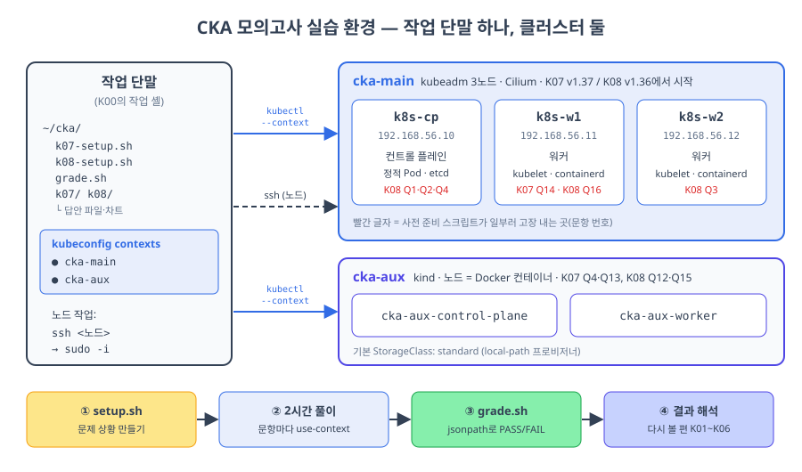

> **자격증 준비 · CKA** | 난이도 ★★★☆☆ | 예상 소요 시험 2시간 + 채점·복기 1.5시간

> ⚠️ **이 모의고사의 모든 문항은 CNCF가 공개한 CKA 커리큘럼(github.com/cncf/curriculum, 2026-11-15 확인 시 `CKA_Curriculum_v1.37.pdf`)의 5개 도메인을 바탕으로 이 시리즈가 직접 창작한 연습 과제입니다.** 실제 시험 문제나 유출 문제(덤프)가 아니고, 그런 것을 재현하지도 않습니다. Linux Foundation 시험은 응시 정책과 NDA로 보호되므로 "실제 출제 문제"라고 주장하는 자료는 믿지도, 퍼뜨리지도 마세요. 네임스페이스·이름·수치는 모두 새로 지은 것입니다.

> 💡 **실습 환경(K00 고정값).** `cka-main` = kubeadm v1.37 클러스터(k8s-cp/k8s-w1/k8s-w2, Cilium), `cka-aux` = kind 클러스터(cka-aux-control-plane/cka-aux-worker). 작업 단말은 두 context가 들어 있는 K00의 작업 셸이고, 스크립트와 답안 파일은 `~/cka/` 아래에 둡니다. 노드 작업은 `ssh <노드>` 후 `sudo -i`. 초기화는 K00의 `cka-clean` 스냅샷입니다.

## 🎯 오늘의 목표

- K01~K06에서 익힌 5개 도메인을 **2시간 안에** 한 번에 풀어 본다
- 문항마다 **지정된 context로 바꾸고 시작하는 습관**을 몸에 붙인다
- 사전 준비 스크립트로 "멈춘 kubelet, 잘못된 selector, 실패한 롤아웃" 같은 **시험다운 출발 상태**를 만든다
- 자동 채점 스크립트(`grade.sh`)로 PASS/FAIL과 총점을 보고, 틀린 문항을 **다시 볼 편(K01~K06)** 으로 연결한다

---

## 1. 시험 안내

### 1-1. 형식과 규칙

| 항목 | 이 모의고사 | 실제 시험(2026-11-15 공식 페이지 확인) |
|---|---|---|
| 제한 시간 | **2시간** | 2시간, 온라인 감독, 실기(명령줄) 시험 |
| 문항 수·배점 | 17문항, 합계 100점, 문항 단위 PASS/FAIL | 문항 수는 회차마다 다름. 실제 시험은 문항 안의 부분 점수가 있을 수 있음 |
| 합격 참고선 | **66점** | 공식 페이지에는 합격 점수가 없음. 66%가 널리 알려진 값이므로 **응시 전 Candidate Handbook으로 확인** |
| 클러스터 | `cka-main`(kubeadm: k8s-cp/k8s-w1/k8s-w2), `cka-aux`(kind) | 문항마다 다른 클러스터·context가 지정됨 |
| 허용 문서 | kubernetes.io/docs, kubernetes.io/blog, helm.sh/docs, gateway-api.sigs.k8s.io | 실제 시험과 같은 목록(Linux Foundation "Resources Allowed" 페이지). **이 시리즈 문서·개인 노트·검색 엔진 금지** |
| 버전 | cka-main v1.37(K00 `cka-clean`) | 시험은 Kubernetes v1.37 기준(신규 마이너 출시 후 약 4~8주 안에 갱신) |

시험 중 지킬 규칙:

1. **문항 머리에 적힌 context를 먼저 실행**합니다. 예: `kubectl config use-context cka-main`. 실제 시험도 문항마다 이 명령을 줍니다.
2. 노드 작업(`[ssh k8s-w1]` 표시)은 `ssh k8s-w1` 후 `sudo -i`로 하고, 끝나면 `exit`로 **작업 단말로 돌아옵니다**. 노드 안에서 다음 문항의 kubectl을 치는 실수를 막기 위해서입니다.
3. 파일로 답을 내는 문항은 문항에 적힌 위치에 저장합니다. `~/cka/k07/...`는 **작업 단말**, `/opt/k07/...`는 **k8s-cp 노드**의 경로입니다.
4. 사전 준비 스크립트는 **실행만 하고 내용은 시험 후에** 보세요(그래서 접어 두었습니다).
5. 문항 사이 순서는 자유입니다. 배점이 큰 트러블슈팅(Q14)부터 잡는 것도 전략입니다.



### 1-2. 준비 확인

작업 단말(K00의 작업 셸)에서 시작 전에 아래 네 가지가 되는지 봅니다.

```bash
kubectl config get-contexts               # cka-main, cka-aux 두 줄이 보여야 함
kubectl --context cka-main get nodes      # k8s-cp, k8s-w1, k8s-w2 Ready (v1.37.x)
kubectl --context cka-aux get sc          # standard (default) 가 보여야 함 (kind 기본)
for n in k8s-cp k8s-w1 k8s-w2; do ssh -o BatchMode=yes $n sudo true && echo "$n ssh-ok"; done
```

세 노드 모두 **비밀번호 없이** `ssh <노드> sudo`가 되어야 셋업·채점 스크립트가 노드 상태를 만들고 확인할 수 있습니다. 안 되면 K00의 SSH 설정 절을 다시 보세요.

### 1-3. 진행 순서

```bash
# 작업 단말에서. 먼저 K00 방식으로 초기화:
#   vagrant snapshot restore cka-clean --no-provision   (Vagrantfile 폴더)
#   bash ~/cka/reset-aux.sh                             (cka-aux 재생성)
mkdir -p ~/cka && cd ~/cka
vi k07-setup.sh        # 3절 내용을 붙여 넣고 저장 (LF 줄바꿈)
bash k07-setup.sh      # 이미지·CRD를 내려받아 3~5분 걸림
```

```
[*] preflight ...
[*] etcd client tools on k8s-cp ...
[*] Gateway API CRDs (v1.7.0) ...
[*] workloads on cka-main ...
[*] objects on cka-aux ...
[*] breaking a few things ...
[*] ready. Start the 2-hour timer now.
```

> 💡 시험 시간은 마지막 줄이 나온 순간부터 잽니다. 끝나면 5절의 `grade.sh`로 채점합니다.

---

## 2. 문항 한눈에 보기

| # | context | 도메인 | 주제 | 배점 |
|---|---|---|---|---|
| Q1 | cka-main | 클러스터 아키텍처 | ServiceAccount + Role/RoleBinding | 7 |
| Q2 | cka-main `[ssh k8s-cp]` | 클러스터 아키텍처 | etcd 스냅숏 백업 | 7 |
| Q3 | cka-main | 클러스터 아키텍처 | Kustomize overlay 적용 | 6 |
| Q4 | **cka-aux** | 클러스터 아키텍처 | CRD로 커스텀 리소스 만들기 | 5 |
| Q5 | cka-main | 워크로드·스케줄링 | 실패한 롤아웃 되돌리기 + 전략 | 5 |
| Q6 | cka-main | 워크로드·스케줄링 | ConfigMap·Secret을 쓰는 Pod | 5 |
| Q7 | cka-main | 워크로드·스케줄링 | 노드 레이블 + nodeAffinity + 리소스 | 5 |
| Q8 | cka-main | 서비스·네트워킹 | NodePort Service | 5 |
| Q9 | cka-main | 서비스·네트워킹 | NetworkPolicy(네임스페이스 AND Pod 선택) | 6 |
| Q10 | cka-main | 서비스·네트워킹 | Gateway API HTTPRoute | 5 |
| Q11 | cka-main | 서비스·네트워킹 | CoreDNS 이름 확인 | 4 |
| Q12 | cka-main | 스토리지 | 정적 PV/PVC + Pod 마운트 | 6 |
| Q13 | **cka-aux** | 스토리지 | StorageClass + 기본 클래스 변경 | 4 |
| Q14 | cka-main `[ssh k8s-w1]` | 트러블슈팅 | NotReady 노드 | 10 |
| Q15 | cka-main | 트러블슈팅 | 엔드포인트 없는 Service | 8 |
| Q16 | cka-main | 트러블슈팅 | 멀티 컨테이너 로그 추출 | 6 |
| Q17 | cka-main | 트러블슈팅 | Pending Pod | 6 |
| | | | **합계** | **100** |

도메인별 합계는 공식 비중과 같습니다: 트러블슈팅 30 / 클러스터 아키텍처 25 / 서비스·네트워킹 20 / 워크로드·스케줄링 15 / 스토리지 10.

---

## 3. 사전 준비 스크립트

작업 단말에서 실행합니다. 노드에 필요한 작업은 `ssh <노드> sudo ...`로 합니다. 스크립트는 k8s-cp에 etcd 클라이언트(`etcdctl`·`etcdutl`)가 없으면 클러스터의 etcd 이미지와 같은 버전을 GitHub 릴리스에서 받아 `/usr/local/bin`에 설치합니다. 실제 시험 환경에는 이 도구가 이미 있습니다.

<details><summary>k07-setup.sh (작업 단말에서 실행 — 시험 후에 열어 보기)</summary>

```bash
#!/bin/bash
# k07-setup.sh -- CKA mock exam 1 setup
# run on the work terminal (both contexts in kubeconfig, passwordless 'ssh <node> sudo')
set -euo pipefail

MAIN=${MAIN_CTX:-cka-main}
AUX=${AUX_CTX:-cka-aux}
WORK=~/cka/k07
GWAPI=${GWAPI_VERSION:-v1.7.0}

km() { kubectl --context "$MAIN" "$@"; }
ka() { kubectl --context "$AUX" "$@"; }
node_sh() {   # node_sh <node> <command...> : run a command as root on a node
  local n=$1; shift
  if [[ $(hostname -s) == "$n" ]]; then
    sudo bash -c "$*"
  else
    ssh -o BatchMode=yes -o ConnectTimeout=5 "$n" "sudo bash -c $(printf '%q' "$*")"
  fi
}
ensure_ns() { "$1" create namespace "$2" --dry-run=client -o yaml | "$1" apply -f - >/dev/null; }

echo "[*] preflight ..."
for c in "$MAIN" "$AUX"; do
  kubectl config get-contexts "$c" >/dev/null 2>&1 || { echo "ERROR: context $c not found" >&2; exit 1; }
done
km get nodes k8s-cp k8s-w1 k8s-w2 >/dev/null
ka get nodes >/dev/null
ka get storageclass standard >/dev/null || { echo "ERROR: $AUX has no 'standard' StorageClass" >&2; exit 1; }
for n in k8s-cp k8s-w1 k8s-w2; do
  node_sh "$n" true || { echo "ERROR: 'ssh $n sudo' must work without a password" >&2; exit 1; }
done

echo "[*] etcd client tools on k8s-cp ..."
img=$(km -n kube-system get pod -l component=etcd -o jsonpath='{.items[0].spec.containers[0].image}')
ver=${img##*:}; ver="v${ver%%-*}"
node_sh k8s-cp "command -v etcdctl >/dev/null && command -v etcdutl >/dev/null && exit 0
  arch=\$(dpkg --print-architecture); tmp=\$(mktemp -d)
  curl -fsSL https://github.com/etcd-io/etcd/releases/download/${ver}/etcd-${ver}-linux-\$arch.tar.gz | tar xz -C \$tmp
  install -m 0755 \$tmp/etcd-${ver}-linux-\$arch/etcdctl \$tmp/etcd-${ver}-linux-\$arch/etcdutl /usr/local/bin/
  rm -rf \$tmp"

node_sh k8s-cp "mkdir -p /opt/k07 && rm -f /opt/k07/etcd-backup.db"
mkdir -p "$WORK"
rm -f "$WORK/dns.txt" "$WORK/worker-errors.txt"

echo "[*] Gateway API CRDs (${GWAPI}) ..."
if ! km get crd httproutes.gateway.networking.k8s.io >/dev/null 2>&1; then
  km apply --server-side -f "https://github.com/kubernetes-sigs/gateway-api/releases/download/${GWAPI}/standard-install.yaml" >/dev/null
  km wait --for=condition=Established --timeout=90s \
    crd/gateways.gateway.networking.k8s.io crd/httproutes.gateway.networking.k8s.io >/dev/null
fi

echo "[*] workloads on cka-main ..."
for ns in k07-apps k07-db k07-prod k07-backend; do ensure_ns km "$ns"; done
km label namespace k07-backend team=backend --overwrite >/dev/null

km apply -f - >/dev/null <<'EOF'
apiVersion: gateway.networking.k8s.io/v1
kind: GatewayClass
metadata:
  name: k07-class
spec:
  controllerName: example.com/k07-no-controller
---
apiVersion: gateway.networking.k8s.io/v1
kind: Gateway
metadata:
  name: k07-gw
  namespace: k07-apps
spec:
  gatewayClassName: k07-class
  listeners:
  - name: http
    protocol: HTTP
    port: 80
---
apiVersion: apps/v1
kind: Deployment
metadata:
  name: web
  namespace: k07-apps
spec:
  replicas: 2
  selector:
    matchLabels: {app: web}
  template:
    metadata:
      labels: {app: web}
    spec:
      containers:
      - name: nginx
        image: nginx:1.27-alpine
        ports:
        - containerPort: 80
---
apiVersion: apps/v1
kind: Deployment
metadata:
  name: shop
  namespace: k07-apps
spec:
  replicas: 2
  selector:
    matchLabels: {app: shop}
  template:
    metadata:
      labels: {app: shop, tier: front}
    spec:
      containers:
      - name: nginx
        image: nginx:1.27-alpine
        ports:
        - containerPort: 80
---
apiVersion: v1
kind: Service
metadata:
  name: shop
  namespace: k07-apps
spec:
  selector: {app: shopp, tier: front}
  ports:
  - port: 80
    targetPort: 80
---
apiVersion: apps/v1
kind: Deployment
metadata:
  name: report
  namespace: k07-apps
spec:
  replicas: 1
  selector:
    matchLabels: {app: report}
  template:
    metadata:
      labels: {app: report}
    spec:
      containers:
      - name: report
        image: busybox:1.37
        command: ["sh", "-c", "sleep 604800"]
        resources:
          requests:
            cpu: "40"
            memory: 32Mi
---
apiVersion: v1
kind: Pod
metadata:
  name: logger
  namespace: k07-apps
spec:
  containers:
  - name: worker
    image: busybox:1.37
    command:
    - sh
    - -c
    - |
      echo "09:00:01 INFO  worker started"
      echo "09:00:02 ERROR queue=orders timeout after 30s"
      echo "09:00:03 INFO  retrying"
      echo "09:00:04 WARN  slow consumer"
      echo "09:00:05 ERROR queue=payments connection reset"
      echo "09:00:06 INFO  recovered"
      echo "09:00:07 ERROR queue=orders dead letter count=3"
      sleep 604800
  - name: sidecar
    image: busybox:1.37
    command:
    - sh
    - -c
    - |
      echo "09:00:01 INFO  shipper ready"
      echo "09:00:09 ERROR shipper buffer full"
      sleep 604800
---
apiVersion: apps/v1
kind: Deployment
metadata:
  name: db
  namespace: k07-db
spec:
  replicas: 1
  selector:
    matchLabels: {app: db}
  template:
    metadata:
      labels: {app: db}
    spec:
      containers:
      - name: db
        image: busybox:1.37
        command: ["sh", "-c", "sleep 604800"]
        ports:
        - containerPort: 5432
---
apiVersion: v1
kind: Service
metadata:
  name: db
  namespace: k07-db
spec:
  selector: {app: db}
  ports:
  - port: 5432
    targetPort: 5432
EOF

# Q5: a deployment whose latest rollout is broken
km -n k07-apps create deployment api --image=nginx:1.27-alpine --replicas=3 --dry-run=client -o yaml | km apply -f - >/dev/null
km -n k07-apps rollout status deployment/api --timeout=180s >/dev/null
km -n k07-apps set image deployment/api nginx=nginx:0.0.0-k07 >/dev/null

# Q3: kustomize base + overlay
mkdir -p ~/cka/k07/kustomize/base ~/cka/k07/kustomize/overlays/prod
cat > ~/cka/k07/kustomize/base/deployment.yaml <<'EOF'
apiVersion: apps/v1
kind: Deployment
metadata:
  name: catalog
spec:
  replicas: 1
  selector:
    matchLabels:
      app: catalog
  template:
    metadata:
      labels:
        app: catalog
    spec:
      containers:
      - name: catalog
        image: nginx:1.27-alpine
EOF
cat > ~/cka/k07/kustomize/base/kustomization.yaml <<'EOF'
apiVersion: kustomize.config.k8s.io/v1beta1
kind: Kustomization
resources:
- deployment.yaml
EOF
cat > ~/cka/k07/kustomize/overlays/prod/kustomization.yaml <<'EOF'
apiVersion: kustomize.config.k8s.io/v1beta1
kind: Kustomization
namespace: k07-prod
resources:
- ../../base
EOF

echo "[*] objects on cka-aux ..."
ensure_ns ka k07-aux
ka apply -f - >/dev/null <<'EOF'
apiVersion: apiextensions.k8s.io/v1
kind: CustomResourceDefinition
metadata:
  name: backups.ops.example.com
spec:
  group: ops.example.com
  scope: Namespaced
  names:
    plural: backups
    singular: backup
    kind: Backup
    shortNames: [bk]
  versions:
  - name: v1
    served: true
    storage: true
    schema:
      openAPIV3Schema:
        type: object
        properties:
          spec:
            type: object
            required: [schedule]
            properties:
              schedule:
                type: string
              retention:
                type: integer
                minimum: 1
EOF

echo "[*] breaking a few things ..."
node_sh k8s-w1 "systemctl disable --now kubelet" >/dev/null 2>&1
kubectl config use-context "$MAIN" >/dev/null
echo "[*] ready. Start the 2-hour timer now."
```

</details>

> 💡 다시 풀 때는 K00의 초기화 방법(Vagrant 스냅샷 복원, kind 클러스터 재생성)으로 되돌린 뒤 스크립트를 다시 실행하세요. 스크립트를 그냥 다시 돌리면 이미 고친 항목이 일부만 망가집니다.

---

## 4. 문항

> 공통 조건: 별도 언급이 없으면 이미지는 `nginx:1.27-alpine`, 파일 답안은 작업 단말의 `~/cka/k07/` 아래에 저장합니다(Q2만 k8s-cp 노드의 `/opt/k07/`). 이름·네임스페이스·숫자는 **문항에 적힌 그대로** 써야 채점됩니다.

### Q1. RBAC — 7점

```bash
kubectl config use-context cka-main
```

네임스페이스 `k07-apps`에 ServiceAccount `deployer`를 만들어라. 이 계정이 **같은 네임스페이스의 Deployment에 대해서만** `get`, `list`, `create`, `update`, `patch`를 할 수 있도록 Role `deployer-role`과 RoleBinding `deployer-rb`를 만들어라. 다른 리소스·다른 네임스페이스·`delete` 권한은 주지 않는다.

### Q2. etcd 백업 — 7점

```bash
kubectl config use-context cka-main
```

`ssh k8s-cp`로 접속해, 실행 중인 etcd의 스냅숏을 **k8s-cp의** `/opt/k07/etcd-backup.db`로 저장하라. 엔드포인트는 `https://127.0.0.1:2379`, 인증서는 `/etc/kubernetes/pki/etcd/` 아래의 것을 사용한다. 저장 후 스냅숏이 유효한지 확인하라.

### Q3. Kustomize — 6점

```bash
kubectl config use-context cka-main
```

`~/cka/k07/kustomize/overlays/prod`에 overlay가 있다. **base는 수정하지 말고 overlay의 `kustomization.yaml`만 고쳐서** 다음을 만족하게 한 뒤 클러스터에 적용하라.

- Deployment `catalog`의 replicas는 `3`
- 이 overlay가 만드는 모든 리소스와 Pod 템플릿에 레이블 `env=prod`
- 네임스페이스는 `k07-prod`(이미 overlay에 설정됨)

### Q4. CRD — 5점

```bash
kubectl config use-context cka-aux
```

이 클러스터에는 `ops.example.com` 그룹의 CRD가 설치되어 있다. 네임스페이스 `k07-aux`에 이 CRD의 `Backup` 리소스 `nightly`를 만들어라. 스케줄은 `0 2 * * *`, 보존 개수(retention)는 `7`이다. 필드 이름은 CRD 스키마에서 직접 확인하라.

### Q5. 롤아웃 되돌리기 — 5점

```bash
kubectl config use-context cka-main
```

`k07-apps`의 Deployment `api`가 최근 이미지 변경 이후 정상적으로 롤아웃되지 않는다. **직전의 정상 리비전으로 되돌리고**, 앞으로의 롤링 업데이트가 `maxSurge: 1`, `maxUnavailable: 0`으로 동작하도록 설정하라. 최종적으로 3개 Pod가 모두 Ready여야 한다.

### Q6. ConfigMap과 Secret — 5점

```bash
kubectl config use-context cka-main
```

`k07-apps`에 다음을 만들어라.

- ConfigMap `app-cfg`: `LOG_LEVEL=debug`
- Secret(generic) `app-sec`: `DB_PASS=k07-s3cret`
- Pod `cfg-pod`(이미지 `nginx:1.27-alpine`): ConfigMap `app-cfg`의 모든 키를 환경 변수로 받고, Secret `app-sec`을 `/etc/app`에 **읽기 전용**으로 마운트한다(파일 `/etc/app/DB_PASS`가 보여야 함).

### Q7. 노드 선택과 리소스 — 5점

```bash
kubectl config use-context cka-main
```

노드 `k8s-w2`에 레이블 `disk=ssd`를 붙여라. `k07-apps`에 Deployment `fast`(이미지 `nginx:1.27-alpine`, replicas 2)를 만들되, **`disk=ssd` 레이블이 있는 노드에만 반드시(required)** 스케줄되도록 nodeAffinity를 쓰고, 컨테이너 리소스는 requests `cpu: 100m`, `memory: 64Mi`, limits `memory: 128Mi`로 한다.

### Q8. NodePort — 5점

```bash
kubectl config use-context cka-main
```

`k07-apps`의 Deployment `web`을 Service `web-np`로 노출하라. 타입은 NodePort, Service 포트 80 → 컨테이너 포트 80, nodePort는 `30080`이다. `http://192.168.56.10:30080`으로 nginx 기본 페이지가 보여야 한다.

### Q9. NetworkPolicy — 6점

```bash
kubectl config use-context cka-main
```

`k07-db` 네임스페이스에 NetworkPolicy `db-allow-api`를 만들어라. `app=db` Pod로 들어오는 트래픽 중 **레이블 `team=backend`인 네임스페이스에 있으면서 동시에 레이블 `role=api`인 Pod**에서 오는 **TCP 5432만** 허용한다. 그 밖의 인그레스는 모두 막힌다. 이그레스는 이 정책으로 제한하지 않는다.

### Q10. Gateway API — 5점

```bash
kubectl config use-context cka-main
```

`k07-apps`에 Gateway `k07-gw`가 있다. 같은 네임스페이스에 HTTPRoute `web-route`를 만들어 호스트 `web.k07.local`의 경로 `/`(접두사 일치) 요청을 Service `web`의 포트 80으로 보내라. Service `web`(ClusterIP, 포트 80 → 80, Deployment `web` 선택)도 아직 없다면 만들어라.

> 💡 이 실습 클러스터에는 Gateway 컨트롤러가 없어 Gateway가 `Accepted` 상태가 되지 않습니다. 채점은 리소스 정의만 봅니다.

### Q11. CoreDNS — 4점

```bash
kubectl config use-context cka-main
```

`k07-db`의 Service `db`를 클러스터 안에서 찾을 때 쓰는 **완전한 DNS 이름(FQDN)** 을 `~/cka/k07/dns.txt`에 한 줄로 저장하라(끝의 점 없이). 임시 Pod(`busybox:1.37`)에서 `nslookup`으로 실제로 해석되는지도 확인하라.

### Q12. PV와 PVC — 6점

```bash
kubectl config use-context cka-main
```

다음을 만들어라.

- PersistentVolume `k07-pv`: 용량 `1Gi`, 접근 모드 `ReadWriteOnce`, 반환 정책 `Retain`, storageClassName `manual`, hostPath `/srv/k07-pv`
- `k07-apps`의 PersistentVolumeClaim `k07-pvc`: `500Mi`, `ReadWriteOnce`, storageClassName `manual` → `k07-pv`에 Bound
- `k07-apps`의 Pod `pv-pod`(이미지 `busybox:1.37`, 명령 `sleep 3600`): `k07-pvc`를 `/data`에 마운트, Running

### Q13. StorageClass — 4점

```bash
kubectl config use-context cka-aux
```

StorageClass `fast-local`을 만들어라. 프로비저너는 이 클러스터의 기존 기본 클래스와 같은 것, `reclaimPolicy: Delete`, `volumeBindingMode: WaitForFirstConsumer`. 그리고 **`fast-local`을 기본(default) StorageClass로** 만들고, 기존 기본 클래스는 기본이 아니게 하라(삭제 금지).

### Q14. NotReady 노드 — 10점

```bash
kubectl config use-context cka-main
```

`k8s-w1`이 `NotReady`다. 원인을 찾아 고치고, **노드를 재부팅해도 다시 Ready**가 되도록 하라. 작업은 `ssh k8s-w1`로 접속해서 한다.

### Q15. Service 엔드포인트 — 8점

```bash
kubectl config use-context cka-main
```

`k07-apps`의 Service `shop`으로 요청하면 응답이 없다. **Deployment `shop`은 수정하지 말고** Service를 고쳐 Deployment `shop`의 Pod 2개가 모두 엔드포인트로 잡히게 하라.

### Q16. 컨테이너 로그 — 6점

```bash
kubectl config use-context cka-main
```

`k07-apps`의 Pod `logger`에는 컨테이너가 두 개 있다. **컨테이너 `worker`의 로그 중 `ERROR`를 포함한 줄만** 원래 순서대로 `~/cka/k07/worker-errors.txt`에 저장하라.

### Q17. Pending Pod — 6점

```bash
kubectl config use-context cka-main
```

`k07-apps`의 Deployment `report`의 Pod가 계속 `Pending`이다. 원인을 확인하고, **CPU 요청을 `100m`으로 바꿔** Pod가 Running·Ready가 되게 하라. 다른 설정(메모리 요청, 명령)은 그대로 둔다.

---

## 5. 채점

### 5-1. 채점 절차

시간이 끝나면 손을 떼고 작업 단말의 `~/cka`에서 실행합니다. 채점 스크립트는 클러스터를 바꾸지 않고 읽기만 합니다(Q8은 NodePort로 HTTP 요청 한 번).

```bash
vi grade.sh      # 5-3 전문 붙여 넣기
bash grade.sh
```

```
== CKA mock exam 1 (k07) grading  2026-11-15 15:02 ==
Q01  PASS    7/  7  RBAC deployer
Q02  PASS    7/  7  etcd snapshot
Q03  FAIL    0/  6  kustomize overlay
...
---------------------------------------------------
TOTAL: 81 / 100   (PASS 14, FAIL 3)
RESULT: reference line (66) reached
```

### 5-2. 채점 체크리스트 (수동 확인용)

| # | 검증 명령(context 생략 시 cka-main) | 기대 결과 |
|---|---|---|
| Q1 | `kubectl auth can-i create deployments -n k07-apps --as=system:serviceaccount:k07-apps:deployer` | `yes` (`delete`는 `no`, 다른 ns는 `no`) |
| Q2 | `ssh k8s-cp sudo etcdutl --write-out=table snapshot status /opt/k07/etcd-backup.db` | 해시·리비전·키 개수 표 |
| Q3 | `kubectl -n k07-prod get deploy catalog --show-labels` | READY `3/3`, `env=prod` |
| Q4 | `kubectl --context cka-aux -n k07-aux get backup nightly -o yaml` | `schedule: 0 2 * * *`, `retention: 7` |
| Q5 | `kubectl -n k07-apps get deploy api -o wide` | 이미지 `nginx:1.27-alpine`, `3/3` |
| Q6 | `kubectl -n k07-apps exec cfg-pod -- sh -c 'echo $LOG_LEVEL; cat /etc/app/DB_PASS'` | `debug`, `k07-s3cret` |
| Q7 | `kubectl -n k07-apps get pod -l app=fast -o wide` | 2개 모두 `k8s-w2` |
| Q8 | `curl -s http://192.168.56.10:30080 \| grep title` | `Welcome to nginx!` |
| Q9 | `kubectl -n k07-db describe netpol db-allow-api` | From 항목 1개에 NamespaceSelector와 PodSelector가 함께 |
| Q10 | `kubectl -n k07-apps get httproute web-route -o yaml` | parentRefs `k07-gw`, hostname, backend `web:80` |
| Q11 | `cat ~/cka/k07/dns.txt` | `db.k07-db.svc.cluster.local` |
| Q12 | `kubectl get pv k07-pv; kubectl -n k07-apps get pvc,pod` | Bound, `pv-pod` Running |
| Q13 | `kubectl --context cka-aux get sc` | `fast-local (default)`만 default |
| Q14 | `kubectl get nodes`; `ssh k8s-w1 systemctl is-enabled kubelet` | `k8s-w1 Ready`; `enabled` |
| Q15 | `kubectl -n k07-apps get endpointslices -l kubernetes.io/service-name=shop` | 주소 2개 |
| Q16 | `diff <(kubectl -n k07-apps logs logger -c worker \| grep ERROR) ~/cka/k07/worker-errors.txt` | 출력 없음 |
| Q17 | `kubectl -n k07-apps get deploy report` | `1/1` |

### 5-3. 자동 채점 스크립트 `grade.sh` 전문

```bash
#!/bin/bash
# grade.sh -- CKA mock exam 1 (k07) auto grader
# run on the work terminal, like k07-setup.sh. read-only.
MAIN=${MAIN_CTX:-cka-main}
AUX=${AUX_CTX:-cka-aux}
CP_IP=${CP_IP:-192.168.56.10}
SCORE=0; MAX=0; NPASS=0; NFAIL=0

km() { kubectl --context "$MAIN" --request-timeout=15s "$@"; }
ka() { kubectl --context "$AUX" --request-timeout=15s "$@"; }
node_sh() {
  local n=$1; shift
  if [[ $(hostname -s) == "$n" ]]; then
    sudo bash -c "$*"
  else
    ssh -o BatchMode=yes -o ConnectTimeout=5 "$n" "sudo bash -c $(printf '%q' "$*")"
  fi
}
check() {   # check <no> <points> <title> <function>
  local no=$1 pts=$2 title=$3 fn=$4
  MAX=$((MAX + pts))
  if ( "$fn" ) >/dev/null 2>&1; then
    SCORE=$((SCORE + pts)); NPASS=$((NPASS + 1))
    printf 'Q%02d  PASS  %3d/%3d  %s\n' "$no" "$pts" "$pts" "$title"
  else
    NFAIL=$((NFAIL + 1))
    printf 'Q%02d  FAIL  %3d/%3d  %s\n' "$no" 0 "$pts" "$title"
  fi
}
jp() { "$1" "${@:2:$#-2}" -o jsonpath="${!#}"; }   # jp km -n ns get x y '{...}'
eq() { [[ "$1" == "$2" ]]; }

# --- checks ------------------------------------------------------------
q01() {
  local sa=system:serviceaccount:k07-apps:deployer v
  km -n k07-apps get sa deployer && km -n k07-apps get role deployer-role && km -n k07-apps get rolebinding deployer-rb || return 1
  for v in get list create update patch; do
    eq "$(km auth can-i "$v" deployments.apps -n k07-apps --as="$sa")" yes || return 1
  done
  eq "$(km auth can-i delete deployments.apps -n k07-apps --as="$sa")" no &&
  eq "$(km auth can-i get pods -n k07-apps --as="$sa")" no &&
  eq "$(km auth can-i create deployments.apps -n default --as="$sa")" no
}

q02() {
  node_sh k8s-cp "test -s /opt/k07/etcd-backup.db && etcdutl snapshot status /opt/k07/etcd-backup.db"
}

q03() {
  eq "$(jp km -n k07-prod get deploy catalog '{.spec.replicas}')" 3 &&
  eq "$(jp km -n k07-prod get deploy catalog '{.metadata.labels.env}')" prod &&
  eq "$(jp km -n k07-prod get deploy catalog '{.spec.template.metadata.labels.env}')" prod &&
  eq "$(jp km -n k07-prod get deploy catalog '{.status.readyReplicas}')" 3 &&
  grep -q '^  replicas: 1$' ~/cka/k07/kustomize/base/deployment.yaml
}

q04() {
  eq "$(jp ka -n k07-aux get backups.ops.example.com nightly '{.spec.schedule}|{.spec.retention}')" '0 2 * * *|7'
}

q05() {
  eq "$(jp km -n k07-apps get deploy api '{.spec.template.spec.containers[0].image}')" nginx:1.27-alpine &&
  eq "$(jp km -n k07-apps get deploy api '{.spec.strategy.rollingUpdate.maxSurge}')" 1 &&
  eq "$(jp km -n k07-apps get deploy api '{.spec.strategy.rollingUpdate.maxUnavailable}')" 0 &&
  eq "$(jp km -n k07-apps get deploy api '{.status.readyReplicas}/{.status.updatedReplicas}/{.status.replicas}')" 3/3/3
}

q06() {
  eq "$(jp km -n k07-apps get cm app-cfg '{.data.LOG_LEVEL}')" debug &&
  eq "$(jp km -n k07-apps get secret app-sec '{.data.DB_PASS}' | base64 -d)" k07-s3cret &&
  eq "$(km -n k07-apps exec cfg-pod -- printenv LOG_LEVEL)" debug &&
  eq "$(km -n k07-apps exec cfg-pod -- cat /etc/app/DB_PASS)" k07-s3cret &&
  ! km -n k07-apps exec cfg-pod -- sh -c 'touch /etc/app/x'
}

q07() {
  local nodes
  eq "$(jp km get node k8s-w2 '{.metadata.labels.disk}')" ssd &&
  jp km -n k07-apps get deploy fast '{.spec.template.spec.affinity.nodeAffinity.requiredDuringSchedulingIgnoredDuringExecution}' | grep -q ssd &&
  eq "$(jp km -n k07-apps get deploy fast '{.spec.template.spec.containers[0].resources.requests.cpu}|{.spec.template.spec.containers[0].resources.requests.memory}|{.spec.template.spec.containers[0].resources.limits.memory}')" '100m|64Mi|128Mi' &&
  eq "$(jp km -n k07-apps get deploy fast '{.status.readyReplicas}')" 2 || return 1
  nodes=$(jp km -n k07-apps get pod -l app=fast '{range .items[*]}{.spec.nodeName}{"\n"}{end}' | sort -u)
  eq "$nodes" k8s-w2
}

q08() {
  eq "$(jp km -n k07-apps get svc web-np '{.spec.type}|{.spec.ports[0].port}|{.spec.ports[0].nodePort}')" 'NodePort|80|30080' &&
  curl -s -m 5 "http://${CP_IP}:30080/" | grep -q 'Welcome to nginx'
}

q09() {
  local p='{.spec.podSelector.matchLabels.app}|{.spec.policyTypes[*]}|{.spec.ingress[0].from[0].namespaceSelector.matchLabels.team}|{.spec.ingress[0].from[0].podSelector.matchLabels.role}|{.spec.ingress[0].ports[0].port}|{.spec.ingress[0].ports[0].protocol}'
  local n_from n_rules
  eq "$(jp km -n k07-db get netpol db-allow-api "$p")" 'db|Ingress|backend|api|5432|TCP' || return 1
  n_rules=$(jp km -n k07-db get netpol db-allow-api '{range .spec.ingress[*]}x{end}')
  n_from=$(jp km -n k07-db get netpol db-allow-api '{range .spec.ingress[0].from[*]}x{end}')
  eq "$n_rules" x && eq "$n_from" x
}

q10() {
  local r='{.spec.parentRefs[0].name}|{.spec.hostnames[0]}|{.spec.rules[0].matches[0].path.type}|{.spec.rules[0].matches[0].path.value}|{.spec.rules[0].backendRefs[0].name}|{.spec.rules[0].backendRefs[0].port}'
  eq "$(jp km -n k07-apps get httproute web-route "$r")" 'k07-gw|web.k07.local|PathPrefix|/|web|80' &&
  eq "$(jp km -n k07-apps get svc web '{.spec.selector.app}|{.spec.ports[0].port}')" 'web|80'
}

q11() {
  eq "$(tr -d '[:space:]' < ~/cka/k07/dns.txt)" db.k07-db.svc.cluster.local
}

q12() {
  eq "$(jp km get pv k07-pv '{.spec.capacity.storage}|{.spec.accessModes[*]}|{.spec.persistentVolumeReclaimPolicy}|{.spec.storageClassName}|{.spec.hostPath.path}')" '1Gi|ReadWriteOnce|Retain|manual|/srv/k07-pv' &&
  eq "$(jp km -n k07-apps get pvc k07-pvc '{.status.phase}|{.spec.volumeName}|{.spec.resources.requests.storage}')" 'Bound|k07-pv|500Mi' &&
  eq "$(jp km -n k07-apps get pod pv-pod '{.status.phase}')" Running &&
  jp km -n k07-apps get pod pv-pod '{range .spec.volumes[*]}{.persistentVolumeClaim.claimName}{"\n"}{end}' | grep -qx k07-pvc &&
  jp km -n k07-apps get pod pv-pod '{range .spec.containers[0].volumeMounts[*]}{.mountPath}{"\n"}{end}' | grep -qx /data
}

q13() {
  local prov
  prov=$(jp ka get sc standard '{.provisioner}')
  eq "$(jp ka get sc fast-local '{.provisioner}|{.reclaimPolicy}|{.volumeBindingMode}')" "${prov}|Delete|WaitForFirstConsumer" &&
  eq "$(jp ka get sc fast-local '{.metadata.annotations.storageclass\.kubernetes\.io/is-default-class}')" true &&
  ! eq "$(jp ka get sc standard '{.metadata.annotations.storageclass\.kubernetes\.io/is-default-class}')" true
}

q14() {
  eq "$(jp km get node k8s-w1 '{.status.conditions[?(@.type=="Ready")].status}')" True &&
  eq "$(node_sh k8s-w1 'systemctl is-enabled kubelet')" enabled
}

q15() {
  local ready
  eq "$(jp km -n k07-apps get deploy shop '{.spec.template.metadata.labels.app}|{.spec.replicas}')" 'shop|2' &&
  eq "$(jp km -n k07-apps get svc shop '{.spec.ports[0].port}')" 80 || return 1
  ready=$(jp km -n k07-apps get endpointslices -l kubernetes.io/service-name=shop \
          '{range .items[*].endpoints[*]}{.conditions.ready}{"\n"}{end}' | grep -c true)
  (( ready >= 2 ))
}

q16() {
  [[ -s ~/cka/k07/worker-errors.txt ]] &&
  diff -q <(km -n k07-apps logs logger -c worker | grep ERROR) ~/cka/k07/worker-errors.txt
}

q17() {
  eq "$(jp km -n k07-apps get deploy report '{.spec.template.spec.containers[0].resources.requests.cpu}|{.spec.template.spec.containers[0].resources.requests.memory}')" '100m|32Mi' &&
  eq "$(jp km -n k07-apps get deploy report '{.status.readyReplicas}')" 1
}

# --- run ---------------------------------------------------------------
echo "== CKA mock exam 1 (k07) grading  $(date '+%F %H:%M') =="
check  1  7 "RBAC deployer"                 q01
check  2  7 "etcd snapshot"                 q02
check  3  6 "kustomize overlay"             q03
check  4  5 "CRD instance on cka-aux"       q04
check  5  5 "rollback + strategy"           q05
check  6  5 "ConfigMap + Secret pod"        q06
check  7  5 "node affinity + resources"     q07
check  8  5 "NodePort 30080"                q08
check  9  6 "NetworkPolicy db-allow-api"    q09
check 10  5 "HTTPRoute web-route"           q10
check 11  4 "service FQDN"                  q11
check 12  6 "static PV/PVC + pod"           q12
check 13  4 "default StorageClass on aux"   q13
check 14 10 "k8s-w1 Ready + kubelet enabled" q14
check 15  8 "service shop endpoints"        q15
check 16  6 "worker ERROR lines"            q16
check 17  6 "pending pod fixed"             q17
echo "---------------------------------------------------"
printf 'TOTAL: %d / %d   (PASS %d, FAIL %d)\n' "$SCORE" "$MAX" "$NPASS" "$NFAIL"
if (( SCORE >= 66 )); then
  echo "RESULT: reference line (66) reached"
else
  echo "RESULT: below reference line (66)"
fi
```

> 💡 **jsonpath 한 줄 채점.** `jp` 함수는 마지막 인자를 jsonpath로 넘깁니다. 여러 필드를 `|`로 이어 한 번에 비교하므로 필드 하나만 틀려도 FAIL입니다. 직접 확인할 때도 `kubectl get ... -o jsonpath='{.spec.x}|{.spec.y}'` 패턴이 시험에서 빠르게 검증하는 방법입니다.

> ⚠️ Q1은 `delete` 권한과 다른 네임스페이스 권한이 **없는지**도 봅니다. 편하자고 `--verb='*'`이나 ClusterRoleBinding을 쓰면 FAIL입니다. Q6은 마운트가 읽기 전용인지(쓰기 시도가 실패하는지)까지 확인합니다.

---

## 6. 풀이

각 풀이는 한 가지 정답 예시입니다. 요구 사항을 만족하면 다른 방법도 정답입니다. 📖 표시는 시험 중 허용 문서에서 찾을 페이지입니다.

<details><summary>풀이 — Q1. RBAC</summary>

```bash
kubectl config use-context cka-main
kubectl -n k07-apps create serviceaccount deployer
kubectl -n k07-apps create role deployer-role \
  --verb=get,list,create,update,patch --resource=deployments
kubectl -n k07-apps create rolebinding deployer-rb \
  --role=deployer-role --serviceaccount=k07-apps:deployer
kubectl auth can-i create deployments -n k07-apps --as=system:serviceaccount:k07-apps:deployer   # yes
kubectl auth can-i delete deployments -n k07-apps --as=system:serviceaccount:k07-apps:deployer   # no
```

**흔한 감점:** `--serviceaccount=deployer`처럼 네임스페이스를 빼면 오류가 나고, `--user=deployer`로 바인딩하면 **사용자** `deployer`에게 권한이 가서 ServiceAccount는 여전히 권한이 없습니다. `--resource=deployments`는 kubectl이 `apps` 그룹으로 풀어 줍니다(YAML로 쓸 때는 `apiGroups: ["apps"]`를 꼭 넣기).

📖 Reference → Access Authn/Authz → Using RBAC Authorization

</details>

<details><summary>풀이 — Q2. etcd 백업</summary>

```bash
kubectl config use-context cka-main
ssh k8s-cp
# 인증서 경로는 etcd 정적 Pod 매니페스트에서 확인하는 습관
sudo grep -E 'cert-file|key-file|trusted-ca-file|listen-client' /etc/kubernetes/manifests/etcd.yaml

sudo etcdctl --endpoints=https://127.0.0.1:2379 \
  --cacert=/etc/kubernetes/pki/etcd/ca.crt \
  --cert=/etc/kubernetes/pki/etcd/server.crt \
  --key=/etc/kubernetes/pki/etcd/server.key \
  snapshot save /opt/k07/etcd-backup.db

sudo etcdutl --write-out=table snapshot status /opt/k07/etcd-backup.db
exit                                   # 작업 단말로
```

```
+----------+----------+------------+------------+---------+
|   HASH   | REVISION | TOTAL KEYS | TOTAL SIZE | VERSION |
+----------+----------+------------+------------+---------+
| 5c9d0e3a |    48211 |       1302 |     6.2 MB |   3.6.0 |
+----------+----------+------------+------------+---------+
```

**흔한 감점:** 인증서 3개 중 하나라도 빠지면 `context deadline exceeded`로 실패합니다. etcd 3.6부터 `etcdctl snapshot status`와 `etcdctl snapshot restore`는 없어졌고 **`etcdutl`** 로 합니다(저장 `save`는 여전히 `etcdctl`). 예전 글의 `ETCDCTL_API=3`은 붙여도 무해하지만 필요 없습니다. 이 명령은 **k8s-cp(etcd가 있는 노드)** 에서 실행합니다.

📖 Tasks → Administer a Cluster → Operating etcd clusters for Kubernetes

</details>

<details><summary>풀이 — Q3. Kustomize</summary>

```bash
kubectl config use-context cka-main
cat > ~/cka/k07/kustomize/overlays/prod/kustomization.yaml <<'EOF'
apiVersion: kustomize.config.k8s.io/v1beta1
kind: Kustomization
namespace: k07-prod
resources:
- ../../base
replicas:
- name: catalog
  count: 3
labels:
- pairs:
    env: prod
  includeTemplates: true
EOF
kubectl kustomize ~/cka/k07/kustomize/overlays/prod | grep -E 'replicas|env|namespace'   # 먼저 렌더링 확인
kubectl apply -k ~/cka/k07/kustomize/overlays/prod
kubectl -n k07-prod get deploy catalog --show-labels
```

**흔한 감점:** base의 `deployment.yaml`을 직접 고치면 FAIL(문항이 금지). `includeTemplates: true`가 없으면 Deployment 자신에만 붙고 Pod 템플릿엔 안 붙습니다. 예전 필드 `commonLabels`도 동작은 하지만 **셀렉터까지** 바꾸므로, 이미 배포된 Deployment에 나중에 붙이면 "selector is immutable"로 적용이 거부됩니다. 적용은 `kubectl apply -f`가 아니라 **`-k`**.

📖 Tasks → Manage Kubernetes Objects → Declarative Management of Kubernetes Objects Using Kustomize

</details>

<details><summary>풀이 — Q4. CRD</summary>

```bash
kubectl config use-context cka-aux
kubectl get crd | grep ops.example.com
kubectl explain backup.spec --api-version=ops.example.com/v1      # schedule, retention 확인
cat <<'EOF' | kubectl apply -f -
apiVersion: ops.example.com/v1
kind: Backup
metadata:
  name: nightly
  namespace: k07-aux
spec:
  schedule: "0 2 * * *"
  retention: 7
EOF
kubectl -n k07-aux get bk
```

**흔한 감점:** context를 바꾸지 않고 cka-main에 적용하면 `no matches for kind "Backup"` 오류가 납니다(이게 오히려 실수를 알려 주는 신호). `retention: "7"`처럼 따옴표를 넣으면 스키마(integer)에 걸려 거부됩니다. `schedule`의 `*`는 YAML에서 따옴표로 감쌀 것.

📖 Tasks → Extend Kubernetes → Use Custom Resources → Extend the Kubernetes API with CustomResourceDefinitions

</details>

<details><summary>풀이 — Q5. 롤아웃 되돌리기</summary>

```bash
kubectl config use-context cka-main
kubectl -n k07-apps rollout status deploy/api --timeout=5s      # 진행 안 됨
kubectl -n k07-apps get pods -l app=api                          # ErrImagePull / ImagePullBackOff
kubectl -n k07-apps rollout history deploy/api
kubectl -n k07-apps rollout undo deploy/api                      # 직전 리비전(nginx:1.27-alpine)
kubectl -n k07-apps patch deploy api -p '{"spec":{"strategy":{"type":"RollingUpdate","rollingUpdate":{"maxSurge":1,"maxUnavailable":0}}}}'
kubectl -n k07-apps rollout status deploy/api
```

**흔한 감점:** `rollout undo --to-revision=1`은 이 경우엔 맞지만 습관적으로 쓰면 위험합니다. **history를 먼저 보고** 정상 이미지가 어느 리비전인지 확인하세요. `maxUnavailable: "0%"`처럼 문자열 퍼센트로 쓰면 의미는 같아도 채점 값(`0`)과 다릅니다 — 문항에 적힌 형태 그대로.

📖 Concepts → Workloads → Workload Management → Deployments (Rolling Back a Deployment)

</details>

<details><summary>풀이 — Q6. ConfigMap과 Secret</summary>

```bash
kubectl config use-context cka-main
kubectl -n k07-apps create configmap app-cfg --from-literal=LOG_LEVEL=debug
kubectl -n k07-apps create secret generic app-sec --from-literal=DB_PASS=k07-s3cret
kubectl -n k07-apps run cfg-pod --image=nginx:1.27-alpine --dry-run=client -o yaml > q6.yaml
```

`q6.yaml`의 containers 아래를 고칩니다.

```yaml
spec:
  containers:
  - name: cfg-pod
    image: nginx:1.27-alpine
    envFrom:
    - configMapRef:
        name: app-cfg
    volumeMounts:
    - name: sec
      mountPath: /etc/app
      readOnly: true
  volumes:
  - name: sec
    secret:
      secretName: app-sec
```

```bash
kubectl apply -f q6.yaml
kubectl -n k07-apps exec cfg-pod -- sh -c 'echo $LOG_LEVEL; cat /etc/app/DB_PASS'
```

**흔한 감점:** `env`에 `valueFrom.configMapKeyRef`로 한 키만 넣어도 지금은 같아 보이지만 "모든 키"라는 조건을 놓친 것입니다(`envFrom`). Secret 볼륨은 원래 읽기 전용으로 마운트되지만 문항이 요구하므로 `readOnly: true`를 명시합니다. `--from-literal` 대신 `echo ... | base64`로 손수 넣다가 줄바꿈(`\n`)이 섞이는 실수도 흔합니다(`echo -n`).

📖 Tasks → Configure Pods and Containers → Configure a Pod to Use a ConfigMap / Distribute Credentials Securely Using Secrets

</details>

<details><summary>풀이 — Q7. 노드 선택과 리소스</summary>

```bash
kubectl config use-context cka-main
kubectl label node k8s-w2 disk=ssd
kubectl -n k07-apps create deployment fast --image=nginx:1.27-alpine --replicas=2 --dry-run=client -o yaml > q7.yaml
```

```yaml
    spec:
      affinity:
        nodeAffinity:
          requiredDuringSchedulingIgnoredDuringExecution:
            nodeSelectorTerms:
            - matchExpressions:
              - key: disk
                operator: In
                values: ["ssd"]
      containers:
      - name: nginx
        image: nginx:1.27-alpine
        resources:
          requests:
            cpu: 100m
            memory: 64Mi
          limits:
            memory: 128Mi
```

```bash
kubectl apply -f q7.yaml
kubectl -n k07-apps get pod -l app=fast -o wide
```

**흔한 감점:** `preferredDuringScheduling...`을 쓰면 다른 노드에도 갈 수 있어 "반드시" 조건 위반. `nodeSelector: {disk: ssd}`도 동작은 같지만 문항이 nodeAffinity를 지정했으므로 채점 필드가 비어 FAIL. 레이블을 `k8s-w1`에 붙이는 오타도 흔합니다.

📖 Tasks → Configure Pods and Containers → Assign Pods to Nodes using Node Affinity

</details>

<details><summary>풀이 — Q8. NodePort</summary>

```bash
kubectl config use-context cka-main
kubectl -n k07-apps expose deployment web --name=web-np --type=NodePort --port=80 --target-port=80 --dry-run=client -o yaml > q8.yaml
# q8.yaml 의 ports 항목에 nodePort: 30080 추가
kubectl apply -f q8.yaml
curl -s http://192.168.56.10:30080 | grep title
```

**흔한 감점:** `kubectl expose`에는 nodePort 지정 옵션이 없어 임의 포트가 배정됩니다. 만든 뒤 `kubectl edit`로 바꾸거나, 위처럼 YAML에 넣고 적용하세요. `kubectl create service nodeport web-np --tcp=80:80 --node-port=30080`도 되지만 셀렉터가 `app=web-np`로 만들어져 **엔드포인트가 비게** 됩니다(셀렉터를 `app=web`으로 고쳐야 함).

📖 Concepts → Services, Load Balancing, and Networking → Service (type: NodePort)

</details>

<details><summary>풀이 — Q9. NetworkPolicy</summary>

```yaml
apiVersion: networking.k8s.io/v1
kind: NetworkPolicy
metadata:
  name: db-allow-api
  namespace: k07-db
spec:
  podSelector:
    matchLabels:
      app: db
  policyTypes:
  - Ingress
  ingress:
  - from:
    - namespaceSelector:
        matchLabels:
          team: backend
      podSelector:
        matchLabels:
          role: api
    ports:
    - protocol: TCP
      port: 5432
```

```bash
kubectl config use-context cka-main
kubectl apply -f q9.yaml
kubectl -n k07-db describe netpol db-allow-api
```

**흔한 감점:** 가장 흔한 실수는 `podSelector` 앞에 `-`를 붙이는 것입니다. 그러면 from 항목이 **두 개(OR)** 가 되어 "team=backend 네임스페이스의 모든 Pod" 또는 "k07-db 안의 role=api Pod"가 허용됩니다. `describe`에서 NamespaceSelector와 PodSelector가 **한 항목**으로 묶여 보이는지 확인하세요. `policyTypes`에 Egress를 넣으면 이그레스가 전부 막혀 DB가 DNS도 못 씁니다.

📖 Concepts → Services, Load Balancing, and Networking → Network Policies

</details>

<details><summary>풀이 — Q10. Gateway API</summary>

```bash
kubectl config use-context cka-main
kubectl -n k07-apps expose deployment web --port=80 --target-port=80     # Service web
cat <<'EOF' | kubectl apply -f -
apiVersion: gateway.networking.k8s.io/v1
kind: HTTPRoute
metadata:
  name: web-route
  namespace: k07-apps
spec:
  parentRefs:
  - name: k07-gw
  hostnames:
  - web.k07.local
  rules:
  - matches:
    - path:
        type: PathPrefix
        value: /
    backendRefs:
    - name: web
      port: 80
EOF
kubectl -n k07-apps get httproute web-route -o yaml | grep -A3 parentRefs
```

**흔한 감점:** HTTPRoute는 Service를 **이름으로** 찾으므로 Service `web`이 없으면 라우트는 만들어져도 백엔드가 비어 있습니다. `backendRefs`의 `port`를 빼면 Service 백엔드에서는 검증 오류가 납니다. Ingress 문법(`pathType: Prefix`)과 헷갈려 `type: Prefix`로 쓰면 거부됩니다 — Gateway API는 `PathPrefix`.

📖 gateway-api.sigs.k8s.io → Guides → HTTP routing

</details>

<details><summary>풀이 — Q11. CoreDNS</summary>

```bash
kubectl config use-context cka-main
kubectl run dnstest --image=busybox:1.37 --rm -it --restart=Never -- nslookup db.k07-db.svc.cluster.local
echo db.k07-db.svc.cluster.local > ~/cka/k07/dns.txt
```

```
Name:	db.k07-db.svc.cluster.local
Address: 10.96.142.37
```

**흔한 감점:** `db.k07-db`만 쓰면 Pod의 search 도메인 덕에 해석은 되지만 FQDN이 아닙니다. 클러스터 도메인이 `cluster.local`인지 모르겠다면 `kubectl -n kube-system get cm coredns -o yaml`의 `kubernetes cluster.local ...` 줄에서 확인합니다.

📖 Concepts → Services, Load Balancing, and Networking → DNS for Services and Pods

</details>

<details><summary>풀이 — Q12. PV와 PVC</summary>

```yaml
apiVersion: v1
kind: PersistentVolume
metadata:
  name: k07-pv
spec:
  capacity:
    storage: 1Gi
  accessModes: ["ReadWriteOnce"]
  persistentVolumeReclaimPolicy: Retain
  storageClassName: manual
  hostPath:
    path: /srv/k07-pv
    type: DirectoryOrCreate
---
apiVersion: v1
kind: PersistentVolumeClaim
metadata:
  name: k07-pvc
  namespace: k07-apps
spec:
  accessModes: ["ReadWriteOnce"]
  storageClassName: manual
  resources:
    requests:
      storage: 500Mi
---
apiVersion: v1
kind: Pod
metadata:
  name: pv-pod
  namespace: k07-apps
spec:
  containers:
  - name: app
    image: busybox:1.37
    command: ["sleep", "3600"]
    volumeMounts:
    - name: data
      mountPath: /data
  volumes:
  - name: data
    persistentVolumeClaim:
      claimName: k07-pvc
```

```bash
kubectl config use-context cka-main
kubectl apply -f q12.yaml
kubectl get pv k07-pv; kubectl -n k07-apps get pvc k07-pvc
```

**흔한 감점:** PVC에 `storageClassName`을 빼면 기본 StorageClass가 있는 클러스터에서는 그 클래스가 자동으로 들어가 `manual` PV와 짝이 맺어지지 않습니다(이 kubeadm 클러스터엔 기본 클래스가 없어 우연히 묶일 수도 있지만, 시험 클러스터엔 있을 수 있음). PV는 **클러스터 범위**라 `namespace`를 넣지 않습니다.

📖 Tasks → Configure Pods and Containers → Configure a Pod to Use a PersistentVolume for Storage

</details>

<details><summary>풀이 — Q13. StorageClass</summary>

```bash
kubectl config use-context cka-aux
kubectl get sc standard -o jsonpath='{.provisioner}{"\n"}'      # rancher.io/local-path
cat <<'EOF' | kubectl apply -f -
apiVersion: storage.k8s.io/v1
kind: StorageClass
metadata:
  name: fast-local
  annotations:
    storageclass.kubernetes.io/is-default-class: "true"
provisioner: rancher.io/local-path
reclaimPolicy: Delete
volumeBindingMode: WaitForFirstConsumer
EOF
kubectl patch sc standard -p '{"metadata":{"annotations":{"storageclass.kubernetes.io/is-default-class":"false"}}}'
kubectl get sc
```

**흔한 감점:** 기존 클래스의 기본 표시를 빼지 않으면 `(default)`가 둘이 됩니다. 이때 Kubernetes는 가장 최근 것을 쓰지만 문항 조건(기존은 기본이 아님) 위반입니다. 프로비저너 이름을 추측해서 쓰지 말고 **기존 클래스에서 복사**하세요. kind의 `standard`를 지우면 FAIL(문항이 금지).

📖 Tasks → Administer a Cluster → Change the default StorageClass

</details>

<details><summary>풀이 — Q14. NotReady 노드</summary>

```bash
kubectl config use-context cka-main
kubectl get nodes                          # k8s-w1 NotReady
kubectl describe node k8s-w1 | grep -A5 Conditions   # Kubelet stopped posting node status
ssh k8s-w1
sudo -i
systemctl status kubelet                   # inactive (dead), disabled
journalctl -u kubelet -n 20 --no-pager     # 오류 없이 멈춤 → 누군가 중지·비활성화
systemctl enable --now kubelet
systemctl is-enabled kubelet               # enabled
exit; exit                                 # 작업 단말로 돌아오기
kubectl get nodes -w                       # 수십 초 안에 Ready
```

**흔한 감점:** `systemctl start kubelet`만 하면 지금은 Ready지만 **재부팅 후 다시 NotReady**(문항 조건 위반, 채점은 `is-enabled`까지 봄). 원인 찾기 순서는 `kubectl describe node` → 노드에서 `systemctl status kubelet` → `journalctl -u kubelet` → containerd(`systemctl status containerd`, `crictl ps`)입니다. 이번엔 첫 단계에서 끝나지만 K08에서는 아닙니다.

📖 Tasks → Debug → Debug Cluster → Troubleshooting Clusters

</details>

<details><summary>풀이 — Q15. Service 엔드포인트</summary>

```bash
kubectl config use-context cka-main
kubectl -n k07-apps get endpointslices -l kubernetes.io/service-name=shop   # ENDPOINTS <unset>
kubectl -n k07-apps get svc shop -o jsonpath='{.spec.selector}{"\n"}'        # {"app":"shopp","tier":"front"}
kubectl -n k07-apps get pod -l app=shop --show-labels                        # app=shop,tier=front
kubectl -n k07-apps patch svc shop -p '{"spec":{"selector":{"app":"shop","tier":"front"}}}'
kubectl -n k07-apps get endpointslices -l kubernetes.io/service-name=shop
```

**흔한 감점:** Pod에 `app=shopp` 레이블을 덧붙여 맞추면 "Deployment 수정 금지"는 피해도 Deployment가 Pod를 다시 만들면 사라집니다(그리고 Deployment 템플릿을 고치면 FAIL). Service 셀렉터의 **모든** 키가 Pod 레이블과 맞아야 합니다. 엔드포인트가 비었을 땐 항상 "셀렉터 ↔ Pod 레이블"부터 비교하세요.

📖 Tasks → Debug → Debug Applications → Debug Services

</details>

<details><summary>풀이 — Q16. 컨테이너 로그</summary>

```bash
kubectl config use-context cka-main
kubectl -n k07-apps logs logger                # 컨테이너를 고르라는 오류
kubectl -n k07-apps logs logger -c worker | grep ERROR > ~/cka/k07/worker-errors.txt
cat ~/cka/k07/worker-errors.txt                 # 3줄
```

**흔한 감점:** `--all-containers`로 뽑으면 sidecar의 `ERROR` 줄까지 섞입니다. `grep -i error`는 이번엔 같은 결과지만 대소문자 조건이 다른 문항에선 틀립니다. 파일은 **작업 단말(`~/cka/k07`)** 에 저장 — 노드에 ssh한 채로 저장하면 엉뚱한 곳에 생깁니다.

📖 Reference → kubectl → kubectl logs

</details>

<details><summary>풀이 — Q17. Pending Pod</summary>

```bash
kubectl config use-context cka-main
kubectl -n k07-apps describe pod -l app=report | tail -5
#   0/3 nodes are available: ... 3 Insufficient cpu ...
kubectl -n k07-apps set resources deployment report --requests=cpu=100m,memory=32Mi
kubectl -n k07-apps rollout status deploy/report
```

**흔한 감점:** `kubectl edit pod`로 Pod 자체를 고치려 하면 resources 변경이 거부되거나(버전·기능에 따라) Deployment가 원래 값으로 새 Pod를 만듭니다 — **소유자(Deployment)를 고칠 것**. `set resources --requests=cpu=100m`만 써도 기존 memory 요청은 유지되지만, 확인 차 위처럼 함께 적는 편이 안전합니다. 요청값 `"40"`은 CPU 40개라는 뜻입니다.

📖 Concepts → Configuration → Resource Management for Pods and Containers

</details>

---

## 7. 결과 해석

### 7-1. 점수대별 다음 행동

| 점수 | 해석 | 다음 행동 |
|---|---|---|
| 90~100 | 기본기 충분 | 바로 [K08 모의고사 2](./k08-mock-exam-2.md)로. 이 모의고사는 시간을 90분으로 줄여 한 번 더 |
| 66~89 | 참고선 통과, 구멍 있음 | 틀린 문항의 편만 연습 과제까지 복습 → 환경 초기화 후 **처음부터** 다시 |
| 45~65 | 도메인 하나 이상이 비어 있음 | 아래 표에서 틀린 도메인의 편을 다시 풀고, 명령형 생성(`--dry-run=client -o yaml`) 속도부터 올리기 |
| 0~44 | 기본 명령이 손에 안 붙음 | [K00](./k00-exam-overview-lab.md)의 시험 요령부터 다시 보고 K01~K06 연습 과제를 한 바퀴 |

### 7-2. 틀린 문항 → 다시 볼 편

| 틀린 문항 | 도메인 | 다시 볼 편 |
|---|---|---|
| Q2 | 클러스터 아키텍처 (설치·etcd) | [K01 kubeadm 설치·업그레이드, etcd 백업·복원](./k01-cluster-install-upgrade-etcd.md) |
| Q1, Q3, Q4 | 클러스터 아키텍처 (RBAC·Kustomize·CRD) | [K02 RBAC, Helm·Kustomize, CRD·오퍼레이터](./k02-rbac-helm-kustomize-crd.md) |
| Q5, Q6, Q7 | 워크로드·스케줄링 | [K03 워크로드·스케줄링](./k03-workloads-scheduling.md) |
| Q8, Q9, Q10, Q11 | 서비스·네트워킹 | [K04 서비스·네트워킹](./k04-services-networking.md) |
| Q12, Q13 | 스토리지 | [K05 스토리지](./k05-storage.md) |
| Q14, Q15, Q16, Q17 | 트러블슈팅 | [K06 트러블슈팅](./k06-troubleshooting.md) |

> 💡 **"알았는데 시간이 모자랐다"** 가 많다면 지식이 아니라 속도 문제입니다. `alias k=kubectl`, `export do="--dry-run=client -o yaml"`, `kubectl explain ... --recursive`, 문서 검색창 키워드(예: "NetworkPolicy", "etcdctl snapshot") 같은 K00의 시간 절약 요령을 다시 연습하세요.

---

## 트러블슈팅

| 증상 | 원인 | 해결 |
|---|---|---|
| 셋업이 `context cka-main not found`로 멈춤 | K00과 context 이름이 다름 | `MAIN_CTX=<이름> AUX_CTX=<이름> bash k07-setup.sh` (채점도 같은 변수로) |
| 셋업이 `'ssh k8s-w1 sudo' must work`로 멈춤 | 작업 단말→노드 SSH 키·이름 설정 누락 | K00의 SSH 설정 절, `ssh -o BatchMode=yes k8s-w1 sudo true`로 확인 |
| etcd 도구 다운로드 실패 | GitHub 접속 불가, 또는 etcd 이미지 태그 형식이 다름 | `kubectl -n kube-system get pod -l component=etcd -o jsonpath='{..image}'`로 버전 확인 후 수동 설치 |
| Gateway API CRD 적용이 `prohibited`로 거부 | 더 새 버전 CRD가 이미 설치됨(v1.7.0의 safe-upgrades 정책) | 이미 `httproutes` CRD가 있으면 셋업은 설치를 건너뜀. 수동 설치 시 `GWAPI_VERSION`을 기존 버전에 맞추기 |
| Q8 채점만 FAIL인데 Pod에서 `curl web-np`는 됨 | nodePort가 30080이 아님, 또는 작업 단말에서 k8s-cp IP로 접근 불가 | `kubectl get svc web-np`; IP가 다르면 `CP_IP=<IP> bash grade.sh` |
| Q14 채점이 오래 걸리다 FAIL | grade.sh가 k8s-w1에 ssh하지 못함 | `ssh -o BatchMode=yes k8s-w1 true`로 확인 |
| `kubectl --context cka-aux`가 연결 거부 | kind 노드 컨테이너가 꺼져 있음(호스트 재시작 등) | `docker start cka-aux-control-plane cka-aux-worker` 후 재시도 |

---

## 핵심 정리

- **문항마다 context부터.** 이 모의고사에서는 Q4·Q13만 `cka-aux`였고, 바꾸지 않으면 "리소스 종류가 없다" 오류로 알려 줬습니다. K08은 그렇게 친절하지 않습니다.
- 명령형 생성(`create`·`run`·`expose` + `--dry-run=client -o yaml`)으로 뼈대를 만들고 **필요한 필드만 YAML에서 추가**하면 시간이 크게 줄어듭니다.
- 채점은 "지금 되는가"뿐 아니라 **조건 위반이 없는가**(delete 권한 없음, base 미수정, 기본 클래스 하나, 재부팅 후 유지)까지 봅니다. 문항의 "~만", "반드시", "수정하지 말고"에 밑줄을 그으세요.
- 트러블슈팅은 **증상 → 소유자 → 원인 → 영구 조치 → 검증** 순서: NotReady면 kubelet, 엔드포인트가 비면 셀렉터, Pending이면 `describe`의 Events.
- etcd 3.6부터 저장은 `etcdctl`, 상태 확인·복원은 `etcdutl`입니다.

---

## ⏭️ 다음 예고 — CKA K08. 모의고사 2 (함정 난이도)

K08은 **`kubectl`이 아예 응답하지 않는 클러스터**에서 시작합니다. 컨트롤 플레인 정적 Pod를 `crictl`과 로그만으로 살리고, etcd 스냅숏을 복원한 뒤 클러스터가 정말 정상인지 확인하고, PodDisruptionBudget 때문에 끝나지 않는 drain을 풀면서 노드를 업그레이드합니다. 기본 거부 NetworkPolicy 아래에서 **DNS 이그레스를 빠뜨리는 함정**, 그리고 시작부터 엉뚱한 context가 선택되어 있어 "다른 클러스터에서 열심히 작업하는" 실수를 유도하는 문항도 있습니다. 문항 수는 비슷하지만 **한 문항이 다른 문항의 결과를 지울 수 있다**는 점이 가장 큰 함정입니다.
