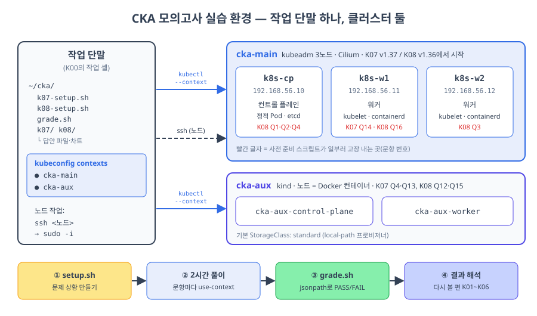

> **자격증 준비 · CKA** | 난이도 ★★★★★ | 예상 소요 시험 2시간 + 채점·복기 2시간

> ⚠️ **이 모의고사의 모든 문항은 CNCF가 공개한 CKA 커리큘럼(github.com/cncf/curriculum, 2026-11-15 확인 시 `CKA_Curriculum_v1.37.pdf`)의 5개 도메인을 바탕으로 이 시리즈가 직접 창작한 연습 과제입니다.** 실제 시험 문제나 유출 문제(덤프)가 아니고, 그런 것을 재현하지도 않습니다. Linux Foundation 시험은 응시 정책과 NDA로 보호되므로 "실제 출제 문제"라고 주장하는 자료는 믿지도, 퍼뜨리지도 마세요. 함정의 형태도 실제 시험을 옮긴 것이 아니라, 운영 중에 실제로 자주 겪는 실수를 모아 만든 것입니다.

> 💡 **실습 환경(K00 고정값).** `cka-main` = kubeadm 클러스터(k8s-cp/k8s-w1/k8s-w2, Cilium), `cka-aux` = kind 클러스터(cka-aux-control-plane/cka-aux-worker). 작업 단말은 두 context가 들어 있는 K00의 작업 셸, 스크립트와 답안 파일은 `~/cka/` 아래, 노드 작업은 `ssh <노드>` 후 `sudo -i`. **이 모의고사는 업그레이드 문항 때문에 K00의 v1.36 스냅샷 `k00-v136`에서 시작합니다**(K07은 `cka-clean`, v1.37).

## 🎯 오늘의 목표

- `kubectl`이 응답하지 않는 상태에서 **`crictl`과 로그만으로** 컨트롤 플레인을 살린다
- etcd 스냅숏을 복원하고, **복원 뒤에 무엇을 확인해야 "정상"인지** 스스로 판단한다
- PodDisruptionBudget 때문에 멈춘 drain을 **PDB를 지우지 않고** 풀면서 노드를 한 마이너 버전 업그레이드한다
- 한 문항의 조치가 다른 문항의 결과를 지우거나 막는 **연쇄 함정**을 시험 시작 5분 안에 읽어 내는 습관을 만든다

---

## 1. 시험 안내

### 1-1. 형식과 규칙

[K07](./k07-mock-exam-1.md)과 같습니다. 다른 점만 표시합니다.

| 항목 | 이 모의고사 | 비고 |
|---|---|---|
| 제한 시간 | **2시간** | 실제 시험과 같음(공식 페이지: 2시간, 온라인 감독, 실기) |
| 문항 수·배점 | 16문항, 합계 100점, 문항 단위 PASS/FAIL | 문항당 요구 사항이 2~3개씩 겹쳐 있음 |
| 합격 참고선 | 66점 | 공식 합격 점수는 Candidate Handbook에서 확인 |
| 출발 상태 | **cka-main의 API 서버가 응답하지 않음** | 그리고 current-context가 무엇인지는 직접 확인할 것 |
| 허용 문서 | kubernetes.io/docs, kubernetes.io/blog, helm.sh/docs, gateway-api.sigs.k8s.io | 실제 시험의 허용 목록과 같음. 이 시리즈·노트·검색 엔진 금지 |
| 버전 | cka-main을 K00의 **`k00-v136` 스냅샷(v1.36)** 으로 되돌려 시작 | Q16에서 v1.36 → v1.37(최신 패치, 예: v1.37.1)로 올림. 2026-11-15 기준 시험은 Kubernetes v1.37 |

시험 중 규칙:

1. **문항 머리의 `use-context` 명령을 건너뛰지 않습니다.** 이번에는 건너뛰면 조용히 다른 클러스터에서 성공합니다.
2. 노드 작업은 `ssh <노드>` → `sudo -i`, 끝나면 `exit`로 작업 단말에 돌아옵니다.
3. 셋업 스크립트는 시험이 끝난 뒤 읽으세요. 함정이 그대로 보입니다.
4. **어떤 문항은 다른 문항의 결과를 되돌리거나 막습니다.** 2절 표를 보고 순서를 먼저 정하세요. 순서를 정하는 것 자체가 문항입니다.
5. k8s-cp의 `/var/lib/k08-setup/`은 셋업·채점이 쓰는 폴더(비상 복구용 원본 포함)입니다. 시험 중 열어 보지 않습니다.



### 1-2. 준비와 진행 순서

준비 조건은 K07 1-2와 같고, 두 가지가 더 필요합니다.

- **Helm**이 작업 단말에 설치되어 있어야 합니다(`helm version`). 없으면 helm.sh/docs의 설치 안내(K02)대로 설치합니다.
- cka-main은 **K00의 `k00-v136` 스냅샷(v1.36)** 으로 되돌린 상태여야 합니다. v1.37이 현재 최신 마이너라 `cka-clean`(v1.37)에서는 "한 마이너 올리기"를 할 수 없기 때문입니다. 셋업은 `pkgs.k8s.io`에 다음 마이너 저장소가 있는지 확인하고, 없으면 멈춥니다. cka-aux는 K00 방식으로 새로 만들어 두세요.

```bash
# 작업 단말에서. 먼저 K00 방식으로 초기화:
#   vagrant snapshot restore k00-v136 --no-provision    (Vagrantfile 폴더)
#   bash ~/cka/reset-aux.sh                             (cka-aux 재생성)
mkdir -p ~/cka && cd ~/cka
vi k08-setup.sh        # 3절 내용 붙여 넣기 (LF)
bash k08-setup.sh      # 5~8분. k8s-w2를 NotReady로 만드는 단계에서 1~3분 기다림
```

```
[*] preflight ... base v1.36 -> target v1.37
[*] etcd client tools on k8s-cp ...
[*] Gateway API CRDs (v1.7.0) ...
[*] taking k8s-w2 out ...
[*] workloads on cka-main ...
[*] objects on cka-aux ...
[*] control plane chaos ...
[*] ready. Start the 2-hour timer now.
```

---

## 2. 문항 한눈에 보기

| # | context | 도메인 | 주제 | 배점 |
|---|---|---|---|---|
| Q1 | cka-main `[ssh k8s-cp]` | 트러블슈팅 | API 서버 정적 Pod 복구 | 8 |
| Q2 | cka-main `[ssh k8s-cp]` | 클러스터 아키텍처 | etcd 스냅숏 복원 + 상태 확인 | 7 |
| Q3 | cka-main `[ssh k8s-w2]` | 트러블슈팅 | kubelet이 뜨지 않는 노드 | 8 |
| Q4 | cka-main | 트러블슈팅 | 새 Pod가 모두 Pending | 7 |
| Q5 | cka-main | 클러스터 아키텍처 | 클러스터 범위 읽기 권한 | 5 |
| Q6 | cka-main | 클러스터 아키텍처 | Helm 로컬 차트 설치 | 5 |
| Q7 | cka-main | 서비스·네트워킹 | 엔드포인트는 있는데 응답 없는 Service | 5 |
| Q8 | cka-main | 서비스·네트워킹 | 기본 거부 아래 NetworkPolicy 열기 | 8 |
| Q9 | cka-main | 서비스·네트워킹 | 다른 네임스페이스 백엔드로 가중치 라우팅 | 7 |
| Q10 | cka-main | 워크로드·스케줄링 | HPA | 5 |
| Q11 | cka-main | 워크로드·스케줄링 | ConfigMap 변경 반영 | 5 |
| Q12 | **cka-aux** | 워크로드·스케줄링 | 모든 노드에 DaemonSet | 5 |
| Q13 | cka-main | 트러블슈팅 | 계속 재시작하는 Pod | 7 |
| Q14 | cka-main | 스토리지 | Pending PVC | 6 |
| Q15 | **cka-aux** | 스토리지 | 동적 PV 반환 정책 | 4 |
| Q16 | cka-main `[ssh k8s-cp, k8s-w1]` | 클러스터 아키텍처 | 한 마이너 업그레이드 + PDB | 8 |
| | | | **합계** | **100** |

도메인별 합계: 트러블슈팅 30(Q1·Q3·Q4·Q13) / 클러스터 아키텍처 25(Q2·Q5·Q6·Q16) / 서비스·네트워킹 20(Q7·Q8·Q9) / 워크로드·스케줄링 15(Q10·Q11·Q12) / 스토리지 10(Q14·Q15).

---

## 3. 사전 준비 스크립트

작업 단말에서 실행합니다. 노드 작업은 `ssh <노드> sudo ...`로 합니다. 마지막 단계에서 cka-main의 API 서버가 멈추므로, 스크립트가 끝난 뒤에는 cka-main에 kubectl이 통하지 않는 것이 정상입니다.

<details><summary>k08-setup.sh (작업 단말에서 실행 — 시험 후에 열어 보기)</summary>

```bash
#!/bin/bash
# k08-setup.sh -- CKA mock exam 2 (trap level) setup
# run on the work terminal (both contexts in kubeconfig, passwordless 'ssh <node> sudo')
set -euo pipefail

MAIN=${MAIN_CTX:-cka-main}
AUX=${AUX_CTX:-cka-aux}
WORK=~/cka/k08
GWAPI=${GWAPI_VERSION:-v1.7.0}
STATE=/var/lib/k08-setup            # on k8s-cp
MANI=/etc/kubernetes/manifests       # on k8s-cp

km() { kubectl --context "$MAIN" "$@"; }
ka() { kubectl --context "$AUX" "$@"; }
node_sh() {   # node_sh <node> <command...> : run a command as root on a node
  local n=$1; shift
  if [[ $(hostname -s) == "$n" ]]; then
    sudo bash -c "$*"
  else
    ssh -o BatchMode=yes -o ConnectTimeout=5 "$n" "sudo bash -c $(printf '%q' "$*")"
  fi
}
ensure_ns() { "$1" create namespace "$2" --dry-run=client -o yaml | "$1" apply -f - >/dev/null; }
wait_for() {  # wait_for <seconds> <command...> : retry every 5s until the command succeeds
  local t=$1; shift
  while (( t > 0 )); do "$@" >/dev/null 2>&1 && return 0; sleep 5; t=$((t - 5)); done
  return 1
}

# --- preflight ---------------------------------------------------------
for c in "$MAIN" "$AUX"; do
  kubectl config get-contexts "$c" >/dev/null 2>&1 || { echo "ERROR: context $c not found" >&2; exit 1; }
done
command -v helm >/dev/null || { echo "ERROR: helm is not installed" >&2; exit 1; }
km get nodes k8s-cp k8s-w1 k8s-w2 >/dev/null
ka get storageclass standard >/dev/null
for n in k8s-cp k8s-w1 k8s-w2; do
  node_sh "$n" true || { echo "ERROR: 'ssh $n sudo' must work without a password" >&2; exit 1; }
done
kv=$(km get node k8s-cp -o jsonpath='{.status.nodeInfo.kubeletVersion}')
minor=$(cut -d. -f2 <<<"$kv")
next=$((minor + 1))
curl -fsSL -o /dev/null "https://pkgs.k8s.io/core:/stable:/v1.${next}/deb/Release" || {
  echo "ERROR: packages for v1.${next} are not published. Restore cka-main from the k00-v136 snapshot (K00)." >&2; exit 1; }
echo "[*] preflight ... base v1.${minor} -> target v1.${next}"
node_sh k8s-cp "install -d -m 0700 $STATE && echo $minor > $STATE/base-minor"

echo "[*] etcd client tools on k8s-cp ..."
img=$(km -n kube-system get pod -l component=etcd -o jsonpath='{.items[0].spec.containers[0].image}')
ver=${img##*:}; ver="v${ver%%-*}"
node_sh k8s-cp "command -v etcdctl >/dev/null && command -v etcdutl >/dev/null && exit 0
  arch=\$(dpkg --print-architecture); tmp=\$(mktemp -d)
  curl -fsSL https://github.com/etcd-io/etcd/releases/download/${ver}/etcd-${ver}-linux-\$arch.tar.gz | tar xz -C \$tmp
  install -m 0755 \$tmp/etcd-${ver}-linux-\$arch/etcdctl \$tmp/etcd-${ver}-linux-\$arch/etcdutl /usr/local/bin/
  rm -rf \$tmp"
node_sh k8s-cp "mkdir -p /opt/k08 && rm -f /opt/k08/etcd-pre.db"
mkdir -p "$WORK"
rm -rf "$WORK/cruncher-reason.txt" "$WORK/charts"

echo "[*] Gateway API CRDs (${GWAPI}) ..."
if ! km get crd httproutes.gateway.networking.k8s.io >/dev/null 2>&1; then
  km apply --server-side -f "https://github.com/kubernetes-sigs/gateway-api/releases/download/${GWAPI}/standard-install.yaml" >/dev/null
  km wait --for=condition=Established --timeout=90s \
    crd/gateways.gateway.networking.k8s.io crd/httproutes.gateway.networking.k8s.io \
    crd/referencegrants.gateway.networking.k8s.io >/dev/null
fi

# --- k8s-w2: kubelet points at a kubeconfig that does not exist ----------
echo "[*] taking k8s-w2 out ..."
node_sh k8s-w2 'f=$(systemctl show -p DropInPaths --value kubelet | tr " " "\n" | grep 10-kubeadm.conf | head -1)
  test -n "$f" &&
  sed -i "s#--kubeconfig=/etc/kubernetes/kubelet.conf#--kubeconfig=/etc/kubernetes/kubelet.cnf#" "$f" &&
  grep -q kubelet.cnf "$f" && systemctl daemon-reload && systemctl restart kubelet' || {
  echo "ERROR: could not modify the kubelet drop-in on k8s-w2" >&2; exit 1; }
w2_not_ready() { [[ $(km get node k8s-w2 -o jsonpath='{.status.conditions[?(@.type=="Ready")].status}') != True ]]; }
wait_for 240 w2_not_ready || { echo "ERROR: k8s-w2 is still Ready" >&2; exit 1; }
km -n kube-system rollout restart deployment/coredns >/dev/null
km -n kube-system rollout status deployment/coredns --timeout=180s >/dev/null

# --- workloads on cka-main ---------------------------------------------
echo "[*] workloads on cka-main ..."
for ns in k08-ops k08-shop k08-net k08-gw k08-restore; do ensure_ns km "$ns"; done

km apply -f - >/dev/null <<'EOF'
apiVersion: v1
kind: ServiceAccount
metadata:
  name: auditor
  namespace: k08-ops
---
apiVersion: v1
kind: ConfigMap
metadata:
  name: marker
  namespace: k08-restore
data:
  token: k08-7f3a
---
apiVersion: apps/v1
kind: Deployment
metadata:
  name: cart
  namespace: k08-shop
spec:
  replicas: 2
  selector:
    matchLabels: {app: cart}
  template:
    metadata:
      labels: {app: cart}
    spec:
      containers:
      - name: nginx
        image: nginx:1.27-alpine
---
apiVersion: policy/v1
kind: PodDisruptionBudget
metadata:
  name: cart-pdb
  namespace: k08-shop
spec:
  minAvailable: 2
  selector:
    matchLabels: {app: cart}
---
apiVersion: apps/v1
kind: Deployment
metadata:
  name: web
  namespace: k08-shop
spec:
  replicas: 2
  selector:
    matchLabels: {app: web}
  template:
    metadata:
      labels: {app: web}
    spec:
      containers:
      - name: nginx
        image: nginx:1.27-alpine
---
apiVersion: v1
kind: ConfigMap
metadata:
  name: cfg-app
  namespace: k08-shop
data:
  MODE: staging
---
apiVersion: apps/v1
kind: Deployment
metadata:
  name: cfg-app
  namespace: k08-shop
spec:
  replicas: 2
  selector:
    matchLabels: {app: cfg-app}
  template:
    metadata:
      labels: {app: cfg-app}
    spec:
      containers:
      - name: nginx
        image: nginx:1.27-alpine
        env:
        - name: MODE
          valueFrom:
            configMapKeyRef:
              name: cfg-app
              key: MODE
---
apiVersion: apps/v1
kind: Deployment
metadata:
  name: pay
  namespace: k08-shop
spec:
  replicas: 1
  selector:
    matchLabels: {app: pay}
  template:
    metadata:
      labels: {app: pay}
    spec:
      containers:
      - name: pay
        image: busybox:1.37
        command: ["sh", "-c", "mkdir -p /www && echo pay-ok > /www/index.html && exec httpd -f -p 8080 -h /www"]
        ports:
        - containerPort: 80
---
apiVersion: v1
kind: Service
metadata:
  name: pay
  namespace: k08-shop
spec:
  selector: {app: pay}
  ports:
  - port: 80
    targetPort: 80
---
apiVersion: apps/v1
kind: Deployment
metadata:
  name: pay-canary
  namespace: k08-shop
spec:
  replicas: 1
  selector:
    matchLabels: {app: pay-canary}
  template:
    metadata:
      labels: {app: pay-canary}
    spec:
      containers:
      - name: pay
        image: busybox:1.37
        command: ["sh", "-c", "mkdir -p /www && echo canary-ok > /www/index.html && exec httpd -f -p 8080 -h /www"]
---
apiVersion: v1
kind: Service
metadata:
  name: pay-canary
  namespace: k08-shop
spec:
  selector: {app: pay-canary}
  ports:
  - port: 80
    targetPort: 8080
---
apiVersion: apps/v1
kind: Deployment
metadata:
  name: toolbox
  namespace: k08-shop
spec:
  replicas: 1
  selector:
    matchLabels: {app: toolbox}
  template:
    metadata:
      labels: {app: toolbox}
    spec:
      containers:
      - name: toolbox
        image: busybox:1.37
        command: ["sh", "-c", "sleep 604800"]
---
apiVersion: v1
kind: PersistentVolume
metadata:
  name: k08-pv
spec:
  capacity:
    storage: 1Gi
  accessModes: ["ReadWriteOnce"]
  persistentVolumeReclaimPolicy: Retain
  storageClassName: manual
  hostPath:
    path: /srv/k08-pv
    type: DirectoryOrCreate
---
apiVersion: v1
kind: PersistentVolumeClaim
metadata:
  name: data-pvc
  namespace: k08-shop
spec:
  accessModes: ["ReadWriteMany"]
  storageClassName: manual
  resources:
    requests:
      storage: 1Gi
---
apiVersion: apps/v1
kind: Deployment
metadata:
  name: ledger
  namespace: k08-shop
spec:
  replicas: 1
  selector:
    matchLabels: {app: ledger}
  template:
    metadata:
      labels: {app: ledger}
    spec:
      containers:
      - name: ledger
        image: busybox:1.37
        command: ["sh", "-c", "date >> /data/ledger.log; sleep 604800"]
        volumeMounts:
        - name: data
          mountPath: /data
      volumes:
      - name: data
        persistentVolumeClaim:
          claimName: data-pvc
---
apiVersion: apps/v1
kind: Deployment
metadata:
  name: cruncher
  namespace: k08-ops
spec:
  replicas: 1
  selector:
    matchLabels: {app: cruncher}
  template:
    metadata:
      labels: {app: cruncher}
    spec:
      containers:
      - name: stress
        image: polinux/stress
        command: ["stress"]
        args: ["--vm", "1", "--vm-bytes", "150M", "--vm-hang", "1"]
        resources:
          requests:
            memory: 50Mi
          limits:
            memory: 100Mi
---
apiVersion: apps/v1
kind: Deployment
metadata:
  name: backend
  namespace: k08-net
spec:
  replicas: 1
  selector:
    matchLabels: {app: backend}
  template:
    metadata:
      labels: {app: backend}
    spec:
      containers:
      - name: backend
        image: busybox:1.37
        command: ["sh", "-c", "mkdir -p /www && echo backend-ok > /www/index.html && exec httpd -f -p 8080 -h /www"]
        ports:
        - containerPort: 8080
---
apiVersion: v1
kind: Service
metadata:
  name: backend
  namespace: k08-net
spec:
  selector: {app: backend}
  ports:
  - port: 8080
    targetPort: 8080
---
apiVersion: apps/v1
kind: Deployment
metadata:
  name: frontend
  namespace: k08-net
spec:
  replicas: 1
  selector:
    matchLabels: {app: frontend}
  template:
    metadata:
      labels: {app: frontend}
    spec:
      containers:
      - name: frontend
        image: busybox:1.37
        command: ["sh", "-c", "sleep 604800"]
---
apiVersion: apps/v1
kind: Deployment
metadata:
  name: other
  namespace: k08-net
spec:
  replicas: 1
  selector:
    matchLabels: {app: other}
  template:
    metadata:
      labels: {app: other}
    spec:
      containers:
      - name: other
        image: busybox:1.37
        command: ["sh", "-c", "sleep 604800"]
---
apiVersion: networking.k8s.io/v1
kind: NetworkPolicy
metadata:
  name: default-deny
  namespace: k08-net
spec:
  podSelector: {}
  policyTypes: ["Ingress", "Egress"]
---
apiVersion: gateway.networking.k8s.io/v1
kind: GatewayClass
metadata:
  name: k08-class
spec:
  controllerName: example.com/k08-no-controller
---
apiVersion: gateway.networking.k8s.io/v1
kind: Gateway
metadata:
  name: shared-gw
  namespace: k08-gw
spec:
  gatewayClassName: k08-class
  listeners:
  - name: http
    protocol: HTTP
    port: 80
EOF

for d in k08-shop/cart k08-shop/web k08-shop/cfg-app k08-shop/pay k08-shop/pay-canary \
         k08-shop/toolbox k08-net/backend k08-net/frontend k08-net/other; do
  km -n "${d%%/*}" rollout status "deployment/${d##*/}" --timeout=240s >/dev/null
done

# helm chart (local directory)
mkdir -p "$WORK/charts/proxy/templates"
cat > "$WORK"/charts/proxy/Chart.yaml <<'EOF'
apiVersion: v2
name: proxy
description: small nginx proxy for the k08 mock exam
type: application
version: 0.1.0
appVersion: "1.26"
EOF
cat > "$WORK"/charts/proxy/values.yaml <<'EOF'
replicaCount: 1
image:
  repository: nginx
  tag: "1.26-alpine"
service:
  port: 80
EOF
cat > "$WORK"/charts/proxy/templates/deployment.yaml <<'EOF'
apiVersion: apps/v1
kind: Deployment
metadata:
  name: {{ .Release.Name }}
  labels:
    app: {{ .Release.Name }}
spec:
  replicas: {{ .Values.replicaCount }}
  selector:
    matchLabels:
      app: {{ .Release.Name }}
  template:
    metadata:
      labels:
        app: {{ .Release.Name }}
    spec:
      containers:
      - name: proxy
        image: "{{ .Values.image.repository }}:{{ .Values.image.tag }}"
        ports:
        - containerPort: 80
EOF
cat > "$WORK"/charts/proxy/templates/service.yaml <<'EOF'
apiVersion: v1
kind: Service
metadata:
  name: {{ .Release.Name }}
spec:
  selector:
    app: {{ .Release.Name }}
  ports:
  - port: {{ .Values.service.port }}
    targetPort: 80
EOF

# --- cka-aux -----------------------------------------------------------
echo "[*] objects on cka-aux ..."
ensure_ns ka k08-ops
ka apply -f - >/dev/null <<'EOF'
apiVersion: v1
kind: PersistentVolumeClaim
metadata:
  name: keep-me
  namespace: k08-ops
spec:
  accessModes: ["ReadWriteOnce"]
  storageClassName: standard
  resources:
    requests:
      storage: 100Mi
---
apiVersion: v1
kind: Pod
metadata:
  name: keep-me-user
  namespace: k08-ops
spec:
  containers:
  - name: app
    image: busybox:1.37
    command: ["sh", "-c", "echo keep > /data/keep.txt; sleep 604800"]
    volumeMounts:
    - name: data
      mountPath: /data
  volumes:
  - name: data
    persistentVolumeClaim:
      claimName: keep-me
EOF
keep_bound() { [[ $(ka -n k08-ops get pvc keep-me -o jsonpath='{.status.phase}') == Bound ]]; }
wait_for 180 keep_bound || { echo "ERROR: keep-me PVC did not bind on $AUX" >&2; exit 1; }
uid=$(ka -n k08-ops get pvc keep-me -o jsonpath='{.metadata.uid}')
node_sh k8s-cp "echo $uid > $STATE/keep-me.uid"

# --- control plane chaos -----------------------------------------------
echo "[*] control plane chaos ..."
node_sh k8s-cp "cp $MANI/kube-apiserver.yaml $MANI/kube-scheduler.yaml $STATE/"

node_sh k8s-cp "sed -i 's#--kubeconfig=/etc/kubernetes/scheduler.conf#--kubeconfig=/etc/kubernetes/scheduler-k08.conf#' $MANI/kube-scheduler.yaml &&
  grep -q scheduler-k08.conf $MANI/kube-scheduler.yaml"
sched_down() { [[ $(km -n kube-system get pod kube-scheduler-k8s-cp -o jsonpath='{.status.containerStatuses[0].ready}') != true ]]; }
wait_for 120 sched_down
sleep 10
km -n k08-ops create deployment queue --image=busybox:1.37 --replicas=2 -- sh -c 'sleep 604800' >/dev/null

node_sh k8s-cp "etcdctl --endpoints=https://127.0.0.1:2379 \
  --cacert=/etc/kubernetes/pki/etcd/ca.crt \
  --cert=/etc/kubernetes/pki/etcd/server.crt \
  --key=/etc/kubernetes/pki/etcd/server.key \
  snapshot save /opt/k08/etcd-pre.db" >/dev/null
km -n k08-restore delete configmap marker >/dev/null

kubectl config use-context "$AUX" >/dev/null
node_sh k8s-cp "sed -i 's#--tls-cert-file=/etc/kubernetes/pki/apiserver.crt#--tls-cert-file=/etc/kubernetes/pki/apiserver.cert#' $MANI/kube-apiserver.yaml &&
  grep -q 'apiserver.cert\$' $MANI/kube-apiserver.yaml"
echo "[*] ready. Start the 2-hour timer now."
```

</details>

> ⚠️ 연습을 포기하고 원래대로 돌리고 싶다면 K00의 스냅샷 복원이 가장 깔끔합니다. 급하면 k8s-cp에서 `sudo cp /var/lib/k08-setup/kube-*.yaml /etc/kubernetes/manifests/`로 두 정적 Pod만 되살릴 수 있습니다(나머지 함정은 그대로).

---

## 4. 문항

> 공통 조건: 파일 답안은 작업 단말의 `~/cka/k08/` 아래(etcd 스냅숏만 k8s-cp 노드의 `/opt/k08/`). 이름·네임스페이스·숫자는 문항에 적힌 그대로. **"삭제 금지", "수정하지 말고"는 채점 조건입니다.**

### Q1. API 서버 — 8점

```bash
kubectl config use-context cka-main
```

cka-main의 API 서버가 응답하지 않는다. `ssh k8s-cp`로 접속해 원인을 찾아 고쳐 `kubectl get nodes`가 다시 동작하게 하라. `/etc/kubernetes/manifests/`에는 원래 있던 4개 매니페스트 외에 **다른 파일을 남기지 않는다.**

### Q2. etcd 복원 — 7점

```bash
kubectl config use-context cka-main
```

누군가 실수로 `k08-restore` 네임스페이스의 ConfigMap `marker`를 지웠다. k8s-cp의 `/opt/k08/etcd-pre.db`는 삭제 직전에 찍은 스냅숏이다. 이 스냅숏으로 etcd를 복원해 `marker`를 되살려라. 복원 후 다음을 직접 확인하라.

- `marker`의 `data.token`이 다시 보인다
- etcd 엔드포인트 health가 정상이고, etcd·kube-apiserver·kube-controller-manager Pod가 Ready다
- **시험 종료 시점에도** `marker`가 남아 있어야 한다

> 복원은 스냅숏 시점 이후의 **모든** 클러스터 변경을 되돌린다는 점을 기억하라.

### Q3. 노드 k8s-w2 — 8점

```bash
kubectl config use-context cka-main
```

`k8s-w2`가 `NotReady`다. `ssh k8s-w2`로 접속해 kubelet이 뜨지 않는 원인을 찾아 고쳐라. 재부팅 후에도 Ready가 유지되어야 한다. kubelet 인증서나 노드를 다시 join하지 말고 **잘못된 설정만** 바로잡아라.

### Q4. 스케줄링이 멈췄다 — 7점

```bash
kubectl config use-context cka-main
```

`k08-ops`의 Deployment `queue`(replicas 2)의 Pod가 모두 `Pending`이고 이벤트에도 스케줄링 실패 메시지가 없다. 원인을 고쳐 두 Pod가 Running이 되게 하라. `queue`의 매니페스트는 수정하지 않는다.

### Q5. 감사 계정 — 5점

```bash
kubectl config use-context cka-main
```

`k08-ops`의 ServiceAccount `auditor`가 **노드 목록과 모든 네임스페이스의 Pod 목록을 조회(get, list, watch)** 할 수 있게 하라. ClusterRole과 바인딩의 이름은 둘 다 `node-auditor`. 그 외 권한(쓰기, Secret 조회 등)은 주지 않는다.

### Q6. Helm — 5점

```bash
kubectl config use-context cka-main
```

작업 단말의 `~/cka/k08/charts/proxy`에 로컬 차트가 있다. 이 차트를 릴리스 이름 `metrics-proxy`로 네임스페이스 `k08-tools`에 설치하라. 레플리카는 `2`, 이미지 태그는 `1.27-alpine`이어야 한다. **차트 파일은 수정하지 않는다.** (`k08-tools`는 아직 없다.)

### Q7. 응답 없는 Service — 5점

```bash
kubectl config use-context cka-main
```

`k08-shop`의 Service `pay`에는 엔드포인트가 잡혀 있는데 `http://pay`로 요청하면 연결이 거부된다. **Service 포트(80)와 Deployment는 그대로 두고** 고쳐, 같은 네임스페이스의 `toolbox` Pod에서 `wget -qO- http://pay`가 `pay-ok`를 돌려주게 하라.

### Q8. NetworkPolicy — 8점

```bash
kubectl config use-context cka-main
```

`k08-net`에는 모든 인그레스·이그레스를 막는 `default-deny`가 있다. **`default-deny`는 수정·삭제하지 말고** 정책을 추가해, `app=frontend` Pod가 **서비스 이름으로** `http://backend:8080`에 접속할 수 있게 하라. `app=other` Pod는 여전히 `backend`에 접속할 수 없어야 한다. 필요한 최소한만 연다.

### Q9. 가중치 라우팅 — 7점

```bash
kubectl config use-context cka-main
```

`k08-gw`의 Gateway `shared-gw`에 붙는 HTTPRoute `pay-route`를 **`k08-gw` 네임스페이스에** 만들어라. 호스트 `pay.k08.local`, 경로 접두사 `/api` 요청을 `k08-shop`의 Service `pay`(포트 80)에 **90**, `pay-canary`(포트 80)에 **10** 비율로 보낸다. 이 참조가 Gateway API 규칙상 **허용되도록** 필요한 리소스도 만들어라.

### Q10. HPA — 5점

```bash
kubectl config use-context cka-main
```

`k08-shop`의 Deployment `web`에 HorizontalPodAutoscaler `web`(autoscaling/v2)을 만들어라. 최소 2, 최대 6, 평균 CPU 사용률 목표 60%. **HPA가 실제로 CPU 사용률을 계산할 수 있도록** Deployment에 필요한 설정이 빠져 있다면 `cpu: 100m`으로 채워라.

### Q11. 설정 반영 — 5점

```bash
kubectl config use-context cka-main
```

`k08-shop`의 ConfigMap `cfg-app`의 `MODE`를 `prod`로 바꾸고, Deployment `cfg-app`의 **실행 중인 모든 Pod**가 환경 변수 `MODE=prod`를 갖게 하라. Deployment의 Pod 템플릿 내용(이미지, env 정의)은 바꾸지 않는다.

### Q12. DaemonSet — 5점

```bash
kubectl config use-context cka-aux
```

네임스페이스 `k08-ops`에 DaemonSet `node-agent`(이미지 `busybox:1.37`, 명령 `sleep 604800`)를 만들어 **컨트롤 플레인 노드를 포함한 이 클러스터의 모든 노드**에서 하나씩 Running이 되게 하라.

### Q13. 재시작 루프 — 7점

```bash
kubectl config use-context cka-main
```

`k08-ops`의 Deployment `cruncher`의 Pod가 계속 재시작한다. 마지막으로 종료된 이유(reason)를 `~/cka/k08/cruncher-reason.txt`에 그대로 한 단어로 저장하고, **명령과 인자는 바꾸지 말고** 메모리 limit을 `256Mi`로 바꿔 Pod가 안정적으로 Ready가 되게 하라.

### Q14. Pending PVC — 6점

```bash
kubectl config use-context cka-main
```

`k08-shop`의 PVC `data-pvc`가 `Pending`이라 Deployment `ledger`가 시작하지 못한다. **PV `k08-pv`는 수정하지 말고**, PVC 이름·용량(1Gi)·storageClassName은 유지한 채 `data-pvc`가 `k08-pv`에 Bound되고 `ledger`가 Ready가 되게 하라.

### Q15. 반환 정책 — 4점

```bash
kubectl config use-context cka-aux
```

`k08-ops`의 PVC `keep-me`에 동적으로 만들어진 PV는 PVC를 지우면 함께 삭제된다. **PVC를 다시 만들지 말고** 이 PV가 PVC 삭제 후에도 남도록(`Retain`) 바꿔라. StorageClass는 수정하지 않는다.

### Q16. 업그레이드 — 8점

```bash
kubectl config use-context cka-main
```

cka-main을 **한 마이너 버전 올려라**(v1.36.x → v1.37의 최신 패치, 2026-11-15 기준 v1.37.1). 이번 작업 범위는 컨트롤 플레인 `k8s-cp`와 워커 `k8s-w1`이며 `k8s-w2`는 다음 정기 점검 때 한다(버전 차이 허용 범위 안). 조건:

- 두 노드 모두 kubelet까지 새 버전, 작업 후 **스케줄 가능** 상태
- `k8s-shop`이 아닌 **`k08-shop`의 PDB `cart-pdb`는 수정·삭제 금지**, Deployment `cart`의 가용 Pod는 최종적으로 2개 이상
- 업그레이드 중 실행 중인 서비스가 PDB를 어기며 중단되지 않게 한다

---

## 5. 채점

### 5-1. 채점 절차

```bash
cd ~/cka
vi grade.sh      # 5-3 전문 붙여 넣기 (작업 단말)
bash grade.sh
```

```
== CKA mock exam 2 (k08) grading  2026-11-15 17:31 ==
Q01  PASS    8/  8  kube-apiserver static pod
Q02  FAIL    0/  7  etcd restore (marker survives)
Q03  PASS    8/  8  k8s-w2 kubelet
...
---------------------------------------------------
TOTAL: 58 / 100   (PASS 10, FAIL 6)
RESULT: below reference line (66)
```

### 5-2. 채점 체크리스트

| # | 검증 명령(context 생략 시 cka-main) | 기대 결과 |
|---|---|---|
| Q1 | `kubectl get --raw=/readyz`; `ls /etc/kubernetes/manifests` | `ok`; 파일 정확히 4개 |
| Q2 | `kubectl -n k08-restore get cm marker -o jsonpath='{.data.token}'`; `ssh k8s-cp sudo etcdctl ... endpoint health` | `k08-7f3a`; `is healthy` |
| Q3 | `kubectl get node k8s-w2`; `ssh k8s-w2 systemctl is-enabled kubelet` | Ready; enabled |
| Q4 | `kubectl -n kube-system get pod kube-scheduler-k8s-cp`; `kubectl -n k08-ops get deploy queue` | Running; `2/2` |
| Q5 | `kubectl auth can-i list nodes --as=system:serviceaccount:k08-ops:auditor` | `yes` (`delete pods`, `get secrets`는 `no`) |
| Q6 | `helm -n k08-tools list`; `kubectl -n k08-tools get deploy metrics-proxy -o wide` | deployed; `2/2`, `nginx:1.27-alpine` |
| Q7 | `kubectl -n k08-shop exec deploy/toolbox -- wget -qO- -T 3 http://pay` | `pay-ok` |
| Q8 | `kubectl -n k08-net exec deploy/frontend -- wget -qO- -T 3 http://backend:8080` / `deploy/other`에서 같은 명령 | `backend-ok` / 실패 |
| Q9 | `kubectl -n k08-gw get httproute pay-route -o yaml`; `kubectl -n k08-shop get referencegrant` | 백엔드 2개(90/10, ns k08-shop); HTTPRoute→Service 허용 |
| Q10 | `kubectl -n k08-shop get hpa web` | `cpu: <unknown>/60%` 또는 실제 값, MIN 2, MAX 6 |
| Q11 | `kubectl -n k08-shop exec deploy/cfg-app -- printenv MODE` | `prod` (모든 Pod) |
| Q12 | `kubectl --context cka-aux -n k08-ops get ds node-agent` | DESIRED = READY = 노드 수, cka-main에는 없음 |
| Q13 | `cat ~/cka/k08/cruncher-reason.txt`; `kubectl -n k08-ops get pod -l app=cruncher` | `OOMKilled`; Running, RESTARTS 0 |
| Q14 | `kubectl -n k08-shop get pvc data-pvc`; `kubectl -n k08-shop get deploy ledger` | Bound `k08-pv`; `1/1` |
| Q15 | `kubectl --context cka-aux get pv` | keep-me의 PV가 `Retain`, PVC는 처음 것 그대로 |
| Q16 | `kubectl get nodes`; `kubectl -n k08-shop get pdb cart-pdb` | k8s-cp·k8s-w1 새 버전, SchedulingDisabled 없음; MIN AVAILABLE 2 |

### 5-3. 자동 채점 스크립트 `grade.sh` 전문

```bash
#!/bin/bash
# grade.sh -- CKA mock exam 2 (k08) auto grader
# run on the work terminal, like k08-setup.sh. read-only.
MAIN=${MAIN_CTX:-cka-main}
AUX=${AUX_CTX:-cka-aux}
SCORE=0; MAX=0; NPASS=0; NFAIL=0

km() { kubectl --context "$MAIN" --request-timeout=15s "$@"; }
ka() { kubectl --context "$AUX" --request-timeout=15s "$@"; }
node_sh() {
  local n=$1; shift
  if [[ $(hostname -s) == "$n" ]]; then
    sudo bash -c "$*"
  else
    ssh -o BatchMode=yes -o ConnectTimeout=5 "$n" "sudo bash -c $(printf '%q' "$*")"
  fi
}
check() {   # check <no> <points> <title> <function>
  local no=$1 pts=$2 title=$3 fn=$4
  MAX=$((MAX + pts))
  if ( "$fn" ) >/dev/null 2>&1; then
    SCORE=$((SCORE + pts)); NPASS=$((NPASS + 1))
    printf 'Q%02d  PASS  %3d/%3d  %s\n' "$no" "$pts" "$pts" "$title"
  else
    NFAIL=$((NFAIL + 1))
    printf 'Q%02d  FAIL  %3d/%3d  %s\n' "$no" 0 "$pts" "$title"
  fi
}
jp() { "$1" "${@:2:$#-2}" -o jsonpath="${!#}"; }   # jp km -n ns get x y '{...}'
eq() { [[ "$1" == "$2" ]]; }
ready_cp() {  # ready_cp <component> : static pod of k8s-cp is Ready
  eq "$(jp km -n kube-system get pod "$1-k8s-cp" '{.status.conditions[?(@.type=="Ready")].status}')" True
}
node_ready() { eq "$(jp km get node "$1" '{.status.conditions[?(@.type=="Ready")].status}')" True; }

# --- checks ------------------------------------------------------------
q01() {
  node_sh k8s-cp 'grep -q -- "--tls-cert-file=/etc/kubernetes/pki/apiserver.crt$" /etc/kubernetes/manifests/kube-apiserver.yaml &&
                  [ "$(ls /etc/kubernetes/manifests | wc -l)" -eq 4 ]' &&
  eq "$(km get --raw=/readyz)" ok && ready_cp kube-apiserver
}

q02() {
  eq "$(jp km -n k08-restore get cm marker '{.data.token}')" k08-7f3a &&
  ready_cp etcd && ready_cp kube-apiserver && ready_cp kube-controller-manager &&
  node_sh k8s-cp 'etcdctl --endpoints=https://127.0.0.1:2379 --cacert=/etc/kubernetes/pki/etcd/ca.crt --cert=/etc/kubernetes/pki/etcd/server.crt --key=/etc/kubernetes/pki/etcd/server.key endpoint health'
}

q03() {
  node_ready k8s-w2 &&
  node_sh k8s-w2 '! grep -rqs kubelet.cnf /usr/lib/systemd/system/kubelet.service.d /etc/systemd/system/kubelet.service.d &&
                  systemctl is-enabled kubelet'
}

q04() {
  ready_cp kube-scheduler &&
  node_sh k8s-cp 'grep -q -- "--kubeconfig=/etc/kubernetes/scheduler.conf$" /etc/kubernetes/manifests/kube-scheduler.yaml' &&
  eq "$(jp km -n k08-ops get deploy queue '{.status.availableReplicas}')" 2
}

q05() {
  local sa=system:serviceaccount:k08-ops:auditor
  km get clusterrole node-auditor && km get clusterrolebinding node-auditor || return 1
  eq "$(km auth can-i list nodes --as="$sa")" yes &&
  eq "$(km auth can-i watch nodes --as="$sa")" yes &&
  eq "$(km auth can-i list pods -A --as="$sa")" yes &&
  eq "$(km auth can-i get pods -n kube-system --as="$sa")" yes &&
  eq "$(km auth can-i delete pods -n k08-ops --as="$sa")" no &&
  eq "$(km auth can-i get secrets -n kube-system --as="$sa")" no &&
  eq "$(km auth can-i patch nodes --as="$sa")" no
}

q06() {
  helm --kube-context "$MAIN" -n k08-tools list --deployed -q | grep -qx metrics-proxy &&
  eq "$(jp km -n k08-tools get deploy metrics-proxy '{.spec.replicas}|{.spec.template.spec.containers[0].image}|{.status.readyReplicas}')" '2|nginx:1.27-alpine|2' &&
  grep -q 'replicaCount: 1' ~/cka/k08/charts/proxy/values.yaml &&
  grep -q 'tag: "1.26-alpine"' ~/cka/k08/charts/proxy/values.yaml
}

q07() {
  eq "$(jp km -n k08-shop get svc pay '{.spec.ports[0].port}')" 80 &&
  eq "$(km -n k08-shop exec deploy/toolbox -- wget -qO- -T 3 http://pay)" pay-ok
}

q08() {
  eq "$(jp km -n k08-net get netpol default-deny '{.spec.podSelector}|{.spec.policyTypes[*]}')" '{}|Ingress Egress' &&
  eq "$(km -n k08-net exec deploy/frontend -- wget -qO- -T 3 http://backend:8080)" backend-ok &&
  ! km -n k08-net exec deploy/other -- wget -qO- -T 3 http://backend:8080 &&
  ! km -n k08-net exec deploy/other -- wget -qO- -T 3 "http://$(jp km -n k08-net get svc backend '{.spec.clusterIP}'):8080"
}

q09() {
  local r='{.spec.parentRefs[0].name}|{.spec.hostnames[0]}|{.spec.rules[0].matches[0].path.type}|{.spec.rules[0].matches[0].path.value}'
  local b want
  eq "$(jp km -n k08-gw get httproute pay-route "$r")" 'shared-gw|pay.k08.local|PathPrefix|/api' || return 1
  b=$(jp km -n k08-gw get httproute pay-route '{range .spec.rules[0].backendRefs[*]}{.name}:{.namespace}:{.port}:{.weight}{"\n"}{end}' | sort)
  want=$(printf 'pay-canary:k08-shop:80:10\npay:k08-shop:80:90')
  eq "$b" "$want" &&
  jp km -n k08-shop get referencegrants '{range .items[*]}{.spec.from[*].kind}/{.spec.from[*].namespace}/{.spec.to[*].kind}{"\n"}{end}' |
    grep -q '^HTTPRoute/k08-gw/Service$'
}

q10() {
  eq "$(jp km -n k08-shop get hpa.v2.autoscaling web '{.spec.scaleTargetRef.kind}/{.spec.scaleTargetRef.name}|{.spec.minReplicas}|{.spec.maxReplicas}|{.spec.metrics[0].resource.name}|{.spec.metrics[0].resource.target.type}|{.spec.metrics[0].resource.target.averageUtilization}')" \
     'Deployment/web|2|6|cpu|Utilization|60' &&
  eq "$(jp km -n k08-shop get deploy web '{.spec.template.spec.containers[0].resources.requests.cpu}')" 100m
}

q11() {
  local p n=0
  eq "$(jp km -n k08-shop get cm cfg-app '{.data.MODE}')" prod &&
  eq "$(jp km -n k08-shop get deploy cfg-app '{.spec.template.spec.containers[0].image}|{.spec.template.spec.containers[0].env[0].valueFrom.configMapKeyRef.name}')" 'nginx:1.27-alpine|cfg-app' || return 1
  for p in $(jp km -n k08-shop get pod -l app=cfg-app '{range .items[?(@.status.phase=="Running")]}{.metadata.name}{" "}{.metadata.deletionTimestamp}{"\n"}{end}' | awk 'NF==1'); do
    eq "$(km -n k08-shop exec "$p" -- printenv MODE)" prod || return 1
    n=$((n + 1))
  done
  (( n >= 2 ))
}

q12() {
  local nodes
  nodes=$(ka get nodes --no-headers | wc -l)
  eq "$(jp ka -n k08-ops get ds node-agent '{.status.desiredNumberScheduled}|{.status.numberReady}')" "${nodes}|${nodes}" &&
  ! km -n k08-ops get ds node-agent
}

q13() {
  grep -qx 'OOMKilled' <(tr -d '[:space:]' < ~/cka/k08/cruncher-reason.txt; echo) &&
  eq "$(jp km -n k08-ops get deploy cruncher '{.spec.template.spec.containers[0].resources.limits.memory}|{.spec.template.spec.containers[0].args[*]}')" '256Mi|--vm 1 --vm-bytes 150M --vm-hang 1' &&
  eq "$(jp km -n k08-ops get deploy cruncher '{.status.readyReplicas}')" 1 &&
  eq "$(jp km -n k08-ops get pod -l app=cruncher '{range .items[*]}{.status.containerStatuses[0].restartCount}{"\n"}{end}' | sort -u)" 0
}

q14() {
  eq "$(jp km get pv k08-pv '{.spec.capacity.storage}|{.spec.accessModes[*]}|{.spec.storageClassName}|{.spec.persistentVolumeReclaimPolicy}')" '1Gi|ReadWriteOnce|manual|Retain' &&
  eq "$(jp km -n k08-shop get pvc data-pvc '{.status.phase}|{.spec.volumeName}|{.spec.resources.requests.storage}|{.spec.storageClassName}')" 'Bound|k08-pv|1Gi|manual' &&
  eq "$(jp km -n k08-shop get deploy ledger '{.status.readyReplicas}')" 1
}

q15() {
  local pv
  pv=$(jp ka -n k08-ops get pvc keep-me '{.spec.volumeName}')
  [[ -n $pv ]] &&
  eq "$(jp ka -n k08-ops get pvc keep-me '{.metadata.uid}')" "$(node_sh k8s-cp 'cat /var/lib/k08-setup/keep-me.uid')" &&
  eq "$(jp ka get pv "$pv" '{.spec.persistentVolumeReclaimPolicy}')" Retain &&
  eq "$(jp ka get sc standard '{.reclaimPolicy}')" Delete
}

q16() {
  local base target n
  base=$(node_sh k8s-cp 'cat /var/lib/k08-setup/base-minor')
  target=$((base + 1))
  for n in k8s-cp k8s-w1; do
    [[ $(jp km get node "$n" '{.status.nodeInfo.kubeletVersion}') == v1.${target}.* ]] || return 1
    [[ -z $(jp km get node "$n" '{.spec.unschedulable}') ]] || return 1
    node_ready "$n" || return 1
  done
  [[ $(jp km -n kube-system get pod kube-apiserver-k8s-cp '{.spec.containers[0].image}') == *:v1.${target}.* ]] &&
  eq "$(jp km -n k08-shop get pdb cart-pdb '{.spec.minAvailable}')" 2 &&
  (( $(jp km -n k08-shop get deploy cart '{.status.availableReplicas}') >= 2 ))
}

# --- run ---------------------------------------------------------------
echo "== CKA mock exam 2 (k08) grading  $(date '+%F %H:%M') =="
check  1  8 "kube-apiserver static pod"        q01
check  2  7 "etcd restore (marker survives)"   q02
check  3  8 "k8s-w2 kubelet"                   q03
check  4  7 "kube-scheduler + queue"           q04
check  5  5 "ClusterRole node-auditor"         q05
check  6  5 "helm release metrics-proxy"       q06
check  7  5 "service pay targetPort"           q07
check  8  8 "netpol frontend->backend + DNS"   q08
check  9  7 "HTTPRoute split + ReferenceGrant" q09
check 10  5 "HPA web + cpu request"            q10
check 11  5 "ConfigMap change rolled out"      q11
check 12  5 "DaemonSet on cka-aux only"        q12
check 13  7 "OOMKilled cruncher"               q13
check 14  6 "PVC data-pvc bound"               q14
check 15  4 "Retain on dynamic PV"             q15
check 16  8 "upgrade k8s-cp + k8s-w1 with PDB" q16
echo "---------------------------------------------------"
printf 'TOTAL: %d / %d   (PASS %d, FAIL %d)\n' "$SCORE" "$MAX" "$NPASS" "$NFAIL"
if (( SCORE >= 66 )); then
  echo "RESULT: reference line (66) reached"
else
  echo "RESULT: below reference line (66)"
fi
```

> 💡 Q2 채점은 **시험이 끝난 시점**에 `marker`를 봅니다. 복원 직후 확인했을 때는 있었는데 채점에서 FAIL이라면, 그 뒤의 어떤 작업(대개 Q16)이 etcd 데이터를 되돌린 것입니다. 6-1 함정 지도의 Q2·Q16 줄을 보세요.

---

## 6. 풀이

### 6-1. 함정 지도

시험을 마친 뒤 먼저 이 표로 "어디에 함정이 있었는지"를 훑고, 아래 풀이를 보세요.

| 문항 | 숨은 함정 | 놓치면 |
|---|---|---|
| 시작 | current-context가 **cka-aux**로 바뀌어 있음. `kubectl get nodes`가 멀쩡히 동작해 "클러스터 정상"으로 착각 | 시간 낭비, 여러 문항을 엉뚱한 클러스터에 적용 |
| Q1 | kubectl이 안 되므로 `crictl ps -a`, `crictl logs`, `/var/log/pods`로 봐야 함 / 고치기 전 백업을 **manifests 폴더 안에** 남김 | Q1 (파일 4개 조건) |
| Q2 | 복원은 스냅숏 이후 변경을 **모두** 되돌림 → Q1 외의 작업을 먼저 하면 사라짐 | 먼저 푼 문항 전부 |
| Q2 ↔ Q16 | 복원을 "새 data-dir + etcd.yaml hostPath 변경"으로 하면, 나중에 `kubeadm upgrade apply`가 kubeadm 설정(`/var/lib/etcd`)으로 etcd 매니페스트를 다시 만들어 **복원 전 데이터로 돌아감** | Q2 (채점 시 marker 없음) |
| Q3 | 고친 뒤 `systemctl daemon-reload` 없이 restart → 옛 설정으로 계속 실패 | Q3 |
| Q3·Q4 → Q16 | k8s-w2가 NotReady이고 스케줄러가 죽어 있으면 drain으로 쫓겨난 Pod가 **갈 곳이 없어** PDB가 영원히 막음 | Q16 |
| Q4 | 스케줄러가 죽으면 Pod 이벤트가 **비어 있음**("FailedScheduling"조차 없음) → 노드·taint만 뒤지다 시간 소모 | Q4 |
| Q5 | 노드는 클러스터 범위 → Role/RoleBinding으로는 불가, ClusterRole + **ClusterRoleBinding** | Q5 |
| Q6 | current-context가 aux면 Helm도 aux에 설치 / `--create-namespace` 누락 / `--set tag=`처럼 키 경로 오류 | Q6 |
| Q7 | Deployment의 `containerPort: 80`은 **장식**. 프로세스는 8080에서 듣는 중 | Q7 |
| Q8 | 백엔드 인그레스 + 프런트 이그레스만 열고 **DNS(53/UDP·TCP) 이그레스**를 빠뜨림 → IP로는 되는데 이름으로는 안 됨 | Q8 |
| Q9 | 다른 네임스페이스 Service 참조는 **대상 네임스페이스(k08-shop)의 ReferenceGrant**가 있어야 허용 | Q9 |
| Q10 | 리소스 요청 없는 Deployment → HPA가 `<unknown>` | Q10 |
| Q11 | 환경 변수로 받은 ConfigMap은 **Pod 재생성 전까지 안 바뀜** → `rollout restart` | Q11 |
| Q12 | `k08-ops`가 **두 클러스터 모두에** 있어 잘못된 context에서도 조용히 성공 / 컨트롤 플레인 taint 톨러레이션 누락 | Q12 |
| Q14 | PVC의 accessModes는 **변경 불가** → 다시 만들어야 하는데, Pending Pod가 PVC를 쥐고 있어 **pvc-protection**으로 삭제가 `Terminating`에서 멈춤 | Q14 |
| Q15 | StorageClass의 reclaimPolicy를 바꿔도 **이미 만들어진 PV**는 그대로 / SC는 수정 금지 | Q15 |
| Q16 | PDB 삭제·`--disable-eviction`은 조건 위반 / uncordon 누락 / 워커는 `apply`가 아니라 `kubeadm upgrade node` / 저장소를 새 마이너로 바꾸지 않으면 패키지가 안 보임 | Q16 |

**권장 순서:** Q1 → Q2 → Q3 → Q4 → (Q5~Q15 자유) → Q16. 앞의 네 문항은 다른 문항의 전제 조건이고, Q2는 "되돌리는" 문항이라 일찍, Q16은 다른 모든 것이 정상인 상태에서 마지막에.

### 6-2. 문항별 풀이

<details><summary>풀이 — Q1. API 서버</summary>

```bash
kubectl config current-context                  # cka-aux  ← 함정 1
kubectl config use-context cka-main
kubectl get nodes                               # connection refused
ssh k8s-cp
sudo -i
crictl ps -a --name kube-apiserver              # Exited 가 반복
crictl logs $(crictl ps -a --name kube-apiserver -q | head -1) 2>&1 | tail -3
#   ... open /etc/kubernetes/pki/apiserver.cert: no such file or directory
ls /etc/kubernetes/pki/apiserver.*              # apiserver.crt 는 있음
vi /etc/kubernetes/manifests/kube-apiserver.yaml
#   --tls-cert-file=/etc/kubernetes/pki/apiserver.cert  →  apiserver.crt
watch -n2 'crictl ps --name kube-apiserver'     # Running 확인 (30~60초)
exit; exit                                      # 작업 단말로
kubectl get nodes
```

컨테이너가 너무 빨리 죽어 `crictl logs`가 비어 있으면 `sudo ls /var/log/pods/ | grep apiserver` 아래의 로그 파일이나 `journalctl -u kubelet | grep apiserver`를 봅니다.

**흔한 감점:** 매니페스트를 고치기 전 `cp kube-apiserver.yaml kube-apiserver.yaml.bak`을 **같은 폴더에** 두면 kubelet이 그 파일도 정적 Pod로 읽으려 합니다(같은 이름 충돌). 백업은 `/root/` 같은 다른 곳에. 그리고 `kubectl get nodes`가 처음부터 잘 되었다면 **current-context부터 의심**하세요.

📖 Tasks → Debug → Debug Cluster → Troubleshooting Clusters / Reference → Command line tools → crictl

</details>

<details><summary>풀이 — Q2. etcd 복원</summary>

K8s 문서는 복원 전에 API 서버를 멈추라고 권합니다. 여기서는 **원래 data-dir 자리에 복원**해 etcd 매니페스트를 건드리지 않는 방법을 씁니다(Q16과 충돌하지 않음).

```bash
kubectl config use-context cka-main
ssh k8s-cp
sudo -i
grep -E -- '--name=|--initial-advertise-peer-urls|--initial-cluster=|--data-dir' /etc/kubernetes/manifests/etcd.yaml
#   --name=k8s-cp  --initial-advertise-peer-urls=https://192.168.56.10:2380
#   --initial-cluster=k8s-cp=https://192.168.56.10:2380  --data-dir=/var/lib/etcd

# 1) API 서버와 etcd 정지 (매니페스트를 manifests 폴더 밖으로)
mkdir -p /root/k08-hold
mv /etc/kubernetes/manifests/kube-apiserver.yaml /etc/kubernetes/manifests/etcd.yaml /root/k08-hold/
watch -n2 'crictl ps | grep -E "etcd|kube-apiserver"'      # 둘 다 사라질 때까지

# 2) 기존 데이터 치우고 같은 자리에 복원 (etcd 3.6: etcdutl)
mv /var/lib/etcd /var/lib/etcd.before-restore
etcdutl snapshot restore /opt/k08/etcd-pre.db \
  --data-dir /var/lib/etcd \
  --name k8s-cp \
  --initial-cluster k8s-cp=https://192.168.56.10:2380 \
  --initial-advertise-peer-urls https://192.168.56.10:2380

# 3) 되돌려 놓고 확인
mv /root/k08-hold/etcd.yaml /root/k08-hold/kube-apiserver.yaml /etc/kubernetes/manifests/
systemctl restart kubelet
etcdctl --endpoints=https://127.0.0.1:2379 --cacert=/etc/kubernetes/pki/etcd/ca.crt \
  --cert=/etc/kubernetes/pki/etcd/server.crt --key=/etc/kubernetes/pki/etcd/server.key endpoint health
exit; exit                                                                  # 작업 단말로
kubectl -n k08-restore get cm marker -o jsonpath='{.data.token}{"\n"}'     # k08-7f3a
kubectl -n kube-system get pod -l tier=control-plane
kubectl get nodes
```

"복원 후 상태 확인"이 문항의 절반입니다. 컨트롤러 매니저·스케줄러는 etcd가 바뀐 것을 모른 채 캐시를 들고 있을 수 있으므로 문서는 이들(그리고 kubelet)을 재시작하라고 권합니다. 이번 셋업에서는 스케줄러가 이미 고장 나 있으니(Q4) "Running이 아닌 컨트롤 플레인 Pod"가 보여도 당황하지 말고 다음 문항으로 넘기면 됩니다.

**흔한 감점:**
- `etcdctl snapshot restore` — etcd 3.6에는 없습니다(`etcdutl`).
- 새 폴더(`/var/lib/etcd-restore`)에 복원하고 `etcd.yaml`의 hostPath만 바꾸는 방법도 지금은 동작합니다. 그러나 이 클러스터는 Q16에서 `kubeadm upgrade apply`를 하므로, kubeadm이 **kubeadm-config의 `etcd.local.dataDir`(/var/lib/etcd)** 를 기준으로 etcd 매니페스트를 다시 쓰면 복원 전 데이터로 돌아갑니다. 그 방법을 썼다면 `kubectl -n kube-system edit cm kubeadm-config`에서 `dataDir`도 맞춰야 합니다.
- etcd가 아직 떠 있는 채로 data-dir를 바꾸거나, 매니페스트를 `manifests/` 안에서 이름만 바꿔(`etcd.yaml.off`) 두는 것 — kubelet은 확장자와 상관없이 폴더의 파일을 읽습니다.

📖 Tasks → Administer a Cluster → Operating etcd clusters for Kubernetes (Restoring an etcd cluster)

</details>

<details><summary>풀이 — Q3. 노드 k8s-w2</summary>

```bash
kubectl config use-context cka-main
ssh k8s-w2
sudo -i
systemctl status kubelet --no-pager | head -5          # activating (auto-restart)
journalctl -u kubelet -n 20 --no-pager
#   ... failed to run Kubelet: unable to load bootstrap kubeconfig: stat /etc/kubernetes/bootstrap-kubelet.conf ...
systemctl cat kubelet | grep -n kubeconfig             # --kubeconfig=/etc/kubernetes/kubelet.cnf
ls /etc/kubernetes/                                     # kubelet.conf 는 그대로 있음
vi $(systemctl show -p DropInPaths --value kubelet | tr ' ' '\n' | grep 10-kubeadm)
#   kubelet.cnf → kubelet.conf
systemctl daemon-reload
systemctl restart kubelet
systemctl is-enabled kubelet
exit; exit
kubectl get nodes -w
```

**흔한 감점:** `daemon-reload`를 빼면 systemd는 수정 전 유닛을 계속 씁니다(`systemctl status`에 "changed on disk" 경고). 오류 메시지가 "bootstrap kubeconfig"를 말해서 `kubeadm join`을 다시 하거나 `kubelet.conf`를 `kubelet.cnf`로 복사하면 문항 조건 위반입니다 — **잘못된 경로를 가리키는 설정**을 고치세요. 드롭인 위치는 패키지 버전에 따라 `/usr/lib/systemd/system/kubelet.service.d/` 또는 `/etc/systemd/system/kubelet.service.d/`이므로 `systemctl cat kubelet`으로 찾는 습관을.

📖 Tasks → Debug → Debug Cluster → Troubleshooting kubeadm / Reference → Setup tools → kubeadm → Configuring each kubelet in your cluster using kubeadm

</details>

<details><summary>풀이 — Q4. 스케줄링이 멈췄다</summary>

```bash
kubectl config use-context cka-main
kubectl -n k08-ops get pod -l app=queue -o wide        # NODE <none>
kubectl -n k08-ops describe pod -l app=queue | tail -3 # Events: <none>  ← 스케줄러가 시도조차 안 함
kubectl -n kube-system get pod -l component=kube-scheduler   # CrashLoopBackOff
kubectl -n kube-system logs kube-scheduler-k8s-cp | tail -3
#   ... stat /etc/kubernetes/scheduler-k08.conf: no such file or directory
ssh -t k8s-cp sudo vi /etc/kubernetes/manifests/kube-scheduler.yaml   # 또는 ssh k8s-cp → sudo -i → vi
#   --kubeconfig=/etc/kubernetes/scheduler-k08.conf → /etc/kubernetes/scheduler.conf
kubectl -n kube-system get pod -l component=kube-scheduler -w
kubectl -n k08-ops get deploy queue
```

**흔한 감점:** "Pending + 이벤트 없음"을 taint나 리소스 부족으로 오해해 노드를 이리저리 고치는 것. 리소스·taint 문제라면 `FailedScheduling` 이벤트가 **반드시** 남습니다. 이벤트가 비었으면 스케줄러 자체를 보세요. `--authentication-kubeconfig`/`--authorization-kubeconfig` 줄은 원래대로이므로 건드릴 필요 없습니다.

📖 Tasks → Debug → Debug Cluster → Troubleshooting Clusters (control plane components)

</details>

<details><summary>풀이 — Q5. 감사 계정</summary>

```bash
kubectl config use-context cka-main
kubectl create clusterrole node-auditor --verb=get,list,watch --resource=nodes,pods
kubectl create clusterrolebinding node-auditor --clusterrole=node-auditor --serviceaccount=k08-ops:auditor
kubectl auth can-i list nodes --as=system:serviceaccount:k08-ops:auditor           # yes
kubectl auth can-i list pods -A --as=system:serviceaccount:k08-ops:auditor         # yes
kubectl auth can-i get secrets -n kube-system --as=system:serviceaccount:k08-ops:auditor   # no
```

**흔한 감점:** ClusterRole을 만들고 **RoleBinding**(`-n k08-ops`)으로 묶으면 Pod는 `k08-ops` 안에서만, 노드는 아예 안 됩니다(노드는 네임스페이스가 없음). 편하게 `view` ClusterRole을 바인딩하면 이름 조건도 틀리고 다른 리소스까지 열립니다.

📖 Reference → Access Authn/Authz → Using RBAC Authorization (ClusterRoleBinding)

</details>

<details><summary>풀이 — Q6. Helm</summary>

```bash
kubectl config use-context cka-main
cat ~/cka/k08/charts/proxy/values.yaml               # 키 경로 확인: replicaCount, image.tag
helm template metrics-proxy ~/cka/k08/charts/proxy --set replicaCount=2 --set image.tag=1.27-alpine | grep -E 'replicas|image:'
helm install metrics-proxy ~/cka/k08/charts/proxy \
  --namespace k08-tools --create-namespace \
  --set replicaCount=2 --set image.tag=1.27-alpine
helm -n k08-tools list
kubectl -n k08-tools get deploy metrics-proxy -o wide
```

**흔한 감점:** context를 바꾸지 않으면 Helm도 kubectl의 current-context(=cka-aux)에 설치합니다. `values.yaml`을 직접 고치면 "차트 수정 금지" 위반. `--set tag=1.27-alpine`은 오류 없이 **무시**되어 1.26 이미지가 깔립니다 — `helm template`으로 미리 렌더링해 보면 바로 잡힙니다.

📖 helm.sh/docs → Helm Commands → helm install

</details>

<details><summary>풀이 — Q7. 응답 없는 Service</summary>

```bash
kubectl config use-context cka-main
kubectl -n k08-shop get endpointslices -l kubernetes.io/service-name=pay    # 10.244.x.y:80
kubectl -n k08-shop exec deploy/toolbox -- wget -qO- -T 3 http://pay        # Connection refused
kubectl -n k08-shop get deploy pay -o jsonpath='{.spec.template.spec.containers[0].command}{"\n"}'
#   ... httpd -f -p 8080 ...   ← 실제로 듣는 포트
kubectl -n k08-shop exec deploy/pay -- netstat -tln      # :::8080 LISTEN
kubectl -n k08-shop patch svc pay -p '{"spec":{"ports":[{"port":80,"targetPort":8080}]}}'
kubectl -n k08-shop exec deploy/toolbox -- wget -qO- -T 3 http://pay        # pay-ok
```

**흔한 감점:** `containerPort`는 정보 표시일 뿐 실제로 포트를 열거나 바꾸지 않습니다. "엔드포인트 있음 + connection refused"는 거의 항상 **targetPort ↔ 실제 리스닝 포트** 불일치입니다(엔드포인트 없음은 셀렉터, timeout은 NetworkPolicy·라우팅을 먼저 의심).

📖 Tasks → Debug → Debug Applications → Debug Services

</details>

<details><summary>풀이 — Q8. NetworkPolicy</summary>

필요한 것은 세 방향입니다: ① frontend → DNS 이그레스 ② frontend → backend:8080 이그레스 ③ backend가 frontend에서 오는 8080 인그레스.

```yaml
apiVersion: networking.k8s.io/v1
kind: NetworkPolicy
metadata:
  name: frontend-egress
  namespace: k08-net
spec:
  podSelector:
    matchLabels:
      app: frontend
  policyTypes: ["Egress"]
  egress:
  - to:
    - namespaceSelector:
        matchLabels:
          kubernetes.io/metadata.name: kube-system
      podSelector:
        matchLabels:
          k8s-app: kube-dns
    ports:
    - protocol: UDP
      port: 53
    - protocol: TCP
      port: 53
  - to:
    - podSelector:
        matchLabels:
          app: backend
    ports:
    - protocol: TCP
      port: 8080
---
apiVersion: networking.k8s.io/v1
kind: NetworkPolicy
metadata:
  name: backend-ingress
  namespace: k08-net
spec:
  podSelector:
    matchLabels:
      app: backend
  policyTypes: ["Ingress"]
  ingress:
  - from:
    - podSelector:
        matchLabels:
          app: frontend
    ports:
    - protocol: TCP
      port: 8080
```

```bash
kubectl config use-context cka-main
kubectl apply -f q8.yaml
kubectl -n k08-net exec deploy/frontend -- wget -qO- -T 3 http://backend:8080     # backend-ok
kubectl -n k08-net exec deploy/other -- wget -qO- -T 3 http://backend:8080        # 실패해야 정상
```

**흔한 감점:** ②③만 만들면 `wget http://<ClusterIP>:8080`은 되는데 `http://backend:8080`은 `bad address 'backend'`로 실패합니다 — 이그레스가 기본 거부라 **DNS 질의 자체가 막힌** 것. DNS 규칙의 namespaceSelector와 podSelector는 **한 항목(AND)** 으로. `egress: [{}]`처럼 이그레스를 통째로 열면 "최소한만" 조건 위반이고, `default-deny`를 고치면 채점에서 바로 FAIL입니다. NetworkPolicy는 Service가 아니라 **Pod 포트(8080)** 기준이라는 점도 기억하세요.

📖 Concepts → Services, Load Balancing, and Networking → Network Policies / DNS for Services and Pods

</details>

<details><summary>풀이 — Q9. 가중치 라우팅</summary>

```yaml
apiVersion: gateway.networking.k8s.io/v1
kind: HTTPRoute
metadata:
  name: pay-route
  namespace: k08-gw
spec:
  parentRefs:
  - name: shared-gw
  hostnames:
  - pay.k08.local
  rules:
  - matches:
    - path:
        type: PathPrefix
        value: /api
    backendRefs:
    - name: pay
      namespace: k08-shop
      port: 80
      weight: 90
    - name: pay-canary
      namespace: k08-shop
      port: 80
      weight: 10
---
apiVersion: gateway.networking.k8s.io/v1
kind: ReferenceGrant
metadata:
  name: allow-k08-gw-routes
  namespace: k08-shop
spec:
  from:
  - group: gateway.networking.k8s.io
    kind: HTTPRoute
    namespace: k08-gw
  to:
  - group: ""
    kind: Service
```

```bash
kubectl config use-context cka-main
kubectl apply -f q9.yaml
kubectl -n k08-shop get referencegrant
```

**흔한 감점:** ReferenceGrant를 **HTTPRoute 쪽(k08-gw)** 에 만드는 실수 — 허락은 참조를 **받는** 쪽(k08-shop)이 합니다. `to`의 Service는 core 그룹이라 `group: ""`. 이 Gateway API 버전(v1.7.0)에서 ReferenceGrant는 `v1`로 제공되며 예전 예제의 `v1beta1`도 아직 서빙되지만, 설치된 CRD에서 확인하는 습관을: `kubectl api-resources | grep referencegrant`.

📖 gateway-api.sigs.k8s.io → API Types → ReferenceGrant / Guides → HTTP traffic splitting

</details>

<details><summary>풀이 — Q10. HPA</summary>

```bash
kubectl config use-context cka-main
kubectl -n k08-shop set resources deployment web --requests=cpu=100m
kubectl -n k08-shop autoscale deployment web --min=2 --max=6 --cpu=60%
kubectl -n k08-shop get hpa web
```

`--cpu=60%` 형식은 최신 kubectl 기준입니다. 예전 kubectl은 `--cpu-percent=60`을 씁니다(`kubectl autoscale --help`로 확인). YAML로 쓴다면:

```yaml
apiVersion: autoscaling/v2
kind: HorizontalPodAutoscaler
metadata:
  name: web
  namespace: k08-shop
spec:
  scaleTargetRef:
    apiVersion: apps/v1
    kind: Deployment
    name: web
  minReplicas: 2
  maxReplicas: 6
  metrics:
  - type: Resource
    resource:
      name: cpu
      target:
        type: Utilization
        averageUtilization: 60
```

**흔한 감점:** CPU **요청**이 없으면 사용률(%)의 분모가 없어 HPA가 영원히 `<unknown>`입니다. K00의 cka-main에는 metrics-server가 없으므로 설정이 맞아도 `<unknown>`이 보이는데, 그건 정상입니다(채점은 정의만). 실제 시험 클러스터에는 대개 metrics-server가 있으니 `kubectl top pods`로 확인하세요.

📖 Tasks → Run Applications → Horizontal Pod Autoscaling / HorizontalPodAutoscaler Walkthrough

</details>

<details><summary>풀이 — Q11. 설정 반영</summary>

```bash
kubectl config use-context cka-main
kubectl -n k08-shop patch configmap cfg-app -p '{"data":{"MODE":"prod"}}'
kubectl -n k08-shop exec deploy/cfg-app -- printenv MODE      # 아직 staging
kubectl -n k08-shop rollout restart deployment cfg-app
kubectl -n k08-shop rollout status deployment cfg-app
kubectl -n k08-shop get pod -l app=cfg-app -o name | xargs -I{} kubectl -n k08-shop exec {} -- printenv MODE
```

**흔한 감점:** 환경 변수는 **컨테이너 시작 시 한 번** 채워집니다. 볼륨으로 마운트한 ConfigMap은 (subPath가 아니면) 잠시 후 파일이 갱신되지만 env는 아닙니다. `rollout restart`는 템플릿에 재시작 시각 annotation만 추가하므로 "이미지·env 정의를 바꾸지 말라"는 조건을 지킵니다. Pod를 하나씩 `delete`해도 결과는 같지만 느리고 빠뜨리기 쉽습니다.

📖 Tasks → Configure Pods and Containers → Configure a Pod to Use a ConfigMap

</details>

<details><summary>풀이 — Q12. DaemonSet</summary>

```bash
kubectl config use-context cka-aux                        # ← 반드시
kubectl get nodes                                          # cka-aux-control-plane, cka-aux-worker
kubectl describe node cka-aux-control-plane | grep Taints   # node-role.kubernetes.io/control-plane:NoSchedule
kubectl -n k08-ops create deployment node-agent --image=busybox:1.37 --dry-run=client -o yaml -- sh -c 'sleep 604800' > q12.yaml
# kind: Deployment → DaemonSet, replicas·strategy·status 삭제, tolerations 추가
```

```yaml
apiVersion: apps/v1
kind: DaemonSet
metadata:
  name: node-agent
  namespace: k08-ops
spec:
  selector:
    matchLabels:
      app: node-agent
  template:
    metadata:
      labels:
        app: node-agent
    spec:
      tolerations:
      - key: node-role.kubernetes.io/control-plane
        operator: Exists
        effect: NoSchedule
      containers:
      - name: busybox
        image: busybox:1.37
        command: ["sh", "-c", "sleep 604800"]
```

```bash
kubectl apply -f q12.yaml
kubectl -n k08-ops get ds node-agent        # DESIRED = READY = 노드 수
```

**흔한 감점:** cka-main에서 만들어도 `k08-ops`가 있으니 **아무 오류 없이 성공**합니다 — 채점은 cka-main에 같은 DaemonSet이 있으면 FAIL로 봅니다. 잘못 만들었다면 지우세요. kind가 노드 1개(컨트롤 플레인만)라면 톨러레이션이 없을 때 DESIRED가 0이 되어 바로 티가 납니다.

📖 Concepts → Workloads → Workload Management → DaemonSet (Taints and tolerations)

</details>

<details><summary>풀이 — Q13. 재시작 루프</summary>

```bash
kubectl config use-context cka-main
kubectl -n k08-ops get pod -l app=cruncher                     # CrashLoopBackOff, RESTARTS 증가
kubectl -n k08-ops get pod -l app=cruncher \
  -o jsonpath='{.items[0].status.containerStatuses[0].lastState.terminated.reason}{"\n"}'   # OOMKilled
kubectl -n k08-ops get pod -l app=cruncher \
  -o jsonpath='{.items[0].status.containerStatuses[0].lastState.terminated.reason}' > ~/cka/k08/cruncher-reason.txt
kubectl -n k08-ops set resources deployment cruncher --limits=memory=256Mi
kubectl -n k08-ops rollout status deployment cruncher
kubectl -n k08-ops get pod -l app=cruncher                     # Running, RESTARTS 0
```

**흔한 감점:** `kubectl logs`만 보면 stress가 남긴 짧은 출력뿐이라 원인이 안 보입니다. 종료 이유는 **`lastState.terminated.reason`**(또는 `describe`의 Last State)에 있습니다. `--vm-bytes`를 줄이는 것은 "명령·인자 변경 금지" 위반. 파일에 `Reason: OOMKilled`처럼 다른 글자를 섞으면 FAIL — "한 단어로".

📖 Tasks → Configure Pods and Containers → Assign Memory Resources to Containers and Pods (Exceed a Container's memory limit)

</details>

<details><summary>풀이 — Q14. Pending PVC</summary>

```bash
kubectl config use-context cka-main
kubectl -n k08-shop describe pvc data-pvc | tail -3
#   no persistent volumes available for this claim and no storage class is set  (또는 비슷한 메시지)
kubectl get pv k08-pv -o jsonpath='{.spec.accessModes}{"\n"}'          # ["ReadWriteOnce"]
kubectl -n k08-shop get pvc data-pvc -o jsonpath='{.spec.accessModes}{"\n"}'   # ["ReadWriteMany"] ← 불일치
kubectl -n k08-shop get pvc data-pvc -o yaml > q14.yaml               # 백업

# accessModes는 바꿀 수 없음 → 다시 만들어야 함. 그런데 ledger Pod가 PVC를 쥐고 있음
kubectl -n k08-shop scale deployment ledger --replicas=0
kubectl -n k08-shop delete pvc data-pvc                               # 이제 바로 지워짐
cat <<'EOF' | kubectl apply -f -
apiVersion: v1
kind: PersistentVolumeClaim
metadata:
  name: data-pvc
  namespace: k08-shop
spec:
  accessModes: ["ReadWriteOnce"]
  storageClassName: manual
  resources:
    requests:
      storage: 1Gi
EOF
kubectl -n k08-shop scale deployment ledger --replicas=1
kubectl -n k08-shop get pvc data-pvc; kubectl -n k08-shop get deploy ledger
```

**흔한 감점:** Pod를 치우지 않고 `delete pvc`를 하면 `kubernetes.io/pvc-protection` finalizer 때문에 **Terminating에서 멈추고**, 같은 이름으로 새로 만들 수도 없습니다(이때 finalizer를 강제로 지우는 것은 데이터 사고의 지름길). PV를 RWX로 바꾸면 "PV 수정 금지" 위반이고, hostPath는 원래 RWX를 지원하지 않습니다.

📖 Concepts → Storage → Persistent Volumes (Access Modes, Storage Object in Use Protection)

</details>

<details><summary>풀이 — Q15. 반환 정책</summary>

```bash
kubectl config use-context cka-aux
PV=$(kubectl -n k08-ops get pvc keep-me -o jsonpath='{.spec.volumeName}')
kubectl get pv "$PV" -o jsonpath='{.spec.persistentVolumeReclaimPolicy}{"\n"}'     # Delete
kubectl patch pv "$PV" -p '{"spec":{"persistentVolumeReclaimPolicy":"Retain"}}'
kubectl get pv "$PV"
```

**흔한 감점:** StorageClass의 `reclaimPolicy`는 **새로 만들어질 PV**에만 적용되고, 이미 있는 PV는 그대로입니다(게다가 SC의 reclaimPolicy는 변경 불가 필드라 지우고 다시 만들어야 함 — 문항이 금지). PVC를 지웠다가 다시 만들면 UID가 바뀌어 FAIL이고, 그 순간 원래 PV는 Delete 정책으로 이미 사라집니다.

📖 Tasks → Administer a Cluster → Change the Reclaim Policy of a PersistentVolume

</details>

<details><summary>풀이 — Q16. 업그레이드</summary>

아래는 v1.36 → v1.37 예시입니다(2026-11-15 기준 v1.37 최신 패치는 v1.37.1). 실제 패치 버전은 `apt-cache madison`에 나온 값을 쓰세요. **Q2~Q4를 먼저 끝낸 상태**여야 합니다. 노드 안의 명령은 `sudo -i` 상태, kubectl은 작업 단말에서 실행합니다.

**① k8s-cp — kubeadm, 컨트롤 플레인**

```bash
kubectl config use-context cka-main       # 작업 단말
ssh k8s-cp
sudo -i
sed -i 's#/v1.36/#/v1.37/#' /etc/apt/sources.list.d/kubernetes.list
apt-get update
apt-cache madison kubeadm | head -3       # 예: 1.37.1-1.1
V=1.37.1-1.1
apt-mark unhold kubeadm && apt-get install -y kubeadm="$V" && apt-mark hold kubeadm
kubeadm version -o short
kubeadm upgrade plan
kubeadm upgrade apply v1.37.1
exit; exit                                # 작업 단말로
```

**② k8s-cp — kubelet·kubectl**

```bash
kubectl drain k8s-cp --ignore-daemonsets  # 작업 단말
ssh k8s-cp
sudo -i
V=1.37.1-1.1
apt-mark unhold kubelet kubectl && apt-get install -y kubelet="$V" kubectl="$V" && apt-mark hold kubelet kubectl
systemctl daemon-reload && systemctl restart kubelet
exit; exit
kubectl uncordon k8s-cp                   # 작업 단말
```

**③ k8s-w1 — PDB를 지키면서 drain**

```bash
kubectl -n k08-shop get pdb cart-pdb            # ALLOWED DISRUPTIONS 0  ← replicas 2, minAvailable 2
kubectl -n k08-shop scale deployment cart --replicas=3
kubectl -n k08-shop rollout status deployment cart
kubectl -n k08-shop get pdb cart-pdb            # ALLOWED DISRUPTIONS 1
kubectl drain k8s-w1 --ignore-daemonsets --delete-emptydir-data
```

```bash
ssh k8s-w1
sudo -i
sed -i 's#/v1.36/#/v1.37/#' /etc/apt/sources.list.d/kubernetes.list
apt-get update
V=1.37.1-1.1
apt-mark unhold kubeadm && apt-get install -y kubeadm="$V" && apt-mark hold kubeadm
kubeadm upgrade node
apt-mark unhold kubelet kubectl && apt-get install -y kubelet="$V" kubectl="$V" && apt-mark hold kubelet kubectl
systemctl daemon-reload && systemctl restart kubelet
exit; exit
```

```bash
kubectl uncordon k8s-w1
kubectl get nodes                               # k8s-cp, k8s-w1 v1.37.1 / k8s-w2 v1.36.x
kubectl -n k08-shop get deploy cart; kubectl -n k08-shop get pdb cart-pdb
kubectl -n k08-restore get cm marker            # Q2 결과가 살아 있는지 다시 확인
```

**흔한 감점:**
- drain이 `Cannot evict pod as it would violate the pod's disruption budget`를 무한 반복 — PDB를 지우거나 `--disable-eviction`(PDB 우회)을 쓰면 조건 위반. **레플리카를 늘려 허용 중단 수를 만드는 것**이 정석입니다. 늘린 Pod가 갈 곳이 있어야 하므로 k8s-w2(Q3)와 스케줄러(Q4)가 먼저 정상이어야 합니다.
- `kubeadm upgrade plan`의 상태 점검이 실패하면(예: 스케줄러가 죽어 점검용 Job이 뜨지 않음) 업그레이드가 시작되지 않습니다. 메시지를 읽고 원인 문항으로 돌아가세요.
- 워커에서 `kubeadm upgrade apply` — 워커와 추가 컨트롤 플레인은 **`kubeadm upgrade node`**.
- uncordon 누락(`SchedulingDisabled`)은 채점에서 FAIL. kubelet 재시작 전 `daemon-reload` 누락도 흔합니다.
- 저장소 파일을 바꾸지 않으면 `madison`에 새 마이너가 안 보입니다(`pkgs.k8s.io`는 마이너마다 저장소가 따로).

📖 Tasks → Administer a Cluster → Administration with kubeadm → Upgrading kubeadm clusters / Changing the Kubernetes package repository / Safely Drain a Node

</details>

---

## 7. 결과 해석

### 7-1. 점수대별 다음 행동

| 점수 | 해석 | 다음 행동 |
|---|---|---|
| 85~100 | 함정까지 읽어 냄 | killer.sh 시뮬레이터(응시 등록 시 2회 포함)로 실제 화면·속도에 적응 후 응시 |
| 66~84 | 합격권, 연쇄 함정에서 손해 | 6-1 함정 지도에서 놓친 줄만 골라 해당 편의 "자주 하는 실수" 다시 읽기 → 환경 초기화 후 재도전 |
| 40~65 | 개별 지식은 있으나 순서·검증 습관 부족 | K07을 90분 안에 다시 풀고, 이 모의고사는 **권장 순서를 지키며** 재도전 |
| 0~39 | 컨트롤 플레인 문항에서 막혀 시간 소진 | [K06 트러블슈팅](./k06-troubleshooting.md)과 [K01](./k01-cluster-install-upgrade-etcd.md)을 연습 과제까지 다시 |

### 7-2. 틀린 문항 → 다시 볼 편

| 틀린 문항 | 도메인 | 다시 볼 편 |
|---|---|---|
| Q2, Q16 | 클러스터 아키텍처 (etcd·업그레이드) | [K01 kubeadm 설치·업그레이드, etcd 백업·복원](./k01-cluster-install-upgrade-etcd.md) |
| Q5, Q6 | 클러스터 아키텍처 (RBAC·Helm) | [K02 RBAC, Helm·Kustomize, CRD·오퍼레이터](./k02-rbac-helm-kustomize-crd.md) |
| Q10, Q11, Q12 | 워크로드·스케줄링 | [K03 워크로드·스케줄링](./k03-workloads-scheduling.md) |
| Q7, Q8, Q9 | 서비스·네트워킹 | [K04 서비스·네트워킹](./k04-services-networking.md) |
| Q14, Q15 | 스토리지 | [K05 스토리지](./k05-storage.md) |
| Q1, Q3, Q4, Q13 | 트러블슈팅 | [K06 트러블슈팅](./k06-troubleshooting.md) |

> 💡 **같은 문항을 K07에서는 맞히고 K08에서 틀렸다면** 지식이 아니라 "조건 읽기"와 "순서" 문제입니다. 다음 시도 때는 시작 5분 동안 문항을 모두 훑고, 다른 문항에 영향을 주는 것(복원·업그레이드·노드·스케줄러)에 먼저 표시하세요.

---

## 트러블슈팅

| 증상 | 원인 | 해결 |
|---|---|---|
| 셋업이 `packages for v1.NN are not published`로 멈춤 | cka-main이 이미 최신 마이너(v1.37, `cka-clean`) | K00의 `k00-v136` 스냅샷으로 되돌린 뒤 재실행 |
| 셋업이 `k8s-w2 is still Ready`로 멈춤 | kubelet 드롭인 위치가 달라 수정이 안 됨 | `ssh k8s-w2 systemctl cat kubelet`으로 드롭인 경로 확인 후 그 파일을 원래대로 되돌리고 재실행 |
| 셋업 중 `keep-me PVC did not bind` | kind의 local-path 프로비저너가 이미지 pull 중 | `kubectl --context cka-aux -n local-path-storage get pod` 확인 후 재실행 |
| Q2 복원 후 `kubectl`이 계속 `connection refused` | apiserver 매니페스트를 `/root/k08-hold`에서 되돌려 놓지 않음 | `ls /etc/kubernetes/manifests`로 4개 확인 |
| Q2 복원 후 노드가 잠시 NotReady | 스냅숏 시점의 Lease·상태로 돌아갔다가 kubelet이 다시 보고하는 중 | 1~2분 기다리고 `kubectl get nodes` 재확인 |
| Q16 `kubeadm upgrade apply`가 etcd 단계에서 오래 걸림 | etcd 버전이 바뀌는 업그레이드 | 정상. 문서의 권고처럼 업그레이드 전 상태 점검을 마쳐 두면 실패가 줄어듦 |
| grade.sh Q12가 계속 FAIL인데 aux에는 잘 떠 있음 | cka-main에도 같은 DaemonSet을 만든 적이 있음 | `kubectl --context cka-main -n k08-ops delete ds node-agent` |

---

## 핵심 정리

- 시험 시작 직후 **`kubectl config current-context`** — 클러스터가 정상으로 보일수록 의심하세요.
- 컨트롤 플레인 정적 Pod는 **매니페스트 파일 = 진실**입니다. kubectl이 없을 땐 `crictl ps -a` → `crictl logs` → `/var/log/pods`, 백업은 manifests 폴더 **밖에**.
- etcd 복원은 "되살리기"이자 "되돌리기"입니다. **가장 먼저**, 그리고 **원래 data-dir 자리에** 복원하면 이후 kubeadm 업그레이드와도 충돌하지 않습니다. 복원 뒤엔 health·컨트롤 플레인 Pod·노드·대상 데이터를 차례로 확인.
- PDB가 drain을 막으면 PDB가 아니라 **가용성 여유(레플리카, 갈 곳 있는 노드)** 를 만드세요. uncordon까지가 업그레이드입니다.
- 기본 거부 NetworkPolicy 아래에서는 **DNS 이그레스가 1순위**입니다. "IP로는 되는데 이름으로는 안 된다"는 DNS 차단의 신호.
- 변경 불가 필드(PVC accessModes, SC reclaimPolicy)는 "다시 만들기"가 답이고, 다시 만들기 전에 **무엇이 그 객체를 쥐고 있는지**(Pod, finalizer)를 먼저 봅니다.

---

## ⏭️ 다음 단계 — CKS·CKAD로

K07·K08을 66점 이상으로 통과했다면 다음 갈래는 둘입니다.

- **CKS(Certified Kubernetes Security Specialist):** 이 시리즈의 RBAC·NetworkPolicy·etcd·업그레이드 문항을 **보안 관점**으로 확장합니다. 클러스터 하드닝(API 서버 플래그·감사 로그), Pod Security Admission, 이미지 취약점 스캔·서명, 런타임 탐지, Secret 암호화(at rest) 등이 다뤄집니다. CKS는 **유효한 CKA 자격이 응시 전제 조건**이라 이 탭의 자연스러운 다음 단계입니다.
- **CKAD(Certified Kubernetes Application Developer):** 클러스터 운영 대신 **애플리케이션 정의**에 집중합니다. 멀티 컨테이너 패턴, 프로브, Job/CronJob, Helm·Kustomize로 배포하기, 배포 전략(블루/그린·카나리)처럼 K03·K04에서 본 내용을 더 깊게 다룹니다.
- **확인 방법:** 두 시험 모두 커리큘럼과 Kubernetes 버전이 주기적으로 바뀝니다. 응시 전 Linux Foundation 공식 페이지와 github.com/cncf/curriculum에서 **반드시 직접 확인**하세요. 이 탭과 마찬가지로, 유출 문제가 아닌 공식 커리큘럼 기반 연습만이 실력이 됩니다.
