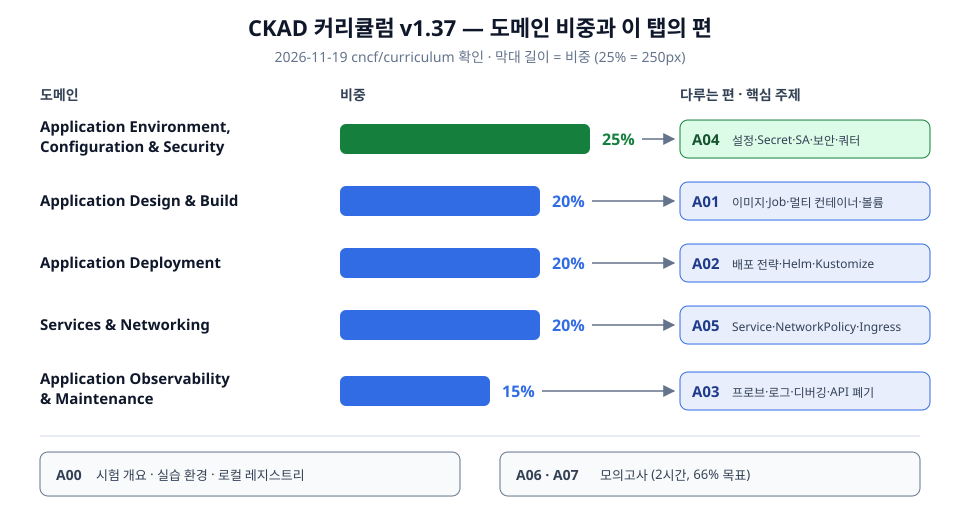
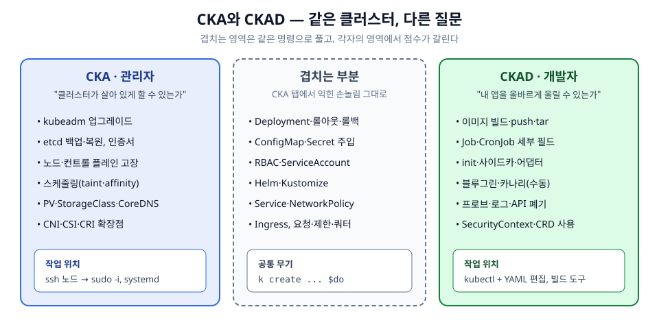
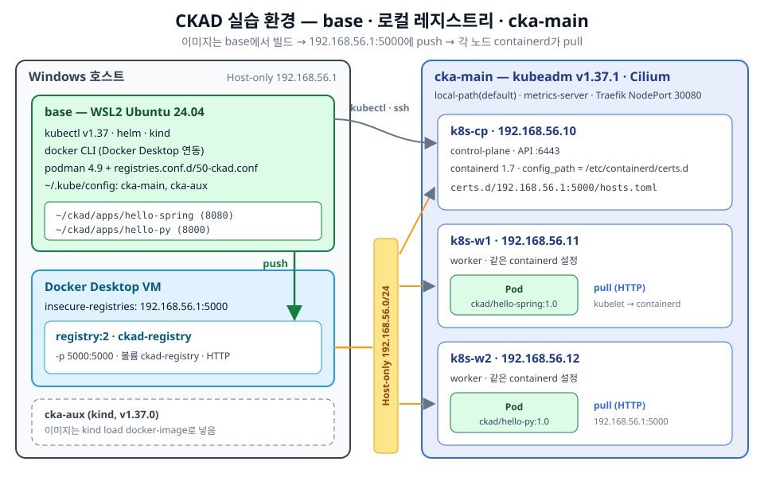

> **자격증 준비 · CKAD** | 난이도 ★★☆☆☆ | 예상 소요 2.5 ~ 3.5시간 (애드온·레지스트리 준비와 스냅샷 포함)

> ⚠️ **이 탭의 모든 연습 과제는 CNCF가 공개한 CKAD 공식 커리큘럼을 바탕으로 직접 만든 "시험 스타일" 과제입니다.** 실제 출제 문제나 유출 문제(덤프)가 아니며, 그런 자료를 재현하지도 않습니다. Linux Foundation 시험은 응시자가 시험 내용 비공개에 동의하고 치르므로, 실제 문제를 공유하거나 구하는 것은 정책 위반이고 자격 취소 사유입니다.

## 🎯 오늘의 목표

- CKAD가 **무엇을, 어떤 조건으로** 평가하는지 공식 페이지 기준으로 설명하고, CKA와 어떻게 다른지 말할 수 있다
- 커리큘럼 5개 도메인이 이 탭의 A01~A05, 본편 Day, CKA 탭의 어느 편과 이어지는지 지도를 그린다
- CKA 탭의 `cka-main` 클러스터를 재사용하되, 개발자 과제에 필요한 **애드온(metrics-server, local-path, Traefik)** 을 올려 둔다
- base(WSL2)에서 **Docker와 Podman** 으로 이미지를 만들고, **로컬 레지스트리 `registry:2`** 에 push한 이미지를 클러스터 노드가 pull하게 한다
- 이후 모든 편이 쓰는 **예제 앱 소스(Spring Boot·Python)** 를 정해진 위치에 두고, 스냅샷 **`ckad-clean`** 을 찍는다

---

## 1. CKAD는 어떤 시험인가?

CKAD(Certified Kubernetes Application Developer)는 쿠버네티스 위에 **애플리케이션을 설계·빌드·배포·운영하는 개발자**의 실기 시험입니다. CKA가 "클러스터를 세우고 고칠 수 있는가"를 묻는다면, CKAD는 "주어진 클러스터 위에 **내 앱을 제대로 올릴 수 있는가**"를 묻습니다. 노드에 들어가 kubelet을 고치는 일은 거의 없고, 대신 Pod 스펙 한 장 안에서 손이 바쁩니다.

2026-11-19에 다음 공식 자료를 확인한 결과입니다.

- Linux Foundation [CKAD 페이지](https://training.linuxfoundation.org/certification/certified-kubernetes-application-developer-ckad/)
- [CKA·CKAD·CKS FAQ](https://docs.linuxfoundation.org/tc-docs/certification/faq-cka-ckad-cks)
- [Important Instructions: CKA and CKAD](https://docs.linuxfoundation.org/tc-docs/certification/tips-cka-and-ckad)
- [허용 자료(Resources Allowed)](https://docs.linuxfoundation.org/tc-docs/certification/certification-resources-allowed)
- [cncf/curriculum](https://github.com/cncf/curriculum) 저장소의 `CKAD_Curriculum_v1.37.pdf`

| 항목 | 내용 (확인일 **2026-11-19**) | 출처 |
|---|---|---|
| 기준 Kubernetes 버전 | **v1.37**. 새 마이너 출시 후 **약 4~8주 안에** 시험 환경을 맞춤 | CKAD 페이지 |
| 형식 | **온라인 감독(proctored), 실기(performance-based)**. 명령줄로 과제 수행, 객관식 없음 | CKAD 페이지 |
| 과제 수 | **15~20개** | Important Instructions |
| 시험 시간 | **2시간** | CKAD 페이지, FAQ |
| 합격 점수 | **66% 이상** (CKA와 같음, CKS는 67%) | FAQ |
| 응시 자격 | 사전 자격 없음(CKA 불필요) | CKAD 페이지 |
| 재응시 | 등록 1건에 **재응시 1회 포함**. 등록 후 **12개월** 안에 응시 | CKAD 페이지, FAQ |
| killer.sh 시뮬레이터 | **2회** 포함, 회당 **36시간**(활성화 시점부터), 세션당 17문항, 채점 결과 제공. **`CKAD-SINGLE` 단독 등록 상품에는 미포함** | CKAD 페이지, FAQ |
| 시험 환경 | 원격 Linux 데스크톱. 과제마다 지정 호스트로 **`ssh <호스트>`**, 관리자 권한은 **`sudo -i`**. 호스트에 `kubectl`·**`k` alias·bash 자동완성**·`yq`·`curl`·`wget`·`man`. 과제를 끝내면 `exit`로 base 복귀, **중첩 ssh 미지원** | Important Instructions |
| 이미지 빌드 도구 | 공식 안내에 **Docker·Podman·Helm 설치 여부 명시 없음** → 과제가 요구하면 그 호스트에 있다고 보고, 시작하면 `which docker podman helm`으로 확인 | Important Instructions |
| 허용 문서 | `kubernetes.io/docs`, `kubernetes.io/blog`, **`helm.sh/docs`**, 과제의 **Quick Reference** 상자 링크. kubernetes.io 번역본도 허용(영문 권장). 검색창은 되지만 **외부 검색 결과를 열면 안 됨**. 터미널의 `/usr/share` 문서(man 페이지)와 배포판 패키지 사용 가능 | Resources Allowed |
| 자격 유효기간 | **2년** | CKAD 페이지 |
| 응시료 | 시험 단독 **$445** (교육 과정 번들 별도) | CKAD 페이지 |

> 💡 **CKA와 허용 문서가 다릅니다.** CKA에는 `gateway-api.sigs.k8s.io`가 있었지만 **CKAD 목록에는 없습니다.** CKAD 커리큘럼도 "Use **Ingress** rules to expose applications"라고 적혀 있습니다. Gateway API는 kubernetes.io의 개념 페이지로 버티고, Ingress를 우선 손에 익히세요(A05). `docs.docker.com`과 Podman 문서도 목록에 없으므로 이미지 빌드는 **`docker build --help`, `man podman-build`** 로 확인하는 습관을 들입니다(A01).

> ⚠️ 키보드·데스크톱 주의 사항(INSERT 키 금지, 탭 닫기 `Ctrl+Alt+W`, 복사·붙여넣기 `Ctrl+Shift+C/V`, base 재부팅 금지)은 CKA와 같습니다. [CKA K00 1장](../cka/k00-exam-overview-lab.md)을 보세요. 응시 직전에는 위 표 전체를 공식 페이지에서 다시 확인하세요. 몇 달 사이에 버전과 문구가 바뀝니다.

---

## 2. 커리큘럼 5개 도메인과 이 탭의 지도



| 비중 | 도메인 (커리큘럼 v1.37) | 다루는 편 |
|---|---|---|
| **25%** | Application Environment, Configuration and Security | [A04](./a04-environment-config-security.md) |
| **20%** | Application Design and Build | [A01](./a01-design-build.md) |
| **20%** | Application Deployment | [A02](./a02-deployment.md) |
| **20%** | Services and Networking | [A05](./a05-services-networking.md) |
| **15%** | Application Observability and Maintenance | [A03](./a03-observability-maintenance.md) |
| — | 종합 | [A06](./a06-mock-exam-1.md), [A07](./a07-mock-exam-2.md) 모의고사 |

### 2-1. 커리큘럼 항목 ↔ 탭 편 ↔ 본편 Day ↔ CKA 편

이론은 본편과 CKA 탭에서 이미 다뤘습니다. 이 탭은 **개발자 과제 형태로 손을 빠르게 만드는 것**에 집중하고, 개념은 아래 링크를 참조합니다.

| 도메인 | 커리큘럼 항목 (원문) | 탭 편 | 본편 Day | CKA 편 |
|---|---|---|---|---|
| Design & Build | Define, build and modify container images | A01 | [Day 02](../../01-docker/day02-image-layers.md), [Day 03](../../01-docker/day03-dockerfile.md) | — |
| | Choose and use the right workload resource (Deployment, DaemonSet, CronJob, etc.) | A01 | [Day 11](../../02-kubernetes/day11-deployment.md) | [K03](../cka/k03-workloads-scheduling.md) |
| | Understand multi-container Pod design patterns (e.g. sidecar, init and others) | A01 | [Day 10](../../02-kubernetes/day10-pod.md) | K03 4-6 |
| | Utilize persistent and ephemeral volumes | A01 | [Day 04](../../01-docker/day04-volumes.md), [Day 14](../../02-kubernetes/day14-storage.md) | [K05](../cka/k05-storage.md) |
| Deployment | Use Kubernetes primitives to implement common deployment strategies (e.g. blue/green or canary) | A02 | [Day 56](../../07-gitops/day56-argo-rollouts.md)(개념) | — |
| | Understand Deployments and how to perform rolling updates | A02 | Day 11 | K03 |
| | Use the Helm package manager to deploy existing packages | A02 | [Day 16](../../02-kubernetes/day16-helm.md) | [K02](../cka/k02-rbac-helm-kustomize-crd.md) |
| | Kustomize | A02 | [Day 52](../../07-gitops/day52-kustomize.md) | K02 |
| Observability & Maintenance | Understand API deprecations | A03 | — | — |
| | Implement probes and health checks | A03 | Day 10 | — |
| | Use built-in CLI tools to monitor Kubernetes applications | A03 | [Day 17](../../02-kubernetes/day17-monitoring.md) | [K06](../cka/k06-troubleshooting.md) |
| | Utilize container logs | A03 | Day 10 | K06 |
| | Debugging in Kubernetes | A03 | Day 10, Day 11 | K06 |
| Environment, Config & Security | Discover and use resources that extend Kubernetes (CRD, Operators) | A04 | — | K02 |
| | Understand authentication, authorization and admission control | A04 | [Day 19](../../02-kubernetes/day19-rbac-namespace.md) | K02 |
| | Understand requests, limits, quotas / Define resource requirements | A04 | [Day 18](../../02-kubernetes/day18-autoscaling.md) | K03 |
| | Understand ConfigMaps / Create & consume Secrets | A04 | [Day 13](../../02-kubernetes/day13-configmap-secret.md) | K03 |
| | Understand ServiceAccounts | A04 | Day 19 | K02 |
| | Understand Application Security (SecurityContexts, Capabilities, etc.) | A04 | [Day 69](../../09-security/day69-k8s-workload-security.md) | — |
| Services & Networking | Demonstrate basic understanding of NetworkPolicies | A05 | Day 19, [Day 70](../../09-security/day70-networkpolicy-zero-trust.md) | [K04](../cka/k04-services-networking.md) |
| | Provide and troubleshoot access to applications via services | A05 | [Day 12](../../02-kubernetes/day12-service.md) | K04 |
| | Use Ingress rules to expose applications | A05 | [Day 15](../../02-kubernetes/day15-ingress.md) | K04 |

> 💡 커리큘럼 원문의 "API **depreciations**"는 deprecations의 오타로 보입니다. PDF에 그렇게 적혀 있어 그대로 옮겼습니다.

목표 편(A01~A05)은 CKA 탭과 같은 순서로 구성됩니다.

1. **커리큘럼 항목 요약**
2. **출제 유형** — 과제가 어떤 모양이고, 무엇이 채점되는지
3. **핵심 명령·매니페스트 표** — 명령형 `kubectl create/run ... $do` 위주
4. **시간 절약 팁**, **자주 하는 실수**
5. **창작 연습 과제 6~10개** — `<details>`를 열면 풀이와 **검증 명령**, 그리고 "📖 시험장에서 찾을 문서"
6. **핵심 정리**, 다음 편 예고

### 2-2. CKA와 CKAD — 관리자 vs 개발자



| 구분 | CKA (관리자) | CKAD (개발자) |
|---|---|---|
| 질문 | "클러스터가 살아 있게 할 수 있는가" | "내 앱을 올바르게 올릴 수 있는가" |
| 주 작업 위치 | 노드 ssh → `sudo -i`, `/etc/kubernetes`, systemd | 지정 호스트의 `kubectl`, 그리고 **YAML 편집기** |
| 단골 과제 | 업그레이드, etcd 백업·복원, 노드·컨트롤 플레인 고장 | 이미지 빌드, Job/CronJob, 멀티 컨테이너, 프로브, 배포 전략, ConfigMap/Secret, SecurityContext |
| 비중 큰 도메인 | Troubleshooting 30% | Environment·Config·Security 25% |
| 겹치는 부분 | RBAC, Helm·Kustomize, Deployment·롤백, Service·NetworkPolicy, Ingress | 같음 — **같은 명령, 다른 질문** |
| 시간 압박 | 오래 걸리는 과제 몇 개(업그레이드) | **짧은 과제가 많음** — 과제당 5~6분, 손 속도 싸움 |
| 허용 문서 추가분 | `helm.sh/docs`, `gateway-api.sigs.k8s.io` | `helm.sh/docs`만 |

> 💡 CKA를 먼저 끝냈다면 CKAD 범위의 절반은 이미 손에 있습니다. 새로 익힐 것은 **이미지 빌드, Job/CronJob 세부 필드, 수동 블루그린·카나리, 프로브, API 폐기 대응, SecurityContext** 정도입니다. 이 탭은 거기에 시간을 씁니다.

---

## 3. 3주 학습 계획

하루 1~2시간 기준입니다. Chapter 2(Day 08~20)와 CKA K00·K01을 끝냈다는 전제입니다(실습 클러스터가 있어야 함).

| 주차 | 범위 | 핵심 | 주말 점검 |
|---|---|---|---|
| 1주 | A00, A01, A02 | 실습 환경, **이미지 빌드→push→Pod 실행 3분 안에**, Job/CronJob 필드, 사이드카, 롤링·블루그린·카나리, Helm·Kustomize | A01·A02 과제를 문서만 보고 과제당 6분 |
| 2주 | A03, A04, A05 | 프로브·로그·디버깅, ConfigMap/Secret·SecurityContext·쿼터, Service·NetworkPolicy·Ingress | 25% 도메인(A04) 과제 무작위 8개 |
| 3주 | A06, A07, killer.sh | 모의고사 2회 → 틀린 편 재풀이 → killer.sh 1회차 → 약점 → 2회차 | 2시간 타이머, 66% 이상 |

💡 공부 방법:

- **스냅샷 복원 → 과제 → 검증.** 편을 시작할 때마다 `ckad-clean`으로 되돌리면 앞 편의 잔여물이 채점을 흐리지 않습니다.
- **문서 찾기도 연습 대상.** 각 과제의 "📖" 표시를 보고 kubernetes.io 검색창으로 **실제로 그 페이지를 찾아가는** 연습을 같이 하세요. CKAD는 예제 YAML 복사가 특히 잘 통하는 시험입니다(Job, CronJob, 사이드카, 프로브, SecurityContext, NetworkPolicy 모두 문서에 거의 그대로 있는 예제가 있음).
- **killer.sh는 3주 차에.** 회당 36시간, 2회뿐입니다. A06·A07까지 끝낸 뒤 쓰세요.

---

## 4. 시험 환경 팁 — CKA와 다른 것만

셸 준비(`k` alias, 자동완성, `$do`, `$now`), vim 설정(`expandtab ts=2 sw=2`), 호스트·context 확인 루틴, 시간 배분 원칙은 [CKA K00 4장](../cka/k00-exam-overview-lab.md)과 똑같습니다. 그대로 쓰세요. CKAD에서 더 신경 쓸 것만 적습니다.

| 원칙 | 구체적으로 |
|---|---|
| **네임스페이스를 첫 줄에** | CKAD 과제는 거의 모두 특정 네임스페이스를 지정합니다. `k config set-context --current --namespace=<ns>`로 바꾸거나, 명령마다 `-n <ns>`. 네임스페이스가 틀리면 0점 |
| **결과물 파일 경로를 정확히** | "YAML을 `<경로>`에 저장하라", "로그를 `<경로>`에 저장하라", "이미지를 tar로 `<경로>`에" 같은 요구가 흔합니다. 경로 한 글자 틀리면 0점 |
| **수정 불가 필드는 replace** | Pod의 대부분 필드는 수정할 수 없습니다. `k get pod x -o yaml > x.yaml` → 고치기 → `k replace --force -f x.yaml` |
| **이미지 과제는 도구부터** | `which docker podman` → 있는 쪽으로. Podman은 보통 `sudo podman`일 수 있으니 과제 문장을 보고 판단 |
| **과제당 5~6분** | 120분 ÷ 15~20개. CKAD는 짧은 과제가 많아 **막히면 즉시 표시하고 넘어가기**가 더 중요 |

```bash
# CKAD에서 특히 자주 쓰는 확인 명령
k explain pod.spec.containers.livenessProbe        # 필드 이름이 기억 안 날 때
k explain cronjob.spec --recursive | less          # 전체 트리
k api-resources | grep -i <키워드>                  # 리소스 이름·약어·그룹
k get <리소스> -o yaml | yq '.spec.template.spec'   # yq로 필요한 부분만
```

---

## 5. 실습 환경 — CKA 환경을 재사용한다



CKAD용 클러스터를 새로 만들지 않습니다. CKA 탭에서 만든 것을 **그대로** 씁니다.

| 이미 있어야 하는 것 | 만든 곳 |
|---|---|
| `cka-main`(kubeadm **v1.37.1**, 3노드, Cilium) | [K00 6장](../cka/k00-exam-overview-lab.md) → [K01](../cka/k01-cluster-install-upgrade-etcd.md)에서 v1.37 업그레이드 → 스냅샷 `cka-clean` |
| `cka-aux`(kind v0.33.0) | K00 6-5 |
| base(WSL2 Ubuntu 24.04)의 kubectl v1.37·helm·kind, `~/.ssh/config`의 노드 별칭, `~/.bashrc`의 alias | K00 6-3, 4-1 |
| Docker Desktop의 WSL integration(base에서 `docker` 사용) | K00 6-3 |

> 💡 CKA 탭을 건너뛰고 왔다면 K00 6장과 K01 4장(업그레이드)을 먼저 하세요. K01 업그레이드가 귀찮다면 K00 6-2의 **방법 C**(`K8S_MINOR=v1.37`로 바로 설치)도 됩니다. 마지막에 스냅샷 `cka-clean`만 찍어 두면 이 편을 이어갈 수 있습니다.

### 5-1. 출발점 — `cka-clean`으로 되돌리기

```powershell
# Windows PowerShell
cd C:\lab\k8s
vagrant halt
vagrant snapshot restore cka-clean --no-provision
```

```bash
# base(WSL2)
k config use-context cka-main
k get nodes        # k8s-cp / k8s-w1 / k8s-w2 모두 Ready, v1.37.x
mkdir -p ~/ckad && cd ~/ckad
```

### 5-2. 애드온 세 가지 — CKA 편의 설치를 한 번에

`cka-clean`에는 기본 StorageClass, metrics-server, Ingress 컨트롤러가 **없습니다**(CKA K03~K05에서 각각 설치했지만 스냅샷 이후의 일). CKAD 과제는 PVC(A01), `kubectl top`(A03), Ingress·Gateway(A05)를 모두 쓰므로 여기서 한꺼번에 올리고 `ckad-clean`에 포함합니다. 설명은 각 편을 보고, 여기서는 명령만 그대로 옮깁니다(base에서 실행).

```bash
# ① local-path-provisioner v0.0.37 + 기본 StorageClass  (설명: CKA K05 0장)
kubectl apply -f https://raw.githubusercontent.com/rancher/local-path-provisioner/v0.0.37/deploy/local-path-storage.yaml
kubectl -n local-path-storage rollout status deploy/local-path-provisioner
kubectl patch storageclass local-path \
  -p '{"metadata":{"annotations":{"storageclass.kubernetes.io/is-default-class":"true"}}}'

# ② metrics-server (학습 환경이라 --kubelet-insecure-tls)  (설명: CKA K03 4-3)
kubectl apply -f https://github.com/kubernetes-sigs/metrics-server/releases/latest/download/components.yaml
kubectl -n kube-system patch deployment metrics-server --type=json \
  -p '[{"op":"add","path":"/spec/template/spec/containers/0/args/-","value":"--kubelet-insecure-tls"}]'
kubectl -n kube-system rollout status deploy/metrics-server
```

③ **Gateway API CRD v1.6.3 + Traefik 차트 42.4.0**은 [CKA K04 1장의 "Gateway API CRD + Traefik 준비"](../cka/k04-services-networking.md) 코드 블록을 `~/ckad/` 폴더에서 **그대로** 실행합니다(`traefik-values.yaml` 작성 → `helm install traefik ...`). 결과로 IngressClass·GatewayClass `traefik`, Gateway `traefik/traefik-gateway`, HTTP NodePort **30080**이 생깁니다.

```bash
kubectl get sc                          # local-path (default)
kubectl top nodes                       # 세 노드 수치가 보이면 OK (1분쯤 걸릴 수 있음)
kubectl get ingressclass,gatewayclass   # traefik
curl -s -o /dev/null -w '%{http_code}\n' http://192.168.56.11:30080/   # 404 = Traefik 응답
```

---

## 6. base에 이미지 도구 준비 — Docker와 Podman

시험의 이미지 과제는 "주어진 Dockerfile로 이미지를 만들고 태그를 붙여 저장하라 / 레지스트리에 올려라 / tar로 내보내라" 같은 모양입니다. 공식 안내에 어떤 도구가 있는지 적혀 있지 않으므로, **둘 다 같은 손놀림으로** 할 수 있게 준비합니다. 명령은 거의 같습니다(`docker build` ↔ `podman build`).

| 도구 | base에서 | 버전 확인 | 비고 |
|---|---|---|---|
| Docker | Docker Desktop의 WSL integration (K00에서 켬) | `docker version --format '{{.Server.Version}}'` | 데몬은 Docker Desktop VM. 게시한 포트는 **Windows 호스트**에 열림 |
| Podman | Ubuntu 24.04 apt 패키지 | `podman --version` (4.9.x) | 데몬 없음, rootless. Ubuntu 기본 설정은 **짧은 이미지 이름 검색 레지스트리가 비어 있음** |

```bash
# base(WSL2) — Podman 설치
sudo apt-get update && sudo apt-get install -y podman
podman --version
podman info --format '{{.Host.Security.Rootless}}'    # true
```

> ⚠️ **Podman과 짧은 이미지 이름.** Ubuntu의 Podman은 `/etc/containers/registries.conf`에 `unqualified-search-registries`가 정해져 있지 않아 `FROM python:3.12-slim`이 `short-name ... did not resolve` 오류를 냅니다. 이 탭의 Dockerfile은 처음부터 **`docker.io/library/python:3.12-slim`처럼 전체 이름**을 씁니다. Docker와 Podman 둘 다에서 동작하고, 공급망 측면에서도 좋은 습관입니다(Day 57).

---

## 7. 로컬 레지스트리 `registry:2`와 노드의 pull

이미지를 만들었으면 노드가 그것을 가져와야 Pod가 뜹니다. 공개 레지스트리 대신 실습망 안에 **레지스트리 하나**를 둡니다.

### 7-1. 어디에 두나 — 주소 `192.168.56.1:5000`

| 선택지 | 문제 |
|---|---|
| WSL2 안에서 직접 dockerd 실행 | WSL2 NAT 뒤라 노드(192.168.56.x)가 들어오지 못함 |
| `k8s-cp`에 레지스트리 | 노드에 Docker를 따로 설치해야 하고, 스냅샷 복원 때 이미지가 사라짐 |
| **Docker Desktop으로 실행 → Windows 호스트에 포트 게시** | Windows 호스트는 VirtualBox Host-only 망의 **192.168.56.1**을 가지고 있어 세 노드 모두 바로 닿음. 스냅샷과 무관하게 이미지가 남음 ✅ |

```bash
# base(WSL2) — 레지스트리 실행 (이미지는 named volume에 보관, Docker Desktop을 켜면 자동 시작)
docker volume create ckad-registry
docker run -d --name ckad-registry --restart=always \
  -p 5000:5000 -v ckad-registry:/var/lib/registry registry:2
curl -s http://localhost:5000/v2/_catalog          # {"repositories":[]}

# 이 탭의 모든 편과 모의고사 셋업·채점 스크립트는 레지스트리 주소를 환경 변수 REG로 받습니다
echo 'export REG=192.168.56.1:5000' >> ~/.bashrc
source ~/.bashrc && echo $REG                       # 192.168.56.1:5000
```

Windows PowerShell에서 Host-only 주소와 포트가 열렸는지 확인합니다.

```powershell
Get-NetIPAddress -AddressFamily IPv4 | Where-Object IPAddress -like '192.168.56.*'   # 192.168.56.1
Test-NetConnection 192.168.56.1 -Port 5000      # TcpTestSucceeded : True
```

노드에서도 닿는지 봅니다.

```bash
ssh k8s-w1 'curl -s http://192.168.56.1:5000/v2/_catalog'    # {"repositories":[]}
```

> ⚠️ 노드에서 timeout이 나면 Windows 방화벽이 Host-only 망의 5000 포트를 막고 있는 것입니다. 관리자 PowerShell에서 Host-only 대역에만 여는 규칙을 추가하세요: `New-NetFirewallRule -DisplayName "ckad-registry" -Direction Inbound -Protocol TCP -LocalPort 5000 -RemoteAddress 192.168.56.0/24 -Action Allow`. 실습이 끝나면 `Remove-NetFirewallRule -DisplayName "ckad-registry"`로 지울 수 있습니다.

### 7-2. 빌드 도구가 HTTP 레지스트리에 push하도록

`registry:2`는 TLS 없이 **HTTP**로 동작합니다. Docker와 Podman은 기본적으로 HTTPS만 쓰므로(예외: `localhost`) 이 주소를 "insecure"로 등록합니다.

**Docker Desktop** → Settings → **Docker Engine**의 JSON에 한 줄을 넣고 *Apply & restart*.

```json
{
  "insecure-registries": ["192.168.56.1:5000"]
}
```

(기존 JSON의 다른 키는 그대로 두고 `insecure-registries`만 추가합니다.) 레지스트리 컨테이너는 `--restart=always`라 재시작 뒤 다시 뜹니다.

**Podman** — 설정 조각 파일 하나.

```bash
sudo mkdir -p /etc/containers/registries.conf.d
sudo tee /etc/containers/registries.conf.d/50-ckad.conf <<'EOF'
[[registry]]
location = "192.168.56.1:5000"
insecure = true
EOF
```

확인 — 작은 이미지를 다시 태그해 양쪽으로 올려 봅니다.

```bash
docker pull busybox:1.37
docker tag busybox:1.37 192.168.56.1:5000/ckad/busybox:1.37
docker push 192.168.56.1:5000/ckad/busybox:1.37

podman pull docker.io/library/busybox:1.37
podman tag docker.io/library/busybox:1.37 192.168.56.1:5000/ckad/busybox:podman
podman push 192.168.56.1:5000/ckad/busybox:podman

curl -s http://192.168.56.1:5000/v2/ckad/busybox/tags/list
# {"name":"ckad/busybox","tags":["1.37","podman"]}
```

> 💡 Podman은 설정 파일 없이 `podman push --tls-verify=false <이미지>`로도 됩니다. 시험장에서 설정 파일을 만들 시간이 없을 때 기억해 둘 옵션입니다.

### 7-3. 노드의 containerd가 HTTP 레지스트리에서 pull하도록

kubelet은 이미지를 **각 노드의 containerd**에게 받아 오라고 시킵니다. 그래서 설정도 세 노드 모두에 합니다. containerd는 레지스트리별 설정을 `config_path` 아래의 **`<레지스트리 호스트:포트>/hosts.toml`** 에서 읽습니다([containerd docs/hosts.md](https://github.com/containerd/containerd/blob/main/docs/hosts.md) 기준).

| containerd | 설정 파일 버전 | `config_path`가 있는 섹션 |
|---|---|---|
| **1.7.x** (Ubuntu 24.04 패키지, 우리 노드) | `version = 2` | `[plugins."io.containerd.grpc.v1.cri".registry]` |
| **2.x** | `version = 3` | `[plugins."io.containerd.cri.v1.images".registry]` |

먼저 노드의 버전과 현재 값을 봅니다.

```bash
ssh k8s-w1
sudo -i
containerd --version                          # containerd 1.7.x ...
grep -n '^version' /etc/containerd/config.toml
grep -n 'config_path' /etc/containerd/config.toml
```

Day 20에서 `containerd config default`로 만든 **1.7 설정**에는 `config_path = ""`(빈 값)가 들어 있습니다. 이것을 `certs.d` 폴더로 바꾸고 containerd를 재시작합니다.

```bash
# k8s-w1 (root) — 1.7.x 기준. 출력된 config_path 줄이 registry 섹션의 것인지 위 grep 결과로 확인
sed -i 's|config_path = ""|config_path = "/etc/containerd/certs.d"|' /etc/containerd/config.toml
grep -n -B1 'config_path' /etc/containerd/config.toml
#   [plugins."io.containerd.grpc.v1.cri".registry]
#     config_path = "/etc/containerd/certs.d"

mkdir -p "/etc/containerd/certs.d/192.168.56.1:5000"
cat > "/etc/containerd/certs.d/192.168.56.1:5000/hosts.toml" <<'EOF'
server = "http://192.168.56.1:5000"

[host."http://192.168.56.1:5000"]
  capabilities = ["pull", "resolve"]
EOF

systemctl restart containerd
crictl pull 192.168.56.1:5000/ckad/busybox:1.37        # Image is up to date for sha256:...
exit; exit
```

> 💡 **containerd 2.x라면** `containerd config dump | grep -n config_path`로 먼저 보세요. 2.x 기본 설정에는 `config_path`에 이미 `/etc/containerd/certs.d`가 들어 있는 경우가 많고, 그러면 `hosts.toml`만 만들면 됩니다. 비어 있다면 `[plugins.'io.containerd.cri.v1.images'.registry]` 섹션의 `config_path`를 같은 값으로 바꾸고 재시작합니다.

> 💡 `config.toml`을 바꾸면 재시작이 필요하지만, 그 뒤로 **`certs.d` 아래 `hosts.toml`을 고치는 것은 재시작 없이 반영**됩니다(containerd 문서). `http://` 스킴이 "TLS 없이 평문으로"라는 뜻이고, 자체 서명 HTTPS라면 `skip_verify = true`를 씁니다.

같은 작업을 `k8s-cp`, `k8s-w2`에도 반복합니다. base에서 한 번에 하려면:

```bash
for n in k8s-cp k8s-w1 k8s-w2; do
  ssh $n 'sudo bash -s' <<'EOF'
sed -i 's|config_path = ""|config_path = "/etc/containerd/certs.d"|' /etc/containerd/config.toml
mkdir -p "/etc/containerd/certs.d/192.168.56.1:5000"
cat > "/etc/containerd/certs.d/192.168.56.1:5000/hosts.toml" <<'TOML'
server = "http://192.168.56.1:5000"

[host."http://192.168.56.1:5000"]
  capabilities = ["pull", "resolve"]
TOML
systemctl restart containerd
crictl pull 192.168.56.1:5000/ckad/busybox:1.37 >/dev/null && echo "$(hostname) OK"
EOF
done
```

마지막으로 **Pod로** 확인합니다. 이것이 이 탭의 모든 이미지 과제가 거치는 경로입니다.

```bash
k run reg-check --image=192.168.56.1:5000/ckad/busybox:1.37 --restart=Never -- sh -c 'echo pulled-from-local-registry'
k get pod reg-check -o wide          # Completed
k logs reg-check                      # pulled-from-local-registry
k delete pod reg-check
```

> 💡 **kind 보조 클러스터(`cka-aux`)** 는 노드가 Docker 컨테이너라 설정 위치가 다릅니다. 이 탭에서 `cka-aux`로 직접 만든 이미지를 써야 할 때는 레지스트리 대신 `kind load docker-image <이미지> --name cka-aux`로 노드에 바로 넣습니다.

---

## 8. 예제 앱 소스 — Spring Boot와 Python

이 탭의 이미지 과제는 두 앱을 씁니다. 소스는 여기서 만들고, **빌드·push는 A01에서** 합니다. 시험 과제처럼 busybox·nginx 이미지를 쓰는 과제도 각 편에 충분히 있습니다.

| 앱 | 소스 위치 (base) | 포트 | 엔드포인트 | A01에서 만들 이미지 |
|---|---|---|---|---|
| **hello-spring** | `~/ckad/apps/hello-spring/` | 8080 | `/` (버전·호스트명), `/actuator/health` | `192.168.56.1:5000/ckad/hello-spring:1.0`, `:2.0` |
| **hello-py** | `~/ckad/apps/hello-py/` | 8000 | `/` (버전·호스트명), `/healthz` | `192.168.56.1:5000/ckad/hello-py:1.0` |

### 8-1. hello-spring — Spring Initializr로 뼈대

2026-11-19 기준 Spring Initializr(start.spring.io)의 기본 Spring Boot는 **4.1.2**, Gradle 래퍼는 9.9.1입니다. Java는 LTS인 **21**로 고정합니다.

```bash
mkdir -p ~/ckad/apps && cd ~/ckad/apps
curl -s https://start.spring.io/starter.tgz \
  -d type=gradle-project -d language=java \
  -d bootVersion=4.1.2 -d javaVersion=21 \
  -d groupId=dev.ckad -d artifactId=hello-spring -d name=hello-spring \
  -d packageName=dev.ckad.hello -d dependencies=web,actuator \
  -d baseDir=hello-spring | tar -xzf -
ls hello-spring       # build.gradle  gradle/  gradlew  settings.gradle  src/ ...
```

응답 컨트롤러 하나를 추가합니다. 환경 변수 `APP_VERSION`과 `APP_MESSAGE`는 Spring의 relaxed binding으로 `app.version`, `app.message`에 들어갑니다. A02의 블루그린·카나리에서 "어느 버전이 응답했는지"를 보는 데 씁니다.

```java
// ~/ckad/apps/hello-spring/src/main/java/dev/ckad/hello/HelloController.java
package dev.ckad.hello;

import java.net.InetAddress;
import java.net.UnknownHostException;

import org.springframework.beans.factory.annotation.Value;
import org.springframework.web.bind.annotation.GetMapping;
import org.springframework.web.bind.annotation.RestController;

@RestController
public class HelloController {

    @Value("${app.version:dev}")
    private String version;

    @Value("${app.message:hello}")
    private String message;

    @GetMapping("/")
    public String hello() throws UnknownHostException {
        return message + " from hello-spring " + version
                + " on " + InetAddress.getLocalHost().getHostName() + "\n";
    }
}
```

> 💡 Spring Boot Actuator는 쿠버네티스 위에서 실행되면(환경 변수 `KUBERNETES_SERVICE_HOST` 감지) `/actuator/health/liveness`, `/actuator/health/readiness` 프로브 그룹을 자동으로 켭니다. 프로브 과제는 A03에서 이것을 씁니다.

### 8-2. hello-py — 표준 라이브러리만

의존성 설치가 없어 빌드가 몇 초면 끝납니다. 이미지 과제를 반복 연습할 때 씁니다.

```python
# ~/ckad/apps/hello-py/app.py
import os
import socket
from http.server import BaseHTTPRequestHandler, HTTPServer

VERSION = os.environ.get("APP_VERSION", "dev")


class Handler(BaseHTTPRequestHandler):
    def do_GET(self):
        if self.path == "/healthz":
            body = b"ok\n"
        else:
            body = f"hello from hello-py {VERSION} on {socket.gethostname()}\n".encode()
        self.send_response(200)
        self.send_header("Content-Type", "text/plain")
        self.send_header("Content-Length", str(len(body)))
        self.end_headers()
        self.wfile.write(body)


HTTPServer(("0.0.0.0", 8000), Handler).serve_forever()
```

```bash
mkdir -p ~/ckad/apps/hello-py      # 위 app.py를 여기에 저장
python3 ~/ckad/apps/hello-py/app.py &  sleep 1
curl -s localhost:8000/            # hello from hello-py dev on <WSL 호스트명>
kill %1
```

두 앱의 Dockerfile은 A01에서 직접 작성합니다.

---

## 9. 실습 환경 고정값과 스냅샷 `ckad-clean`

### 9-1. 실습 환경 고정값 — A01~A07 공통

이 표는 **A01~A07이 그대로 쓰는 값**입니다. CKA K00 6-1의 값을 이어받고 CKAD용 항목을 더했습니다.

| 항목 | 값 |
|---|---|
| 작업 터미널(시험의 `base`) | Windows 호스트의 **WSL2 Ubuntu 24.04** — kubectl v1.37.x, helm(Helm 4), kind v0.33.0, **Docker**(Docker Desktop WSL integration), **Podman 4.9.x**(apt), `~/.kube/config`에 두 context |
| 작업 폴더 | base의 **`~/ckad/`**, 편마다 `~/ckad/a0N/`. 과제가 경로를 지정하면 그 경로 |
| context ① | **`cka-main`** — kubeadm **v1.37.1**, Ubuntu 24.04, containerd 1.7.x, **Cilium**, Pod CIDR `10.244.0.0/16`, Service CIDR `10.96.0.0/12` |
| `cka-main` 노드 | `k8s-cp` **192.168.56.10** (control-plane, NoSchedule taint) · `k8s-w1` **192.168.56.11** · `k8s-w2` **192.168.56.12** |
| context ② | **`cka-aux`** — kind v0.33.0, `kindest/node:v1.37.0` (context 전환 연습, 가벼운 과제) |
| 노드 접속 | base에서 `ssh k8s-cp` / `ssh k8s-w1` / `ssh k8s-w2` → **`sudo -i`** |
| 스토리지 | **local-path-provisioner v0.0.37**, StorageClass **`local-path` (default)**, `WaitForFirstConsumer`, 반환 `Delete` |
| 메트릭 | **metrics-server** (`--kubelet-insecure-tls`), `kubectl top` 사용 가능 |
| Ingress / Gateway | Gateway API CRD **v1.6.3**, Traefik 차트 **42.4.0**(릴리스·네임스페이스 `traefik`), IngressClass·GatewayClass **`traefik`**, Gateway **`traefik-gateway`**(네임스페이스 `traefik`, 리스너 `web` 포트 8000, 모든 네임스페이스의 라우트 허용), HTTP **NodePort 30080** — CKA K04와 같은 구성 |
| 레지스트리 환경 변수 | base `~/.bashrc`에 **`export REG=192.168.56.1:5000`** — 각 편의 명령과 A06·A07 셋업·채점 스크립트가 `$REG`로 주소를 받음 |
| 로컬 레지스트리 | **`192.168.56.1:5000`** — Docker Desktop의 `registry:2` 컨테이너 `ckad-registry`(볼륨 `ckad-registry`, `--restart=always`), **HTTP(TLS 없음)** |
| 레지스트리 신뢰 설정 | Docker Desktop `insecure-registries`, Podman `/etc/containers/registries.conf.d/50-ckad.conf`, 세 노드 containerd `config_path = "/etc/containerd/certs.d"` + `/etc/containerd/certs.d/192.168.56.1:5000/hosts.toml` |
| 이미지 이름 규칙 | `192.168.56.1:5000/ckad/<앱>:<태그>` |
| 예제 앱 | `~/ckad/apps/hello-spring`(Spring Boot 4.1.2, Java 21, 포트 8080) · `~/ckad/apps/hello-py`(Python 3.12, 포트 8000). 이미지 `hello-spring:1.0`·`:2.0`, `hello-py:1.0`은 **A01에서 push** |
| 공용 테스트 이미지 | `busybox:1.37`, `nginx:1.27` / `nginx:1.28`, `192.168.56.1:5000/ckad/busybox:1.37` |
| Vagrant 폴더 | `C:\lab\k8s` |
| 스냅샷 | `cka-clean`(CKA 탭) → **`ckad-clean`**(이 편 완료 — **A01~A07의 초기화 지점**) |

### 9-2. `ckad-clean`에 들어가는 것 — 설치 순서 요약

`cka-clean`에서 출발해 아래 순서로 한 번씩 하면 `ckad-clean` 상태가 됩니다. 4~6은 VM 밖(Windows·WSL)에 남으므로 스냅샷을 되돌려도 다시 할 필요가 없고, 1~3과 7은 VM 안이라 스냅샷에 포함됩니다.

| 순서 | 작업 | 어디에 | 이 편의 절 |
|---|---|---|---|
| 1 | local-path-provisioner v0.0.37 + 기본 StorageClass `local-path` (CKA K05와 동일) | 클러스터 | 5-2 ① |
| 2 | metrics-server + `--kubelet-insecure-tls` (A03의 `kubectl top`) | 클러스터 | 5-2 ② |
| 3 | Gateway API CRD v1.6.3 → Traefik 차트 42.4.0 (`traefik-gateway`, IngressClass `traefik`, NodePort 30080 — CKA K04와 동일) | 클러스터 | 5-2 ③ |
| 4 | Podman 설치 | base | 6 |
| 5 | `registry:2` 컨테이너 `ckad-registry` + `export REG=192.168.56.1:5000` | Docker Desktop · base | 7-1 |
| 6 | Docker Desktop `insecure-registries`, Podman `50-ckad.conf` | Windows · base | 7-2 |
| 7 | 세 노드 containerd `config_path` + `hosts.toml` → `crictl pull` 확인 | k8s-cp·w1·w2 | 7-3 |
| 8 | 예제 앱 소스 | base | 8 |
| 9 | 확인 후 `vagrant halt` → `vagrant snapshot save ckad-clean` | Windows | 9-3 |

스냅샷 직전 최종 확인:

```bash
k get sc | grep '(default)'                                   # local-path (default)
k top nodes >/dev/null && echo metrics-ok
k get ingressclass traefik && k -n traefik get gateway traefik-gateway   # PROGRAMMED True
for n in k8s-cp k8s-w1 k8s-w2; do ssh $n "sudo crictl pull $REG/ckad/busybox:1.37 >/dev/null && echo \$(hostname) pull-ok"; done
```

### 9-3. 스냅샷 찍기

```powershell
cd C:\lab\k8s
vagrant halt
vagrant snapshot save ckad-clean
vagrant up
vagrant snapshot list        # k00-v136, cka-clean, (cks-clean), ckad-clean
```

편을 시작할 때 초기화:

```powershell
vagrant halt
vagrant snapshot restore ckad-clean --no-provision
```

> 💡 레지스트리는 VM 밖(Docker Desktop 볼륨)에 있으므로 스냅샷을 되돌려도 **A01에서 push한 이미지가 그대로 남습니다.** 반대로 노드의 containerd 설정은 스냅샷 안에 있어, `cka-clean`으로 되돌리면 7-3을 다시 해야 합니다. 그래서 CKAD 편은 항상 `ckad-clean`으로 되돌립니다.

---

## 10. 첫 연습 — 환경 점검 과제

> 아래 과제는 공식 커리큘럼을 바탕으로 창작한 **환경 점검용** 과제입니다. base의 `~/ckad/a00/`에서 context `cka-main`으로 작업합니다.

```bash
mkdir -p ~/ckad/a00 && cd ~/ckad/a00
k config use-context cka-main
```

### 과제 1. 레지스트리 이미지로 Pod 실행 (목표 3분)

네임스페이스 `a00`을 만들고, 이미지 `192.168.56.1:5000/ckad/busybox:1.37`로 Pod `regcheck`를 실행하라. 컨테이너는 `sleep 3600`을 실행하고, Pod는 **`k8s-w2`에 배치**돼야 한다. Pod가 실행 중인 노드 이름을 `~/ckad/a00/node.txt`에 저장하라.

<details>
<summary>풀이·검증</summary>

```bash
k create ns a00
k -n a00 run regcheck --image=192.168.56.1:5000/ckad/busybox:1.37 $do -- sleep 3600 > regcheck.yaml
# spec: 아래에 한 줄 추가
#   nodeName: k8s-w2
k apply -f regcheck.yaml
k -n a00 get pod regcheck -o jsonpath='{.spec.nodeName}' > ~/ckad/a00/node.txt
```

```bash
cat ~/ckad/a00/node.txt                                     # k8s-w2
k -n a00 get pod regcheck                                   # Running
k -n a00 describe pod regcheck | grep -E 'Image:|Pulled'    # 192.168.56.1:5000/... Successfully pulled
```

`nodeName`은 스케줄러를 건너뛰고 바로 그 노드에 배치합니다. 노드 지정의 정석은 nodeSelector·affinity지만(CKA K03), 환경 점검에는 이것이 가장 빠릅니다.

📖 문서: kubernetes.io → "Assign Pods to Nodes"(`/docs/concepts/scheduling-eviction/assign-pod-node/`의 *nodeName* 절)
</details>

### 과제 2. 레지스트리 카탈로그 기록 (목표 2분)

로컬 레지스트리에 있는 저장소 목록과 `ckad/busybox`의 태그 목록을 `~/ckad/a00/catalog.txt`에 저장하라(두 줄).

<details>
<summary>풀이·검증</summary>

```bash
curl -s http://192.168.56.1:5000/v2/_catalog            > ~/ckad/a00/catalog.txt
curl -s http://192.168.56.1:5000/v2/ckad/busybox/tags/list >> ~/ckad/a00/catalog.txt
cat ~/ckad/a00/catalog.txt
# {"repositories":["ckad/busybox"]}
# {"name":"ckad/busybox","tags":["1.37","podman"]}
```

📖 문서: 레지스트리 API는 허용 문서에 없습니다. `curl`로 `/v2/_catalog`, `/v2/<이름>/tags/list`를 기억해 두세요. 이미지 이름 구조는 kubernetes.io → "Images"(`/docs/concepts/containers/images/`).
</details>

### 과제 3. 애드온 동작 확인 (목표 3분)

다음 세 줄을 `~/ckad/a00/addons.txt`에 저장하라: 기본 StorageClass 이름, `k8s-w1`의 현재 메모리 사용량(`kubectl top` 출력의 MEMORY 값), IngressClass 이름.

<details>
<summary>풀이·검증</summary>

```bash
k get sc --no-headers | grep '(default)' | awk '{print $1}'  > ~/ckad/a00/addons.txt
k top node k8s-w1 --no-headers | awk '{print $4}'  >> ~/ckad/a00/addons.txt
k get ingressclass -o jsonpath='{.items[0].metadata.name}{"\n"}' >> ~/ckad/a00/addons.txt
cat ~/ckad/a00/addons.txt
# local-path
# 812Mi
# traefik
```

📖 문서: "kubectl Quick Reference"(`/docs/reference/kubectl/quick-reference/`, jsonpath 예시), "Change the default StorageClass"
</details>

정리: `k delete ns a00`

---

## 11. 트러블슈팅

| 증상 | 원인 | 해결 |
|---|---|---|
| `docker push`가 `http: server gave HTTP response to HTTPS client` | Docker Desktop에 insecure-registries 미설정 | 7-2의 Docker Engine JSON 추가 후 *Apply & restart* |
| `podman push`가 같은 오류 | `50-ckad.conf` 누락 또는 오타 | 7-2 설정 파일 확인, 급하면 `--tls-verify=false` |
| Pod가 `ErrImagePull`, 이벤트에 `http: server gave HTTP response to HTTPS client` | 그 노드의 containerd에 `hosts.toml` 없음 또는 `config_path` 미변경 | `kubectl get pod -o wide`로 노드 확인 → 7-3을 그 노드에 적용 |
| Pod가 `ErrImagePull`, 이벤트에 `dial tcp 192.168.56.1:5000: i/o timeout` | Windows 방화벽 | 7-1 방화벽 규칙 |
| `curl localhost:5000`은 되는데 192.168.56.1:5000은 안 됨 | Docker Desktop이 아니라 WSL 안의 dockerd로 레지스트리를 띄움 | Docker Desktop의 WSL integration 사용, 또는 `.wslconfig`에 `networkingMode=mirrored` |
| `podman build`가 `short-name "python:3.12-slim" did not resolve` | Ubuntu Podman의 검색 레지스트리 미설정 | Dockerfile의 `FROM`을 `docker.io/library/...` 전체 이름으로 |
| `crictl pull`이 `config_path` 변경 후에도 실패 | `sed`가 다른 줄을 바꿨거나 재시작 누락 | `grep -n -B1 config_path /etc/containerd/config.toml`로 섹션 확인, `systemctl restart containerd` |
| 스냅샷 복원 후 `ErrImagePull` | `cka-clean`으로 되돌려 노드 설정이 사라짐 | `ckad-clean`으로 복원하거나 7-3 반복 |

---

## 12. 핵심 정리

- CKAD는 **v1.37 기준, 2시간, 온라인 감독 실기**. 15~20개 과제, **66% 이상 합격**, 재응시 1회와 killer.sh 2회(각 36시간) 포함(`CKAD-SINGLE` 제외), 자격 유효 2년
- 허용 문서는 `kubernetes.io/docs`·`/blog`, **`helm.sh/docs`**, Quick Reference 링크뿐. **Gateway API·Docker·Podman 문서는 없음** → `--help`, `man`
- 비중: Environment·Config·Security 25 / Design & Build 20 / Deployment 20 / Services & Networking 20 / Observability & Maintenance 15
- CKA = 클러스터 관리, CKAD = **앱 정의**. 겹치는 명령은 같고, 과제당 시간이 더 짧다
- 실습 환경: `cka-main` 재사용 + local-path·metrics-server·Traefik, base에 Docker·Podman, 레지스트리 **`192.168.56.1:5000`**
- 노드 pull: containerd `config_path` → `/etc/containerd/certs.d/<호스트:포트>/hosts.toml`에 `http://` 호스트. 1.7은 `grpc.v1.cri`, 2.x는 `cri.v1.images` 섹션
- 초기화 지점은 스냅샷 **`ckad-clean`**. 레지스트리의 이미지는 VM 밖이라 남는다
- 이 탭의 과제는 모두 **공식 커리큘럼 기반 창작 과제**다

---

## ⏭️ 다음 예고 — A01. 애플리케이션 설계·빌드

오늘 만든 hello-spring 소스로 **멀티 스테이지 Dockerfile**을 써서 이미지를 빌드하고, 태그를 붙여 로컬 레지스트리에 push한 뒤 Pod로 실행합니다. `docker save`/`podman save`로 이미지를 tar로 내보내는 과제도 연습합니다. 이어서 Job(`completions`·`parallelism`·`backoffLimit`·`activeDeadlineSeconds`·TTL)과 CronJob(`schedule`·`concurrencyPolicy`·히스토리), init·네이티브 사이드카·어댑터·앰배서더 패턴, emptyDir·PVC 볼륨을 시험 과제 형식으로 다룹니다.
