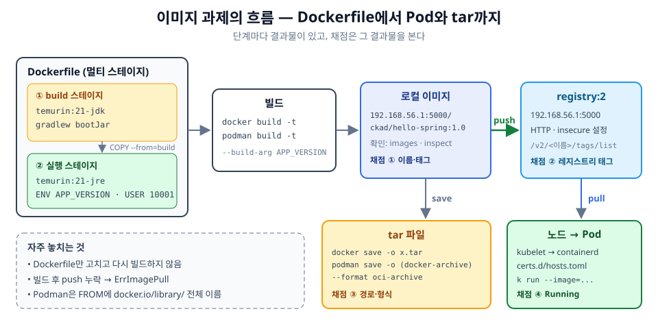
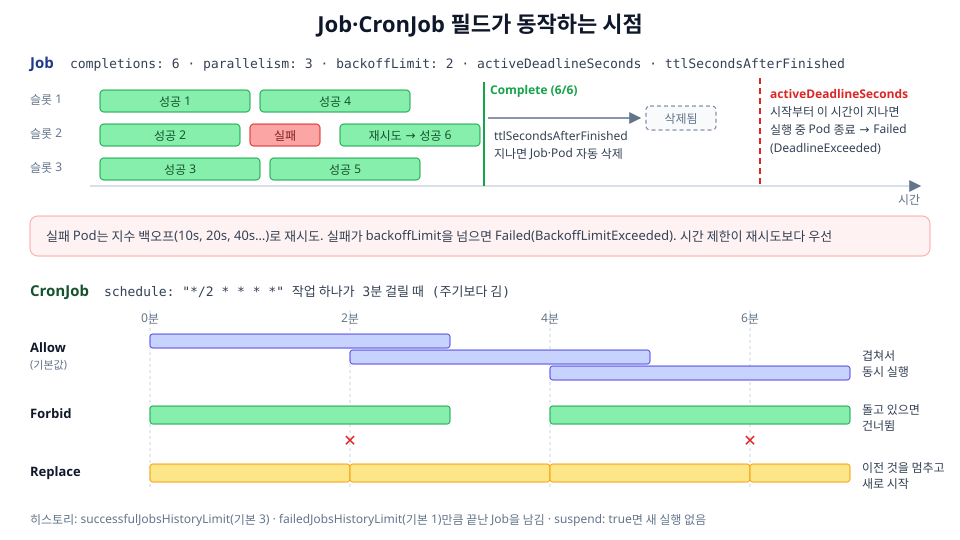
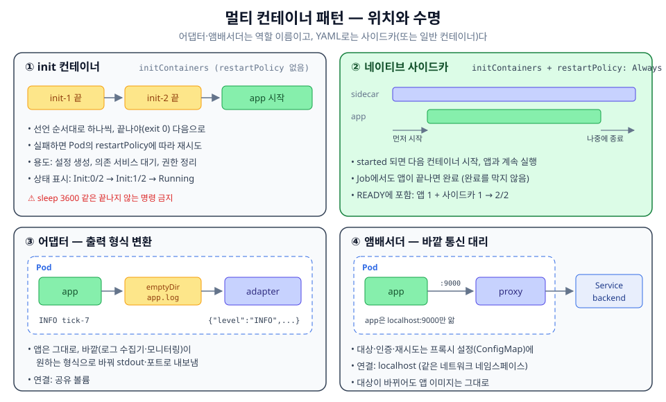

> **자격증 준비 · CKAD** | 난이도 ★★★☆☆ | 예상 소요 3 ~ 3.5시간

> ⚠️ 이 편의 모든 연습 과제는 CNCF가 공개한 **CKAD 공식 커리큘럼(v1.37)을 바탕으로 직접 창작한** 시험 스타일 과제입니다. 실제 시험 문제(유출 문제·덤프)가 아니며 실제 출제 내용과 무관합니다.

## 🎯 오늘의 목표

- Spring Boot 앱의 **멀티 스테이지 Dockerfile**을 쓰고, 이미지를 빌드·태그·push한 뒤 Pod로 실행하는 과정을 5분 안에 끝낼 수 있다
- `docker save` / `podman save`로 이미지를 **tar로 내보내고** 형식을 확인할 수 있다
- Job의 `completions`·`parallelism`·`backoffLimit`·`activeDeadlineSeconds`·`ttlSecondsAfterFinished`, CronJob의 `schedule`·`concurrencyPolicy`·히스토리 한도를 **과제 문장 그대로** YAML에 옮길 수 있다
- init 컨테이너, **네이티브 사이드카**, 어댑터·앰배서더 패턴을 구분하고 Pod 한 장으로 만들 수 있다
- emptyDir·PVC·일반 임시 볼륨(generic ephemeral volume)을 목적에 맞게 골라 마운트할 수 있다

---

## 1. 커리큘럼 항목 요약 — Application Design and Build (20%)

2026-11-19 기준 cncf/curriculum의 `CKAD_Curriculum_v1.37.pdf` 항목과 이 편의 섹션입니다.

| 공식 커리큘럼 항목 | 이 편의 섹션 | 이론은 여기서 |
|---|---|---|
| Define, build and modify container images | 4-1 | [Day 02](../../01-docker/day02-image-layers.md), [Day 03](../../01-docker/day03-dockerfile.md) |
| Choose and use the right workload resource (Deployment, DaemonSet, CronJob, etc.) | 4-2, 4-3 | [Day 11](../../02-kubernetes/day11-deployment.md), [CKA K03](../cka/k03-workloads-scheduling.md)(DaemonSet·정적 Pod) |
| Understand multi-container Pod design patterns (e.g. sidecar, init and others) | 4-4 | [Day 10](../../02-kubernetes/day10-pod.md) 4장, CKA K03 4-6 |
| Utilize persistent and ephemeral volumes | 4-5 | [Day 04](../../01-docker/day04-volumes.md), [Day 14](../../02-kubernetes/day14-storage.md), [CKA K05](../cka/k05-storage.md) |

> 💡 Dockerfile 명령, 레이어 캐시, 멀티 스테이지의 원리는 Day 03에, Pod의 init·사이드카 기본은 Day 10에, PV/PVC·StorageClass는 Day 14와 K05에 있습니다. 이 편은 **시험 과제 형식(명령형 생성, 빠른 YAML 편집, 정확한 경로·이름)** 에 집중합니다.

### 실습 환경

[A00](./a00-exam-overview-lab.md)의 고정값을 씁니다. 시작 전에 스냅샷 **`ckad-clean`** 으로 되돌리고, base(WSL2)의 `~/ckad/a01`에서 context `cka-main`으로 작업합니다.

```bash
k config use-context cka-main
mkdir -p ~/ckad/a01 && cd ~/ckad/a01
k create ns a01
k config set-context --current --namespace=a01     # 이 편은 기본 네임스페이스 a01
export do="--dry-run=client -o yaml"; export now="--force --grace-period=0"
REG=192.168.56.1:5000                              # 로컬 레지스트리 (A00 7장)
```

---

## 2. 출제 유형 — 어떻게 채점되는가

| 과제 형태 | 예시 문장(창작) | 채점 포인트 |
|---|---|---|
| **이미지 빌드형** | "`<폴더>`의 Dockerfile로 이미지 `<이름>:<태그>`를 빌드하라" | 로컬 이미지 목록에 **정확한 이름·태그**가 있는가 |
| **이미지 수정형** | "베이스 이미지를 바꾸고 환경 변수를 추가해 새 태그로" | Dockerfile 내용, 새 태그 존재 |
| **내보내기형** | "그 이미지를 OCI 형식 tar로 `<경로>`에 저장하라" | 파일 존재·형식(`index.json`/`manifest.json`) |
| **push·실행형** | "레지스트리에 push하고 그 이미지로 Pod를 실행하라" | 레지스트리 태그, Pod `Running`, 이미지 필드 |
| **Job·CronJob형** | "6번 성공, 동시에 2개, 실패 재시도 2회, 30초 넘으면 중단" | 각 필드 값, Job의 최종 상태(Complete/Failed) |
| **멀티 컨테이너형** | "앱보다 먼저 시작해 계속 실행되는 로그 수집 컨테이너를" | 컨테이너 **이름**, `initContainers` 위치, `restartPolicy: Always`, 공유 볼륨 |
| **볼륨형** | "PVC 200Mi를 만들어 `/data`에, 캐시는 메모리 기반 emptyDir 64Mi로" | PVC `Bound`, 마운트 경로, `medium`·`sizeLimit` |

> ⚠️ 이미지 과제는 **도구가 만든 결과물**(로컬 이미지 태그, tar 파일, 레지스트리 태그)을 채점합니다. Dockerfile만 고치고 빌드를 잊거나, 빌드만 하고 push를 잊으면 0점입니다. 마지막에 `docker images`/`podman images`, `ls -l <tar>`로 **눈으로** 확인하세요.

---

## 3. 핵심 명령·매니페스트 표

| 하고 싶은 것 | Docker | Podman |
|---|---|---|
| 빌드 + 태그 | `docker build -t $REG/ckad/app:1.0 .` | `podman build -t $REG/ckad/app:1.0 .` |
| 다른 파일 이름 | `docker build -f build/Dockerfile.prod -t x:1 .` | 같음 (`Containerfile`도 자동 인식) |
| 빌드 인자 | `--build-arg APP_VERSION=2.0` | 같음 |
| 태그 추가 | `docker tag <원본> <새이름:태그>` | `podman tag <원본> <새이름:태그>` |
| push | `docker push $REG/ckad/app:1.0` | `podman push $REG/ckad/app:1.0` (설정 없으면 `--tls-verify=false`) |
| tar로 내보내기 | `docker save -o app.tar <이미지>` | `podman save -o app.tar <이미지>` (기본 docker-archive), `--format oci-archive` |
| tar 불러오기 | `docker load -i app.tar` | `podman load -i app.tar` |
| 이미지 목록 | `docker images <저장소>` | `podman images <저장소>` |
| 이미지 정보 | `docker image inspect <이미지> --format '{{.Config.User}}'` | `podman image inspect ...` |

| 하고 싶은 것 | kubectl (명령형 우선) | YAML로 덧붙일 것 |
|---|---|---|
| Pod | `k run web --image=$REG/ckad/hello-spring:1.0 --port=8080 --env=APP_MESSAGE=hi` | `resources`, 볼륨 |
| Job | `k create job calc --image=busybox:1.37 $do -- sh -c 'echo hi'` | `completions`, `parallelism`, `backoffLimit`, `activeDeadlineSeconds`, `ttlSecondsAfterFinished` |
| CronJob | `k create cronjob rep --image=busybox:1.37 --schedule='*/2 * * * *' $do -- date` | `concurrencyPolicy`, `successfulJobsHistoryLimit`, `failedJobsHistoryLimit`, `startingDeadlineSeconds`, `suspend`, `timeZone` |
| CronJob 즉시 한 번 | `k create job rep-manual --from=cronjob/rep` | — |
| CronJob 일시 중지 | `k patch cronjob rep -p '{"spec":{"suspend":true}}'` | — |
| Job 완료 대기 | `k wait --for=condition=complete job/calc --timeout=120s` | 실패 대기는 `--for=condition=failed` |
| PVC | (명령형 없음) — 문서 예제 복사 | `storageClassName`, `accessModes`, `resources.requests.storage` |
| 임시 Pod로 확인 | `k run tmp --image=busybox:1.37 --rm -it --restart=Never -- wget -qO- http://<IP>:8080/` | — |

> 💡 `kubectl create job`이 만드는 Pod 템플릿의 `restartPolicy`는 **`Never`**, `kubectl create cronjob`은 **`OnFailure`**(기본값, `--restart`로 변경)입니다. Job·CronJob에는 `Always`를 쓸 수 없습니다. 과제가 재시작 정책을 지정하면 YAML에서 확인하세요.

---

## 4. 영역별 핵심 — 시험에서 필요한 만큼만

### 4-1. 이미지 — 빌드 → 태그 → push → 실행 → 내보내기



📖 **시험장에서 찾을 문서:** Docker·Podman 문서는 허용 목록에 없습니다. **`docker build --help`, `man podman-build`, `man podman-save`** 로 옵션을 확인합니다. 쿠버네티스 쪽은 "Images"(`/docs/concepts/containers/images/`), 비공개 레지스트리 인증이 나오면 "Pull an Image from a Private Registry"(`/docs/tasks/configure-pod-container/pull-image-private-registry/`).

Spring Boot 멀티 스테이지 Dockerfile입니다. A00 8장에서 만든 `~/ckad/apps/hello-spring/`에 둡니다. 원리(빌드 스테이지 결과물만 `COPY --from`)는 Day 03 5-4와 같고, 여기서는 **Gradle 의존성 캐시를 위해 빌드 파일을 먼저 복사**하는 순서만 눈여겨보세요.

```dockerfile
# ~/ckad/apps/hello-spring/Dockerfile
# ---------- 1단계: 빌드 (JDK + Gradle 래퍼) ----------
FROM docker.io/library/eclipse-temurin:21-jdk AS build
WORKDIR /src
COPY gradlew settings.gradle build.gradle ./
COPY gradle ./gradle
RUN ./gradlew --no-daemon dependencies > /dev/null      # 의존성 레이어 캐시
COPY src ./src
RUN ./gradlew --no-daemon bootJar \
 && cp build/libs/hello-spring-0.0.1-SNAPSHOT.jar /app.jar

# ---------- 2단계: 실행 (JRE만) ----------
FROM docker.io/library/eclipse-temurin:21-jre
ARG APP_VERSION=1.0
ENV APP_VERSION=${APP_VERSION}
RUN useradd --system --uid 10001 spring
WORKDIR /app
COPY --from=build /app.jar app.jar
USER 10001
EXPOSE 8080
ENTRYPOINT ["java", "-jar", "/app/app.jar"]
```

```text
# ~/ckad/apps/hello-spring/.dockerignore
build
.gradle
*.md
```

```bash
cd ~/ckad/apps/hello-spring
docker build -t $REG/ckad/hello-spring:1.0 .
docker build --build-arg APP_VERSION=2.0 -t $REG/ckad/hello-spring:2.0 .   # 캐시 덕분에 수 초
docker images $REG/ckad/hello-spring
docker push $REG/ckad/hello-spring:1.0
docker push $REG/ckad/hello-spring:2.0
curl -s http://$REG/v2/ckad/hello-spring/tags/list      # {"name":"ckad/hello-spring","tags":["1.0","2.0"]}
```

```
REPOSITORY                             TAG   IMAGE ID       CREATED          SIZE
192.168.56.1:5000/ckad/hello-spring    2.0   4c1d...        5 seconds ago    3xxMB
192.168.56.1:5000/ckad/hello-spring    1.0   9a7e...        40 seconds ago   3xxMB
```

> 💡 `APP_VERSION`은 실행 스테이지의 `ARG` → `ENV`로 이미지에 구워집니다. 컨트롤러는 Spring의 relaxed binding으로 이 값을 `app.version`으로 읽습니다. A02의 블루그린·카나리는 이 두 태그(1.0, 2.0)의 응답 차이를 봅니다.

**이미지를 tar로.** 시험에서는 "OCI 형식으로"나 "docker 형식으로"처럼 형식을 지정할 수 있습니다.

| 명령 | 결과 형식 | tar 안에서 확인할 파일 |
|---|---|---|
| `docker save -o x.tar <이미지>` | Docker 아카이브 (Docker 25 이후는 OCI 레이아웃도 함께 포함) | `manifest.json` (+ `index.json`, `oci-layout`) |
| `podman save -o x.tar <이미지>` | **docker-archive** (기본) | `manifest.json` |
| `podman save --format oci-archive -o x.tar <이미지>` | **OCI 아카이브** | `index.json`, `oci-layout` |
| `podman save --format oci-dir -o dir/ <이미지>` | OCI 디렉터리 (tar 아님) | `dir/index.json` |

```bash
tar -tf x.tar | grep -E '^(manifest.json|index.json|oci-layout)$'   # 형식 확인
```

> 💡 레지스트리 없이 노드에 바로 넣어야 할 때는 tar를 노드로 복사해 `sudo ctr -n k8s.io images import x.tar`. kubelet이 쓰는 containerd 네임스페이스는 **`k8s.io`** 입니다. 이 탭은 레지스트리를 기본으로 씁니다.

### 4-2. Job — 다섯 필드를 정확히



📖 **시험장에서 찾을 문서:** "Jobs"(`/docs/concepts/workloads/controllers/job/`), "Automatic Cleanup for Finished Jobs"(`/docs/concepts/workloads/controllers/ttlafterfinished/`).

| 필드 (`spec.` 아래) | 뜻 | 기본값 | 과제 문장 예 |
|---|---|---|---|
| `completions` | 성공해야 하는 Pod 수 | 1 | "총 6번 성공해야 완료" |
| `parallelism` | 동시에 실행할 Pod 수 | 1 | "동시에 2개씩" |
| `backoffLimit` | 실패 재시도 한도(넘으면 `Failed`, 이유 `BackoffLimitExceeded`) | 6 | "최대 2번까지 재시도" |
| `activeDeadlineSeconds` | Job 전체 제한 시간(넘으면 실행 중 Pod 종료, 이유 `DeadlineExceeded`) | 없음 | "30초 안에 끝나지 않으면 중단" |
| `ttlSecondsAfterFinished` | 끝난 뒤(성공·실패 모두) Job과 Pod 자동 삭제까지 | 없음 | "끝나고 2분 뒤 자동 삭제" |
| `completionMode: Indexed` | Pod마다 `JOB_COMPLETION_INDEX` 0..n-1 부여 | NonIndexed | "각 Pod가 자기 번호를 출력" |

> ⚠️ **위치 주의.** 위 필드는 Job의 `spec:` 바로 아래입니다. `spec.template.spec`(Pod 스펙)에 넣으면 `unknown field` 오류가 나거나(Pod에도 `activeDeadlineSeconds`가 있어서) **조용히 다른 의미**가 됩니다. Pod의 `activeDeadlineSeconds`는 Pod 하나의 제한이고, Job 전체 제한이 아닙니다.

> 💡 `activeDeadlineSeconds`는 `backoffLimit`보다 우선합니다. 재시도가 남아 있어도 시간이 다 되면 Job은 `Failed`입니다.

### 4-3. CronJob — 스케줄과 겹침 정책

📖 **시험장에서 찾을 문서:** "CronJob"(`/docs/concepts/workloads/controllers/cron-jobs/`) — 스케줄 문법 표와 예제 YAML이 있습니다. 실습 튜토리얼은 "Running Automated Tasks with a CronJob"(`/docs/tasks/job/automated-tasks-with-cron-jobs/`).

| 필드 (`spec.` 아래) | 값 | 기본값 |
|---|---|---|
| `schedule` | `분 시 일 월 요일`, 예: `*/5 * * * *`(5분마다), `30 2 * * 1-5`(평일 02:30) | 필수 |
| `timeZone` | `Asia/Seoul` 등 IANA 이름 | kube-controller-manager의 시간대(보통 UTC) |
| `concurrencyPolicy` | `Allow`(겹쳐도 실행) / `Forbid`(이전 것이 돌고 있으면 건너뜀) / `Replace`(이전 것을 멈추고 새로) | `Allow` |
| `startingDeadlineSeconds` | 예정 시각을 놓쳤을 때 이 초 안이면 늦게라도 실행 | 없음 |
| `suspend` | `true`면 새 실행을 만들지 않음 | `false` |
| `successfulJobsHistoryLimit` | 남겨 둘 성공 Job 수 | **3** |
| `failedJobsHistoryLimit` | 남겨 둘 실패 Job 수 | **1** |
| `jobTemplate.spec` | 4-2의 Job 필드가 여기 들어감 | — |

> ⚠️ CronJob YAML은 **세 겹**입니다: `CronJob.spec` → `jobTemplate.spec`(Job) → `template.spec`(Pod). `backoffLimit`은 가운데, `restartPolicy`와 `containers`는 맨 안쪽입니다. 들여쓰기 한 칸이 틀리면 필드가 무시되거나 오류가 납니다. `$do`로 뼈대를 뽑고 그 안에 끼워 넣으세요.

### 4-4. 멀티 컨테이너 패턴



📖 **시험장에서 찾을 문서:** "Init Containers"(`/docs/concepts/workloads/pods/init-containers/`), "Sidecar Containers"(`/docs/concepts/workloads/pods/sidecar-containers/`), 튜토리얼 "Adopting Sidecar Containers"(`/docs/tutorials/configuration/pod-sidecar-containers/`), 공유 볼륨 예제 "Communicate Between Containers in the Same Pod Using a Shared Volume"(`/docs/tasks/access-application-cluster/communicate-containers-same-pod-shared-volume/`), 로그 사이드카 예제는 "Logging Architecture"(`/docs/concepts/cluster-administration/logging/`).

| 패턴 | 어디에 쓰나 | 위치 | 언제 끝나나 | 연결 방법 |
|---|---|---|---|---|
| **init** | 준비 작업(설정 생성, 의존 서비스 대기, 권한 정리) | `initContainers` (restartPolicy 없음) | **끝나야** 다음 컨테이너 시작. 순서대로 하나씩 | 공유 볼륨 |
| **네이티브 사이드카** | 앱과 같이 계속 도는 보조(로그 수집, 프록시) | `initContainers` + **`restartPolicy: Always`** | 앱보다 **먼저 시작**, 앱보다 **나중에 종료**. Job에서도 완료를 막지 않음 | 공유 볼륨, localhost |
| **어댑터** | 앱 출력을 **바깥이 원하는 형식으로 변환**(로그 포맷, 메트릭 노출) | 사이드카 형태(위치는 위와 같음) | 앱과 함께 | 공유 볼륨 |
| **앰배서더** | 앱 대신 **바깥과 통신하는 프록시**(앱은 `localhost:포트`만 앎) | 사이드카 형태 | 앱과 함께 | localhost (같은 네트워크 네임스페이스) |
| (전통적 사이드카) | v1.28 이전 방식 | `containers`에 함께 | 순서 보장 없음, Job이 끝나지 않는 문제 | — |

> 💡 어댑터·앰배서더는 **역할 이름**이지 쿠버네티스 필드가 아닙니다. YAML로는 둘 다 "사이드카(또는 일반 컨테이너)"이고, 과제 문장이 "앱보다 먼저 시작하고 계속 실행"이라 하면 네이티브 사이드카(`initContainers` + `restartPolicy: Always`)로, 그런 조건이 없으면 `containers`에 나란히 둬도 됩니다. **과제가 지정한 위치를 따르세요.**

> 💡 네이티브 사이드카는 v1.33에서 GA가 됐고, 시험 버전 v1.37에서는 기본 기능입니다. Pod `READY` 칸은 일반 컨테이너와 사이드카를 함께 셉니다(앱 1 + 사이드카 1 → `2/2`).

### 4-5. 볼륨 — 무엇을 언제

📖 **시험장에서 찾을 문서:** "Volumes"(`/docs/concepts/storage/volumes/` — emptyDir 절), "Ephemeral Volumes"(`/docs/concepts/storage/ephemeral-volumes/`), "Configure a Pod to Use a PersistentVolume for Storage"(`/docs/tasks/configure-pod-container/configure-persistent-volume-storage/`), "Configure a Pod to Use a Volume for Storage"(`/docs/tasks/configure-pod-container/configure-volume-storage/`).

| 볼륨 | 수명 | 쓰는 곳 | 핵심 필드 |
|---|---|---|---|
| `emptyDir` | **Pod와 함께** 생기고 사라짐 | 컨테이너 간 공유, 캐시, 임시 파일 | `medium: Memory`(tmpfs), `sizeLimit` |
| 일반 임시 볼륨(`ephemeral`) | Pod와 함께, 하지만 **StorageClass로 프로비저닝** | 노드 디스크보다 큰 임시 공간, 스토리지 기능이 필요한 스크래치 | `ephemeral.volumeClaimTemplate.spec` (PVC 이름은 `<Pod>-<볼륨>`) |
| `persistentVolumeClaim` | **Pod와 독립** — Pod를 지워도 남음 | 데이터베이스, 업로드 파일 | `claimName`, 마운트 `readOnly` |
| `configMap` / `secret` | 원본 오브젝트를 따름 | 설정 파일 | A04에서 |
| `hostPath` | 노드에 남음 | 노드 파일 접근(개발자 과제에선 드묾) | CKA K05 |

> ⚠️ `local-path` StorageClass는 **`WaitForFirstConsumer`** 입니다. PVC만 만들면 `Pending`이 정상이고, 그것을 쓰는 Pod가 스케줄되는 순간 `Bound`가 됩니다. "PVC가 Pending인데 실패한 건가?" 하고 시간을 쓰지 마세요. 또 local-path 볼륨은 **한 노드에 묶이는 RWO**라, 같은 PVC를 쓰는 두 번째 Pod가 다른 노드에 가면 붙지 못합니다.

---

## 5. 시간 절약 팁

- **이미지 과제는 한 줄씩 확인하며**: `build` → `images | grep` → `push` → `curl .../tags/list` → Pod. 단계마다 출력 한 줄을 보는 데 5초면 충분하고, 마지막에 실패 원인을 찾는 것보다 빠릅니다.
- **Job·CronJob은 `$do` 뼈대 + 필드 덧붙이기**: `k create job x --image=busybox:1.37 $do -- sh -c '...' > x.yaml` 후 `spec:` 바로 아래에 필드를 넣습니다. 명령에 `--`로 준 인자는 `command`가 됩니다.
- **CronJob 검증은 기다리지 말고 `--from`**: `k create job test-run --from=cronjob/<이름>`으로 바로 한 번 돌려 결과를 확인합니다. 단 과제가 만들라고 하지 않은 Job은 검증 후 지우세요.
- **사이드카는 문서 예제를 복사**: "Sidecar Containers" 페이지의 예제 YAML이 `initContainers` + `restartPolicy: Always` + 공유 `emptyDir` 구조 그대로입니다. 이미지·명령·이름만 바꿉니다.
- **`k explain`으로 위치 확인**: `k explain job.spec.ttlSecondsAfterFinished`, `k explain cronjob.spec.jobTemplate.spec.backoffLimit`, `k explain pod.spec.initContainers.restartPolicy`.

---

## 6. 자주 하는 실수

| 실수 | 결과 | 바로잡기 |
|---|---|---|
| 빌드만 하고 push 안 함 | Pod `ErrImagePull` (`not found`) | `curl http://$REG/v2/<이름>/tags/list`로 확인 |
| 같은 태그로 다시 push했는데 Pod가 옛 이미지 | 노드에 캐시된 이미지 사용(`IfNotPresent`) | 새 태그를 쓰거나 `imagePullPolicy: Always` |
| Podman에서 `FROM eclipse-temurin:21-jre` | `short-name did not resolve` | `docker.io/library/...` 전체 이름 |
| `docker save` 경로를 상대 경로로 써서 다른 폴더에 저장 | 채점 경로에 파일 없음 | 과제의 **절대 경로** 그대로 `-o`에 |
| Job 필드를 Pod 스펙(`template.spec`)에 넣음 | 무시되거나 다른 의미 | `k explain job.spec`로 위치 확인 |
| Job에 `restartPolicy: Always` | `Unsupported value: "Always"` | `Never` 또는 `OnFailure` |
| CronJob `schedule`을 따옴표 없이 | 셸이 `*`를 파일 이름으로 확장 | `--schedule='*/2 * * * *'` 작은따옴표 |
| 사이드카를 `containers`에 넣음(과제는 "먼저 시작") | 시작 순서 보장 없음, Job 미완료 | `initContainers` + `restartPolicy: Always` |
| init 컨테이너가 끝나지 않는 명령(`sleep 3600`) | Pod가 영원히 `Init:0/1` | init은 반드시 **끝나는** 명령 |
| `emptyDir: {medium: memory}` (소문자) | 검증 오류 | `Memory` 대문자 |
| PVC `Pending`을 실패로 오해 | 시간 낭비 | `WaitForFirstConsumer` — Pod를 만들면 Bound |

---

## 7. 창작 연습 과제

> 아래 과제는 모두 **공식 커리큘럼을 바탕으로 창작한** 연습 문제입니다. base의 `~/ckad/a01`에서 context `cka-main`, 네임스페이스 `a01`로 작업합니다(과제가 다른 네임스페이스를 지정하면 그것을 따름). 과제당 목표 시간은 4~7분입니다.

### 과제 1. Spring Boot 멀티 스테이지 빌드와 push (목표 7분)

`~/ckad/apps/hello-spring`에 4-1의 멀티 스테이지 Dockerfile을 작성하고, 이미지를 `192.168.56.1:5000/ckad/hello-spring:1.0`과 (`APP_VERSION=2.0`을 빌드 인자로 넘긴) `:2.0` 두 태그로 빌드해 레지스트리에 push하라. 최종 이미지는 **root가 아닌 사용자**로 실행돼야 하고, 빌드 도구(JDK)가 들어 있으면 안 된다.

📖 참고 문서: `docker build --help` (허용 문서 없음), kubernetes.io "Images"

<details>
<summary>풀이·검증</summary>

4-1의 Dockerfile과 `.dockerignore`를 저장한 뒤 4-1의 빌드·push 명령을 실행합니다.

```bash
docker image inspect $REG/ckad/hello-spring:1.0 --format '{{.Config.User}}'           # 10001
docker image inspect $REG/ckad/hello-spring:2.0 --format '{{range .Config.Env}}{{println .}}{{end}}' | grep APP_VERSION   # APP_VERSION=2.0
docker run --rm --entrypoint sh $REG/ckad/hello-spring:1.0 -c 'command -v javac || echo no-javac'   # no-javac
curl -s http://$REG/v2/ckad/hello-spring/tags/list                                     # ["1.0","2.0"]
```

`javac`가 없다는 것이 "실행 스테이지에 JDK가 없다"는 증거입니다. 빌드 스테이지(JDK)는 `COPY --from=build`로 jar만 넘겨주고 최종 이미지에 남지 않습니다(Day 03).
</details>

### 과제 2. Podman으로 빌드하고 OCI tar로 내보내기 (목표 5분)

`~/ckad/apps/hello-py`에 다음 조건의 Dockerfile을 작성하라: 베이스 `docker.io/library/python:3.12-slim`, 로그 버퍼링 끄기(`PYTHONUNBUFFERED=1`), `APP_VERSION=1.0`, UID 10001로 실행, 포트 8000. **Podman**으로 `192.168.56.1:5000/ckad/hello-py:1.0`을 빌드해 push하고, 같은 이미지를 **OCI 아카이브** 형식으로 `~/ckad/a01/hello-py-1.0.tar`에 저장하라.

📖 참고 문서: `man podman-build`, `man podman-save` (허용 문서 없음)

<details>
<summary>풀이·검증</summary>

```dockerfile
# ~/ckad/apps/hello-py/Dockerfile
FROM docker.io/library/python:3.12-slim
ENV PYTHONUNBUFFERED=1 \
    APP_VERSION=1.0
WORKDIR /app
COPY app.py .
USER 10001
EXPOSE 8000
CMD ["python", "/app/app.py"]
```

```bash
cd ~/ckad/apps/hello-py
podman build -t $REG/ckad/hello-py:1.0 .
podman push $REG/ckad/hello-py:1.0
podman save --format oci-archive -o ~/ckad/a01/hello-py-1.0.tar $REG/ckad/hello-py:1.0
```

```bash
podman images $REG/ckad/hello-py                     # 1.0
ls -lh ~/ckad/a01/hello-py-1.0.tar
tar -tf ~/ckad/a01/hello-py-1.0.tar | grep -E '^(index.json|oci-layout)$'   # 두 줄 모두 나와야 OCI
curl -s http://$REG/v2/ckad/hello-py/tags/list       # ["1.0"]
```

`--format`을 빼면 docker-archive가 되어 `index.json`이 없습니다. 과제가 형식을 말하면 반드시 옵션으로 지정하세요. 같은 일을 Docker로 하면 `docker save -o ... <이미지>`입니다(형식 옵션 없음).
</details>

### 과제 3. 기존 이미지 수정 — 새 태그 (목표 5분)

과제 2의 Dockerfile을 수정해 다음 두 가지를 바꾼 이미지 `192.168.56.1:5000/ckad/hello-py:1.1`을 만들어 push하라(1.0 이미지는 그대로 둔다).
- 환경 변수 `APP_VERSION`을 `1.1`로
- 이미지에 라벨 `org.opencontainers.image.version=1.1` 추가

그리고 Docker로 같은 이미지를 받아 `~/ckad/a01/hello-py-1.1-docker.tar`로 저장하라.

📖 참고 문서: `docker build --help`, `docker save --help`

<details>
<summary>풀이·검증</summary>

```bash
cd ~/ckad/apps/hello-py
sed -i 's/APP_VERSION=1.0/APP_VERSION=1.1/' Dockerfile
sed -i '/^FROM/a LABEL org.opencontainers.image.version="1.1"' Dockerfile
podman build -t $REG/ckad/hello-py:1.1 .
podman push $REG/ckad/hello-py:1.1

docker pull $REG/ckad/hello-py:1.1
docker save -o ~/ckad/a01/hello-py-1.1-docker.tar $REG/ckad/hello-py:1.1
```

```bash
podman image inspect $REG/ckad/hello-py:1.1 --format '{{index .Labels "org.opencontainers.image.version"}}'   # 1.1
curl -s http://$REG/v2/ckad/hello-py/tags/list                    # ["1.0","1.1"]
tar -tf ~/ckad/a01/hello-py-1.1-docker.tar | grep manifest.json  # manifest.json
```

Dockerfile을 바꾼 뒤엔 다시 빌드해야 이미지가 바뀝니다. "1.0은 그대로"라는 조건 때문에 **태그를 덮어쓰지 않는 것**이 채점 포인트입니다. A02 이후 편은 다시 `APP_VERSION=1.0` 상태의 Dockerfile을 기대하지 않으니 그대로 두어도 됩니다.
</details>

### 과제 4. 빌드한 이미지로 Pod 실행과 응답 확인 (목표 4분)

`a01`에 Pod `spring`을 만들어라: 이미지 `192.168.56.1:5000/ckad/hello-spring:2.0`, 컨테이너 포트 8080, 환경 변수 `APP_MESSAGE=ckad`, 메모리 요청 `256Mi`·제한 `512Mi`. Pod의 `/` 응답을 `~/ckad/a01/spring.txt`에 저장하라.

📖 참고 문서: "Assign Memory Resources to Containers and Pods"(`/docs/tasks/configure-pod-container/assign-memory-resource/`), "kubectl Quick Reference"

<details>
<summary>풀이·검증</summary>

```bash
k run spring --image=$REG/ckad/hello-spring:2.0 --port=8080 --env=APP_MESSAGE=ckad $do > spring.yaml
# containers[0] 아래에 추가
#     resources:
#       requests:
#         memory: 256Mi
#       limits:
#         memory: 512Mi
k apply -f spring.yaml
k wait --for=condition=Ready pod/spring --timeout=120s
IP=$(k get pod spring -o jsonpath='{.status.podIP}')
k run tmp --image=busybox:1.37 --rm -i --restart=Never -- wget -qO- http://$IP:8080/ > ~/ckad/a01/spring.txt
cat ~/ckad/a01/spring.txt
```

```
ckad from hello-spring 2.0 on spring
```

`k run ... --rm -i`의 출력에는 가끔 `pod "tmp" deleted` 줄이 섞입니다. 그 줄은 stderr라 파일에는 들어가지 않지만, 내용을 꼭 `cat`으로 확인하세요. Spring Boot가 뜨는 데 10~20초 걸리므로 `k wait`이 중요합니다.
</details>

### 과제 5. 병렬 Job — 완료 수·동시 수·재시도·TTL (목표 5분)

`a01`에 Job `dice`를 만들어라. 이미지 `busybox:1.37`, 명령 `sh -c 'echo rolled $((RANDOM % 6 + 1)); sleep 3'`. 총 **6번 성공**해야 완료되고, **동시에 3개**씩 실행하며, 실패는 **최대 2번**까지 재시도한다. Job은 끝나고 **120초 뒤 자동 삭제**돼야 한다.

📖 참고 문서: "Jobs"(*Parallel execution for Jobs*, *Pod backoff failure policy* 절), "Automatic Cleanup for Finished Jobs"

<details>
<summary>풀이·검증</summary>

```bash
k create job dice --image=busybox:1.37 $do -- sh -c 'echo rolled $((RANDOM % 6 + 1)); sleep 3' > dice.yaml
```

```yaml
# dice.yaml 의 spec: 바로 아래 (template: 과 같은 들여쓰기)
spec:
  completions: 6
  parallelism: 3
  backoffLimit: 2
  ttlSecondsAfterFinished: 120
  template:
    ...
```

```bash
k apply -f dice.yaml
k get pods -l job-name=dice -w          # 3개씩 두 번에 나눠 실행 (Ctrl+C)
k wait --for=condition=complete job/dice --timeout=120s
k get job dice                          # COMPLETIONS 6/6
k get job dice -o jsonpath='{.spec.completions} {.spec.parallelism} {.spec.backoffLimit} {.spec.ttlSecondsAfterFinished}{"\n"}'   # 6 3 2 120
k logs -l job-name=dice --prefix | head
```

busybox `sh`(ash)는 `$RANDOM`을 지원합니다. 명령 문자열은 작은따옴표로 감싸야 base의 셸이 `$((...))`를 미리 계산하지 않습니다. 2분 뒤 `k get job dice`가 `NotFound`면 TTL도 맞게 설정된 것입니다.
</details>

### 과제 6. 실패하는 Job — 제한 시간과 재시도 구분 (목표 5분)

`a01`에 Job 두 개를 만들고 각각 **왜 실패했는지**를 `~/ckad/a01/job-reasons.txt`에 `<Job 이름> <이유>` 형식으로 저장하라.
- `slowpoke`: `busybox:1.37`로 `sleep 60`. Job 전체 제한 시간 **15초**
- `flaky`: `busybox:1.37`로 `sh -c 'exit 1'`. 재시도 **1번**, Pod 재시작 정책 `Never`

📖 참고 문서: "Jobs"(*Job termination and cleanup* 절)

<details>
<summary>풀이·검증</summary>

```bash
k create job slowpoke --image=busybox:1.37 $do -- sleep 60 > slowpoke.yaml
# spec: 아래에  activeDeadlineSeconds: 15
k create job flaky --image=busybox:1.37 $do -- sh -c 'exit 1' > flaky.yaml
# spec: 아래에  backoffLimit: 1     (restartPolicy: Never 는 kubectl create job 기본값 — 확인만)
k apply -f slowpoke.yaml -f flaky.yaml
k wait --for=condition=failed job/slowpoke job/flaky --timeout=90s

for j in slowpoke flaky; do
  echo "$j $(k get job $j -o jsonpath='{.status.conditions[?(@.type=="Failed")].reason}')"
done > ~/ckad/a01/job-reasons.txt
cat ~/ckad/a01/job-reasons.txt
```

```
slowpoke DeadlineExceeded
flaky BackoffLimitExceeded
```

```bash
k get pods -l job-name=flaky       # Error 상태 Pod 2개 (최초 1 + 재시도 1)
```

`restartPolicy: Never`라서 실패할 때마다 **새 Pod**가 생깁니다. `OnFailure`였다면 같은 Pod 안에서 컨테이너가 재시작되고 Pod 수는 1개로 보입니다. 재시도 간격은 10초, 20초, 40초…로 늘어나므로(지수 백오프) `backoffLimit`이 크면 실패 판정까지 오래 걸립니다.
</details>

### 과제 7. CronJob — 겹침 금지와 히스토리 (목표 6분)

`a01`에 CronJob `heartbeat`를 만들어라: **2분마다** 실행, 이미지 `busybox:1.37`, 명령 `sh -c 'date; echo beat; sleep 150'`. 이전 실행이 아직 돌고 있으면 **새 실행을 건너뛰고**, 성공한 Job은 **2개**, 실패한 Job은 **1개**만 남긴다. 예정 시각을 놓쳤을 때는 **30초 안이면** 실행한다. 만든 뒤 스케줄을 기다리지 말고 수동으로 한 번 실행해 출력을 확인하라.

📖 참고 문서: "CronJob"(*Writing a CronJob spec*, *Concurrency policy*, *Jobs history limits* 절)

<details>
<summary>풀이·검증</summary>

```bash
k create cronjob heartbeat --image=busybox:1.37 --schedule='*/2 * * * *' $do \
  -- sh -c 'date; echo beat; sleep 150' > heartbeat.yaml
```

```yaml
# heartbeat.yaml 의 CronJob spec: 아래 (jobTemplate: 과 같은 들여쓰기)
spec:
  schedule: '*/2 * * * *'
  concurrencyPolicy: Forbid
  successfulJobsHistoryLimit: 2
  failedJobsHistoryLimit: 1
  startingDeadlineSeconds: 30
  jobTemplate:
    ...
```

```bash
k apply -f heartbeat.yaml
k create job heartbeat-manual --from=cronjob/heartbeat
k logs -f job/heartbeat-manual | head -2     # 날짜, beat (Ctrl+C)
k get cronjob heartbeat -o jsonpath='{.spec.concurrencyPolicy} {.spec.successfulJobsHistoryLimit} {.spec.failedJobsHistoryLimit} {.spec.startingDeadlineSeconds}{"\n"}'
# Forbid 2 1 30
```

명령이 150초 동안 돌기 때문에 2분 주기의 다음 실행과 **겹칩니다**. 몇 분 지켜보면 `Forbid` 덕분에 동시에 하나만 실행되는 것을 볼 수 있습니다(`k get jobs -w`). 수동 Job(`--from`)은 CronJob의 히스토리 한도 대상이 아니라 직접 지워야 합니다: `k delete job heartbeat-manual`. 끝나면 `k patch cronjob heartbeat -p '{"spec":{"suspend":true}}'`로 멈춰 두세요.
</details>

### 과제 8. init 컨테이너 + 네이티브 사이드카 + 어댑터 (목표 7분)

`a01`에 Pod `report`를 만들어라. 세 컨테이너가 `emptyDir` 볼륨 `work`(`/work`)를 공유한다.
1. init 컨테이너 `setup`(busybox:1.37): `/work/app.log`를 빈 파일로 만들고 끝난다.
2. **앱보다 먼저 시작해 계속 실행되는** 어댑터 `to-json`(busybox:1.37): `/work/app.log`를 `tail -F`로 읽어 각 줄 `LEVEL msg`를 `{"level":"LEVEL","msg":"msg"}` 형태로 바꿔 표준 출력에 쓴다.
3. 앱 컨테이너 `app`(busybox:1.37): 3초마다 `INFO tick-<숫자>`를 `/work/app.log`에 추가한다.

📖 참고 문서: "Sidecar Containers", "Init Containers", "Logging Architecture"(*Streaming sidecar container* 예제)

<details>
<summary>풀이·검증</summary>

```yaml
# report.yaml
apiVersion: v1
kind: Pod
metadata:
  name: report
  namespace: a01
spec:
  volumes:
  - name: work
    emptyDir: {}
  initContainers:
  - name: setup                       # 일반 init: 끝나야 다음으로
    image: busybox:1.37
    command: ["sh", "-c", "touch /work/app.log"]
    volumeMounts:
    - name: work
      mountPath: /work
  - name: to-json                     # 네이티브 사이드카(어댑터 역할)
    image: busybox:1.37
    restartPolicy: Always
    command:
    - sh
    - -c
    - |
      tail -F /work/app.log | awk '{ printf "{\"level\":\"%s\",\"msg\":\"%s\"}\n", $1, $2; fflush() }'
    volumeMounts:
    - name: work
      mountPath: /work
  containers:
  - name: app
    image: busybox:1.37
    command: ["sh", "-c", "i=0; while true; do i=$((i+1)); echo \"INFO tick-$i\" >> /work/app.log; sleep 3; done"]
    volumeMounts:
    - name: work
      mountPath: /work
```

```bash
k apply -f report.yaml
k get pod report                         # READY 2/2, STATUS Running
k logs report -c to-json --tail=3
```

```
{"level":"INFO","msg":"tick-7"}
{"level":"INFO","msg":"tick-8"}
{"level":"INFO","msg":"tick-9"}
```

```bash
k get pod report -o jsonpath='{range .spec.initContainers[*]}{.name}={.restartPolicy}{"\n"}{end}'
# setup=
# to-json=Always
```

init 컨테이너는 **선언 순서대로** 시작합니다. `setup`이 끝나야 `to-json`이 시작되고, `to-json`이 시작(started)되어야 `app`이 시작됩니다. `READY 2/2`는 사이드카와 앱을 센 것이고, 끝난 `setup`은 세지 않습니다. 따옴표가 많은 명령은 위처럼 **YAML 블록 스칼라(`- |`)** 로 쓰면 YAML 쪽 이스케이프가 사라져 셸에서 치던 그대로 옮길 수 있습니다. `fflush()`가 없으면 awk가 출력을 모아 두었다가 늦게 내보내 `k logs`에 한참 아무것도 안 보일 수 있습니다.
</details>

### 과제 9. 앰배서더 — 앱은 localhost만 안다 (목표 6분)

`a01`에 nginx Deployment `backend`(이미지 `nginx:1.27`, 레플리카 1)와 Service `backend`(포트 80)를 만들어라. 그리고 Pod `client`를 만들어라: 앱 컨테이너 `app`(busybox:1.37)은 5초마다 **`http://localhost:9000/`** 만 호출해 응답 첫 줄을 출력하고, 같은 Pod의 앰배서더 컨테이너 `proxy`(nginx:1.27)가 `localhost:9000`으로 받아 Service `backend`로 넘긴다. 앰배서더 설정은 ConfigMap `proxy-conf`로 준다.

📖 참고 문서: "Configure a Pod to Use a ConfigMap"(*Add ConfigMap data to a Volume*), "Sidecar Containers"

<details>
<summary>풀이·검증</summary>

```bash
k create deploy backend --image=nginx:1.27
k expose deploy backend --port=80
cat > default.conf <<'EOF'
server {
  listen 9000;
  location / { proxy_pass http://backend.a01.svc.cluster.local:80; }
}
EOF
k create configmap proxy-conf --from-file=default.conf
```

```yaml
# client.yaml
apiVersion: v1
kind: Pod
metadata:
  name: client
  namespace: a01
spec:
  volumes:
  - name: conf
    configMap:
      name: proxy-conf
  initContainers:
  - name: proxy                         # 앰배서더: 앱보다 먼저 떠 있어야 하므로 네이티브 사이드카로
    image: nginx:1.27
    restartPolicy: Always
    volumeMounts:
    - name: conf
      mountPath: /etc/nginx/conf.d      # 기본 default.conf를 우리 것으로 대체
  containers:
  - name: app
    image: busybox:1.37
    command: ["sh", "-c", "while true; do wget -qO- http://localhost:9000/ | grep -m1 -o '<title>.*</title>'; sleep 5; done"]
```

```bash
k apply -f client.yaml
k get pod client                       # READY 2/2
k logs client -c app --tail=2          # <title>Welcome to nginx!</title>
```

앱은 `backend`라는 이름도, 포트 80도 모릅니다. 연결 대상이 바뀌면 ConfigMap만 고치면 됩니다. 이것이 앰배서더의 요점입니다. 같은 Pod의 컨테이너는 네트워크 네임스페이스를 공유하므로 `localhost`로 서로 닿습니다(Day 10 4-3의 pause 컨테이너).
</details>

### 과제 10. 볼륨 세 가지 — PVC, 메모리 emptyDir, 일반 임시 볼륨 (목표 7분)

`a01`에 다음을 만들어라.
- PVC `uploads`: 200Mi, `ReadWriteOnce`, StorageClass `local-path`
- Pod `store`(nginx:1.27):
  - PVC `uploads`를 `/usr/share/nginx/html`에
  - 메모리 기반 emptyDir 64Mi를 `/cache`에
  - StorageClass `local-path`로 프로비저닝되는 **임시 볼륨** 100Mi를 `/scratch`에 (Pod와 함께 삭제)

`/usr/share/nginx/html/index.html`에 `stored`를 쓰고, Pod를 지웠다 다시 만들어도 내용이 남는지 확인하라.

📖 참고 문서: "Configure a Pod to Use a PersistentVolume for Storage", "Volumes"(*emptyDir* 절), "Ephemeral Volumes"(*Generic ephemeral volumes* 절)

<details>
<summary>풀이·검증</summary>

```yaml
# store.yaml
apiVersion: v1
kind: PersistentVolumeClaim
metadata:
  name: uploads
  namespace: a01
spec:
  accessModes: ["ReadWriteOnce"]
  storageClassName: local-path
  resources:
    requests:
      storage: 200Mi
---
apiVersion: v1
kind: Pod
metadata:
  name: store
  namespace: a01
spec:
  containers:
  - name: nginx
    image: nginx:1.27
    volumeMounts:
    - { name: html,    mountPath: /usr/share/nginx/html }
    - { name: cache,   mountPath: /cache }
    - { name: scratch, mountPath: /scratch }
  volumes:
  - name: html
    persistentVolumeClaim:
      claimName: uploads
  - name: cache
    emptyDir:
      medium: Memory
      sizeLimit: 64Mi
  - name: scratch
    ephemeral:
      volumeClaimTemplate:
        spec:
          accessModes: ["ReadWriteOnce"]
          storageClassName: local-path
          resources:
            requests:
              storage: 100Mi
```

```bash
k apply -f store.yaml
k wait --for=condition=Ready pod/store --timeout=90s
k get pvc                                   # uploads, store-scratch 모두 Bound
k exec store -- sh -c 'echo stored > /usr/share/nginx/html/index.html; df -h /cache | tail -1'
# tmpfs   64.0M  0  64.0M  0% /cache   ← tmpfs 크기가 sizeLimit으로 잡힘 (노드·버전에 따라 더 크게 보여도 sizeLimit 초과 시 축출)

k delete pod store
k get pvc                                   # uploads 만 남음 (store-scratch 삭제됨)
k apply -f store.yaml                       # PVC는 unchanged, Pod 재생성
k wait --for=condition=Ready pod/store --timeout=90s
k exec store -- cat /usr/share/nginx/html/index.html    # stored
```

일반 임시 볼륨의 PVC 이름은 **`<Pod 이름>-<볼륨 이름>`**(`store-scratch`)이고, Pod가 그 PVC의 owner라서 Pod를 지우면 함께 지워집니다. `uploads`는 독립 PVC라 남습니다. 두 번째 Pod는 local-path PV가 있는 **같은 노드**에 스케줄됩니다(PV의 nodeAffinity).
</details>

### 정리

```bash
k config set-context --current --namespace=default
k delete ns a01
```

레지스트리의 `hello-spring:1.0`·`2.0`, `hello-py:1.0`은 A02 이후 편에서 씁니다. **지우지 마세요.**

---

## 8. 핵심 정리

- 이미지 과제: `build -t <레지스트리/이름:태그>` → `images`로 확인 → `push` → `tags/list` → Pod. Podman은 **전체 이미지 이름**, HTTP 레지스트리는 insecure 설정 또는 `--tls-verify=false`
- tar 내보내기: `docker save -o`, `podman save -o`(기본 docker-archive) / `--format oci-archive`(`index.json`, `oci-layout`)
- 멀티 스테이지: 빌드 파일 먼저 복사해 캐시, 실행 스테이지는 JRE + 비 root 사용자, 버전은 `ARG` → `ENV`
- Job: `completions`·`parallelism`·`backoffLimit`(기본 6)·`activeDeadlineSeconds`(우선)·`ttlSecondsAfterFinished`는 **Job의 `spec` 바로 아래**. 실패 이유 `BackoffLimitExceeded` / `DeadlineExceeded`
- CronJob: 세 겹 구조, `concurrencyPolicy` Allow/Forbid/Replace, 히스토리 기본 3/1, 검증은 `create job --from=cronjob/...`
- 멀티 컨테이너: init은 끝나야 다음, **네이티브 사이드카 = `initContainers` + `restartPolicy: Always`**, 어댑터는 출력 변환, 앰배서더는 localhost 프록시
- 볼륨: emptyDir(Pod 수명, `medium: Memory`·`sizeLimit`), 일반 임시 볼륨(Pod 수명 + StorageClass), PVC(독립 수명). local-path는 `WaitForFirstConsumer`

---

## ⏭️ 다음 예고 — A02. 애플리케이션 배포

오늘 push한 `hello-spring:1.0`과 `2.0`으로 배포 전략을 연습합니다. Deployment의 `maxSurge`·`maxUnavailable`·`minReadySeconds`로 롤링 업데이트를 조절하고 롤백하며, Service의 selector를 바꿔 끼우는 **수동 블루그린**, 레플리카 비율로 트래픽을 나누는 **수동 카나리**를 kubectl만으로 만듭니다. 이어서 Helm으로 공개 차트를 검색·설치하고 values를 덮어써 업그레이드·삭제하고, Kustomize 오버레이를 `kubectl apply -k`로 적용합니다.
