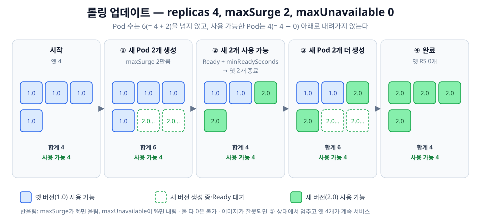
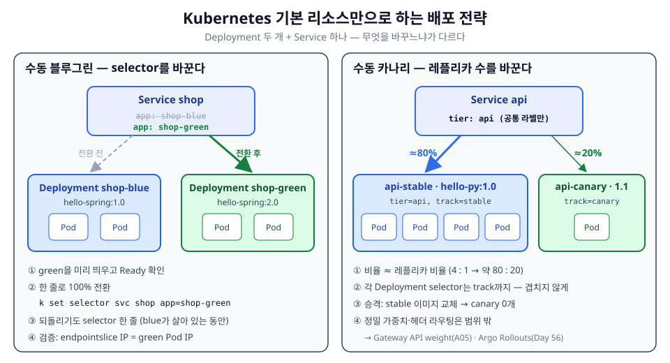

> **자격증 준비 · CKAD** | 난이도 ★★★☆☆ | 예상 소요 3시간

> ⚠️ 이 편의 모든 연습 과제는 CNCF가 공개한 **CKAD 공식 커리큘럼(v1.37)을 바탕으로 직접 창작한** 시험 스타일 과제입니다. 실제 시험 문제(유출 문제·덤프)가 아니며 실제 출제 내용과 무관합니다.

## 🎯 오늘의 목표

- 과제 문장의 "동시에 최대 N개 추가", "사용 불가 0개", "준비 후 M초 관찰" 같은 조건을 `maxSurge`·`maxUnavailable`·`minReadySeconds`로 바로 옮기고, 멈춘 롤아웃을 찾아 **지정 리비전으로 롤백**할 수 있다
- Deployment 두 개와 Service 하나로 **수동 블루그린**(selector 전환)과 **수동 카나리**(레플리카 비율)를 kubectl만으로 만들 수 있다
- Helm으로 차트를 **검색·설치·values 덮어쓰기·업그레이드·삭제**하고, 릴리스를 네임스페이스 너머로 찾을 수 있다
- Kustomize base/overlay를 `kubectl apply -k`로 적용하고 렌더링 결과를 먼저 확인할 수 있다

---

## 1. 커리큘럼 항목 요약 — Application Deployment (20%)

| 공식 커리큘럼 항목 | 이 편의 섹션 | 이론은 여기서 |
|---|---|---|
| Use Kubernetes primitives to implement common deployment strategies (e.g. blue/green or canary) | 4-2, 4-3 | [Day 56](../../07-gitops/day56-argo-rollouts.md) 3장(개념 비교) |
| Understand Deployments and how to perform rolling updates | 4-1 | [Day 11](../../02-kubernetes/day11-deployment.md), [CKA K03](../cka/k03-workloads-scheduling.md) |
| Use the Helm package manager to deploy existing packages | 4-4 | [Day 16](../../02-kubernetes/day16-helm.md), [CKA K02](../cka/k02-rbac-helm-kustomize-crd.md) 4장 |
| Kustomize | 4-5 | [Day 52](../../07-gitops/day52-kustomize.md), CKA K02 5장 |

> 💡 커리큘럼 문구는 "Kubernetes **primitives**로" 배포 전략을 구현하라는 것입니다. Argo Rollouts 같은 별도 컨트롤러가 아니라 **Deployment·Service·라벨만으로** 하는 방법이 시험 범위입니다. Rollout CRD로 자동화하는 방법은 Day 56에서 다뤘으니 여기서는 링크로만 잇습니다. ReplicaSet·리비전의 원리는 Day 11, Helm 차트 구조는 Day 16, base/overlay 설계는 Day 52를 보세요.

### 실습 환경

[A00](./a00-exam-overview-lab.md)의 고정값. 스냅샷 **`ckad-clean`** 으로 되돌린 뒤 base의 `~/ckad/a02`에서 context `cka-main`으로 작업합니다. [A01](./a01-design-build.md)에서 레지스트리에 push한 `hello-spring:1.0`·`2.0`, `hello-py:1.0`·`1.1`(A01 과제 3)을 씁니다.

```bash
k config use-context cka-main
mkdir -p ~/ckad/a02 && cd ~/ckad/a02
k create ns a02
k config set-context --current --namespace=a02
export do="--dry-run=client -o yaml"; export now="--force --grace-period=0"
REG=192.168.56.1:5000
curl -s http://$REG/v2/ckad/hello-spring/tags/list   # ["1.0","2.0"]  ← 없으면 A01 과제 1부터
curl -s http://$REG/v2/ckad/hello-py/tags/list       # ["1.0","1.1"]  ← 1.1이 없으면 A01 과제 3
```

---

## 2. 출제 유형 — 어떻게 채점되는가

| 과제 형태 | 예시 문장(창작) | 채점 포인트 |
|---|---|---|
| **롤링 파라미터형** | "업데이트 중 추가 Pod는 최대 2개, 사용 불가는 0개로" | `spec.strategy.rollingUpdate` 값, 최종 이미지 |
| **롤백형** | "잘못된 업데이트를 되돌려 이미지 X를 쓰는 리비전으로" | 최종 이미지, Pod 정상, (필요하면) 기록 파일 |
| **블루그린형** | "Service가 green Deployment로만 트래픽을 보내게 전환하라" | Service **selector**, 엔드포인트가 green Pod만 가리키는가 |
| **카나리형** | "총 Pod 10개 중 약 20%가 새 버전을 받게" | 두 Deployment의 **레플리카 수**, 공통 라벨, Service selector |
| **Helm형** | "저장소 추가 → 차트 X 버전 Y를 네임스페이스 Z에 values로 설치", "릴리스 찾아 삭제" | 릴리스 이름·네임스페이스·차트 버전·적용된 values |
| **Kustomize형** | "`<폴더>`의 overlay를 적용하라", "이미지 태그를 Kustomize로 바꿔 적용" | 클러스터의 최종 리소스(이름 접두사, 네임스페이스, 이미지, 레플리카) |

> ⚠️ 블루그린·카나리 과제는 **Service가 실제로 어떤 Pod를 가리키는지**로 채점된다고 생각하세요. selector 오타 하나로 엔드포인트가 비어도 `kubectl apply`는 아무 오류를 내지 않습니다. 반드시 `k get endpointslice -l kubernetes.io/service-name=<svc>`로 확인합니다.

---

## 3. 핵심 명령·매니페스트 표

| 하고 싶은 것 | 명령 |
|---|---|
| Deployment 생성 | `k create deploy web --image=$REG/ckad/hello-spring:1.0 --replicas=4 --port=8080` |
| 전략 파라미터 | `k patch deploy web -p '{"spec":{"strategy":{"rollingUpdate":{"maxSurge":2,"maxUnavailable":0}}}}'` |
| 전략을 Recreate로 | `k patch deploy web --type=json -p '[{"op":"remove","path":"/spec/strategy/rollingUpdate"},{"op":"replace","path":"/spec/strategy/type","value":"Recreate"}]'` |
| `minReadySeconds` 등 | `k patch deploy web -p '{"spec":{"minReadySeconds":10,"revisionHistoryLimit":5,"progressDeadlineSeconds":60}}'` |
| 이미지 변경 | `k set image deploy/web hello-spring=$REG/ckad/hello-spring:2.0` (컨테이너 이름 = 이미지 이름의 마지막 부분) |
| 변경 사유 | `k annotate deploy/web kubernetes.io/change-cause="2.0 배포" --overwrite` |
| 롤아웃 상태·이력 | `k rollout status deploy/web`, `k rollout history deploy/web [--revision=N]` |
| 롤백 | `k rollout undo deploy/web [--to-revision=N]` |
| 일시 중지·재개 | `k rollout pause deploy/web` → 여러 변경 → `k rollout resume deploy/web` |
| Service 생성 | `k expose deploy web-blue --name=web --port=80 --target-port=8080` |
| selector 교체 | `k set selector svc web app=web-green` (selector **전체를** 바꿈) |
| 엔드포인트 확인 | `k get endpointslice -l kubernetes.io/service-name=web -o wide` |
| 레플리카 비율 | `k scale deploy api-stable --replicas=8; k scale deploy api-canary --replicas=2` |

| Helm | 명령 |
|---|---|
| 저장소 추가·갱신·목록 | `helm repo add podinfo https://stefanprodan.github.io/podinfo` · `helm repo update` · `helm repo list` |
| 차트 검색 | `helm search repo podinfo` · 버전 목록 `--versions` |
| 기본 values 보기 | `helm show values podinfo/podinfo --version 6.16.0` |
| 설치 | `helm install <릴리스> podinfo/podinfo -n <ns> --create-namespace --version 6.16.0 -f values.yaml --set replicaCount=2` |
| 업그레이드 | `helm upgrade <릴리스> podinfo/podinfo -n <ns> --version 6.17.0 --reuse-values --set ui.message=v2` |
| 상태·이력·값 | `helm status`, `helm history`, `helm get values [--all]`, `helm get manifest` |
| 목록 | `helm list -n <ns>`, **`helm list -A`**, `--failed`, `--pending`, `--uninstalled` |
| 롤백 | `helm rollback <릴리스> <리비전> -n <ns>` |
| 삭제 | `helm uninstall <릴리스> -n <ns>` (`--keep-history`면 이력 보존) |
| 렌더링만 | `helm template <릴리스> podinfo/podinfo --version 6.16.0 -f values.yaml` |
| 차트 내려받기 | `helm pull podinfo/podinfo --version 6.16.0 --untar` |

| Kustomize | 명령 |
|---|---|
| 렌더링(적용 안 함) | `k kustomize overlays/dev` |
| 적용 / 차이 / 삭제 | `k apply -k overlays/dev` · `k diff -k overlays/dev` · `k delete -k overlays/dev` |
| 이미지 태그만 바꾸기 | `kustomization.yaml`의 `images:` → `newTag:` |

---

## 4. 영역별 핵심 — 시험에서 필요한 만큼만

### 4-1. 롤링 업데이트 파라미터

📖 **시험장에서 찾을 문서:** "Deployments"(`/docs/concepts/workloads/controllers/deployment/`) — *Rolling Update Deployment*, *Max Unavailable*, *Max Surge*, *Min Ready Seconds*, *Progress Deadline Seconds*, *Revision History Limit*, *Rolling Back a Deployment* 절이 한 페이지에 다 있습니다.

| 필드 (`spec.` 아래) | 뜻 | 기본값 | 반올림 |
|---|---|---|---|
| `strategy.type` | `RollingUpdate` / `Recreate`(모두 내리고 새로) | RollingUpdate | — |
| `strategy.rollingUpdate.maxSurge` | 원하는 수보다 **추가로** 띄울 수 있는 Pod 수(정수 또는 %) | 25% | % → **올림** |
| `strategy.rollingUpdate.maxUnavailable` | 원하는 수 중 **사용 불가**여도 되는 Pod 수 | 25% | % → **내림** |
| `minReadySeconds` | 새 Pod가 Ready 후 **이 시간 동안 버텨야** 사용 가능으로 셈 | 0 | — |
| `progressDeadlineSeconds` | 이 시간 동안 진전이 없으면 `Progressing=False`, 이유 `ProgressDeadlineExceeded` | 600 | — |
| `revisionHistoryLimit` | 남겨 둘 옛 ReplicaSet 수(= 롤백 가능한 리비전 수) | 10 | — |



예: 레플리카 4, 기본값(25%/25%) → surge 1, unavailable 1 → 업데이트 중 Pod는 **최대 5개, 최소 3개 사용 가능**. 레플리카 10, 30%/30% → surge 3(올림), unavailable 3(내림).

> ⚠️ `maxSurge`와 `maxUnavailable`을 **둘 다 0**으로 둘 수는 없습니다(진행할 방법이 없음). "무중단"은 `maxUnavailable: 0` + `maxSurge ≥ 1`입니다.

> 💡 `progressDeadlineSeconds`를 넘겨도 쿠버네티스는 **자동 롤백하지 않습니다.** 상태만 표시합니다. 롤백은 사람이(`rollout undo`) 하거나 Argo Rollouts 같은 도구(Day 56)가 합니다. 과제가 "실패를 감지할 수 있게 60초로"라고 하면 이 필드입니다.

### 4-2. 수동 블루그린 — Service selector 전환



📖 **시험장에서 찾을 문서:** "Service"(`/docs/concepts/services-networking/service/` — *Services without selectors* 위의 selector 설명), `kubectl set selector` 레퍼런스(`/docs/reference/kubectl/generated/kubectl_set/kubectl_set_selector/`), "Managing Workloads"(`/docs/concepts/workloads/management/`).

```
           Service web  (selector: app=web-blue)  ──전환──▶  (selector: app=web-green)
                │                                                  │
   ┌────────────┴───────────┐                         ┌────────────┴───────────┐
   │ Deployment web-blue    │                         │ Deployment web-green   │
   │ hello-spring:1.0 × 2   │  ← 둘 다 계속 떠 있음 →  │ hello-spring:2.0 × 2   │
   └────────────────────────┘                         └────────────────────────┘
```

| 단계 | 명령 | 포인트 |
|---|---|---|
| ① blue 배포 + Service | `k create deploy web-blue --image=...:1.0 --replicas=2 --port=8080` → `k expose deploy web-blue --name=web --port=80 --target-port=8080` | `kubectl create deploy`는 라벨 **`app=<Deployment 이름>`** 을 붙이므로 selector가 `app=web-blue`가 됨 |
| ② green 배포 | `k create deploy web-green --image=...:2.0 --replicas=2 --port=8080` | Service는 아직 blue만 가리킴. green을 **미리 Ready**로 |
| ③ 전환 | `k set selector svc web app=web-green` | 한 번에 100% 전환 |
| ④ 되돌리기 | `k set selector svc web app=web-blue` | blue가 살아 있으므로 즉시 |
| ⑤ 정리 | `k scale deploy web-blue --replicas=0` (또는 삭제) | 과제가 "blue는 남겨 두라"면 지우지 말 것 |

> 💡 **`kubectl create deploy`의 라벨을 그대로 이용**하는 것이 가장 빠릅니다. 라벨을 `app=web, version=blue`처럼 직접 설계하려면 `$do`로 뽑아 `metadata.labels`, `spec.selector.matchLabels`, `template.metadata.labels` **세 곳**을 모두 고쳐야 합니다. 과제가 라벨을 지정하면 그것을 따르세요.

### 4-3. 수동 카나리 — 레플리카 비율

```
                    Service api (selector: tier=api)
                 ┌──────────────┴───────────────┐
   Deployment api-stable                  Deployment api-canary
   tier=api, track=stable                 tier=api, track=canary
   hello-py:1.0 × 4  (≈80%)               hello-py:1.1 × 1  (≈20%)
```

- 두 Deployment의 Pod 템플릿에 **공통 라벨**(`tier: api`)을 붙이고, Service는 그 공통 라벨만 선택합니다.
- Deployment 각자의 selector는 **서로 겹치지 않게** `track` 라벨까지 포함합니다(겹치면 두 Deployment가 서로의 Pod를 자기 것으로 셀 수 있음).
- kube-proxy(우리 클러스터는 Cilium)는 엔드포인트에 **고르게** 나누므로 비율 ≈ 레플리카 비율입니다. 정확히 20%가 아니라 "약 20%"입니다.
- 승격(promote): stable의 이미지를 새 버전으로 바꾸고 canary를 0으로 줄이거나 지웁니다.

> 💡 정확한 가중치(예: 정확히 5%)나 헤더 기반 라우팅은 Deployment만으로는 불가능합니다. Gateway API `HTTPRoute`의 `backendRefs.weight`(A05)나 Argo Rollouts(Day 56)의 영역입니다. 시험에서 "primitives로"라고 하면 레플리카 비율입니다.

### 4-4. Helm — 기존 패키지 배포

📖 **시험장에서 찾을 문서:** `helm.sh/docs`(허용 목록) → *Using Helm*(`helm.sh/docs/intro/using_helm/` — `--set` 문법과 `-f` 우선순위), 명령 레퍼런스 `helm.sh/docs/helm/helm_install/`, `helm_upgrade/`, `helm_uninstall/`, `helm_list/`, `helm_search_repo/`.

| 기억할 규칙 | 내용 |
|---|---|
| values 우선순위 | 차트 기본 `values.yaml` < `-f` 파일(여러 개면 **뒤가 이김**) < `--set`(뒤가 이김) |
| `--set` 문법 | 중첩 `a.b=c`, 목록 `list={x,y}`, 목록 원소 `list[0].name=x`, 점이 든 키 `a\.b=c`, 문자열 강제 `--set-string` |
| `upgrade` 때 값 | 아무 옵션 없이 `upgrade`하면 **이전에 준 값이 사라지고 차트 기본값으로** 돌아감 → 유지하려면 `--reuse-values` 또는 같은 `-f`를 다시 |
| 네임스페이스 | 릴리스 기록은 네임스페이스별 Secret(`sh.helm.release.v1.<릴리스>.v<N>`). `-n`을 빼면 "not found" |
| 릴리스 이름 → 리소스 이름 | 차트마다 다름. podinfo는 릴리스 이름에 `podinfo`가 들어 있으면 그대로, 아니면 `<릴리스>-podinfo` |
| Helm 3 / 4 | 명령은 같음. Helm 4는 `--atomic` → `--rollback-on-failure` 등 이름 변경, 새 설치는 server-side apply ([CKA K02](../cka/k02-rbac-helm-kustomize-crd.md) 4장) |

> 💡 시험장은 인터넷 저장소에 닿지 않을 수도 있습니다. 과제가 저장소 URL을 주면 `helm repo add`, 이미 추가돼 있다고 하면 **`helm repo list`부터** 보세요. `helm search hub`(Artifact Hub 검색)는 외부 접속이 필요하니 기대하지 않는 것이 안전합니다.

### 4-5. Kustomize — overlay 적용

📖 **시험장에서 찾을 문서:** kubernetes.io "Declarative Management of Kubernetes Objects Using Kustomize"(`/docs/tasks/manage-kubernetes-objects/kustomization/`). kustomize.io·kubectl.docs.kubernetes.io는 **허용 목록에 없습니다.**

자주 쓰는 필드와 함정은 [CKA K02 5장](../cka/k02-rbac-helm-kustomize-crd.md)의 표에 정리돼 있습니다. 개발자 과제에서 특히 자주 보는 것만 덧붙입니다.

| 필드 | 개발자 과제에서 |
|---|---|
| `images:` (`name`, `newName`, `newTag`) | "Kustomize로 이미지 태그를 2.0으로" → **매니페스트 수정 없이** `newTag` |
| `replicas:` | "dev는 1개, prod는 3개" |
| `configMapGenerator` | 설정 파일·리터럴로 ConfigMap 생성. 이름 뒤에 **해시 접미사** → 내용이 바뀌면 이름이 바뀌어 Deployment가 **자동 롤링**(Day 52 7-1) |
| `patches:` (`path:` 또는 인라인 `patch:`) | 리소스 일부 덮어쓰기(strategic merge 또는 JSON6902). `target:`으로 대상 지정 |
| `namePrefix` / `namespace` / `labels` | 환경별 이름·위치·라벨 |

> ⚠️ `k apply -k`는 **폴더**를 받습니다(`kustomization.yaml`이 있는 곳). `-f kustomization.yaml`로 적용하면 Kustomization 자체를 쿠버네티스 리소스로 보내려다 `no matches for kind "Kustomization"` 오류가 납니다.

---

## 5. 시간 절약 팁

- **`kubectl create deploy`의 컨테이너 이름을 먼저 확인**: `set image`에는 컨테이너 이름이 필요합니다. 이미지 `192.168.56.1:5000/ckad/hello-spring:1.0`의 컨테이너 이름은 `hello-spring`입니다. 헷갈리면 `k get deploy web -o jsonpath='{.spec.template.spec.containers[*].name}'`.
- **`set image *=...`**: 컨테이너가 하나뿐이면 `k set image deploy/web '*=<이미지>'`로 이름을 몰라도 됩니다.
- **롤백 전 `--revision=N`으로 내용 확인**: `k rollout history deploy/web --revision=3 | grep -i image`. "1.0을 쓰는 리비전으로"는 번호가 아니라 **내용**으로 찾는 과제입니다.
- **블루그린 검증은 엔드포인트 IP 대조**: `k get pods -l app=web-green -o wide`의 IP와 `endpointslice`의 IP가 같으면 끝.
- **Helm은 설치 전에 `helm template`이나 `--dry-run`**: values 오타를 클러스터에 올리기 전에 잡습니다. `helm show values ... | grep -n -A3 service:`로 키 경로를 확인하세요.
- **Kustomize는 apply 전에 `k kustomize`**: 이름 접두사·네임스페이스·이미지 태그가 렌더링에 반영됐는지 5초 만에 봅니다.

---

## 6. 자주 하는 실수

| 실수 | 결과 | 바로잡기 |
|---|---|---|
| `set image deploy/web web=...` | `unable to find container named "web"` | 컨테이너 이름 확인 또는 `'*=...'` |
| `rollout undo`를 두 번 | 두 번째 undo는 **방금 되돌린 리비전으로 다시** 감 | `--to-revision=N`으로 명시 |
| `maxSurge: 0, maxUnavailable: 0` | 검증 오류 | 하나는 1 이상 |
| 블루그린에서 `k label`로 Pod 라벨만 바꿈 | Deployment가 새 Pod를 만들면 원래 라벨로 돌아감 | Service selector를 바꾸거나 Pod **템플릿** 라벨을 바꿈 |
| `k patch svc web -p '{"spec":{"selector":{"app":"web-green"}}}'`인데 selector에 다른 키가 더 있음 | 키가 **병합**되어 두 조건 AND → 엔드포인트 0 | `k set selector`(전체 교체) 또는 `--type=merge`로 다른 키를 `null` |
| 카나리 두 Deployment의 selector가 같음 | 레플리카 수가 엉뚱하게 계산되고 서로의 Pod를 건드림 | 각 selector에 `track` 라벨 포함 |
| `helm upgrade`에 값 재지정 누락 | 설치 때 준 values가 기본값으로 돌아감 | `--reuse-values` 또는 같은 `-f` |
| `helm list`가 비어 있음 | 다른 네임스페이스 | `helm list -A` |
| `helm uninstall`에 `-n` 누락 | `release: not found` | `-n <ns>` |
| `k apply -f kustomization.yaml` | `no matches for kind "Kustomization"` | `k apply -k <폴더>` |
| overlay의 `images.name`에 태그까지 씀 | 매칭 실패, 이미지 그대로 | `name`은 태그 없는 이미지 이름, 태그는 `newTag` |

---

## 7. 창작 연습 과제

> 아래 과제는 모두 **공식 커리큘럼을 바탕으로 창작한** 연습 문제입니다. base의 `~/ckad/a02`에서 context `cka-main`, 네임스페이스 `a02`로 작업합니다(과제가 다른 네임스페이스를 지정하면 그것을 따름). 과제당 목표 시간은 4~7분입니다.

### 과제 1. 무중단 롤링 업데이트와 변경 사유 (목표 5분)

`a02`에 Deployment `catalog`를 만들어라: 이미지 `192.168.56.1:5000/ckad/hello-spring:1.0`, 레플리카 4, 포트 8080. 업데이트 중 **사용 불가 Pod는 0개, 추가 Pod는 최대 2개**, 새 Pod는 Ready 후 **10초** 지나야 사용 가능으로 치며, 옛 ReplicaSet은 **5개**까지만 남긴다. 그 뒤 이미지를 `:2.0`으로 업데이트하고 변경 사유 `upgrade to 2.0`을 기록하라.

📖 참고 문서: "Deployments"(*Max Surge*, *Max Unavailable*, *Min Ready Seconds*, *Revision History Limit*, *Checking Rollout History of a Deployment*)

<details>
<summary>풀이·검증</summary>

```bash
k create deploy catalog --image=$REG/ckad/hello-spring:1.0 --replicas=4 --port=8080
k patch deploy catalog -p '{"spec":{"minReadySeconds":10,"revisionHistoryLimit":5,"strategy":{"rollingUpdate":{"maxSurge":2,"maxUnavailable":0}}}}'
k rollout status deploy/catalog
k set image deploy/catalog hello-spring=$REG/ckad/hello-spring:2.0
k annotate deploy/catalog kubernetes.io/change-cause="upgrade to 2.0" --overwrite
k rollout status deploy/catalog
```

```bash
k get deploy catalog -o jsonpath='{.spec.strategy.rollingUpdate} {.spec.minReadySeconds} {.spec.revisionHistoryLimit}{"\n"}'
# {"maxSurge":2,"maxUnavailable":0} 10 5
k rollout history deploy/catalog
# REVISION  CHANGE-CAUSE
# 1         <none>
# 2         upgrade to 2.0
k get rs -l app=catalog            # 새 RS 4/4, 옛 RS 0/0
```

`patch`를 `rollout status`가 끝난 뒤에 했기 때문에 전략 변경만으로는 새 리비전이 생기지 않습니다(Pod 템플릿이 아니므로). `minReadySeconds: 10` 때문에 업데이트가 눈에 띄게 느려지는 것도 확인하세요. 진행 중 `k get pods -w`를 보면 Pod 수가 **6을 넘지 않고**(4+2), Ready인 옛 Pod가 4 아래로 내려가지 않습니다.
</details>

### 과제 2. 멈춘 롤아웃 감지와 지정 리비전 롤백 (목표 6분)

과제 1의 `catalog`에서 진전이 없으면 **45초** 안에 실패로 표시되게 하라. 이미지를 존재하지 않는 `:9.9`로 바꾸고, 실패 상태가 표시되는 것을 확인한 뒤 **이미지 `:2.0`을 쓰는 리비전**으로 되돌려라. 롤백 직전의 `rollout history` 출력을 `~/ckad/a02/catalog-history.txt`에 저장하라.

📖 참고 문서: "Deployments"(*Progress Deadline Seconds*, *Failed Deployment*, *Rolling Back to a Previous Revision*)

<details>
<summary>풀이·검증</summary>

```bash
k patch deploy catalog -p '{"spec":{"progressDeadlineSeconds":45}}'
k set image deploy/catalog hello-spring=$REG/ckad/hello-spring:9.9
k annotate deploy/catalog kubernetes.io/change-cause="bad 9.9" --overwrite
k rollout status deploy/catalog --timeout=90s
# error: deployment "catalog" exceeded its progress deadline
k get deploy catalog -o jsonpath='{.status.conditions[?(@.type=="Progressing")].reason}{"\n"}'
# ProgressDeadlineExceeded

k rollout history deploy/catalog > ~/ckad/a02/catalog-history.txt
for r in $(k rollout history deploy/catalog | awk 'NR>2 {print $1}'); do
  echo "$r $(k rollout history deploy/catalog --revision=$r | grep -o 'hello-spring:[^ ]*')"
done
# 1 hello-spring:1.0
# 2 hello-spring:2.0
# 3 hello-spring:9.9
k rollout undo deploy/catalog --to-revision=2
k rollout status deploy/catalog
```

```bash
cat ~/ckad/a02/catalog-history.txt
k get deploy catalog -o jsonpath='{.spec.template.spec.containers[0].image}{"\n"}'   # ...hello-spring:2.0
k get pods -l app=catalog                       # 4개 Running, ErrImagePull 없음
k rollout history deploy/catalog                # 2번이 사라지고 4번(= 옛 2번 내용)이 생김
```

`maxUnavailable: 0`이었으므로 실패한 업데이트 중에도 2.0 Pod 4개는 그대로 서비스했습니다. 실패한 새 Pod는 `maxSurge: 2`만큼(2개) `ErrImagePull` 상태였습니다. 롤백하면 해당 리비전 번호는 **새 번호로 옮겨 갑니다.**
</details>

### 과제 3. Recreate 전략 (목표 4분)

`a02`에 Deployment `migrator`(이미지 `nginx:1.27`, 레플리카 3)를 만들어라. 이 앱은 두 버전이 동시에 실행되면 안 된다. 그에 맞는 전략으로 바꾼 뒤 이미지를 `nginx:1.28`로 업데이트하라.

📖 참고 문서: "Deployments"(*Recreate Deployment*)

<details>
<summary>풀이·검증</summary>

```bash
k create deploy migrator --image=nginx:1.27 --replicas=3
k patch deploy migrator --type=json -p '[
  {"op":"remove","path":"/spec/strategy/rollingUpdate"},
  {"op":"replace","path":"/spec/strategy/type","value":"Recreate"}]'
k set image deploy/migrator nginx=nginx:1.28
k get pods -l app=migrator -w        # 3개 모두 Terminating → 그다음 새 Pod 3개 (Ctrl+C)
```

```bash
k get deploy migrator -o jsonpath='{.spec.strategy}{"\n"}'          # {"type":"Recreate"}
k get deploy migrator -o jsonpath='{.spec.template.spec.containers[0].image}{"\n"}'   # nginx:1.28
```

`type`만 `Recreate`로 바꾸고 `rollingUpdate`를 남겨 두면 `spec.strategy.rollingUpdate: Forbidden: may not be specified when strategy type is 'Recreate'` 오류가 납니다. 그래서 JSON 패치로 **지우고 바꾸기**를 한 번에 합니다. `k edit`으로 해도 되지만 두 군데를 고쳐야 한다는 점은 같습니다.
</details>

### 과제 4. 수동 블루그린 (목표 7분)

`a02`에 다음을 만들어라.
- Deployment `shop-blue`: `hello-spring:1.0`, 레플리카 2, 포트 8080
- Service `shop`: 포트 80 → 8080, 지금은 `shop-blue`의 Pod만 가리킨다
- Deployment `shop-green`: `hello-spring:2.0`, 레플리카 2

(노드 메모리가 빠듯하면 먼저 `k delete deploy catalog`로 과제 1·2의 JVM Pod를 정리하세요.) green의 Pod가 모두 Ready가 되면 Service `shop`이 **green의 Pod만** 가리키도록 전환하라. blue Deployment는 지우지 말고 레플리카만 0으로 줄여라. Service를 통해 받은 응답 한 줄을 `~/ckad/a02/shop.txt`에 저장하라.

📖 참고 문서: "Service"(*Defining a Service*), `kubectl set selector` 레퍼런스, "Deployments"

<details>
<summary>풀이·검증</summary>

```bash
k create deploy shop-blue  --image=$REG/ckad/hello-spring:1.0 --replicas=2 --port=8080
k expose deploy shop-blue --name=shop --port=80 --target-port=8080
k create deploy shop-green --image=$REG/ckad/hello-spring:2.0 --replicas=2 --port=8080
k rollout status deploy/shop-green

k set selector svc shop app=shop-green
k scale deploy shop-blue --replicas=0
k run tmp --image=busybox:1.37 --rm -i --restart=Never -- wget -qO- http://shop/ > ~/ckad/a02/shop.txt
```

```bash
cat ~/ckad/a02/shop.txt                    # hello from hello-spring 2.0 on shop-green-...
k get svc shop -o jsonpath='{.spec.selector}{"\n"}'          # {"app":"shop-green"}
k get endpointslice -l kubernetes.io/service-name=shop -o jsonpath='{.items[*].endpoints[*].addresses}{"\n"}'
k get pods -l app=shop-green -o wide       # 위 주소와 같은 IP 두 개
k get deploy shop-blue                     # 0/0 (남아 있음)
```

`k expose deploy shop-blue`는 Deployment의 selector(`app=shop-blue`)를 그대로 Service selector로 복사합니다. 그래서 전환은 `set selector` 한 줄입니다. 되돌릴 때는 `k scale deploy shop-blue --replicas=2` → Ready 확인 → `k set selector svc shop app=shop-blue` 순서로, **받을 쪽을 먼저 준비**합니다.
</details>

### 과제 5. 수동 카나리 — 약 20% (목표 7분)

`a02`에 Service `api`(포트 80 → 8000)와 Deployment 두 개를 만들어 **전체 5개 Pod 중 1개(약 20%)** 만 새 버전을 받게 하라.
- `api-stable`: `hello-py:1.0`, 레플리카 4, Pod 라벨 `tier=api`, `track=stable`
- `api-canary`: `hello-py:1.1`, 레플리카 1, Pod 라벨 `tier=api`, `track=canary`

Service를 통해 50번 요청해 버전별 응답 수를 `~/ckad/a02/canary.txt`에 저장하라. 그다음 **승격**하라: stable을 1.1로 올리고 canary는 0으로 줄인다.

📖 참고 문서: "Managing Workloads"(*Canary deployments* 절), "Labels and Selectors"(`/docs/concepts/overview/working-with-objects/labels/`)

<details>
<summary>풀이·검증</summary>

```bash
k create deploy api-stable --image=$REG/ckad/hello-py:1.0 --replicas=4 --port=8000 $do > api-stable.yaml
```

`api-stable.yaml`의 라벨 세 곳을 고칩니다(`app: api-stable` → 아래처럼).

```yaml
metadata:
  labels: {tier: api, track: stable}
spec:
  selector:
    matchLabels: {tier: api, track: stable}
  template:
    metadata:
      labels: {tier: api, track: stable}
```

```bash
sed -e 's/api-stable/api-canary/' -e 's/stable/canary/g' -e 's/replicas: 4/replicas: 1/' \
    -e 's/hello-py:1.0/hello-py:1.1/' api-stable.yaml > api-canary.yaml
k apply -f api-stable.yaml -f api-canary.yaml
k create service clusterip api --tcp=80:8000 $do | sed 's/app: api/tier: api/' | k apply -f -
k get endpointslice -l kubernetes.io/service-name=api -o jsonpath='{range .items[*].endpoints[*]}{.addresses[0]}{"\n"}{end}' | wc -l   # 5

k run tmp --image=busybox:1.37 --rm -i --restart=Never -- \
  sh -c 'for i in $(seq 50); do wget -qO- http://api/; done' \
  | grep -o 'hello-py [0-9.]*' | sort | uniq -c > ~/ckad/a02/canary.txt
cat ~/ckad/a02/canary.txt
```

```
     41 hello-py 1.0
      9 hello-py 1.1
```

숫자는 매번 조금씩 다릅니다(약 40:10). `k create service clusterip api`는 selector를 `app: api`로 만들기 때문에 `sed`로 `tier: api`로 바꿔 적용했습니다. 승격:

```bash
k set image deploy/api-stable hello-py=$REG/ckad/hello-py:1.1
k rollout status deploy/api-stable
k scale deploy api-canary --replicas=0
k get deploy api-stable -o jsonpath='{.spec.template.spec.containers[0].image}{"\n"}'   # ...hello-py:1.1
```

`sed`의 `s/stable/canary/g`는 Deployment 이름까지 바꾸므로 첫 번째 식이 사실상 중복이지만, 의도를 드러내려고 남겼습니다. 결과 파일을 `k apply` 전에 `cat`으로 한 번 보세요.
</details>

### 과제 6. Helm — values 파일과 `--set`으로 설치 (목표 6분)

저장소 `podinfo`(`https://stefanprodan.github.io/podinfo`)를 추가하고, 차트 `podinfo/podinfo` **버전 6.16.0**을 네임스페이스 `a02-helm`(없으면 생성)에 릴리스 이름 `frontend`로 설치하라. 다음 values를 `~/ckad/a02/frontend-values.yaml`에 두고 설치에 사용하라: 레플리카 2, Service 타입 NodePort·노드 포트 **30898**. 메시지 `ckad-a02`는 명령줄 `--set`으로 준다. 설치 후 Service를 통해 응답의 `message`를 확인하라.

📖 참고 문서: helm.sh → *Using Helm*(*Customizing the Chart Before Installing*), `helm install` 레퍼런스

<details>
<summary>풀이·검증</summary>

```bash
helm repo add podinfo https://stefanprodan.github.io/podinfo
helm repo update
helm search repo podinfo/podinfo --versions | head -4
helm show values podinfo/podinfo --version 6.16.0 | grep -n -A12 '^service:'   # 키 경로 확인

cat > ~/ckad/a02/frontend-values.yaml <<'EOF'
replicaCount: 2
service:
  type: NodePort
  nodePort: 30898
EOF

helm install frontend podinfo/podinfo -n a02-helm --create-namespace --version 6.16.0 \
  -f ~/ckad/a02/frontend-values.yaml --set ui.message=ckad-a02
```

```bash
helm list -n a02-helm                       # frontend  deployed  podinfo-6.16.0
helm get values frontend -n a02-helm        # replicaCount, service, ui.message 세 가지
k -n a02-helm get deploy,svc                # frontend-podinfo (2/2), NodePort 9898:30898
curl -s http://192.168.56.11:30898/ | grep -E '"(version|message)"'
#   "message": "ckad-a02",
#   "version": "6.16.0",
```

릴리스 이름 `frontend`에 `podinfo`가 들어 있지 않아 리소스 이름은 `frontend-podinfo`입니다(차트의 `fullname` 템플릿). `helm get values`는 **사용자가 준 값만** 보여 줍니다. 기본값까지 보려면 `--all`.
</details>

### 과제 7. Helm — 업그레이드, 이력, 롤백, 삭제 (목표 6분)

과제 6의 `frontend`를 차트 **6.17.0**으로 업그레이드하되 기존 values는 **모두 유지**하고 레플리카만 3으로 바꿔라. 이력을 확인한 뒤 리비전 1로 롤백하라. 마지막으로 다른 네임스페이스에 연습용 릴리스 `scratch`(podinfo 6.16.0, 네임스페이스 `a02-tmp`)를 설치했다가, **모든 네임스페이스에서** 릴리스를 찾아 `scratch`만 삭제하라.

📖 참고 문서: helm.sh → `helm upgrade`(*--reuse-values*), `helm history`, `helm rollback`, `helm list`(*--all-namespaces*), `helm uninstall`

<details>
<summary>풀이·검증</summary>

```bash
helm upgrade frontend podinfo/podinfo -n a02-helm --version 6.17.0 --reuse-values --set replicaCount=3
helm get values frontend -n a02-helm        # replicaCount: 3, service, ui.message 그대로
helm history frontend -n a02-helm
# REVISION  STATUS      CHART           APP VERSION  DESCRIPTION
# 1         superseded  podinfo-6.16.0  6.16.0       Install complete
# 2         deployed    podinfo-6.17.0  6.17.0       Upgrade complete
helm rollback frontend 1 -n a02-helm
helm history frontend -n a02-helm | tail -1  # 3  deployed  podinfo-6.16.0 ... Rollback to 1

helm install scratch podinfo/podinfo -n a02-tmp --create-namespace --version 6.16.0
helm list -A                                 # frontend(a02-helm), scratch(a02-tmp), traefik(traefik)
helm uninstall scratch -n a02-tmp
```

```bash
helm list -A                                 # scratch 없음, frontend·traefik 남음
k -n a02-helm get deploy frontend-podinfo -o jsonpath='{.spec.replicas} {.spec.template.spec.containers[0].image}{"\n"}'
# 2 ghcr.io/stefanprodan/podinfo:6.16.0     ← 리비전 1의 값으로 돌아감
```

`--reuse-values` 없이 `--set replicaCount=3`만 주면 NodePort 설정과 메시지가 **차트 기본값으로 돌아갑니다**(Service가 ClusterIP가 됨). 롤백은 리비전 1 내용으로 **새 리비전 3**을 만듭니다. A00에서 설치한 `traefik` 릴리스는 건드리지 마세요.
</details>

### 과제 8. Kustomize — overlay로 이미지·레플리카·이름 바꿔 적용 (목표 6분)

`~/ckad/a02/kust/`에 base와 overlay `prod`를 만들고 적용하라.
- base: Deployment `greeter`(`hello-py:1.0`, 레플리카 1, 포트 8000)와 Service `greeter`(80 → 8000)
- overlay `prod`: 네임스페이스 `a02-prod`, 이름 접두사 `prod-`, 모든 리소스에 라벨 `env=prod`, 이미지 태그 **1.1**, 레플리카 **3**

적용 전에 렌더링 결과를 `~/ckad/a02/prod-rendered.yaml`에 저장하라.

📖 참고 문서: "Declarative Management of Kubernetes Objects Using Kustomize"(*Bases and Overlays*, *Setting cross-cutting fields*, *images*, *replicas*)

<details>
<summary>풀이·검증</summary>

```bash
mkdir -p ~/ckad/a02/kust/{base,overlays/prod} && cd ~/ckad/a02/kust
k create deploy greeter --image=$REG/ckad/hello-py:1.0 --port=8000 $do > base/deploy.yaml
k create service clusterip greeter --tcp=80:8000 $do > base/svc.yaml
cat > base/kustomization.yaml <<'EOF'
resources:
- deploy.yaml
- svc.yaml
EOF
cat > overlays/prod/kustomization.yaml <<'EOF'
apiVersion: kustomize.config.k8s.io/v1beta1
kind: Kustomization
resources:
- ../../base
namespace: a02-prod
namePrefix: prod-
labels:
- pairs:
    env: prod
  includeSelectors: false
images:
- name: 192.168.56.1:5000/ckad/hello-py
  newTag: "1.1"
replicas:
- name: greeter
  count: 3
EOF

k kustomize overlays/prod > ~/ckad/a02/prod-rendered.yaml
grep -nE 'name: prod-|namespace:|image:|replicas:' ~/ckad/a02/prod-rendered.yaml
k create ns a02-prod
k apply -k overlays/prod
```

```bash
k -n a02-prod get deploy,svc -l env=prod
# deployment.apps/prod-greeter   3/3
# service/prod-greeter           ClusterIP ... 80/TCP
k -n a02-prod get deploy prod-greeter -o jsonpath='{.spec.template.spec.containers[0].image}{"\n"}'   # ...hello-py:1.1
k -n a02-prod get endpointslice -l kubernetes.io/service-name=prod-greeter   # 엔드포인트 3개
```

`k create service clusterip greeter`가 만든 selector는 `app: greeter`이고 Deployment의 Pod 라벨도 `app: greeter`라 그대로 맞습니다. `namePrefix`는 **이름만** 바꾸고 라벨·selector는 바꾸지 않으므로 Service가 Pod를 잘 찾습니다. `includeSelectors: false`는 `env=prod`를 selector에는 넣지 않겠다는 뜻입니다(기존 Deployment의 selector는 수정 불가라 나중에 문제가 되지 않게). `images.name`은 **태그 없는 전체 이미지 이름**, `replicas.name`은 **접두사 붙기 전 이름**입니다.
</details>

### 과제 9. Kustomize — 패치와 configMapGenerator (목표 7분)

과제 8의 overlay `prod`에 다음을 추가해 다시 적용하라.
- `configMapGenerator`로 ConfigMap `greeter-config`(리터럴 `APP_VERSION=prod-1.1`)를 만들고, Deployment의 컨테이너가 이것을 **환경 변수 전체로** 받게 한다(패치로).
- 같은 패치로 컨테이너에 메모리 요청 `32Mi`, 제한 `64Mi`를 준다.

적용 전에 `k diff -k`로 바뀔 내용을 확인하고, 적용 후 Service 응답에 `prod-1.1`이 보이는지 확인하라.

📖 참고 문서: "Declarative Management of Kubernetes Objects Using Kustomize"(*configMapGenerator*, *Patches*)

<details>
<summary>풀이·검증</summary>

```bash
cd ~/ckad/a02/kust
cat > overlays/prod/patch-greeter.yaml <<'EOF'
apiVersion: apps/v1
kind: Deployment
metadata:
  name: greeter                 # 접두사 붙기 전 이름
spec:
  template:
    spec:
      containers:
      - name: hello-py          # strategic merge: 컨테이너는 name으로 병합
        envFrom:
        - configMapRef:
            name: greeter-config
        resources:
          requests:
            memory: 32Mi
          limits:
            memory: 64Mi
EOF
cat >> overlays/prod/kustomization.yaml <<'EOF'
configMapGenerator:
- name: greeter-config
  literals:
  - APP_VERSION=prod-1.1
patches:
- path: patch-greeter.yaml
EOF

k kustomize overlays/prod | grep -nE 'name: prod-greeter-config|configMapRef' -A1
k diff -k overlays/prod | head -40
k apply -k overlays/prod
k -n a02-prod rollout status deploy/prod-greeter
```

```bash
k -n a02-prod get cm                       # prod-greeter-config-<해시>
k -n a02-prod run tmp --image=busybox:1.37 --rm -i --restart=Never -- wget -qO- http://prod-greeter/
# hello from hello-py prod-1.1 on prod-greeter-...
k -n a02-prod get deploy prod-greeter -o jsonpath='{.spec.template.spec.containers[0].resources}{"\n"}'
```

패치와 ConfigMap 참조에는 **원래 이름**(`greeter`, `greeter-config`)을 씁니다. Kustomize가 접두사와 해시 접미사를 붙이면서 Deployment 안의 참조도 `prod-greeter-config-<해시>`로 **함께 바꿔 줍니다.** 리터럴을 바꿔 다시 적용하면 해시가 바뀌어 새 ConfigMap이 생기고 Deployment가 자동으로 롤링됩니다(Day 52 7-1). 환경 변수 `APP_VERSION`이 이미지의 `ENV`보다 우선하므로 응답이 `prod-1.1`로 바뀝니다.
</details>

### 정리

```bash
k config set-context --current --namespace=default
helm uninstall frontend -n a02-helm
k delete -k ~/ckad/a02/kust/overlays/prod
k delete ns a02 a02-helm a02-tmp a02-prod
```

---

## 8. 핵심 정리

- 롤링: `maxSurge`(올림)·`maxUnavailable`(내림)·`minReadySeconds`·`progressDeadlineSeconds`(감지만, 자동 롤백 없음)·`revisionHistoryLimit`. 무중단은 `maxUnavailable: 0`
- 롤백: `rollout history --revision=N`으로 **내용 확인** → `undo --to-revision=N`. 변경 사유는 `kubernetes.io/change-cause` 어노테이션
- Recreate: `type` 변경 + `rollingUpdate` **삭제**를 함께
- 블루그린: 두 Deployment + Service **selector 전환**(`k set selector`). 받을 쪽을 먼저 Ready로
- 카나리: 공통 라벨을 고르는 Service + **레플리카 비율**. 각 Deployment selector는 겹치지 않게. 정밀 가중치는 Gateway API·Day 56의 영역
- Helm: values 우선순위 기본 < `-f` < `--set`, 업그레이드는 `--reuse-values`, 모든 명령에 `-n`, 찾을 땐 `helm list -A`
- Kustomize: `k kustomize`로 렌더링 확인 → `k apply -k <폴더>`. `images`·`replicas`·패치의 이름은 **원래 이름**, 네임스페이스는 미리 생성

---

## ⏭️ 다음 예고 — A03. 관측성·유지보수

배포한 앱이 "정말 건강한가"를 다룹니다. hello-spring의 Actuator 엔드포인트로 liveness·readiness·startup 프로브를 걸고, `kubectl logs`(이전 컨테이너, 여러 Pod, 사이드카), `kubectl top`, `kubectl events`, `kubectl debug`로 문제를 찾습니다. 그리고 커리큘럼의 "API 폐기(deprecation)" 항목 — 오래된 apiVersion을 찾아 현재 버전으로 옮기는 방법을 시험 과제 형식으로 연습합니다.
