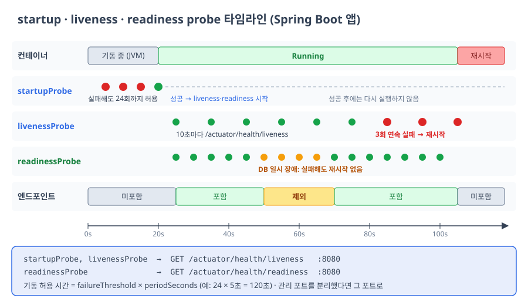
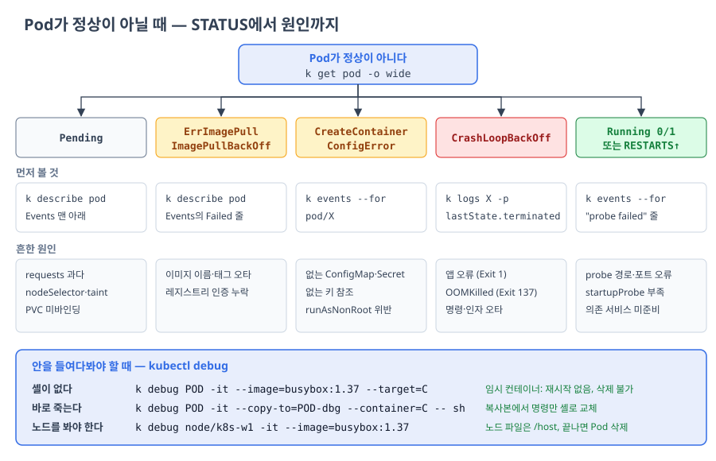
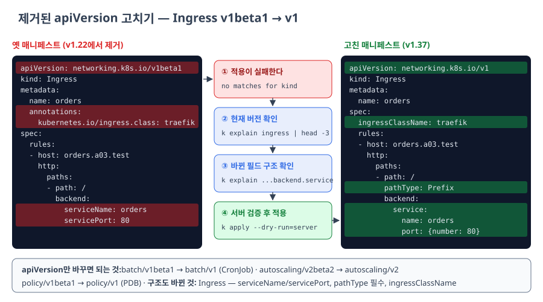

> **자격증 준비 · CKAD** | 난이도 ★★★☆☆ | 예상 소요 3 ~ 3.5시간

> ⚠️ 이 편의 모든 연습 과제는 CNCF가 공개한 **CKAD 공식 커리큘럼(github.com/cncf/curriculum)을 바탕으로 직접 창작한** 시험 스타일 과제입니다. 실제 시험 문제(유출 문제·덤프)가 아니며 실제 출제 내용과 무관합니다.

## 🎯 오늘의 목표

- Spring Boot actuator 경로(`/actuator/health/liveness`, `/readiness`)에 맞춰 **startup·liveness·readiness probe**를 문서 예제에서 5분 안에 옮겨 적을 수 있다
- `kubectl logs`의 `-c`, `--previous`, `-l`, `--since`를 골라 써서 **과제가 원하는 로그만** 파일로 남길 수 있다
- 셸이 없는 컨테이너는 `kubectl debug`(임시 컨테이너)로, 노드는 `kubectl debug node/`로 들여다볼 수 있다
- Pod STATUS와 `describe`·이벤트·종료 사유를 보고 **실패 원인을 한 줄로** 적을 수 있다
- 폐기·제거된 `apiVersion`이 든 매니페스트를 `kubectl explain`으로 확인해 현재 버전으로 고칠 수 있다

---

## 1. 커리큘럼 항목 요약 — Application Observability and Maintenance (15%)

2026-11-19에 cncf/curriculum 저장소의 `CKAD_Curriculum_v1.37.pdf`를 확인했습니다. 이 도메인의 비중은 **15%**이고 항목은 다섯 개입니다. (PDF에는 "API depreciations"라고 오타가 그대로 적혀 있습니다.)

| 공식 커리큘럼 항목 | 이 편의 섹션 | 과제 |
|---|---|---|
| Understand API deprecations | 4-5 | 9, 10 |
| Implement probes and health checks | 4-1 | 1, 2 |
| Use built-in CLI tools to monitor Kubernetes applications | 4-4 | 7 |
| Utilize container logs | 4-2 | 3, 4 |
| Debugging in Kubernetes | 4-3, 4-4 | 5, 6, 8 |

> 💡 이론은 본편과 CKA 편을 참조하세요. probe의 개념과 재시작 정책은 [Day 10](../../02-kubernetes/day10-pod.md) 6장, metrics-server와 `kubectl top`은 [Day 18](../../02-kubernetes/day18-autoscaling.md) 7~8장, STATUS별 원인 후보·종료 코드·이벤트 읽기는 [CKA K06](../cka/k06-troubleshooting.md) 6·8장에 정리돼 있습니다. 이 편은 같은 내용을 **CKAD 과제 문장에 맞춰 빠르게 손으로 옮기는 것**에 집중합니다.

> 💡 CKAD 시험 중 열 수 있는 문서는 Linux Foundation *Resources Allowed* 페이지 기준 `kubernetes.io/docs`, `kubernetes.io/blog`, `helm.sh/docs`, 그리고 과제의 Quick Reference 링크입니다(2026-11-19 확인). **Spring Boot 문서(docs.spring.io)는 열 수 없으니** actuator 경로는 외워 두세요.

### 실습 환경

[A00](./a00-exam-overview-lab.md)에서 준비한 환경을 그대로 씁니다. 작업 터미널은 base(WSL2), 클러스터는 context **`cka-main`**(kubeadm v1.37.1, `k8s-cp` 192.168.56.10 / `k8s-w1` .11 / `k8s-w2` .12, Cilium, local-path 기본 StorageClass, Traefik + Gateway API v1.6.3)입니다. 스냅샷 `ckad-clean`에서 시작하세요.

```bash
kubectl config use-context cka-main
mkdir -p ~/ckad/a03 && cd ~/ckad/a03
alias k=kubectl; export do="--dry-run=client -o yaml"; export now="--force --grace-period=0"
export REG=192.168.56.1:5000      # A00의 로컬 레지스트리 (이미지 이름: $REG/ckad/<app>:<tag>)
k create ns a03
k top nodes          # metrics-server는 ckad-clean에 이미 설치돼 있음
```

> 💡 스냅샷 `ckad-clean`에는 metrics-server, local-path 기본 StorageClass, Traefik(IngressClass·GatewayClass `traefik`, Gateway `traefik-gateway`, NodePort 30080)이 들어 있습니다. 로컬 레지스트리에는 `hello-spring:1.0`/`2.0`(8080, `/`·`/actuator/health`), `hello-py:1.0`/`1.1`(8000, `/`·`/healthz`), `busybox:1.37`이 있습니다. 이 편은 그 밖에 Docker Hub의 `nginx:1.27`, `busybox:1.37`, `python:3.12-slim`과 `registry.k8s.io/pause:3.10`도 씁니다.

---

## 2. 출제 유형 — 어떻게 채점되는가

| 과제 형태 | 예시 문장(창작) | 채점 포인트 |
|---|---|---|
| **probe 추가형** | "Deployment `orders`에 `/actuator/health/readiness`(8080) readiness probe를 추가하라" | probe 종류, `httpGet.path`·`port`, 주기·임계값 숫자, **롤아웃 완료** |
| **probe 수리형** | "Pod가 계속 재시작된다. 원인을 고쳐라" | 잘못된 포트·경로·`initialDelaySeconds` 수정, `RESTARTS` 증가 멈춤 |
| **로그 추출형** | "`audit` 컨테이너의 최근 10분 로그를 `~/x.log`에 저장" | 파일 존재, 올바른 컨테이너·기간·이전 인스턴스 |
| **원인 기록형** | "실패한 Pod를 찾아 이름과 사유를 파일에 적어라" | 파일 내용(정확한 이름·사유 문자열) |
| **디버깅형** | "셸이 없는 Pod에서 PID 1의 명령을 확인하라" | 임시 컨테이너 사용, 결과 파일 |
| **모니터링형** | "`tier=batch` 중 CPU를 가장 많이 쓰는 Pod 이름을 기록" | `kubectl top` 결과와 일치 |
| **API 폐기형** | "주어진 매니페스트가 적용되지 않는다. 현재 API로 고쳐 적용" | `apiVersion`과 바뀐 필드 구조, 리소스 실제 생성 |

> ⚠️ **"파일에 적어라" 과제는 파일 내용만 채점합니다.** 경로 오타, 불필요한 헤더 줄(`NAME ...`), 이름 대신 `pod/이름` 같은 접두사가 감점 원인입니다. `--no-headers`, `-o name`, `-o jsonpath`를 쓰고 마지막에 `cat`으로 확인하세요.

---

## 3. 핵심 명령 표

| 하고 싶은 것 | 명령 | 비고 |
|---|---|---|
| probe 필드 확인 | `k explain pod.spec.containers.startupProbe` | 명령형 생성 플래그 **없음** → 문서 예제 복사 |
| probe 실패 이벤트 | `k -n a03 events --for pod/X` / `k describe pod X` | `Liveness probe failed: ...`, `Readiness probe failed: ...` |
| 특정 컨테이너 로그 | `k logs POD -c audit` | 멀티 컨테이너면 `-c` 없을 때 기본 컨테이너 |
| 죽기 전 로그 | `k logs POD --previous` (`-p`) | CrashLoopBackOff 원인은 대부분 여기 |
| 라벨로 여러 Pod | `k logs -l app=X --prefix --tail=-1` | **셀렉터를 쓰면 기본 `--tail=10`** |
| 기간 제한 | `k logs POD --since=10m` / `--since-time=2026-11-19T06:00:00Z` | 둘 중 하나만 |
| 모든 컨테이너 | `k logs POD --all-containers` | `deploy/X --all-pods`도 가능 |
| 임시 컨테이너 | `k debug POD -it --image=busybox:1.37 --target=app` | `--target`으로 프로세스 네임스페이스 공유 |
| 복사본으로 디버그 | `k debug POD -it --copy-to=POD-dbg --container=app -- sh` | 원본은 그대로, 명령만 바꾼 복사본 |
| 노드 디버그 | `k debug node/k8s-w1 -it --image=busybox:1.37` | 노드 파일시스템은 `/host`, 끝나면 Pod 삭제 |
| 리소스 사용량 | `k top pod -n a03 --sort-by=cpu` / `--containers` | metrics-server 필요 |
| 종료 사유 | `k get pod X -o jsonpath='{.status.containerStatuses[0].lastState.terminated.reason}'` | `OOMKilled`, `Error`, `Completed` |
| 제공되는 API 버전 | `k api-resources | grep -i cronjob` / `k api-versions` | `k explain cronjob` 첫 줄의 `GROUP`, `VERSION` |
| 폐기 API 호출 흔적 | `k get --raw /metrics | grep apiserver_requested_deprecated_apis` | 관리자 권한 필요 |

---

## 4. 영역별 핵심 — 시험에서 필요한 만큼만

### 4-1. probe 세 가지 — Spring Boot actuator에 맞추기



| probe | 실패하면 | 언제 쓰나 | Spring Boot 경로 |
|---|---|---|---|
| **startupProbe** | 임계값 초과 시 컨테이너 **재시작**. 성공 전까지 나머지 probe는 **시작 안 함** | 기동이 느린 앱(JVM) | `/actuator/health/liveness` |
| **livenessProbe** | 컨테이너 **재시작** | 교착 상태처럼 "살아 있지만 고장" | `/actuator/health/liveness` |
| **readinessProbe** | **Service 엔드포인트에서 제외**(재시작 없음) | 트래픽을 받을 준비 | `/actuator/health/readiness` |

**Spring Boot 쪽 설정이 필요한가?** 현재 Spring Boot 문서(Actuator *Kubernetes Probes*)에 따르면 liveness·readiness 헬스 그룹은 **자동으로 켜져** 있고, `management.endpoint.health.probes.enabled=false`로 끌 수 있습니다. 따라서 A00·A01의 `hello-spring` 이미지(Spring Boot 4.1.2, 포트 8080, `/actuator/health` 노출)는 추가 설정 없이 `/actuator/health/liveness`, `/actuator/health/readiness`에 응답합니다. 예전 Spring Boot 2.x는 쿠버네티스 환경을 감지했을 때만 켜졌으므로, 2.x 앱을 로컬(`docker run`)에서도 같은 경로로 시험하려면 명시적으로 켭니다.

```yaml
# src/main/resources/application.yml — 2.x 앱을 로컬에서도 같은 경로로 쓰고 싶을 때
management:
  endpoint:
    health:
      probes:
        enabled: true
```

> 💡 같은 문서의 `management.endpoint.health.probes.add-additional-paths=true`를 켜면 메인 포트에 `/livez`, `/readyz`도 생깁니다. 시험에서는 과제가 준 경로를 그대로 쓰면 됩니다.

컨테이너 쪽은 문서의 *Configure Liveness, Readiness and Startup Probes* 예제를 복사해 경로·포트만 바꿉니다.

```yaml
    ports:
    - containerPort: 8080
    startupProbe:                      # 최대 5 x 24 = 120초까지 기동을 기다림
      httpGet: {path: /actuator/health/liveness, port: 8080}
      periodSeconds: 5
      failureThreshold: 24
    livenessProbe:
      httpGet: {path: /actuator/health/liveness, port: 8080}
      periodSeconds: 10
      failureThreshold: 3
    readinessProbe:
      httpGet: {path: /actuator/health/readiness, port: 8080}
      periodSeconds: 5
      failureThreshold: 3
```

> 💡 `startupProbe`가 있으면 `livenessProbe`에 큰 `initialDelaySeconds`를 줄 필요가 없습니다. 예전 방식(`initialDelaySeconds: 90`)은 기동이 빠른 날에도 90초를 기다리고, 느린 날에는 여전히 죽입니다.

> ⚠️ Spring에서 `management.server.port: 8081`로 관리 포트를 따로 열었다면 probe의 `port`도 **8081**이어야 합니다. 앱 포트(8080)로 두면 404가 나서 liveness가 계속 실패합니다.

**이 편의 실습 앱 두 개.**

- `orders` — A00에서 로컬 레지스트리에 올린 **`hello-spring:1.0`**(포트 8080). probe 없이 배포해 두고 과제 1에서 probe를 붙입니다.
- `ready-sim` — readiness를 **마음대로 켜고 끄기** 위한 보조 앱입니다. nginx 설정으로 actuator 경로를 흉내 내며, 20초 늦게 기동하고 `/tmp/state/readiness.json` 파일이 있을 때만 readiness가 200을 돌려줍니다(과제 2).

```bash
k -n a03 create deploy orders --image=$REG/ckad/hello-spring:1.0 --replicas=2 --port=8080
k -n a03 expose deploy orders --port=80 --target-port=8080

cat > ready-sim.yaml <<'EOF'
apiVersion: v1
kind: ConfigMap
metadata: {name: actuator-sim, namespace: a03}
data:
  default.conf: |
    server {
      listen 8080;
      location = /actuator/health/liveness {
        default_type application/json;
        return 200 '{"status":"UP"}';
      }
      location = /actuator/health/readiness {
        root /tmp/state;
        try_files /readiness.json =503;
      }
      location / {
        default_type text/plain;
        return 200 "ready-sim $hostname\n";
      }
    }
---
apiVersion: apps/v1
kind: Deployment
metadata: {name: ready-sim, namespace: a03}
spec:
  replicas: 2
  selector: {matchLabels: {app: ready-sim}}
  template:
    metadata: {labels: {app: ready-sim}}
    spec:
      containers:
      - name: app
        image: nginx:1.27
        command: ["sh", "-c"]
        args:
        - |
          sleep 20
          echo '{"status":"UP"}' > /tmp/state/readiness.json
          exec nginx -g 'daemon off;'
        ports:
        - containerPort: 8080
        readinessProbe:
          httpGet: {path: /actuator/health/readiness, port: 8080}
          periodSeconds: 5
        volumeMounts:
        - {name: conf, mountPath: /etc/nginx/conf.d}
        - {name: state, mountPath: /tmp/state}
      volumes:
      - name: conf
        configMap: {name: actuator-sim}
      - name: state
        emptyDir: {}
EOF
k apply -f ready-sim.yaml
k -n a03 expose deploy ready-sim --port=80 --target-port=8080
```

### 4-2. 로그 — 옵션 네 개면 충분하다

| 옵션 | 언제 | 함정 |
|---|---|---|
| `-c NAME` | 멀티 컨테이너 Pod | 생략하면 기본 컨테이너(첫 번째 또는 `kubectl.kubernetes.io/default-container` 어노테이션) |
| `--previous` / `-p` | 재시작된 컨테이너의 **직전 인스턴스** | 한 번도 재시작 안 했으면 `previous terminated container ... not found` |
| `-l KEY=VAL` | 여러 Pod 한꺼번에 | **`--tail` 기본값이 10줄로 바뀜**, 동시 요청 기본 5개(`--max-log-requests`) |
| `--since=10m` | 최근 N분 | `--since-time`(RFC3339)과 동시 사용 불가 |

```bash
k -n a03 logs deploy/orders                       # Deployment의 Pod 하나
k -n a03 logs -l app=orders --prefix --tail=-1    # 모든 Pod, 전체 줄, 출처 표시
k -n a03 logs POD -c app --since=5m --timestamps
```

### 4-3. `kubectl debug` — 세 가지 모드

| 모드 | 명령 | 쓰는 때 |
|---|---|---|
| 임시 컨테이너 | `k debug POD -it --image=busybox:1.37 --target=CONTAINER` | 실행 중 Pod에 셸·도구가 없을 때(distroless, pause). **재시작 없음** |
| Pod 복사본 | `k debug POD -it --copy-to=NEW --container=C -- sh` | 바로 죽는 컨테이너의 명령을 바꿔 안을 보고 싶을 때. `--set-image`로 이미지 교체도 |
| 노드 | `k debug node/NODE -it --image=busybox:1.37` | 노드 파일(`/host`)·로그 확인. 호스트 네임스페이스에서 실행 |

> ⚠️ 임시 컨테이너는 **한 번 추가하면 지울 수 없습니다**(Pod를 지워야 사라짐). 노드 디버그 Pod(`node-debugger-...`)는 일반 Pod라 끝나면 **직접 삭제**하세요. 둘 다 v1.37의 기본 프로필은 `general`이고, 노드에서 특권이 필요하면 `--profile=sysadmin`입니다.

### 4-4. 실패한 Pod 원인 찾기와 `kubectl top`



| STATUS | 먼저 볼 것 | 흔한 원인 |
|---|---|---|
| `Pending` | `k describe pod` 맨 아래 Events | requests 과다(`Insufficient memory`), nodeSelector·taint, PVC 미바인딩 |
| `ErrImagePull` / `ImagePullBackOff` | Events | 이미지 이름·태그 오타, 프라이빗 레지스트리 인증 |
| `CreateContainerConfigError` | Events | 없는 ConfigMap·Secret(또는 키) 참조 |
| `CrashLoopBackOff` | `k logs --previous`, `lastState.terminated` | 앱 오류(Exit 1), `OOMKilled`(Exit 137), 명령 오타 |
| `Running` 인데 `READY 0/1` | Events의 `Readiness probe failed` | probe 경로·포트, 앱 미준비 |
| `Running`, `RESTARTS` 증가 | Events의 `Liveness probe failed` | liveness 포트·경로, 너무 짧은 대기 |

자세한 원인 목록과 종료 코드 표는 [CKA K06 6장](../cka/k06-troubleshooting.md)을 보세요. CKAD는 **노드·컨트롤 플레인이 아니라 애플리케이션 쪽 원인**만 다룹니다.

```bash
k -n a03 get pod -o wide
k -n a03 events --types=Warning
k -n a03 top pod --sort-by=memory --containers
```

### 4-5. API 폐기 대응



쿠버네티스는 베타 API를 정해진 정책에 따라 **폐기(deprecated) → 제거(removed)** 합니다. 폐기된 API를 쓰면 서버가 `Warning:` 헤더를 돌려주고, 제거된 API로 `apply`하면 아예 실패합니다.

```bash
k -n a03 get endpoints
# Warning: v1 Endpoints is deprecated in v1.33+; use discovery.k8s.io/v1 EndpointSlice
```

```
error: resource mapping not found for name: "nightly" namespace: "a03" from "old.yaml":
no matches for kind "CronJob" in version "batch/v1beta1"
ensure CRDs are installed first
```

| 자주 보는 옛 apiVersion | 제거된 버전 | 지금 쓰는 apiVersion | 필드 변화 |
|---|---|---|---|
| `batch/v1beta1` CronJob | v1.25 | `batch/v1` | 없음 |
| `policy/v1beta1` PodDisruptionBudget | v1.25 | `policy/v1` | 거의 없음 |
| `autoscaling/v2beta2` HPA | v1.26 | `autoscaling/v2` | 없음 |
| `networking.k8s.io/v1beta1` Ingress | v1.22 | `networking.k8s.io/v1` | **있음** — `serviceName`/`servicePort` → `service.name`/`service.port.number`, `pathType` 필수, 클래스는 `ingressClassName` |
| `flowcontrol.apiserver.k8s.io/v1beta3` | v1.32 | `flowcontrol.apiserver.k8s.io/v1` | 없음 |

고치는 순서는 늘 같습니다.

1. `k explain <kind>` 첫 줄에서 **현재 GROUP/VERSION** 확인 (또는 `k api-resources | grep -i <kind>`)
2. 매니페스트의 `apiVersion` 교체
3. 필드 구조가 바뀐 리소스(Ingress)는 `k explain ingress.spec.rules.http.paths.backend --recursive`로 새 구조 확인
4. `k apply --dry-run=server -f`로 서버 검증 후 적용

> 💡 **`kubectl convert` 플러그인**은 2026-11-19 현재도 kubernetes.io의 *Install and Set Up kubectl on Linux* 페이지에 설치 방법이 있고 v1.37.2 바이너리(`kubectl-convert`)도 배포됩니다. 다만 별도 플러그인이라 **시험 환경에 있다고 가정하면 안 되고**, 플러그인이 아는 버전끼리만 변환되므로 아주 오래전에 제거된 버전은 변환하지 못할 수 있습니다. 시험에서는 `explain` + 손 편집이 기본입니다.
>
> ```bash
> # 연습 환경 설치 (문서의 절차)
> curl -LO "https://dl.k8s.io/release/$(curl -L -s https://dl.k8s.io/release/stable.txt)/bin/linux/amd64/kubectl-convert"
> sudo install -o root -g root -m 0755 kubectl-convert /usr/local/bin/kubectl-convert
> kubectl convert -f old-pdb.yaml --output-version policy/v1
> ```

---

## 5. 시간 절약 팁

- **probe는 문서에서 복사.** 검색어 `liveness` → *Configure Liveness, Readiness and Startup Probes*. `httpGet` 예제 블록을 통째로 복사한 뒤 vim에서 경로·포트만 고칩니다. 세 probe가 모두 필요하면 하나를 만들고 `yy`·`p`로 복제해 이름만 바꾸세요.
- **Deployment에 probe를 넣을 때는 `k edit`보다 파일.** `k get deploy orders -o yaml > o.yaml` → 수정 → `k apply -f o.yaml`. 실수해도 파일이 남아 있어 다시 고칠 수 있습니다.
- **원인 기록 과제는 jsonpath 한 줄.** `k get pod X -o jsonpath='{.status.containerStatuses[0].state.waiting.reason}'`(대기 중), `...lastState.terminated.reason`(직전 종료).
- **로그 파일은 리다이렉트 후 `wc -l`.** 빈 파일이면 컨테이너 이름이나 `--previous`를 잘못 고른 것입니다.
- **`k events`는 정렬이 이미 시간순**입니다. `k get events`를 쓸 땐 `--sort-by=.metadata.creationTimestamp`.
- **API 버전 검증은 `--dry-run=server`.** 클라이언트 드라이런은 스키마를 서버에 묻지 않으므로 제거된 API를 잡지 못할 때가 있습니다.

---

## 6. 자주 하는 실수

| 실수 | 결과 | 바로잡기 |
|---|---|---|
| readiness 대신 liveness에 `/readiness` 경로 | DB가 잠깐 끊겨도 컨테이너가 재시작됨 | liveness는 `/liveness`, readiness는 `/readiness` |
| probe `port`에 Service 포트(80) | `connection refused`로 계속 실패 | **컨테이너 포트**(8080) 또는 포트 이름 |
| startupProbe 없이 liveness만, 기동 60초 앱 | 기동 중에 죽고 다시 기동 → 영원히 CrashLoop | startupProbe 추가(`failureThreshold × periodSeconds` ≥ 기동 시간) |
| `k logs -l app=X > f.log` | Pod마다 **10줄만** 저장 | `--tail=-1` 붙이기 |
| 멀티 컨테이너 Pod에 `-c` 없이 로그 | 엉뚱한(기본) 컨테이너 로그 | `k get pod X -o jsonpath='{.spec.containers[*].name}'`로 이름 확인 |
| CrashLoop인데 `--previous` 없이 로그 | 방금 시작한 인스턴스의 빈 로그 | `-p` |
| Pod의 `env`·`command`를 `k edit`으로 변경 | `Forbidden: pod updates may not change fields` | 파일로 뽑아 고친 뒤 `k replace --force -f` |
| 노드 디버그 Pod 방치 | 다음 과제에서 Pod 개수·이름 검증이 꼬임 | `k delete pod node-debugger-... $now` |
| Ingress `apiVersion`만 `v1`로 변경 | `unknown field "serviceName"` 오류 | 백엔드 구조·`pathType`까지 수정 |

---

## 7. 창작 연습 과제

> 아래 과제는 모두 **공식 커리큘럼을 바탕으로 창작한** 연습 문제입니다. 모든 과제는 context `cka-main`, 네임스페이스 `a03`에서 하며, 4-1의 `orders`·`ready-sim` 앱을 먼저 배포해 두세요.

### 과제 1. Spring Boot식 probe 세 개 (목표 6분)

Deployment `orders`(네임스페이스 `a03`, 이미지 `hello-spring:1.0`)의 컨테이너에 다음 probe를 추가하라. 포트는 모두 8080이다.
- startupProbe: `/actuator/health/liveness`, 5초 간격, 최대 **24회** 실패까지 허용
- livenessProbe: `/actuator/health/liveness`, 10초 간격, 3회 실패 시 재시작
- readinessProbe: `/actuator/health/readiness`, 5초 간격

롤아웃이 끝나고 두 Pod가 모두 `READY 1/1`이어야 한다.

📖 참고 문서: kubernetes.io/docs/tasks/configure-pod-container/configure-liveness-readiness-startup-probes/

<details>
<summary>풀이·검증</summary>

```bash
k -n a03 get deploy orders -o yaml > orders.yaml
vim orders.yaml        # containers[0] 의 ports 아래에 4-1의 probe 블록 세 개를 붙여 넣기
k apply -f orders.yaml
k -n a03 rollout status deploy/orders --timeout=120s
```

```bash
k -n a03 get pod -l app=orders
# NAME                      READY   STATUS    RESTARTS   AGE
# orders-7b4f9c6d8-2xk8p    1/1     Running   0          45s
# orders-7b4f9c6d8-q7wzn    1/1     Running   0          25s
k -n a03 get deploy orders -o jsonpath='{.spec.template.spec.containers[0].startupProbe.failureThreshold}{"\n"}'   # 24
k -n a03 describe pod -l app=orders | grep -E '^\s+(Startup|Liveness|Readiness):'
```

새 Pod는 Spring 컨텍스트가 뜨는 동안(노드 사양에 따라 수 초~수십 초) `0/1`입니다. 그동안 startupProbe가 `connection refused`로 실패하지만 24회까지 허용하므로 재시작하지 않습니다. 이벤트에 `Startup probe failed`가 몇 번 보이는 것은 정상입니다.

```bash
k -n a03 run t --image=$REG/ckad/busybox:1.37 --rm -it --restart=Never -- wget -qO- http://orders/actuator/health/readiness
# {"status":"UP"}
```
</details>

### 과제 2. readiness가 트래픽을 끊는 것 확인하기 (목표 5분)

`ready-sim` Pod 하나의 readiness를 일부러 실패시켜라(`/tmp/state/readiness.json` 삭제). 그 상태에서 Service `ready-sim`의 준비된 엔드포인트 수를 `~/ckad/a03/ready-endpoints.txt`에 숫자 하나로 기록하고, 마지막에 Pod를 원래대로 돌려놓아라.

📖 참고 문서: kubernetes.io/docs/concepts/workloads/pods/probes/, kubernetes.io/docs/concepts/services-networking/endpoint-slices/

<details>
<summary>풀이·검증</summary>

```bash
P=$(k -n a03 get pod -l app=ready-sim -o jsonpath='{.items[0].metadata.name}')
k -n a03 exec $P -- rm /tmp/state/readiness.json
sleep 20
k -n a03 get pod -l app=ready-sim                 # 하나가 0/1, RESTARTS 0 (재시작 없음)
k -n a03 get endpointslices -l kubernetes.io/service-name=ready-sim \
  -o jsonpath='{range .items[*].endpoints[*]}{.conditions.ready}{"\n"}{end}' | grep -c true \
  > ~/ckad/a03/ready-endpoints.txt
cat ~/ckad/a03/ready-endpoints.txt             # 1
```

```bash
k -n a03 exec $P -- sh -c 'echo "{\"status\":\"UP\"}" > /tmp/state/readiness.json'
sleep 10; k -n a03 get pod -l app=ready-sim       # 둘 다 1/1
```

readiness 실패는 **재시작을 일으키지 않고** EndpointSlice의 `ready: false`로만 나타납니다. liveness였다면 `RESTARTS`가 올라갔을 것입니다.
</details>

### 과제 3. 바로 죽는 Pod의 원인과 수리 (목표 6분)

다음 Pod를 만들어라. 곧 `CrashLoopBackOff`가 된다. 죽기 직전 로그의 **마지막 줄**을 `~/ckad/a03/payment-crash.txt`에 저장하고, 환경 변수 `DB_URL=jdbc:postgresql://db:5432/pay`를 넣어 Pod가 `Running`을 유지하게 고쳐라. Pod 이름은 그대로여야 한다.

```bash
k -n a03 run payment --image=python:3.12-slim -- python -c "import os,time; print('payment boot', flush=True); os.environ['DB_URL']; time.sleep(1e6)"
```

📖 참고 문서: kubernetes.io/docs/tasks/debug/debug-application/debug-running-pod/, kubernetes.io/docs/tasks/debug/debug-application/determine-reason-pod-failure/

<details>
<summary>풀이·검증</summary>

```bash
k -n a03 get pod payment -w            # RESTARTS 가 1 이상 될 때까지 (Ctrl+C)
k -n a03 logs payment --previous | tail -1 > ~/ckad/a03/payment-crash.txt
cat ~/ckad/a03/payment-crash.txt       # KeyError: 'DB_URL'
```

Pod의 `env`는 바꿀 수 없으므로 매니페스트를 뽑아 고친 뒤 강제로 교체합니다.

```bash
k -n a03 get pod payment -o yaml > payment.yaml
vim payment.yaml
#   containers:
#   - args: [...]
#     env:
#     - name: DB_URL
#       value: jdbc:postgresql://db:5432/pay
k replace --force -f payment.yaml
k -n a03 get pod payment               # Running, RESTARTS 0
k -n a03 logs payment                  # payment boot
```

💡 원인을 모를 때는 `k -n a03 debug payment -it --copy-to=payment-dbg --container=payment -- sh`로 **명령만 셸로 바꾼 복사본**을 띄워 `env`, 파일 등을 살펴볼 수 있습니다. 확인 후 `k -n a03 delete pod payment-dbg $now`.
</details>

### 과제 4. 멀티 컨테이너 로그를 골라 담기 (목표 6분)

아래 Deployment `ledger`를 배포하라. 세 Pod의 **`audit` 컨테이너** 로그 중 **최근 2분**의 `WARN` 줄만, 어느 Pod에서 나왔는지 표시해 `~/ckad/a03/ledger-warn.log`에 저장하라.

```bash
cat <<'EOF' | k apply -f -
apiVersion: apps/v1
kind: Deployment
metadata: {name: ledger, namespace: a03}
spec:
  replicas: 3
  selector: {matchLabels: {app: ledger}}
  template:
    metadata: {labels: {app: ledger}}
    spec:
      containers:
      - name: app
        image: busybox:1.37
        command: ["sh", "-c", "while true; do echo \"$(date +%T) ledger tick\"; sleep 3; done"]
      - name: audit
        image: busybox:1.37
        command: ["sh", "-c", "i=0; while true; do i=$((i+1)); echo \"$(date +%T) INFO audit seq=$i\"; [ $((i%4)) -eq 0 ] && echo \"$(date +%T) WARN slow query seq=$i\"; sleep 2; done"]
EOF
```

📖 참고 문서: kubernetes.io/docs/reference/kubectl/generated/kubectl_logs/, kubernetes.io/docs/concepts/cluster-administration/logging/

<details>
<summary>풀이·검증</summary>

```bash
sleep 150     # 로그가 2분 이상 쌓이도록 (연습용)
k -n a03 logs -l app=ledger -c audit --since=2m --prefix --tail=-1 | grep WARN > ~/ckad/a03/ledger-warn.log
head -3 ~/ckad/a03/ledger-warn.log
# [pod/ledger-7d5f8c9b6-4hxkq/audit] 06:41:08 WARN slow query seq=48
# [pod/ledger-7d5f8c9b6-9mzrt/audit] 06:41:09 WARN slow query seq=48
cut -d']' -f1 ~/ckad/a03/ledger-warn.log | sort -u | wc -l      # 3 (세 Pod 모두)
```

`--tail=-1`을 빼면 셀렉터 사용 시 기본값 10줄이 적용되어, Pod마다 최근 10줄 중 WARN 두어 줄만 남습니다. `--since=2m`과 겹쳐 쓰면 **두 조건 중 더 좁은 쪽**이 적용되므로 반드시 함께 씁니다.
</details>

### 과제 5. 셸이 없는 Pod 들여다보기 — 임시 컨테이너 (목표 5분)

`k -n a03 run sealed --image=registry.k8s.io/pause:3.10`으로 Pod를 만들어라. 이 컨테이너에는 셸이 없다. 이름이 `dbg`인 임시 컨테이너(busybox:1.37)를 `sealed` 컨테이너의 프로세스 네임스페이스에 붙여 `ps` 결과를 얻고, **PID 1의 명령**을 `~/ckad/a03/sealed-pid1.txt`에 적어라. Pod는 재시작되면 안 된다.

📖 참고 문서: kubernetes.io/docs/tasks/debug/debug-application/debug-running-pod/ (*Debugging with an ephemeral debug container*), kubernetes.io/docs/concepts/workloads/pods/ephemeral-containers/

<details>
<summary>풀이·검증</summary>

```bash
k -n a03 exec sealed -- sh
# error: ... exec: "sh": executable file not found in $PATH

k -n a03 debug sealed --image=busybox:1.37 -c dbg --target=sealed -- ps
sleep 5; k -n a03 logs sealed -c dbg
# PID   USER     TIME  COMMAND
#     1 65535     0:00 /pause
#     7 root      0:00 ps
k -n a03 logs sealed -c dbg | awk '$1==1 {print $4}' > ~/ckad/a03/sealed-pid1.txt
cat ~/ckad/a03/sealed-pid1.txt                  # /pause
```

```bash
k -n a03 get pod sealed -o jsonpath='{.spec.ephemeralContainers[*].name}{"\n"}'   # dbg
k -n a03 get pod sealed                         # RESTARTS 0
```

`-it` 없이 실행하면 붙지 않고 바로 돌아오므로, 결과는 `logs -c dbg`로 읽습니다. `--target`이 없으면 임시 컨테이너는 자기 프로세스만 보입니다.
</details>

### 과제 6. 노드에서 Pod 로그 디렉터리 확인 (목표 5분)

`ledger` Pod가 하나라도 떠 있는 워커 노드 하나를 골라 `kubectl debug node/`로 접근하라. 그 노드의 `/var/log/pods` 아래에서 **네임스페이스 `a03`에 해당하는 디렉터리 이름**을 모두 `~/ckad/a03/node-podlogs.txt`에 저장하라. 디버그용 Pod는 끝난 뒤 삭제한다. ssh는 쓰지 않는다.

📖 참고 문서: kubernetes.io/docs/tasks/debug/debug-cluster/kubectl-node-debug/, kubernetes.io/docs/concepts/cluster-administration/logging/

<details>
<summary>풀이·검증</summary>

```bash
N=$(k -n a03 get pod -l app=ledger -o jsonpath='{.items[0].spec.nodeName}'); echo $N     # 예: k8s-w1
k -n a03 debug node/$N --image=busybox:1.37 -- sh -c 'ls /host/var/log/pods | grep "^a03_"'
D=$(k -n a03 get pod -o name | grep node-debugger)
sleep 5; k -n a03 logs $D > ~/ckad/a03/node-podlogs.txt
cat ~/ckad/a03/node-podlogs.txt
# a03_ledger-7d5f8c9b6-4hxkq_3f1c...
# a03_orders-7b4f9c6d8-2xk8p_9a2e...
k -n a03 delete $D $now
```

디렉터리 이름 형식은 `<네임스페이스>_<Pod 이름>_<Pod UID>`이고, 그 안에 컨테이너별 폴더와 `0.log`, `1.log`(재시작 번호)가 있습니다. `kubectl logs --previous`가 읽는 것이 바로 이 직전 번호의 파일입니다. 대화형으로 보고 싶다면 `-it`을 붙이고 안에서 `chroot /host`를 하면 노드 셸처럼 쓸 수 있습니다.
</details>

### 과제 7. CPU를 가장 많이 쓰는 Pod (목표 4분)

다음 세 Pod를 만들고 1~2분 기다린 뒤, `tier=batch` Pod 중 **CPU 사용량이 가장 큰 Pod의 이름**만 `~/ckad/a03/top-cpu.txt`에 적어라.

```bash
k -n a03 run batch-a -l tier=batch --image=busybox:1.37 -- sleep 1d
k -n a03 run batch-b -l tier=batch --image=busybox:1.37 -- sh -c 'while true; do :; done'
k -n a03 run batch-c -l tier=batch --image=busybox:1.37 -- sleep 1d
```

📖 참고 문서: kubernetes.io/docs/tasks/debug/debug-cluster/resource-metrics-pipeline/, kubernetes.io/docs/reference/kubectl/quick-reference/ (*Interacting with running Pods*)

<details>
<summary>풀이·검증</summary>

```bash
k -n a03 top pod -l tier=batch --sort-by=cpu
# NAME      CPU(cores)   MEMORY(bytes)
# batch-b   998m         0Mi
# batch-a   0m           0Mi
# batch-c   0m           0Mi
k -n a03 top pod -l tier=batch --sort-by=cpu --no-headers | head -1 | awk '{print $1}' > ~/ckad/a03/top-cpu.txt
cat ~/ckad/a03/top-cpu.txt        # batch-b
k -n a03 delete pod batch-a batch-b batch-c $now
```

`error: Metrics API not available`가 나오면 metrics-server Pod 상태(`k -n kube-system get pod -l k8s-app=metrics-server`)를 확인하세요. 방금 만든 Pod는 첫 수집(약 15~60초) 전까지 목록에 나오지 않습니다.
</details>

### 과제 8. 실패한 Pod 네 개 — 사유 기록과 수리 (목표 10분)

아래 매니페스트를 적용하라. 네 Pod 모두 정상이 아니다. 각 Pod의 **이름과 대기 또는 종료 사유**를 `이름:사유` 형식으로 한 줄씩 `~/ckad/a03/failures.txt`에 적고(사유는 `kubectl`이 보여 주는 문자열 그대로), 네 Pod 모두 `Running`이 되도록 고쳐라. 이미지는 `nginx:1.27-alpine`, `f-sched`의 메모리 요청은 64Mi, `f-oom`의 메모리 limit은 128Mi로 맞춘다.

```bash
cat <<'EOF' | k apply -f -
apiVersion: v1
kind: Pod
metadata: {name: f-image, namespace: a03}
spec:
  containers:
  - {name: app, image: nginx:1.27-alpne}
---
apiVersion: v1
kind: Pod
metadata: {name: f-config, namespace: a03}
spec:
  containers:
  - name: app
    image: nginx:1.27
    env:
    - name: MODE
      valueFrom: {configMapKeyRef: {name: f-config-cm, key: mode}}
---
apiVersion: v1
kind: Pod
metadata: {name: f-sched, namespace: a03}
spec:
  containers:
  - name: app
    image: nginx:1.27
    resources: {requests: {memory: 64Gi}}
---
apiVersion: v1
kind: Pod
metadata: {name: f-oom, namespace: a03}
spec:
  containers:
  - name: app
    image: python:3.12-slim
    command: ["python", "-c", "b = bytearray(96*1024*1024); import time; time.sleep(1e6)"]
    resources: {limits: {memory: 32Mi}}
EOF
```

📖 참고 문서: kubernetes.io/docs/tasks/debug/debug-application/debug-pods/, kubernetes.io/docs/tasks/debug/debug-application/determine-reason-pod-failure/, kubernetes.io/docs/concepts/configuration/manage-resources-containers/

<details>
<summary>풀이·검증</summary>

```bash
sleep 40; k -n a03 get pod | grep '^f-'
# f-config   0/1   CreateContainerConfigError   0     40s
# f-image    0/1   ImagePullBackOff             0     40s
# f-oom      0/1   CrashLoopBackOff             2     40s
# f-sched    0/1   Pending                      0     40s
k -n a03 get pod f-oom -o jsonpath='{.status.containerStatuses[0].lastState.terminated.reason}{"\n"}'   # OOMKilled
k -n a03 events --for pod/f-sched | tail -1
# ... 0/3 nodes are available: 3 Insufficient memory ...
```

```bash
cat > ~/ckad/a03/failures.txt <<'EOF'
f-config:CreateContainerConfigError
f-image:ImagePullBackOff
f-oom:OOMKilled
f-sched:Unschedulable
EOF
```

`f-sched`의 사유는 `k get pod f-sched -o jsonpath='{.status.conditions[?(@.type=="PodScheduled")].reason}'`가 돌려주는 `Unschedulable`입니다(STATUS 열의 `Pending`은 phase). `f-image`는 시점에 따라 `ErrImagePull`일 수도 있으니 기록 직전에 다시 확인하세요.

수리:

```bash
k -n a03 create configmap f-config-cm --from-literal=mode=prod     # 참조 대상을 만들면 kubelet이 재시도
k -n a03 get pod f-image -o yaml > f-image.yaml && sed -i 's/1.27-alpne/1.27-alpine/' f-image.yaml && k replace --force -f f-image.yaml
k -n a03 get pod f-sched -o yaml > f-sched.yaml && sed -i 's/memory: 64Gi/memory: 64Mi/' f-sched.yaml && k replace --force -f f-sched.yaml
k -n a03 get pod f-oom   -o yaml > f-oom.yaml   && sed -i 's/memory: 32Mi/memory: 128Mi/' f-oom.yaml && k replace --force -f f-oom.yaml
sleep 20; k -n a03 get pod | grep '^f-'                             # 네 개 모두 Running
```

이미지는 Pod에서 바꿀 수 있는 몇 안 되는 필드라 `k -n a03 set image pod/f-image app=nginx:1.27-alpine`도 됩니다. 하지만 `resources`는 일반 수정이 막혀 있으므로 replace가 가장 확실합니다.
</details>

### 과제 9. 제거된 apiVersion 매니페스트 고치기 (목표 8분)

아래 `old.yaml`이 적용되지 않는다. 현재 클러스터(v1.37)에서 제공하는 API 버전으로 고쳐 **세 리소스 모두 생성**하라. Ingress는 IngressClass `traefik`을 쓰고 동작은 그대로 유지한다. 고친 파일은 `~/ckad/a03/fixed.yaml`로 저장한다.

```bash
cat > ~/ckad/a03/old.yaml <<'EOF'
apiVersion: batch/v1beta1
kind: CronJob
metadata: {name: nightly, namespace: a03}
spec:
  schedule: "0 3 * * *"
  jobTemplate:
    spec:
      template:
        spec:
          restartPolicy: OnFailure
          containers:
          - {name: report, image: busybox:1.37, command: ["sh", "-c", "echo report"]}
---
apiVersion: autoscaling/v2beta2
kind: HorizontalPodAutoscaler
metadata: {name: orders, namespace: a03}
spec:
  scaleTargetRef: {apiVersion: apps/v1, kind: Deployment, name: orders}
  minReplicas: 2
  maxReplicas: 5
  metrics:
  - type: Resource
    resource: {name: cpu, target: {type: Utilization, averageUtilization: 70}}
---
apiVersion: networking.k8s.io/v1beta1
kind: Ingress
metadata:
  name: orders
  namespace: a03
  annotations:
    kubernetes.io/ingress.class: traefik
spec:
  rules:
  - host: orders.a03.test
    http:
      paths:
      - path: /
        backend:
          serviceName: orders
          servicePort: 80
EOF
```

📖 참고 문서: kubernetes.io/docs/reference/using-api/deprecation-guide/, kubernetes.io/docs/concepts/services-networking/ingress/, kubernetes.io/docs/reference/kubectl/generated/kubectl_explain/

<details>
<summary>풀이·검증</summary>

```bash
k apply -f ~/ckad/a03/old.yaml
# no matches for kind "CronJob" in version "batch/v1beta1"  (세 리소스 모두 비슷한 오류)
k explain cronjob | head -3                   # GROUP: batch  KIND: CronJob  VERSION: v1
k explain hpa | head -3                       # GROUP: autoscaling ... VERSION: v2
k explain ingress.spec.rules.http.paths.backend.service
```

```bash
cp ~/ckad/a03/old.yaml ~/ckad/a03/fixed.yaml
vim ~/ckad/a03/fixed.yaml
```

바뀌는 부분만:

```yaml
apiVersion: batch/v1                       # CronJob
---
apiVersion: autoscaling/v2                 # HPA (본문은 그대로)
---
apiVersion: networking.k8s.io/v1
kind: Ingress
metadata:
  name: orders
  namespace: a03                           # annotations 블록 삭제
spec:
  ingressClassName: traefik
  rules:
  - host: orders.a03.test
    http:
      paths:
      - path: /
        pathType: Prefix
        backend:
          service:
            name: orders
            port: {number: 80}
```

```bash
k apply --dry-run=server -f ~/ckad/a03/fixed.yaml && k apply -f ~/ckad/a03/fixed.yaml
k -n a03 get cronjob,hpa,ingress
curl -s -H 'Host: orders.a03.test' http://192.168.56.11:30080/     # hello-spring의 / 응답
```

HPA는 CPU 요청값이 없는 Deployment라 TARGETS가 `<unknown>`일 수 있지만, 이 과제의 채점 대상은 **리소스 생성**입니다.
</details>

### 과제 10. API 정보 찾아 기록하기 (목표 5분)

다음 세 가지를 `~/ckad/a03/api-info.txt`에 한 줄씩 순서대로 적어라.
1. 이 클러스터에서 HorizontalPodAutoscaler의 `apiVersion`(예: `group/version` 형식)
2. Pod 컨테이너의 startup probe에서 "몇 번 실패하면 실패로 보는가"를 정하는 필드의 **전체 경로**(`pod.spec...` 형식)
3. `k -n a03 get endpoints`를 실행했을 때 출력되는 경고 문장에서 권하는 대체 리소스의 `group/version`

📖 참고 문서: kubernetes.io/docs/reference/kubectl/generated/kubectl_explain/, kubernetes.io/docs/reference/using-api/deprecation-guide/

<details>
<summary>풀이·검증</summary>

```bash
k api-resources | grep -i horizontalpodautoscaler
# horizontalpodautoscalers   hpa   autoscaling/v2   true   HorizontalPodAutoscaler
k explain pod.spec.containers.startupProbe.failureThreshold | head -3
k -n a03 get endpoints 2>&1 | grep -i warning
# Warning: v1 Endpoints is deprecated in v1.33+; use discovery.k8s.io/v1 EndpointSlice

cat > ~/ckad/a03/api-info.txt <<'EOF'
autoscaling/v2
pod.spec.containers.startupProbe.failureThreshold
discovery.k8s.io/v1
EOF
```

관리자 권한이 있다면 누가 폐기 API를 부르고 있는지 API 서버 메트릭으로도 확인할 수 있습니다.

```bash
k get --raw /metrics | grep '^apiserver_requested_deprecated_apis'
# apiserver_requested_deprecated_apis{group="",removed_release="",resource="endpoints",subresource="",version="v1"} 1
```
</details>

### 정리

```bash
k delete ns a03
rm -f ~/ckad/a03/*.yaml
```

답안 파일(`*.txt`, `*.log`)은 복습용으로 남겨도 됩니다.

---

## 8. 핵심 정리

- probe 세 개: **startup**(기동 기다림, 성공 전 나머지 정지) · **liveness**(실패 시 재시작) · **readiness**(실패 시 엔드포인트 제외). Spring Boot는 `/actuator/health/liveness`, `/actuator/health/readiness`
- probe의 `port`는 **컨테이너 포트**(관리 포트를 분리했다면 그 포트). 기동 시간 ≤ `failureThreshold × periodSeconds`
- 로그: `-c`(컨테이너) · `-p`(직전 인스턴스) · `-l`(여러 Pod, **기본 10줄 → `--tail=-1`**) · `--since`(기간). 출처는 `--prefix`
- 디버그: 셸 없음 → `k debug POD --image=busybox --target=C`(지울 수 없음), 바로 죽음 → `--copy-to`, 노드 → `k debug node/N`(`/host`, 끝나면 Pod 삭제)
- 원인 기록: STATUS → `describe`/`events` → `logs -p` → `lastState.terminated.reason`. Pod의 env·resources 수정은 `replace --force`
- API 폐기: `explain`/`api-resources`로 현재 버전 확인 → `apiVersion` 교체 → 구조 바뀐 리소스(Ingress) 필드 수정 → `--dry-run=server`. `kubectl convert`는 플러그인이라 시험에서 기대하지 않기

---

## ⏭️ 다음 예고 — A04. 환경·설정·보안

비중이 가장 큰 도메인(25%)입니다. ConfigMap·Secret을 env·envFrom·볼륨으로 넣고 불변으로 만드는 법, `securityContext`(runAsUser, runAsNonRoot, capabilities, readOnlyRootFilesystem), ServiceAccount 지정, ResourceQuota·LimitRange 안에서 Pod 만들기, 이미 설치된 CRD로 리소스 만들기, 그리고 RBAC로 앱 ServiceAccount에 최소 권한을 주고 `kubectl auth can-i`로 검증하는 과제를 풉니다.
