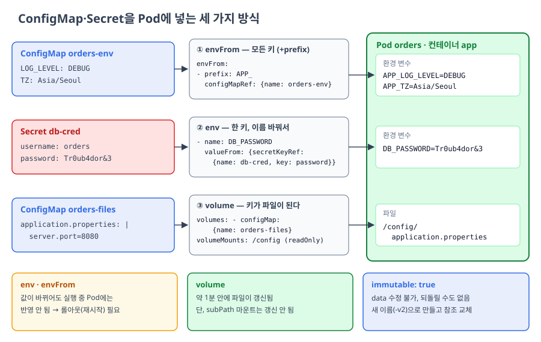
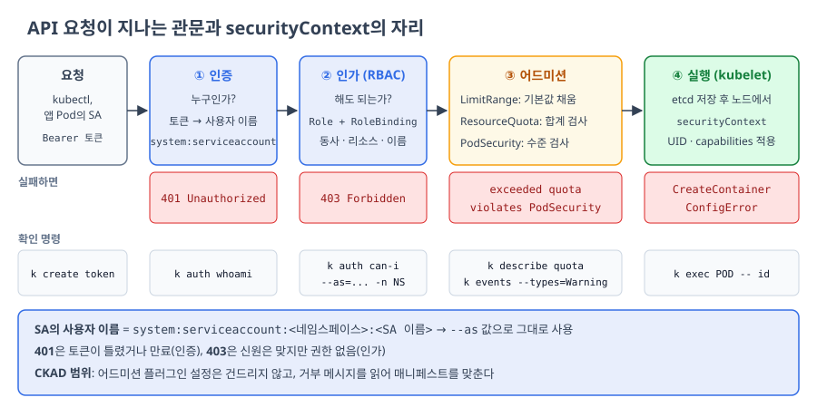

> **자격증 준비 · CKAD** | 난이도 ★★★☆☆ | 예상 소요 3.5 ~ 4시간

> ⚠️ 이 편의 모든 연습 과제는 CNCF가 공개한 **CKAD 공식 커리큘럼(github.com/cncf/curriculum)을 바탕으로 직접 창작한** 시험 스타일 과제입니다. 실제 시험 문제(유출 문제·덤프)가 아니며 실제 출제 내용과 무관합니다.

## 🎯 오늘의 목표

- ConfigMap·Secret을 **env 한 키 / envFrom 전체 / 볼륨 파일** 세 방식으로 넣고, 불변(immutable)으로 만들 수 있다
- `securityContext`의 `runAsUser`·`runAsNonRoot`·`capabilities`·`readOnlyRootFilesystem`을 과제 문장대로 Pod·컨테이너 수준에 나눠 쓸 수 있다
- 앱에 ServiceAccount를 지정하고, RBAC로 필요한 권한만 준 뒤 `kubectl auth can-i`로 증명할 수 있다
- ResourceQuota·LimitRange가 걸린 네임스페이스에서 **거부되지 않는 Pod**를 만들고, 거부된 이유를 찾을 수 있다
- 이미 설치된 CRD를 `api-resources`·`explain`으로 파악해 커스텀 리소스를 만들고 조회할 수 있다

---

## 1. 커리큘럼 항목 요약 — Application Environment, Configuration and Security (25%)

2026-11-19에 확인한 cncf/curriculum의 `CKAD_Curriculum_v1.37.pdf`에서 **비중이 가장 큰 도메인**입니다.

| 공식 커리큘럼 항목 | 이 편의 섹션 | 과제 |
|---|---|---|
| Discover and use resources that extend Kubernetes (CRD, Operators) | 4-5 | 10 |
| Understand authentication, authorization and admission control | 4-6 | 8, 9 |
| Understand requests, limits, quotas | 4-4 | 9 |
| Define resource requirements | 4-4 | 9 |
| Understand ConfigMaps | 4-1 | 1, 4 |
| Create & consume Secrets | 4-1 | 2, 3 |
| Understand ServiceAccounts | 4-3 | 7, 8 |
| Understand Application Security (SecurityContexts, Capabilities, etc.) | 4-2 | 5, 6 |

> 💡 이론은 본편과 CKA 편을 참조하세요. ConfigMap·Secret과 불변 설정은 [Day 13](../../02-kubernetes/day13-configmap-secret.md), requests·limits·QoS·LimitRange·ResourceQuota는 [Day 18](../../02-kubernetes/day18-autoscaling.md) 2~5장, RBAC·ServiceAccount·API 요청의 세 관문은 [Day 19](../../02-kubernetes/day19-rbac-namespace.md) 3~4장, `securityContext`와 Pod Security Admission은 [Day 69](../../09-security/day69-k8s-workload-security.md) 2~4장. CKA 쪽은 [K02](../cka/k02-rbac-helm-kustomize-crd.md)(RBAC·CRD), [K03 4-2·4-4](../cka/k03-workloads-scheduling.md)(설정 주입·쿼터)와 겹칩니다. 이 편은 **개발자 입장의 과제 문장**에 맞춘 빠른 작성에 집중합니다.

### 실습 환경

[A00](./a00-exam-overview-lab.md)의 환경 그대로입니다. 작업 터미널 base(WSL2), context **`cka-main`**(kubeadm v1.37.1, API `https://192.168.56.10:6443`), 스냅샷 `ckad-clean`에서 시작합니다.

```bash
kubectl config use-context cka-main
mkdir -p ~/ckad/a04 && cd ~/ckad/a04
alias k=kubectl; export do="--dry-run=client -o yaml"; export now="--force --grace-period=0"
k create ns a04
```

---

## 2. 출제 유형 — 어떻게 채점되는가

| 과제 형태 | 예시 문장(창작) | 채점 포인트 |
|---|---|---|
| **설정 주입형** | "ConfigMap `app-env`의 모든 키를 환경 변수로, Secret `db`의 `password`만 `DB_PASSWORD`로" | 이름·키 정확성, 컨테이너 안에서 실제 값 |
| **파일 마운트형** | "Secret을 `/etc/creds`에 읽기 전용, 권한 0400으로" | `mountPath`, `readOnly`, `defaultMode` |
| **보안 컨텍스트형** | "UID 1000, 루트 금지, 루트 파일시스템 읽기 전용, 모든 capability 제거" | 필드 위치(Pod vs 컨테이너), Pod Running |
| **SA·RBAC형** | "SA `reporter`가 `a04`의 Pod를 조회만 할 수 있게" | Role의 verbs·resources, RoleBinding 대상, `can-i` 결과 |
| **쿼터형** | "쿼터가 있는 네임스페이스에 Deployment가 3개 Pod를 갖게" | Pod 개수, requests·limits 값 |
| **CRD 사용형** | "설치된 `FeatureFlag` 리소스를 하나 만들어라" | group/version/kind, spec 필드, 생성 결과 |

> ⚠️ **Secret 값은 평문으로 주어집니다.** `kubectl create secret generic --from-literal`이 base64 인코딩을 알아서 해 주므로 직접 인코딩하지 마세요. YAML로 써야 한다면 `data` 대신 **`stringData`** 를 쓰면 평문 그대로 넣을 수 있습니다.

---

## 3. 핵심 명령 표

| 하고 싶은 것 | 명령 | 비고 |
|---|---|---|
| ConfigMap (값) | `k create cm app-env --from-literal=LOG_LEVEL=DEBUG --from-literal=TZ=Asia/Seoul` | |
| ConfigMap (파일) | `k create cm app-files --from-file=application.properties` | 키 = 파일 이름. `--from-file=key=path`로 키 지정 |
| ConfigMap (env 파일) | `k create cm app-env --from-env-file=app.env` | `KEY=VAL` 줄마다 키 하나 |
| Secret | `k create secret generic db --from-literal=username=app --from-literal=password='S3cr#t'` | 특수문자는 작은따옴표 |
| Secret 값 읽기 | `k get secret db -o jsonpath='{.data.password}' \| base64 -d` | |
| env 일괄 주입 | `k set env deploy/web --from=configmap/app-env` | `--keys=a,b`로 일부만, `--prefix=APP_` |
| SA 생성·지정 | `k create sa reporter` / `k set sa deploy/web reporter` | Pod는 SA 변경 불가 → 재생성 |
| SA 토큰 발급 | `k create token reporter --duration=10m` | TokenRequest API, 저장 안 됨 |
| Role·바인딩 | `k create role pod-read --verb=get,list,watch --resource=pods` / `k create rolebinding ... --role=pod-read --serviceaccount=a04:reporter` | `--serviceaccount=NS:NAME` |
| 권한 확인 | `k auth can-i list pods -n a04 --as=system:serviceaccount:a04:reporter` | `--list`로 전체 |
| 리소스 지정 | `k set resources deploy/web --requests=cpu=100m,memory=128Mi --limits=cpu=200m,memory=256Mi` | `k run`에는 플래그 없음 → `$do` 후 편집 |
| 쿼터 | `k create quota q --hard=requests.cpu=500m,requests.memory=512Mi,pods=4` | LimitRange는 명령형 없음 |
| 쿼터 사용량 | `k describe quota -n NS` | Used / Hard |
| CRD 찾기 | `k get crd` / `k api-resources --api-group=ckad.example.com` | SHORTNAMES 열 |
| CR 필드 | `k explain featureflag.spec` | 구조 스키마가 있으면 동작 |
| securityContext 필드 | `k explain pod.spec.containers.securityContext` | 명령형 없음 → 문서 복사 |

---

## 4. 영역별 핵심 — 시험에서 필요한 만큼만

### 4-1. ConfigMap·Secret — 세 가지 주입 방식



| 방식 | YAML 위치 | 값이 바뀌면 | 쓰는 때 |
|---|---|---|---|
| **env 한 키** | `env[].valueFrom.configMapKeyRef` / `secretKeyRef` | 반영 안 됨(재시작 필요) | 이름을 바꿔 넣을 때(`password` → `DB_PASSWORD`) |
| **envFrom 전체** | `envFrom[].configMapRef` / `secretRef` (+`prefix`) | 반영 안 됨 | 키가 이미 환경 변수 이름일 때 |
| **볼륨 파일** | `volumes[].configMap` / `secret` + `volumeMounts` | **약 1분 안에 파일 갱신**(subPath 마운트는 제외) | `application.properties`, 인증서 |

Spring Boot라면 두 방식이 자연스럽게 섞입니다. `SPRING_PROFILES_ACTIVE`, `SPRING_DATASOURCE_PASSWORD` 같은 값은 env로(relaxed binding이 대문자·밑줄을 프로퍼티로 바꿔 줌), 설정 파일 전체는 볼륨으로 마운트하고 `SPRING_CONFIG_ADDITIONAL_LOCATION=/config/`로 추가 위치를 알려 줍니다.

```yaml
    envFrom:
    - configMapRef: {name: app-env}
      prefix: APP_                       # 선택: 모든 키 앞에 붙음
    env:
    - name: DB_PASSWORD
      valueFrom: {secretKeyRef: {name: db, key: password}}
    volumeMounts:
    - {name: cfg, mountPath: /config, readOnly: true}
  volumes:
  - name: cfg
    configMap:
      name: app-files
      items:                             # 선택: 특정 키만, 파일 이름 변경
      - {key: application.properties, path: application.properties}
```

**불변 ConfigMap·Secret.** `immutable: true`를 넣으면 `data`를 바꿀 수 없고(삭제·재생성만 가능), kubelet이 변경 감시를 하지 않아 API 서버 부하가 줄어듭니다. 바꾸려면 **새 이름(`-v2`)으로 만들고 Deployment가 새 이름을 참조**하게 하는 것이 정석입니다. 한 번 켠 `immutable`은 끌 수 없습니다.

### 4-2. securityContext — 어디에 쓰는 필드인가

| 필드 | Pod 수준 | 컨테이너 수준 | 의미 |
|---|---|---|---|
| `runAsUser` / `runAsGroup` | ✅ | ✅(우선) | 프로세스 UID/GID |
| `runAsNonRoot` | ✅ | ✅ | UID 0이면 **시작 거부**(`CreateContainerConfigError`) |
| `fsGroup` | ✅ | ❌ | 볼륨 파일의 그룹 소유권 |
| `seccompProfile` | ✅ | ✅ | `RuntimeDefault` (restricted 필수) |
| `allowPrivilegeEscalation` | ❌ | ✅ | `false` 권장 (restricted 필수) |
| `capabilities.drop/add` | ❌ | ✅ | `drop: ["ALL"]`, 필요하면 `add: ["NET_BIND_SERVICE"]` |
| `readOnlyRootFilesystem` | ❌ | ✅ | 쓰기 필요한 경로는 `emptyDir` 마운트 |
| `privileged` | ❌ | ✅ | 앱 과제에서는 거의 항상 `false` |

> ⚠️ **`capabilities`, `readOnlyRootFilesystem`, `allowPrivilegeEscalation`은 컨테이너 수준에만 있습니다.** Pod `spec.securityContext`에 넣으면 `unknown field` 오류가 나거나(`kubectl apply`의 필드 검증) 무시됩니다. `k explain pod.spec.securityContext`와 `k explain pod.spec.containers.securityContext`로 위치를 확인하세요.

> 💡 Spring Boot(내장 Tomcat)를 `readOnlyRootFilesystem: true`로 돌리면 `/tmp`에 작업 디렉터리를 못 만들어 기동에 실패합니다. `/tmp`에 `emptyDir`를 마운트하는 것이 표준 해법입니다.

### 4-3. ServiceAccount

- 모든 네임스페이스에는 `default` SA가 있고, `serviceAccountName`을 안 쓰면 이것이 붙습니다.
- Pod의 `serviceAccountName`은 **생성 후 바꿀 수 없습니다.** Deployment는 `k set sa`로 바꾸면 새 Pod가 롤아웃됩니다.
- API를 부를 일이 없는 앱은 `automountServiceAccountToken: false`(SA 또는 Pod spec)로 토큰 마운트를 끕니다.
- 토큰은 `kubectl create token`(TokenRequest)으로 발급하는 **시간 제한 토큰**이 기본입니다. 오래가는 Secret 토큰은 꼭 필요할 때만.

### 4-4. requests·limits, ResourceQuota, LimitRange

어드미션에서 **LimitRange가 먼저 기본값을 채우고**, 그다음 ResourceQuota가 합계를 검사합니다. 표와 동작 원리는 [CKA K03 4-4](../cka/k03-workloads-scheduling.md)와 [Day 18 5장](../../02-kubernetes/day18-autoscaling.md)을 보고, 여기서는 과제에서 막히는 지점만 짚습니다.

- `requests.cpu` 쿼터가 있으면 requests 없는 Pod는 **거부**됩니다. LimitRange `defaultRequest`가 있으면 자동으로 채워져 통과합니다.
- Deployment Pod가 쿼터로 거부되면 Deployment·ReplicaSet은 만들어지고 **Pod만 없습니다.** 원인은 `k describe rs` 또는 `k events`의 `exceeded quota`.
- 쿼터가 꽉 찬 상태에서 롤링 업데이트를 하면 새 Pod(maxSurge)를 만들 자리가 없어 **멈춥니다.** 레플리카를 줄이거나 `Recreate` 전략으로 풉니다(과제 9).
- `kubectl run`에는 리소스 플래그가 없습니다(`--requests`는 오래전 제거). `$do`로 뽑아 `resources:` 블록을 붙이세요.

### 4-5. 이미 설치된 CRD 사용하기

CKAD는 CRD를 **만드는 것**보다 **이미 있는 것을 찾아 쓰는 것**을 봅니다. 오퍼레이터가 설치한 리소스(예: 이 클러스터의 Gateway API `Gateway`, `HTTPRoute`, Cilium의 `CiliumNetworkPolicy`)가 대표적입니다.

```bash
k get crd | head
k api-resources --api-group=gateway.networking.k8s.io       # NAME, SHORTNAMES, APIVERSION, NAMESPACED, KIND
k explain httproute.spec --api-version=gateway.networking.k8s.io/v1
k get gateway -A                                             # CR 조회는 일반 리소스와 똑같다
```

순서는 **① `api-resources`로 group/version·kind·네임스페이스 여부 → ② `explain`으로 spec 필드 → ③ 문서 예제나 `k get <kind> <기존 것> -o yaml`을 본떠 작성**입니다. CR에 대한 권한도 RBAC로 줄 수 있으며, 이때 `--resource=featureflags.ckad.example.com`처럼 **복수형.그룹**으로 씁니다.

### 4-6. 인증·인가·어드미션 — 요청이 통과하는 관문



| 단계 | 질문 | 이 편에서 다루는 것 | 확인 방법 |
|---|---|---|---|
| 인증(Authentication) | 누구인가? | SA 토큰(`system:serviceaccount:NS:NAME`) | `k create token`, `k auth whoami` |
| 인가(Authorization) | 해도 되는가? | RBAC Role/RoleBinding | `k auth can-i ... --as=...` |
| 어드미션(Admission) | 받아들여도 되는가(고칠 것은)? | LimitRange(기본값 채움), ResourceQuota(합계), PodSecurity(restricted 등) | `k describe quota`, 생성 거부 메시지 |
| 실행(kubelet) | 어떻게 실행하나? | `securityContext` | `k exec -- id` |

kubeadm 클러스터의 kube-apiserver는 기본 어드미션 플러그인(`LimitRanger`, `ResourceQuota`, `PodSecurity`, `ServiceAccount` 등)에 `NodeRestriction`을 더해 켭니다. 시험에서 어드미션 설정 파일을 고치는 것은 CKA·CKS의 몫이고, CKAD는 **어드미션이 거부한 이유를 읽고 매니페스트를 맞추는 것**까지입니다.

---

## 5. 시간 절약 팁

- **`$do`로 뼈대 → vim으로 블록 추가.** `k run app --image=busybox:1.37 $do -- sleep 1d > app.yaml` 후 `env`, `envFrom`, `volumes`, `securityContext`, `resources`를 붙입니다. 문서 검색어: `configmap pod` → *Configure a Pod to Use a ConfigMap*, `secret` → *Distribute Credentials Securely Using Secrets*, `security context` → *Configure a Security Context for a Pod or Container*.
- **검증은 `exec`로 한 줄씩.** `k exec app -- env | grep APP_`, `k exec app -- cat /config/application.properties`, `k exec app -- id`.
- **RBAC는 명령형 두 줄 + `can-i` 두 줄.** 허용되어야 하는 것 하나(`yes`), 막혀야 하는 것 하나(`no`)를 꼭 함께 확인합니다.
- **`--as` 문자열을 외워 두기**: `system:serviceaccount:<네임스페이스>:<SA 이름>`.
- **쿼터 과제는 `k describe quota`를 먼저.** 남은 양(Hard − Used)을 보고 Pod당 값을 계산한 다음 YAML을 씁니다.
- **CR 작성이 막히면 기존 객체를 복사.** `k get <kind> <이름> -o yaml`에서 `status`, `metadata.uid` 등을 지우고 고치면 가장 빠릅니다.

---

## 6. 자주 하는 실수

| 실수 | 결과 | 바로잡기 |
|---|---|---|
| `envFrom`에서 `configMapRef` 아래에 `prefix` | 오류 또는 무시 | `prefix`는 `configMapRef`와 **같은 수준**(`envFrom[]`의 필드) |
| Secret YAML의 `data`에 평문 | `illegal base64 data` 오류 | `stringData` 사용, 또는 명령형 생성 |
| `subPath`로 마운트한 ConfigMap 수정 후 기다림 | 파일이 절대 안 바뀜 | subPath는 자동 갱신 대상이 아님 → 디렉터리 마운트 또는 재시작 |
| 불변 ConfigMap을 `k edit` | `field is immutable` | 새 이름으로 만들고 참조 변경 |
| `capabilities`를 Pod 수준에 | `unknown field` 오류 | 컨테이너 `securityContext`로 이동 |
| `runAsNonRoot: true`만 지정, 이미지는 root | `CreateContainerConfigError: container has runAsNonRoot and image will run as root` | `runAsUser: 1000` 추가 또는 비루트 이미지 |
| `readOnlyRootFilesystem: true`인데 앱이 `/tmp` 사용 | `Read-only file system` 오류로 CrashLoop | `/tmp`에 `emptyDir` |
| `--serviceaccount=reporter`(네임스페이스 생략) | `must be <namespace>:<name>` 오류 | `--serviceaccount=a04:reporter` |
| `can-i`에서 `-n` 생략 | 기본 네임스페이스로 판단 → `no` | `-n a04` |
| ClusterRoleBinding으로 바인딩 | 모든 네임스페이스 권한(과도) | 과제가 네임스페이스 한정이면 **RoleBinding** |
| 쿼터 네임스페이스에서 requests 없는 Pod | `must specify requests.cpu` | `resources.requests` 추가 또는 LimitRange 기본값 확인 |

---

## 7. 창작 연습 과제

> 아래 과제는 모두 **공식 커리큘럼을 바탕으로 창작한** 연습 문제입니다. 특별한 말이 없으면 context `cka-main`, 네임스페이스 `a04`에서 합니다.

### 과제 1. ConfigMap 두 개 — envFrom과 볼륨 (목표 6분)

- ConfigMap `orders-env`: `LOG_LEVEL=DEBUG`, `TZ=Asia/Seoul`
- ConfigMap `orders-files`: 키 `application.properties`, 내용은 `server.port=8080`과 `orders.page-size=50` 두 줄
- Pod `orders-cfg`(busybox:1.37, 명령 `sleep 1d`): `orders-env`의 모든 키를 접두사 `APP_`를 붙여 환경 변수로, `orders-files`를 `/config`에 읽기 전용으로 마운트. 환경 변수 `SPRING_CONFIG_ADDITIONAL_LOCATION=/config/`도 넣는다.

📖 참고 문서: kubernetes.io/docs/tasks/configure-pod-container/configure-pod-configmap/

<details>
<summary>풀이·검증</summary>

```bash
k -n a04 create cm orders-env --from-literal=LOG_LEVEL=DEBUG --from-literal=TZ=Asia/Seoul
printf 'server.port=8080\norders.page-size=50\n' > application.properties
k -n a04 create cm orders-files --from-file=application.properties
k -n a04 run orders-cfg --image=busybox:1.37 --env=SPRING_CONFIG_ADDITIONAL_LOCATION=/config/ $do -- sleep 1d > orders-cfg.yaml
vim orders-cfg.yaml
```

```yaml
  containers:
  - name: orders-cfg
    image: busybox:1.37
    args: ["sleep", "1d"]
    env:
    - {name: SPRING_CONFIG_ADDITIONAL_LOCATION, value: /config/}
    envFrom:
    - prefix: APP_
      configMapRef: {name: orders-env}
    volumeMounts:
    - {name: cfg, mountPath: /config, readOnly: true}
  volumes:
  - name: cfg
    configMap: {name: orders-files}
```

```bash
k apply -f orders-cfg.yaml
k -n a04 exec orders-cfg -- env | grep -E '^APP_|SPRING'
# APP_LOG_LEVEL=DEBUG
# APP_TZ=Asia/Seoul
# SPRING_CONFIG_ADDITIONAL_LOCATION=/config/
k -n a04 exec orders-cfg -- cat /config/application.properties
k -n a04 exec orders-cfg -- touch /config/x      # Read-only file system
```
</details>

### 과제 2. Secret 키를 다른 이름의 환경 변수로 (목표 5분)

Secret `db-cred`(`username=orders`, `password=Tr0ub4dor&3`)를 만들어라. Deployment `pay`(nginx:1.27, 레플리카 1)를 만들고 컨테이너에 다음 환경 변수를 넣어라.
- `SPRING_DATASOURCE_USERNAME` ← `db-cred`의 `username`
- `SPRING_DATASOURCE_PASSWORD` ← `db-cred`의 `password`
- `LOG_LEVEL` ← ConfigMap `orders-env`의 `LOG_LEVEL`

📖 참고 문서: kubernetes.io/docs/tasks/inject-data-application/distribute-credentials-secure/, kubernetes.io/docs/concepts/configuration/secret/

<details>
<summary>풀이·검증</summary>

```bash
k -n a04 create secret generic db-cred --from-literal=username=orders --from-literal='password=Tr0ub4dor&3'
k -n a04 create deploy pay --image=nginx:1.27 $do > pay.yaml
vim pay.yaml
```

```yaml
      containers:
      - image: nginx:1.27
        name: nginx
        env:
        - name: SPRING_DATASOURCE_USERNAME
          valueFrom: {secretKeyRef: {name: db-cred, key: username}}
        - name: SPRING_DATASOURCE_PASSWORD
          valueFrom: {secretKeyRef: {name: db-cred, key: password}}
        - name: LOG_LEVEL
          valueFrom: {configMapKeyRef: {name: orders-env, key: LOG_LEVEL}}
```

```bash
k apply -f pay.yaml && k -n a04 rollout status deploy/pay
k -n a04 exec deploy/pay -- printenv SPRING_DATASOURCE_PASSWORD     # Tr0ub4dor&3
k -n a04 get secret db-cred -o jsonpath='{.data.password}' | base64 -d; echo
```

`--from-literal`에서 `&`가 셸에 해석되지 않도록 **작은따옴표**로 감쌌습니다. 값이 틀어지면 Secret을 지우고 다시 만드세요.
</details>

### 과제 3. Secret을 파일로 — 권한 0400 (목표 5분)

Secret `api-key`를 키 `token`, 값 `ckad-demo-token-7f3a`로 만들어라. Pod `key-reader`(busybox:1.37, `sleep 1d`)가 이 Secret을 `/etc/api`에 읽기 전용으로 마운트하되 파일 권한은 `0400`이어야 한다. 마지막으로 Secret의 값을 디코드해 `~/ckad/a04/token.txt`에 저장하라.

📖 참고 문서: kubernetes.io/docs/concepts/configuration/secret/ (*Using Secrets as files from a Pod*)

<details>
<summary>풀이·검증</summary>

```bash
k -n a04 create secret generic api-key --from-literal=token=ckad-demo-token-7f3a
cat <<'EOF' | k apply -f -
apiVersion: v1
kind: Pod
metadata: {name: key-reader, namespace: a04}
spec:
  containers:
  - name: app
    image: busybox:1.37
    args: ["sleep", "1d"]
    volumeMounts:
    - {name: key, mountPath: /etc/api, readOnly: true}
  volumes:
  - name: key
    secret:
      secretName: api-key
      defaultMode: 0400
EOF
```

```bash
k -n a04 exec key-reader -- ls -lL /etc/api
# -r--------    1 root     root    20 ... token
k -n a04 exec key-reader -- cat /etc/api/token; echo
k -n a04 get secret api-key -o jsonpath='{.data.token}' | base64 -d > ~/ckad/a04/token.txt
cat ~/ckad/a04/token.txt        # ckad-demo-token-7f3a
```

`ls -l`만 쓰면 심볼릭 링크(`token -> ..data/token`)의 권한이 보입니다. `-L`로 실제 파일 권한을 확인하세요. YAML에서 `0400`은 8진수로 해석됩니다(JSON이라면 십진수 `256`).
</details>

### 과제 4. 불변 ConfigMap과 교체 배포 (목표 7분)

1. 불변 ConfigMap `flags-v1`(`CHECKOUT_V2=false`)을 만들고, Deployment `checkout`(nginx:1.27, 레플리카 2)이 `envFrom`으로 이 ConfigMap을 쓰게 하라.
2. `flags-v1`의 값을 `true`로 바꾸려 시도해 거부되는 것을 확인하라.
3. `CHECKOUT_V2=true`인 불변 ConfigMap `flags-v2`를 만들고, `checkout`이 `flags-v2`를 쓰도록 롤아웃하라. `flags-v1`은 남겨 둔다(롤백 대비).

📖 참고 문서: kubernetes.io/docs/concepts/configuration/configmap/ (*Immutable ConfigMaps*)

<details>
<summary>풀이·검증</summary>

```bash
k -n a04 create cm flags-v1 --from-literal=CHECKOUT_V2=false $do > flags-v1.yaml
echo 'immutable: true' >> flags-v1.yaml && k apply -f flags-v1.yaml
k -n a04 create deploy checkout --image=nginx:1.27 --replicas=2 $do > checkout.yaml
vim checkout.yaml      # containers[0] 아래에 추가
#        envFrom:
#        - configMapRef: {name: flags-v1}
k apply -f checkout.yaml && k -n a04 rollout status deploy/checkout

k -n a04 patch cm flags-v1 -p '{"data":{"CHECKOUT_V2":"true"}}'
# The ConfigMap "flags-v1" is invalid: data: Forbidden: field is immutable when `immutable` is set
```

```bash
sed 's/flags-v1/flags-v2/; s/"false"/"true"/' flags-v1.yaml > flags-v2.yaml
grep -E 'name:|CHECKOUT|immutable' flags-v2.yaml        # name: flags-v2, CHECKOUT_V2: "true", immutable: true
k apply -f flags-v2.yaml
k -n a04 patch deploy checkout --type=json -p '[{"op":"replace","path":"/spec/template/spec/containers/0/envFrom/0/configMapRef/name","value":"flags-v2"}]'
k -n a04 rollout status deploy/checkout
k -n a04 exec deploy/checkout -- printenv CHECKOUT_V2      # true
k -n a04 get cm flags-v1 flags-v2
```

💡 `k set env deploy/checkout --from=configmap/flags-v1`도 비슷해 보이지만, 이 명령은 `envFrom`이 아니라 **키마다 `env[].valueFrom`** 을 만듭니다. 과제가 `envFrom`을 요구하면 YAML로 쓰세요.

ConfigMap 이름이 바뀌면 Pod 템플릿이 바뀌므로 **자동으로 롤링 업데이트**됩니다. 같은 이름의 값만 바꾸는 방식은 env 주입에서 반영이 안 되고, 롤백 시 이전 값도 잃습니다.
</details>

### 과제 5. restricted 네임스페이스에서 통과하는 Pod (목표 8분)

네임스페이스 `a04-sec`를 만들고 Pod Security `restricted`를 **enforce**로 걸어라. 그 안에 Pod `hardened`(busybox:1.37, `sleep 1d`)를 다음 조건으로 실행하라.
- UID 1000, GID 3000, 볼륨 그룹 2000, 루트 실행 금지
- 컨테이너 루트 파일시스템 읽기 전용, `/tmp`만 쓰기 가능(emptyDir)
- 권한 상승 금지, 모든 capability 제거 후 `NET_BIND_SERVICE`만 추가
- seccomp `RuntimeDefault`

📖 참고 문서: kubernetes.io/docs/tasks/configure-pod-container/security-context/, kubernetes.io/docs/concepts/security/pod-security-standards/

<details>
<summary>풀이·검증</summary>

```bash
k create ns a04-sec
k label ns a04-sec pod-security.kubernetes.io/enforce=restricted
cat <<'EOF' > hardened.yaml
apiVersion: v1
kind: Pod
metadata: {name: hardened, namespace: a04-sec}
spec:
  securityContext:                       # Pod 수준
    runAsUser: 1000
    runAsGroup: 3000
    fsGroup: 2000
    runAsNonRoot: true
    seccompProfile: {type: RuntimeDefault}
  containers:
  - name: app
    image: busybox:1.37
    args: ["sleep", "1d"]
    securityContext:                     # 컨테이너 수준
      allowPrivilegeEscalation: false
      readOnlyRootFilesystem: true
      capabilities:
        drop: ["ALL"]
        add: ["NET_BIND_SERVICE"]
    volumeMounts:
    - {name: tmp, mountPath: /tmp}
  volumes:
  - name: tmp
    emptyDir: {}
EOF
k apply -f hardened.yaml
```

```bash
k -n a04-sec exec hardened -- id
# uid=1000 gid=3000 groups=2000,3000      (groups 순서는 다를 수 있음, fsGroup 2000 포함이 핵심)
k -n a04-sec exec hardened -- touch /tmp/ok && echo tmp-ok
k -n a04-sec exec hardened -- touch /ok
# touch: /ok: Read-only file system
k -n a04-sec exec hardened -- grep CapBnd /proc/1/status
# CapBnd: 0000000000000400                  ← NET_BIND_SERVICE(비트 10)만
```

조건 하나를 빼고 다시 만들어 보면 PodSecurity 어드미션이 무엇을 요구하는지 정확히 알려 줍니다.

```bash
k -n a04-sec run bare --image=busybox:1.37 -- sleep 1d
# Error from server (Forbidden): pods "bare" is forbidden: violates PodSecurity "restricted:latest":
# allowPrivilegeEscalation != false ..., unrestricted capabilities ..., runAsNonRoot != true ..., seccompProfile ...
```
</details>

### 과제 6. 루트 금지 Pod 살리기 (목표 5분)

다음 Pod가 시작되지 않는다. `runAsNonRoot: true`는 **유지**한 채, 이미지를 비루트 nginx인 `nginxinc/nginx-unprivileged:1.27`로 바꾸고 포트를 맞춰 Pod를 실행하라. 컨테이너 안의 UID를 `~/ckad/a04/web-uid.txt`에 숫자로 적어라.

```bash
cat <<'EOF' | k apply -f -
apiVersion: v1
kind: Pod
metadata: {name: web-nonroot, namespace: a04}
spec:
  securityContext: {runAsNonRoot: true}
  containers:
  - name: web
    image: nginx:1.27
    ports: [{containerPort: 80}]
EOF
```

📖 참고 문서: kubernetes.io/docs/tasks/configure-pod-container/security-context/, kubernetes.io/docs/tasks/debug/debug-application/debug-pods/

<details>
<summary>풀이·검증</summary>

```bash
k -n a04 get pod web-nonroot                       # CreateContainerConfigError
k -n a04 events --for pod/web-nonroot | tail -1
# Error: container has runAsNonRoot and image will run as root (pod: ...)
k -n a04 get pod web-nonroot -o yaml > web-nonroot.yaml
sed -i 's#image: nginx:1.27#image: nginxinc/nginx-unprivileged:1.27#; s/containerPort: 80$/containerPort: 8080/' web-nonroot.yaml
k replace --force -f web-nonroot.yaml
k -n a04 get pod web-nonroot                       # Running
k -n a04 exec web-nonroot -- id -u > ~/ckad/a04/web-uid.txt
cat ~/ckad/a04/web-uid.txt                         # 101
k -n a04 exec web-nonroot -- curl -s localhost:8080 | grep -o 'Welcome to nginx'
```

kubelet은 `runAsNonRoot`를 볼 때 **이미지의 USER가 숫자 UID인지** 확인합니다. 이미지가 root(0)이거나 USER가 이름(예: `nginx`)이라 숫자로 판단할 수 없으면 시작을 거부하므로, 그때는 `runAsUser`에 숫자를 직접 지정합니다. 비루트 nginx는 1024 미만 포트를 열 수 없어서 8080을 씁니다.
</details>

### 과제 7. 앱 전용 ServiceAccount, 토큰 없이 (목표 5분)

SA `orders-sa`를 만들어라. 이 SA는 토큰을 자동 마운트하지 않는다. Deployment `pay`(과제 2)가 이 SA로 실행되게 하고, 새 Pod 안에 토큰 파일이 없는 것을 확인하라.

📖 참고 문서: kubernetes.io/docs/tasks/configure-pod-container/configure-service-account/

<details>
<summary>풀이·검증</summary>

```bash
k -n a04 create sa orders-sa $do > orders-sa.yaml
echo 'automountServiceAccountToken: false' >> orders-sa.yaml
k apply -f orders-sa.yaml
k -n a04 set sa deploy/pay orders-sa
k -n a04 rollout status deploy/pay
```

```bash
k -n a04 get pod -l app=pay -o jsonpath='{.items[0].spec.serviceAccountName}{"\n"}'     # orders-sa
k -n a04 exec deploy/pay -- ls /var/run/secrets/kubernetes.io/serviceaccount
# ls: cannot access '/var/run/secrets/kubernetes.io/serviceaccount': No such file or directory
```

Pod spec에 `automountServiceAccountToken`을 쓰면 SA 설정보다 **Pod 쪽이 우선**합니다. 과제가 "이 Deployment만"이라면 Pod 템플릿에, "이 SA를 쓰는 모든 Pod"라면 SA에 씁니다.
</details>

### 과제 8. 조회 전용 앱 SA — RBAC와 `can-i`, 실제 API 호출 (목표 8분)

SA `reporter`(네임스페이스 `a04`)가 다음만 할 수 있게 하라.
- `a04`의 Pod: `get`, `list`, `watch`
- `a04`의 ConfigMap 중 **`report-config` 하나만** `get`

Role 이름은 `reporter-role`, RoleBinding 이름은 `reporter-rb`. `can-i`로 세 가지(Pod 목록 / Secret 목록 / `orders-env` ConfigMap 조회)를 확인해 `yes`/`no`를 한 줄씩 `~/ckad/a04/can-i.txt`에 적고, 이 SA의 토큰으로 API 서버를 직접 호출해 Pod 목록은 200, Secret 목록은 403이 나오는 것을 보여라.

📖 참고 문서: kubernetes.io/docs/reference/access-authn-authz/rbac/, kubernetes.io/docs/reference/access-authn-authz/authorization/ (*Checking API access*)

<details>
<summary>풀이·검증</summary>

```bash
k -n a04 create sa reporter
k -n a04 create cm report-config --from-literal=format=csv
k -n a04 create role reporter-role --verb=get,list,watch --resource=pods
k -n a04 get role reporter-role -o yaml > reporter-role.yaml
vim reporter-role.yaml
#   rules:
#   - apiGroups: [""]
#     resources: ["pods"]
#     verbs: ["get", "list", "watch"]
#   - apiGroups: [""]
#     resources: ["configmaps"]
#     resourceNames: ["report-config"]
#     verbs: ["get"]
k apply -f reporter-role.yaml
k -n a04 create rolebinding reporter-rb --role=reporter-role --serviceaccount=a04:reporter
```

```bash
AS=system:serviceaccount:a04:reporter
{ k auth can-i list pods -n a04 --as=$AS
  k auth can-i list secrets -n a04 --as=$AS
  k auth can-i get configmap/orders-env -n a04 --as=$AS; } > ~/ckad/a04/can-i.txt
cat ~/ckad/a04/can-i.txt          # yes / no / no
k auth can-i get configmap/report-config -n a04 --as=$AS     # yes
```

명령형 `create role`의 `--resource-name`은 **모든 규칙에** 붙기 때문에, 리소스마다 이름 제한이 다르면 YAML로 규칙을 나눠야 합니다.

이제 인증(토큰)과 인가(RBAC)를 실제 HTTP로 확인합니다.

```bash
TOKEN=$(k -n a04 create token reporter --duration=10m)
API=https://192.168.56.10:6443
curl -sk -o /dev/null -w '%{http_code}\n' -H "Authorization: Bearer $TOKEN" $API/api/v1/namespaces/a04/pods      # 200
curl -sk -H "Authorization: Bearer $TOKEN" $API/api/v1/namespaces/a04/secrets | grep -E '"(reason|code)"'
#   "reason": "Forbidden",
#   "code": 403
curl -sk -o /dev/null -w '%{http_code}\n' $API/api/v1/namespaces/a04/pods                                          # 403 (system:anonymous)
```

토큰이 없으면 `system:anonymous`로 인증되고, 토큰이 있으면 `system:serviceaccount:a04:reporter`로 인증된 뒤 RBAC가 동사·리소스를 판단합니다. 401은 **인증 실패**(토큰 오류·만료), 403은 **인가 실패**입니다.
</details>

### 과제 9. 쿼터 안에서 Pod 만들기 (목표 10분)

다음으로 네임스페이스 `a04-q`를 준비하라.

```bash
k create ns a04-q
k -n a04-q create quota team-q --hard=requests.cpu=500m,requests.memory=512Mi,limits.cpu=1,limits.memory=1Gi,pods=4
cat <<'EOF' | k apply -f -
apiVersion: v1
kind: LimitRange
metadata: {name: team-lr, namespace: a04-q}
spec:
  limits:
  - type: Container
    defaultRequest: {cpu: 100m, memory: 128Mi}
    default: {cpu: 200m, memory: 256Mi}
    max: {cpu: 500m, memory: 512Mi}
EOF
k -n a04-q create deploy burst --image=nginx:1.27 --replicas=3 $do > burst.yaml
```

1. `resources`를 쓰지 않은 Pod `probe-lr`(nginx:1.27)를 만들어 LimitRange가 채운 값을 확인하고 삭제하라.
2. `burst.yaml`의 컨테이너에 requests `cpu=200m,memory=128Mi`, limits `cpu=400m,memory=256Mi`를 넣어 적용하라. 몇 개의 Pod가 만들어지는지, 왜 나머지가 안 만들어지는지 확인하라.
3. Pod `fits`(nginx:1.27, requests `100m/128Mi`, limits `200m/256Mi`)를 만들고, **쿼터는 바꾸지 않고** `burst`의 3개 레플리카가 모두 실행되도록 `burst`의 Pod당 리소스를 조정하라(limits는 requests의 2배).

📖 참고 문서: kubernetes.io/docs/concepts/policy/resource-quotas/, kubernetes.io/docs/concepts/policy/limit-range/, kubernetes.io/docs/concepts/configuration/manage-resources-containers/

<details>
<summary>풀이·검증</summary>

```bash
# 1
k -n a04-q run probe-lr --image=nginx:1.27
k -n a04-q get pod probe-lr -o jsonpath='{.spec.containers[0].resources}{"\n"}'
# {"limits":{"cpu":"200m","memory":"256Mi"},"requests":{"cpu":"100m","memory":"128Mi"}}
k -n a04-q delete pod probe-lr $now
```

```bash
# 2
vim burst.yaml
#        resources:
#          requests: {cpu: 200m, memory: 128Mi}
#          limits: {cpu: 400m, memory: 256Mi}
k apply -f burst.yaml
k -n a04-q get deploy burst                     # READY 2/3
k -n a04-q events --types=Warning | grep -m1 quota
# ... forbidden: exceeded quota: team-q, requested: requests.cpu=200m, used: requests.cpu=400m, limited: requests.cpu=500m
```

```bash
# 3 — 남은 양 계산: requests.cpu 500m, 메모리 512Mi, pods 4 를 fits 1개 + burst 3개가 나눠 씀
k -n a04-q run fits --image=nginx:1.27 $do > fits.yaml
vim fits.yaml        # requests {cpu: 100m, memory: 128Mi}, limits {cpu: 200m, memory: 256Mi}
```

`burst` Pod 2개(200m씩)가 이미 400m를 쓰고 있어 `fits`(100m)까지 넣으면 쿼터가 꽉 찹니다. 이 상태에서 `set resources`로 롤링 업데이트를 하면 새 Pod(maxSurge)를 만들 자리가 없어 **롤아웃이 멈춥니다.** 먼저 줄이고, 고치고, 늘립니다.

```bash
k -n a04-q scale deploy burst --replicas=0
k apply -f fits.yaml
k -n a04-q set resources deploy burst --requests=cpu=100m,memory=128Mi --limits=cpu=200m,memory=256Mi
k -n a04-q scale deploy burst --replicas=3
k -n a04-q get deploy burst; k -n a04-q get pod fits        # 3/3, fits Running
k -n a04-q describe quota team-q
# requests.cpu     400m   500m
# requests.memory  512Mi  512Mi
# limits.cpu       800m   1
# limits.memory    1Gi    1Gi
# pods             4      4
```

Pod당 100m이면 burst 3개 + fits = 400m로 cpu는 여유가 있지만, **memory(128Mi × 4 = 512Mi)와 pods(4)가 정확히 한도**입니다. 쿼터 과제는 항목마다 합계를 따져야 합니다.
</details>

### 과제 10. 설치된 CRD로 리소스 만들기·조회 (목표 8분)

먼저 아래 CRD를 설치하라(시험에서는 오퍼레이터가 미리 설치해 둔 상황이라고 생각한다).

```bash
cat <<'EOF' | k apply -f -
apiVersion: apiextensions.k8s.io/v1
kind: CustomResourceDefinition
metadata: {name: featureflags.ckad.example.com}
spec:
  group: ckad.example.com
  scope: Namespaced
  names: {plural: featureflags, singular: featureflag, kind: FeatureFlag, shortNames: [ff]}
  versions:
  - name: v1
    served: true
    storage: true
    schema:
      openAPIV3Schema:
        type: object
        properties:
          spec:
            type: object
            required: [enabled]
            properties:
              enabled: {type: boolean}
              rolloutPercent: {type: integer, minimum: 0, maximum: 100}
              description: {type: string}
    additionalPrinterColumns:
    - {name: Enabled, type: boolean, jsonPath: .spec.enabled}
    - {name: Rollout, type: integer, jsonPath: .spec.rolloutPercent}
EOF
```

1. 이 리소스의 `apiVersion`과 짧은 이름을 `~/ckad/a04/crd-info.txt`에 한 줄씩 적어라.
2. `a04`에 `FeatureFlag` `checkout-v2`를 만들어라: 켜짐, 롤아웃 10%, 설명 `new checkout flow`.
3. 롤아웃 150%로 만들려 하면 어떻게 되는지 확인하라.
4. 과제 8의 SA `reporter`가 `a04`의 FeatureFlag를 `get`/`list`할 수 있게 하라.

📖 참고 문서: kubernetes.io/docs/tasks/extend-kubernetes/custom-resources/custom-resource-definitions/, kubernetes.io/docs/concepts/extend-kubernetes/api-extension/custom-resources/, kubernetes.io/docs/reference/access-authn-authz/rbac/

<details>
<summary>풀이·검증</summary>

```bash
k api-resources --api-group=ckad.example.com
# NAME           SHORTNAMES   APIVERSION            NAMESPACED   KIND
# featureflags   ff           ckad.example.com/v1   true         FeatureFlag
printf 'ckad.example.com/v1\nff\n' > ~/ckad/a04/crd-info.txt
k explain featureflag.spec
```

```bash
cat <<'EOF' | k apply -f -
apiVersion: ckad.example.com/v1
kind: FeatureFlag
metadata: {name: checkout-v2, namespace: a04}
spec:
  enabled: true
  rolloutPercent: 10
  description: new checkout flow
EOF
k -n a04 get ff
# NAME          ENABLED   ROLLOUT   AGE
# checkout-v2   true      10        5s
```

```bash
k -n a04 patch ff checkout-v2 --type=merge -p '{"spec":{"rolloutPercent":150}}'
# The FeatureFlag "checkout-v2" is invalid: spec.rolloutPercent: Invalid value: 150:
# spec.rolloutPercent in body should be less than or equal to 100
```

```bash
k -n a04 create role ff-read --verb=get,list --resource=featureflags.ckad.example.com
k -n a04 create rolebinding ff-read-rb --role=ff-read --serviceaccount=a04:reporter
k auth can-i list featureflags.ckad.example.com -n a04 --as=system:serviceaccount:a04:reporter   # yes
k auth can-i delete featureflags.ckad.example.com -n a04 --as=system:serviceaccount:a04:reporter # no
```

CRD의 OpenAPI 스키마 검증(`minimum`/`maximum`, `required`)은 API 서버가 **생성·수정 시점에** 수행합니다. 오퍼레이터 CR을 만들 때 오류 메시지가 바로 "어느 필드를 어떻게 고치라"를 알려 주니 끝까지 읽으세요.
</details>

### 정리

```bash
k delete ns a04 a04-sec a04-q
k delete crd featureflags.ckad.example.com
```

---

## 8. 핵심 정리

- 설정 주입: **env 한 키**(`valueFrom`, 이름 변경 가능) · **envFrom 전체**(`prefix`) · **볼륨 파일**(갱신 반영, subPath 제외). Secret은 명령형 생성 또는 `stringData`
- 불변 ConfigMap·Secret: `immutable: true`, 수정 불가 → **새 이름 + 참조 교체**로 롤아웃
- securityContext: `runAsUser`/`runAsNonRoot`/`fsGroup`/`seccompProfile`은 Pod에도, **`capabilities`/`readOnlyRootFilesystem`/`allowPrivilegeEscalation`은 컨테이너에만**. 읽기 전용 루트면 `/tmp`에 emptyDir
- ServiceAccount: `k create sa`, `k set sa deploy/X`, 토큰이 필요 없으면 `automountServiceAccountToken: false`, 토큰 발급은 `k create token`
- RBAC: Role(동사·리소스·이름) + RoleBinding(`--serviceaccount=NS:NAME`) → `k auth can-i ... --as=system:serviceaccount:NS:NAME -n NS`. 401은 인증, 403은 인가 실패
- 쿼터: LimitRange가 기본값을 채우고 ResourceQuota가 합계를 막는다. 거부는 RS 이벤트에서 `exceeded quota`. 꽉 찬 쿼터에서는 롤링 업데이트가 멈춘다
- CRD 사용: `api-resources --api-group` → `explain` → 작성. 권한은 `--resource=복수형.그룹`

---

## ⏭️ 다음 예고 — A05. 서비스·네트워킹

앱을 밖으로 내보내고 서로 연결하는 차례입니다. `kubectl expose`로 ClusterIP·NodePort Service를 만들고, selector·targetPort가 어긋나 엔드포인트가 비는 문제를 고치며, 라벨 기반 NetworkPolicy로 frontend → backend → db 트래픽만 허용하고(DNS 허용 포함), Traefik 위에서 Ingress와 Gateway API HTTPRoute로 경로·호스트 라우팅을 만듭니다. 마지막으로 `kubectl port-forward`로 로컬에서 앱을 확인하는 법까지 정리합니다.
