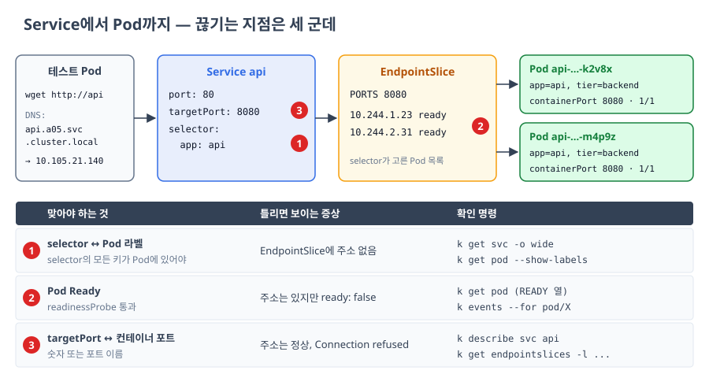
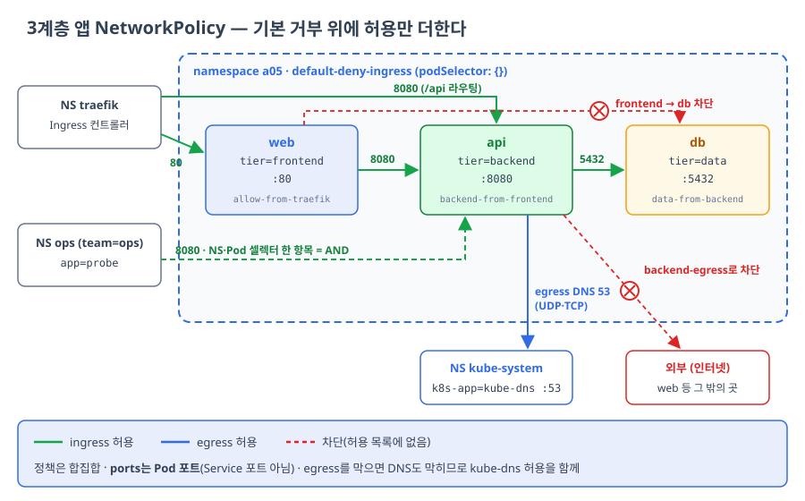
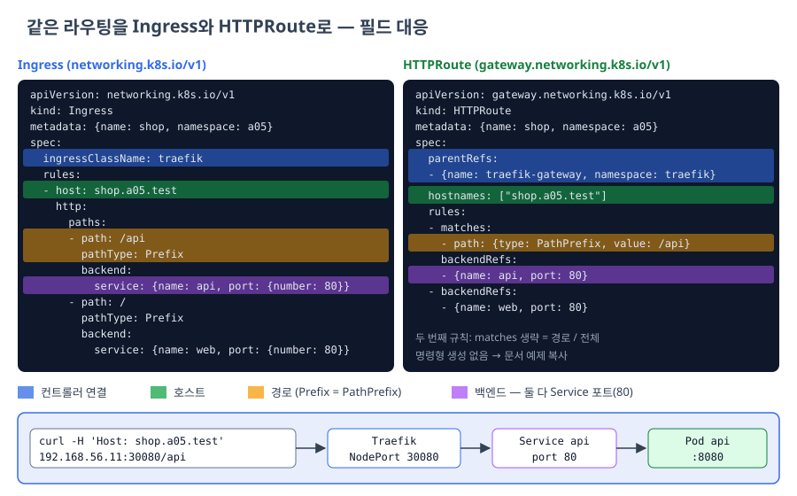

> **자격증 준비 · CKAD** | 난이도 ★★★☆☆ | 예상 소요 3 ~ 3.5시간

> ⚠️ 이 편의 모든 연습 과제는 CNCF가 공개한 **CKAD 공식 커리큘럼(github.com/cncf/curriculum)을 바탕으로 직접 창작한** 시험 스타일 과제입니다. 실제 시험 문제(유출 문제·덤프)가 아니며 실제 출제 내용과 무관합니다.

## 🎯 오늘의 목표

- `kubectl expose`로 ClusterIP·NodePort Service를 1분 안에 만들고, **port / targetPort / nodePort**를 과제 문장대로 맞출 수 있다
- 엔드포인트가 빈 Service를 보고 **selector·targetPort·readiness** 중 무엇이 틀렸는지 찾아 고칠 수 있다
- frontend → backend → db 3계층 앱에 **라벨 기반 NetworkPolicy**(DNS 허용 포함)를 쓰고 허용·차단을 모두 검증할 수 있다
- 경로·호스트 기반 **Ingress**와 **Gateway API HTTPRoute**를 이미 설치된 컨트롤러 위에 작성할 수 있다
- `kubectl port-forward`로 클러스터 밖(base)에서 앱을 확인할 수 있다

---

## 1. 커리큘럼 항목 요약 — Services and Networking (20%)

2026-11-19에 확인한 cncf/curriculum의 `CKAD_Curriculum_v1.37.pdf` 항목은 세 개입니다.

| 공식 커리큘럼 항목 | 이 편의 섹션 | 과제 |
|---|---|---|
| Demonstrate basic understanding of NetworkPolicies | 4-2 | 4, 5, 6 |
| Provide and troubleshoot access to applications via services | 4-1, 4-4 | 1, 2, 3, 9 |
| Use Ingress rules to expose applications | 4-3 | 7, 8 |

> ⚠️ **CKAD 커리큘럼에는 Gateway API가 명시돼 있지 않고**(CKA에는 있음), 허용 문서 목록에도 `gateway-api.sigs.k8s.io`가 **CKA 전용**으로만 올라 있습니다(Linux Foundation *Resources Allowed*, 2026-11-19 확인). 그래도 Ingress의 후속 표준이라 이 편은 HTTPRoute 과제를 하나 넣었고, 필요한 예제는 **kubernetes.io/docs의 *Gateway API* 페이지**에서 찾도록 안내합니다.

> 💡 이론은 본편과 CKA 편을 참조하세요. Service 유형·EndpointSlice·port-forward는 [Day 12](../../02-kubernetes/day12-service.md), Ingress·Gateway API와 Traefik은 [Day 15](../../02-kubernetes/day15-ingress.md), NetworkPolicy 입문은 [Day 19](../../02-kubernetes/day19-rbac-namespace.md) 6-7, AND/OR 규칙과 기본 거부 설계는 [Day 70](../../09-security/day70-networkpolicy-zero-trust.md), 시험 속도용 템플릿은 [CKA K04](../cka/k04-services-networking.md). 이 편은 같은 내용을 **앱 개발자 과제(앱 간 연결·노출)** 관점으로 다시 손에 익힙니다.

### 실습 환경

[A00](./a00-exam-overview-lab.md)의 환경 그대로입니다. context **`cka-main`**(kubeadm v1.37.1, 노드 IP 192.168.56.10~12, **Cilium**이 NetworkPolicy를 실제로 집행), Traefik(네임스페이스 `traefik`, NodePort **30080**, IngressClass `traefik`, Gateway `traefik-gateway`)과 Gateway API v1.6.3 CRD가 설치된 스냅샷 `ckad-clean`에서 시작합니다.

```bash
kubectl config use-context cka-main
mkdir -p ~/ckad/a05 && cd ~/ckad/a05
alias k=kubectl; export do="--dry-run=client -o yaml"; export now="--force --grace-period=0"
k get ingressclass,gatewayclass; k -n traefik get gateway      # traefik / traefik-gateway PROGRAMMED True
k top nodes                                                   # metrics-server도 ckad-clean에 포함
k create ns a05
```

이 편의 3계층 앱입니다. `web`과 `api`는 요청 정보를 그대로 돌려주는 `traefik/whoami`(라우팅 확인에 편함), `db`는 Python 내장 HTTP 서버로 5432 포트를 흉내 냅니다. `api`는 Spring Boot 기본값처럼 **8080**에서 듣습니다. A00의 `$REG/ckad/hello-spring:1.0`(8080)을 `api` 이미지로 써도 Service·NetworkPolicy 과제는 똑같이 풀리지만, whoami는 **받은 요청의 호스트·경로를 그대로 보여 줘서** Ingress·HTTPRoute 검증이 훨씬 쉽습니다.

```bash
k -n a05 create deploy web --image=traefik/whoami:v1.11 --replicas=2 --port=80
k -n a05 create deploy api --image=traefik/whoami:v1.11 --replicas=2 --port=8080
k -n a05 set env deploy/api WHOAMI_PORT_NUMBER=8080          # whoami의 포트 지정 환경 변수
k -n a05 create deploy db  --image=python:3.12-slim --port=5432 -- python -m http.server 5432
k -n a05 patch deploy web -p '{"spec":{"template":{"metadata":{"labels":{"tier":"frontend"}}}}}'
k -n a05 patch deploy api -p '{"spec":{"template":{"metadata":{"labels":{"tier":"backend"}}}}}'
k -n a05 patch deploy db  -p '{"spec":{"template":{"metadata":{"labels":{"tier":"data"}}}}}'
k -n a05 get pod -L app,tier
```

| 앱 | Pod 라벨 | 컨테이너 포트 | 역할 |
|---|---|---|---|
| `web` | `app=web`, `tier=frontend` | 80 | 프런트엔드 |
| `api` | `app=api`, `tier=backend` | 8080 | Spring Boot 스타일 API |
| `db` | `app=db`, `tier=data` | 5432 | DB 흉내 |

> 💡 Service는 `app=…`로, NetworkPolicy는 `tier=…`로 고릅니다. 그래서 `-l tier=frontend`만 붙인 테스트 Pod는 정책상 "프런트엔드"로 취급되면서도 **Service 엔드포인트에는 끼지 않습니다.**

---

## 2. 출제 유형 — 어떻게 채점되는가

| 과제 형태 | 예시 문장(창작) | 채점 포인트 |
|---|---|---|
| **노출형** | "Deployment `api`를 포트 80으로 노출(컨테이너 8080)" | Service 이름·type·port·targetPort, **엔드포인트 존재** |
| **NodePort형** | "`web`을 노드 포트 30081로" | nodePort 값, 노드 IP로 접속 |
| **고장 Service형** | "Service `orders-svc`로 접속이 안 된다. 고쳐라" | selector·targetPort 수정, Pod는 건드리지 않음 |
| **NetworkPolicy형** | "`tier=backend`는 `tier=frontend`에서 오는 TCP 8080만" | podSelector·from·ports, 실제 허용·차단 |
| **egress형** | "backend는 db의 5432와 DNS로만 나갈 수 있게" | DNS 53(UDP·TCP) 포함 여부 |
| **Ingress형** | "호스트 `shop.a05.test`의 `/api`는 `api`로, 나머지는 `web`으로" | `ingressClassName`, host, path·pathType, backend 서비스·포트 |
| **HTTPRoute형** | "Gateway `traefik-gateway`에 붙는 라우트 작성" | parentRefs(네임스페이스), hostnames, matches, backendRefs |
| **확인형** | "port-forward로 응답을 받아 파일에 저장" | 파일 내용 |

> ⚠️ **NetworkPolicy는 틀려도 오류가 없습니다.** 문법만 맞으면 생성되고, 의도와 다르게 "다 열리거나 다 막힐" 뿐입니다. 허용돼야 하는 것 하나, 막혀야 하는 것 하나를 **반드시 둘 다** 테스트하세요.

---

## 3. 핵심 명령 표

| 하고 싶은 것 | 명령 | 비고 |
|---|---|---|
| Deployment 노출 | `k -n a05 expose deploy api --port=80 --target-port=8080` | selector는 Deployment의 selector를 그대로 |
| 이름 바꿔 노출 | `k expose deploy web --name=web-np --type=NodePort --port=80` | nodePort 값 지정 플래그 **없음** |
| nodePort 지정 | `k create svc nodeport web-np --tcp=80:80 --node-port=30081` | selector가 `app=web-np`로 생김 → `k set selector` |
| Pod 생성+노출 | `k run t --image=nginx:1.27 --port=80 --expose` | 같은 이름의 ClusterIP |
| selector 교체 | `k set selector svc web-np app=web` | 기존 selector를 **통째로 교체** |
| targetPort 수정 | `k patch svc X -p '{"spec":{"ports":[{"port":80,"targetPort":8080}]}}'` | ports는 `port` 값으로 병합 |
| 엔드포인트 | `k get endpointslices -l kubernetes.io/service-name=api` | `k get endpoints`는 v1.33+ 폐기 경고 |
| selector 비교 | `k get svc -o wide` / `k get pod --show-labels` | SELECTOR 열 ↔ LABELS 열 |
| Ingress | `k create ingress shop --class=traefik --rule="shop.a05.test/api*=api:80" --rule="shop.a05.test/*=web:80"` | `*` 있으면 Prefix, 없으면 Exact |
| 접속 테스트 Pod | `k -n a05 run t -l tier=frontend --image=busybox:1.37 --rm -it --restart=Never -- wget -qO- -T 2 http://api` | `-T 2`로 차단 시 빨리 끝냄 |
| 노드 IP로 접속 | `curl -H 'Host: shop.a05.test' http://192.168.56.11:30080/api` | base에서 |
| 포트 포워딩 | `k -n a05 port-forward svc/api 18080:80` | `로컬:Service포트`, 기본 127.0.0.1 |
| NetworkPolicy | (명령형 없음) | 문서 *Network Policies* 예제 복사 |
| HTTPRoute | (명령형 없음) | 문서 *Gateway API* 예제 복사 |

---

## 4. 영역별 핵심 — 시험에서 필요한 만큼만

### 4-1. Service — 이름에서 Pod까지 이어지는 세 고리



Service 접속이 안 될 때 확인할 곳은 세 군데뿐입니다.

| 고리 | 맞아야 하는 것 | 틀리면 보이는 것 | 확인 |
|---|---|---|---|
| ① selector ↔ Pod 라벨 | Service `spec.selector`의 **모든** 키·값이 Pod 라벨에 있음 | EndpointSlice에 주소 없음 | `k get svc -o wide`, `k get pod --show-labels` |
| ② Pod Ready | readiness 통과 | 주소는 있으나 `ready: false` | `k get pod`의 READY |
| ③ targetPort ↔ 컨테이너 포트 | 컨테이너가 실제로 듣는 포트 | 주소는 정상인데 `connection refused` | `k describe svc`의 TargetPort, `k get endpointslices`의 PORTS |

| 필드 | 의미 | 예 (`api`) |
|---|---|---|
| `port` | Service가 받는 포트 (클러스터 안에서 `http://api:80`) | 80 |
| `targetPort` | Pod 컨테이너 포트 (숫자 또는 포트 **이름**) | 8080 |
| `nodePort` | 모든 노드에서 여는 포트(30000~32767) | 30081 |

DNS 이름은 `<서비스>.<네임스페이스>.svc.cluster.local`이고, 같은 네임스페이스에서는 `<서비스>`만, 다른 네임스페이스에서는 `<서비스>.<네임스페이스>`로 충분합니다.

### 4-2. NetworkPolicy — 3계층 앱에 거는 네 장



과제 문장에서 **대상(누구를 보호) / 출처·목적지(누가) / 포트**를 뽑으면 YAML이 나옵니다. 문서 *Network Policies* 페이지의 `test-network-policy` 예제를 복사해 지우고 고치는 것이 가장 빠릅니다.

```yaml
apiVersion: networking.k8s.io/v1
kind: NetworkPolicy
metadata: {name: backend-from-frontend, namespace: a05}
spec:
  podSelector: {matchLabels: {tier: backend}}     # 대상
  policyTypes: [Ingress]
  ingress:
  - from:
    - podSelector: {matchLabels: {tier: frontend}} # 출처 (같은 네임스페이스)
    ports:
    - {protocol: TCP, port: 8080}                  # Pod 포트 (Service 포트 아님)
```

| 규칙 | 기억할 것 |
|---|---|
| 정책이 하나라도 Pod를 고르면 | 그 방향(Ingress/Egress)은 **허용 목록에 있는 것만** 통과 |
| 정책 여러 개 | **합집합**. 고치지 말고 허용 정책을 추가 |
| 한 항목에 `namespaceSelector`+`podSelector` | **AND** (그 네임스페이스의 그 Pod) |
| `-` 두 개로 나눔 | **OR** (과하게 열림) |
| 네임스페이스 라벨 | 모든 NS에 `kubernetes.io/metadata.name: <이름>` 자동 |
| egress를 막으면 | **DNS(UDP·TCP 53)** 도 막힘 → `kube-system`의 `k8s-app=kube-dns` 허용 |
| `ports`의 숫자 | Service 포트가 아니라 **Pod(컨테이너) 포트** |

### 4-3. Ingress와 HTTPRoute



| 항목 | Ingress (`networking.k8s.io/v1`) | HTTPRoute (`gateway.networking.k8s.io/v1`) |
|---|---|---|
| 어느 컨트롤러가 처리 | `spec.ingressClassName: traefik` | `spec.parentRefs: [{name: traefik-gateway, namespace: traefik}]` |
| 호스트 | `rules[].host` (규칙마다) | `hostnames: [...]` (라우트 전체) |
| 경로 | `paths[].path` + `pathType: Prefix/Exact` | `matches[].path: {type: PathPrefix/Exact, value}` |
| 백엔드 | `backend.service.name` + `port.number` | `backendRefs[]: {name, port}` (**Service 포트**) |
| 명령형 생성 | `k create ingress` 있음 | 없음 |
| 상태 확인 | `k describe ingress` | `k describe httproute`의 `Accepted`, `ResolvedRefs` |

```bash
# Ingress 명령형: * 가 붙으면 Prefix
k -n a05 create ingress shop --class=traefik \
  --rule="shop.a05.test/api*=api:80" --rule="shop.a05.test/*=web:80" $do
```

> 💡 Traefik은 이 클러스터에서 Ingress와 Gateway API를 **둘 다** 처리하며 입구는 같은 NodePort **30080**입니다. 테스트는 base에서 `curl -H 'Host: <호스트>' http://192.168.56.11:30080/<경로>`. `/etc/hosts`를 고칠 필요가 없습니다.

### 4-4. 포트 포워딩

```bash
k -n a05 port-forward svc/api 18080:80 &          # 로컬 18080 → Service 포트 80 → Pod 8080
curl -s localhost:18080 | head -3
kill %1
```

| 대상 | 의미 |
|---|---|
| `pod/X 8080` | 로컬 8080 → Pod 8080 |
| `svc/api 18080:80` | Service의 **포트 80에 대응하는 targetPort**로, 엔드포인트 Pod **하나**에 연결(로드밸런싱 아님) |
| `deploy/api 18080:8080` | Deployment의 Pod 하나 |
| `--address 0.0.0.0` | 다른 호스트에서도 접속 허용(기본은 127.0.0.1만) |

> ⚠️ port-forward는 **포그라운드에서 계속 실행**됩니다. 시험 터미널에서 그대로 두면 다음 명령을 칠 수 없으니 `&`로 띄우고 끝나면 `kill %1`, 또는 별도 탭을 쓰세요.

---

## 5. 시간 절약 팁

- **노출은 `expose`가 기본.** selector를 Deployment에서 복사해 주므로 오타가 없습니다. `create svc`는 nodePort 번호가 지정된 과제에만 쓰고, 바로 `k set selector`.
- **테스트 Pod 한 줄 외우기**: `k -n a05 run t -l tier=frontend --image=busybox:1.37 --rm -it --restart=Never -- wget -qO- -T 2 http://api`. 라벨만 바꿔 허용·차단을 번갈아 봅니다.
- **문서 검색어**: `network policy` → *Network Policies*, `ingress` → *Ingress*(경로·호스트 예제, `pathType`), `gateway` → *Gateway API*(HTTPRoute 예제), `debug service` → *Debug Services*, `port forward` → *Use Port Forwarding to Access Applications in a Cluster*.
- **Ingress는 `$do`로 뽑아 확인하고 적용.** `pathType`과 백엔드 포트를 눈으로 한 번 보는 데 5초면 충분합니다.
- **HTTPRoute는 만들고 바로 `describe`.** `Accepted: True`, `ResolvedRefs: True` 두 줄이면 curl 전에 대부분 확인됩니다.
- **NetworkPolicy는 기본 거부부터.** `podSelector: {}` + `policyTypes: [Ingress]` 한 장을 먼저 두고 필요한 허용을 하나씩 추가하면 머릿속이 정리됩니다.

---

## 6. 자주 하는 실수

| 실수 | 결과 | 바로잡기 |
|---|---|---|
| `expose`에 `--target-port` 누락 | targetPort = port(80) → 8080 앱에 `connection refused` | `--port`(Service) / `--target-port`(컨테이너) 구분 |
| `k create svc`의 기본 selector 방치 | 엔드포인트 없음 | `k set selector svc X app=…` |
| selector에 Pod에 없는 라벨 추가 | 엔드포인트 사라짐 | selector의 **모든** 키가 Pod에 있어야 함 |
| NetworkPolicy `ports`에 Service 포트(80) | 허용해야 할 트래픽도 차단 | Pod 포트(8080) |
| `namespaceSelector`와 `podSelector`를 `-` 두 개로 | OR → 과하게 허용 | 한 항목 안에 두 키 |
| egress 제한에 DNS 누락 | `wget: bad address 'db'` | UDP·TCP 53 → kube-dns 허용 |
| 기본 거부 후 Ingress 컨트롤러 허용 누락 | Ingress·HTTPRoute가 504/타임아웃 | `traefik` 네임스페이스에서 오는 트래픽 허용 |
| Ingress `pathType` 없이 YAML 작성 | 생성 거부(필수 필드) | `Prefix` 또는 `Exact` |
| `--rule="host/api=api:80"`(별표 없음) | `Exact` → `/api/v1` 불일치 | 하위 경로까지면 `/api*` |
| HTTPRoute `parentRefs`에 namespace 누락 | Gateway를 못 찾아 `Accepted` 없음 | `namespace: traefik` |
| HTTPRoute `backendRefs.port`에 컨테이너 포트 | `ResolvedRefs: False` | **Service 포트** |
| port-forward를 포그라운드로 두고 다음 과제 | 터미널이 묶임 | `&` + `kill %1` |

---

## 7. 창작 연습 과제

> 아래 과제는 모두 **공식 커리큘럼을 바탕으로 창작한** 연습 문제입니다. 모두 context `cka-main`에서 하며, 1장의 3계층 앱을 먼저 배포해 두세요. 과제는 순서대로 이어집니다.

### 과제 1. ClusterIP 세 개와 FQDN (목표 5분)

네임스페이스 `a05`에서 다음 Service를 만들어라.
- `web`: 포트 80 → 컨테이너 80
- `api`: 포트 80 → 컨테이너 8080
- `db`: 포트 5432 → 컨테이너 5432

다른 네임스페이스(`default`)의 Pod에서 `api`를 부를 때 쓸 **전체 도메인 이름(FQDN)** 을 `~/ckad/a05/api-fqdn.txt`에 적고, 실제로 그 이름으로 응답을 받아라.

📖 참고 문서: kubernetes.io/docs/concepts/services-networking/service/, kubernetes.io/docs/tutorials/services/connect-applications-service/

<details>
<summary>풀이·검증</summary>

```bash
k -n a05 expose deploy web --port=80
k -n a05 expose deploy api --port=80 --target-port=8080
k -n a05 expose deploy db  --port=5432
k -n a05 get svc -o wide
# NAME   TYPE        CLUSTER-IP      PORT(S)    SELECTOR
# api    ClusterIP   10.105.21.140   80/TCP     app=api
# db     ClusterIP   10.98.170.33    5432/TCP   app=db
# web    ClusterIP   10.110.40.12    80/TCP     app=web
echo api.a05.svc.cluster.local > ~/ckad/a05/api-fqdn.txt
k run t --image=busybox:1.37 --rm -it --restart=Never -- wget -qO- -T 2 http://api.a05.svc.cluster.local | head -2
# Hostname: api-6f9c7d8b5-k2v8x
# IP: 127.0.0.1
k -n a05 get endpointslices -l kubernetes.io/service-name=api
# NAME        ADDRESSTYPE   PORTS   ENDPOINTS                  AGE
# api-7xk2p   IPv4          8080    10.244.1.23,10.244.2.31    30s
```

EndpointSlice의 PORTS가 **8080**(targetPort)인 것을 확인하세요. Service 포트(80)와 Pod 포트(8080)가 다른 전형적인 Spring Boot 구성입니다.
</details>

### 과제 2. 지정 번호 NodePort (목표 4분)

`web` Pod를 노드 포트 **30081**로 노출하는 Service `web-np`를 만들어라(Service 포트 80). base에서 아무 노드 IP의 30081로 접속해 응답의 `Hostname:` 줄을 `~/ckad/a05/nodeport.txt`에 저장하라.

📖 참고 문서: kubernetes.io/docs/concepts/services-networking/service/ (*Type NodePort*)

<details>
<summary>풀이·검증</summary>

```bash
k -n a05 create svc nodeport web-np --tcp=80:80 --node-port=30081
k -n a05 set selector svc web-np app=web
k -n a05 get svc web-np -o wide          # 80:30081/TCP, SELECTOR app=web
curl -s http://192.168.56.12:30081/ | grep Hostname > ~/ckad/a05/nodeport.txt
cat ~/ckad/a05/nodeport.txt              # Hostname: web-5b8d6c7f9-...
```

다른 방법: `k -n a05 expose deploy web --name=web-np --type=NodePort --port=80` 후 `k -n a05 patch svc web-np -p '{"spec":{"ports":[{"port":80,"nodePort":30081}]}}'`. 어느 쪽이든 마지막에 SELECTOR 열을 확인합니다.
</details>

### 과제 3. 접속이 안 되는 Service 고치기 (목표 6분)

아래 Service `orders-svc`로 `api` Pod에 접속하려 하지만 응답이 없다. **Pod와 Deployment는 건드리지 말고** Service만 고쳐라. 원인 두 가지를 `~/ckad/a05/orders-svc-cause.txt`에 한 줄씩 적어라.

```bash
cat <<'EOF' | k apply -f -
apiVersion: v1
kind: Service
metadata: {name: orders-svc, namespace: a05}
spec:
  selector: {app: api, tier: backend, version: v1}
  ports:
  - {name: http, port: 80, targetPort: 80}
EOF
```

📖 참고 문서: kubernetes.io/docs/tasks/debug/debug-application/debug-service/

<details>
<summary>풀이·검증</summary>

```bash
k -n a05 get endpointslices -l kubernetes.io/service-name=orders-svc
# ENDPOINTS: <unset>                         ← ① selector가 아무 Pod도 못 고름
k -n a05 get pod -l app=api --show-labels
# app=api,pod-template-hash=...,tier=backend  ← version 라벨이 없다
```

```bash
k -n a05 set selector svc orders-svc app=api,tier=backend
k -n a05 get endpointslices -l kubernetes.io/service-name=orders-svc     # 주소 2개, PORTS 80
k -n a05 run t --image=busybox:1.37 --rm -it --restart=Never -- wget -qO- -T 2 http://orders-svc
# wget: can't connect to remote host (10.105.x.x): Connection refused     ← ② 포트 80에는 아무도 없음
k -n a05 patch svc orders-svc -p '{"spec":{"ports":[{"port":80,"targetPort":8080}]}}'
k -n a05 run t --image=busybox:1.37 --rm -it --restart=Never -- wget -qO- -T 2 http://orders-svc | head -1
# Hostname: api-6f9c7d8b5-...
```

```bash
cat > ~/ckad/a05/orders-svc-cause.txt <<'EOF'
selector에 Pod에 없는 라벨 version=v1 이 포함됨
targetPort 80 이 컨테이너 포트 8080 과 다름
EOF
```

`k set selector`는 selector 전체를 바꾸므로 **남겨야 할 키도 함께** 적어야 합니다. 이 과제는 고장을 두 단계로 겹쳐 두었습니다. 엔드포인트가 생겼다고 끝내지 말고 **실제 응답**까지 확인하세요. 과제 4의 정책을 만들기 전이므로 이 시점에는 NetworkPolicy가 원인일 수 없습니다.
</details>

### 과제 4. 3계층 인그레스 정책 (목표 8분)

`a05`에 다음 NetworkPolicy를 만들어라.
- `default-deny-ingress`: 모든 Pod의 인바운드 차단
- `backend-from-frontend`: `tier=backend`는 `tier=frontend`에서 오는 TCP 8080만 허용
- `data-from-backend`: `tier=data`는 `tier=backend`에서 오는 TCP 5432만 허용

frontend → api는 되고, frontend → db와 라벨 없는 Pod → api는 막혀야 한다.

📖 참고 문서: kubernetes.io/docs/concepts/services-networking/network-policies/

<details>
<summary>풀이·검증</summary>

```bash
cat <<'EOF' > netpol-ingress.yaml
apiVersion: networking.k8s.io/v1
kind: NetworkPolicy
metadata: {name: default-deny-ingress, namespace: a05}
spec:
  podSelector: {}
  policyTypes: [Ingress]
---
apiVersion: networking.k8s.io/v1
kind: NetworkPolicy
metadata: {name: backend-from-frontend, namespace: a05}
spec:
  podSelector: {matchLabels: {tier: backend}}
  policyTypes: [Ingress]
  ingress:
  - from:
    - podSelector: {matchLabels: {tier: frontend}}
    ports:
    - {protocol: TCP, port: 8080}
---
apiVersion: networking.k8s.io/v1
kind: NetworkPolicy
metadata: {name: data-from-backend, namespace: a05}
spec:
  podSelector: {matchLabels: {tier: data}}
  policyTypes: [Ingress]
  ingress:
  - from:
    - podSelector: {matchLabels: {tier: backend}}
    ports:
    - {protocol: TCP, port: 5432}
EOF
k apply -f netpol-ingress.yaml
```

```bash
T="--image=busybox:1.37 --rm -it --restart=Never --"
k -n a05 run t1 -l tier=frontend $T wget -qO- -T 2 http://api | head -1      # Hostname: api-...   (허용)
k -n a05 run t2 -l tier=frontend $T wget -qO- -T 2 http://db:5432             # download timed out (차단)
k -n a05 run t3 $T wget -qO- -T 2 http://api                                  # download timed out (차단)
k -n a05 run t4 -l tier=backend  $T wget -qO- -T 2 http://db:5432 | head -1   # <!DOCTYPE HTML>     (허용)
```

이제 NodePort 30081(과제 2)도 막혔습니다. `web`(frontend)을 고르는 허용 정책이 없기 때문입니다. 과제 7에서 Ingress 컨트롤러용 허용을 추가합니다.
</details>

### 과제 5. backend의 나가는 트래픽 제한 — DNS 포함 (목표 7분)

`tier=backend` Pod는 **DNS 조회와 `tier=data`의 TCP 5432**로만 나갈 수 있어야 한다. 정책 이름은 `backend-egress`.

📖 참고 문서: kubernetes.io/docs/concepts/services-networking/network-policies/, kubernetes.io/docs/tasks/administer-cluster/declare-network-policy/

<details>
<summary>풀이·검증</summary>

```bash
cat <<'EOF' | k apply -f -
apiVersion: networking.k8s.io/v1
kind: NetworkPolicy
metadata: {name: backend-egress, namespace: a05}
spec:
  podSelector: {matchLabels: {tier: backend}}
  policyTypes: [Egress]
  egress:
  - to:
    - namespaceSelector:
        matchLabels: {kubernetes.io/metadata.name: kube-system}
      podSelector:
        matchLabels: {k8s-app: kube-dns}
    ports:
    - {protocol: UDP, port: 53}
    - {protocol: TCP, port: 53}
  - to:
    - podSelector: {matchLabels: {tier: data}}
    ports:
    - {protocol: TCP, port: 5432}
EOF
```

```bash
k -n a05 run b -l tier=backend --image=busybox:1.37 --restart=Never -- sleep 1h
k -n a05 wait --for=condition=Ready pod/b
k -n a05 exec b -- nslookup db                                    # 이름 해석 성공
k -n a05 exec b -- wget -qO- -T 2 http://db:5432 | head -1        # 허용
k -n a05 exec b -- wget -qO- -T 2 http://web                      # download timed out
k -n a05 exec b -- wget -qO- -T 2 http://kubernetes.io            # 이름은 풀리지만 timed out
k -n a05 delete pod b $now
```

DNS 항목을 지우고 다시 해 보면 `wget: bad address 'db'`가 나옵니다. "연결 시간 초과"와 "이름 해석 실패"는 원인이 다르니 메시지를 구분해 읽으세요.
</details>

### 과제 6. 다른 네임스페이스의 모니터링 Pod만 (목표 6분)

네임스페이스 `ops`를 만들고 라벨 `team=ops`를 붙여라. `a05`의 `tier=backend`는 **`team=ops` 네임스페이스의 `app=probe` Pod**에서 오는 TCP 8080도 받아야 한다(기존 frontend 허용은 유지). `ops`의 다른 Pod, 다른 네임스페이스의 `app=probe`는 차단된다. 정책 이름은 `backend-from-ops-probe`.

📖 참고 문서: kubernetes.io/docs/concepts/services-networking/network-policies/ (*Behavior of to and from selectors*)

<details>
<summary>풀이·검증</summary>

```bash
k create ns ops && k label ns ops team=ops
cat <<'EOF' | k apply -f -
apiVersion: networking.k8s.io/v1
kind: NetworkPolicy
metadata: {name: backend-from-ops-probe, namespace: a05}
spec:
  podSelector: {matchLabels: {tier: backend}}
  policyTypes: [Ingress]
  ingress:
  - from:
    - namespaceSelector: {matchLabels: {team: ops}}
      podSelector: {matchLabels: {app: probe}}       # 하이픈 없음 → AND
    ports:
    - {protocol: TCP, port: 8080}
EOF
```

```bash
T="--image=busybox:1.37 --rm -it --restart=Never --"
k -n ops run p1 -l app=probe $T wget -qO- -T 2 http://api.a05 | head -1   # 허용
k -n ops run p2 $T wget -qO- -T 2 http://api.a05                          # timed out
k run p3 -l app=probe $T wget -qO- -T 2 http://api.a05                     # timed out (default NS)
k -n a05 run p4 -l tier=frontend $T wget -qO- -T 2 http://api | head -1   # 여전히 허용 (합집합)
```

`podSelector` 앞에 `-`를 붙이면 "`team=ops` 네임스페이스의 **모든** Pod **또는** **같은 네임스페이스(a05)**의 `app=probe`"가 되어 p2가 통과합니다. 한 번 일부러 틀려 보고 차이를 확인하세요.
</details>

### 과제 7. 경로 기반 Ingress (목표 6분)

IngressClass `traefik`을 쓰는 Ingress `shop`(네임스페이스 `a05`)을 만들어라.
- 호스트 `shop.a05.test`의 `/api`로 시작하는 요청 → Service `api` 포트 80
- 같은 호스트의 나머지 요청 → Service `web` 포트 80

과제 4의 기본 거부가 있으므로, Ingress 컨트롤러(네임스페이스 `traefik`)가 `web`·`api`에 닿도록 허용 정책 `allow-from-traefik`도 추가하라.

📖 참고 문서: kubernetes.io/docs/concepts/services-networking/ingress/, kubernetes.io/docs/reference/kubectl/generated/kubectl_create/kubectl_create_ingress/

<details>
<summary>풀이·검증</summary>

```bash
k -n a05 create ingress shop --class=traefik \
  --rule="shop.a05.test/api*=api:80" --rule="shop.a05.test/*=web:80"
k -n a05 get ingress shop -o jsonpath='{range .spec.rules[0].http.paths[*]}{.path} {.pathType} {.backend.service.name}{"\n"}{end}'
# /api Prefix api
# / Prefix web

cat <<'EOF' | k apply -f -
apiVersion: networking.k8s.io/v1
kind: NetworkPolicy
metadata: {name: allow-from-traefik, namespace: a05}
spec:
  podSelector:
    matchExpressions:
    - {key: tier, operator: In, values: [frontend, backend]}
  policyTypes: [Ingress]
  ingress:
  - from:
    - namespaceSelector:
        matchLabels: {kubernetes.io/metadata.name: traefik}
    ports:
    - {protocol: TCP, port: 80}
    - {protocol: TCP, port: 8080}
EOF
```

```bash
curl -s -H 'Host: shop.a05.test' http://192.168.56.11:30080/api/orders | grep -E 'Hostname|^GET'
# Hostname: api-6f9c7d8b5-k2v8x
# GET /api/orders HTTP/1.1
curl -s -H 'Host: shop.a05.test' http://192.168.56.11:30080/ | grep Hostname
# Hostname: web-5b8d6c7f9-...
curl -s -o /dev/null -w '%{http_code}\n' -H 'Host: other.a05.test' http://192.168.56.11:30080/   # 404
```

whoami는 받은 요청 줄(`GET /api/orders`)을 그대로 보여 주므로 **경로가 백엔드에 어떻게 전달됐는지**까지 확인할 수 있습니다. Ingress는 경로를 잘라내지 않습니다.
</details>

### 과제 8. 호스트·경로 라우팅을 HTTPRoute로 (목표 7분)

기존 Gateway `traefik-gateway`(네임스페이스 `traefik`)에 붙는 HTTPRoute 두 개를 네임스페이스 `a05`에 만들어라.
- `shop-gw`: 호스트 `www.a05.test`의 `/admin`으로 시작하는 요청 → Service `api`, 나머지 → Service `web`
- `shop-gw-api`: 호스트 `api.a05.test`의 모든 요청 → Service `api`

📖 참고 문서: kubernetes.io/docs/concepts/services-networking/gateway/ (*HTTPRoute*) — CKAD에서는 gateway-api.sigs.k8s.io를 열 수 없다

<details>
<summary>풀이·검증</summary>

HTTPRoute의 `hostnames`는 **라우트 전체**에 적용되고 `matches`에는 호스트 조건이 없습니다. 호스트마다 규칙이 다르면 이 과제처럼 라우트를 나눕니다.

```bash
cat <<'EOF' | k apply -f -
apiVersion: gateway.networking.k8s.io/v1
kind: HTTPRoute
metadata: {name: shop-gw, namespace: a05}
spec:
  parentRefs:
  - {name: traefik-gateway, namespace: traefik}
  hostnames: ["www.a05.test"]
  rules:
  - matches:
    - path: {type: PathPrefix, value: /admin}
    backendRefs:
    - {name: api, port: 80}
  - backendRefs:
    - {name: web, port: 80}
---
apiVersion: gateway.networking.k8s.io/v1
kind: HTTPRoute
metadata: {name: shop-gw-api, namespace: a05}
spec:
  parentRefs:
  - {name: traefik-gateway, namespace: traefik}
  hostnames: ["api.a05.test"]
  rules:
  - backendRefs:
    - {name: api, port: 80}
EOF
```

```bash
k -n a05 describe httproute shop-gw | grep -E '^\s+(Reason|Status|Type):' | head -6
#   Reason: Accepted / Status: True / Type: Accepted
#   Reason: ResolvedRefs / Status: True / Type: ResolvedRefs
for u in "www.a05.test/" "www.a05.test/admin/users" "api.a05.test/v1/orders"; do
  h=${u%%/*}; p=/${u#*/}
  printf '%-28s ' "$u"; curl -s -H "Host: $h" http://192.168.56.10:30080$p | grep Hostname
done
# www.a05.test/                Hostname: web-...
# www.a05.test/admin/users     Hostname: api-...
# api.a05.test/v1/orders       Hostname: api-...
```

`backendRefs.port`는 **Service 포트(80)** 입니다. 과제 7의 `allow-from-traefik` 정책이 이 라우트에도 그대로 적용됩니다(같은 Traefik Pod가 처리하므로).
</details>

### 과제 9. 포트 포워딩으로 확인하기 (목표 4분)

base에서 `kubectl port-forward`로 로컬 포트 **18080**을 Service `api`(포트 80)에 연결해 `/actuator/health` 경로로 요청하고, 응답의 요청 줄(`GET ...`)을 `~/ckad/a05/pf.txt`에 저장하라. 끝나면 포트 포워딩을 종료한다.

📖 참고 문서: kubernetes.io/docs/tasks/access-application-cluster/port-forward-access-application-cluster/

<details>
<summary>풀이·검증</summary>

```bash
k -n a05 port-forward svc/api 18080:80 > /tmp/pf.log 2>&1 &
sleep 2; cat /tmp/pf.log
# Forwarding from 127.0.0.1:18080 -> 8080
# Forwarding from [::1]:18080 -> 8080
curl -s localhost:18080/actuator/health | grep '^GET' > ~/ckad/a05/pf.txt
cat ~/ckad/a05/pf.txt                  # GET /actuator/health HTTP/1.1
kill %1
```

출력의 `-> 8080`이 보여 주듯 `svc/api`를 지정해도 실제 연결은 **targetPort(8080)로 Pod 하나에** 직접 붙습니다. Service의 로드밸런싱을 거치지 않으므로 여러 번 요청해도 Hostname이 바뀌지 않습니다.
</details>

### 정리

```bash
k delete ns a05 ops
```

Traefik과 Gateway API CRD는 A06·A07 모의고사에서도 쓰니 **남겨 두세요**.

---

## 8. 핵심 정리

- Service: `expose`(selector 자동, `--target-port` 잊지 않기), nodePort 번호는 `create svc nodeport --node-port` + `set selector`
- 연결이 안 되면 세 고리: **selector ↔ 라벨**(EndpointSlice 비었나) → **Ready** → **targetPort ↔ 컨테이너 포트**(connection refused)
- NetworkPolicy: 대상(`podSelector`) / 출처·목적지(`from`/`to`) / **Pod 포트**. 같은 항목 두 셀렉터 = AND, `-` 두 개 = OR. 정책은 합집합
- egress를 막으면 **DNS 53(UDP·TCP)** 허용을 함께. 기본 거부 뒤에는 **Ingress 컨트롤러 네임스페이스 허용**도
- Ingress: `k create ingress --class=traefik --rule="host/path*=svc:port"`, `*`가 Prefix. HTTPRoute: `parentRefs`(+namespace), `hostnames`, `matches`, `backendRefs`(Service 포트), `describe`로 `Accepted`·`ResolvedRefs`
- CKAD는 Gateway API가 커리큘럼·허용 문서 밖 → 예제는 kubernetes.io의 *Gateway API* 페이지에서
- port-forward: `svc/X 로컬:서비스포트` → targetPort의 Pod 하나. `&`로 띄우고 `kill %1`

---

## ⏭️ 다음 예고 — A06. 모의고사 1

A01~A05에서 연습한 다섯 도메인을 한 번에 섞어 **2시간 실전 모의고사**를 치릅니다. 이미지 빌드·Job, 배포 전략과 Helm·Kustomize, probe·로그·디버깅, 설정·보안·RBAC, Service·NetworkPolicy·Ingress를 시험 비중대로 배분한 창작 과제를 타이머를 켜고 풀고, 과제별 채점 체크리스트로 스스로 점수를 매깁니다.
