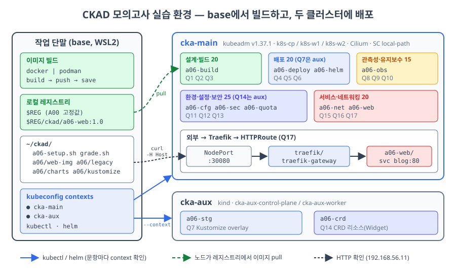

> **자격증 준비 · CKAD** | 난이도 ★★★☆☆ | 예상 소요 시험 2시간 + 채점·복기 1.5시간

> ⚠️ **이 모의고사의 모든 문항은 CNCF가 공개한 CKAD 커리큘럼(github.com/cncf/curriculum, 2026-11-19 확인 시 `CKAD_Curriculum_v1.37.pdf`)의 5개 도메인을 바탕으로 이 시리즈가 직접 창작한 연습 과제입니다.** 실제 시험 문제나 유출 문제(덤프)가 아니고, 그런 것을 재현하지도 않습니다. Linux Foundation 시험은 응시 정책과 NDA로 보호되므로 "실제 출제 문제"라고 주장하는 자료는 믿지도, 퍼뜨리지도 마세요. 네임스페이스·이름·수치는 모두 새로 지은 것입니다.

> 💡 **실습 환경(A00 실습 환경 고정값 기준).** `cka-main` = kubeadm v1.37.1 클러스터(k8s-cp/k8s-w1/k8s-w2, Cilium, 기본 StorageClass `local-path`, Traefik + Gateway API — Gateway `traefik-gateway`(네임스페이스 `traefik`), NodePort `30080`), `cka-aux` = kind 클러스터. 작업 단말은 base(WSL2)이고 Docker 또는 Podman과 로컬 레지스트리가 준비되어 있다고 가정합니다. **레지스트리 주소는 A00에서 정한 값을 변수 `REG`로 받습니다**(예: `export REG=<A00의 레지스트리 host:port>`). 스크립트와 답안은 `~/ckad/` 아래, 노드 작업은 `ssh <노드>` 후 `sudo -i`, 초기화는 A00의 `ckad-clean` 스냅샷입니다.

## 🎯 오늘의 목표

- A01~A05에서 익힌 5개 도메인을 **2시간 안에** 한 번에 풀어 본다
- 이미지 빌드·push·배포, Helm·Kustomize, probe, NetworkPolicy, HTTPRoute를 **명령형 생성 + 빠른 YAML 편집**으로 처리한다
- 사전 준비 스크립트로 "잘못된 selector, 오타 난 이미지, 폐기된 apiVersion" 같은 **시험다운 출발 상태**를 만든다
- 자동 채점 스크립트(`grade.sh`)로 PASS/FAIL과 총점을 보고, 틀린 문항을 **다시 볼 편(A01~A05)** 으로 연결한다

---

## 1. 시험 안내

### 1-1. 형식과 규칙

| 항목 | 이 모의고사 | 실제 시험(2026-11-19 공식 페이지 확인) |
|---|---|---|
| 제한 시간 | **2시간** | 2시간, 온라인 감독, 실기(명령줄) 시험 |
| 문항 수·배점 | 17문항, 합계 100점, 문항 단위 PASS/FAIL | 문항 수는 회차마다 다름. 실제 시험은 문항 안의 부분 점수가 있을 수 있음 |
| 합격 참고선 | **66점** | 공식 페이지에는 합격 점수가 없음. 66%가 널리 알려진 값이므로 **응시 전 Candidate Handbook으로 확인** |
| 도메인 비중 | 아래 2절 표 | 설계·빌드 20% / 배포 20% / 관측성·유지보수 15% / 환경·설정·보안 25% / 서비스·네트워킹 20% |
| 클러스터 | `cka-main`, `cka-aux` | 문항마다 다른 클러스터·context가 지정됨 |
| 허용 문서 | kubernetes.io/docs, kubernetes.io/blog, helm.sh/docs 등 | 정확한 목록은 Linux Foundation "Resources Allowed" 페이지(A00 정리). **이 시리즈 문서·개인 노트·검색 엔진 금지** |
| 버전 | cka-main v1.37.1 | 시험은 Kubernetes v1.37 기준 |

시험 중 지킬 규칙:

1. **문항 머리에 적힌 context를 먼저 실행**합니다. 실제 시험도 문항마다 이 명령을 줍니다.
2. 파일로 답을 내는 문항은 **작업 단말(base)** 의 `~/ckad/a06/...`에 저장합니다.
3. 이미지 빌드는 base에서 `docker` 또는 `podman`으로 합니다. 아래 풀이는 `docker`로 쓰고, Podman이면 `docker`를 `podman`으로 바꿔 읽으세요.
4. 사전 준비 스크립트는 **실행만 하고 내용은 시험 후에** 보세요(그래서 접어 두었습니다).
5. 문항 사이 순서는 자유입니다. 배점이 큰 문항(Q12, Q1, Q3, Q11)부터 잡는 것도 전략입니다.



### 1-2. 준비 확인

```bash
export REG="<A00에서 정한 레지스트리 host:port>"   # 예시 값이 아니라 A00의 고정값을 그대로
kubectl config get-contexts                      # cka-main, cka-aux
kubectl --context cka-main get nodes             # k8s-cp, k8s-w1, k8s-w2 Ready (v1.37.x)
kubectl --context cka-main get gatewayclass,sc   # traefik Accepted, local-path (default)
curl -s http://$REG/v2/_catalog                  # {"repositories":[...]} 가 보이면 OK
docker version --format '{{.Server.Version}}' || podman version
helm version --short
```

> ⚠️ 노드(containerd)가 `$REG`에서 이미지를 받을 수 있어야 Q1이 풀립니다. HTTP 레지스트리라면 각 노드의 containerd에 이 레지스트리를 등록하는 작업이 필요하며, 이것은 **A00의 레지스트리 절**에서 한 번 해 둡니다. 레지스트리가 HTTPS라면 `export REG_SCHEME=https`도 함께 지정합니다.

### 1-3. 진행 순서

```bash
# 작업 단말(base)에서. 먼저 A00 방식으로 초기화:
#   vagrant snapshot restore ckad-clean --no-provision   (Vagrantfile 폴더)
#   bash ~/cka/reset-aux.sh                              (cka-aux 재생성)
mkdir -p ~/ckad && cd ~/ckad
vi a06-setup.sh        # 3절 내용을 붙여 넣고 저장 (LF 줄바꿈)
bash a06-setup.sh      # 이미지를 내려받아 2~4분 걸림
```

```
[*] preflight ...
[*] files under ~/ckad/a06 ...
[*] workloads on cka-main ...
[*] objects on cka-aux ...
[*] breaking a few things ...
[*] ready. Start the 2-hour timer now.
```

> 💡 시험 시간은 마지막 줄이 나온 순간부터 잽니다. 끝나면 5절의 `grade.sh`로 채점합니다.

---

## 2. 문항 한눈에 보기

| # | context | 도메인 | 주제 | 배점 |
|---|---|---|---|---|
| Q1 | cka-main | 설계·빌드 | 이미지 빌드·push·저장 후 배포 | 7 |
| Q2 | cka-main | 설계·빌드 | CronJob + 수동 Job 실행 | 6 |
| Q3 | cka-main | 설계·빌드 | init 컨테이너 + 네이티브 사이드카 | 7 |
| Q4 | cka-main | 배포 | 롤백 후 롤링 업데이트 | 6 |
| Q5 | cka-main | 배포 | 수동 카나리 | 5 |
| Q6 | cka-main | 배포 | Helm 로컬 차트 설치 | 5 |
| Q7 | **cka-aux** | 배포 | Kustomize overlay | 4 |
| Q8 | cka-main | 관측성·유지보수 | readiness·liveness probe | 5 |
| Q9 | cka-main | 관측성·유지보수 | 로그로 원인 찾기 | 5 |
| Q10 | cka-main | 관측성·유지보수 | 폐기된 apiVersion 고치기 | 5 |
| Q11 | cka-main | 환경·설정·보안 | ConfigMap(파일) + Secret | 7 |
| Q12 | cka-main | 환경·설정·보안 | ServiceAccount + securityContext | 8 |
| Q13 | cka-main | 환경·설정·보안 | 쿼터 안에서 리소스 지정 | 5 |
| Q14 | **cka-aux** | 환경·설정·보안 | CRD 리소스 만들기 | 5 |
| Q15 | cka-main | 서비스·네트워킹 | Service selector·targetPort 고치기 | 6 |
| Q16 | cka-main | 서비스·네트워킹 | NetworkPolicy + Pod 레이블 | 7 |
| Q17 | cka-main | 서비스·네트워킹 | Gateway API HTTPRoute | 7 |
| | | | **합계** | **100** |

도메인별 합계는 공식 비중과 같습니다: 설계·빌드 20 / 배포 20 / 관측성·유지보수 15 / 환경·설정·보안 25 / 서비스·네트워킹 20.

---

## 3. 사전 준비 스크립트

작업 단말(base)에서 실행합니다. 노드 ssh는 쓰지 않습니다. 레지스트리 주소는 `REG` 변수로 받고, 없으면 바로 멈춥니다.

<details><summary>a06-setup.sh (작업 단말에서 실행 — 시험 후에 열어 보기)</summary>

```bash
#!/bin/bash
# a06-setup.sh -- CKAD mock exam 1 setup
# run on the work terminal (base). needs: kubectl, helm, docker|podman, curl
set -euo pipefail

MAIN=${MAIN_CTX:-cka-main}
AUX=${AUX_CTX:-cka-aux}
REG=${REG:?export REG=<registry host:port fixed in A00> first}
REG_SCHEME=${REG_SCHEME:-http}
WORK=~/ckad/a06

km() { kubectl --context "$MAIN" "$@"; }
ka() { kubectl --context "$AUX" "$@"; }
ensure_ns() { "$1" create namespace "$2" --dry-run=client -o yaml | "$1" apply -f - >/dev/null; }
die() { echo "ERROR: $*" >&2; exit 1; }

echo "[*] preflight ..."
for c in "$MAIN" "$AUX"; do
  kubectl config get-contexts "$c" >/dev/null 2>&1 || die "context $c not found"
done
km get nodes >/dev/null
ka get nodes >/dev/null
command -v helm >/dev/null 2>&1 || die "helm not found"
command -v docker >/dev/null 2>&1 || command -v podman >/dev/null 2>&1 || die "docker or podman is required (A00)"
curl -fsS -m 5 "${REG_SCHEME}://${REG}/v2/" >/dev/null || die "registry ${REG_SCHEME}://${REG} not reachable"
km get gatewayclass traefik >/dev/null 2>&1 || die "GatewayClass traefik not found (CKA K04 Traefik setup)"
km -n traefik get gateway traefik-gateway >/dev/null 2>&1 || die "Gateway traefik/traefik-gateway not found"

echo "[*] files under ~/ckad/a06 ..."
rm -rf "$WORK"
mkdir -p "$WORK"/web-img "$WORK"/legacy "$WORK"/charts/webapp/templates \
         "$WORK"/kustomize/base "$WORK"/kustomize/overlays/staging

# Q1: image source
cat > "$WORK/web-img/Dockerfile" <<'EOF'
FROM nginx:1.27-alpine
COPY index.html /usr/share/nginx/html/index.html
EOF
echo 'a06 image v1' > "$WORK/web-img/index.html"

# Q10: legacy manifest (removed API)
cat > "$WORK/legacy/app.yaml" <<'EOF'
apiVersion: extensions/v1beta1
kind: Deployment
metadata:
  name: legacy
  namespace: a06-obs
spec:
  replicas: 1
  template:
    metadata:
      labels:
        app: legacy
    spec:
      containers:
      - name: legacy
        image: nginx:1.27-alpine
        ports:
        - containerPort: 80
EOF

# Q11: properties file
cat > "$WORK/app.properties" <<'EOF'
server.port=8080
feature.cart=true
greeting=hello-a06
EOF

# Q6: local helm chart
cat > "$WORK/charts/webapp/Chart.yaml" <<'EOF'
apiVersion: v2
name: webapp
description: small nginx chart for the CKAD mock exam
type: application
version: 0.1.0
appVersion: "1.27"
EOF
cat > "$WORK/charts/webapp/values.yaml" <<'EOF'
replicaCount: 1
image:
  repository: nginx
  tag: 1.27-alpine
service:
  type: ClusterIP
  port: 80
EOF
cat > "$WORK/charts/webapp/templates/deployment.yaml" <<'EOF'
apiVersion: apps/v1
kind: Deployment
metadata:
  name: {{ .Release.Name }}
  labels:
    app: {{ .Release.Name }}
spec:
  replicas: {{ .Values.replicaCount }}
  selector:
    matchLabels:
      app: {{ .Release.Name }}
  template:
    metadata:
      labels:
        app: {{ .Release.Name }}
    spec:
      containers:
      - name: web
        image: "{{ .Values.image.repository }}:{{ .Values.image.tag }}"
        ports:
        - containerPort: 80
EOF
cat > "$WORK/charts/webapp/templates/service.yaml" <<'EOF'
apiVersion: v1
kind: Service
metadata:
  name: {{ .Release.Name }}
spec:
  type: {{ .Values.service.type }}
  selector:
    app: {{ .Release.Name }}
  ports:
  - port: {{ .Values.service.port }}
    targetPort: 80
EOF

# Q7: kustomize base + empty overlay
cat > "$WORK/kustomize/base/deployment.yaml" <<'EOF'
apiVersion: apps/v1
kind: Deployment
metadata:
  name: api
spec:
  replicas: 1
  selector:
    matchLabels:
      app: api
  template:
    metadata:
      labels:
        app: api
    spec:
      containers:
      - name: api
        image: nginx:1.27-alpine
        ports:
        - containerPort: 80
EOF
cat > "$WORK/kustomize/base/service.yaml" <<'EOF'
apiVersion: v1
kind: Service
metadata:
  name: api
spec:
  selector:
    app: api
  ports:
  - port: 80
    targetPort: 80
EOF
cat > "$WORK/kustomize/base/kustomization.yaml" <<'EOF'
apiVersion: kustomize.config.k8s.io/v1beta1
kind: Kustomization
resources:
- deployment.yaml
- service.yaml
EOF
cat > "$WORK/kustomize/overlays/staging/kustomization.yaml" <<'EOF'
apiVersion: kustomize.config.k8s.io/v1beta1
kind: Kustomization
resources:
- ../../base
EOF

echo "[*] workloads on cka-main ..."
km delete namespace a06-helm --ignore-not-found >/dev/null
for ns in a06-build a06-deploy a06-obs a06-cfg a06-sec a06-quota a06-net a06-web; do
  ensure_ns km "$ns"
done

km apply -f - >/dev/null <<'EOF'
apiVersion: apps/v1
kind: Deployment
metadata:
  name: shop-v1
  namespace: a06-deploy
spec:
  replicas: 3
  selector:
    matchLabels: {app: shop, version: v1}
  template:
    metadata:
      labels: {app: shop, version: v1}
    spec:
      containers:
      - name: web
        image: nginx:1.27-alpine
        ports:
        - containerPort: 80
---
apiVersion: v1
kind: Service
metadata:
  name: shop
  namespace: a06-deploy
spec:
  selector: {app: shop}
  ports:
  - port: 80
    targetPort: 80
---
apiVersion: apps/v1
kind: Deployment
metadata:
  name: health
  namespace: a06-obs
spec:
  replicas: 2
  selector:
    matchLabels: {app: health}
  template:
    metadata:
      labels: {app: health}
    spec:
      containers:
      - name: web
        image: nginx:1.27-alpine
        ports:
        - containerPort: 80
---
apiVersion: v1
kind: ConfigMap
metadata:
  name: worker-cfg
  namespace: a06-obs
data:
  queue: orders
---
apiVersion: apps/v1
kind: Deployment
metadata:
  name: worker
  namespace: a06-obs
spec:
  replicas: 1
  selector:
    matchLabels: {app: worker}
  template:
    metadata:
      labels: {app: worker}
    spec:
      containers:
      - name: worker
        image: busybox:1.37
        command:
        - sh
        - -c
        - |
          echo "worker 2.3.1 booting"
          if [ -z "$QUEUE_NAME" ]; then
            echo "ERROR: required environment variable QUEUE_NAME is not set" >&2
            exit 1
          fi
          echo "consuming $QUEUE_NAME"
          sleep 604800
---
apiVersion: v1
kind: ServiceAccount
metadata:
  name: default-runner
  namespace: a06-sec
---
apiVersion: v1
kind: ResourceQuota
metadata:
  name: compute
  namespace: a06-quota
spec:
  hard:
    pods: "4"
    requests.cpu: "1"
    requests.memory: 1Gi
    limits.cpu: "2"
    limits.memory: 2Gi
---
apiVersion: apps/v1
kind: Deployment
metadata:
  name: base-load
  namespace: a06-quota
spec:
  replicas: 1
  selector:
    matchLabels: {app: base-load}
  template:
    metadata:
      labels: {app: base-load}
    spec:
      containers:
      - name: load
        image: busybox:1.37
        command: ["sh", "-c", "sleep 604800"]
        resources:
          requests: {cpu: 500m, memory: 256Mi}
          limits: {cpu: "1", memory: 512Mi}
---
apiVersion: apps/v1
kind: Deployment
metadata:
  name: api
  namespace: a06-net
spec:
  replicas: 2
  selector:
    matchLabels: {app: api}
  template:
    metadata:
      labels: {app: api, tier: backend}
    spec:
      containers:
      - name: api
        image: nginx:1.27-alpine
        ports:
        - name: http
          containerPort: 80
---
apiVersion: v1
kind: Service
metadata:
  name: api
  namespace: a06-net
spec:
  selector: {app: api-server, tier: backend}
  ports:
  - port: 80
    targetPort: 8080
---
apiVersion: v1
kind: Pod
metadata:
  name: db
  namespace: a06-net
  labels: {app: db}
spec:
  containers:
  - name: redis
    image: redis:7.4-alpine
    ports:
    - containerPort: 6379
---
apiVersion: v1
kind: Service
metadata:
  name: db
  namespace: a06-net
spec:
  selector: {app: db}
  ports:
  - port: 6379
    targetPort: 6379
---
apiVersion: v1
kind: Pod
metadata:
  name: client
  namespace: a06-net
  labels: {app: client}
spec:
  containers:
  - name: cli
    image: redis:7.4-alpine
    command: ["sleep", "604800"]
---
apiVersion: v1
kind: Pod
metadata:
  name: stranger
  namespace: a06-net
  labels: {app: stranger}
spec:
  containers:
  - name: cli
    image: redis:7.4-alpine
    command: ["sleep", "604800"]
---
apiVersion: networking.k8s.io/v1
kind: NetworkPolicy
metadata:
  name: default-deny-ingress
  namespace: a06-net
spec:
  podSelector: {}
  policyTypes: ["Ingress"]
---
apiVersion: apps/v1
kind: Deployment
metadata:
  name: blog
  namespace: a06-web
spec:
  replicas: 2
  selector:
    matchLabels: {app: blog}
  template:
    metadata:
      labels: {app: blog}
    spec:
      containers:
      - name: web
        image: nginx:1.27-alpine
        ports:
        - containerPort: 80
---
apiVersion: v1
kind: Service
metadata:
  name: blog
  namespace: a06-web
spec:
  selector: {app: blog}
  ports:
  - port: 80
    targetPort: 80
EOF

# Q4: a deployment whose latest rollout has a typo in the image
km -n a06-deploy create deployment catalog --image=nginx:1.27-alpine --replicas=3 \
  --dry-run=client -o yaml | km apply -f - >/dev/null
km -n a06-deploy rollout status deployment/catalog --timeout=180s >/dev/null

echo "[*] objects on cka-aux ..."
for ns in a06-stg a06-crd; do ensure_ns ka "$ns"; done
ka apply -f - >/dev/null <<'EOF'
apiVersion: apiextensions.k8s.io/v1
kind: CustomResourceDefinition
metadata:
  name: widgets.shop.a06.example.com
spec:
  group: shop.a06.example.com
  scope: Namespaced
  names:
    plural: widgets
    singular: widget
    kind: Widget
    shortNames: [wd]
  versions:
  - name: v1
    served: true
    storage: true
    schema:
      openAPIV3Schema:
        type: object
        properties:
          spec:
            type: object
            required: [color, size]
            properties:
              color:
                type: string
                enum: [red, green, blue]
              size:
                type: integer
                minimum: 1
                maximum: 10
EOF

echo "[*] breaking a few things ..."
km -n a06-deploy set image deployment/catalog nginx=nginx:1.28-alpne >/dev/null
kubectl config use-context "$MAIN" >/dev/null
echo "[*] ready. Start the 2-hour timer now."
```

</details>

> 💡 다시 풀 때는 A00의 초기화 방법(Vagrant 스냅샷 `ckad-clean` 복원, kind 재생성)으로 되돌린 뒤 스크립트를 다시 실행하세요. 스크립트만 다시 돌리면 이미 고친 항목 일부가 그대로 남습니다.

---

## 4. 문항

> 공통 조건: 별도 언급이 없으면 이미지는 `nginx:1.27-alpine`, 파일 답안은 작업 단말의 `~/ckad/a06/` 아래에 저장합니다. 이름·네임스페이스·숫자는 **문항에 적힌 그대로** 써야 채점됩니다. `$REG`는 1-2에서 export한 레지스트리 주소입니다.

### Q1. 이미지 빌드와 배포 — 7점

```bash
kubectl config use-context cka-main
```

`~/ckad/a06/web-img`에 Dockerfile과 `index.html`이 있다.

1. 이 디렉터리로 이미지를 빌드해 `$REG/ckad/a06-web:1.0`으로 태그하고 레지스트리에 push하라.
2. 같은 이미지를 **파일로도** 저장하라: `~/ckad/a06/a06-web-1.0.tar` (docker-archive 또는 OCI 아카이브).
3. 네임스페이스 `a06-build`에 Deployment `img-web`(replicas 2)를 만들어 이 이미지로 실행하라. 2개 Pod가 모두 Ready여야 한다.

### Q2. CronJob — 6점

```bash
kubectl config use-context cka-main
```

`a06-build`에 CronJob `report`를 만들어라.

- 스케줄 `*/15 * * * *`, 이미지 `busybox:1.37`, 명령 `sh -c 'date; echo a06-report'`
- 성공한 Job 기록은 2개, 실패한 Job 기록은 1개만 남긴다
- 각 Job은 최대 2번 재시도(`backoffLimit: 2`)하고, 60초가 넘으면 종료(`activeDeadlineSeconds: 60`)된다
- Pod의 `restartPolicy`는 `Never`

그리고 다음 스케줄을 기다리지 말고 이 CronJob으로부터 Job `report-now`를 **지금 한 번** 실행해 완료시켜라.

### Q3. 멀티 컨테이너 Pod — 7점

```bash
kubectl config use-context cka-main
```

`a06-build`에 Pod `web-log`를 만들어라.

- init 컨테이너 `setup`(`busybox:1.37`): `emptyDir` 볼륨 `html`을 `/work`에 마운트하고, 내용이 `a06 multi`인 `/work/index.html`을 만든 뒤 끝난다
- 메인 컨테이너 `web`(`nginx:1.27-alpine`): `html`을 `/usr/share/nginx/html`에, `emptyDir` 볼륨 `logs`를 `/var/log/nginx`에 마운트
- 사이드카 `log-tail`(`busybox:1.37`): **네이티브 사이드카**(init 컨테이너 + `restartPolicy: Always`)로 만들고, `logs`를 `/var/log/nginx`에 마운트해 `tail -F /var/log/nginx/access.log`를 실행

Pod가 Ready이고, `web`에 요청을 보내면 `log-tail`의 로그에 접근 기록이 보여야 한다.

### Q4. 롤백과 업데이트 — 6점

```bash
kubectl config use-context cka-main
```

`a06-deploy`의 Deployment `catalog`가 최근 이미지 변경 이후 새 Pod를 띄우지 못한다. **먼저 직전의 정상 리비전으로 되돌리고**, 그다음 이미지를 `nginx:1.28-alpine`으로 올바르게 업데이트하라. 이 업데이트에는 변경 사유 `upgrade to 1.28`이 `kubectl rollout history`에 보이도록 남긴다. 최종적으로 3개 Pod가 모두 Ready여야 한다.

### Q5. 수동 카나리 — 5점

```bash
kubectl config use-context cka-main
```

`a06-deploy`에는 Deployment `shop-v1`(3개, 레이블 `app=shop,version=v1`)과 이를 가리키는 Service `shop`이 있다. **Service는 수정하지 말고**, 새 버전 Deployment `shop-v2`(이미지 `nginx:1.28-alpine`, 레이블 `app=shop,version=v2`)를 추가해 Service `shop`으로 들어오는 요청의 **약 25%** 가 새 버전으로 가게 하라. `shop-v1`은 3개를 유지한다.

### Q6. Helm — 5점

```bash
kubectl config use-context cka-main
```

`~/ckad/a06/charts/webapp`에 로컬 Helm 차트가 있다. 이 차트를 릴리스 이름 `webapp`으로 네임스페이스 `a06-helm`(아직 없음)에 설치하라. 값은 `replicaCount=2`, `service.type=NodePort`로 지정한다. 차트 파일은 수정하지 않는다.

### Q7. Kustomize — 4점

```bash
kubectl config use-context cka-aux
```

`~/ckad/a06/kustomize/overlays/staging`의 `kustomization.yaml`**만** 고쳐서 다음을 만족하게 한 뒤 **cka-aux**에 적용하라(base는 수정 금지).

- 네임스페이스 `a06-stg`
- 모든 리소스 이름 앞에 `stg-` (Deployment는 `stg-api`, Service는 `stg-api`가 된다)
- 이미지 `nginx`의 태그를 `1.28-alpine`으로
- replicas `2`

### Q8. Probe — 5점

```bash
kubectl config use-context cka-main
```

`a06-obs`의 Deployment `health`의 컨테이너에 다음 probe를 추가하라.

- readiness: HTTP GET `/` 포트 `80`, `initialDelaySeconds: 5`, `periodSeconds: 5`
- liveness: TCP 포트 `80`, `initialDelaySeconds: 10`, `periodSeconds: 10`

롤아웃 후 2개 Pod가 모두 Ready여야 한다.

### Q9. 로그로 원인 찾기 — 5점

```bash
kubectl config use-context cka-main
```

`a06-obs`의 Deployment `worker`의 Pod가 계속 재시작된다. 로그로 원인을 찾아 고쳐라. 필요한 값은 이미 같은 네임스페이스의 ConfigMap `worker-cfg`에 있으며, **값을 Deployment에 직접 적지 말고 ConfigMap에서 참조**해야 한다.

### Q10. API 버전 — 5점

```bash
kubectl config use-context cka-main
```

`~/ckad/a06/legacy/app.yaml`은 오래된 클러스터에서 쓰던 매니페스트라 지금은 적용되지 않는다. **이 파일을 그 자리에서 고쳐** 현재 클러스터(v1.37)에 적용되게 하고, 실제로 적용하라. Deployment `legacy`(네임스페이스 `a06-obs`)의 Pod 1개가 Ready여야 한다.

### Q11. ConfigMap과 Secret — 7점

```bash
kubectl config use-context cka-main
```

`a06-cfg`에 다음을 만들어라.

- ConfigMap `app-props`: `~/ckad/a06/app.properties` **파일 전체**를 키 `app.properties`로 담는다
- Secret(generic) `db-cred`: `username=app`, `password=a06-Pa55`
- Pod `cfg-app`(이미지 `nginx:1.27-alpine`): 환경 변수 `DB_USER`는 `db-cred`의 `username`에서, `DB_PASSWORD`는 `password`에서 가져오고, ConfigMap `app-props`를 `/config`에 마운트한다(파일 `/config/app.properties`가 보여야 함)

### Q12. ServiceAccount와 securityContext — 8점

```bash
kubectl config use-context cka-main
```

`a06-sec`에 ServiceAccount `runner`를 만들고, 이 계정으로 실행되는 Pod `secure`(이미지 `busybox:1.37`, 명령 `sleep 3600`)를 만들어라.

- Pod 수준: API 토큰을 자동 마운트하지 않음, `runAsUser: 1000`, `runAsGroup: 3000`, `fsGroup: 2000`
- 컨테이너 수준: 권한 상승 금지, 루트 파일시스템 읽기 전용, 모든 capability 제거

### Q13. 쿼터 안에서 리소스 지정 — 5점

```bash
kubectl config use-context cka-main
```

`a06-quota`에는 ResourceQuota `compute`가 있다. 이 네임스페이스에 Pod `calc`(이미지 `busybox:1.37`, 명령 `sleep 3600`)를 만들어 Running이 되게 하라. 컨테이너 리소스는 requests `cpu: 200m`, `memory: 128Mi`, limits `cpu: 400m`, `memory: 256Mi`이다. 쿼터는 수정하지 않는다.

### Q14. CRD 리소스 — 5점

```bash
kubectl config use-context cka-aux
```

이 클러스터에는 `shop.a06.example.com` 그룹의 CRD가 설치되어 있다. 네임스페이스 `a06-crd`에 이 CRD의 `Widget` 리소스 `blue-widget`을 만들어라. 색은 파랑, 크기는 `3`이다. 필드 이름과 허용 값은 CRD 스키마에서 직접 확인하라.

### Q15. Service 고치기 — 6점

```bash
kubectl config use-context cka-main
```

`a06-net`의 Service `api`로 요청하면 응답이 없다. **Deployment `api`는 수정하지 말고** Service만 고쳐 Deployment `api`의 Pod 2개가 모두 엔드포인트로 잡히고, Service 포트 80이 컨테이너의 `http` 포트로 연결되게 하라.

### Q16. NetworkPolicy — 7점

```bash
kubectl config use-context cka-main
```

`a06-net`에는 모든 인그레스를 막는 정책 `default-deny-ingress`가 있다(수정·삭제 금지). 다음을 만족하게 하라.

- NetworkPolicy `db-allow`: `app=db` Pod로, **같은 네임스페이스의 `role=backend` Pod**에서 오는 **TCP 6379만** 허용
- Pod `client`가 `db`에 접속할 수 있도록 **레이블만 추가**(Pod를 다시 만들지 않음)
- Pod `stranger`는 여전히 `db`에 접속하지 못해야 한다

### Q17. HTTPRoute — 7점

```bash
kubectl config use-context cka-main
```

`a06-web`에 Deployment `blog`와 Service `blog`(포트 80)가 있다. 네임스페이스 `traefik`의 Gateway `traefik-gateway`에 붙는 HTTPRoute `blog-route`를 `a06-web`에 만들어, 호스트 `blog.a06.test`의 경로 `/`(접두사 일치) 요청을 Service `blog`의 포트 80으로 보내라. 작업 단말에서 `curl -H 'Host: blog.a06.test' http://192.168.56.11:30080/`로 nginx 기본 페이지가 보여야 한다.

---

## 5. 채점

### 5-1. 채점 절차

시간이 끝나면 손을 떼고 작업 단말의 `~/ckad`에서 실행합니다. 채점 스크립트는 클러스터 객체를 바꾸지 않습니다(Pod 안에서 `exec`로 확인 명령을 실행하고, NodePort로 HTTP 요청을 보내는 것만 합니다). 셋업 때와 같은 `REG`가 필요합니다.

```bash
vi grade.sh      # 5-3 전문 붙여 넣기
bash grade.sh
```

```
== CKAD mock exam 1 (a06) grading  2026-11-19 15:02 ==
Q01  PASS    7/  7  image build/push/save + deploy
Q02  PASS    6/  6  CronJob report + manual job
Q03  FAIL    0/  7  init + native sidecar
...
---------------------------------------------------
TOTAL: 79 / 100   (PASS 14, FAIL 3)
RESULT: reference line (66) reached
```

### 5-2. 채점 체크리스트 (수동 확인용)

| # | 검증 명령(context 생략 시 cka-main) | 기대 결과 |
|---|---|---|
| Q1 | `curl -s http://$REG/v2/ckad/a06-web/tags/list`; `kubectl -n a06-build get deploy img-web` | `"1.0"` 포함; `2/2` |
| Q2 | `kubectl -n a06-build get cronjob report`; `kubectl -n a06-build get job report-now` | `*/15 * * * *`; `Complete` |
| Q3 | `kubectl -n a06-build get pod web-log` | `2/2 Running`(사이드카 포함) |
| Q4 | `kubectl -n a06-deploy rollout history deploy/catalog` | 마지막 리비전 `upgrade to 1.28` |
| Q5 | `kubectl -n a06-deploy get endpointslices -l kubernetes.io/service-name=shop` | 주소 4개 |
| Q6 | `helm -n a06-helm list` | `webapp` `deployed` |
| Q7 | `kubectl --context cka-aux -n a06-stg get deploy,svc` | `stg-api` 2/2, `nginx:1.28-alpine` |
| Q8 | `kubectl -n a06-obs describe deploy health \| grep -E 'Liveness\|Readiness'` | 두 probe 모두 |
| Q9 | `kubectl -n a06-obs logs deploy/worker` | `consuming orders` |
| Q10 | `head -1 ~/ckad/a06/legacy/app.yaml`; `kubectl -n a06-obs get deploy legacy` | `apiVersion: apps/v1`; `1/1` |
| Q11 | `kubectl -n a06-cfg exec cfg-app -- sh -c 'echo $DB_USER; cat /config/app.properties'` | `app`, 파일 3줄 |
| Q12 | `kubectl -n a06-sec exec secure -- id` | `uid=1000 gid=3000 groups=2000,...` |
| Q13 | `kubectl -n a06-quota describe quota compute` | `calc` 포함 사용량, 한도 이내 |
| Q14 | `kubectl --context cka-aux -n a06-crd get wd blue-widget -o yaml` | `color: blue`, `size: 3` |
| Q15 | `kubectl -n a06-net get endpointslices -l kubernetes.io/service-name=api` | 주소 2개, 포트 80 |
| Q16 | `kubectl -n a06-net exec client -- redis-cli -h db ping` | `PONG` (stranger는 시간 초과) |
| Q17 | `curl -s -H 'Host: blog.a06.test' http://192.168.56.11:30080/ \| grep title` | `Welcome to nginx!` |

### 5-3. 자동 채점 스크립트 `grade.sh` 전문

```bash
#!/bin/bash
# grade.sh -- CKAD mock exam 1 (a06) auto grader
# run on the work terminal, like a06-setup.sh. does not change cluster objects.
MAIN=${MAIN_CTX:-cka-main}
AUX=${AUX_CTX:-cka-aux}
REG=${REG:?export REG=<registry host:port fixed in A00> first}
REG_SCHEME=${REG_SCHEME:-http}
NODE_IP=${NODE_IP:-192.168.56.11}
W=~/ckad/a06
SCORE=0; MAX=0; NPASS=0; NFAIL=0

km() { kubectl --context "$MAIN" --request-timeout=20s "$@"; }
ka() { kubectl --context "$AUX" --request-timeout=20s "$@"; }
check() {   # check <no> <points> <title> <function>
  local no=$1 pts=$2 title=$3 fn=$4
  MAX=$((MAX + pts))
  if ( "$fn" ) >/dev/null 2>&1; then
    SCORE=$((SCORE + pts)); NPASS=$((NPASS + 1))
    printf 'Q%02d  PASS  %3d/%3d  %s\n' "$no" "$pts" "$pts" "$title"
  else
    NFAIL=$((NFAIL + 1))
    printf 'Q%02d  FAIL  %3d/%3d  %s\n' "$no" 0 "$pts" "$title"
  fi
}
jp() { "$1" "${@:2:$#-2}" -o jsonpath="${!#}"; }   # jp km -n ns get x y '{...}'
eq() { [[ "$1" == "$2" ]]; }
ready_eps() {   # ready_eps <ctxfn> <ns> <service> -> number of ready endpoints
  jp "$1" -n "$2" get endpointslices -l kubernetes.io/service-name="$3" \
     '{range .items[*].endpoints[*]}{.conditions.ready}{"\n"}{end}' | grep -c true
}
pod_ready() { eq "$(jp "$1" -n "$2" get pod "$3" '{.status.conditions[?(@.type=="Ready")].status}')" True; }

# --- checks ------------------------------------------------------------
q01() {
  eq "$(jp km -n a06-build get deploy img-web '{.spec.template.spec.containers[0].image}|{.spec.replicas}|{.status.readyReplicas}')" \
     "${REG}/ckad/a06-web:1.0|2|2" &&
  curl -fsS -m 5 "${REG_SCHEME}://${REG}/v2/ckad/a06-web/tags/list" | grep -q '"1.0"' &&
  tar -tf "$W/a06-web-1.0.tar" | grep -qE '^(\./)?(manifest\.json|index\.json)$' &&
  eq "$(km -n a06-build exec deploy/img-web -- cat /usr/share/nginx/html/index.html)" 'a06 image v1'
}

q02() {
  local p='{.spec.schedule}|{.spec.successfulJobsHistoryLimit}|{.spec.failedJobsHistoryLimit}|{.spec.jobTemplate.spec.backoffLimit}|{.spec.jobTemplate.spec.activeDeadlineSeconds}|{.spec.jobTemplate.spec.template.spec.restartPolicy}|{.spec.jobTemplate.spec.template.spec.containers[0].image}'
  eq "$(jp km -n a06-build get cronjob report "$p")" '*/15 * * * *|2|1|2|60|Never|busybox:1.37' &&
  eq "$(jp km -n a06-build get job report-now '{.status.succeeded}')" 1 &&
  eq "$(jp km -n a06-build get job report-now '{.metadata.annotations.cronjob\.kubernetes\.io/instantiate}')" manual &&
  km -n a06-build logs job/report-now | grep -q '^a06-report$'
}

q03() {
  pod_ready km a06-build web-log &&
  eq "$(jp km -n a06-build get pod web-log '{.spec.initContainers[?(@.name=="log-tail")].restartPolicy}')" Always &&
  eq "$(jp km -n a06-build get pod web-log '{.spec.initContainers[?(@.name=="setup")].image}')" busybox:1.37 &&
  eq "$(km -n a06-build exec web-log -c web -- wget -qO- http://127.0.0.1/)" 'a06 multi' || return 1
  sleep 2
  km -n a06-build logs web-log -c log-tail | grep -q 'GET / HTTP'
}

q04() {
  eq "$(jp km -n a06-deploy get deploy catalog '{.spec.template.spec.containers[0].image}|{.status.readyReplicas}|{.status.updatedReplicas}|{.status.replicas}')" \
     'nginx:1.28-alpine|3|3|3' &&
  km -n a06-deploy rollout history deploy/catalog | tail -n 3 | grep -q 'upgrade to 1.28'
}

q05() {
  eq "$(jp km -n a06-deploy get deploy shop-v2 '{.spec.template.metadata.labels.app}|{.spec.template.metadata.labels.version}|{.spec.template.spec.containers[0].image}|{.spec.replicas}|{.status.readyReplicas}')" \
     'shop|v2|nginx:1.28-alpine|1|1' &&
  eq "$(jp km -n a06-deploy get deploy shop-v1 '{.spec.replicas}|{.status.readyReplicas}')" '3|3' &&
  eq "$(jp km -n a06-deploy get svc shop '{.spec.selector}')" '{"app":"shop"}' &&
  (( $(ready_eps km a06-deploy shop) == 4 ))
}

q06() {
  helm --kube-context "$MAIN" -n a06-helm status webapp | grep -q 'STATUS: deployed' &&
  eq "$(jp km -n a06-helm get deploy webapp '{.spec.replicas}|{.status.readyReplicas}')" '2|2' &&
  eq "$(jp km -n a06-helm get svc webapp '{.spec.type}')" NodePort
}

q07() {
  eq "$(jp ka -n a06-stg get deploy stg-api '{.spec.replicas}|{.status.readyReplicas}|{.spec.template.spec.containers[0].image}')" \
     '2|2|nginx:1.28-alpine' &&
  eq "$(jp ka -n a06-stg get svc stg-api '{.spec.selector.app}')" api &&
  grep -q 'image: nginx:1.27-alpine' "$W/kustomize/base/deployment.yaml" &&
  grep -q 'replicas: 1' "$W/kustomize/base/deployment.yaml"
}

q08() {
  local c='.spec.template.spec.containers[0]'
  local p="{${c}.readinessProbe.httpGet.path}|{${c}.readinessProbe.httpGet.port}|{${c}.readinessProbe.initialDelaySeconds}|{${c}.readinessProbe.periodSeconds}|{${c}.livenessProbe.tcpSocket.port}|{${c}.livenessProbe.initialDelaySeconds}|{${c}.livenessProbe.periodSeconds}"
  eq "$(jp km -n a06-obs get deploy health "$p")" '/|80|5|5|80|10|10' &&
  eq "$(jp km -n a06-obs get deploy health '{.status.readyReplicas}|{.status.updatedReplicas}')" '2|2'
}

q09() {
  eq "$(jp km -n a06-obs get deploy worker '{.spec.template.spec.containers[0].env[?(@.name=="QUEUE_NAME")].valueFrom.configMapKeyRef.name}|{.spec.template.spec.containers[0].env[?(@.name=="QUEUE_NAME")].valueFrom.configMapKeyRef.key}')" \
     'worker-cfg|queue' &&
  eq "$(jp km -n a06-obs get deploy worker '{.status.readyReplicas}')" 1 &&
  km -n a06-obs logs deploy/worker | grep -q 'consuming orders'
}

q10() {
  grep -qx 'apiVersion: apps/v1' "$W/legacy/app.yaml" &&
  eq "$(jp km -n a06-obs get deploy legacy '{.spec.selector.matchLabels.app}|{.status.readyReplicas}')" 'legacy|1'
}

q11() {
  jp km -n a06-cfg get cm app-props '{.data.app\.properties}' | grep -qx 'feature.cart=true' &&
  eq "$(jp km -n a06-cfg get secret db-cred '{.data.username}' | base64 -d)" app &&
  eq "$(jp km -n a06-cfg get secret db-cred '{.data.password}' | base64 -d)" a06-Pa55 &&
  eq "$(jp km -n a06-cfg get pod cfg-app '{.spec.containers[0].env[?(@.name=="DB_USER")].valueFrom.secretKeyRef.name}')" db-cred &&
  eq "$(km -n a06-cfg exec cfg-app -- printenv DB_USER)" app &&
  eq "$(km -n a06-cfg exec cfg-app -- printenv DB_PASSWORD)" a06-Pa55 &&
  km -n a06-cfg exec cfg-app -- cat /config/app.properties | grep -qx 'greeting=hello-a06'
}

q12() {
  local p='{.spec.serviceAccountName}|{.spec.automountServiceAccountToken}|{.spec.securityContext.runAsUser}|{.spec.securityContext.runAsGroup}|{.spec.securityContext.fsGroup}|{.spec.containers[0].securityContext.allowPrivilegeEscalation}|{.spec.containers[0].securityContext.readOnlyRootFilesystem}|{.spec.containers[0].securityContext.capabilities.drop[*]}'
  km -n a06-sec get sa runner &&
  eq "$(jp km -n a06-sec get pod secure "$p")" 'runner|false|1000|3000|2000|false|true|ALL' &&
  pod_ready km a06-sec secure &&
  eq "$(km -n a06-sec exec secure -- id -u)" 1000 &&
  ! km -n a06-sec exec secure -- test -e /var/run/secrets/kubernetes.io/serviceaccount/token
}

q13() {
  eq "$(jp km -n a06-quota get pod calc '{.spec.containers[0].resources.requests.cpu}|{.spec.containers[0].resources.requests.memory}|{.spec.containers[0].resources.limits.cpu}|{.spec.containers[0].resources.limits.memory}|{.status.phase}')" \
     '200m|128Mi|400m|256Mi|Running' &&
  eq "$(jp km -n a06-quota get quota compute '{.spec.hard.requests\.cpu}|{.spec.hard.limits\.memory}|{.spec.hard.pods}')" '1|2Gi|4'
}

q14() {
  eq "$(jp ka -n a06-crd get widgets.shop.a06.example.com blue-widget '{.spec.color}|{.spec.size}')" 'blue|3'
}

q15() {
  eq "$(jp km -n a06-net get deploy api '{.spec.template.metadata.labels.app}|{.spec.template.metadata.labels.tier}|{.status.readyReplicas}')" 'api|backend|2' &&
  eq "$(jp km -n a06-net get svc api '{.spec.ports[0].port}')" 80 &&
  (( $(ready_eps km a06-net api) == 2 )) &&
  eq "$(jp km -n a06-net get endpointslices -l kubernetes.io/service-name=api '{.items[0].ports[0].port}')" 80
}

q16() {
  local p='{.spec.podSelector.matchLabels.app}|{.spec.policyTypes[*]}|{.spec.ingress[0].from[0].podSelector.matchLabels.role}|{.spec.ingress[0].ports[0].port}|{.spec.ingress[0].ports[0].protocol}'
  eq "$(jp km -n a06-net get netpol db-allow "$p")" 'db|Ingress|backend|6379|TCP' &&
  [[ -z "$(jp km -n a06-net get netpol db-allow '{.spec.ingress[0].from[0].namespaceSelector}')" ]] &&
  eq "$(jp km -n a06-net get netpol default-deny-ingress '{.spec.policyTypes[*]}')" Ingress &&
  eq "$(jp km -n a06-net get pod client '{.metadata.labels.role}')" backend &&
  eq "$(km -n a06-net exec client -- timeout 5 redis-cli -h db ping)" PONG &&
  ! eq "$(km -n a06-net exec stranger -- timeout 5 redis-cli -h db ping 2>/dev/null)" PONG
}

q17() {
  local r='{.spec.parentRefs[0].name}|{.spec.parentRefs[0].namespace}|{.spec.hostnames[0]}|{.spec.rules[0].matches[0].path.type}|{.spec.rules[0].matches[0].path.value}|{.spec.rules[0].backendRefs[0].name}|{.spec.rules[0].backendRefs[0].port}'
  eq "$(jp km -n a06-web get httproute blog-route "$r")" 'traefik-gateway|traefik|blog.a06.test|PathPrefix|/|blog|80' &&
  curl -fsS -m 5 -H 'Host: blog.a06.test' "http://${NODE_IP}:30080/" | grep -q 'Welcome to nginx'
}

# --- run ---------------------------------------------------------------
echo "== CKAD mock exam 1 (a06) grading  $(date '+%F %H:%M') =="
check  1  7 "image build/push/save + deploy"  q01
check  2  6 "CronJob report + manual job"     q02
check  3  7 "init + native sidecar"           q03
check  4  6 "rollback + update w/ cause"      q04
check  5  5 "manual canary shop-v2"           q05
check  6  5 "helm install webapp"             q06
check  7  4 "kustomize staging on aux"        q07
check  8  5 "readiness + liveness probes"     q08
check  9  5 "worker env from ConfigMap"       q09
check 10  5 "legacy apiVersion fixed"         q10
check 11  7 "ConfigMap file + Secret env"     q11
check 12  8 "SA + securityContext"            q12
check 13  5 "pod within ResourceQuota"        q13
check 14  5 "Widget CR on aux"                q14
check 15  6 "service api fixed"               q15
check 16  7 "NetworkPolicy db-allow"          q16
check 17  7 "HTTPRoute blog-route"            q17
echo "---------------------------------------------------"
printf 'TOTAL: %d / %d   (PASS %d, FAIL %d)\n' "$SCORE" "$MAX" "$NPASS" "$NFAIL"
if (( SCORE >= 66 )); then
  echo "RESULT: reference line (66) reached"
else
  echo "RESULT: below reference line (66)"
fi
```

> 💡 **jsonpath 한 줄 채점.** `jp` 함수는 마지막 인자를 jsonpath로 넘깁니다. 여러 필드를 `|`로 이어 한 번에 비교하므로 필드 하나만 틀려도 FAIL입니다. 시험에서 자기 답을 검증할 때도 `kubectl get ... -o jsonpath='{.spec.x}|{.spec.y}'` 패턴이 빠릅니다.

> ⚠️ Q12는 토큰 파일이 **실제로 마운트되지 않았는지**, Q16은 `stranger`가 **여전히 막혀 있는지**까지 봅니다. 편하자고 `default-deny-ingress`를 지우거나 `from: []`처럼 전체 허용을 만들면 FAIL입니다.

---

## 6. 풀이

각 풀이는 정답 예시 하나입니다. 요구 사항을 만족하면 다른 방법도 정답입니다. 📖 표시는 시험 중 허용 문서에서 찾을 페이지입니다. 아래는 A00에서 만든 별칭 `k=kubectl`, `export do="--dry-run=client -o yaml"`을 씁니다.

<details><summary>풀이 — Q1. 이미지 빌드와 배포</summary>

```bash
kubectl config use-context cka-main
cd ~/ckad/a06/web-img
docker build -t "$REG/ckad/a06-web:1.0" .
docker push "$REG/ckad/a06-web:1.0"
docker save -o ~/ckad/a06/a06-web-1.0.tar "$REG/ckad/a06-web:1.0"
#   podman: podman save --format oci-archive -o ~/ckad/a06/a06-web-1.0.tar "$REG/ckad/a06-web:1.0"
k -n a06-build create deployment img-web --image="$REG/ckad/a06-web:1.0" --replicas=2
k -n a06-build rollout status deploy/img-web
k -n a06-build exec deploy/img-web -- cat /usr/share/nginx/html/index.html   # a06 image v1
```

**흔한 감점:** 태그 없이 빌드(`-t a06-web`)한 뒤 push하면 레지스트리 이름이 없어 `docker.io`로 가려다 실패합니다. **태그에 레지스트리 주소를 포함**해야 합니다. Pod가 `ErrImagePull`이면 노드가 레지스트리를 신뢰하지 않는 것이므로(HTTP 레지스트리) A00의 containerd 설정을 확인하세요. `docker save`의 출력 파일 위치가 `web-img` 안으로 가지 않게 절대 경로로.

📖 Concepts → Containers → Images (이미지 이름·태그), Reference → kubectl → `kubectl create deployment`. Docker/Podman 명령 자체는 허용 문서 범위 밖이므로 `docker build --help`, `podman save --help`로 확인합니다.

</details>

<details><summary>풀이 — Q2. CronJob</summary>

```bash
kubectl config use-context cka-main
k -n a06-build create cronjob report --image=busybox:1.37 --schedule='*/15 * * * *' \
  $do -- sh -c 'date; echo a06-report' > q2.yaml
```

`q2.yaml`에 필드를 추가합니다.

```yaml
spec:
  schedule: '*/15 * * * *'
  successfulJobsHistoryLimit: 2
  failedJobsHistoryLimit: 1
  jobTemplate:
    spec:
      backoffLimit: 2
      activeDeadlineSeconds: 60
      template:
        spec:
          restartPolicy: Never      # create cronjob 기본값은 OnFailure
          containers:
          - name: report
            image: busybox:1.37
            command: ["sh", "-c", "date; echo a06-report"]
```

```bash
k apply -f q2.yaml
k -n a06-build create job report-now --from=cronjob/report
k -n a06-build wait --for=condition=complete job/report-now --timeout=60s
k -n a06-build logs job/report-now
```

**흔한 감점:** `kubectl create cronjob`의 기본 `restartPolicy`는 `OnFailure`라 그대로 두면 조건 위반입니다. `backoffLimit`·`activeDeadlineSeconds`는 **jobTemplate.spec**(Job 수준), history limit은 **CronJob spec** 수준입니다. 위치를 바꾸면 API가 알 수 없는 필드로 거부하거나(strict 검증) 조용히 무시합니다. `kubectl run`으로 같은 명령을 돌리면 "CronJob으로부터" 만든 Job이 아니라서 FAIL.

📖 Concepts → Workloads → Workload Management → CronJob, Jobs

</details>

<details><summary>풀이 — Q3. 멀티 컨테이너 Pod</summary>

```yaml
apiVersion: v1
kind: Pod
metadata:
  name: web-log
  namespace: a06-build
spec:
  volumes:
  - name: html
    emptyDir: {}
  - name: logs
    emptyDir: {}
  initContainers:
  - name: setup
    image: busybox:1.37
    command: ["sh", "-c", "echo 'a06 multi' > /work/index.html"]
    volumeMounts:
    - {name: html, mountPath: /work}
  - name: log-tail
    image: busybox:1.37
    restartPolicy: Always                 # 이 한 줄이 네이티브 사이드카
    command: ["sh", "-c", "tail -F /var/log/nginx/access.log"]
    volumeMounts:
    - {name: logs, mountPath: /var/log/nginx}
  containers:
  - name: web
    image: nginx:1.27-alpine
    volumeMounts:
    - {name: html, mountPath: /usr/share/nginx/html}
    - {name: logs, mountPath: /var/log/nginx}
```

```bash
k apply -f q3.yaml
k -n a06-build get pod web-log                       # READY 2/2
k -n a06-build exec web-log -c web -- wget -qO- localhost
k -n a06-build logs web-log -c log-tail              # "GET / HTTP/1.1" 200 ...
```

**흔한 감점:** 사이드카를 `containers`에 두면 동작은 하지만 "네이티브 사이드카" 조건 위반입니다. 순서도 중요합니다. init 컨테이너는 위에서부터 차례로 실행되므로 `setup`이 끝난 뒤 `log-tail`이 시작되고, 그다음 `web`이 뜹니다. nginx 공식 이미지는 `access.log`를 `/dev/stdout` 심볼릭 링크로 두는데, `emptyDir`을 `/var/log/nginx`에 덮어씌우면 링크가 사라지고 **실제 파일**에 쓰게 됩니다. 이 문항이 동작하는 이유입니다.

📖 Concepts → Workloads → Pods → Sidecar Containers, Init Containers

</details>

<details><summary>풀이 — Q4. 롤백과 업데이트</summary>

```bash
kubectl config use-context cka-main
k -n a06-deploy rollout status deploy/catalog --timeout=5s   # 진행 안 됨
k -n a06-deploy get pod -l app=catalog                       # ImagePullBackOff (nginx:1.28-alpne)
k -n a06-deploy rollout history deploy/catalog
k -n a06-deploy rollout undo deploy/catalog
k -n a06-deploy rollout status deploy/catalog

k -n a06-deploy set image deploy/catalog nginx=nginx:1.28-alpine
k -n a06-deploy annotate deploy/catalog kubernetes.io/change-cause='upgrade to 1.28' --overwrite
k -n a06-deploy rollout status deploy/catalog
k -n a06-deploy rollout history deploy/catalog               # 마지막 줄 CHANGE-CAUSE
```

**흔한 감점:** 오타 리비전에서 바로 `set image`를 해도 결과 이미지는 같지만 "먼저 되돌리고"를 건너뛴 것입니다(시험에서는 문항 조건을 그대로 따르는 습관이 안전). `--record`는 폐기된 플래그라 쓰지 말고 `kubernetes.io/change-cause` 주석을 씁니다. 주석은 **해당 리비전의 ReplicaSet에 복사**되므로 업데이트 직후에 붙이면 그 리비전에 남습니다. `create deployment`가 만든 컨테이너 이름은 이미지 이름에서 온 `nginx`입니다.

📖 Concepts → Workloads → Workload Management → Deployments (Updating, Rolling Back)

</details>

<details><summary>풀이 — Q5. 수동 카나리</summary>

```bash
kubectl config use-context cka-main
k -n a06-deploy get svc shop -o jsonpath='{.spec.selector}{"\n"}'    # {"app":"shop"}
k -n a06-deploy create deployment shop-v2 --image=nginx:1.28-alpine --replicas=1 $do > q5.yaml
```

`q5.yaml`의 selector와 template 레이블을 바꿉니다.

```yaml
  selector:
    matchLabels:
      app: shop
      version: v2
  template:
    metadata:
      labels:
        app: shop
        version: v2
```

```bash
k apply -f q5.yaml
k -n a06-deploy get endpointslices -l kubernetes.io/service-name=shop     # 4개 → v2 비율 1/4
```

**흔한 감점:** `create deployment`가 만든 기본 레이블 `app: shop-v2`를 그대로 두면 Service에 안 잡힙니다. 반대로 selector를 `app: shop`만으로 두면 `shop-v1`의 Pod까지 자기 것으로 셈하는 **겹치는 셀렉터**가 되어 두 Deployment가 서로의 Pod를 건드립니다. `version` 레이블로 꼭 구분하세요. 비율은 Pod 수로 정해지므로 v1 3 : v2 1.

📖 Concepts → Workloads → Workload Management → Deployments, Concepts → Cluster Administration → Managing Workloads (Canary deployments)

</details>

<details><summary>풀이 — Q6. Helm</summary>

```bash
kubectl config use-context cka-main
helm show values ~/ckad/a06/charts/webapp           # 키 이름 먼저 확인
helm install webapp ~/ckad/a06/charts/webapp -n a06-helm --create-namespace \
  --set replicaCount=2 --set service.type=NodePort
helm -n a06-helm list
k -n a06-helm get deploy,svc
```

**흔한 감점:** `--create-namespace`를 빼면 `namespaces "a06-helm" not found`. `-n`을 빼면 현재 context의 기본 네임스페이스(`default`)에 설치됩니다. `--set type=NodePort`처럼 **키 경로**를 틀리면 오류 없이 무시되니 `helm show values`로 먼저 확인하고, 설치 후 `helm get values webapp -n a06-helm`으로 확인하세요.

📖 helm.sh/docs → Helm Commands → `helm install` (`--set`, `--create-namespace`)

</details>

<details><summary>풀이 — Q7. Kustomize</summary>

```bash
kubectl config use-context cka-aux
cat > ~/ckad/a06/kustomize/overlays/staging/kustomization.yaml <<'EOF'
apiVersion: kustomize.config.k8s.io/v1beta1
kind: Kustomization
resources:
- ../../base
namespace: a06-stg
namePrefix: stg-
images:
- name: nginx
  newTag: 1.28-alpine
replicas:
- name: api
  count: 2
EOF
k kustomize ~/ckad/a06/kustomize/overlays/staging | grep -E 'name:|image:|replicas:'
k apply -k ~/ckad/a06/kustomize/overlays/staging
k -n a06-stg get deploy,svc
```

**흔한 감점:** `replicas`의 `name`은 **접두사가 붙기 전 이름**(`api`)입니다. `images`의 `name`도 태그를 뺀 이미지 이름(`nginx`). context를 안 바꾸면 cka-main에 `a06-stg` 네임스페이스가 없어 오류가 납니다. `kubectl apply -f`가 아니라 `-k`.

📖 Tasks → Manage Kubernetes Objects → Declarative Management of Kubernetes Objects Using Kustomize

</details>

<details><summary>풀이 — Q8. Probe</summary>

```bash
kubectl config use-context cka-main
k -n a06-obs edit deploy health
```

```yaml
      containers:
      - name: web
        image: nginx:1.27-alpine
        readinessProbe:
          httpGet:
            path: /
            port: 80
          initialDelaySeconds: 5
          periodSeconds: 5
        livenessProbe:
          tcpSocket:
            port: 80
          initialDelaySeconds: 10
          periodSeconds: 10
```

```bash
k -n a06-obs rollout status deploy/health
```

**흔한 감점:** readiness와 liveness를 바꿔 쓰는 실수, `httpGet`의 `path`를 빼는 실수(기본값 `/`라 동작은 하지만 확인 습관). probe는 **컨테이너 아래**에 둡니다. `spec.template.spec`에 두면 알 수 없는 필드로 거부됩니다.

📖 Tasks → Configure Pods and Containers → Configure Liveness, Readiness and Startup Probes

</details>

<details><summary>풀이 — Q9. 로그로 원인 찾기</summary>

```bash
kubectl config use-context cka-main
k -n a06-obs get pod -l app=worker                      # CrashLoopBackOff
k -n a06-obs logs deploy/worker                         # ERROR: required environment variable QUEUE_NAME is not set
k -n a06-obs get cm worker-cfg -o yaml                  # data.queue: orders
k -n a06-obs edit deploy worker                         # 환경 변수 이름(QUEUE_NAME) ≠ 키 이름(queue)
```

```yaml
        env:
        - name: QUEUE_NAME
          valueFrom:
            configMapKeyRef:
              name: worker-cfg
              key: queue
```

```bash
k -n a06-obs rollout status deploy/worker
k -n a06-obs logs deploy/worker                         # consuming orders
```

**흔한 감점:** `envFrom`으로 ConfigMap 전체를 넣으면 환경 변수 이름이 `queue`가 되어 여전히 `QUEUE_NAME`이 없습니다. **환경 변수 이름과 ConfigMap 키 이름이 다를 때는 `valueFrom.configMapKeyRef`**. 재시작이 반복된 Pod는 `logs --previous`로 직전 컨테이너의 로그를 보는 것도 기억하세요(A07에서 다시 나옵니다).

📖 Tasks → Configure Pods and Containers → Configure a Pod to Use a ConfigMap (Define container environment variables using ConfigMap data)

</details>

<details><summary>풀이 — Q10. API 버전</summary>

```bash
kubectl config use-context cka-main
k apply -f ~/ckad/a06/legacy/app.yaml
#   error: resource mapping not found ... no matches for kind "Deployment" in version "extensions/v1beta1"
k api-resources | grep -w deployments          # deployments  deploy  apps/v1  true  Deployment
k explain deployment.spec.selector             # REQUIRED
```

파일을 고칩니다(두 군데).

```yaml
apiVersion: apps/v1                # 1) 그룹/버전
kind: Deployment
metadata:
  name: legacy
  namespace: a06-obs
spec:
  replicas: 1
  selector:                        # 2) apps/v1에서는 필수
    matchLabels:
      app: legacy
  template:
    metadata:
      labels:
        app: legacy
```

```bash
k apply -f ~/ckad/a06/legacy/app.yaml
k -n a06-obs get deploy legacy
```

**흔한 감점:** apiVersion만 바꾸고 `selector`를 빠뜨리면 `spec.selector: Required value`로 거부됩니다. 옛 API에서는 selector가 템플릿 레이블로 자동 채워졌지만 `apps/v1`은 아닙니다. `kubectl convert` 플러그인은 기본 설치가 아니므로 시험에서는 `kubectl explain`과 문서로 직접 고치는 편이 빠릅니다.

📖 Reference → API Overview → Deprecated API Migration Guide

</details>

<details><summary>풀이 — Q11. ConfigMap과 Secret</summary>

```bash
kubectl config use-context cka-main
k -n a06-cfg create configmap app-props --from-file=app.properties=$HOME/ckad/a06/app.properties
k -n a06-cfg create secret generic db-cred --from-literal=username=app --from-literal=password=a06-Pa55
k -n a06-cfg run cfg-app --image=nginx:1.27-alpine $do > q11.yaml
```

```yaml
spec:
  containers:
  - name: cfg-app
    image: nginx:1.27-alpine
    env:
    - name: DB_USER
      valueFrom:
        secretKeyRef: {name: db-cred, key: username}
    - name: DB_PASSWORD
      valueFrom:
        secretKeyRef: {name: db-cred, key: password}
    volumeMounts:
    - {name: props, mountPath: /config}
  volumes:
  - name: props
    configMap:
      name: app-props
```

```bash
k apply -f q11.yaml
k -n a06-cfg exec cfg-app -- sh -c 'echo $DB_USER $DB_PASSWORD; ls /config'
```

**흔한 감점:** `--from-env-file`을 쓰면 파일의 각 줄이 **별도 키**(`server.port` 등)가 되어 "파일 전체를 키 `app.properties`로"라는 조건 위반입니다. 반대 상황(줄마다 키)은 A07에서 나옵니다. `--from-file=<경로>`만 써도 키는 파일 이름이 되지만, 키 이름을 명시하는 습관이 안전합니다.

📖 Tasks → Configure Pods and Containers → Configure a Pod to Use a ConfigMap, Distribute Credentials Securely Using Secrets

</details>

<details><summary>풀이 — Q12. ServiceAccount와 securityContext</summary>

```bash
kubectl config use-context cka-main
k -n a06-sec create serviceaccount runner
k -n a06-sec run secure --image=busybox:1.37 $do -- sleep 3600 > q12.yaml
```

```yaml
spec:
  serviceAccountName: runner
  automountServiceAccountToken: false
  securityContext:
    runAsUser: 1000
    runAsGroup: 3000
    fsGroup: 2000
  containers:
  - name: secure
    image: busybox:1.37
    args: ["sleep", "3600"]
    securityContext:
      allowPrivilegeEscalation: false
      readOnlyRootFilesystem: true
      capabilities:
        drop: ["ALL"]
```

```bash
k apply -f q12.yaml
k -n a06-sec exec secure -- id                  # uid=1000 gid=3000 groups=2000,3000
```

**흔한 감점:** `capabilities`, `allowPrivilegeEscalation`, `readOnlyRootFilesystem`은 **컨테이너 securityContext에만** 있습니다(Pod 수준에 쓰면 거부). 반대로 `fsGroup`은 Pod 수준에만 있습니다. 네임스페이스 `a06-sec`에는 미끼 SA `default-runner`가 있으니 이름을 정확히. `serviceAccount`(폐기된 별칭 필드) 대신 `serviceAccountName`을 씁니다.

📖 Tasks → Configure Pods and Containers → Configure a Security Context for a Pod or Container, Configure Service Accounts for Pods

</details>

<details><summary>풀이 — Q13. 쿼터 안에서 리소스 지정</summary>

```bash
kubectl config use-context cka-main
k -n a06-quota describe quota compute          # 이미 쓰는 양(base-load)과 한도
k -n a06-quota run calc --image=busybox:1.37 $do -- sleep 3600 > q13.yaml
```

```yaml
    resources:
      requests: {cpu: 200m, memory: 128Mi}
      limits: {cpu: 400m, memory: 256Mi}
```

```bash
k apply -f q13.yaml
k -n a06-quota describe quota compute          # requests.cpu 700m/1 ...
```

**흔한 감점:** 쿼터가 `limits.*`까지 걸려 있으면 **requests와 limits를 모두** 적어야 합니다. 하나라도 빠지면 `must specify limits.cpu ...`로 Pod 생성 자체가 거부됩니다. `kubectl run --requests` 같은 옛 플래그는 없어졌으므로 YAML에 넣으세요.

📖 Concepts → Policies → Resource Quotas, Concepts → Configuration → Resource Management for Pods and Containers

</details>

<details><summary>풀이 — Q14. CRD 리소스</summary>

```bash
kubectl config use-context cka-aux
k get crd | grep a06
k explain widget.spec                          # color <string> enum: red, green, blue / size <integer> -required-
cat <<'EOF' | k apply -f -
apiVersion: shop.a06.example.com/v1
kind: Widget
metadata:
  name: blue-widget
  namespace: a06-crd
spec:
  color: blue
  size: 3
EOF
k -n a06-crd get wd
```

**흔한 감점:** `size: "3"`처럼 문자열로 쓰면 스키마(integer)에 걸려 거부되고, `color: Blue`는 enum에 없어 거부됩니다. 이 거부 메시지가 오히려 힌트입니다. context를 바꾸지 않으면 `no matches for kind "Widget"`.

📖 Tasks → Extend Kubernetes → Use Custom Resources → Extend the Kubernetes API with CustomResourceDefinitions

</details>

<details><summary>풀이 — Q15. Service 고치기</summary>

```bash
kubectl config use-context cka-main
k -n a06-net get svc api -o yaml | grep -A3 -E 'selector|ports'
k -n a06-net get pod -l app=api --show-labels                # app=api,tier=backend
k -n a06-net patch svc api --type=merge \
  -p '{"spec":{"selector":{"app":"api","tier":"backend"},"ports":[{"port":80,"targetPort":"http"}]}}'
k -n a06-net get endpointslices -l kubernetes.io/service-name=api
```

**흔한 감점:** 셀렉터만 고치면 엔드포인트는 잡히지만 포트가 8080이라 연결이 거부됩니다. **엔드포인트 = 셀렉터, 연결 = targetPort**, 두 가지를 따로 확인하세요. `targetPort: http`처럼 **이름**으로 가리키면 컨테이너 포트 번호가 바뀌어도 따라갑니다. merge 패치에서 `ports`는 목록이라 통째로 바뀌므로 `port`도 함께 적습니다.

📖 Concepts → Services, Load Balancing, and Networking → Service, Tasks → Debug → Debug Applications → Debug Services

</details>

<details><summary>풀이 — Q16. NetworkPolicy</summary>

```bash
kubectl config use-context cka-main
cat <<'EOF' | k apply -f -
apiVersion: networking.k8s.io/v1
kind: NetworkPolicy
metadata:
  name: db-allow
  namespace: a06-net
spec:
  podSelector:
    matchLabels:
      app: db
  policyTypes: ["Ingress"]
  ingress:
  - from:
    - podSelector:
        matchLabels:
          role: backend
    ports:
    - protocol: TCP
      port: 6379
EOF
k -n a06-net label pod client role=backend
k -n a06-net exec client -- redis-cli -h db ping                       # PONG
k -n a06-net exec stranger -- timeout 5 redis-cli -h db ping           # 시간 초과
```

**흔한 감점:** `from` 아래에 `namespaceSelector: {}`를 함께 두면 **모든 네임스페이스의** `role=backend`가 허용됩니다(조건은 같은 네임스페이스). Pod를 지우고 레이블을 넣어 다시 만들면 "레이블만 추가" 위반. NetworkPolicy는 합집합이라 `default-deny-ingress`를 건드릴 필요가 없습니다.

📖 Concepts → Services, Load Balancing, and Networking → Network Policies

</details>

<details><summary>풀이 — Q17. HTTPRoute</summary>

```bash
kubectl config use-context cka-main
k -n traefik get gateway traefik-gateway -o yaml | grep -A6 listeners   # 리스너와 허용 네임스페이스 확인
cat <<'EOF' | k apply -f -
apiVersion: gateway.networking.k8s.io/v1
kind: HTTPRoute
metadata:
  name: blog-route
  namespace: a06-web
spec:
  parentRefs:
  - name: traefik-gateway
    namespace: traefik
  hostnames:
  - blog.a06.test
  rules:
  - matches:
    - path:
        type: PathPrefix
        value: /
    backendRefs:
    - name: blog
      port: 80
EOF
k -n a06-web get httproute blog-route -o jsonpath='{.status.parents[0].conditions[*].type}{"\n"}'   # Accepted ResolvedRefs
curl -s -H 'Host: blog.a06.test' http://192.168.56.11:30080/ | grep title
```

**흔한 감점:** Gateway가 다른 네임스페이스에 있는데 `parentRefs`에 `namespace`를 빼면 HTTPRoute 자신의 네임스페이스(`a06-web`)에서 Gateway를 찾다가 붙지 못합니다. 이때 객체는 만들어지지만 `status.parents`가 비거나 `Accepted=False`라 **"만들었는데 안 된다"**가 됩니다. 만든 뒤에는 꼭 status를 보세요.

📖 kubernetes.io/docs/concepts/services-networking/gateway/ (Concepts → Services, Load Balancing, and Networking → Gateway API). CKAD에서는 gateway-api.sigs.k8s.io를 열 수 없습니다(A00 참고).

</details>

---

## 7. 결과 해석

### 7-1. 점수대별 다음 행동

| 점수 | 해석 | 다음 행동 |
|---|---|---|
| 90~100 | 기본기 충분 | 바로 [A07 모의고사 2](./a07-mock-exam-2.md)로. 이 모의고사는 시간을 90분으로 줄여 한 번 더 |
| 66~89 | 참고선 통과, 구멍 있음 | 틀린 문항의 편만 창작 과제까지 복습 → 환경 초기화 후 **처음부터** 다시 |
| 45~65 | 도메인 하나 이상이 비어 있음 | 아래 표에서 틀린 도메인의 편을 다시 풀고, `$do`(명령형 생성) 속도부터 올리기 |
| 0~44 | 기본 명령이 손에 안 붙음 | [A00](./a00-exam-overview-lab.md)의 시험 요령부터 다시 보고 A01~A05 과제를 한 바퀴 |

### 7-2. 틀린 문항 → 다시 볼 편

| 틀린 문항 | 도메인 | 다시 볼 편 |
|---|---|---|
| Q1, Q2, Q3 | 설계·빌드 | [A01 애플리케이션 설계·빌드](./a01-design-build.md) |
| Q4, Q5, Q6, Q7 | 배포 | [A02 애플리케이션 배포](./a02-deployment.md) |
| Q8, Q9, Q10 | 관측성·유지보수 | [A03 관측성·유지보수](./a03-observability-maintenance.md) |
| Q11, Q12, Q13, Q14 | 환경·설정·보안 | [A04 환경·설정·보안](./a04-environment-config-security.md) |
| Q15, Q16, Q17 | 서비스·네트워킹 | [A05 서비스·네트워킹](./a05-services-networking.md) |

> 💡 **"알았는데 시간이 모자랐다"** 가 많다면 지식이 아니라 속도 문제입니다. CKAD는 CKA보다 **YAML을 손으로 고치는 양**이 많습니다. `$do`로 뼈대 만들기, vim에서 들여쓰기 블록 옮기기(`V` + `>`), `kubectl explain <리소스>.<필드>`로 필드 위치 확인을 반복 연습하세요.

---

## 트러블슈팅

| 증상 | 원인 | 해결 |
|---|---|---|
| 셋업이 `REG: export REG=...`로 바로 멈춤 | `REG` 변수를 안 줌 | A00의 레지스트리 주소로 `export REG=...` 후 재실행(채점도 같은 셸에서) |
| 셋업이 `registry ... not reachable`로 멈춤 | 레지스트리 컨테이너가 꺼져 있음, 또는 HTTPS인데 `http`로 접근 | `docker ps`로 레지스트리 확인, HTTPS면 `REG_SCHEME=https` |
| 셋업이 `GatewayClass traefik not found`로 멈춤 | 스냅샷에 Traefik이 없음 | CKA K04의 "Gateway API CRD + Traefik 준비"를 실행한 뒤 재실행 |
| Q1 Pod가 `ErrImagePull` (`http: server gave HTTP response to HTTPS client`) | 노드 containerd가 HTTP 레지스트리를 모름 | A00의 레지스트리 절에서 노드 설정을 다시 확인 |
| Q1 `podman push`가 TLS 오류 | Podman은 HTTP 레지스트리에 `--tls-verify=false`가 필요 | `podman push --tls-verify=false ...` 또는 A00의 `registries.conf` 설정 |
| Q16 `client`도 `db`에 접속 안 됨 | 레이블 키·값 오타, 또는 정책 `ports`에 `UDP` | `k -n a06-net get pod client --show-labels`, `k describe netpol db-allow` |
| Q17 curl이 404 | HTTPRoute가 Gateway에 붙지 않음, 또는 Host 헤더 오타 | `k -n a06-web describe httproute blog-route`의 Conditions |
| `kubectl --context cka-aux`가 연결 거부 | kind 노드 컨테이너가 꺼져 있음 | `docker start cka-aux-control-plane cka-aux-worker` |

---

## 핵심 정리

- **문항마다 context부터.** 이번에는 Q7·Q14만 `cka-aux`였고, 바꾸지 않으면 "네임스페이스/리소스 종류가 없다" 오류로 알려 줬습니다. A07은 그렇게 친절하지 않습니다.
- 이미지 문항은 **태그에 레지스트리 주소 포함 → push → 노드가 pull 가능한지**까지가 한 세트입니다.
- `kubectl create ... $do`로 뼈대를 만들고 **필드 위치**(Pod 수준 vs 컨테이너 수준, Job 수준 vs CronJob 수준)를 `kubectl explain`으로 확인하는 것이 CKAD 속도의 핵심입니다.
- 엔드포인트가 비면 **셀렉터**, 엔드포인트는 있는데 연결이 안 되면 **targetPort**, 둘 다 맞는데 외부에서 안 되면 **Route/Ingress의 status**를 봅니다.
- 채점은 "지금 되는가"뿐 아니라 **조건 위반이 없는가**(Service 미수정, base 미수정, 토큰 미마운트, 막혀야 할 Pod는 막힘)까지 봅니다.

---

## ⏭️ 다음 예고 — A07. 모의고사 2 (함정 난이도)

A07은 **시작부터 엉뚱한 context와 기본 네임스페이스가 선택된** 상태에서 출발합니다. ResourceQuota 때문에 Deployment가 Pod를 **하나도** 만들지 못하는데 `kubectl get pods`에는 아무 단서가 없는 상황, readiness probe 포트가 틀려 Service 엔드포인트가 비어 있는 상황, `timeZone`으로 서울 시각에 맞춰야 하는 CronJob, 폐기된 `policy/v1beta1`·`autoscaling/v2beta2`·Ingress `v1beta1` 매니페스트를 한꺼번에 옮기는 문항이 나옵니다. 사이드카 때문에 끝나지 않는 Job, `--reuse-values`를 빠뜨리면 값이 사라지는 Helm 업그레이드처럼 **"명령은 성공했는데 결과가 틀린"** 함정이 핵심입니다.
