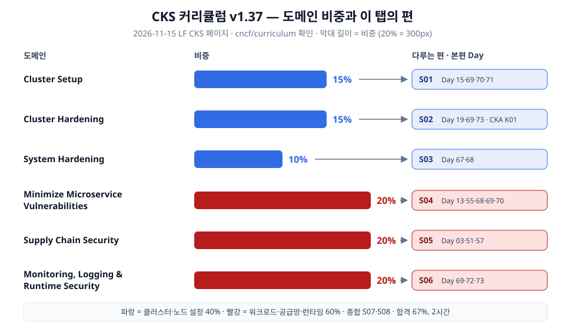
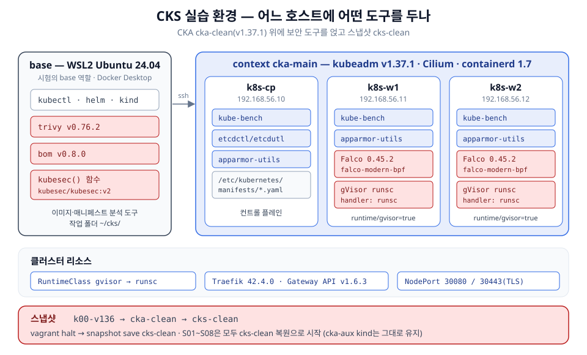

> **자격증 준비 · CKS** | 난이도 ★★★☆☆ | 예상 소요 3 ~ 4시간 (도구 설치·스냅샷 포함)

> ⚠️ **이 탭의 모든 연습 과제는 CNCF가 공개한 CKS 공식 커리큘럼을 바탕으로 직접 만든 "시험 스타일" 과제입니다.** 실제 출제 문제나 유출 문제(덤프)가 아니며, 그런 자료를 재현하지도 않습니다. Linux Foundation 시험은 응시자가 시험 내용 비공개에 동의하고 치르므로, 실제 문제를 공유하거나 구하는 것은 정책 위반이고 자격 취소 사유입니다.

## 🎯 오늘의 목표

- CKS가 **무엇을, 어떤 조건으로** 평가하는지 공식 페이지 기준으로 설명할 수 있다 (CKA와 무엇이 다른가)
- 커리큘럼 6개 도메인이 이 탭의 S01~S06, 본편 Chapter 9(Day 66~73)와 어떻게 이어지는지 지도를 그린다
- CKA K00·K01에서 만든 `cka-main` 클러스터 노드에 **kube-bench, Falco, AppArmor 유틸, gVisor(runsc), etcdctl**을, base에 **Trivy, bom, kubesec**을 설치한다
- containerd에 runsc 핸들러를 등록하고 **RuntimeClass `gvisor`** 로 Pod를 샌드박스에서 띄운다
- 모든 편의 출발점이 될 스냅샷 **`cks-clean`** 을 찍는다

---

## 1. CKS는 어떤 시험인가?

CKS(Certified Kubernetes Security Specialist)는 CKA 다음 단계의 **보안 전문** 실기 시험입니다. CKA가 "클러스터를 굴릴 수 있는가"를 물었다면, CKS는 "그 클러스터를 **잠글** 수 있는가"를 묻습니다. 형식은 CKA와 같은 온라인 감독 실기지만, 과제 하나하나에 **노드 파일 수정, 보안 도구 실행, 정책 작성**이 섞여 있어 과제당 손이 더 많이 갑니다.

2026-11-15에 다음 공식 자료를 확인한 결과입니다.

- Linux Foundation [CKS 페이지](https://training.linuxfoundation.org/certification/certified-kubernetes-security-specialist/)
- [CKA·CKAD·CKS FAQ](https://docs.linuxfoundation.org/tc-docs/certification/faq-cka-ckad-cks)
- [Important Instructions: CKS](https://docs.linuxfoundation.org/tc-docs/certification/important-instructions-cks)
- [허용 자료(Resources Allowed)](https://docs.linuxfoundation.org/tc-docs/certification/certification-resources-allowed)
- [cncf/curriculum](https://github.com/cncf/curriculum) 저장소의 `CKS_Curriculum v1.37.pdf`

| 항목 | 내용 (확인일 **2026-11-15**) | 출처 |
|---|---|---|
| 기준 Kubernetes 버전 | **v1.37**. 새 마이너 출시 후 **약 4~8주 안에** 시험 환경을 맞춤 | CKS 페이지, FAQ |
| 형식 | **온라인 감독(proctored), 실기(performance-based)**. 명령줄로 과제 수행 | CKS 페이지 |
| 과제 수 | **15~20개** | Important Instructions: CKS |
| 시험 시간 | **2시간** | CKS 페이지 |
| 합격 점수 | **67% 이상** (CKA는 66%) | FAQ |
| 응시 자격 | **CKA에 합격한 사람만** 응시 가능("must have taken and passed the CKA exam prior to attempting the CKS exam"). CKA 자격이 **응시 시점에 유효해야 하는지는 FAQ에 명시 없음** → 등록 전 확인 | CKS 페이지, FAQ |
| 재응시 | 등록 1건에 **재응시 1회 포함**(페이지 한쪽은 "One Retake", 다른 쪽은 "Two exam attempts"로 표기 — 같은 뜻으로 총 2회 응시). 등록 후 **12개월** 안에 응시 | CKS 페이지 |
| killer.sh 시뮬레이터 | **2회** 포함, 회당 **36시간**(활성화 시점부터), 세션당 17문항, 채점 결과 제공. 단 `CKS-SINGLE` 단독 등록 상품에는 **미포함** | CKS 페이지, FAQ |
| 시험 환경 | 과제마다 지정된 호스트로 **`ssh <호스트>`**, 관리자 권한은 **`sudo -i`**. 각 호스트에 `kubectl`·`k` alias·bash 자동완성·`yq`·`curl`·`wget`·`man`. **base 호스트에는 이 도구가 없음** → 지정 호스트에서 작업. 과제를 끝내면 **base로 돌아오기**, 중첩 ssh 미지원 | Important Instructions: CKS |
| 보안 도구 목록 | **공식 안내에 없음**(Trivy·Falco 등이 설치돼 있다는 문구 없음). 과제에서 쓰라는 도구가 그 호스트에 있다고 보고, 시작하면 `which <도구>`로 확인 | Important Instructions: CKS |
| 허용 문서 | `kubernetes.io/docs`, `kubernetes.io/blog`, **`falco.org/docs`**, **bom 문서**(`kubernetes-sigs.github.io/bom/cli-reference/`), **`etcd.io/docs`**, **NGINX Ingress 문서**(`kubernetes.github.io/ingress-nginx/user-guide/nginx-configuration/`), **`docs.cilium.io`**, **`istio.io/latest/docs`**, 그리고 과제의 **Quick Reference** 상자 링크. kubernetes.io 검색은 되지만 **외부 검색 결과를 열면 안 됨** | Resources Allowed |
| 자격 유효기간 | **2년** | CKS 페이지 |
| 응시료 | 시험 단독 **$445** (번들 상품 별도) | CKS 페이지 |

> 💡 **CKA와 다른 점 세 가지.** ① 합격선이 **67%** 로 1%p 높습니다. ② 허용 문서에 Falco·etcd·Cilium·Istio·bom·NGINX Ingress 문서가 **추가**되고, 대신 CKA에 있던 `helm.sh/docs`·`gateway-api.sigs.k8s.io`는 CKS 목록에 **없습니다**. ③ Trivy·kubesec·AppArmor·gVisor 문서는 목록에 없으므로 **`<도구> --help`, `man`, 과제의 Quick Reference**로 버텨야 합니다. 그래서 이 탭은 각 도구의 핵심 옵션을 손에 익히는 데 시간을 씁니다.

> ⚠️ **커리큘럼 PDF 버전 표기를 확인하세요.** 2026-11-15 현재 cncf/curriculum 저장소의 파일은 `CKS_Curriculum v1.37.pdf`인데, LF CKS 페이지의 커리큘럼 링크 이름은 아직 v1.34로 표시돼 있었습니다. 도메인·비중은 두 곳이 같습니다. 응시 직전에 이 표 전체를 공식 페이지에서 다시 확인하세요.

> ⚠️ 키보드·데스크톱 주의 사항(INSERT 키 금지, `Ctrl+Alt+W`, `Ctrl+Shift+C/V`, base 재부팅 금지)은 CKA와 같습니다. [CKA K00 1장](../cka/k00-exam-overview-lab.md)을 보세요.

---

## 2. 커리큘럼 6개 도메인과 이 탭의 지도



| 비중 | 도메인 (커리큘럼 v1.37) | 다루는 편 |
|---|---|---|
| **15%** | Cluster Setup | [S01](./s01-cluster-setup.md) |
| **15%** | Cluster Hardening | [S02](./s02-cluster-hardening.md) |
| **10%** | System Hardening | [S03](./s03-system-hardening.md) |
| **20%** | Minimize Microservice Vulnerabilities | [S04](./s04-microservice-vulnerabilities.md) |
| **20%** | Supply Chain Security | [S05](./s05-supply-chain.md) |
| **20%** | Monitoring, Logging and Runtime Security | [S06](./s06-monitoring-runtime.md) |
| — | 종합 | [S07](./s07-mock-exam-1.md), [S08](./s08-mock-exam-2.md) 모의고사 |

### 2-1. 커리큘럼 항목 ↔ 탭 편 ↔ 본편 Day

이론은 본편 Chapter 9(보안)와 Chapter 2·7에서 이미 다뤘습니다. 이 탭은 **시험 과제 형식**에만 집중하고, 개념은 아래 Day로 넘깁니다.

| 도메인 | 커리큘럼 항목 (요지) | 탭 편 | 본편 Day · CKA 편 |
|---|---|---|---|
| Cluster Setup | NetworkPolicy로 클러스터 수준 접근 제한 | S01 | [Day 19](../../02-kubernetes/day19-rbac-namespace.md), [Day 70](../../09-security/day70-networkpolicy-zero-trust.md), [K04](../cka/k04-services-networking.md) |
| | CIS 벤치마크로 컴포넌트(etcd, kubelet, kubedns, kube-apiserver) 설정 점검 | S01 | [Day 69](../../09-security/day69-k8s-workload-security.md) 9장 |
| | Ingress 오브젝트를 TLS와 함께 설정 | S01 | [Day 15](../../02-kubernetes/day15-ingress.md), [Day 71](../../09-security/day71-vault-cert-manager.md) |
| | 노드 메타데이터와 엔드포인트 보호 | S01 | Day 70, [Day 67](../../09-security/day67-host-hardening.md) |
| | 배포 전 플랫폼 바이너리 검증 | S01 | [Day 57](../../07-gitops/day57-supply-chain-security.md) |
| Cluster Hardening | RBAC로 노출 최소화 | S02 | Day 19, [K02](../cka/k02-rbac-helm-kustomize-crd.md) |
| | ServiceAccount 주의(기본값 끄기, 새 SA 권한 최소화) | S02 | Day 69 8장 |
| | Kubernetes API 접근 제한 | S02 | Day 19 3장·6-5, [Day 73](../../09-security/day73-keycloak-sso-audit.md) |
| | 취약점을 피하기 위한 업그레이드 | S02(링크) | [K01](../cka/k01-cluster-install-upgrade-etcd.md) |
| System Hardening | 호스트 OS 흔적 최소화 | S03 | Day 67 |
| | 최소 권한 IAM | S03 | Day 67 |
| | 외부 네트워크 접근 최소화 | S03 | Day 67 |
| | AppArmor·seccomp 같은 커널 하드닝 도구 | S03 | [Day 68](../../09-security/day68-container-runtime-security.md) |
| Microservice Vulnerabilities | 알맞은 Pod Security Standards | S04 | Day 69 |
| | Kubernetes Secret 관리 | S04 | [Day 13](../../02-kubernetes/day13-configmap-secret.md), [Day 55](../../07-gitops/day55-secrets.md), Day 71 |
| | 격리 기법(멀티테넌시, 샌드박스 컨테이너 등) | S04 | Day 19, Day 68 |
| | Pod 간 암호화(Cilium, Istio) | S04 | Day 70 6장 |
| Supply Chain | 베이스 이미지 최소화 | S05 | [Day 03](../../01-docker/day03-dockerfile.md), Day 57 |
| | 공급망 이해(SBOM, CI/CD, 아티팩트 저장소) | S05 | Day 57, [Day 51](../../07-gitops/day51-github-actions.md) |
| | 공급망 보호(허용 레지스트리, 서명·검증) | S05 | Day 57 |
| | 워크로드·이미지 정적 분석(kubesec, KubeLinter 등) | S05 | Day 57 |
| Monitoring·Runtime | 행위 분석으로 악성 활동 탐지 | S06 | [Day 72](../../09-security/day72-falco.md) |
| | 인프라·앱·네트워크·데이터·사용자·워크로드 위협 탐지 | S06 | Day 72 |
| | 공격 단계와 행위자 조사·식별 | S06 | Day 72, Day 73 |
| | 런타임 컨테이너 불변성 | S06 | Day 69 4장 |
| | 감사 로그로 접근 모니터링 | S06 | Day 73 |

목표 편(S01~S06)은 모두 같은 순서로 구성됩니다. CKA 탭과 같습니다.

1. **커리큘럼 항목 요약**
2. **출제 유형** — 과제가 어떤 모양이고, 무엇이 채점되는지
3. **핵심 명령·파일 위치 표** — CKS는 "어느 노드의 어느 파일"이 절반입니다
4. **시간 절약 팁**, **자주 하는 실수**
5. **창작 연습 과제 6~10개** — `<details>`를 열면 풀이와 **검증 명령**, 그리고 "📖 시험장에서 찾을 허용 문서 페이지"
6. **핵심 정리**, 다음 편 예고

---

## 3. 3~4주 학습 계획

하루 1~2시간 기준입니다. CKA 탭(K00~K08)과 Chapter 9(Day 66~73)를 끝냈다는 전제입니다. CKA를 딴 지 오래됐다면 1주차 전에 K04(NetworkPolicy)와 K02(RBAC)를 한 번 다시 풀어 보세요.

| 주차 | 범위 | 핵심 | 주말 점검 |
|---|---|---|---|
| 1주 | S00, S01, S02 | 도구 설치·`cks-clean`, **기본 거부 NetworkPolicy**, kube-bench → 매니페스트·kubelet 수정, RBAC 축소, API 서버 플래그 | S01·S02 과제를 과제당 7분 안에 |
| 2주 | S03, S04 | AppArmor·seccomp 프로파일 적재, PSA·securityContext, Secret 암호화(EncryptionConfiguration), **RuntimeClass(gVisor)** | 정적 Pod 매니페스트를 고쳐 API 서버를 **한 번에** 살리기 |
| 3주 | S05, S06 | Trivy·kubesec·SBOM, ImagePolicyWebhook·허용 레지스트리, **감사 로그 정책**, **Falco 규칙 수정·로그 읽기** | Falco 출력 형식 바꾸기 + 감사 정책 작성 30분 안에 |
| 4주 | S07, S08, killer.sh | 모의고사 2회 → 틀린 편 재풀이 → killer.sh 1회차 → 약점 → 2회차 | 2시간 타이머, 67% 이상 |

3주로 줄이려면 2주차와 3주차를 합치고(S03~S06을 하루 한 편), 4주차의 killer.sh를 3주차 주말로 당기세요. 다만 **API 서버 매니페스트를 고치다 망가뜨리고 복구하는 경험**은 여러 번 해 볼수록 좋으니 S01·S02·S04·S06의 매니페스트 과제는 꼭 두 번씩 하기를 권합니다.

💡 공부 방법 세 가지:

- **"고치기 전에 백업, 고친 뒤에 검증."** CKS는 `/etc/kubernetes/manifests/kube-apiserver.yaml`을 고치는 과제가 여러 도메인에 나옵니다. 한 글자 틀리면 API 서버가 안 뜨고, 그 뒤 과제를 하나도 못 풉니다. 이 탭은 매번 `cp <파일> ~/cks/<편>/<파일>.bak`부터 시작합니다.
- **도구는 `--help`로 익히세요.** Trivy·kubesec·AppArmor는 허용 문서가 없습니다. 연습할 때부터 문서를 보지 말고 `trivy image --help | grep -i severity`처럼 찾는 습관을 들입니다.
- **killer.sh는 4주차에.** 실제 시험보다 어렵게 만들어져 있으니 점수에 낙담하지 말고, **풀이 해설을 읽는 시간**을 넉넉히 잡으세요.

---

## 4. 시험 환경 팁 — CKA에서 달라지는 것

셸 준비(alias, `$do`, vim 설정)와 시간 배분 원칙은 [CKA K00 4장](../cka/k00-exam-overview-lab.md)과 같습니다. CKS에서 추가로 몸에 익힐 것만 적습니다.

| 습관 | 왜 |
|---|---|
| 과제 시작 → `ssh <호스트>` → **`sudo -i`** | 매니페스트·kubelet 설정·Falco 규칙·AppArmor 프로파일이 모두 root 소유 |
| 노드 파일 수정 전 **백업** | `cp /etc/kubernetes/manifests/kube-apiserver.yaml ~/kube-apiserver.yaml.bak` — 원본 폴더 **밖**에 둘 것(아래 ⚠️) |
| API 서버 수정 후 **기다리고 확인** | `watch crictl ps` 또는 `crictl ps \| grep apiserver` → `k get nodes`가 응답할 때까지 |
| 안 뜨면 **로그 위치**부터 | `crictl ps -a`, `crictl logs <id>`, `/var/log/pods/kube-system_kube-apiserver-*/`, `journalctl -u kubelet` |
| 도구 확인 | `which kube-bench falco runsc apparmor_parser trivy` |
| 파일로 답하는 과제 | 경로·형식(한 줄에 하나, 이름만 등)을 과제 문장 그대로 |

> ⚠️ **백업 파일을 `/etc/kubernetes/manifests/` 안에 두지 마세요.** kubelet은 이 폴더의 **모든** 파일을 정적 Pod로 읽으려 합니다. `kube-apiserver.yaml.bak`이 같은 폴더에 있으면 이름이 같은 Pod가 두 개 정의되어 어느 쪽이 뜰지 예측할 수 없습니다.

---

## 5. 실습 환경 — CKA 환경에 보안 도구 얹기



### 5-1. 출발점

[CKA K00](../cka/k00-exam-overview-lab.md) 6장의 환경을 그대로 씁니다. K01까지 끝내 **v1.37.1**로 올라간 상태(스냅샷 `cka-clean`)에서 시작합니다.

```powershell
# Windows PowerShell
cd C:\lab\k8s
vagrant halt
vagrant snapshot restore cka-clean --no-provision
vagrant up
```

```bash
# base(WSL2)
k config use-context cka-main
k get nodes        # 세 노드 모두 v1.37.1, Ready
mkdir -p ~/cks/s00 && cd ~/cks/s00
```

> 💡 CKA 탭을 건너뛰고 왔다면 K00 6장(클러스터·base·context)과 K01 4장(v1.37 업그레이드)을 먼저 하세요. 이 탭의 모든 명령은 그 고정값을 전제합니다.

### 5-2. 어느 노드에 무엇을 설치하나

시험에서는 **과제가 지정한 호스트에 ssh해서** 도구를 씁니다. 연습 환경도 같은 모양으로 맞춰 **노드 설정을 보는 도구**(kube-bench, Falco, AppArmor, gVisor, etcdctl)는 노드에 설치하고, **이미지·매니페스트를 분석하는 도구**(Trivy, bom, kubesec)는 Docker가 있는 base에 둡니다.

| 도구 | 설치 노드 | 확인한 버전 (2026-11-15) | 쓰는 편 |
|---|---|---|---|
| kube-bench | **3대 모두** | v0.16.0 (2026-08-05) | S01 |
| Trivy | base(WSL2) | v0.76.2 (2026-11-05) | S05 |
| bom | base(WSL2) | v0.8.0 | S05 |
| kubesec | base(WSL2) — 이미지 `kubesec/kubesec:v2`를 감싼 셸 함수 | v2 (최신 릴리스 v2.15.0) | S05 |
| etcdctl / etcdutl | `k8s-cp` | v3.7.3 (K01에서 설치) | S04 |
| AppArmor 유틸 (`apparmor-utils`) | **3대 모두** | Ubuntu 24.04 패키지 | S03 |
| Falco | `k8s-w1`, `k8s-w2` | 0.45.2 (2026-10-29), modern eBPF 드라이버 | S06 |
| gVisor `runsc` + containerd 핸들러 | `k8s-w1`, `k8s-w2` | release-20261109.0 | S04 |
| Gateway API CRD + Traefik | 클러스터(Helm) | Gateway API v1.6.3, 차트 42.4.0 (K04와 동일) | S01 |

> 💡 버전 숫자는 확인 시점의 최신입니다. 몇 달 뒤라면 같은 명령으로 더 새 버전이 설치될 수 있고, 이 탭의 과제는 대부분 그대로 동작합니다. 고정하고 싶은 도구는 아래에 버전 변수를 두었습니다.

### 5-3. kube-bench — 3대 모두

Day 69에서는 kind 위에서 **Job**으로 돌렸습니다. kubeadm 노드에서는 **바이너리를 노드에 설치해 직접 실행**하는 쪽이 시험 과제 모양("노드에 ssh해서 kube-bench를 돌리고 FAIL을 고쳐라")과 같습니다. 공식 릴리스의 `.deb`를 받고, 같은 릴리스의 체크섬 파일로 검증한 뒤 설치합니다.

```bash
# base에서 — 세 노드에 같은 명령 실행
for n in k8s-cp k8s-w1 k8s-w2; do
ssh $n 'bash -s' <<'EOF'
set -e
KB_VER=0.16.0
cd /tmp
curl -fsSLO https://github.com/aquasecurity/kube-bench/releases/download/v${KB_VER}/kube-bench_${KB_VER}_linux_amd64.deb
curl -fsSLO https://github.com/aquasecurity/kube-bench/releases/download/v${KB_VER}/kube-bench_${KB_VER}_checksums.txt
sha256sum --check --ignore-missing kube-bench_${KB_VER}_checksums.txt     # ...deb: OK
sudo apt-get install -y ./kube-bench_${KB_VER}_linux_amd64.deb
kube-bench version
EOF
done
```

`.deb`는 바이너리를 `/usr/bin/kube-bench`, 벤치마크 정의를 **`/etc/kube-bench/cfg/`** 에 설치합니다.

```bash
ssh k8s-cp 'sudo kube-bench run --targets master --benchmark cis-1.12 | tail -6'
```

```
== Summary master ==
NN checks PASS
NN checks FAIL
NN checks WARN
0 checks INFO
```

숫자는 환경마다 다릅니다. 여기서는 **실행이 되는지**만 확인하고, FAIL 항목은 S01에서 고칩니다.

> ⚠️ **벤치마크 버전을 명시하는 이유.** kube-bench v0.16.0의 `cfg/config.yaml`에는 Kubernetes **1.34까지만** 매핑이 있고(`"1.34": "cis-1.12"`), 그보다 높은 버전은 마이너를 하나씩 내려가며 찾습니다. 그래서 v1.37 클러스터에서는 자동으로 **`cis-1.12`** 가 선택됩니다(2026-11-15에 v0.16.0 소스로 확인). 개발 브랜치에는 1.34·1.35를 `cis-2.0`에 매핑하는 변경이 있어 다음 릴리스에서 바뀔 수 있습니다. 이 탭은 결과가 흔들리지 않게 **`--benchmark cis-1.12`** 를 붙여 실행하고, 항목 번호도 그 기준으로 적습니다. 시험장에서는 과제가 지정한 방법(명령·버전)을 그대로 따르세요.

### 5-4. Trivy·bom·kubesec — base(WSL2)

이미지 스캔·SBOM·매니페스트 정적 분석 도구는 **노드가 아니라 base**에 둡니다. 이미지를 받아 분석하는 작업이라 노드의 containerd와 무관하고, base에는 K00에서 켠 Docker Desktop(WSL integration)이 있어 kubesec을 이미지로 돌릴 수 있기 때문입니다. S05가 이 배치를 전제로 합니다.

```bash
# base(WSL2)
mkdir -p ~/cks/s00/dl && cd ~/cks/s00/dl

# Trivy — 버전 고정 + 체크섬 검증
TRIVY_VER=0.76.2
curl -fsSLO https://github.com/aquasecurity/trivy/releases/download/v${TRIVY_VER}/trivy_${TRIVY_VER}_Linux-64bit.tar.gz
curl -fsSLO https://github.com/aquasecurity/trivy/releases/download/v${TRIVY_VER}/trivy_${TRIVY_VER}_checksums.txt
sha256sum --check --ignore-missing trivy_${TRIVY_VER}_checksums.txt     # ...tar.gz: OK
tar xzf trivy_${TRIVY_VER}_Linux-64bit.tar.gz trivy && sudo install -m 0755 trivy /usr/local/bin/trivy

# bom (kubernetes-sigs) — SBOM 생성. CKS 허용 문서에 CLI 레퍼런스가 있는 도구
BOM_VER=0.8.0
curl -fsSLO https://github.com/kubernetes-sigs/bom/releases/download/v${BOM_VER}/bom-amd64-linux
curl -fsSLO https://github.com/kubernetes-sigs/bom/releases/download/v${BOM_VER}/checksums.txt
sha256sum --check --ignore-missing checksums.txt                         # bom-amd64-linux: OK
sudo install -m 0755 bom-amd64-linux /usr/local/bin/bom

# kubesec — 바이너리 대신 공식 이미지를 감싼 셸 함수
echo 'kubesec() { docker run -i --rm kubesec/kubesec:v2 "$@"; }' >> ~/.bashrc && source ~/.bashrc

cd ~/cks/s00 && rm -rf dl
trivy --version; bom version | head -3; kubesec version
```

> ⚠️ **Trivy는 버전을 고정해서 설치하세요.** 2026년 3월 Trivy 배포 경로가 공격을 받아 **v0.69.4**(그리고 Docker Hub의 0.69.5·0.69.6 이미지)가 악성으로 배포된 사건이 있었습니다(CVE-2026-33634, GHSA-69fq-xp46-6x23, [Day 57](../../07-gitops/day57-supply-chain-security.md)). "최신을 아무거나"가 아니라 **버전을 지정하고 체크섬으로 검증**하는 것이 바로 S01의 "바이너리 검증", S05의 "공급망 보호"가 말하는 내용입니다.

> 💡 kubesec 함수는 컨테이너 안에서 돌기 때문에 base의 파일 경로가 보이지 않습니다. `kubesec scan /dev/stdin < pod.yaml`처럼 **표준 입력**으로 넘기세요(S05). Trivy는 처음 실행할 때 취약점 DB를 내려받으니 미리 `trivy image --download-db-only`를 한 번 해 두면 연습이 빨라집니다.

### 5-5. etcdctl — `k8s-cp`

K01 5장에서 이미 `etcdctl`·`etcdutl` v3.7.3을 `/usr/local/bin`에 설치했습니다. 확인만 합니다.

```bash
ssh k8s-cp 'etcdctl version; etcdutl version'
```

없다면 [K01 5-1](../cka/k01-cluster-install-upgrade-etcd.md)의 설치 블록을 그대로 실행하세요. CKS에서는 S04에서 **Secret이 etcd에 평문으로 저장되는지** 확인할 때 씁니다.

### 5-6. AppArmor 유틸 — 3대 모두

Ubuntu 24.04는 AppArmor가 기본으로 켜져 있고 `apparmor_parser`·`aa-status`는 `apparmor` 패키지에 이미 들어 있습니다. 프로파일을 만들고 모드를 바꾸는 도구(`aa-genprof`, `aa-complain`, `aa-enforce`, `aa-logprof`)는 `apparmor-utils`에 있습니다.

```bash
for n in k8s-cp k8s-w1 k8s-w2; do
  ssh $n 'sudo apt-get install -y apparmor-utils >/dev/null && sudo aa-status | head -3'
done
```

```
apparmor module is loaded.
1xx profiles are loaded.
...
```

### 5-7. Falco — 워커 노드에 직접 설치

Falco를 설치하는 방법은 두 가지입니다.

| 방법 | 모양 | 규칙·설정 위치 | 로그 보기 |
|---|---|---|---|
| **노드 직접 설치** (deb + systemd) | 노드마다 `falco-modern-bpf.service` | `/etc/falco/falco.yaml`, `/etc/falco/falco_rules.yaml`, `/etc/falco/falco_rules.local.yaml`, `/etc/falco/rules.d/` | `journalctl -u falco-modern-bpf` |
| Helm DaemonSet ([Day 72](../../09-security/day72-falco.md)) | `falco` 네임스페이스의 DaemonSet Pod | Helm 값(`customRules`) → ConfigMap → Pod의 `/etc/falco/rules.d` | `kubectl logs ds/falco` |

이 탭은 **노드 직접 설치**를 택합니다. CKS 공식 안내는 어떤 방식인지 밝히지 않지만, 공식 안내가 말하는 작업 방식이 "**지정 호스트에 ssh → `sudo -i`**"이고 허용 문서 `falco.org/docs`의 설치·규칙 페이지가 `/etc/falco/` 파일을 기준으로 설명하므로, "노드에서 Falco 규칙 파일을 고치고 서비스 로그를 읽는" 형태가 시험 과제에 더 가깝다고 판단했습니다. DaemonSet 방식은 Day 72에서 이미 했으니 S06에서 차이만 짚습니다.

공식 패키지 문서(falco.org/docs/setup/packages) 절차 그대로, 드라이버는 **modern eBPF**(커널 모듈 빌드 불필요, Ubuntu 24.04의 6.8 커널에서 동작)로 고르고 대화창 없이 설치합니다.

```bash
for n in k8s-w1 k8s-w2; do
ssh $n 'bash -s' <<'EOF'
set -e
curl -fsSL https://falco.org/repo/falcosecurity-packages.asc \
  | sudo gpg --dearmor --yes -o /usr/share/keyrings/falco-archive-keyring.gpg
echo "deb [signed-by=/usr/share/keyrings/falco-archive-keyring.gpg] https://download.falco.org/packages/deb stable main" \
  | sudo tee /etc/apt/sources.list.d/falcosecurity.list >/dev/null
sudo apt-get update -y
sudo FALCO_FRONTEND=noninteractive FALCO_DRIVER_CHOICE=modern_ebpf FALCOCTL_ENABLED=no \
  apt-get install -y falco
sudo systemctl enable --now falco-modern-bpf.service
falco --version | head -1
systemctl is-active falco-modern-bpf
EOF
done
```

| 환경 변수 | 뜻 |
|---|---|
| `FALCO_FRONTEND=noninteractive` | 드라이버 선택 대화창을 띄우지 않음 |
| `FALCO_DRIVER_CHOICE=modern_ebpf` | modern eBPF 드라이버로 서비스 구성 |
| `FALCOCTL_ENABLED=no` | 규칙 자동 업데이트(falcoctl) 끔 → 스냅샷마다 규칙이 같게 유지 |

동작 확인 — 컨테이너 안에서 셸을 열면 기본 규칙 `Terminal shell in container`가 걸립니다.

```bash
k run falco-test --image=nginx:1.27 --overrides='{"spec":{"nodeName":"k8s-w1"}}'
k wait --for=condition=Ready pod/falco-test
k exec -it falco-test -- sh -c 'cat /etc/shadow > /dev/null; exit'
ssh k8s-w1 'sudo journalctl -u falco-modern-bpf --since "2 min ago" | grep -E "Notice|Warning" | tail -3'
k delete pod falco-test --force --grace-period=0
```

```
... Warning Sensitive file opened for reading by non-trusted program (file=/etc/shadow ... container_name=falco-test ...)
... Notice A shell was spawned in a container with an attached terminal (... container_name=falco-test ...)
```

> 💡 규칙 출력에 컨테이너·Pod 이름이 나오는 것은 패키지에 함께 들어 있는 **container 플러그인**(0.45.2 패키지에는 0.7.6)이 containerd 소켓에서 메타데이터를 가져오기 때문입니다. 출력에 `container_name=<NA>`만 보이면 S06에서 다룰 플러그인 설정을 확인하세요.

### 5-8. gVisor(runsc)와 RuntimeClass — 워커 노드

[Day 68](../../09-security/day68-container-runtime-security.md)에서 본 "컨테이너는 호스트 커널을 공유한다"는 약점을 줄이는 방법이 **샌드박스 런타임**입니다. gVisor의 `runsc`는 사용자 공간에서 커널 시스템 콜을 대신 처리합니다. 커리큘럼의 "sandboxed containers"에 해당하고, 과제는 보통 "RuntimeClass를 만들고 특정 Pod가 그것으로 돌게 하라" 모양입니다(S04).

**① 워커 두 대에 runsc 설치** — gvisor.dev 공식 apt 저장소.

```bash
for n in k8s-w1 k8s-w2; do
ssh $n 'bash -s' <<'EOF'
set -e
curl -fsSL https://gvisor.dev/archive.key \
  | sudo gpg --dearmor --yes -o /usr/share/keyrings/gvisor-archive-keyring.gpg
echo "deb [arch=$(dpkg --print-architecture) signed-by=/usr/share/keyrings/gvisor-archive-keyring.gpg] https://storage.googleapis.com/gvisor/releases release main" \
  | sudo tee /etc/apt/sources.list.d/gvisor.list >/dev/null
sudo apt-get update && sudo apt-get install -y runsc
runsc --version | head -1
ls -l /usr/bin/containerd-shim-runsc-v1
EOF
done
```

**② containerd에 `runsc` 핸들러 등록.** CKA K02 9번 과제에서 확인했듯 노드의 containerd는 Ubuntu 패키지 **1.7.x**이고 설정 파일은 `version = 2` 형식입니다. 기존 `runc` 런타임 표 옆에 `runsc` 표를 하나 추가합니다(TOML은 새 표를 파일 끝에 추가해도 됩니다).

```bash
for n in k8s-w1 k8s-w2; do
ssh $n 'bash -s' <<'EOF'
set -e
sudo cp /etc/containerd/config.toml /etc/containerd/config.toml.bak
head -1 /etc/containerd/config.toml                      # version = 2 확인
grep -q 'runtimes.runsc' /etc/containerd/config.toml || sudo tee -a /etc/containerd/config.toml >/dev/null <<'TOML'

[plugins."io.containerd.grpc.v1.cri".containerd.runtimes.runsc]
  runtime_type = "io.containerd.runsc.v1"
TOML
sudo systemctl restart containerd
sudo crictl info | grep -A2 '"runsc"'
EOF
done
```

> ⚠️ **containerd 2.x라면 설정 형식이 다릅니다.** 첫 줄이 `version = 3`이면 표 이름이 `[plugins.'io.containerd.cri.v1.runtime'.containerd.runtimes.runsc]`입니다(`runtime_type`은 같음). `containerd --version`으로 먼저 확인하세요. 핸들러 이름(`runsc`)은 표 이름의 마지막 부분이고, 이것이 RuntimeClass의 `handler`와 **정확히 같아야** 합니다.

**③ RuntimeClass와 확인용 Pod.** RuntimeClass는 클러스터 범위 리소스입니다. 문서 예시(Runtime Class 페이지)를 그대로 쓰고, gVisor가 없는 `k8s-cp`에 Pod가 가지 않게 `scheduling.nodeSelector`를 붙입니다.

```bash
k label node k8s-w1 k8s-w2 runtime/gvisor=true
cat > ~/cks/s00/rc-gvisor.yaml <<'EOF'
apiVersion: node.k8s.io/v1
kind: RuntimeClass
metadata:
  name: gvisor
handler: runsc
scheduling:
  nodeSelector:
    runtime/gvisor: "true"
EOF
k apply -f ~/cks/s00/rc-gvisor.yaml

k run sandboxed --image=busybox:1.37 --overrides='{"spec":{"runtimeClassName":"gvisor"}}' --command -- sleep 3600
k wait --for=condition=Ready pod/sandboxed
k exec sandboxed -- dmesg | head -2
```

```
[   0.000000] Starting gVisor...
[   0.4xxxxx] ...
```

`dmesg`에 **`Starting gVisor...`** 가 보이면 Pod가 runsc 위에서 돌고 있는 것입니다. 일반 Pod에서 `dmesg`를 치면 권한 오류가 나거나 호스트 커널 메시지가 보입니다. 확인 후 지웁니다: `k delete pod sandboxed --force --grace-period=0`.

> 💡 RuntimeClass `gvisor`와 노드 라벨은 **스냅샷에 남겨 둡니다.** S04 과제는 "RuntimeClass가 이미 있다 / 없으니 만들어라" 두 형태를 모두 연습하는데, 없는 형태는 과제 안에서 지우고 시작합니다.

### 5-9. Gateway API + Traefik — S01의 TLS 과제용

`cka-clean`에는 Ingress 컨트롤러가 없습니다. [K04](../cka/k04-services-networking.md) 0장과 같은 버전(Gateway API v1.6.3, Traefik 차트 42.4.0)으로 설치하되, HTTPS 엔트리포인트(`websecure`, 컨테이너 포트 8443)를 **NodePort 30443**으로 고정하는 줄만 추가합니다.

```bash
mkdir -p ~/cks/s00 && cd ~/cks/s00
k apply --server-side -f https://github.com/kubernetes-sigs/gateway-api/releases/download/v1.6.3/standard-install.yaml

cat > traefik-values.yaml <<'EOF'
service:
  spec:
    type: NodePort
ports:
  web:
    nodePort: 30080
  websecure:
    nodePort: 30443
providers:
  kubernetesIngress:
    strictPrefixMatching: true
  kubernetesGateway:
    enabled: true
gateway:
  listeners:
    web:
      port: 8000
      protocol: HTTP
      namespacePolicy:
        from: All
EOF

helm repo add traefik https://traefik.github.io/charts && helm repo update
helm install traefik traefik/traefik --version 42.4.0 -n traefik --create-namespace -f traefik-values.yaml
k -n traefik rollout status deploy/traefik
k -n traefik get svc traefik      # 80:30080/TCP,443:30443/TCP
```

> 💡 K05에서 설치한 local-path-provisioner(기본 StorageClass)가 필요하면 [K05 0장](../cka/k05-storage.md)을 실행한 뒤 스냅샷을 찍으세요. S01~S03 과제는 PVC를 쓰지 않습니다.

---

## 6. 실습 환경 고정값과 스냅샷 `cks-clean`

### 6-1. 실습 환경 고정값 — S01~S08 공통

이 표는 **S01~S08이 그대로 쓰는 값**입니다. CKA K00 6-1의 값을 이어받고 CKS용 항목을 더했습니다.

| 항목 | 값 |
|---|---|
| 작업 터미널(시험의 `base`) | Windows 호스트의 **WSL2 Ubuntu 24.04** — kubectl v1.37.x, helm, kind, `~/.kube/config`에 두 context |
| context ① | **`cka-main`** — kubeadm **v1.37.1**, Ubuntu 24.04, containerd 1.7.x(`SystemdCgroup = true`), **Cilium**, Pod CIDR `10.244.0.0/16`, Service CIDR `10.96.0.0/12`, API `https://192.168.56.10:6443` |
| `cka-main` 노드 | `k8s-cp` **192.168.56.10** (control-plane) · `k8s-w1` **192.168.56.11** · `k8s-w2` **192.168.56.12** |
| context ② | **`cka-aux`** — kind v0.33.0, `kindest/node:v1.37.0`, kindnet (가벼운 과제·context 전환용) |
| 노드 접속 | base에서 `ssh k8s-cp` / `ssh k8s-w1` / `ssh k8s-w2` → **`sudo -i`** |
| 작업 폴더 | base의 **`~/cks/`**, 편마다 `~/cks/s0N/`. 노드에서 만드는 파일은 과제가 지정한 경로 |
| 정적 Pod 매니페스트 | `k8s-cp:/etc/kubernetes/manifests/` (kube-apiserver, kube-controller-manager, kube-scheduler, etcd) |
| kubelet 설정 | 각 노드 `/var/lib/kubelet/config.yaml`(KubeletConfiguration), 실행 인자 `/var/lib/kubelet/kubeadm-flags.env`, 서비스 드롭인은 `systemctl cat kubelet`으로 확인(pkgs.k8s.io 패키지는 `/usr/lib/systemd/system/kubelet.service.d/10-kubeadm.conf`) |
| kube-bench | 3대 모두 v0.16.0, `/usr/bin/kube-bench`, 정의 `/etc/kube-bench/cfg/`, 실행 시 **`--benchmark cis-1.12`** |
| Trivy / bom / kubesec | **base(WSL2)**: Trivy v0.76.2·bom v0.8.0(`/usr/local/bin`), kubesec은 `~/.bashrc`의 함수 `kubesec() { docker run -i --rm kubesec/kubesec:v2 "$@"; }` |
| etcdctl / etcdutl | `k8s-cp`: v3.7.3(`/usr/local/bin`) |
| AppArmor | 3대 모두 활성, `apparmor-utils` 설치. 프로파일 폴더 `/etc/apparmor.d/` |
| Falco | `k8s-w1`·`k8s-w2`: apt 패키지 0.45.2(DaemonSet 아님), systemd 서비스 **`falco-modern-bpf`**, 설정 **`/etc/falco/falco.yaml`**, 사용자 규칙 **`/etc/falco/falco_rules.local.yaml`**, 자동 규칙 업데이트 끔 |
| gVisor | `k8s-w1`·`k8s-w2`: `runsc`, containerd 핸들러 **`runsc`**, RuntimeClass **`gvisor`**, 노드 라벨 `runtime/gvisor=true` |
| Ingress / Gateway | Gateway API CRD v1.6.3, Traefik 차트 42.4.0(네임스페이스 `traefik`), IngressClass·GatewayClass **`traefik`**, HTTP **NodePort 30080**, HTTPS **NodePort 30443**(엔트리포인트 포트 8443) |
| Vagrant 폴더 | `C:\lab\k8s` |
| 스냅샷 | `cka-clean`(CKA 탭) → **`cks-clean`**(이 편 완료 — **S01~S08의 초기화 지점**) |

### 6-2. 스냅샷 찍기

설치가 끝났으면 확인용 리소스를 정리하고, CKA 때와 같이 **끈 상태에서** 세 VM을 함께 찍습니다.

```bash
k get pods -A | grep -vE 'kube-system|traefik|NAMESPACE'   # 남은 테스트 Pod가 없어야 함
k get runtimeclass                                          # gvisor
```

```powershell
cd C:\lab\k8s
vagrant halt
vagrant snapshot save cks-clean
vagrant up
vagrant snapshot list       # k00-v136, cka-clean, cks-clean
```

이후 모든 편은 이렇게 시작합니다.

```powershell
cd C:\lab\k8s; vagrant halt; vagrant snapshot restore cks-clean --no-provision; vagrant up
```

> 💡 `vagrant up` 직후 1~2분은 노드가 NotReady이거나 Falco 서비스가 재시작 중일 수 있습니다. `k get nodes`가 모두 Ready가 된 뒤 시작하세요.

---

## 7. 첫 연습 — 환경 점검 과제

> 아래 과제는 공식 커리큘럼을 바탕으로 창작한 **환경 점검용** 과제입니다. `cks-clean`에서 시작합니다.

### 과제 1. 도구 인벤토리

context `cka-main`. 세 노드 각각에 `kube-bench`, `falco`, `runsc`, `apparmor_parser`가 있는지, 그리고 base에 `trivy`, `bom`, `kubesec`이 있는지 확인해 base의 `~/cks/s00/tools.txt`에 `<호스트> <도구> <있음|없음>` 형식으로 한 줄씩 저장하라.

<details>
<summary>풀이·검증</summary>

```bash
{
for n in k8s-cp k8s-w1 k8s-w2; do
  for t in kube-bench falco runsc apparmor_parser; do
    if ssh $n "command -v $t >/dev/null || sudo test -x /usr/sbin/$t"; then s=있음; else s=없음; fi
    echo "$n $t $s"
  done
done
for t in trivy bom kubesec; do
  if type $t >/dev/null 2>&1; then echo "base $t 있음"; else echo "base $t 없음"; fi
done
} > ~/cks/s00/tools.txt
column -t ~/cks/s00/tools.txt
```

`k8s-cp`에는 falco·runsc가 없어야 6-1 표와 일치합니다. kubesec은 함수라서 `command -v` 대신 `type`으로 확인했고, `apparmor_parser`는 `/usr/sbin`에 있어 일반 사용자 PATH에 없을 수 있으므로 `sudo test -x`로 함께 확인했습니다.

📖 문서: 없음(셸 기본기). 시험장에서는 과제 시작 시 `which <도구>`가 이 역할
</details>

### 과제 2. 샌드박스 Pod

context `cka-main`. 네임스페이스 `s00`에 RuntimeClass `gvisor`로 도는 Pod `sbx`(이미지 `busybox:1.37`, 명령 `sleep 3600`)를 만들고, Pod 안 `dmesg` 첫 줄을 `~/cks/s00/sbx-dmesg.txt`에 저장하라.

<details>
<summary>풀이·검증</summary>

```bash
k create ns s00
k -n s00 run sbx --image=busybox:1.37 $do --command -- sleep 3600 > ~/cks/s00/sbx.yaml
# spec: 아래에 한 줄 추가 →  runtimeClassName: gvisor
vim ~/cks/s00/sbx.yaml
k apply -f ~/cks/s00/sbx.yaml
k -n s00 wait --for=condition=Ready pod/sbx
k -n s00 exec sbx -- dmesg | head -1 > ~/cks/s00/sbx-dmesg.txt
```

```bash
cat ~/cks/s00/sbx-dmesg.txt                                  # ... Starting gVisor...
k -n s00 get pod sbx -o jsonpath='{.spec.runtimeClassName} {.spec.nodeName}{"\n"}'   # gvisor k8s-w1(또는 w2)
k delete ns s00
```

📖 문서: kubernetes.io → "Runtime Class"(`/docs/concepts/containers/runtime-class/`)
</details>

### 과제 3. kube-bench 요약 기록

context `cka-main`. `k8s-w1`에서 kube-bench로 **node** 대상만 점검(벤치마크 `cis-1.12`)하고, Summary의 PASS·FAIL·WARN 개수를 base의 `~/cks/s00/bench-w1.txt`에 저장하라.

<details>
<summary>풀이·검증</summary>

```bash
ssh k8s-w1 'sudo kube-bench run --targets node --benchmark cis-1.12' > ~/cks/s00/bench-w1-full.txt
grep -A4 '== Summary node ==' ~/cks/s00/bench-w1-full.txt > ~/cks/s00/bench-w1.txt
cat ~/cks/s00/bench-w1.txt
```

숫자는 환경마다 다릅니다. kubeadm 기본값은 kubelet의 익명 인증을 끄고(`authentication.anonymous.enabled: false`) 인가를 `Webhook`으로 두므로 4.2.1·4.2.2는 PASS여야 합니다. FAIL로 나온 항목은 S01에서 하나씩 고칩니다.

📖 문서: kube-bench는 허용 문서가 없습니다. `kube-bench run --help`와 출력의 `== Remediations ==`가 문서 역할
</details>

---

## 8. 트러블슈팅

| 증상 | 원인 | 해결 |
|---|---|---|
| `sha256sum --check`가 `no properly formatted checksum lines found` | 체크섬 파일을 HTML(에러 페이지)로 받음 | `curl -fsSL`(`-f`로 404를 실패 처리), URL의 버전 오타 확인 |
| kube-bench가 `unable to determine benchmark version` | 버전 자동 판별 실패 | `--benchmark cis-1.12` 명시 |
| kube-bench master 결과가 거의 다 `[INFO]`/건너뜀 | 워커에서 `--targets master` 실행 | 컨트롤 플레인 점검은 **`k8s-cp`에서** |
| `falco-modern-bpf` 서비스가 `failed` | 드라이버 미지원 커널, 메모리 부족 | `journalctl -u falco-modern-bpf -n 50`, `uname -r`(6.8 확인), 워커 메모리 2GB 이상 |
| Falco 로그에 아무 경고도 없음 | 서비스가 다른 노드에 있음 | 테스트 Pod가 뜬 노드(`k get pod -o wide`)의 저널을 볼 것 |
| RuntimeClass Pod가 `ContainerCreating`에서 멈춤, 이벤트 `no runtime for "runsc" is configured` | containerd 설정 누락·오타, 재시작 안 함 | 노드에서 `crictl info \| grep runsc`, 표 이름·`runtime_type` 확인 후 `systemctl restart containerd` |
| containerd 재시작 후 노드 NotReady | config.toml 문법 오류 | `journalctl -u containerd -n 30`, `config.toml.bak`으로 되돌린 뒤 다시 추가 |
| gVisor Pod가 `k8s-cp`에 스케줄되어 실패 | RuntimeClass `scheduling.nodeSelector` 누락 | 5-8 ③의 `scheduling` 블록 추가 |
| `curl https://<노드>:30443`이 연결 거부 | Traefik values에 `websecure.nodePort` 누락 | `k -n traefik get svc traefik` 확인 후 `helm upgrade ... -f traefik-values.yaml` |

---

## 9. 핵심 정리

- CKS는 **v1.37 기준, 2시간, 15~20개 과제의 온라인 감독 실기 시험**. **67% 이상 합격**, **CKA 합격자만** 응시, 재응시 1회와 killer.sh 2회(각 36시간) 포함(단독 등록 상품 제외), 자격 2년
- 허용 문서는 `kubernetes.io/docs`·`/blog`에 더해 **falco.org/docs, etcd.io/docs, docs.cilium.io, istio.io, bom, NGINX Ingress 설정 문서**. Trivy·kubesec·AppArmor는 `--help`·`man`으로
- 비중: Cluster Setup 15 / Cluster Hardening 15 / System Hardening 10 / Microservice Vulnerabilities 20 / Supply Chain 20 / Monitoring·Logging·Runtime 20
- 과제 루틴: **`ssh <호스트>` → `sudo -i` → 백업(매니페스트 폴더 밖) → 수정 → 컴포넌트가 다시 뜰 때까지 확인 → base로 복귀**
- 실습 도구: kube-bench(3대, `--benchmark cis-1.12`), etcdctl(`k8s-cp`), Falco `falco-modern-bpf`·gVisor(워커), AppArmor 유틸(3대), Trivy·bom·kubesec(base), Traefik HTTPS NodePort 30443
- 초기화 지점은 스냅샷 **`cks-clean`**. 이 탭의 과제는 모두 **공식 커리큘럼 기반 창작 과제**다

---

## ⏭️ 다음 예고 — S01. 클러스터 설정

첫 도메인 **Cluster Setup(15%)** 입니다. 네임스페이스에 **기본 거부 NetworkPolicy**를 걸고 DNS와 필요한 통신만 여는 과제, kube-bench 결과를 보고 **API 서버·컨트롤러 매니저·스케줄러 정적 Pod 매니페스트와 kubelet 설정 파일을 고치는** 과제, Ingress·Gateway에 **TLS Secret**을 붙이는 과제, egress 정책으로 **노드 메타데이터 엔드포인트(169.254.169.254)를 막는** 과제, 그리고 쿠버네티스 바이너리를 **sha512로 검증**하는 과제를 시험 속도로 풉니다.
