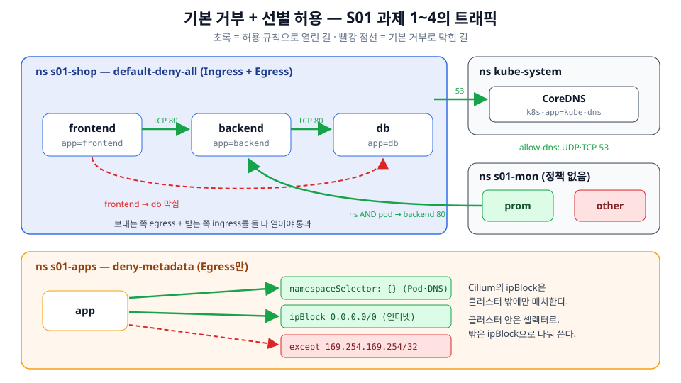
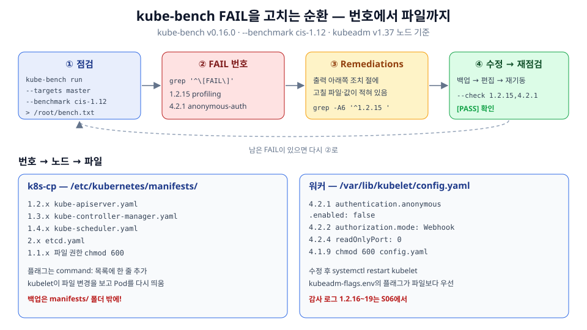

> **자격증 준비 · CKS** | 난이도 ★★★☆☆ | 예상 소요 3 ~ 3.5시간

> ⚠️ 이 편의 모든 연습 과제는 CNCF가 공개한 **CKS 공식 커리큘럼(v1.37)을 바탕으로 직접 창작한** 시험 스타일 과제입니다. 실제 시험 문제(유출 문제·덤프)가 아니며, 실제 출제 내용과 무관합니다.

## 🎯 오늘의 목표

- 네임스페이스에 **기본 거부(ingress+egress) + DNS 허용**을 걸고, 필요한 통신만 정확히 여는 NetworkPolicy를 5분 안에 쓴다
- kube-bench 결과의 **항목 번호 → 고칠 파일 → 고칠 줄**을 바로 연결하고, 정적 Pod 매니페스트·kubelet 설정을 고친 뒤 다시 점검해 PASS를 확인한다
- TLS Secret을 만들어 **Ingress와 Gateway의 HTTPS**에 붙이고 `openssl s_client`로 검증한다
- egress 정책으로 **노드 메타데이터 엔드포인트(169.254.169.254)** 만 막고 나머지 통신은 살린다
- 쿠버네티스 바이너리를 **공식 sha512 값으로 검증**해 변조된 파일을 골라낸다

---

## 1. 커리큘럼 항목 요약 — Cluster Setup (15%)

| 커리큘럼 항목 | 이 편의 섹션 · 과제 | 이론 참조 |
|---|---|---|
| Use Network security policies to restrict cluster level access | 3-1, 과제 1~3 | [Day 70](../../09-security/day70-networkpolicy-zero-trust.md) 2장(기본 거부·AND/OR), [Day 19](../../02-kubernetes/day19-rbac-namespace.md) 6-7, [K04](../cka/k04-services-networking.md) |
| Use CIS benchmark to review the security configuration of Kubernetes components (etcd, kubelet, kubedns, kubeapi) | 3-2, 과제 5·6 | [Day 69](../../09-security/day69-k8s-workload-security.md) 9장(kube-bench 결과 읽기) |
| Properly set up Ingress objects with TLS | 3-3, 과제 7·8 | [Day 15](../../02-kubernetes/day15-ingress.md), [Day 71](../../09-security/day71-vault-cert-manager.md) 3-4 |
| Protect node metadata and endpoints | 3-4, 과제 4·6 | Day 70 2장, [Day 67](../../09-security/day67-host-hardening.md) |
| Verify platform binaries before deploying | 3-5, 과제 9 | [Day 57](../../07-gitops/day57-supply-chain-security.md) |

> 💡 NetworkPolicy의 규칙 네 가지(정책 없으면 전부 허용, 선택되면 격리, 허용만 있고 합집합, 응답은 자동)와 AND/OR 하이픈 차이는 **Day 70 2장**에 있습니다. kube-bench의 PASS/FAIL/WARN 의미와 섹션 번호 체계는 **Day 69 9장**에 있습니다. 여기서는 다시 설명하지 않고 **시험 과제 형식**으로만 다룹니다.

**실습 환경:** [S00](./s00-exam-overview-lab.md) 6-1의 고정값. context **`cka-main`**(kubeadm v1.37.1, Cilium), 노드 작업은 `ssh <노드>` → `sudo -i`, 작업 폴더 `~/cks/s01/`. 스냅샷 **`cks-clean`** 에서 시작합니다.

```powershell
# Windows PowerShell
cd C:\lab\k8s; vagrant halt; vagrant snapshot restore cks-clean --no-provision; vagrant up
```

```bash
# base(WSL2)
k config use-context cka-main && k get nodes
mkdir -p ~/cks/s01 && cd ~/cks/s01
```

---

## 2. 출제 유형 — 어떻게 채점되는가

| 과제 형태 | 예시 문장(창작) | 채점 포인트 |
|---|---|---|
| **기본 거부형** | "네임스페이스 X의 모든 Pod에 대해 들어오고 나가는 트래픽을 기본 거부하라. DNS는 허용" | `podSelector: {}`, `policyTypes`에 **Ingress·Egress 둘 다**, DNS가 **UDP·TCP 53** 모두 |
| **선별 허용형** | "A만 B의 8080으로 들어올 수 있게" | 셀렉터 라벨 정확성, **포트**, AND/OR 구조, 다른 Pod는 막히는가 |
| **CIS 수정형** | "kube-bench가 보고한 1.2.x FAIL을 고쳐라" / "kubelet의 익명 접근을 막아라" | 매니페스트 플래그·kubelet 설정 값, **컴포넌트가 다시 Running인가**, 재점검 PASS |
| **TLS형** | "Secret Y로 호스트 Z를 HTTPS로 제공" | Secret 타입 `kubernetes.io/tls`, Ingress `tls.hosts`·`secretName`, 호스트 이름 일치 |
| **메타데이터 차단형** | "네임스페이스 X의 Pod가 169.254.169.254에 접근하지 못하게, 다른 egress는 유지" | `ipBlock.except`, 정책이 **다른 통신까지 막지 않는가** |
| **바이너리 검증형** | "주어진 바이너리 중 공식 체크섬과 다른 것을 지워라" | 올바른 버전·알고리즘(sha512)으로 비교, 잘못된 파일만 삭제 |

> 💡 NetworkPolicy 과제의 채점은 "**되어야 하는 통신은 되고, 안 되어야 하는 통신은 안 되는가**"를 실제 Pod 간 연결로 봅니다. 그러니 검증도 "허용 1개 + 거부 1개" 이상을 실제로 쳐 보세요. 정책이 문법상 맞아도 라벨 하나가 틀리면 0점입니다.

---

## 3. 핵심 명령·파일 위치 표

### 3-1. NetworkPolicy — 시험용 뼈대



📖 **시험장에서 찾을 문서:** "Network Policies" → `/docs/concepts/services-networking/network-policies/`. 이 페이지의 *Default policies* 절에 기본 거부 예시 4종(ingress/egress/둘 다/전부 허용)이 그대로 있습니다. `kubectl create networkpolicy` 같은 명령형 생성은 **없으므로** 문서에서 복사하는 것이 가장 빠릅니다.

| 하고 싶은 것 | 핵심 줄 |
|---|---|
| 네임스페이스 전체 선택 | `podSelector: {}` |
| 들어오고 나가는 것 모두 기본 거부 | `policyTypes: ["Ingress","Egress"]` + `ingress`/`egress` 규칙 **없음** |
| DNS 허용 | egress `to: namespaceSelector(kubernetes.io/metadata.name: kube-system) + podSelector(k8s-app: kube-dns)`, `ports: UDP 53, TCP 53` |
| 같은 ns의 특정 Pod에서만 | `from: - podSelector: {matchLabels: {app: frontend}}` |
| 특정 ns의 특정 Pod에서만 (AND) | `from: - namespaceSelector: {...}` 다음 줄에 **하이픈 없이** `podSelector: {...}` |
| 클러스터 밖 IP 허용 + 일부 제외 | `to: - ipBlock: {cidr: 0.0.0.0/0, except: [169.254.169.254/32]}` |
| 클러스터 안 모든 Pod | `to: - namespaceSelector: {}` |
| 정책 해석 확인 | `k -n <ns> describe netpol <이름>` |
| 연결 확인 | `k -n <ns> exec <pod> -- wget -qO- -T 2 http://<svc>` / `nc -w 2 <ip> <port>` |

> ⚠️ **이 클러스터의 CNI는 Cilium입니다.** Cilium에서 `ipBlock`은 **클러스터 밖(world) 주소**에만 매치하고, Pod·노드처럼 클러스터 안의 대상은 CIDR로 고르지 않습니다(노드 IP까지 CIDR로 고르려면 Cilium 설정 `policy-cidr-match-mode`가 필요 — `docs.cilium.io`의 Network Policy 문서). 그래서 "`0.0.0.0/0` 허용"만으로는 **CoreDNS·다른 Pod로 가는 통신이 열리지 않고**, API 서버(노드 IP 192.168.56.10:6443)로 가는 egress도 ipBlock으로는 열리지 않습니다. 표준 NetworkPolicy 문서도 ipBlock을 Pod IP에 쓰지 말라고 합니다. **클러스터 안은 셀렉터로, 밖은 ipBlock으로** 나눠 쓰면 어느 CNI에서도 같은 결과가 나옵니다.

### 3-2. CIS 벤치마크 — kube-bench 번호와 고칠 곳



📖 **시험장에서 찾을 문서:** kube-bench 자체 문서는 허용 목록에 없습니다. 대신 kube-bench 출력의 `== Remediations ==`가 고칠 파일과 값을 알려 줍니다. 플래그 의미는 kubernetes.io의 컴포넌트 레퍼런스: "kube-apiserver"(`/docs/reference/command-line-tools-reference/kube-apiserver/`), "kube-controller-manager", "kube-scheduler", "kubelet", 그리고 kubelet 설정 파일 필드는 "Kubelet Configuration (v1beta1)"(`/docs/reference/config-api/kubelet-config.v1beta1/`)과 "Set Kubelet Parameters Via A Configuration File".

| 실행 | 명령 (S00 설치 기준) |
|---|---|
| 컨트롤 플레인 | `k8s-cp`에서 `kube-bench run --targets master --benchmark cis-1.12` |
| etcd | `k8s-cp`에서 `kube-bench run --targets etcd --benchmark cis-1.12` |
| 워커 kubelet | 워커에서 `kube-bench run --targets node --benchmark cis-1.12` |
| 특정 항목만 재점검 | `kube-bench run --targets master --benchmark cis-1.12 --check 1.2.15,1.3.2` |
| FAIL만 보기 | `... \| grep -E '^\[FAIL\]'` |
| 항목의 조치 방법 | `... \| grep -A6 '^1.2.15 '` (Remediations 절) |

kubeadm 기본 클러스터에서 자주 보이는 항목과 고칠 곳(cis-1.12 번호, 2026-11-15 kube-bench v0.16.0 정의 파일로 확인):

| 번호 | 항목 | 고칠 파일 (노드) | 고칠 내용 |
|---|---|---|---|
| 1.1.1 / 1.1.7 | API 서버 / etcd 정적 Pod 매니페스트 권한 600 | `k8s-cp:/etc/kubernetes/manifests/*.yaml` | `chmod 600` |
| 1.1.13 | admin.conf 권한 600 | `k8s-cp:/etc/kubernetes/admin.conf` | `chmod 600` |
| 1.1.12 | etcd 데이터 디렉터리 소유자 `etcd:etcd` | `/var/lib/etcd` | kubeadm은 etcd 사용자를 만들지 않아 **FAIL이 정상**. 과제가 시킬 때만 처리 |
| 1.2.1 | API 서버 `--anonymous-auth=false` (Manual) | kube-apiserver.yaml | **S02**에서 다룸 (헬스 체크와의 관계 주의) |
| 1.2.14 | admission 플러그인에 `NodeRestriction` | kube-apiserver.yaml `--enable-admission-plugins` | kubeadm 기본값에 있음. 빠졌으면 추가(S02) |
| 1.2.15 | API 서버 `--profiling=false` | kube-apiserver.yaml | 플래그 한 줄 추가 |
| 1.2.16~19 | 감사 로그 경로·보관 | kube-apiserver.yaml + 볼륨 | **S06**에서 다룸 |
| 1.3.2 | 컨트롤러 매니저 `--profiling=false` | kube-controller-manager.yaml | 플래그 한 줄 추가 |
| 1.4.1 | 스케줄러 `--profiling=false` | kube-scheduler.yaml | 플래그 한 줄 추가 |
| 1.3.7 / 1.4.2 | `--bind-address=127.0.0.1` | 컨트롤러 매니저 / 스케줄러 | kubeadm 기본값에 있음 |
| 2.x | etcd TLS·클라이언트 인증 | etcd.yaml | kubeadm 기본값으로 PASS |
| 4.1.1 | kubelet 서비스 파일 권한 600 | `systemctl cat kubelet`이 보여 주는 드롭인 파일 | `chmod 600` |
| 4.1.9 | kubelet `config.yaml` 권한 600 | 워커 `/var/lib/kubelet/config.yaml` | `chmod 600` |
| 4.2.1 | kubelet 익명 인증 끄기 | `/var/lib/kubelet/config.yaml` | `authentication.anonymous.enabled: false` |
| 4.2.2 | kubelet 인가가 AlwaysAllow 아님 | 같은 파일 | `authorization.mode: Webhook` |
| 4.2.4 | 읽기 전용 포트 0 (Manual) | 같은 파일 | `readOnlyPort: 0` (또는 줄 삭제 — 기본값 0) |
| 4.2.14 | `seccompDefault: true` (Manual) | 같은 파일 | S03·S04와 연결 |

**정적 Pod 매니페스트를 고치는 절차** (모든 CKS 과제 공통):

```bash
ssh k8s-cp
sudo -i
cp /etc/kubernetes/manifests/kube-apiserver.yaml /root/kube-apiserver.yaml.bak   # 폴더 밖에 백업
vim /etc/kubernetes/manifests/kube-apiserver.yaml                                # command: 목록에 한 줄
watch -n2 'crictl ps --name kube-apiserver'      # 기존 컨테이너가 내려가고 새 것이 Running (30초~1분)
kubectl --kubeconfig /etc/kubernetes/admin.conf get nodes                         # 응답하면 성공
ps -ef | grep [k]ube-apiserver | tr ' ' '\n' | grep -- --profiling               # 실제 플래그 확인
```

**kubelet 설정을 고치는 절차:**

```bash
ssh k8s-w1
sudo -i
cp /var/lib/kubelet/config.yaml /root/kubelet-config.yaml.bak
vim /var/lib/kubelet/config.yaml
cat /var/lib/kubelet/kubeadm-flags.env       # 같은 설정을 덮어쓰는 명령줄 플래그가 없는지
systemctl restart kubelet && systemctl is-active kubelet
```

> ⚠️ kubelet은 **명령줄 플래그가 설정 파일보다 우선**합니다. 설정 파일에서 `anonymous.enabled: false`로 고쳐도 `kubeadm-flags.env`나 드롭인 파일에 `--anonymous-auth=true`가 있으면 그대로 열려 있습니다. kube-bench도 이 둘을 모두 봅니다(`ps -fC kubelet`과 설정 파일).

### 3-3. Ingress·Gateway TLS

📖 **시험장에서 찾을 문서:** "Ingress" → *TLS* 절(`/docs/concepts/services-networking/ingress/#tls`), "Secrets" → *TLS Secrets*, "Gateway API"(`/docs/concepts/services-networking/gateway/`). CKS 허용 목록에는 `gateway-api.sigs.k8s.io`가 **없으므로** Gateway 필드는 `k explain gateway.spec.listeners.tls`로 확인합니다. NGINX Ingress 설정 문서는 허용되지만 이 클러스터의 컨트롤러는 Traefik입니다.

| 하고 싶은 것 | 명령 |
|---|---|
| 자체 서명 인증서 (연습용) | `openssl req -x509 -nodes -newkey rsa:2048 -days 365 -keyout tls.key -out tls.crt -subj "/CN=a.test" -addext "subjectAltName=DNS:a.test"` |
| TLS Secret | `k -n <ns> create secret tls <이름> --cert=tls.crt --key=tls.key` |
| TLS Ingress 한 줄 | `k -n <ns> create ingress <이름> --class=traefik --rule="a.test/*=web:80,tls=<secret>"` |
| Secret 내용 확인 | `k -n <ns> get secret <이름> -o jsonpath='{.data.tls\.crt}' \| base64 -d \| openssl x509 -noout -subject -enddate` |
| 실제 제공되는 인증서 | `openssl s_client -connect 192.168.56.11:30443 -servername a.test </dev/null 2>/dev/null \| openssl x509 -noout -subject` |
| HTTPS 요청 | `curl -sk --resolve a.test:30443:192.168.56.11 https://a.test:30443/` |

> 💡 Day 71에서는 cert-manager가 인증서를 만들어 줬습니다. 시험 과제는 보통 **인증서 파일이 주어지고 Secret·Ingress를 연결**하는 쪽입니다. 키와 인증서가 짝이 맞는지 의심되면 `openssl x509 -noout -modulus -in tls.crt | md5sum`과 `openssl rsa -noout -modulus -in tls.key | md5sum`을 비교하세요.

### 3-4. 노드 메타데이터와 엔드포인트

| 대상 | 위험 | 막는 곳 |
|---|---|---|
| 클라우드 메타데이터 `169.254.169.254` | Pod가 노드의 클라우드 자격 증명·설정을 읽음 | **NetworkPolicy egress `ipBlock.except`** (과제 4), 클라우드의 메타데이터 v2·홉 제한 |
| kubelet API `:10250` | 익명 허용이면 Pod 목록·로그·exec | kubelet `authentication.anonymous.enabled: false`, `authorization.mode: Webhook` (과제 6) |
| kubelet 읽기 전용 `:10255` | 인증 없이 Pod 정보 노출 | `readOnlyPort: 0` (과제 6) |
| 컨트롤러 매니저·스케줄러 `:10257`/`:10259` | 메트릭·프로파일 노출 | `--bind-address=127.0.0.1`, `--profiling=false` (과제 5) |

📖 **문서:** "Securing a Cluster"(`/docs/tasks/administer-cluster/securing-a-cluster/`) → *Restricting cloud metadata API access*, "Kubelet authentication/authorization"(`/docs/reference/access-authn-authz/kubelet-authn-authz/`).

### 3-5. 바이너리 검증

📖 **시험장에서 찾을 문서:** "Install and Set Up kubectl on Linux"(`/docs/tasks/tools/install-kubectl-linux/`) → *Validate the binary*. 체크섬 파일 URL 형식과 `sha256sum --check` 사용법이 있습니다. 같은 경로에 **`.sha512`** 도 있습니다.

| 하고 싶은 것 | 명령 |
|---|---|
| 공식 체크섬 URL | `https://dl.k8s.io/release/v1.37.1/bin/linux/amd64/<바이너리>.sha512` (sha256은 `.sha256`) |
| 한 파일 검증 | `echo "$(curl -fsSL <URL>.sha512)  kubelet" \| sha512sum --check` → `kubelet: OK` |
| 해시만 계산 | `sha512sum kubelet` |
| 과제가 해시 값을 줄 때 | `echo "<주어진 값>  kubelet" \| sha512sum -c` (값과 파일 이름 사이 **공백 두 칸**) |
| 바이너리 버전 | `./kubelet --version`, `./kubectl version --client` |
| 서버 묶음(tarball) | `https://dl.k8s.io/v1.37.1/kubernetes-server-linux-amd64.tar.gz.sha512` |

> 💡 시험장 호스트에서 인터넷 다운로드가 된다는 보장은 없습니다. 과제가 **기대 해시 값을 문장이나 파일로 주는** 형태를 가정하고 `sha512sum -c`를 손에 익혀 두세요. 컨트롤 플레인 컴포넌트(kube-apiserver 등)는 kubeadm에서 **컨테이너 이미지**로 돌기 때문에, 이미지의 다이제스트 확인은 S05에서 다룹니다.

---

## 4. 시간 절약 팁

- NetworkPolicy는 문서의 *Default policies* 예시를 **복사 → `metadata.name`·`namespace`만 수정**. 처음부터 치지 마세요.
- 정책 여러 개를 한 파일에 `---`로 묶어 한 번에 `apply`. 검증용 함수(`t() { ... }`, 과제 1)를 만들어 두면 매트릭스 확인이 10초입니다.
- kube-bench는 **전체를 한 번 돌려 파일로 저장**하고(`> /root/bench.txt`), 이후에는 `--check <번호들>`로 고친 것만 재점검합니다. 전체 재실행보다 빠르고 출력이 짧습니다.
- 정적 Pod 3개(apiserver, controller-manager, scheduler)를 고칠 때는 **apiserver를 마지막에** 고치세요. apiserver가 재시작되는 동안 `kubectl`이 안 되므로, 나머지를 먼저 끝내 두면 기다리는 시간이 한 번으로 줄어듭니다.
- TLS 과제는 `k create secret tls`와 `k create ingress --rule="host/*=svc:port,tls=secret"` 두 줄로 끝납니다. YAML을 쓸 일이 거의 없습니다.

## 5. 자주 하는 실수

| 실수 | 결과 | 바로잡기 |
|---|---|---|
| egress 기본 거부 후 **DNS 허용 누락** | 서비스 이름 조회 실패 → 모든 연결이 "안 됨" | DNS 허용 정책을 항상 짝으로. **TCP 53**도 |
| AND를 OR로 씀 (`- podSelector` 앞 하이픈) | 문법 오류 없이 의도보다 넓게 열림 | `describe netpol`로 해석 확인 |
| ingress만 열고 상대편 egress를 안 엶 | 양쪽이 모두 기본 거부인 ns에서 연결 실패 | 보내는 쪽 egress + 받는 쪽 ingress **둘 다** |
| 메타데이터 차단을 `0.0.0.0/0 except` 하나로만 | Cilium에서 클러스터 안 Pod·DNS까지 막힘 | `namespaceSelector: {}` 규칙을 함께 (과제 4) |
| 매니페스트 백업을 `manifests/` 안에 둠 | 같은 이름 Pod 중복 → 엉뚱한 쪽이 뜸 | 백업은 `/root/` 등 폴더 밖 |
| 매니페스트 YAML 들여쓰기 오류 | API 서버가 안 뜨고 `kubectl` 불통 | `crictl ps -a`, `/var/log/pods/kube-system_kube-apiserver-*/`, `journalctl -u kubelet \| grep apiserver` |
| kubelet 설정 수정 후 재시작 안 함 | kube-bench는 여전히 FAIL | `systemctl restart kubelet` |
| `create secret generic`으로 인증서 저장 | 타입이 `Opaque`, 키 이름 불일치로 TLS 안 붙음 | **`create secret tls`** (`kubernetes.io/tls`, `tls.crt`/`tls.key`) |
| Ingress `tls.hosts`와 `rules.host` 불일치 | 기본 인증서가 나감 | 두 곳의 호스트 이름을 같게 |
| 체크섬 버전 불일치 (v1.37.2 해시로 v1.37.1 비교) | 정상 파일을 변조로 오판 | `--version`으로 바이너리 버전 먼저 확인 |

---

## 6. 창작 연습 과제

> 아래 과제는 모두 **CKS 공식 커리큘럼을 바탕으로 창작한** 연습 문제입니다. `cks-clean` 스냅샷에서 시작하고, 모두 context `cka-main`입니다.

**공통 준비 — 과제 1~3용 워크로드.** busybox의 `httpd`로 각 Pod가 자기 이름을 돌려주는 웹 서버를 띄웁니다.

```bash
cd ~/cks/s01
mk() { k -n $1 run $2 -l app=$2 --image=busybox:1.37 --port=80 --expose \
         --command -- sh -c 'echo $HOSTNAME > /tmp/index.html && httpd -f -p 80 -h /tmp'; }
k create ns s01-shop && for a in frontend backend db; do mk s01-shop $a; done
k create ns s01-mon  && mk s01-mon prom && mk s01-mon other
k -n s01-shop wait --for=condition=Ready pod --all; k -n s01-mon wait --for=condition=Ready pod --all

# 연결 확인 함수: t <ns> <보내는 pod> <대상 host>
t() { if k -n $1 exec $2 -- wget -qO- -T 2 http://$3 >/dev/null 2>&1; then echo "$2 -> $3 OK"; else echo "$2 -> $3 BLOCKED"; fi; }
t s01-shop frontend backend      # 정책이 없으므로 OK
```

### 과제 1. 기본 거부와 DNS

네임스페이스 `s01-shop`의 모든 Pod에 대해 **들어오고 나가는 모든 트래픽을 거부**하는 NetworkPolicy `default-deny-all`을 만들어라. 단, 모든 Pod는 클러스터 DNS(`kube-system`의 CoreDNS)로 이름 조회는 할 수 있어야 한다(NetworkPolicy `allow-dns`).

<details>
<summary>풀이·검증</summary>

```yaml
# ~/cks/s01/t1.yaml
apiVersion: networking.k8s.io/v1
kind: NetworkPolicy
metadata:
  name: default-deny-all
  namespace: s01-shop
spec:
  podSelector: {}
  policyTypes: ["Ingress", "Egress"]
---
apiVersion: networking.k8s.io/v1
kind: NetworkPolicy
metadata:
  name: allow-dns
  namespace: s01-shop
spec:
  podSelector: {}
  policyTypes: ["Egress"]
  egress:
  - to:
    - namespaceSelector:
        matchLabels:
          kubernetes.io/metadata.name: kube-system
      podSelector:
        matchLabels:
          k8s-app: kube-dns
    ports:
    - { protocol: UDP, port: 53 }
    - { protocol: TCP, port: 53 }
```

```bash
k apply -f t1.yaml
t s01-shop frontend backend                                   # BLOCKED
k -n s01-shop exec frontend -- nslookup backend               # Address: 10.x.x.x  (이름 조회는 됨)
k -n s01-shop get netpol                                      # default-deny-all, allow-dns
```

> 💡 `nslookup`이 되는데 `wget`이 막히면 "DNS는 열리고 나머지는 닫힌" 의도한 상태입니다. `nslookup`까지 실패하면 `allow-dns`의 라벨(`k -n kube-system get pod --show-labels | grep dns`)을 확인하세요.

📖 문서: "Network Policies" → Default policies(*Default deny all ingress and all egress traffic*), "Debugging DNS Resolution"(CoreDNS 라벨 `k8s-app=kube-dns`)
</details>

### 과제 2. 계층별 허용

과제 1에 이어서, `s01-shop`에서 다음 통신**만** 가능하게 하라. 정책 이름은 자유.
- `frontend` → `backend` TCP 80
- `backend` → `db` TCP 80
- 그 외 Pod 간 통신(예: `frontend` → `db`, `db` → `backend`)은 모두 막혀야 한다.

<details>
<summary>풀이·검증</summary>

양쪽 모두 기본 거부이므로 **보내는 쪽 egress와 받는 쪽 ingress**를 함께 열어야 합니다.

```yaml
# ~/cks/s01/t2.yaml
apiVersion: networking.k8s.io/v1
kind: NetworkPolicy
metadata: { name: frontend-egress, namespace: s01-shop }
spec:
  podSelector: { matchLabels: { app: frontend } }
  policyTypes: ["Egress"]
  egress:
  - to: [ { podSelector: { matchLabels: { app: backend } } } ]
    ports: [ { protocol: TCP, port: 80 } ]
---
apiVersion: networking.k8s.io/v1
kind: NetworkPolicy
metadata: { name: backend-ingress, namespace: s01-shop }
spec:
  podSelector: { matchLabels: { app: backend } }
  policyTypes: ["Ingress"]
  ingress:
  - from: [ { podSelector: { matchLabels: { app: frontend } } } ]
    ports: [ { protocol: TCP, port: 80 } ]
---
apiVersion: networking.k8s.io/v1
kind: NetworkPolicy
metadata: { name: backend-egress, namespace: s01-shop }
spec:
  podSelector: { matchLabels: { app: backend } }
  policyTypes: ["Egress"]
  egress:
  - to: [ { podSelector: { matchLabels: { app: db } } } ]
    ports: [ { protocol: TCP, port: 80 } ]
---
apiVersion: networking.k8s.io/v1
kind: NetworkPolicy
metadata: { name: db-ingress, namespace: s01-shop }
spec:
  podSelector: { matchLabels: { app: db } }
  policyTypes: ["Ingress"]
  ingress:
  - from: [ { podSelector: { matchLabels: { app: backend } } } ]
    ports: [ { protocol: TCP, port: 80 } ]
```

```bash
k apply -f t2.yaml
t s01-shop frontend backend   # OK
t s01-shop backend db         # OK
t s01-shop frontend db        # BLOCKED
t s01-shop db backend         # BLOCKED
t s01-shop backend frontend   # BLOCKED
```

📖 문서: "Network Policies" → The NetworkPolicy resource(예시의 `ingress`/`egress` 구조를 복사)
</details>

### 과제 3. 다른 네임스페이스의 특정 Pod만

`s01-mon` 네임스페이스의 Pod `prom`(라벨 `app=prom`)**만** `s01-shop`의 `backend` TCP 80에 접근할 수 있게 하라(정책 이름 `backend-from-prom`, 네임스페이스 `s01-shop`). 같은 네임스페이스의 `other`는 접근할 수 없어야 하고, 과제 2의 허용은 유지되어야 한다.

<details>
<summary>풀이·검증</summary>

```yaml
# ~/cks/s01/t3.yaml
apiVersion: networking.k8s.io/v1
kind: NetworkPolicy
metadata: { name: backend-from-prom, namespace: s01-shop }
spec:
  podSelector: { matchLabels: { app: backend } }
  policyTypes: ["Ingress"]
  ingress:
  - from:
    - namespaceSelector:
        matchLabels: { kubernetes.io/metadata.name: s01-mon }
      podSelector:                       # 하이픈 없음 → AND
        matchLabels: { app: prom }
    ports: [ { protocol: TCP, port: 80 } ]
```

```bash
k apply -f t3.yaml
t s01-mon prom  backend.s01-shop    # OK   (s01-mon에는 정책이 없어 prom의 egress는 열려 있음)
t s01-mon other backend.s01-shop    # BLOCKED
t s01-shop frontend backend         # OK   (과제 2 유지 — 정책은 합집합)
k -n s01-shop describe netpol backend-from-prom | sed -n '/Allowing ingress/,/Not affecting/p'
```

`describe` 출력에 `NamespaceSelector: kubernetes.io/metadata.name=s01-mon`과 `PodSelector: app=prom`이 **같은 From 항목 안에** 보이면 AND입니다.

📖 문서: "Network Policies" → Behavior of `to` and `from` selectors
</details>

### 과제 4. 노드 메타데이터 엔드포인트 차단

네임스페이스 `s01-apps`를 만들고 Pod `app`(이미지 `busybox:1.37`, `sleep 3600`)을 띄워라. 이 네임스페이스의 **모든 Pod**가 `169.254.169.254`로는 나갈 수 없고, **그 밖의 모든 egress(클러스터 안 Pod·DNS·외부 인터넷)는 그대로 가능**하도록 NetworkPolicy `deny-metadata`를 만들어라.

<details>
<summary>풀이·검증</summary>

```bash
k create ns s01-apps
k -n s01-apps run app --image=busybox:1.37 --command -- sleep 3600
```

```yaml
# ~/cks/s01/t4.yaml
apiVersion: networking.k8s.io/v1
kind: NetworkPolicy
metadata: { name: deny-metadata, namespace: s01-apps }
spec:
  podSelector: {}
  policyTypes: ["Egress"]
  egress:
  - to:
    - namespaceSelector: {}            # 클러스터 안 모든 Pod (DNS 포함)
  - to:
    - ipBlock:
        cidr: 0.0.0.0/0                # 클러스터 밖
        except:
        - 169.254.169.254/32
```

```bash
k apply -f t4.yaml
k -n s01-apps exec app -- nslookup kubernetes.default                       # 조회됨
k -n s01-apps exec app -- wget -qO- -T 2 http://prom.s01-mon                # prom (클러스터 안 통신 유지)
k -n s01-apps exec app -- sh -c 'nc -w 3 1.1.1.1 80 </dev/null && echo OPEN || echo CLOSED'          # OPEN
k -n s01-apps exec app -- sh -c 'nc -w 3 169.254.169.254 80 </dev/null && echo OPEN || echo CLOSED'  # CLOSED
```

> ⚠️ 이 실습 환경(VirtualBox)에는 **실제 메타데이터 서버가 없어서** 정책이 없어도 169.254.169.254는 CLOSED입니다. 정책이 정말 동작하는지 보려면 `except`를 잠깐 `1.1.1.1/32`로 바꿔 적용하고 위의 1.1.1.1 확인이 **CLOSED로 바뀌는지** 본 뒤 되돌리세요. 그래야 "except가 이 CNI에서 실제로 걸린다"는 것을 확인한 셈입니다.

> 💡 첫 번째 규칙(`namespaceSelector: {}`)을 빼면 Cilium에서는 DNS와 클러스터 안 통신이 막힙니다(3-1의 ⚠️). 다른 CNI에서는 `0.0.0.0/0`이 Pod IP까지 포함할 수도 있지만, 두 규칙으로 나누면 어디서나 같은 결과입니다.

📖 문서: "Network Policies" → ipBlock 예시(`except`), "Securing a Cluster" → Restricting cloud metadata API access
</details>

### 과제 5. kube-bench — 컨트롤 플레인 FAIL 고치기

준비(누군가 설정을 망가뜨린 상황 흉내):

```bash
ssh k8s-cp 'sudo chmod 644 /etc/kubernetes/admin.conf /etc/kubernetes/manifests/etcd.yaml'
```

`k8s-cp`에서 kube-bench(`--targets master`, 벤치마크 `cis-1.12`)를 실행하고, 다음 항목의 FAIL을 모두 PASS로 만들어라: **1.1.7, 1.1.13, 1.2.15, 1.3.2, 1.4.1**. 작업 후 모든 컨트롤 플레인 Pod가 Running이어야 한다. 다른 FAIL(감사 로그 등)은 그대로 둔다.

<details>
<summary>풀이·검증</summary>

```bash
ssh k8s-cp
sudo -i
kube-bench run --targets master --benchmark cis-1.12 > /root/bench-before.txt
grep -E '^\[FAIL\] 1\.(1\.7|1\.13|2\.15|3\.2|4\.1) ' /root/bench-before.txt
grep -A4 -E '^1\.(1\.7|2\.15) ' /root/bench-before.txt         # Remediations 확인
```

파일 권한 두 개:

```bash
chmod 600 /etc/kubernetes/manifests/etcd.yaml /etc/kubernetes/admin.conf
```

프로파일링 세 개 — 백업 후 `command:` 목록에 한 줄씩 추가합니다. **API 서버를 마지막에.**

```bash
mkdir -p /root/bak && cp /etc/kubernetes/manifests/*.yaml /root/bak/
vim /etc/kubernetes/manifests/kube-controller-manager.yaml   # - --profiling=false
vim /etc/kubernetes/manifests/kube-scheduler.yaml            # - --profiling=false
vim /etc/kubernetes/manifests/kube-apiserver.yaml            # - --profiling=false
```

```yaml
# kube-apiserver.yaml 일부
spec:
  containers:
  - command:
    - kube-apiserver
    - --advertise-address=192.168.56.10
    - --profiling=false                  # 추가
    ...
```

```bash
watch -n2 'crictl ps | grep -E "kube-(apiserver|controller|scheduler)"'   # 세 개 모두 새 컨테이너로 Running
kubectl --kubeconfig /etc/kubernetes/admin.conf -n kube-system get pods | grep -E 'apiserver|controller|scheduler'
kube-bench run --targets master --benchmark cis-1.12 --check 1.1.7,1.1.13,1.2.15,1.3.2,1.4.1
```

```
[PASS] 1.1.7 Ensure that the etcd pod specification file permissions are set to 600 or more restrictive (Automated)
[PASS] 1.1.13 Ensure that the default administrative credential file permissions are set to 600 (Automated)
[PASS] 1.2.15 Ensure that the --profiling argument is set to false (Automated)
[PASS] 1.3.2 Ensure that the --profiling argument is set to false (Automated)
[PASS] 1.4.1 Ensure that the --profiling argument is set to false (Automated)
```

> 💡 API 서버가 1분이 지나도 안 뜨면 `crictl ps -a | grep apiserver`로 Exited 컨테이너 ID를 찾아 `crictl logs <id>`를 보세요. 오타 플래그는 `Error: unknown flag: --profilling`처럼 바로 드러납니다. 고칠 수 없으면 `cp /root/bak/kube-apiserver.yaml /etc/kubernetes/manifests/`로 되돌리고 다시 시도합니다.

📖 문서: "kube-apiserver" / "kube-controller-manager" / "kube-scheduler" 레퍼런스(`--profiling`), "Static Pods"(`/docs/tasks/configure-pod-container/static-pod/`)
</details>

### 과제 6. kubelet 엔드포인트 잠그기

준비(`k8s-w1`의 kubelet이 열려 버린 상황 흉내 — 답을 미리 보지 않으려면 그냥 실행만 하세요):

```bash
ssh k8s-w1 'bash -s' <<'EOF'
sudo cp /var/lib/kubelet/config.yaml /root/kubelet-config.orig
sudo sed -i '/anonymous:/{n;s/enabled: false/enabled: true/}' /var/lib/kubelet/config.yaml
sudo sed -i 's/^  mode: Webhook/  mode: AlwaysAllow/' /var/lib/kubelet/config.yaml
echo 'readOnlyPort: 10255' | sudo tee -a /var/lib/kubelet/config.yaml >/dev/null
sudo chmod 644 /var/lib/kubelet/config.yaml
sudo systemctl restart kubelet
EOF
curl -sk https://192.168.56.11:10250/pods | head -c 80; echo     # {"kind":"PodList",... ← 아무나 볼 수 있음
```

`k8s-w1`에서 kube-bench(`--targets node`, `cis-1.12`)를 실행해 **4.1.9, 4.2.1, 4.2.2** FAIL과 4.2.4 WARN의 원인을 고쳐라. 작업 후 노드는 Ready여야 하고, base에서 `https://192.168.56.11:10250/pods`에 인증 없이 접근하면 **401**, `http://192.168.56.11:10255`는 **연결되지 않아야** 한다.

<details>
<summary>풀이·검증</summary>

```bash
ssh k8s-w1
sudo -i
kube-bench run --targets node --benchmark cis-1.12 | grep -E '^\[(FAIL|WARN)\] 4\.(1\.9|2\.[124]) '
cat /var/lib/kubelet/kubeadm-flags.env          # 덮어쓰는 플래그 없음 확인
cp /var/lib/kubelet/config.yaml /root/kubelet-config.yaml.bak
vim /var/lib/kubelet/config.yaml
```

```yaml
# /var/lib/kubelet/config.yaml 고칠 부분
authentication:
  anonymous:
    enabled: false          # true → false   (4.2.1)
  webhook:
    enabled: true
  ...
authorization:
  mode: Webhook             # AlwaysAllow → Webhook   (4.2.2)
...
readOnlyPort: 0             # 10255 → 0 (또는 줄 삭제)   (4.2.4)
```

```bash
chmod 600 /var/lib/kubelet/config.yaml                     # 4.1.9
systemctl restart kubelet && systemctl is-active kubelet
kube-bench run --targets node --benchmark cis-1.12 --check 4.1.9,4.2.1,4.2.2,4.2.4
exit; exit
```

```bash
# base에서
k get node k8s-w1                                                                   # Ready
curl -sk -o /dev/null -w '%{http_code}\n' https://192.168.56.11:10250/pods          # 401
curl -s -m 3 http://192.168.56.11:10255/pods || echo "10255 closed"                 # 10255 closed
k -n s01-shop logs frontend --tail=1    # 로그·exec는 API 서버 경유(인증서)라 계속 동작해야 함
```

> 💡 마지막 줄이 중요합니다. 익명을 막아도 `kubectl logs/exec`는 API 서버가 **자기 클라이언트 인증서**로 kubelet에 접속하므로 계속 됩니다. 이것까지 안 되면 `authentication.webhook.enabled`나 `x509.clientCAFile`을 잘못 건드린 것입니다.

📖 문서: "Kubelet authentication/authorization", "Set Kubelet Parameters Via A Configuration File", "Kubelet Configuration (v1beta1)"(`readOnlyPort`, `authentication`, `authorization`)
</details>

### 과제 7. Ingress에 TLS 붙이기

네임스페이스 `s01-web`에 Deployment `web`(이미지 `nginx:1.27`)과 Service `web`(포트 80)을 만들고, 호스트 `secure.s01.test`를 **HTTPS로** 제공하는 Ingress `secure`(IngressClass `traefik`)를 만들어라. 인증서는 CN·SAN이 `secure.s01.test`인 자체 서명 인증서를 직접 만들어 TLS Secret `secure-tls`에 넣는다.

<details>
<summary>풀이·검증</summary>

```bash
k create ns s01-web
k -n s01-web create deploy web --image=nginx:1.27
k -n s01-web expose deploy web --port=80

cd ~/cks/s01
openssl req -x509 -nodes -newkey rsa:2048 -days 365 \
  -keyout secure.key -out secure.crt \
  -subj "/CN=secure.s01.test" -addext "subjectAltName=DNS:secure.s01.test"
k -n s01-web create secret tls secure-tls --cert=secure.crt --key=secure.key
k -n s01-web create ingress secure --class=traefik \
  --rule="secure.s01.test/*=web:80,tls=secure-tls"
k -n s01-web get ingress secure -o yaml | grep -A4 '^  tls:'
```

```yaml
  tls:
  - hosts:
    - secure.s01.test
    secretName: secure-tls
```

```bash
curl -sk --resolve secure.s01.test:30443:192.168.56.11 \
  -o /dev/null -w '%{http_code}\n' https://secure.s01.test:30443/          # 200
openssl s_client -connect 192.168.56.11:30443 -servername secure.s01.test </dev/null 2>/dev/null \
  | openssl x509 -noout -subject                                           # subject=CN = secure.s01.test
k -n s01-web get secret secure-tls -o jsonpath='{.type}{"\n"}'             # kubernetes.io/tls
```

> 💡 subject가 `CN = TRAEFIK DEFAULT CERT`로 나오면 Traefik이 Secret을 못 읽었거나 호스트 이름이 다른 것입니다. `k -n traefik logs deploy/traefik | grep -i secure`로 확인하고, 그래도 안 되면 Ingress에 어노테이션 `traefik.ingress.kubernetes.io/router.tls: "true"`를 추가해 보세요. 시험 환경의 컨트롤러가 NGINX Ingress라면 같은 Ingress가 그대로 동작합니다(허용 문서의 NGINX Ingress 설정 페이지는 HTTP→HTTPS 리다이렉트 같은 어노테이션 확인용).

📖 문서: "Ingress" → TLS, "Secrets" → TLS Secrets, `kubectl create ingress --help`(`tls=` 문법)
</details>

### 과제 8. Gateway의 HTTPS 리스너

네임스페이스 `s01-web`에 Gateway `secure-gw`(GatewayClass `traefik`)를 만들어 호스트 `gw.s01.test`를 HTTPS로 받게 하고, HTTPRoute `gw-web`으로 Service `web:80`에 연결하라. TLS Secret 이름은 `gw-tls`(CN·SAN `gw.s01.test`, 자체 서명). 이 클러스터의 Traefik HTTPS 엔트리포인트 포트는 **8443**이므로 리스너 포트도 8443이어야 한다.

<details>
<summary>풀이·검증</summary>

```bash
cd ~/cks/s01
openssl req -x509 -nodes -newkey rsa:2048 -days 365 -keyout gw.key -out gw.crt \
  -subj "/CN=gw.s01.test" -addext "subjectAltName=DNS:gw.s01.test"
k -n s01-web create secret tls gw-tls --cert=gw.crt --key=gw.key
k explain gateway.spec.listeners.tls        # mode, certificateRefs 필드 확인
```

```yaml
# ~/cks/s01/t8.yaml
apiVersion: gateway.networking.k8s.io/v1
kind: Gateway
metadata: { name: secure-gw, namespace: s01-web }
spec:
  gatewayClassName: traefik
  listeners:
  - name: https
    protocol: HTTPS
    port: 8443
    hostname: gw.s01.test
    tls:
      mode: Terminate
      certificateRefs:
      - kind: Secret
        name: gw-tls
    allowedRoutes:
      namespaces: { from: Same }
---
apiVersion: gateway.networking.k8s.io/v1
kind: HTTPRoute
metadata: { name: gw-web, namespace: s01-web }
spec:
  parentRefs:
  - name: secure-gw
    sectionName: https
  hostnames: ["gw.s01.test"]
  rules:
  - backendRefs:
    - name: web
      port: 80
```

```bash
k apply -f t8.yaml
k -n s01-web get gateway secure-gw                       # PROGRAMMED True
k -n s01-web describe httproute gw-web | grep -A3 'Conditions'   # Accepted True, ResolvedRefs True
curl -sk --resolve gw.s01.test:30443:192.168.56.11 -o /dev/null -w '%{http_code}\n' https://gw.s01.test:30443/   # 200
openssl s_client -connect 192.168.56.11:30443 -servername gw.s01.test </dev/null 2>/dev/null \
  | openssl x509 -noout -subject                         # subject=CN = gw.s01.test
```

> 💡 Ingress와 Gateway가 같은 30443을 쓰지만 **SNI(호스트 이름)** 로 인증서가 갈립니다. 그래서 `openssl s_client`에 `-servername`을 꼭 붙여야 올바른 인증서를 볼 수 있습니다.

📖 문서: "Gateway API"(`/docs/concepts/services-networking/gateway/`), `k explain gateway.spec.listeners`, `k explain httproute.spec.parentRefs`
</details>

### 과제 9. 바이너리 검증

준비(어느 파일이 변조되는지 모르게 무작위로):

```bash
mkdir -p ~/cks/s01/bin && cd ~/cks/s01/bin
for b in kubectl kubelet kube-proxy; do curl -fsSLO https://dl.k8s.io/release/v1.37.1/bin/linux/amd64/$b; done
printf 'x' >> "$(shuf -n1 -e kubectl kubelet kube-proxy)"
cd ~/cks/s01
```

`~/cks/s01/bin/`의 세 바이너리는 Kubernetes **v1.37.1** linux/amd64 공식 릴리스라고 주장한다. 공식 **sha512** 체크섬과 비교해 일치하지 않는 파일을 **삭제**하고, 그 파일 이름을 `~/cks/s01/tampered.txt`에 적어라. 이어서 `k8s-w1`에 설치된 `kubelet`이 공식 v1.37.1 바이너리와 같은지 확인해 결과(`match` 또는 `mismatch`)를 `~/cks/s01/w1-kubelet.txt`에 적어라.

<details>
<summary>풀이·검증</summary>

```bash
cd ~/cks/s01/bin
for b in kubectl kubelet kube-proxy; do
  echo "$(curl -fsSL https://dl.k8s.io/release/v1.37.1/bin/linux/amd64/$b.sha512)  $b" | sha512sum --check
done
```

```
kubectl: OK
kubelet: FAILED
sha512sum: WARNING: 1 computed checksum did NOT match
kube-proxy: OK
```

```bash
rm kubelet                      # 위에서 FAILED가 나온 파일
echo kubelet > ~/cks/s01/tampered.txt
```

설치된 kubelet은 먼저 **버전**을 확인한 뒤 같은 버전의 해시와 비교합니다.

```bash
ssh k8s-w1 'kubelet --version'                                  # Kubernetes v1.37.1
REF=$(curl -fsSL https://dl.k8s.io/release/v1.37.1/bin/linux/amd64/kubelet.sha512)
GOT=$(ssh k8s-w1 'sha512sum /usr/bin/kubelet' | awk '{print $1}')
[ "$REF" = "$GOT" ] && echo match > ~/cks/s01/w1-kubelet.txt || echo mismatch > ~/cks/s01/w1-kubelet.txt
cat ~/cks/s01/tampered.txt ~/cks/s01/w1-kubelet.txt
```

> 💡 pkgs.k8s.io의 deb 패키지에는 공식 릴리스 바이너리가 그대로 들어 있어 보통 `match`가 나옵니다. `mismatch`라면 먼저 버전(패치 번호)이 같은지, 비교한 파일이 정말 서비스가 실행하는 파일인지(`systemctl cat kubelet`의 `ExecStart`)를 확인하세요. 시험에서 해시 값을 직접 주면 `echo "<값>  kubelet" | sha512sum -c` 한 줄이면 됩니다.

📖 문서: "Install and Set Up kubectl on Linux" → Validate the binary (체크섬 URL 형식과 `--check` 사용법)
</details>

정리:

```powershell
cd C:\lab\k8s; vagrant halt; vagrant snapshot restore cks-clean --no-provision; vagrant up
```

```bash
rm -rf ~/cks/s01/bin
```

---

## 7. 핵심 정리

- 기본 거부는 `podSelector: {}` + `policyTypes: [Ingress, Egress]`, **DNS(UDP·TCP 53) 허용과 항상 짝**. 양쪽이 거부 상태면 **보내는 쪽 egress + 받는 쪽 ingress** 둘 다 연다
- 다른 ns의 특정 Pod는 `namespaceSelector`와 `podSelector`를 **한 항목에(AND)**. `describe netpol`로 해석 확인
- 메타데이터 차단은 `ipBlock: {cidr: 0.0.0.0/0, except: [169.254.169.254/32]}` + 클러스터 안은 `namespaceSelector: {}`로 따로 허용(Cilium은 ipBlock이 클러스터 밖에만 매치)
- kube-bench: `--benchmark cis-1.12`로 실행 → FAIL 번호 → **Remediations** → 파일 수정 → `--check <번호>`로 재점검. profiling은 1.2.15·1.3.2·1.4.1, kubelet은 4.2.1(익명)·4.2.2(Webhook)·4.2.4(readOnlyPort 0)
- 정적 Pod는 **폴더 밖 백업 → 수정 → `crictl ps`로 재기동 확인**. kubelet은 플래그가 설정 파일보다 우선
- TLS는 `create secret tls` + `create ingress --rule="host/*=svc:port,tls=secret"`, Gateway는 리스너 `protocol: HTTPS`·`tls.certificateRefs`. 검증은 `openssl s_client -servername`
- 바이너리는 같은 버전의 `.sha512`로 `sha512sum --check`. 해시 값과 파일 이름 사이 **공백 두 칸**

---

## ⏭️ 다음 예고 — S02. 클러스터 하드닝

두 번째 도메인 **Cluster Hardening(15%)** 입니다. 클러스터에 숨어 있는 **과도한 RBAC 권한**(와일드카드, `cluster-admin` 바인딩, `secrets`·`escalate`·`bind`)을 찾아 줄이고, ServiceAccount 토큰 자동 마운트를 끄고 **기본 SA 사용을 정책으로 막는** 과제, 그리고 API 서버의 **익명 인증·NodeRestriction·인증서 기반 사용자와 kubeconfig**로 API 접근을 좁히는 과제를 풉니다.
