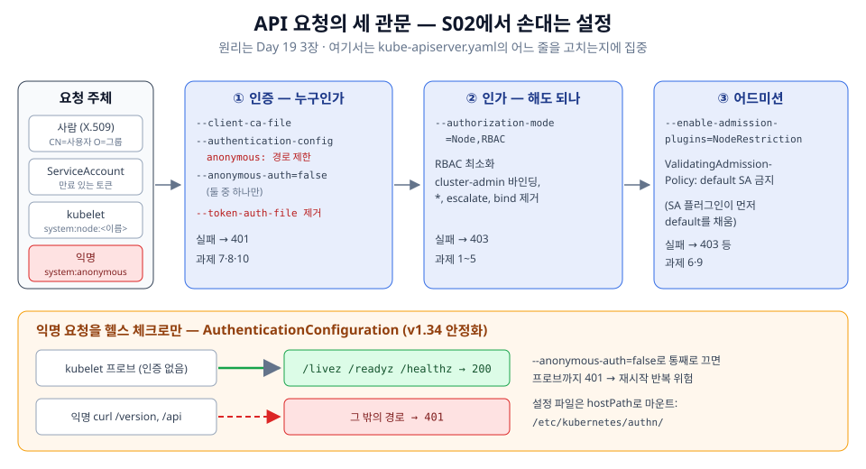
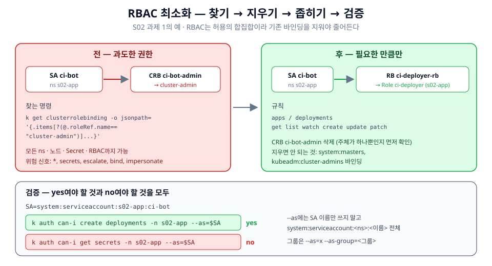

> **자격증 준비 · CKS** | 난이도 ★★★★☆ | 예상 소요 3 ~ 3.5시간

> ⚠️ 이 편의 모든 연습 과제는 CNCF가 공개한 **CKS 공식 커리큘럼(v1.37)을 바탕으로 직접 창작한** 시험 스타일 과제입니다. 실제 시험 문제(유출 문제·덤프)가 아니며, 실제 출제 내용과 무관합니다.

## 🎯 오늘의 목표

- 클러스터에서 **`cluster-admin` 바인딩, 와일드카드 규칙, 위험한 동사(`escalate`·`bind`·`impersonate`)** 를 명령 몇 줄로 찾아낸다
- 과도한 권한을 **필요한 verbs·resources만 남긴 Role**로 바꾸고 `auth can-i`로 "되는 것·안 되는 것"을 모두 검증한다
- ServiceAccount 토큰 자동 마운트를 끄고, **기본 ServiceAccount 사용을 ValidatingAdmissionPolicy로 막는다**
- API 서버의 **익명 접근을 헬스 체크 경로로만 제한**하고, **NodeRestriction**이 켜져 있는지 확인·복구한다
- **인증서 기반 사용자**를 만들어 독립된 kubeconfig로 최소 권한 접속을 구성한다

---

## 1. 커리큘럼 항목 요약 — Cluster Hardening (15%)

| 커리큘럼 항목 | 이 편의 섹션 · 과제 | 이론 참조 |
|---|---|---|
| Use Role Based Access Controls to minimize exposure | 3-1, 과제 1~4 | [Day 19](../../02-kubernetes/day19-rbac-namespace.md) 4장, [K02](../cka/k02-rbac-helm-kustomize-crd.md) 3장 |
| Exercise caution in using service accounts e.g. disable defaults, minimize permissions on newly created ones | 3-2, 과제 5~7 | [Day 69](../../09-security/day69-k8s-workload-security.md) 8장, Day 19 6-4 |
| Restrict access to Kubernetes API | 3-3, 과제 8~10 | Day 19 3장(인증·인가·어드미션)·6-5(X.509 사용자), [Day 73](../../09-security/day73-keycloak-sso-audit.md)(OIDC) |
| Upgrade Kubernetes to avoid vulnerabilities | 4장 (링크) | [K01](../cka/k01-cluster-install-upgrade-etcd.md) 4장 |

> 💡 Role·ClusterRole·바인딩 네 가지 조합과 명령형 생성은 **K02 3장**, "API 요청은 인증 → 인가 → 어드미션 세 관문을 지난다"는 그림과 CSR로 사용자를 만드는 원리는 **Day 19**, 토큰 자동 마운트를 끄는 이유는 **Day 69 8장**에 있습니다. 이 편은 그것을 **"이미 망가진 클러스터에서 찾아 고치는"** 시험 과제 형식으로만 다룹니다.

**실습 환경:** [S00](./s00-exam-overview-lab.md) 6-1의 고정값. context **`cka-main`**(kubeadm v1.37.1), 노드 작업은 `ssh <노드>` → `sudo -i`, 작업 폴더 `~/cks/s02/`. 스냅샷 **`cks-clean`** 에서 시작합니다.

```powershell
# Windows PowerShell
cd C:\lab\k8s; vagrant halt; vagrant snapshot restore cks-clean --no-provision; vagrant up
```

```bash
# base(WSL2)
k config use-context cka-main && k get nodes
mkdir -p ~/cks/s02 && cd ~/cks/s02
```

---

## 2. 출제 유형 — 어떻게 채점되는가

| 과제 형태 | 예시 문장(창작) | 채점 포인트 |
|---|---|---|
| **권한 찾기형** | "cluster-admin에 바인딩된 ServiceAccount를 찾아 파일에 적어라" | 파일 내용(형식까지) |
| **권한 축소형** | "SA X가 Deployment 관리만 하도록 권한을 줄여라. 기존 바인딩은 제거" | 과도한 바인딩이 **사라졌는가**, 필요한 권한은 **남았는가**(`can-i` 양쪽) |
| **SA 하드닝형** | "Pod가 SA 토큰을 마운트하지 않게", "전용 SA를 만들어 쓰게" | Pod 스펙의 `serviceAccountName`·`automountServiceAccountToken`, 실제 마운트 여부 |
| **기본 SA 금지형** | "네임스페이스 X에서 default SA를 쓰는 Pod 생성을 막아라" | 정책·바인딩 존재, 실제로 생성이 **거부되는가** |
| **API 서버 플래그형** | "익명 접근을 막아라", "NodeRestriction을 켜라" | 매니페스트 플래그·설정 파일, **API 서버가 다시 뜨는가**, 동작 확인 |
| **사용자·kubeconfig형** | "사용자 Y의 인증서를 발급해 kubeconfig Z를 만들어라" | CSR 승인, kubeconfig로 `auth whoami`, 권한 범위 |

> 💡 RBAC 축소 과제에서 **"새 권한 추가"만 하고 기존 과도한 바인딩을 지우지 않는 것**이 가장 흔한 감점입니다. RBAC는 허용의 합집합이라 `cluster-admin` 바인딩이 남아 있으면 아무리 좁은 Role을 붙여도 소용없습니다.

---

## 3. 핵심 명령·파일 위치 표



### 3-1. RBAC — 과도한 권한 찾기와 줄이기



📖 **시험장에서 찾을 문서:** "Using RBAC Authorization"(`/docs/reference/access-authn-authz/rbac/`) — 특히 *Privilege escalation prevention and bootstrapping*(escalate·bind), *Default roles and role bindings*, *Command-line utilities*. 위험한 권한 목록은 "Role Based Access Control Good Practices"(`/docs/concepts/security/rbac-good-practices/`).

| 찾고 싶은 것 | 명령 |
|---|---|
| cluster-admin에 묶인 주체 | `k get clusterrolebinding -o custom-columns='NAME:.metadata.name,ROLE:.roleRef.name,KIND:.subjects[*].kind,SUBJ:.subjects[*].name,NS:.subjects[*].namespace' \| awk 'NR==1 \|\| $2=="cluster-admin"'` |
| 특정 SA가 쓰이는 모든 바인딩 | `k get rolebinding,clusterrolebinding -A -o wide \| grep <sa이름>` |
| 한 주체의 실제 권한 전체 | `k auth can-i --list -n <ns> --as=system:serviceaccount:<ns>:<sa>` |
| 그룹 권한 흉내 | `k auth can-i get secrets -n <ns> --as=anyone --as-group=<그룹>` |
| 규칙만 뽑아 보기 | `k get clusterrole <이름> -o jsonpath='{range .rules[*]}{.apiGroups} {.resources} {.verbs}{"\n"}{end}'` |
| Role 내용 사람이 읽기 | `k describe clusterrole <이름>` / `k -n <ns> describe role <이름>` |

와일드카드·위험 동사를 한 번에 훑는 반복문(시스템 기본 ClusterRole `system:*`와 `cluster-admin`, `admin`, `edit`는 제외):

```bash
for r in $(k get clusterrole -o name | grep -vE '/(system:|cluster-admin$|admin$|edit$|view$)'); do
  k get $r -o jsonpath='{.metadata.name}{"\t"}{range .rules[*]}{.verbs}{.resources} {end}{"\n"}'
done | grep -E '"\*"|escalate|bind|impersonate|secrets'
```

| 위험 신호 | 왜 위험한가 |
|---|---|
| `verbs: ["*"]`, `resources: ["*"]` | 미래에 생길 리소스까지 모두 허용 |
| `secrets` get/list/watch | 다른 SA의 토큰 Secret·앱 비밀번호 열람 |
| `pods` create (+ 아무 SA 지정 가능) | 같은 ns의 **어떤 SA 권한이든** Pod를 띄워 빌려 쓸 수 있음 |
| `escalate`, `bind` (roles/clusterroles) | 자기보다 큰 권한의 Role을 만들거나 바인딩 가능 |
| `impersonate` (users/groups/serviceaccounts) | `--as=system:admin` 같은 위장 |
| `nodes/proxy`, `pods/exec` | kubelet API·컨테이너 셸 직접 접근 |
| ClusterRoleBinding에 `system:authenticated`·`system:anonymous` | 로그인한 모두(또는 아무나)에게 권한 |

> ⚠️ **kubeadm의 `admin.conf`와 `super-admin.conf`.** kubeadm(v1.29+)의 `/etc/kubernetes/admin.conf` 사용자는 그룹 `kubeadm:cluster-admins`이고 ClusterRoleBinding `kubeadm:cluster-admins`로 cluster-admin을 받습니다. `super-admin.conf`는 RBAC를 우회하는 `system:masters` 그룹이라 **바인딩을 지워도 권한을 뺏을 수 없습니다.** cluster-admin 바인딩 목록에서 이 둘(`cluster-admin` → `system:masters`, `kubeadm:cluster-admins`)은 지우면 안 되는 정상 항목입니다.

### 3-2. ServiceAccount

📖 **시험장에서 찾을 문서:** "Configure Service Accounts for Pods"(`/docs/tasks/configure-pod-container/configure-service-account/`) → *Opt out of API credential automounting*, "Managing Service Accounts", "Service Accounts"(개념), "Validating Admission Policy"(`/docs/reference/access-authn-authz/validating-admission-policy/`).

| 하고 싶은 것 | 명령 / 필드 |
|---|---|
| 전용 SA 생성 | `k -n <ns> create sa <이름>` |
| SA 단위로 자동 마운트 끄기 | `k -n <ns> patch sa <이름> -p '{"automountServiceAccountToken":false}'` |
| Pod 단위 (SA 설정보다 **우선**) | `spec.automountServiceAccountToken: false` |
| Pod에 SA 지정 | `spec.serviceAccountName: <이름>` (`k run`에는 옵션 없음 → `$do` 후 추가, 또는 `k set serviceaccount deploy/<이름> <sa>`) |
| 실제 마운트 확인 | `k exec <pod> -- ls /var/run/secrets/kubernetes.io/serviceaccount` |
| 짧은 수명 토큰 발급 | `k -n <ns> create token <sa> --duration=10m` |
| 오래 사는 토큰 Secret 찾기 | `k get secrets -A --field-selector type=kubernetes.io/service-account-token` |
| 어떤 Pod가 default SA를 쓰나 | `k get pods -A -o jsonpath='{range .items[?(@.spec.serviceAccountName=="default")]}{.metadata.namespace}/{.metadata.name}{"\n"}{end}'` |

> 💡 "기본 SA를 쓰지 마라"를 강제하는 **내장 스위치는 없습니다.** 세 가지를 조합합니다: ① `default` SA의 자동 마운트를 끈다 ② `default` SA에 붙은 바인딩을 없앤다 ③ 정말 막아야 하면 **ValidatingAdmissionPolicy**(v1.30 GA, kubernetes.io 문서에 예시 있음)로 `serviceAccountName == "default"`인 Pod 생성을 거부한다(과제 6).

### 3-3. API 서버 접근 제한 — 플래그와 파일

📖 **시험장에서 찾을 문서:** "Authenticating"(`/docs/reference/access-authn-authz/authentication/`) → *Anonymous requests*·*Anonymous authenticator configuration*·*X509 client certificates*, "Admission Control in Kubernetes" → *NodeRestriction*, "Certificates and Certificate Signing Requests" → *Normal user*, "Controlling Access to the Kubernetes API", "kube-apiserver" 레퍼런스, "Configure Access to Multiple Clusters"(kubeconfig).

| 설정 (`k8s-cp:/etc/kubernetes/manifests/kube-apiserver.yaml`) | kubeadm 기본값 | 하드닝 |
|---|---|---|
| `--authorization-mode` | `Node,RBAC` | 그대로 유지. `AlwaysAllow`가 보이면 즉시 교체 |
| `--enable-admission-plugins` | `NodeRestriction` | **`NodeRestriction` 반드시 포함** (kubelet이 자기 노드·자기 Pod만 수정하도록) |
| `--anonymous-auth` | 설정 안 됨(= 익명 허용) | `false`로 끄거나, **AuthenticationConfiguration으로 헬스 경로만 허용**(과제 8) |
| `--authentication-config` | 없음 | 익명 허용 경로·JWT(OIDC) 설정 파일. **`anonymous`를 이 파일에 쓰면 `--anonymous-auth`는 쓸 수 없음** |
| `--token-auth-file` | 없음 | 있으면 제거(정적 토큰 파일, CIS 1.2.2) |
| `--client-ca-file` | `/etc/kubernetes/pki/ca.crt` | 인증서 사용자 인증의 기준 CA |
| `--kubelet-client-certificate/key` | 설정됨 | API 서버 → kubelet 인증(S01 과제 6과 짝) |

> ⚠️ **`--anonymous-auth=false`와 헬스 체크.** kubeadm의 API 서버 정적 Pod는 kubelet이 `https://<IP>:6443/livez`·`/readyz`로 **인증 없이** 프로브를 보냅니다. 익명 인증을 통째로 끄면 이 요청도 401이 되어, 환경에 따라 API 서버가 프로브 실패로 **재시작을 반복**할 수 있습니다. v1.34부터 안정화된 *Anonymous authenticator configuration*은 이 문제를 위해 생겼습니다 — 익명을 켜 두되 **`/livez`, `/readyz`, `/healthz`만** 허용합니다(과제 8). 과제가 "`--anonymous-auth=false`로 설정하라"고 **명시하면 시키는 대로** 하고, API 서버가 계속 Running인지 1~2분 지켜보세요.

---

## 4. 업그레이드 — 취약점 피하기

커리큘럼의 "Upgrade Kubernetes to avoid vulnerabilities"는 CKA에서 연습한 kubeadm 업그레이드와 **절차가 같습니다.** [K01 4장](../cka/k01-cluster-install-upgrade-etcd.md)을 그대로 따르세요(drain → `kubeadm upgrade plan/apply/node` → kubelet·kubectl 교체 → uncordon). CKS에서 달라지는 것은 **이유**뿐입니다.

- 보안 수정은 **패치 버전**으로 나옵니다. 2026-11-15 현재 `dl.k8s.io/release/stable.txt`는 **v1.37.2**를 가리키고 실습 클러스터는 v1.37.1이므로, 같은 마이너 안의 패치 업그레이드(`kubeadm upgrade apply v1.37.2`)를 K01 절차로 한 번 연습해 볼 수 있습니다.
- 지원이 끝난 마이너(예: v1.34는 2026-10-27 EOL)는 보안 패치를 받지 못합니다. 과제 문장에 "취약점이 있는 버전"이 나오면 **한 마이너씩** 올리는 원칙은 CKA와 같습니다.

📖 문서: "Upgrading kubeadm clusters"(`/docs/tasks/administer-cluster/kubeadm/kubeadm-upgrade/`), "Version Skew Policy"

---

## 5. 시간 절약 팁

- `SA=system:serviceaccount:<ns>:<이름>` 변수를 먼저 만들고 `can-i`를 줄줄이. **"yes여야 할 것 1~2개, no여야 할 것 1~2개"** 를 습관으로.
- 기존 Role을 고칠 때는 `k edit`보다 **지우고 명령형으로 다시 만들기**가 빠를 때가 많습니다: `k -n x delete role r && k -n x create role r --verb=... --resource=...`. 단, 과제가 "이름을 유지"하라면 이름을 그대로.
- 바인딩을 지울 때는 **주체가 여러 개인지** 먼저 확인(`-o yaml`). 다른 주체까지 함께 지우면 감점입니다. 그럴 땐 `k edit`으로 해당 subject만 빼세요.
- API 서버를 고치는 과제가 두 개 이상이면 **매니페스트를 한 번만 열어서** 모두 고치고 재기동을 한 번만 기다립니다.
- kubeconfig는 `k config --kubeconfig=<파일> set-cluster/set-credentials/set-context/use-context` 네 줄. `--embed-certs=true`를 빼먹지 마세요.

## 6. 자주 하는 실수

| 실수 | 결과 | 바로잡기 |
|---|---|---|
| 좁은 Role만 추가하고 `cluster-admin` 바인딩은 그대로 | 권한이 하나도 안 줄어듦 | 기존 바인딩 삭제 후 `can-i`로 **no** 확인 |
| `--as=ci-bot` (SA 이름만) | 사용자 `ci-bot`으로 검사됨 → 엉뚱한 결과 | `--as=system:serviceaccount:<ns>:ci-bot` |
| SA에 `automountServiceAccountToken: false` 했는데 Pod에 `true` | Pod 설정이 이겨서 토큰이 마운트됨 | Pod 스펙 확인. Pod 쪽이 우선 |
| 기존 Pod에 그대로 기대 | 자동 마운트 설정은 **새로 만드는 Pod부터** 적용 | Deployment는 `k rollout restart` |
| ValidatingAdmissionPolicy만 만들고 Binding 안 만듦 | 아무것도 막히지 않음 | **Policy + Binding(`validationActions: [Deny]`)** 둘 다 |
| AuthenticationConfiguration 파일을 컨테이너에 마운트 안 함 | API 서버가 `no such file`로 기동 실패 | `volumes`(hostPath) + `volumeMounts` 추가 |
| `--anonymous-auth`와 `anonymous:` 설정을 동시에 | API 서버 기동 실패 | 둘 중 하나만 |
| `--enable-admission-plugins=` 값을 덮어쓰며 기존 플러그인 삭제 | NodeRestriction 등 소실 | 쉼표로 **추가**만 |
| CSR `signerName` 누락·오타 | 승인해도 인증서 발급 안 됨 | `kubernetes.io/kube-apiserver-client`, `usages: [client auth]` |
| kubeconfig에 인증서 경로만 기록 | 파일을 옮기면 접속 실패 | `--embed-certs=true` |

---

## 7. 창작 연습 과제

> 아래 과제는 모두 **CKS 공식 커리큘럼을 바탕으로 창작한** 연습 문제입니다. `cks-clean` 스냅샷에서 시작하고, 모두 context `cka-main`입니다.

**공통 준비 — 일부러 과도한 권한을 깔아 둔 클러스터.** 내용을 미리 읽지 말고 실행만 하면 시험장처럼 "남이 만든 클러스터"를 받는 연습이 됩니다.

```bash
cd ~/cks/s02
cat > setup.yaml <<'EOF'
apiVersion: v1
kind: Namespace
metadata: { name: s02-app }
---
apiVersion: v1
kind: ServiceAccount
metadata: { name: ci-bot, namespace: s02-app }
---
apiVersion: rbac.authorization.k8s.io/v1
kind: ClusterRoleBinding
metadata: { name: ci-bot-admin }
roleRef: { apiGroup: rbac.authorization.k8s.io, kind: ClusterRole, name: cluster-admin }
subjects: [ { kind: ServiceAccount, name: ci-bot, namespace: s02-app } ]
---
apiVersion: rbac.authorization.k8s.io/v1
kind: Role
metadata: { name: dev-all, namespace: s02-app }
rules:
- { apiGroups: ["*"], resources: ["*"], verbs: ["*"] }
---
apiVersion: rbac.authorization.k8s.io/v1
kind: RoleBinding
metadata: { name: dev-all-rb, namespace: s02-app }
roleRef: { apiGroup: rbac.authorization.k8s.io, kind: Role, name: dev-all }
subjects: [ { kind: User, name: dev1, apiGroup: rbac.authorization.k8s.io } ]
---
apiVersion: rbac.authorization.k8s.io/v1
kind: ClusterRole
metadata: { name: pod-reader }
rules:
- { apiGroups: [""], resources: ["pods", "pods/log", "secrets"], verbs: ["get", "list", "watch"] }
---
apiVersion: rbac.authorization.k8s.io/v1
kind: ClusterRoleBinding
metadata: { name: pod-reader-auditors }
roleRef: { apiGroup: rbac.authorization.k8s.io, kind: ClusterRole, name: pod-reader }
subjects: [ { kind: Group, name: auditors, apiGroup: rbac.authorization.k8s.io } ]
---
apiVersion: rbac.authorization.k8s.io/v1
kind: ClusterRole
metadata: { name: role-helper }
rules:
- { apiGroups: ["rbac.authorization.k8s.io"], resources: ["roles", "rolebindings"], verbs: ["get", "list", "create", "escalate", "bind"] }
---
apiVersion: rbac.authorization.k8s.io/v1
kind: RoleBinding
metadata: { name: default-edit, namespace: s02-app }
roleRef: { apiGroup: rbac.authorization.k8s.io, kind: ClusterRole, name: edit }
subjects: [ { kind: ServiceAccount, name: default, namespace: s02-app } ]
---
apiVersion: v1
kind: Secret
metadata:
  name: ci-bot-token
  namespace: s02-app
  annotations: { kubernetes.io/service-account.name: ci-bot }
type: kubernetes.io/service-account-token
EOF
k apply -f setup.yaml
```

### 과제 1. cluster-admin 바인딩 정리

클러스터에서 ClusterRole `cluster-admin`에 바인딩된 **ServiceAccount**를 모두 찾아 `~/cks/s02/admin-sas.txt`에 `<네임스페이스>/<이름>` 형식으로 한 줄씩 적어라. 그중 `s02-app/ci-bot`의 cluster-admin 권한을 제거하고, 대신 네임스페이스 `s02-app`에서 **Deployment만 get/list/watch/create/update/patch** 할 수 있게 하라(Role `ci-deployer`, RoleBinding `ci-deployer-rb`).

<details>
<summary>풀이·검증</summary>

```bash
k get clusterrolebinding -o jsonpath='{range .items[?(@.roleRef.name=="cluster-admin")]}{.metadata.name}{"\t"}{range .subjects[*]}{.kind}:{.namespace}/{.name} {end}{"\n"}{end}'
```

```
cluster-admin           Group:/system:masters
ci-bot-admin            ServiceAccount:s02-app/ci-bot
kubeadm:cluster-admins  Group:/kubeadm:cluster-admins
```

```bash
k get clusterrolebinding -o jsonpath='{range .items[?(@.roleRef.name=="cluster-admin")]}{range .subjects[?(@.kind=="ServiceAccount")]}{.namespace}/{.name}{"\n"}{end}{end}' \
  > ~/cks/s02/admin-sas.txt
cat ~/cks/s02/admin-sas.txt                      # s02-app/ci-bot

k get clusterrolebinding ci-bot-admin -o jsonpath='{.subjects}{"\n"}'   # 주체가 ci-bot 하나뿐인지 확인
k delete clusterrolebinding ci-bot-admin
k -n s02-app create role ci-deployer --verb=get,list,watch,create,update,patch --resource=deployments
k -n s02-app create rolebinding ci-deployer-rb --role=ci-deployer --serviceaccount=s02-app:ci-bot
```

```bash
SA=system:serviceaccount:s02-app:ci-bot
k auth can-i create deployments -n s02-app --as=$SA      # yes
k auth can-i delete deployments -n s02-app --as=$SA      # no
k auth can-i get secrets -n s02-app --as=$SA             # no
k auth can-i list nodes --as=$SA                         # no
```

> 💡 cluster-admin은 RoleBinding으로도 붙을 수 있습니다(그 네임스페이스 한정). 꼼꼼히 하려면 `k get rolebinding -A -o jsonpath='{range .items[?(@.roleRef.name=="cluster-admin")]}{.metadata.namespace}/{.metadata.name}{"\n"}{end}'`도 확인하세요.

📖 문서: "Using RBAC Authorization" → Default roles and role bindings, kubernetes.io "kubectl Quick Reference"(jsonpath 필터 `?()`)
</details>

### 과제 2. 와일드카드 Role 축소

네임스페이스 `s02-app`의 Role `dev-all`은 모든 것을 허용한다. 이름은 그대로 두고, 사용자 `dev1`이 **pods, services, configmaps에 대해 get/list/watch/create/delete만** 할 수 있도록 규칙을 바꿔라. Secret과 RBAC 리소스에는 접근할 수 없어야 한다.

<details>
<summary>풀이·검증</summary>

```bash
k -n s02-app delete role dev-all
k -n s02-app create role dev-all --verb=get,list,watch,create,delete --resource=pods,services,configmaps
k -n s02-app describe role dev-all
```

RoleBinding `dev-all-rb`은 Role **이름**으로 참조하므로 그대로 둬도 새 Role에 연결됩니다.

```bash
k auth can-i create pods -n s02-app --as=dev1                 # yes
k auth can-i delete configmaps -n s02-app --as=dev1           # yes
k auth can-i get secrets -n s02-app --as=dev1                 # no
k auth can-i create rolebindings -n s02-app --as=dev1         # no
k auth can-i update pods -n s02-app --as=dev1                 # no
k auth can-i create deployments -n s02-app --as=dev1          # no
```

📖 문서: "Using RBAC Authorization" → Role example, Command-line utilities(`kubectl create role`)
</details>

### 과제 3. 감사 그룹의 Secret 권한 제거

그룹 `auditors`는 클러스터 전체에서 Pod와 Pod 로그를 읽어야 하지만 Secret을 읽어서는 안 된다. ClusterRole `pod-reader`를 고쳐라(ClusterRoleBinding은 유지).

<details>
<summary>풀이·검증</summary>

```bash
k get clusterrole pod-reader -o jsonpath='{range .rules[*]}{.resources} {.verbs}{"\n"}{end}'
# ["pods","pods/log","secrets"] ["get","list","watch"]
k edit clusterrole pod-reader          # resources 목록에서 secrets 한 줄 삭제
```

```yaml
rules:
- apiGroups: [""]
  resources: ["pods", "pods/log"]
  verbs: ["get", "list", "watch"]
```

```bash
k auth can-i list pods -A --as=x --as-group=auditors                       # yes
k auth can-i get pods --subresource=log -n kube-system --as=x --as-group=auditors   # yes
k auth can-i get secrets -n kube-system --as=x --as-group=auditors         # no
```

> 💡 그룹 권한은 `--as=<아무 사용자> --as-group=<그룹>`으로 확인합니다. `--as-group`만 쓰면 kubectl이 오류를 냅니다.

📖 문서: "Using RBAC Authorization" → Referring to subjects(그룹), "kubectl auth can-i" 레퍼런스
</details>

### 과제 4. 권한 상승 경로 찾기

`system:`으로 시작하지 않는 ClusterRole 중 기본 제공(`cluster-admin`, `admin`, `edit`, `view`)을 제외하고, 규칙에 **`escalate`, `bind`, `impersonate` 중 하나 또는 `*` 동사**를 가진 것의 이름을 `~/cks/s02/risky-roles.txt`에 적어라. 찾은 ClusterRole에서 `escalate`와 `bind`를 제거하라.

<details>
<summary>풀이·검증</summary>

```bash
for r in $(k get clusterrole -o name | grep -vE '/(system:|cluster-admin$|admin$|edit$|view$)'); do
  v=$(k get $r -o jsonpath='{.rules[*].verbs}')
  echo "$v" | grep -qE '"(\*|escalate|bind|impersonate)"' && echo "${r#*/}"
done | tee ~/cks/s02/risky-roles.txt
```

```
role-helper
```

이 클러스터에는 Cilium·Traefik 같은 애드온의 ClusterRole도 있습니다. 결과에 그런 이름이 함께 나오면 과제 조건(위 네 동사)에 맞는지 눈으로 확인하고, **과제가 고치라고 한 것만** 고치세요.

```bash
k edit clusterrole role-helper        # verbs에서 escalate, bind 삭제
k get clusterrole role-helper -o jsonpath='{.rules[*].verbs}{"\n"}'   # ["get","list","create"]
```

> 💡 `escalate`·`bind`가 없으면 `roles`에 `create` 권한이 있어도 **자기가 가진 것보다 큰 권한**을 담은 Role은 만들 수 없습니다(RBAC의 권한 상승 방지). 이 동작 덕분에 `create`만 남겨도 안전해집니다.

📖 문서: "Using RBAC Authorization" → Privilege escalation prevention and bootstrapping, "Role Based Access Control Good Practices" → Privilege escalation risks
</details>

### 과제 5. 토큰이 필요 없는 워크로드

네임스페이스 `s02-app`에서:
1. ServiceAccount `default`가 앞으로 만들어지는 Pod에 토큰을 자동 마운트하지 않게 하라.
2. ServiceAccount `api-sa`를 만들고, Deployment `api`(이미지 `nginx:1.27`, 레플리카 1)가 이 SA를 쓰되 **Pod 수준에서도** 토큰을 마운트하지 않게 하라.
3. `default` SA에 붙어 있는 RoleBinding을 찾아 제거하라.

<details>
<summary>풀이·검증</summary>

```bash
k -n s02-app patch sa default -p '{"automountServiceAccountToken": false}'
k -n s02-app create sa api-sa
k -n s02-app create deploy api --image=nginx:1.27 $do > api.yaml
vim api.yaml
```

```yaml
# api.yaml — template.spec 아래에 두 줄
    spec:
      serviceAccountName: api-sa
      automountServiceAccountToken: false
      containers:
      - image: nginx:1.27
        name: nginx
```

```bash
k apply -f api.yaml
k get rolebinding -n s02-app -o jsonpath='{range .items[*]}{.metadata.name}{"\t"}{.subjects[*].name}{"\n"}{end}'
# default-edit   default
k -n s02-app delete rolebinding default-edit
```

```bash
k -n s02-app rollout status deploy/api
k -n s02-app exec deploy/api -- ls /var/run/secrets/kubernetes.io/serviceaccount
# ls: cannot access '/var/run/secrets/kubernetes.io/serviceaccount': No such file or directory
k -n s02-app get pod -l app=api -o jsonpath='{.items[0].spec.serviceAccountName} {.items[0].spec.automountServiceAccountToken}{"\n"}'
# api-sa false
k auth can-i list pods -n s02-app --as=system:serviceaccount:s02-app:default     # no
```

📖 문서: "Configure Service Accounts for Pods" → Opt out of API credential automounting
</details>

### 과제 6. 기본 ServiceAccount 사용 금지

네임스페이스 `s02-app`에서 **`default` ServiceAccount를 쓰는 Pod의 생성을 거부**하라. ValidatingAdmissionPolicy `deny-default-sa`와 ValidatingAdmissionPolicyBinding `deny-default-sa-s02`를 쓰고, 정책은 네임스페이스 라벨 `kubernetes.io/metadata.name=s02-app`으로만 적용한다. 과제 5의 `api` Deployment는 계속 동작해야 한다.

<details>
<summary>풀이·검증</summary>

```yaml
# ~/cks/s02/vap.yaml — 문서의 예시 구조를 복사해 expression만 바꾼 형태
apiVersion: admissionregistration.k8s.io/v1
kind: ValidatingAdmissionPolicy
metadata:
  name: deny-default-sa
spec:
  failurePolicy: Fail
  matchConstraints:
    resourceRules:
    - apiGroups: [""]
      apiVersions: ["v1"]
      operations: ["CREATE"]
      resources: ["pods"]
  validations:
  - expression: "has(object.spec.serviceAccountName) && object.spec.serviceAccountName != 'default'"
    message: "default ServiceAccount is not allowed in this namespace"
---
apiVersion: admissionregistration.k8s.io/v1
kind: ValidatingAdmissionPolicyBinding
metadata:
  name: deny-default-sa-s02
spec:
  policyName: deny-default-sa
  validationActions: [Deny]
  matchResources:
    namespaceSelector:
      matchLabels:
        kubernetes.io/metadata.name: s02-app
```

```bash
k apply -f vap.yaml
k -n s02-app run t1 --image=busybox:1.37 -- sleep 60
# Error from server (Forbidden): pods "t1" is forbidden: ValidatingAdmissionPolicy 'deny-default-sa' with binding
# 'deny-default-sa-s02' denied request: default ServiceAccount is not allowed in this namespace
k -n s02-app run t2 --image=busybox:1.37 --overrides='{"spec":{"serviceAccountName":"api-sa"}}' -- sleep 60   # 생성됨
k run t3 --image=busybox:1.37 -- sleep 60          # default 네임스페이스는 영향 없음 → 생성됨
k -n s02-app rollout restart deploy/api && k -n s02-app rollout status deploy/api   # api-sa라 통과
k delete pod t3 --force --grace-period=0; k -n s02-app delete pod t2 --force --grace-period=0
```

> 💡 `serviceAccountName`을 비워 둔 Pod도 막힙니다. 어드미션 순서상 **ServiceAccount 어드미션 플러그인(변경 단계)이 먼저 `default`를 채운 뒤** 검증 단계에서 정책이 평가되기 때문입니다. Deployment가 막히면 Deployment 자체는 만들어지고 **ReplicaSet 이벤트에 `FailedCreate`** 가 남습니다(`k -n s02-app describe rs`).

📖 문서: "Validating Admission Policy"(Getting Started 예시의 Policy·Binding 구조), "Common Expression Language in Kubernetes"
</details>

### 과제 7. 오래 사는 SA 토큰 정리

클러스터 전체에서 타입이 `kubernetes.io/service-account-token`인 Secret을 찾아 `~/cks/s02/legacy-tokens.txt`에 `<네임스페이스>/<이름>`으로 적고, `s02-app`에 있는 것을 삭제하라. 그 뒤 `ci-bot`이 CI에서 쓸 **유효기간 10분짜리** 토큰을 발급해 `~/cks/s02/ci-bot.token`에 저장하라.

<details>
<summary>풀이·검증</summary>

```bash
k get secrets -A --field-selector type=kubernetes.io/service-account-token \
  -o jsonpath='{range .items[*]}{.metadata.namespace}/{.metadata.name}{"\n"}{end}' | tee ~/cks/s02/legacy-tokens.txt
# s02-app/ci-bot-token
k -n s02-app delete secret ci-bot-token
k -n s02-app create token ci-bot --duration=10m > ~/cks/s02/ci-bot.token
```

```bash
TOKEN=$(cat ~/cks/s02/ci-bot.token)
# 현재 kubeconfig의 관리자 인증서가 함께 전송되지 않게, 빈 kubeconfig로 토큰만 사용
kt() { kubectl --kubeconfig=/dev/null --server=https://192.168.56.10:6443 --insecure-skip-tls-verify --token="$TOKEN" "$@"; }
kt auth whoami | grep Username                             # system:serviceaccount:s02-app:ci-bot
kt -n s02-app get deploy                                   # 과제 1의 권한으로 성공
kt -n s02-app get secrets                                  # Forbidden
cut -d. -f2 ~/cks/s02/ci-bot.token | tr '_-' '/+' | base64 -d 2>/dev/null | grep -o '"exp":[0-9]*'   # 만료 시각(epoch)
```

> 💡 `kubernetes.io/service-account-token` Secret은 **만료가 없는** 옛 방식 토큰입니다(v1.24부터 자동 생성 안 함). `kubectl create token`(TokenRequest API)은 만료와 대상(audience)이 있는 토큰을 줍니다. 위 `base64 -d`는 패딩 때문에 경고가 날 수 있어 `2>/dev/null`로 숨겼습니다.

📖 문서: "Managing Service Accounts" → Manually create a long-lived API token / Delete a ServiceAccount token, "kubectl create token" 레퍼런스
</details>

### 과제 8. 익명 접근을 헬스 체크로만

`k8s-cp`의 API 서버는 현재 익명 요청을 받아 `/version` 같은 정보를 인증 없이 보여 준다. AuthenticationConfiguration 파일 `/etc/kubernetes/authn/authn-config.yaml`을 만들어 **익명 요청은 `/livez`, `/readyz`, `/healthz`에만** 허용하고 API 서버가 이 파일을 쓰게 하라. API 서버는 정상 동작해야 한다.

<details>
<summary>풀이·검증</summary>

변경 전 확인(base에서):

```bash
curl -sk -o /dev/null -w '%{http_code}\n' https://192.168.56.10:6443/version     # 200 (익명으로 보임)
curl -sk https://192.168.56.10:6443/livez; echo                                   # ok
```

```bash
ssh k8s-cp
sudo -i
grep -n anonymous-auth /etc/kubernetes/manifests/kube-apiserver.yaml   # 있으면 그 줄을 지워야 함(동시 사용 불가)
mkdir -p /etc/kubernetes/authn
cat > /etc/kubernetes/authn/authn-config.yaml <<'EOF'
apiVersion: apiserver.config.k8s.io/v1
kind: AuthenticationConfiguration
anonymous:
  enabled: true
  conditions:
  - path: /livez
  - path: /readyz
  - path: /healthz
EOF
cp /etc/kubernetes/manifests/kube-apiserver.yaml /root/kube-apiserver.yaml.bak
vim /etc/kubernetes/manifests/kube-apiserver.yaml
```

세 곳을 고칩니다 — 플래그, volumeMounts, volumes.

```yaml
spec:
  containers:
  - command:
    - kube-apiserver
    - --authentication-config=/etc/kubernetes/authn/authn-config.yaml   # ① 추가
    ...
    volumeMounts:
    - mountPath: /etc/kubernetes/authn                                    # ② 추가
      name: authn
      readOnly: true
    ...
  volumes:
  - hostPath:                                                             # ③ 추가
      path: /etc/kubernetes/authn
      type: DirectoryOrCreate
    name: authn
```

```bash
watch -n2 'crictl ps --name kube-apiserver'          # 새 컨테이너 Running
exit; exit
```

```bash
# base에서
curl -sk -o /dev/null -w '%{http_code}\n' https://192.168.56.10:6443/version     # 401
curl -sk -o /dev/null -w '%{http_code}\n' https://192.168.56.10:6443/api         # 401
curl -sk https://192.168.56.10:6443/livez; echo                                   # ok
k get nodes                                                                        # 인증서 사용자는 정상
k -n kube-system get pod -l component=kube-apiserver                              # RESTARTS가 계속 늘지 않음
```

> 💡 kubeadm의 API 서버 Pod는 `/etc/kubernetes/pki`만 마운트하고 `/etc/kubernetes` 전체는 마운트하지 않습니다. 설정 파일을 새 폴더에 두고 **hostPath로 따로 마운트**하는 이 패턴은 S04(EncryptionConfiguration), S06(감사 정책)에서도 그대로 다시 씁니다.

📖 문서: "Authenticating" → Anonymous requests / Anonymous authenticator configuration(예시 YAML), "kube-apiserver" 레퍼런스(`--authentication-config`)
</details>

### 과제 9. NodeRestriction 복구

준비(누군가 플러그인 목록을 망가뜨린 상황 흉내):

```bash
ssh k8s-cp "sudo sed -i 's/--enable-admission-plugins=NodeRestriction/--enable-admission-plugins=NamespaceLifecycle/' /etc/kubernetes/manifests/kube-apiserver.yaml"
sleep 60; k get nodes
```

`k8s-w1`의 kubelet 자격 증명(`/etc/kubernetes/kubelet.conf`)으로 **다른 노드 `k8s-w2`에 라벨을 붙일 수 있는** 상태다. API 서버를 고쳐 kubelet이 **자기 노드만** 수정할 수 있게 하라. 확인은 `k8s-w1`에서 kubelet 자격 증명으로 한다.

<details>
<summary>풀이·검증</summary>

먼저 문제를 눈으로 확인합니다.

```bash
ssh k8s-w1 'sudo kubectl --kubeconfig /etc/kubernetes/kubelet.conf label node k8s-w2 hacked=yes'
# node/k8s-w2 labeled   ← 다른 노드를 수정할 수 있음
k label node k8s-w2 hacked-            # 원상복구
```

```bash
ssh k8s-cp
sudo -i
grep -n enable-admission-plugins /etc/kubernetes/manifests/kube-apiserver.yaml
# - --enable-admission-plugins=NamespaceLifecycle
cp /etc/kubernetes/manifests/kube-apiserver.yaml /root/kube-apiserver.yaml.bak2
sed -i 's/--enable-admission-plugins=NamespaceLifecycle/--enable-admission-plugins=NodeRestriction/' \
  /etc/kubernetes/manifests/kube-apiserver.yaml
watch -n2 'crictl ps --name kube-apiserver'
exit; exit
```

> 💡 `NamespaceLifecycle`은 **기본으로 켜지는** 플러그인이라 목록에서 빼도 꺼지지 않습니다. kubeadm처럼 `NodeRestriction` 하나만 적어 두면 충분합니다. 다른 플러그인이 함께 있었다면 쉼표로 이어 `...,NodeRestriction`처럼 **추가**만 하세요.

```bash
ssh k8s-w1 'sudo kubectl --kubeconfig /etc/kubernetes/kubelet.conf label node k8s-w2 hacked=yes'
# Error from server (Forbidden): nodes "k8s-w2" is forbidden: node "k8s-w1" is not allowed to modify node "k8s-w2"
ssh k8s-w1 'sudo kubectl --kubeconfig /etc/kubernetes/kubelet.conf label node k8s-w1 node-restriction.kubernetes.io/zone=a'
# Forbidden ... is not allowed to modify labels: node-restriction.kubernetes.io/zone
ssh k8s-cp 'sudo grep -o "enable-admission-plugins=[^ ]*" /etc/kubernetes/manifests/kube-apiserver.yaml'
```

`node-restriction.kubernetes.io/` 접두사 라벨은 kubelet이 스스로 붙일 수 없어서, "이 노드는 격리 구역" 같은 표시를 **노드가 위조할 수 없게** 하는 데 씁니다.

📖 문서: "Admission Control in Kubernetes" → NodeRestriction, "Using Node Authorization"
</details>

### 과제 10. 인증서 사용자와 독립 kubeconfig

사용자 `auditor`(그룹 `s02-auditors`)를 X.509 클라이언트 인증서로 만들어라. 개인키·인증서는 `~/cks/s02/auditor.key`, `~/cks/s02/auditor.crt`, CSR 오브젝트 이름은 `auditor`, 유효기간은 1일. 인증서를 **내장한** kubeconfig `~/cks/s02/auditor.kubeconfig`(cluster 이름 `cka-main`, server `https://192.168.56.10:6443`, context 이름 `auditor@cka-main`)를 만들고, 그룹 `s02-auditors`가 `s02-app` 네임스페이스에서 기본 ClusterRole `view` 권한만 갖게 하라(RoleBinding `auditors-view`).

<details>
<summary>풀이·검증</summary>

CSR로 서명받는 원리는 Day 19 6-5와 같습니다. 시험 속도로 이어 칩니다.

```bash
cd ~/cks/s02
openssl genrsa -out auditor.key 2048
openssl req -new -key auditor.key -out auditor.csr -subj "/CN=auditor/O=s02-auditors"
cat <<EOF | k apply -f -
apiVersion: certificates.k8s.io/v1
kind: CertificateSigningRequest
metadata:
  name: auditor
spec:
  request: $(base64 -w0 < auditor.csr)
  signerName: kubernetes.io/kube-apiserver-client
  expirationSeconds: 86400
  usages: ["client auth"]
EOF
k certificate approve auditor
k get csr auditor -o jsonpath='{.status.certificate}' | base64 -d > auditor.crt
openssl x509 -in auditor.crt -noout -subject -enddate      # subject=CN = auditor, O = s02-auditors
```

kubeconfig — 클러스터 CA는 지금 쓰는 kubeconfig에서 꺼냅니다.

```bash
k config view --raw --minify --context cka-main -o jsonpath='{.clusters[0].cluster.certificate-authority-data}' | base64 -d > ca.crt
KC=~/cks/s02/auditor.kubeconfig
k config --kubeconfig=$KC set-cluster cka-main --server=https://192.168.56.10:6443 --certificate-authority=ca.crt --embed-certs=true
k config --kubeconfig=$KC set-credentials auditor --client-certificate=auditor.crt --client-key=auditor.key --embed-certs=true
k config --kubeconfig=$KC set-context auditor@cka-main --cluster=cka-main --user=auditor --namespace=s02-app
k config --kubeconfig=$KC use-context auditor@cka-main
k -n s02-app create rolebinding auditors-view --clusterrole=view --group=s02-auditors
```

```bash
k --kubeconfig=$KC auth whoami                 # Username auditor, Groups [s02-auditors system:authenticated]
k --kubeconfig=$KC get pods                    # 성공 (s02-app)
k --kubeconfig=$KC get secrets                 # Forbidden (view에는 secrets 없음)
k --kubeconfig=$KC get pods -n kube-system     # Forbidden
grep -c 'client-certificate-data' $KC          # 1  (경로가 아니라 내장)
```

> ⚠️ 쿠버네티스는 클라이언트 인증서를 **폐기(revoke)할 수 없습니다.** 그래서 `expirationSeconds`를 짧게 두고, 권한은 사용자 이름보다 **그룹에 바인딩**해 그룹 바인딩을 지우는 것으로 회수합니다(Day 19 6-5).

📖 문서: "Certificates and Certificate Signing Requests" → Normal user(openssl → CSR → approve → kubeconfig 전 과정), "Configure Access to Multiple Clusters"
</details>

정리:

```powershell
cd C:\lab\k8s; vagrant halt; vagrant snapshot restore cks-clean --no-provision; vagrant up
```

```bash
k delete csr auditor 2>/dev/null; rm -f ~/cks/s02/*.key ~/cks/s02/*.token
```

---

## 8. 핵심 정리

- RBAC 축소의 순서: **찾기**(cluster-admin 바인딩, `*`·`escalate`·`bind`·`impersonate`·`secrets`) → **기존 바인딩 삭제** → **좁은 Role 생성** → `can-i`로 yes·no 모두 검증
- kubeadm의 `cluster-admin`→`system:masters`, `kubeadm:cluster-admins` 바인딩은 정상 항목. `super-admin.conf`는 RBAC로 막을 수 없으니 배포 금지
- SA: `automountServiceAccountToken: false`(SA·Pod, **Pod가 우선**), 전용 SA, `default` SA 바인딩 제거, 필요하면 **ValidatingAdmissionPolicy + Binding**으로 default SA Pod 거부
- 오래 사는 토큰은 `--field-selector type=kubernetes.io/service-account-token`으로 찾아 지우고, `kubectl create token --duration`으로 짧은 토큰 발급
- API 서버: `--authorization-mode=Node,RBAC`, `--enable-admission-plugins`에 **NodeRestriction**, 익명은 **AuthenticationConfiguration으로 `/livez`·`/readyz`·`/healthz`만**(이 경우 `--anonymous-auth` 동시 사용 불가). 설정 파일은 **hostPath로 마운트**
- 사람 사용자는 openssl → CSR(`kubernetes.io/kube-apiserver-client`) → approve → `--embed-certs=true` kubeconfig, 권한은 **그룹**에
- 업그레이드는 [K01](../cka/k01-cluster-install-upgrade-etcd.md) 절차 그대로, 보안 패치는 같은 마이너의 패치 버전으로

---

## ⏭️ 다음 예고 — S03. 시스템 하드닝

이제 쿠버네티스 밖, **노드 자체**로 내려갑니다. 노드에서 듣고 있는 포트를 프로세스·서비스·패키지까지 거슬러 올라가 끄고 지우는 과제, **AppArmor 프로파일을 `apparmor_parser`로 적재해 Pod에 적용**하는 과제, seccomp `RuntimeDefault`와 `Localhost` 프로파일, 커널 모듈과 노드 계정으로 공격 표면을 줄이는 과제를 S00에서 설치한 AppArmor 유틸과 함께 풉니다.
