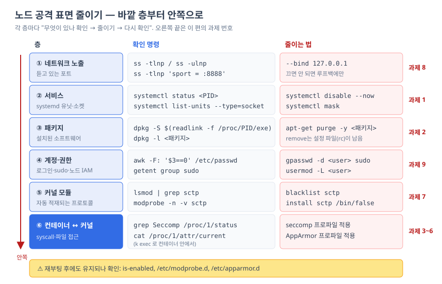
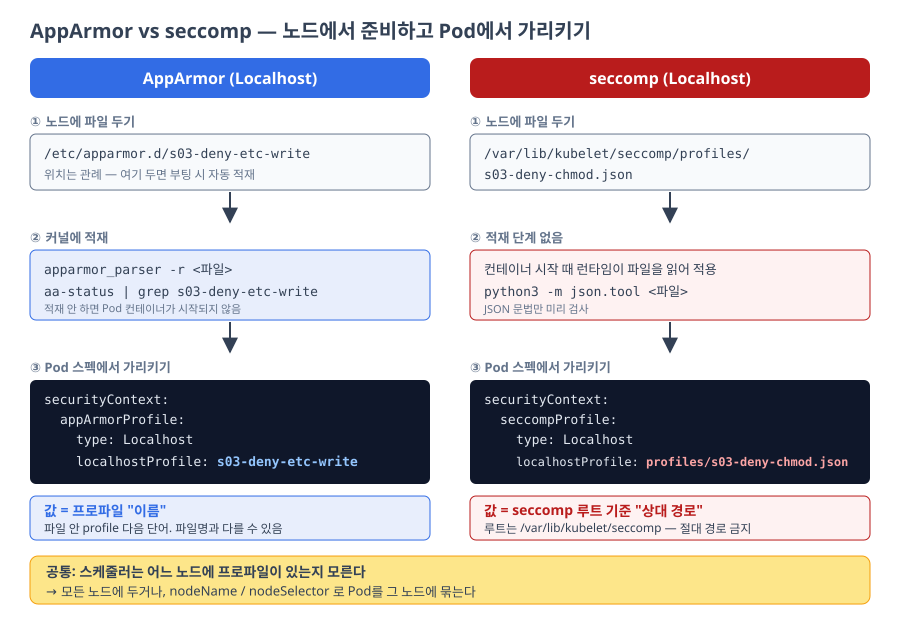

> **자격증 준비 · CKS** | 난이도 ★★★★☆ | 예상 소요 3 ~ 3.5시간

> ⚠️ 이 편의 모든 연습 과제는 CNCF가 공개한 **CKS 공식 커리큘럼(github.com/cncf/curriculum)을 바탕으로 직접 창작한** 시험 스타일 과제입니다. 실제 시험 문제(유출 문제·덤프)가 아니며 실제 출제 내용과 무관합니다.

## 🎯 오늘의 목표

- 노드에서 **듣고 있는 포트 → 프로세스 → systemd 유닛 → 패키지**를 3분 안에 거슬러 올라가 끄고 지울 수 있다
- AppArmor 프로파일을 노드에 **`apparmor_parser`로 적재**하고, Pod에 **`securityContext.appArmorProfile`** 필드로 적용·검증할 수 있다
- seccomp **`RuntimeDefault`** 와 **`Localhost`**(`/var/lib/kubelet/seccomp/` 기준 상대 경로)를 구분해서 쓸 수 있다
- 커널 모듈 자동 적재를 막고, 노드 계정·메타데이터 API 같은 **"노드가 가진 권한"** 을 줄이는 방법을 설명할 수 있다

---

## 1. 커리큘럼 항목 요약 — System Hardening (10%)

2026-11-15 기준 Linux Foundation CKS 페이지와 cncf/curriculum의 `CKS_Curriculum v1.37.pdf`에 실린 도메인입니다. 비중은 10%로 가장 작지만, AppArmor·seccomp는 **S04(PSA restricted)와 S06(런타임 보안) 과제 안에도 섞여 나오는** 기초 체력입니다.

| 커리큘럼 항목 (요지) | 이 편의 섹션 | 본편 이론 |
|---|---|---|
| 호스트 OS 사용 흔적 최소화(공격 표면 줄이기) | 3-1, 과제 1·2 | [Day 67](../../09-security/day67-host-hardening.md) |
| 최소 권한 신원·접근 관리(IAM) | 3-5, 과제 9 | Day 67 4장(sudo), [CKS S02](./s02-cluster-hardening.md) |
| 외부 네트워크 접근 최소화 | 3-1, 과제 8 | Day 67 5장(nftables) |
| AppArmor·seccomp 같은 커널 하드닝 도구를 알맞게 쓰기 | 3-2·3-3, 과제 3~7 | [Day 68](../../09-security/day68-container-runtime-security.md) 6·7장, [Day 69](../../09-security/day69-k8s-workload-security.md) 4장 |

> 💡 **이론은 본편에 맡깁니다.** sshd·sudo·nftables·Lynis는 Day 67, seccomp 프로파일 구조와 AppArmor 문법은 Day 68, restricted를 통과하는 securityContext 세트는 Day 69를 보세요. 이 편은 같은 도구를 **"노드에 ssh → 고치기 → Pod로 검증"** 하는 시험 과제 형식으로만 다룹니다.

### 실습 환경

[CKA K00](../cka/k00-exam-overview-lab.md)의 고정값을 그대로 씁니다. context **`cka-main`**(kubeadm v1.37.1, `k8s-cp` 192.168.56.10 / `k8s-w1` .11 / `k8s-w2` .12, Ubuntu 24.04, containerd, Cilium), 노드 작업은 `ssh <노드>` → `sudo -i`, 작업 폴더 `~/cks/`. 시작 전에 S00에서 찍은 스냅샷 **`cks-clean`** 으로 되돌립니다.

```powershell
# Windows PowerShell
cd C:\lab\k8s
vagrant halt
vagrant snapshot restore cks-clean --no-provision
vagrant up
```

```bash
# base(WSL2) 터미널
k config use-context cka-main && k get nodes
mkdir -p ~/cks/s03 && cd ~/cks/s03
```

과제용 "지저분한 노드"를 만드는 준비 스크립트입니다. base에서 한 번 실행합니다. (실제 시험 환경은 이미 이런 상태로 주어진다고 가정하는 것입니다.)

```bash
# ~/cks/s03/setup.sh — base에서 bash setup.sh
set -e
# k8s-w1: 오래된 리포트 서비스(8888), FTP 패키지, sudo 권한이 남은 퇴사자 계정
ssh k8s-w1 'sudo bash -s' <<'EOF'
cat > /etc/systemd/system/legacy-report.service <<'U'
[Unit]
Description=Legacy report viewer (lab decoy)
[Service]
ExecStart=/usr/bin/python3 -m http.server 8888 --directory /var/tmp
Restart=always
[Install]
WantedBy=multi-user.target
U
systemctl daemon-reload && systemctl enable --now legacy-report
DEBIAN_FRONTEND=noninteractive apt-get install -y vsftpd >/dev/null
id olduser >/dev/null 2>&1 || useradd -m -s /bin/bash -G sudo olduser
mkdir -p /root/cks/s03
EOF
# k8s-w2: 모든 인터페이스에 열린 메트릭 서비스(9100)
ssh k8s-w2 'sudo bash -s' <<'EOF'
cat > /etc/systemd/system/node-metrics.service <<'U'
[Unit]
Description=Node metrics (lab decoy)
[Service]
ExecStart=/usr/bin/python3 -m http.server 9100 --bind 0.0.0.0 --directory /var/tmp
Restart=always
[Install]
WantedBy=multi-user.target
U
systemctl daemon-reload && systemctl enable --now node-metrics
mkdir -p /root/cks/s03
EOF
echo "setup done"
```

---

## 2. 출제 유형

System Hardening 과제는 대부분 **노드 하나를 지정해 주고 ssh로 들어가 고치는** 형태입니다. 채점은 결과 상태(서비스가 꺼졌나, 프로파일이 적재됐나, Pod가 Running이고 프로파일이 붙었나)로 합니다.

| 유형 | 과제 문장의 모습 | 채점 포인트 |
|---|---|---|
| 서비스·포트 정리 | "노드 X에서 포트 N을 듣는 서비스를 중지하고 재부팅 후에도 시작되지 않게 하라" | `is-active`=inactive **그리고** `is-enabled`=disabled, 포트 미청취 |
| 패키지 제거 | "불필요한 패키지 P를 제거하라" | `dpkg -l`에 `ii` 상태가 없음 |
| AppArmor | "주어진 프로파일을 노드에 적재하고 Pod/Deployment에 적용하라" | 노드의 `aa-status`에 enforce, Pod Running, `/proc/1/attr/current` |
| seccomp | "RuntimeDefault를 적용하라" / "노드의 프로파일 파일을 Localhost로 적용하라" | Pod 스펙의 `seccompProfile`, 컨테이너 안 `Seccomp: 2` |
| 커널 모듈 | "모듈 M이 적재되지 않게 하라" | `/etc/modprobe.d/` 설정, `lsmod`에 없음 |
| 계정·권한 | "불필요한 계정의 관리자 권한을 회수하라" | 그룹 소속, 계정 잠금 |

> ⚠️ **AppArmor·seccomp 과제는 "노드 쪽"과 "Pod 쪽" 두 군데를 모두 맞춰야 점수**입니다. 프로파일을 적재만 하고 Pod를 안 고치거나, Pod만 고치고 다른 노드에 스케줄되면 0점입니다.

---

## 3. 핵심 명령·파일 위치



### 3-1. 호스트 최소화 — 포트에서 패키지까지 거슬러 올라가기

| 질문 | 명령 |
|---|---|
| 무엇이 듣고 있나 | `ss -tlnp` (TCP) / `ss -ulnp` (UDP) / `ss -tlnp 'sport = :8888'` |
| 그 PID의 유닛은 | `systemctl status <PID>` 또는 `ps -o unit= -p <PID>` |
| 실행 파일·패키지는 | `readlink -f /proc/<PID>/exe` → `dpkg -S <경로>` |
| 끄기 + 부팅 시 안 켜기 | `systemctl disable --now <유닛>` |
| 다른 유닛이 다시 켜지 못하게 | `systemctl mask <유닛>` (`/dev/null` 링크) |
| 상태 확인 | `systemctl is-active <유닛>; systemctl is-enabled <유닛>` |
| 패키지 제거 | `apt-get purge -y <패키지>` → `dpkg -l <패키지>` |
| 켜진 서비스 목록 | `systemctl list-units --type=service --state=running` |
| 소켓 활성화 유닛 | `systemctl list-units --type=socket` (`*.socket`이 포트를 대신 열고 있을 수 있음) |

쿠버네티스 노드에서 **열려 있는 게 정상인 포트**를 알아야 무엇을 꺼도 되는지 판단할 수 있습니다. kubernetes.io의 *Ports and Protocols* 페이지 기준입니다.

| 노드 | 포트 | 주인 |
|---|---|---|
| control plane | 6443 | kube-apiserver |
| control plane | 2379-2380 | etcd |
| control plane | 10257 / 10259 | kube-controller-manager / kube-scheduler (127.0.0.1) |
| 모든 노드 | 10250 | kubelet API |
| 모든 노드 | 10256 | kube-proxy (healthz) |
| worker | 30000-32767 | NodePort Service |
| (우리 환경) | 22, 4240, 8472/udp 등 | sshd, Cilium 헬스체크·VXLAN |

> 💡 `ss -tlnp`의 `Local Address`가 **`127.0.0.1:` / `[::1]:`** 이면 노드 밖에서는 못 들어옵니다. 과제가 "외부 노출을 없애라"인데 서비스를 꼭 남겨야 한다면, 끄는 대신 **바인드 주소를 127.0.0.1로** 바꾸는 것이 답일 수 있습니다(과제 8).

### 3-2. AppArmor — 노드에 적재하고, Pod에는 이름으로



| 작업 | 명령·위치 |
|---|---|
| 커널 모듈 켜짐 확인 | `cat /sys/module/apparmor/parameters/enabled` → `Y` |
| 프로파일 파일 위치(관례) | `/etc/apparmor.d/<파일>` — 이 위치면 부팅 시 자동 적재 |
| 적재·교체 | `apparmor_parser -r <파일>` (`-r` 이미 있으면 교체, `-q` 조용히, `-W` 캐시 기록) |
| 제거 | `apparmor_parser -R <파일>` |
| 적재 확인 | `aa-status \| grep <이름>` 또는 `grep <이름> /sys/kernel/security/apparmor/profiles` |
| 프로파일 **이름** 찾기 | 파일 안 `profile <이름> flags=(...) {` 줄. **파일명과 다를 수 있음** |
| 컨테이너 안 확인 | `k exec <pod> -- cat /proc/1/attr/current` → `<이름> (enforce)` |

v1.37에서 Pod에 적용하는 방법은 **필드 하나**입니다.

```yaml
spec:
  securityContext:            # Pod 수준: 모든 컨테이너 기본값
    appArmorProfile:
      type: Localhost         # RuntimeDefault | Localhost | Unconfined
      localhostProfile: s03-deny-etc-write   # type이 Localhost일 때만, 프로파일 "이름"
  containers:
  - name: app
    securityContext:          # 컨테이너 수준: Pod 수준보다 우선
      appArmorProfile:
        type: RuntimeDefault
```

| 방식 | 상태 (v1.37 기준, 2026-11-15 확인) |
|---|---|
| `securityContext.appArmorProfile` 필드 | **현재 방식.** v1.30에 추가, AppArmor 지원은 v1.31에 GA(기능 게이트 제거) |
| `container.apparmor.security.beta.kubernetes.io/<컨테이너>` 어노테이션 | **v1.30부터 deprecated.** 어노테이션만 쓰면 생성 시 경고. KEP-24 계획상 API 서버의 어노테이션↔필드 자동 복사도 단계적으로 중단(v1.34·v1.36 단계)되므로 **새로 쓰지 말고 필드로 옮길 것** |

> ⚠️ 시험이나 오래된 블로그의 매니페스트에 어노테이션이 남아 있으면 **필드로 옮기는 것이 정답**입니다. 둘 다 쓰면 값이 반드시 같아야 하고, 다르면 API 서버가 거부합니다. 공식 튜토리얼(*Restrict a Container's Access to Resources with AppArmor*)도 v1.30 이전 방식은 "문서 버전 선택기로 옛 버전을 보라"고만 안내합니다.

### 3-3. seccomp — RuntimeDefault와 Localhost

| 항목 | 내용 |
|---|---|
| `type: RuntimeDefault` | containerd 기본 프로파일. 가장 흔한 과제. PSS restricted의 필수 조건(S04) |
| `type: Localhost` | 노드 파일 사용. **`localhostProfile`은 kubelet seccomp 루트(`/var/lib/kubelet/seccomp`) 기준 상대 경로** |
| 예 | `localhostProfile: profiles/s03-deny-chmod.json` → 노드의 `/var/lib/kubelet/seccomp/profiles/s03-deny-chmod.json` |
| 확인 | `k exec <pod> -- grep Seccomp /proc/1/status` → `Seccomp: 2`(filter), `0`이면 미적용 |
| 노드 전체 기본값 | kubelet 설정(`/var/lib/kubelet/config.yaml`) `seccompDefault: true` → 프로파일 미지정 Pod도 RuntimeDefault |
| 예외 | `privileged: true` 컨테이너에는 seccomp가 적용되지 않음(항상 Unconfined) |

```yaml
securityContext:
  seccompProfile:
    type: Localhost
    localhostProfile: profiles/s03-deny-chmod.json   # 절대 경로 아님!
```

> 💡 AppArmor는 "**이름**", seccomp는 "**상대 경로**"입니다. 그림의 두 줄을 머리에 넣어 두면 `localhostProfile` 값 때문에 헤매지 않습니다. 그리고 **둘 다 스케줄러는 프로파일 존재를 모릅니다.** 프로파일을 한 노드에만 두었다면 `nodeName`/`nodeSelector`로 Pod를 그 노드에 묶어야 합니다.

### 3-4. 커널 모듈 — 자동 적재 막기

kubernetes.io의 *Securing a Cluster* 페이지는 "권한 없는 프로세스도 특정 네트워크 프로토콜 소켓을 열면 커널이 모듈을 자동 적재할 수 있으니, 쓰지 않는 모듈(예: DCCP, SCTP)은 막으라"고 권합니다.

| 설정 (`/etc/modprobe.d/<이름>.conf`) | 효과 |
|---|---|
| `blacklist sctp` | **별칭(alias)을 통한 자동 적재**만 막음. `modprobe sctp`를 직접 치면 적재됨 |
| `install sctp /bin/false` | `modprobe sctp`도 실패. 시험에서 "적재되지 않게"라면 이쪽이 확실 |
| 확인 | `modprobe -n -v sctp` → `install /bin/false`, `lsmod \| grep sctp` 비어 있음 |
| 이미 적재돼 있으면 | `modprobe -r sctp` (사용 중이면 실패 → 재부팅) |

### 3-5. 노드 IAM과 메타데이터 — 개념

노드는 생각보다 많은 "신원"을 들고 있습니다. 하나라도 새면 컨테이너 탈출 없이도 권한이 넘어갑니다.

| 노드가 가진 것 | 위험 | 줄이는 법 | 어디서 |
|---|---|---|---|
| 로그인 계정·sudo·SSH 키 | 퇴사자·공용 계정으로 root | 불필요 계정 잠금, sudo 그룹 정리, 키 인증만 | 과제 9, Day 67 3·4장 |
| kubelet 자격 증명 | 노드 하나 탈취 → 다른 노드 Pod·Secret 조회 | Node 인가자 + **NodeRestriction** 어드미션 | [S02](./s02-cluster-hardening.md) |
| 클라우드 인스턴스 역할(IAM) | 메타데이터 API(`169.254.169.254`)로 임시 키 획득 → 클라우드 전체 | 노드 역할 권한 최소화, IMDSv2·hop limit 1(AWS), Pod별 워크로드 아이덴티티 | 개념 |
| 메타데이터 API 경로 | 모든 Pod가 노드의 클라우드 키를 읽음 | NetworkPolicy egress에서 `169.254.169.254/32` 제외 | [S01](./s01-cluster-setup.md) |

> 💡 우리 VirtualBox 랩에는 메타데이터 서버가 없으므로 이 항목은 개념만 잡습니다. 시험에서는 "Pod가 메타데이터 엔드포인트에 닿지 못하게 하라"가 NetworkPolicy 과제(S01)로 나오는 일이 많습니다.

---

## 4. 시간 절약 팁

- **노드 과제의 첫 세 줄을 고정하세요**: `ssh <노드>` → `sudo -i` → `ss -tlnp; systemctl --failed`. 지금 무엇이 열려 있고 무엇이 깨져 있는지 10초 안에 봅니다.
- **`systemctl disable --now`** 한 번이면 stop과 disable이 같이 됩니다. 확인은 `systemctl is-active X; systemctl is-enabled X` 한 줄로.
- **AppArmor 프로파일 이름은 `grep -E '^ *profile' <파일>`** 로 바로 뽑습니다. 파일명을 그대로 `localhostProfile`에 넣었다가 Pod가 안 뜨는 경우가 제일 흔합니다.
- **seccomp 경로는 `ls /var/lib/kubelet/seccomp/**`** 로 확인한 뒤, 앞의 `/var/lib/kubelet/seccomp/`만 떼어 붙여 넣습니다.
- **Deployment는 `k edit` 대신 `k get deploy x -o yaml > x.yaml`** 로 저장 후 수정 → `k apply -f`. 들여쓰기를 망쳐도 원본이 남습니다.
- **문서 검색어**: `apparmor` → *Restrict a Container's Access to Resources with AppArmor*, `seccomp` → *Restrict a Container's Syscalls with seccomp*, `security context` → *Configure a Security Context for a Pod or Container*, `securing a cluster` → 커널 모듈·메타데이터, `ports and protocols` → 정상 포트 목록.

---

## 5. 자주 하는 실수

| 실수 | 결과 | 바로잡기 |
|---|---|---|
| `systemctl stop`만 함 | 재부팅(채점 스크립트가 확인) 후 다시 켜짐 | `disable --now`, 필요하면 `mask` |
| 서비스는 껐는데 `*.socket` 유닛이 남음 | 접속이 오면 서비스가 다시 뜸 | `systemctl list-units --type=socket`도 확인 |
| `apt-get remove` 후 설정 파일 잔존 | `dpkg -l`에 `rc` 상태로 남음 | 과제가 "완전히"라면 `purge` |
| AppArmor `localhostProfile`에 파일 경로 | 컨테이너 시작 실패 | 파일 안 `profile` 뒤의 **이름** |
| 프로파일을 한 노드에만 적재 | 다른 노드로 가면 Pod 시작 실패 | 모든 노드에 적재하거나 `nodeName`/`nodeSelector` |
| AppArmor 어노테이션을 새로 씀 | deprecated 경고, 버전에 따라 무시될 위험 | `securityContext.appArmorProfile` 필드 |
| seccomp `localhostProfile`에 절대 경로 | 검증 오류·시작 실패 | `/var/lib/kubelet/seccomp` 기준 상대 경로 |
| seccomp 파일 JSON 문법 오류 | `CreateContainerError` | `python3 -m json.tool <파일>`로 먼저 검사 |
| `blacklist`만 쓰고 "적재 금지" 끝 | `modprobe`로 직접 적재 가능 | `install <모듈> /bin/false` 추가 |
| 노드에서 `kubectl` 결과만 보고 끝 | 노드 쪽 상태 미확인 | `aa-status`, `ls` 등 노드 검증 한 줄 |

---

## 6. 창작 연습 과제

> 아래 과제는 모두 **공식 커리큘럼을 바탕으로 창작한** 연습 문제입니다. 1장의 `setup.sh`를 먼저 실행하세요. 모든 과제의 context는 `cka-main`입니다.

### 과제 1. 듣고 있는 낯선 서비스 끄기 (목표 4분)

노드 `k8s-w1`에서 TCP **8888** 포트를 듣고 있는 프로세스를 찾아라.
- 그 프로세스를 띄운 **systemd 유닛 이름**을 `k8s-w1`의 `/root/cks/s03/port8888-unit.txt`에 저장하라
- 유닛을 중지하고, 재부팅 후에도 시작되지 않게 하라

📖 참고 문서: 쿠버네티스 문서 밖의 OS 작업 — `man ss`, `man systemctl`(시험 호스트의 `/usr/share` 문서 허용). 정상 포트 판단은 kubernetes.io/docs/reference/networking/ports-and-protocols/

<details>
<summary>풀이·검증</summary>

```bash
ssh k8s-w1
sudo -i
ss -tlnp 'sport = :8888'
# LISTEN 0 5 0.0.0.0:8888 0.0.0.0:* users:(("python3",pid=4123,fd=3))
systemctl status 4123 | head -1        # ● legacy-report.service - Legacy report viewer ...
ps -o unit= -p 4123 > /root/cks/s03/port8888-unit.txt
systemctl disable --now legacy-report
```

```bash
cat /root/cks/s03/port8888-unit.txt               # legacy-report.service
systemctl is-active legacy-report; systemctl is-enabled legacy-report   # inactive / disabled
ss -tlnp | grep 8888 || echo "8888 closed"
exit; exit
```

`Restart=always`가 걸린 유닛은 프로세스를 `kill`해도 곧 다시 뜹니다. **유닛을 멈춰야** 합니다.
</details>

### 과제 2. 불필요한 패키지 제거 (목표 3분)

노드 `k8s-w1`에 FTP 서버 패키지가 설치되어 21번 포트가 열려 있다. 해당 패키지를 설정 파일까지 **완전히** 제거하라.

📖 참고 문서: `man apt-get`, `man dpkg-query`

<details>
<summary>풀이·검증</summary>

```bash
ssh k8s-w1
sudo -i
ss -tlnp 'sport = :21'                       # users:(("vsftpd",pid=...))
dpkg -S "$(readlink -f /proc/$(pgrep -o vsftpd)/exe)"   # vsftpd: /usr/sbin/vsftpd
apt-get purge -y vsftpd
```

```bash
dpkg -l vsftpd 2>/dev/null | grep -E '^(ii|rc)' || echo "removed"
ss -tlnp | grep ':21 ' || echo "21 closed"
```

`remove`만 하면 `dpkg -l`에 `rc`(설정 파일 잔존)로 남습니다. 과제가 "완전히"라고 했으니 `purge`입니다.
</details>

### 과제 3. AppArmor 프로파일 적재와 Pod 적용 (목표 7분)

아래 프로파일을 노드 `k8s-w1`의 `/etc/apparmor.d/s03-deny-etc-write`로 저장하고 **적재**하라. 그다음 네임스페이스 `s03`에 Pod `writer`(이미지 `busybox:1.37`, 명령 `sleep 3600`)를 만들어 이 프로파일을 **컨테이너 수준**에서 적용하라. Pod는 반드시 `k8s-w1`에서 실행되어야 한다.

```
#include <tunables/global>

profile s03-deny-etc-write flags=(attach_disconnected) {
  #include <abstractions/base>
  file,
  network,
  capability,
  signal,
  deny /etc/** w,
}
```

📖 참고 문서: kubernetes.io/docs/tutorials/security/apparmor/

<details>
<summary>풀이·검증</summary>

```bash
ssh k8s-w1
sudo -i
cat > /etc/apparmor.d/s03-deny-etc-write <<'EOF'
#include <tunables/global>

profile s03-deny-etc-write flags=(attach_disconnected) {
  #include <abstractions/base>
  file,
  network,
  capability,
  signal,
  deny /etc/** w,
}
EOF
grep -E '^ *profile' /etc/apparmor.d/s03-deny-etc-write   # 이름 확인: s03-deny-etc-write
apparmor_parser -r /etc/apparmor.d/s03-deny-etc-write
aa-status | grep s03-deny-etc-write          # s03-deny-etc-write
exit; exit
```

```bash
k create ns s03
k -n s03 run writer --image=busybox:1.37 $do -- sleep 3600 > writer.yaml
```

```yaml
# writer.yaml (수정 후)
apiVersion: v1
kind: Pod
metadata:
  name: writer
  namespace: s03
spec:
  nodeName: k8s-w1
  containers:
  - name: writer
    image: busybox:1.37
    args: ["sleep", "3600"]
    securityContext:
      appArmorProfile:
        type: Localhost
        localhostProfile: s03-deny-etc-write
```

```bash
k apply -f writer.yaml
k -n s03 get pod writer -o wide                       # Running, NODE k8s-w1
k -n s03 exec writer -- cat /proc/1/attr/current      # s03-deny-etc-write (enforce)
k -n s03 exec writer -- touch /tmp/ok && echo "tmp ok"
k -n s03 exec writer -- touch /etc/hacked             # touch: /etc/hacked: Permission denied
```

`nodeName`은 스케줄러를 건너뛰므로 프로파일이 있는 노드에 확실히 붙습니다. 라벨을 붙이고 `nodeSelector`를 써도 됩니다.
</details>

### 과제 4. 어노테이션 방식을 현재 방식으로 (목표 5분)

`~/cks/s03/legacy-aa.yaml`에 아래 Deployment가 있다(연습에서는 아래 내용으로 직접 저장). AppArmor 설정을 v1.37의 **필드 방식**으로 옮겨 네임스페이스 `s03`에 배포하라. 의미(컨테이너 `web`은 런타임 기본 프로파일)는 그대로 유지해야 하고, 어노테이션은 남기지 마라.

```yaml
apiVersion: apps/v1
kind: Deployment
metadata:
  name: legacy-web
  namespace: s03
spec:
  replicas: 1
  selector:
    matchLabels: {app: legacy-web}
  template:
    metadata:
      labels: {app: legacy-web}
      annotations:
        container.apparmor.security.beta.kubernetes.io/web: runtime/default
    spec:
      containers:
      - name: web
        image: nginx:1.27
```

📖 참고 문서: kubernetes.io/docs/tutorials/security/apparmor/ (*Securing a Pod*), kubernetes.io/docs/tasks/configure-pod-container/security-context/

<details>
<summary>풀이·검증</summary>

어노테이션 값과 필드의 대응: `runtime/default` → `RuntimeDefault`, `localhost/<이름>` → `Localhost` + `localhostProfile: <이름>`, `unconfined` → `Unconfined`. 어노테이션 키 끝의 `/web`이 컨테이너 이름이므로 **컨테이너 수준** 필드로 옮깁니다.

```yaml
  template:
    metadata:
      labels: {app: legacy-web}          # annotations 블록 삭제
    spec:
      containers:
      - name: web
        image: nginx:1.27
        securityContext:
          appArmorProfile:
            type: RuntimeDefault
```

```bash
k apply -f ~/cks/s03/legacy-aa.yaml
k -n s03 rollout status deploy legacy-web
k -n s03 get pod -l app=legacy-web -o jsonpath='{.items[0].metadata.annotations}{"\n"}'   # AppArmor 어노테이션 없음
k -n s03 exec deploy/legacy-web -- cat /proc/1/attr/current    # cri-containerd.apparmor.d (enforce)
```

containerd의 기본 AppArmor 프로파일 이름은 `cri-containerd.apparmor.d`입니다. 원래 매니페스트를 그대로 apply하면 "deprecated" 경고가 뜨는 것도 한 번 확인해 보세요.
</details>

### 과제 5. seccomp RuntimeDefault와 노드 기본값 (목표 6분)

(a) 네임스페이스 `s03`에 Deployment `api`(이미지 `nginx:1.27`, 레플리카 2)를 만들고 **Pod 수준**에서 seccomp `RuntimeDefault`를 적용하라.
(b) 노드 `k8s-w2`의 kubelet이 프로파일을 지정하지 않은 모든 Pod에 `RuntimeDefault`를 기본 적용하도록 설정하라.

📖 참고 문서: kubernetes.io/docs/tutorials/security/seccomp/ (*Enable the use of RuntimeDefault as the default seccomp profile for all workloads*), kubernetes.io/docs/reference/config-api/kubelet-config.v1beta1/

<details>
<summary>풀이·검증</summary>

```bash
k -n s03 create deploy api --image=nginx:1.27 --replicas=2 $do > api.yaml
```

```yaml
  template:
    spec:
      securityContext:
        seccompProfile:
          type: RuntimeDefault
      containers:
      - name: nginx
        image: nginx:1.27
```

```bash
k apply -f api.yaml && k -n s03 rollout status deploy api
k -n s03 exec deploy/api -- grep Seccomp /proc/1/status     # Seccomp: 2
```

(b) 노드 쪽:

```bash
ssh k8s-w2
sudo -i
grep -n seccompDefault /var/lib/kubelet/config.yaml || echo "seccompDefault: true" >> /var/lib/kubelet/config.yaml
grep -n seccompDefault /var/lib/kubelet/config.yaml      # seccompDefault: true (중복 키가 없어야 함)
systemctl restart kubelet && systemctl is-active kubelet
exit; exit
```

```bash
k -n s03 run plain --image=busybox:1.37 --overrides='{"spec":{"nodeName":"k8s-w2"}}' -- sleep 3600
k -n s03 exec plain -- grep Seccomp /proc/1/status      # Seccomp: 2 (스펙에는 없지만 kubelet 기본값)
```

`config.yaml`은 YAML이라 최상위 키를 들여쓰기 없이 맨 끝에 붙이면 됩니다. 이미 `seccompDefault: false`가 있으면 그 줄을 고치세요(키가 두 번 나오면 kubelet이 설정을 거부할 수 있습니다).
</details>

### 과제 6. seccomp Localhost 프로파일 (목표 7분)

노드 `k8s-w1`에 아래 프로파일을 `/var/lib/kubelet/seccomp/profiles/s03-deny-chmod.json`으로 만들고, 네임스페이스 `s03`의 Pod `nochmod`(이미지 `busybox:1.37`, `sleep 3600`, `k8s-w1`에서 실행)에 **Localhost** 프로파일로 적용하라. 컨테이너 안에서 `chmod`가 거부되어야 한다.

```json
{
  "defaultAction": "SCMP_ACT_ALLOW",
  "syscalls": [
    { "names": ["chmod", "fchmod", "fchmodat", "fchmodat2"], "action": "SCMP_ACT_ERRNO" }
  ]
}
```

📖 참고 문서: kubernetes.io/docs/tutorials/security/seccomp/ (*Create a Pod with a seccomp profile for syscall auditing*), kubernetes.io/docs/tasks/configure-pod-container/security-context/ (*Set the Seccomp Profile for a Container*)

<details>
<summary>풀이·검증</summary>

```bash
ssh k8s-w1
sudo -i
mkdir -p /var/lib/kubelet/seccomp/profiles
cat > /var/lib/kubelet/seccomp/profiles/s03-deny-chmod.json <<'EOF'
{
  "defaultAction": "SCMP_ACT_ALLOW",
  "syscalls": [
    { "names": ["chmod", "fchmod", "fchmodat", "fchmodat2"], "action": "SCMP_ACT_ERRNO" }
  ]
}
EOF
python3 -m json.tool /var/lib/kubelet/seccomp/profiles/s03-deny-chmod.json > /dev/null && echo "json ok"
exit; exit
```

```yaml
# nochmod.yaml
apiVersion: v1
kind: Pod
metadata:
  name: nochmod
  namespace: s03
spec:
  nodeName: k8s-w1
  securityContext:
    seccompProfile:
      type: Localhost
      localhostProfile: profiles/s03-deny-chmod.json
  containers:
  - name: c
    image: busybox:1.37
    args: ["sleep", "3600"]
```

```bash
k apply -f nochmod.yaml
k -n s03 get pod nochmod                                   # Running
k -n s03 exec nochmod -- sh -c 'touch /tmp/f && chmod 600 /tmp/f'
# chmod: /tmp/f: Operation not permitted
k -n s03 exec nochmod -- grep Seccomp /proc/1/status      # Seccomp: 2
```

`SCMP_ACT_ERRNO`는 기본으로 `EPERM`을 돌려주므로 "Operation not permitted"가 보입니다. 파일이 없거나 경로가 틀리면 Pod는 `CreateContainerError`가 되고 `k describe`의 이벤트에 경로가 찍힙니다.
</details>

### 과제 7. 커널 모듈 적재 금지 (목표 4분)

노드 `k8s-w2`에서 커널 모듈 `sctp`와 `dccp`가 **자동으로든 수동(`modprobe`)으로든** 적재되지 않게 `/etc/modprobe.d/cks-blacklist.conf`를 작성하라. 이미 적재되어 있다면 내려라.

📖 참고 문서: kubernetes.io/docs/tasks/administer-cluster/securing-a-cluster/ (*Preventing containers from loading unwanted kernel modules*), `man modprobe.d`

<details>
<summary>풀이·검증</summary>

```bash
ssh k8s-w2
sudo -i
cat > /etc/modprobe.d/cks-blacklist.conf <<'EOF'
blacklist sctp
install sctp /bin/false
blacklist dccp
install dccp /bin/false
EOF
lsmod | grep -E '^(sctp|dccp)' && modprobe -r sctp dccp
```

```bash
modprobe -n -v sctp            # install /bin/false
modprobe sctp; echo "exit=$?"  # exit=1
lsmod | grep -E '^(sctp|dccp)' || echo "not loaded"
```

최신 커널(6.16 이후)에서는 DCCP 자체가 제거되어 `modinfo dccp`가 "not found"일 수 있습니다. 그래도 설정을 넣어 두는 것은 무해하고, 채점은 보통 설정 파일과 `lsmod`로 합니다.
</details>

### 과제 8. 외부 노출만 없애기 (목표 5분)

노드 `k8s-w2`의 메트릭 서비스(TCP 9100)는 노드 안의 수집기가 쓰고 있어 **끄면 안 된다**. 대신 노드 밖에서 접근할 수 없도록 **루프백에만** 바인드하게 바꿔라. 재부팅 후에도 유지되어야 한다.

📖 참고 문서: `man systemd.service`, `man systemctl`(`edit`), kubernetes.io/docs/reference/networking/ports-and-protocols/

<details>
<summary>풀이·검증</summary>

```bash
ssh k8s-w2
sudo -i
ss -tlnp 'sport = :9100'               # 0.0.0.0:9100
systemctl cat node-metrics | grep ExecStart
sed -i 's/--bind 0.0.0.0/--bind 127.0.0.1/' /etc/systemd/system/node-metrics.service
systemctl daemon-reload && systemctl restart node-metrics
```

```bash
ss -tlnp 'sport = :9100'               # 127.0.0.1:9100
systemctl is-enabled node-metrics      # enabled (끄지 않았음)
curl -s -o /dev/null -w '%{http_code}\n' http://127.0.0.1:9100/    # 200
exit; exit
curl -s -m 3 http://192.168.56.12:9100/ || echo "blocked from outside"
```

패키지가 설치한 유닛(`/lib/systemd/system/`)이라면 원본을 고치지 말고 `systemctl edit <유닛>`으로 드롭인(`ExecStart=` 빈 줄로 초기화 후 새 `ExecStart=`)을 만드는 것이 정석입니다. 여기서는 관리자가 직접 만든 `/etc/systemd/system/` 유닛이라 바로 고쳤습니다.
</details>

### 과제 9. 노드 계정 권한 회수 (목표 4분)

노드 `k8s-w1`에서 **UID 0을 가진 root 외 계정**이 있는지, 그리고 **`sudo` 그룹에 속한 계정**을 확인하라. 퇴사자 계정 `olduser`를 `sudo` 그룹에서 빼고 비밀번호 로그인을 잠가라(계정 삭제는 하지 마라). 확인한 `sudo` 그룹 구성원 목록(작업 후)을 `/root/cks/s03/sudoers.txt`에 저장하라.

📖 참고 문서: `man usermod`, `man gpasswd`, `man getent`. 원리는 [Day 67](../../09-security/day67-host-hardening.md) 4장

<details>
<summary>풀이·검증</summary>

```bash
ssh k8s-w1
sudo -i
awk -F: '$3==0{print $1}' /etc/passwd          # root 만 나와야 정상
getent group sudo                               # sudo:x:27:vagrant,olduser
gpasswd -d olduser sudo
usermod -L olduser
getent group sudo | cut -d: -f4 > /root/cks/s03/sudoers.txt
```

```bash
cat /root/cks/s03/sudoers.txt        # vagrant
id olduser                           # groups=...(olduser) — sudo 없음
passwd -S olduser                    # olduser L ... (L = locked)
```

`usermod -L`은 비밀번호만 잠급니다. SSH 키 로그인까지 막으려면 `~olduser/.ssh/authorized_keys` 제거나 `usermod -s /usr/sbin/nologin`도 고려하세요. 과제 문장이 무엇을 요구하는지(잠금 / 삭제 / 셸 변경)를 정확히 읽는 것이 핵심입니다.
</details>

### 정리

```bash
k delete ns s03
ssh k8s-w1 'sudo apparmor_parser -R /etc/apparmor.d/s03-deny-etc-write; sudo rm -f /etc/apparmor.d/s03-deny-etc-write'
```

다음 편 전에는 `cks-clean`으로 되돌리는 것이 가장 깔끔합니다(노드 설정 변경이 많았으므로).

---

## 7. 핵심 정리

- 호스트 최소화는 **포트(`ss -tlnp`) → PID → 유닛(`systemctl status <PID>`) → 패키지(`dpkg -S`)** 순서로 거슬러 올라가 `disable --now` / `purge`
- 끄면 안 되는 서비스는 **바인드 주소를 127.0.0.1로**. 정상 포트 목록은 *Ports and Protocols*
- AppArmor: 노드에서 `apparmor_parser -r` → `aa-status` 확인 → Pod는 **`securityContext.appArmorProfile`**(`localhostProfile` = 프로파일 **이름**). 어노테이션은 v1.30부터 deprecated, 필드로 옮긴다
- seccomp: `RuntimeDefault`가 기본기, `Localhost`는 **`/var/lib/kubelet/seccomp` 기준 상대 경로**. 확인은 `Seccomp: 2`. 노드 기본값은 kubelet `seccompDefault: true`
- 스케줄러는 프로파일 존재를 모른다 → **모든 노드에 두거나 Pod를 노드에 묶기**
- 커널 모듈: `blacklist`는 자동 적재만, **`install <모듈> /bin/false`** 까지 넣어야 수동 적재도 막힘
- 노드 IAM: 계정·sudo 정리, kubelet 권한은 NodeRestriction(S02), 클라우드 메타데이터는 역할 최소화 + NetworkPolicy 차단(S01)

---

## ⏭️ 다음 예고 — S04. 마이크로서비스 취약점 최소화

오늘 노드 쪽에서 준비한 seccomp·AppArmor가 **Pod Security Admission restricted**의 조건으로 다시 등장합니다. 다음 편에서는 restricted 네임스페이스에서 거부된 Pod를 고치는 과제, securityContext 종합 과제, etcd에 평문으로 저장된 Secret을 `etcdctl get`으로 직접 확인하고 **EncryptionConfiguration**으로 저장 시 암호화·재암호화하는 과제, **RuntimeClass로 gVisor 샌드박스** Pod를 띄우는 과제, 그리고 Pod 간 암호화(mTLS·WireGuard)를 확인하는 명령까지 다룹니다.
