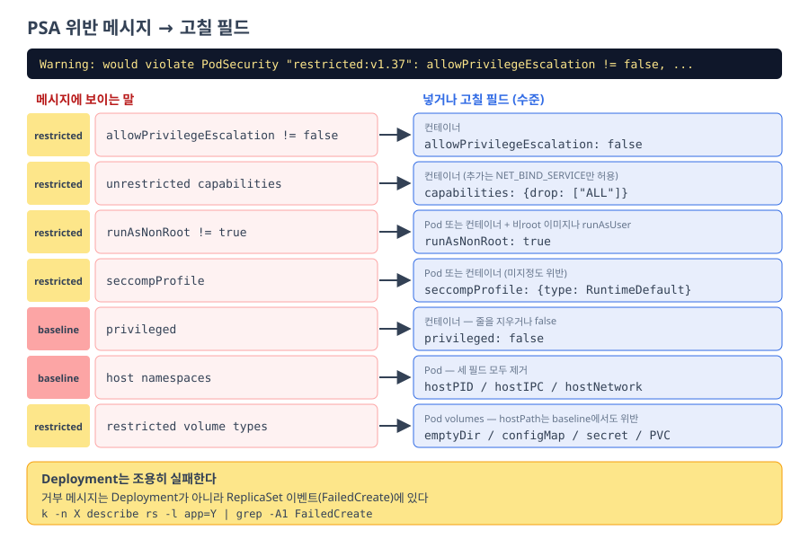
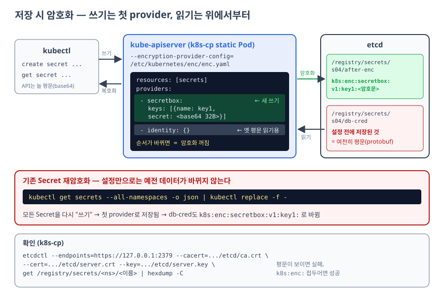
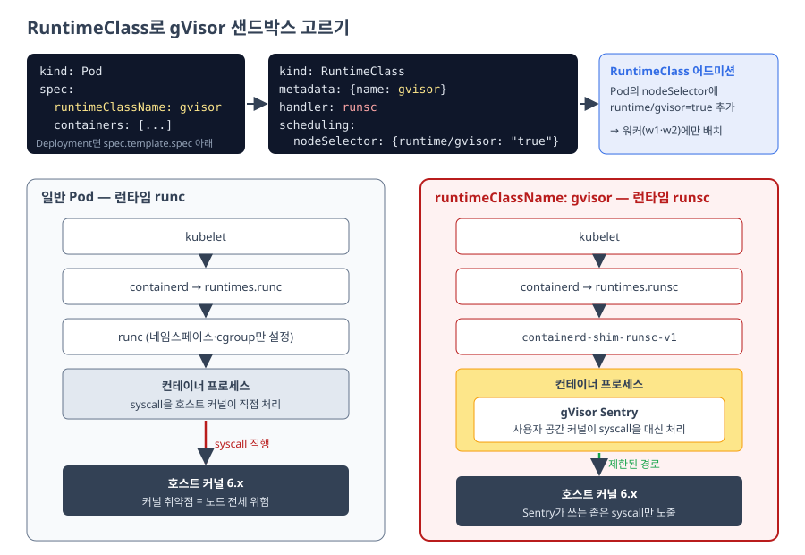

> **자격증 준비 · CKS** | 난이도 ★★★★☆ | 예상 소요 3.5 ~ 4시간

> ⚠️ 이 편의 모든 연습 과제는 CNCF가 공개한 **CKS 공식 커리큘럼(github.com/cncf/curriculum)을 바탕으로 직접 창작한** 시험 스타일 과제입니다. 실제 시험 문제(유출 문제·덤프)가 아니며 실제 출제 내용과 무관합니다.

## 🎯 오늘의 목표

- **PSA restricted** 네임스페이스에서 거부된 워크로드를 위반 메시지만 보고 5분 안에 고칠 수 있다
- `runAsUser`·`fsGroup`·`readOnlyRootFilesystem`·`capabilities` 같은 **securityContext 과제**를 검증 명령까지 붙여 끝낼 수 있다
- `etcdctl get`으로 etcd에 저장된 Secret을 직접 보고, **EncryptionConfiguration**으로 저장 시 암호화를 켠 뒤 **기존 Secret까지 재암호화**할 수 있다
- **RuntimeClass**로 gVisor(`runsc`) 샌드박스 Pod를 띄우고 진짜 샌드박스인지 확인할 수 있다
- Pod 간 암호화(mTLS·WireGuard)의 차이를 설명하고 **켜졌는지 확인하는 명령**을 안다

---

## 1. 커리큘럼 항목 요약 — Minimize Microservice Vulnerabilities (20%)

2026-11-15 기준 Linux Foundation CKS 페이지와 cncf/curriculum의 `CKS_Curriculum v1.37.pdf`에 실린 도메인입니다.

| 커리큘럼 항목 (요지) | 이 편의 섹션 | 본편 이론 |
|---|---|---|
| 알맞은 Pod Security Standards 적용 | 3-1·3-2, 과제 1~3 | [Day 69](../../09-security/day69-k8s-workload-security.md) |
| 쿠버네티스 Secret 관리 | 3-3, 과제 4~6 | [Day 13](../../02-kubernetes/day13-configmap-secret.md) 7장 |
| 격리 기법 이해·구현(멀티 테넌시, 샌드박스 컨테이너 등) | 3-4, 과제 7·8 | [Day 68](../../09-security/day68-container-runtime-security.md) 2장 |
| Pod 간 암호화 구현(Cilium, Istio 등) | 3-5, 과제 9 | [Day 70](../../09-security/day70-networkpolicy-zero-trust.md) 6장 |

> 💡 PSS 세 레벨과 restricted 조건표는 Day 69 2~4장, Secret이 etcd에 평문으로 들어가는 이유는 Day 13 7장, Istio ambient mTLS 실습은 Day 70 6장에 있습니다. 이 편은 반복하지 않고 **시험 과제 형식**만 다룹니다.

> 💡 CKS 허용 문서(2026-11-15 Linux Foundation *Resources Allowed* 확인)는 `kubernetes.io/docs`·`/blog` 외에 **`etcd.io/docs`, `docs.cilium.io`, `istio.io/latest/docs`** 가 포함됩니다. 이 편의 etcd·Cilium·Istio 과제는 그 문서에서 찾을 수 있습니다. gVisor 문서(gvisor.dev)는 목록에 없으므로 RuntimeClass는 kubernetes.io 쪽 페이지를 기억해 둡니다.

### 실습 환경

[CKA K00](../cka/k00-exam-overview-lab.md) 고정값: context **`cka-main`**(kubeadm v1.37.1, `k8s-cp` .10 / `k8s-w1` .11 / `k8s-w2` .12, containerd, Cilium), 노드 작업은 `ssh <노드>` → `sudo -i`, 작업 폴더 `~/cks/`. 스냅샷 **`cks-clean`** 에서 시작합니다. `etcdctl`은 [CKA K01](../cka/k01-cluster-install-upgrade-etcd.md) 5장에서 `k8s-cp`의 `/usr/local/bin`에 설치해 둔 것을 씁니다.

```powershell
cd C:\lab\k8s
vagrant halt
vagrant snapshot restore cks-clean --no-provision
vagrant up
```

```bash
k config use-context cka-main
mkdir -p ~/cks/s04 && cd ~/cks/s04
```

#### gVisor 확인 (S00 5-8에서 설치)

[S00](./s00-exam-overview-lab.md) 5-8에서 `k8s-w1`·`k8s-w2`에 `runsc`를 설치하고 containerd에 `runsc` 핸들러를 등록했으며, 두 워커에 라벨 `runtime/gvisor=true`와 RuntimeClass `gvisor`를 남겨 두었습니다. 여기서는 확인만 합니다.

```bash
k get nodes -L runtime/gvisor          # k8s-w1, k8s-w2 에 true
k get runtimeclass                      # gvisor   runsc
ssh k8s-w1 'runsc --version | head -1; sudo crictl info | grep -c runsc'
```

> 💡 containerd 핸들러 등록 위치(1.7.x는 `[plugins."io.containerd.grpc.v1.cri".containerd.runtimes.runsc]`, 2.x는 `[plugins.'io.containerd.cri.v1.runtime'.containerd.runtimes.runsc]`)와 `runtime_type = "io.containerd.runsc.v1"`은 S00 5-8에 있습니다. 이 편의 과제는 런타임이 노드에 준비돼 있다는 전제에서 **RuntimeClass와 Pod 쪽**에 집중합니다.

---

## 2. 출제 유형

| 유형 | 과제 문장의 모습 | 채점 포인트 |
|---|---|---|
| PSA 위반 수정 | "네임스페이스 X의 Deployment가 Pod를 만들지 못한다. 정책을 바꾸지 말고 고쳐라" | Pod Running, 네임스페이스 라벨 그대로 |
| PSA 라벨 적용 | "X에 restricted를 enforce하고 버전을 고정하라" / "위반 Pod를 파일로" | 라벨 키·값, 파일 내용 |
| securityContext | "UID 1000으로, 루트 FS 읽기 전용, 권한 상승 금지" | 스펙 필드 + 컨테이너 안 `id`·쓰기 결과 |
| Secret 확인 | "Secret 값을 디코드해 파일로" / "etcd에서 직접 읽어 평문 여부 기록" | 파일 내용 |
| 저장 시 암호화 | "provider P로 Secret 암호화를 켜고, 기존 Secret도 암호화하라" | etcd 값의 `k8s:enc:<provider>:v1:<key>:` 접두어 |
| 샌드박스 | "핸들러 `runsc`로 RuntimeClass를 만들고 Pod/Deployment에 적용" | RuntimeClass, `runtimeClassName`, Pod Running |
| Pod 간 암호화 | "Cilium 암호화를 켜라" / "Istio mTLS를 STRICT로" | 상태 명령 출력, PeerAuthentication 리소스 |

> ⚠️ **"정책은 바꾸지 말 것"** 이 붙는 과제가 많습니다. PSA 라벨을 `privileged`로 낮추면 Pod는 뜨지만 0점입니다. 워크로드 쪽을 고쳐야 합니다.

---

## 3. 핵심 명령·파일 위치

### 3-1. PSA — 라벨과 미리 보기

| 작업 | 명령 |
|---|---|
| enforce + 버전 고정 | `k label ns X pod-security.kubernetes.io/enforce=restricted pod-security.kubernetes.io/enforce-version=v1.37` |
| 경고·감사만 | `k label ns X pod-security.kubernetes.io/warn=restricted pod-security.kubernetes.io/audit=restricted` |
| **적용 전 위반 미리 보기** | `k label --dry-run=server --overwrite ns X pod-security.kubernetes.io/enforce=restricted` |
| 거부 이유 보기 (Deployment) | `k -n X describe rs -l app=<이름>` 또는 `k -n X get events --field-selector reason=FailedCreate` |
| 라벨 확인 | `k get ns X --show-labels` |

> 💡 enforce는 **Pod 생성 요청만** 막습니다. Deployment 자체는 만들어지고, ReplicaSet이 Pod를 못 만들어 `READY 0/N`인 채로 조용히 있습니다. 거부 메시지는 **ReplicaSet 이벤트**에 있습니다(Day 69 3장 "함정").

### 3-2. restricted를 통과하는 최소 securityContext



위반 메시지는 고칠 필드 이름을 거의 그대로 알려 줍니다. 그림의 왼쪽(메시지)을 보고 오른쪽(필드)을 넣으면 됩니다.

```yaml
spec:
  securityContext:                       # Pod 수준
    runAsNonRoot: true
    seccompProfile:
      type: RuntimeDefault
  containers:
  - name: app
    securityContext:                     # 컨테이너 수준
      allowPrivilegeEscalation: false
      capabilities:
        drop: ["ALL"]                    # restricted는 NET_BIND_SERVICE 추가만 허용
```

| 필드 | 수준 | 메모 |
|---|---|---|
| `runAsUser` / `runAsGroup` | Pod·컨테이너 | 이미지 USER가 root면 `runAsNonRoot`만으로는 **시작 실패**(`CreateContainerConfigError`) → `runAsUser` 지정 또는 비root 이미지 |
| `fsGroup` | **Pod만** | 볼륨 소유 그룹. 컨테이너 수준에는 없음 |
| `readOnlyRootFilesystem` | **컨테이너만** | 쓰는 경로는 `emptyDir`로 |
| `allowPrivilegeEscalation`, `capabilities`, `privileged` | **컨테이너만** | Pod 수준에 쓰면 `unknown field` |
| `seccompProfile`, `appArmorProfile`, `runAsNonRoot` | Pod·컨테이너 | 컨테이너 값이 우선 |

### 3-3. Secret — 읽기, etcd 직접 보기, 저장 시 암호화



| 작업 | 명령·위치 |
|---|---|
| 값 디코드 | `k -n X get secret S -o jsonpath='{.data.password}' \| base64 -d` |
| etcd 직접 읽기 (`k8s-cp`) | `etcdctl --endpoints=https://127.0.0.1:2379 --cacert=/etc/kubernetes/pki/etcd/ca.crt --cert=/etc/kubernetes/pki/etcd/server.crt --key=/etc/kubernetes/pki/etcd/server.key get /registry/secrets/<ns>/<이름> \| hexdump -C` |
| 설정 파일 위치(문서 예시) | `/etc/kubernetes/enc/enc.yaml` |
| API 서버 플래그 | `--encryption-provider-config=/etc/kubernetes/enc/enc.yaml` + `hostPath` 볼륨·`volumeMount` |
| 키 만들기 | `head -c 32 /dev/urandom \| base64` |
| 기존 Secret 재암호화 | `kubectl get secrets --all-namespaces -o json \| kubectl replace -f -` |
| 암호화 확인 | etcd 값이 `k8s:enc:<provider>:v1:<키 이름>:` 로 시작 |

provider 선택 — kubernetes.io *Encrypting Confidential Data at Rest* 표(2026-11-15 확인)의 평가입니다.

| provider | 문서 평가 | 메모 |
|---|---|---|
| `identity` | 암호화 없음 | 맨 앞에 두면 평문 저장. 마지막에 두면 "옛 평문 읽기용" |
| `aescbc` | **Weak** — 패딩 오라클 취약점 때문에 **권장하지 않음** | 옛 블로그·문서 예제에 가장 많이 나옴 |
| `aesgcm` | 20만 회 쓰기마다 키 교체 필요 | 자동 키 교체가 없으면 권장하지 않음 |
| `secretbox` | **Strong** (XSalsa20 + Poly1305) | 로컬 키 provider 중 문서 평가가 가장 높음 |
| `kms` v2 | **Strongest** (v1.29 GA) | 키가 클러스터 밖 KMS에 있음. **운영 권장.** KMS 플러그인이 필요해 시험·랩에선 드묾. kms v1은 v1.28부터 deprecated |

> ⚠️ 과제가 provider를 지정하면 **무조건 그 provider**를 씁니다. 지정이 없다면 이 편은 `secretbox`를 씁니다. 로컬 키 방식(aescbc·aesgcm·secretbox)은 모두 "키가 컨트롤 플레인 호스트 파일에 있다"는 한계를 공유합니다.

> 💡 **첫 번째 provider가 쓰기**에 쓰이고, 읽기는 위에서부터 차례로 시도합니다. 그래서 `secretbox` → `identity` 순서로 두면 "새로 쓰는 것은 암호화, 예전 평문도 읽힘"이 됩니다. 순서를 거꾸로 두면 암호화가 꺼진 것과 같습니다.

### 3-4. 격리 — RuntimeClass와 gVisor



```yaml
apiVersion: node.k8s.io/v1
kind: RuntimeClass
metadata:
  name: gvisor
handler: runsc                 # containerd config의 runtimes.<이름>과 같아야 함
scheduling:
  nodeSelector:
    runtime/gvisor: "true"     # 이 RuntimeClass를 쓰는 Pod는 자동으로 이 라벨 노드로
```

| 확인 | 명령 | 기대 |
|---|---|---|
| 커널 버전 | `k exec <pod> -- uname -r` | gVisor가 흉내 내는 버전(예: `4.4.0`). 노드 커널(6.x)과 다름 |
| 커널 로그 | `k exec <pod> -- dmesg` | `Starting gVisor...` 류 메시지 |
| 노드 쪽 | `ps -ef \| grep runsc` (Pod가 있는 노드) | `runsc-sandbox` 프로세스 |

> 💡 **멀티 테넌시**는 한 기능이 아니라 조합입니다. 네임스페이스 + RBAC(S02) + NetworkPolicy 기본 거부(S01) + ResourceQuota + PSA + (신뢰할 수 없는 코드라면) **샌드박스 RuntimeClass**. 과제는 보통 이 중 하나를 콕 집어 묻습니다.

### 3-5. Pod 간 암호화 — mTLS와 WireGuard

| 방식 | 무엇을 암호화하나 | 신원 | 켜기 / 확인 |
|---|---|---|---|
| Istio mTLS (sidecar·ambient) | 워크로드 ↔ 워크로드 | **서비스 계정 단위 인증서**(SPIFFE ID) → 인가 정책 가능 | `PeerAuthentication` `mtls.mode: STRICT` / `k get peerauthentication -A`, ambient는 `istioctl ztunnel-config workloads` |
| Cilium WireGuard | 노드 ↔ 노드 사이 Pod 트래픽 | 노드 단위 키(워크로드 신원 아님) | Helm 값 `encryption.enabled=true`, `encryption.type=wireguard` / `cilium-dbg status \| grep Encryption` |
| Cilium mutual authentication | 워크로드 신원 확인(SPIRE) | 워크로드 | 정책의 `authentication.mode: required` (Cilium 문서 확인) |

```yaml
# Istio: 네임스페이스 전체 mTLS 강제
apiVersion: security.istio.io/v1
kind: PeerAuthentication
metadata:
  name: default
  namespace: payments
spec:
  mtls:
    mode: STRICT
```

> 💡 "mTLS"를 물으면 Istio `PeerAuthentication`, "Pod 간 트래픽 암호화"를 Cilium으로 물으면 WireGuard(또는 IPsec)입니다. 우리 `cka-main`에는 Istio가 없으므로 Istio 실습은 Day 70의 kind 환경을 쓰고, 이 편의 과제는 Cilium WireGuard로 합니다.

---

## 4. 시간 절약 팁

- **PSA 위반은 `k apply`의 경고 한 줄에 전부 나옵니다.** Deployment라도 `k -n X apply -f d.yaml` 직후 터미널에 `Warning: would violate PodSecurity "restricted:v1.37": ...`가 찍힙니다. 이 줄을 복사해 두고 하나씩 지우세요.
- **고친 뒤에는 `k -n X rollout restart deploy Y`** 가 아니라 apply만으로 새 ReplicaSet이 생깁니다. 오래된 ReplicaSet의 `FailedCreate` 이벤트에 속지 말고 `k get rs`의 최신 것만 보세요.
- **etcdctl 인증서 세 줄은 etcd 매니페스트에서 복사**: `grep -E 'cert-file|key-file|trusted-ca-file' /etc/kubernetes/manifests/etcd.yaml`. `peer-` 가 붙지 않은 줄입니다(CKA K01 5장).
- **API 서버 매니페스트를 고치기 전에 백업은 매니페스트 폴더 밖으로**: `cp /etc/kubernetes/manifests/kube-apiserver.yaml ~/cks/s04/`. 수정 후 API 서버가 1분 넘게 안 뜨면 `crictl ps -a --name kube-apiserver`와 `crictl logs <ID>`, 그다음 `/var/log/pods/kube-system_kube-apiserver-*`.
- **문서 검색어**: `pod security admission` → *Pod Security Admission*, `pod security standards` → 레벨별 필드표, `encrypt data` → *Encrypting Confidential Data at Rest*(매니페스트 수정 예시까지 있음), `runtime class` → *Runtime Class*, `security context` → *Configure a Security Context*.

---

## 5. 자주 하는 실수

| 실수 | 결과 | 바로잡기 |
|---|---|---|
| PSA 라벨을 낮춰서 해결 | Pod는 뜨지만 0점 | 워크로드의 securityContext를 고친다 |
| `capabilities`를 Pod 수준 securityContext에 | `unknown field` 거부 | 컨테이너 수준으로 |
| `runAsNonRoot: true`만 넣고 root 이미지 유지 | `CreateContainerConfigError` | `runAsUser: <비root>` 또는 비root 이미지 |
| `readOnlyRootFilesystem` 후 앱이 `/tmp`·캐시에 씀 | CrashLoopBackOff | 쓰는 경로에 `emptyDir` |
| EncryptionConfiguration에 `identity`를 첫 번째로 | 암호화 안 됨(평문 저장) | 실제 provider를 첫 번째, `identity`는 마지막 |
| API 서버 볼륨 마운트 누락 | API 서버 기동 실패(파일 없음) | `volumeMounts`와 `volumes` **둘 다** 추가 |
| 키를 base64 하지 않거나 길이 틀림 | API 서버 기동 실패 | `head -c 32 /dev/urandom \| base64` (secretbox는 32바이트) |
| 설정 후 재암호화 생략 | 예전 Secret은 etcd에 평문 그대로 | `get secrets -A -o json \| replace -f -` |
| 백업 YAML을 `/etc/kubernetes/manifests/`에 둠 | 같은 static Pod가 두 번 → 충돌 | 백업은 다른 폴더에 |
| RuntimeClass `handler`를 RuntimeClass 이름과 혼동 | Pod `ContainerCreating`, 이벤트 `no runtime for "..."` | `handler`는 containerd의 `runtimes.<이름>` |
| 샌드박스 없는 노드로 스케줄 | 위와 같은 이벤트 | RuntimeClass `scheduling.nodeSelector` 또는 Pod `nodeSelector` |

---

## 6. 창작 연습 과제

> 아래 과제는 모두 **공식 커리큘럼을 바탕으로 창작한** 연습 문제입니다. 모든 과제의 context는 `cka-main`입니다. 먼저 준비 스크립트를 실행합니다.

```bash
# ~/cks/s04/setup.sh — base에서 bash setup.sh
set -e
kubectl create ns s04-shop
kubectl label ns s04-shop pod-security.kubernetes.io/enforce=restricted pod-security.kubernetes.io/enforce-version=v1.37
kubectl -n s04-shop create deploy shop --image=nginx:1.27 --port=80

kubectl create ns s04-legacy
kubectl -n s04-legacy run web --image=nginx:1.27
kubectl -n s04-legacy run debug-tool --image=busybox:1.37 \
  --overrides='{"spec":{"containers":[{"name":"debug-tool","image":"busybox:1.37","args":["sleep","3600"],"securityContext":{"privileged":true}}]}}'
kubectl -n s04-legacy run node-peek --image=busybox:1.37 \
  --overrides='{"spec":{"hostPID":true,"containers":[{"name":"node-peek","image":"busybox:1.37","args":["sleep","3600"]}]}}'

kubectl create ns s04
kubectl -n s04 create secret generic db-cred --from-literal=username=shop --from-literal=password='Lab-Pa55-0415'
kubectl create ns s04-tenant-b
kubectl -n s04-tenant-b create deploy untrusted --image=nginx:1.27 --replicas=2
echo "setup done"
```

### 과제 1. restricted 네임스페이스의 거부된 Deployment 고치기 (목표 7분)

네임스페이스 `s04-shop`의 Deployment `shop`이 Pod를 하나도 만들지 못하고 있다. **네임스페이스의 PSA 라벨은 바꾸지 말고** Deployment를 고쳐 Pod가 Running이 되게 하라. 이미지는 비root 버전인 `nginxinc/nginx-unprivileged:1.27-alpine`(포트 8080)으로 바꿔도 된다.

📖 참고 문서: kubernetes.io/docs/concepts/security/pod-security-standards/ (*Restricted* 표), kubernetes.io/docs/tasks/configure-pod-container/security-context/

<details>
<summary>풀이·검증</summary>

```bash
k -n s04-shop get deploy shop                       # READY 0/1
k -n s04-shop describe rs -l app=shop | grep -m1 -A1 FailedCreate
# Error creating: pods "shop-..." is forbidden: violates PodSecurity "restricted:v1.37":
#  allowPrivilegeEscalation != false (...), unrestricted capabilities (...),
#  runAsNonRoot != true (...), seccompProfile (...)
k -n s04-shop get deploy shop -o yaml > shop.yaml
```

```yaml
# shop.yaml 의 template.spec 부분
    spec:
      securityContext:
        runAsNonRoot: true
        seccompProfile:
          type: RuntimeDefault
      containers:
      - name: nginx
        image: nginxinc/nginx-unprivileged:1.27-alpine
        ports:
        - containerPort: 8080
        securityContext:
          allowPrivilegeEscalation: false
          capabilities:
            drop: ["ALL"]
```

```bash
k apply -f shop.yaml                                # 경고 없이 적용되어야 함
k -n s04-shop rollout status deploy shop
k -n s04-shop get ns s04-shop --show-labels | grep -o 'enforce=restricted'   # 라벨 그대로
k -n s04-shop exec deploy/shop -- id                # uid=101(nginx) ...
```

`nginx:1.27`은 root로 시작해 80번 포트를 열기 때문에 `runAsNonRoot`를 만족할 수 없습니다. "이미지를 바꿔도 된다"는 문장이 바로 그 힌트입니다.
</details>

### 과제 2. 기존 네임스페이스에 PSA 단계적 적용 (목표 5분)

네임스페이스 `s04-legacy`에 다음을 적용하라.
- **baseline**을 enforce, **restricted**를 warn·audit (세 모드 모두 버전 `v1.37` 고정)
- 적용하기 **전에**, baseline을 enforce하면 위반이 되는 **기존 Pod 이름**을 한 줄에 하나씩 `~/cks/s04/legacy-violations.txt`에 저장하라

📖 참고 문서: kubernetes.io/docs/concepts/security/pod-security-admission/, kubernetes.io/docs/tasks/configure-pod-container/enforce-standards-namespace-labels/

<details>
<summary>풀이·검증</summary>

```bash
k label --dry-run=server --overwrite ns s04-legacy pod-security.kubernetes.io/enforce=baseline
# Warning: existing pods in namespace "s04-legacy" violate the new PodSecurity enforce level "baseline:latest"
# Warning: debug-tool: privileged
# Warning: node-peek: host namespaces
printf 'debug-tool\nnode-peek\n' > ~/cks/s04/legacy-violations.txt

k label --overwrite ns s04-legacy \
  pod-security.kubernetes.io/enforce=baseline  pod-security.kubernetes.io/enforce-version=v1.37 \
  pod-security.kubernetes.io/warn=restricted   pod-security.kubernetes.io/warn-version=v1.37 \
  pod-security.kubernetes.io/audit=restricted  pod-security.kubernetes.io/audit-version=v1.37
```

```bash
cat ~/cks/s04/legacy-violations.txt
k get ns s04-legacy -o jsonpath='{.metadata.labels}' | tr ',' '\n' | grep pod-security    # 6개
k -n s04-legacy get pods                      # 기존 Pod는 그대로 Running (enforce는 새 Pod만 막음)
k -n s04-legacy run p2 --image=busybox:1.37 --overrides='{"spec":{"hostPID":true}}' -- sleep 1
# Error from server (Forbidden): ... violates PodSecurity "baseline:v1.37": host namespaces (hostPID=true)
```

`--dry-run=server`의 경고에는 Pod 이름과 위반 항목이 나옵니다. 이것을 그대로 파일로 옮기면 됩니다.
</details>

### 과제 3. securityContext 종합 (목표 6분)

네임스페이스 `s04`에 Pod `hardened`를 만들어라. 이미지 `busybox:1.37`, 명령 `sleep 3600`.
- 프로세스 UID **1000**, 기본 GID **3000**, 볼륨 소유 그룹 **2000**
- 루트 파일시스템은 **읽기 전용**, 단 `/cache`에는 쓸 수 있어야 한다(`emptyDir`)
- 권한 상승 금지, 모든 capability 제거, seccomp `RuntimeDefault`

📖 참고 문서: kubernetes.io/docs/tasks/configure-pod-container/security-context/

<details>
<summary>풀이·검증</summary>

```yaml
# hardened.yaml
apiVersion: v1
kind: Pod
metadata:
  name: hardened
  namespace: s04
spec:
  securityContext:
    runAsUser: 1000
    runAsGroup: 3000
    fsGroup: 2000
    seccompProfile:
      type: RuntimeDefault
  containers:
  - name: c
    image: busybox:1.37
    args: ["sleep", "3600"]
    securityContext:
      readOnlyRootFilesystem: true
      allowPrivilegeEscalation: false
      capabilities:
        drop: ["ALL"]
    volumeMounts:
    - name: cache
      mountPath: /cache
  volumes:
  - name: cache
    emptyDir: {}
```

```bash
k apply -f hardened.yaml && k -n s04 wait --for=condition=Ready pod/hardened
k -n s04 exec hardened -- id                    # uid=1000 gid=3000 groups=2000,3000
k -n s04 exec hardened -- touch /root-test      # touch: /root-test: Read-only file system
k -n s04 exec hardened -- sh -c 'touch /cache/ok && ls -ln /cache'   # 1000 2000 ... ok
k -n s04 exec hardened -- grep -E 'CapEff|NoNewPrivs|Seccomp:' /proc/1/status
# CapEff: 0000000000000000 / NoNewPrivs: 1 / Seccomp: 2
```
</details>

### 과제 4. Secret 값 꺼내기와 etcd 직접 확인 (목표 6분)

(a) 네임스페이스 `s04`의 Secret `db-cred`에서 `password` 값을 디코드해 base의 `~/cks/s04/db-password.txt`에 저장하라.
(b) `k8s-cp`에서 `etcdctl`로 이 Secret을 **etcd에서 직접** 읽어, 비밀번호가 평문으로 보이는지 확인하고 결과(`plaintext` 또는 `encrypted`)를 `k8s-cp`의 `/root/cks/s04/etcd-state.txt`에 기록하라.

📖 참고 문서: kubernetes.io/docs/tasks/configmap-secret/managing-secret-using-kubectl/ (*Decoding the Secret*), kubernetes.io/docs/tasks/administer-cluster/encrypt-data/ (*Verify that newly written data is encrypted*), etcd.io/docs (etcdctl `get`)

<details>
<summary>풀이·검증</summary>

```bash
k -n s04 get secret db-cred -o jsonpath='{.data.password}' | base64 -d > ~/cks/s04/db-password.txt
cat ~/cks/s04/db-password.txt          # Lab-Pa55-0415
```

```bash
ssh k8s-cp
sudo -i
mkdir -p /root/cks/s04
grep -E -- '--(cert-file|key-file|trusted-ca-file)' /etc/kubernetes/manifests/etcd.yaml
ETCDCTL_API=3 etcdctl --endpoints=https://127.0.0.1:2379 \
  --cacert=/etc/kubernetes/pki/etcd/ca.crt \
  --cert=/etc/kubernetes/pki/etcd/server.crt \
  --key=/etc/kubernetes/pki/etcd/server.key \
  get /registry/secrets/s04/db-cred | hexdump -C | head -20
# ... |k8s.....v1..Secret| ... |Lab-Pa55-0415| ...   ← 평문
echo plaintext > /root/cks/s04/etcd-state.txt
```

`hexdump` 오른쪽 열에 `k8s` 다음 `v1`·`Secret`과 비밀번호가 그대로 보이면 평문(protobuf)입니다. 암호화돼 있다면 `k8s:enc:...` 접두어 뒤가 알아볼 수 없는 바이트입니다. 키 경로는 `/registry/secrets/<네임스페이스>/<이름>`입니다.
</details>

### 과제 5. 저장 시 암호화 켜기 (목표 10분)

`cka-main`의 API 서버가 **Secret**을 `secretbox` provider(키 이름 `key1`)로 암호화해 etcd에 쓰도록 설정하라. 설정 파일은 `k8s-cp`의 `/etc/kubernetes/enc/enc.yaml`. 기존에 평문으로 저장된 Secret도 계속 읽을 수 있어야 한다. 설정 후 새 Secret `s04/after-enc`(`token=abc123`)를 만들어 암호화됐는지 확인하라.

📖 참고 문서: kubernetes.io/docs/tasks/administer-cluster/encrypt-data/ (*Write an encryption configuration file*, *Use the new encryption configuration file*)

<details>
<summary>풀이·검증</summary>

```bash
ssh k8s-cp
sudo -i
mkdir -p /etc/kubernetes/enc
KEY=$(head -c 32 /dev/urandom | base64)
cat > /etc/kubernetes/enc/enc.yaml <<EOF
apiVersion: apiserver.config.k8s.io/v1
kind: EncryptionConfiguration
resources:
  - resources:
      - secrets
    providers:
      - secretbox:
          keys:
            - name: key1
              secret: ${KEY}
      - identity: {}
EOF
chmod 600 /etc/kubernetes/enc/enc.yaml
cp /etc/kubernetes/manifests/kube-apiserver.yaml /root/cks/s04/kube-apiserver.yaml.bak
vim /etc/kubernetes/manifests/kube-apiserver.yaml
```

```yaml
# kube-apiserver.yaml 에 추가할 세 군데
    - --encryption-provider-config=/etc/kubernetes/enc/enc.yaml     # command 목록 끝
...
    volumeMounts:
    - name: enc
      mountPath: /etc/kubernetes/enc
      readOnly: true
...
  volumes:
  - name: enc
    hostPath:
      path: /etc/kubernetes/enc
      type: DirectoryOrCreate
```

```bash
watch -n2 'crictl ps --name kube-apiserver'    # 새 컨테이너가 뜰 때까지 (1분 안팎), Ctrl+C
kubectl get --raw /readyz; echo                # ok
ps -ef | grep -o 'encryption-provider-config=[^ ]*'
kubectl -n s04 create secret generic after-enc --from-literal=token=abc123
ETCDCTL_API=3 etcdctl --endpoints=https://127.0.0.1:2379 \
  --cacert=/etc/kubernetes/pki/etcd/ca.crt --cert=/etc/kubernetes/pki/etcd/server.crt \
  --key=/etc/kubernetes/pki/etcd/server.key \
  get /registry/secrets/s04/after-enc | hexdump -C | head -3
# 00000000  2f 72 65 67 ... |/registry/secrets/s04/after-enc.|
# 000000..  6b 38 73 3a 65 6e 63 3a 73 65 63 72 65 74 62 6f  |k8s:enc:secretbo|
#           78 3a 76 31 3a 6b 65 79 31 3a ...                |x:v1:key1:......|
kubectl -n s04 get secret after-enc -o jsonpath='{.data.token}' | base64 -d; echo   # abc123 (API로는 정상 복호화)
```

API 서버가 돌아오지 않으면 `crictl ps -a --name kube-apiserver`로 종료된 컨테이너 ID를 찾아 `crictl logs <ID>`를 봅니다. 대부분 경로 오타·볼륨 누락·키 길이 문제입니다. 막히면 백업으로 되돌린 뒤(`cp /root/cks/s04/kube-apiserver.yaml.bak /etc/kubernetes/manifests/kube-apiserver.yaml`) 다시 시도하세요.
</details>

### 과제 6. 기존 Secret 재암호화 (목표 4분)

과제 5 이후에도 `s04/db-cred`는 여전히 평문으로 저장돼 있다. **클러스터의 모든 Secret**을 새 provider로 다시 저장하고, `db-cred`가 암호화됐는지 확인하라. `/root/cks/s04/etcd-state.txt`(k8s-cp)를 `encrypted`로 갱신하라.

📖 참고 문서: kubernetes.io/docs/tasks/administer-cluster/encrypt-data/ (*Ensure all relevant data are encrypted*)

<details>
<summary>풀이·검증</summary>

```bash
# k8s-cp, root
kubectl get secrets --all-namespaces -o json | kubectl replace -f -
# secret/... replaced (여러 줄). conflict 오류가 나면 같은 명령을 다시 실행해도 안전
ETCDCTL_API=3 etcdctl --endpoints=https://127.0.0.1:2379 \
  --cacert=/etc/kubernetes/pki/etcd/ca.crt --cert=/etc/kubernetes/pki/etcd/server.crt \
  --key=/etc/kubernetes/pki/etcd/server.key \
  get /registry/secrets/s04/db-cred | hexdump -C | grep -c 'Lab-Pa55'     # 0
ETCDCTL_API=3 etcdctl --endpoints=https://127.0.0.1:2379 \
  --cacert=/etc/kubernetes/pki/etcd/ca.crt --cert=/etc/kubernetes/pki/etcd/server.crt \
  --key=/etc/kubernetes/pki/etcd/server.key \
  get /registry/secrets/s04/db-cred --print-value-only | head -c 26; echo   # k8s:enc:secretbox:v1:key1:
echo encrypted > /root/cks/s04/etcd-state.txt
```

> 💡 키 교체 과제라면 순서가 중요합니다: ① 새 키를 같은 provider의 `keys` **맨 앞**에 추가(옛 키는 아래에 남김) → API 서버 재시작 → ② `get ... | replace` 로 전부 새 키로 다시 쓰기 → ③ 옛 키 제거 → 재시작. 옛 키를 먼저 지우면 아직 옛 키로 저장된 Secret을 읽을 수 없게 됩니다.
</details>

### 과제 7. gVisor RuntimeClass와 샌드박스 Pod (목표 6분)

(연습 준비: S00이 남긴 RuntimeClass를 먼저 지운다 — `k delete runtimeclass gvisor`)

핸들러 `runsc`를 쓰는 RuntimeClass `gvisor`를 만들어라. 이 RuntimeClass를 쓰는 Pod는 **자동으로** 라벨 `runtime/gvisor=true`가 붙은 노드에만 스케줄돼야 한다. 네임스페이스 `s04`에 Pod `sandboxed`(이미지 `nginx:1.27`)를 이 RuntimeClass로 실행하고, 컨테이너 안에서 본 커널 버전을 base의 `~/cks/s04/sandbox-kernel.txt`에 저장하라.

📖 참고 문서: kubernetes.io/docs/concepts/containers/runtime-class/ (*Scheduling*)

<details>
<summary>풀이·검증</summary>

```yaml
# rc-gvisor.yaml
apiVersion: node.k8s.io/v1
kind: RuntimeClass
metadata:
  name: gvisor
handler: runsc
scheduling:
  nodeSelector:
    runtime/gvisor: "true"
---
apiVersion: v1
kind: Pod
metadata:
  name: sandboxed
  namespace: s04
spec:
  runtimeClassName: gvisor
  containers:
  - name: web
    image: nginx:1.27
```

```bash
k apply -f rc-gvisor.yaml
k -n s04 get pod sandboxed -o wide                 # Running, NODE k8s-w2
k -n s04 get pod sandboxed -o jsonpath='{.spec.nodeSelector}{"\n"}'   # {"sandbox":"gvisor"} — RuntimeClass가 합쳐 넣음
k -n s04 exec sandboxed -- uname -r > ~/cks/s04/sandbox-kernel.txt
cat ~/cks/s04/sandbox-kernel.txt                   # 4.4.0 (노드 커널과 다름)
k -n s04 exec sandboxed -- dmesg | head -3         # Starting gVisor...
ssh k8s-w1 uname -r                                # 6.x — 비교
```

`scheduling.nodeSelector`는 RuntimeClass 어드미션이 Pod의 `nodeSelector`에 **합쳐 넣어 주는** 값입니다. Pod마다 nodeSelector를 쓰지 않아도 되는 이유입니다.
</details>

### 과제 8. 신뢰할 수 없는 테넌트를 샌드박스로 (목표 5분)

네임스페이스 `s04-tenant-b`의 Deployment `untrusted`는 외부 고객 코드를 실행한다. 이 Deployment의 모든 Pod가 RuntimeClass `gvisor`로 실행되도록 바꿔라. 다른 설정은 바꾸지 마라.

📖 참고 문서: kubernetes.io/docs/concepts/containers/runtime-class/ (*Usage*)

<details>
<summary>풀이·검증</summary>

```bash
k -n s04-tenant-b patch deploy untrusted -p '{"spec":{"template":{"spec":{"runtimeClassName":"gvisor"}}}}'
k -n s04-tenant-b rollout status deploy untrusted
```

```bash
k -n s04-tenant-b get pods -o custom-columns=NAME:.metadata.name,RC:.spec.runtimeClassName,NODE:.spec.nodeName
# NAME                RC       NODE
# untrusted-...       gvisor   k8s-w1
# untrusted-...       gvisor   k8s-w2
for p in $(k -n s04-tenant-b get pods -o name); do k -n s04-tenant-b exec $p -- uname -r; done   # 4.4.0 두 줄
```

`runtimeClassName`은 **Pod 템플릿**(`spec.template.spec`) 아래에 넣어야 합니다. Deployment의 `spec` 바로 아래에 넣으면 `unknown field` 오류가 납니다.
</details>

### 과제 9. Pod 간 트래픽 암호화 — Cilium WireGuard (목표 8분)

`cka-main`의 Cilium에서 **WireGuard 투명 암호화**를 켜라. 모든 Cilium 에이전트가 암호화를 보고하는지 확인하고, `k8s-w1`에서 동작 중인 에이전트의 `Encryption` 상태 줄을 base의 `~/cks/s04/encryption-status.txt`에 저장하라.

📖 참고 문서: docs.cilium.io → *Security* → *Transparent Encryption* → *WireGuard Transparent Encryption*

<details>
<summary>풀이·검증</summary>

Day 20에서 Cilium을 cilium CLI(Helm 모드)로 설치했으므로 같은 도구로 값을 바꿉니다.

```bash
ssh k8s-cp
sudo -i
cilium upgrade --reuse-values --set encryption.enabled=true --set encryption.type=wireguard
kubectl -n kube-system rollout restart ds/cilium
kubectl -n kube-system rollout status ds/cilium
cilium status --wait
exit; exit
```

```bash
CP=$(k -n kube-system get pod -l k8s-app=cilium --field-selector spec.nodeName=k8s-w1 -o name)
k -n kube-system exec $CP -c cilium-agent -- cilium-dbg status | grep Encryption > ~/cks/s04/encryption-status.txt
cat ~/cks/s04/encryption-status.txt
# Encryption:   Wireguard   [cilium_wg0 (Pubkey: ..., Port: 51871, Peers: 2)]   (버전에 따라 표기 조금 다름)
for p in $(k -n kube-system get pod -l k8s-app=cilium -o name); do
  k -n kube-system exec $p -c cilium-agent -- cilium-dbg status | grep -c Wireguard; done   # 1 세 줄
```

`Peers` 수는 **노드 수 − 1**(우리 환경 2)이어야 합니다. 실제로 터널을 타는지는 노드에서 `tcpdump -n -i cilium_wg0`로 볼 수 있습니다. WireGuard는 **노드 간 구간**을 암호화하며 워크로드 신원 확인(mTLS)은 아닙니다. "mTLS STRICT"를 요구하는 과제라면 3-5의 Istio `PeerAuthentication`을 쓰고 `k get peerauthentication -n <ns>`로 확인합니다.
</details>

### 정리

```bash
k delete ns s04 s04-shop s04-legacy s04-tenant-b
```

RuntimeClass `gvisor`는 S00 상태와 같으므로 남겨 둡니다(과제 7에서 만든 것과 nodeSelector가 같음).

API 서버 암호화 설정과 Cilium WireGuard는 이후 편에 영향을 주지 않지만, 깨끗하게 이어 가려면 `cks-clean`으로 되돌리세요.

---

## 7. 핵심 정리

- PSA: 라벨 `pod-security.kubernetes.io/<enforce|warn|audit>=<레벨>` + `-version=v1.37`. 적용 전 **`k label --dry-run=server --overwrite`** 로 위반 Pod 미리 보기. 거부 이유는 **ReplicaSet 이벤트**
- restricted 최소 세트: `runAsNonRoot`, `seccompProfile: RuntimeDefault`, `allowPrivilegeEscalation: false`, `capabilities.drop: [ALL]`. **정책을 낮추지 말고 워크로드를 고친다**
- securityContext 수준: `fsGroup`은 Pod만, `readOnlyRootFilesystem`·`capabilities`·`allowPrivilegeEscalation`은 컨테이너만
- Secret은 기본적으로 etcd에 **평문(protobuf)**. `etcdctl get /registry/secrets/<ns>/<이름> | hexdump -C`
- 저장 시 암호화: `/etc/kubernetes/enc/enc.yaml` + `--encryption-provider-config` + **볼륨 두 군데**. 첫 provider가 쓰기, `identity`는 마지막. 문서 평가: aescbc Weak(비권장), **secretbox Strong**, **KMS v2 Strongest(운영 권장)**
- 설정 후 **`kubectl get secrets -A -o json | kubectl replace -f -`** 로 재암호화, 접두어 `k8s:enc:<provider>:v1:<key>:` 확인
- 샌드박스: RuntimeClass `handler: runsc` + `scheduling.nodeSelector`, Pod 템플릿에 `runtimeClassName`. 확인은 `uname -r`·`dmesg`
- Pod 간 암호화: Istio `PeerAuthentication STRICT`(mTLS, 워크로드 신원) vs Cilium WireGuard(노드 간, `cilium-dbg status | grep Encryption`)

---

## ⏭️ 다음 예고 — S05. 공급망 보안

지금까지는 "이미 들어온 워크로드"를 단단하게 만들었습니다. 다음 편은 워크로드가 **들어오기 전**을 막습니다. 베이스 이미지 최소화(멀티 스테이지·distroless), SBOM 생성, 이미지 서명·검증과 **허용 레지스트리** 정책, Kubesec·KubeLinter 같은 정적 분석, Trivy 이미지 스캔까지 — 공급망 보안 도메인을 창작 과제로 연습합니다. 본편 [Day 57](../../07-gitops/day57-supply-chain-security.md)과 이어집니다.
