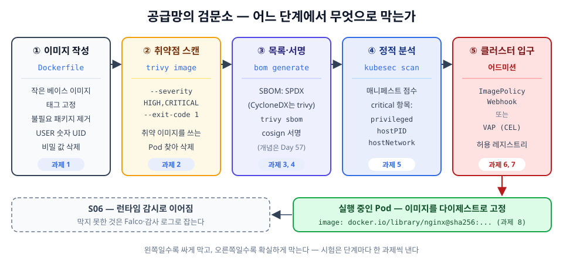
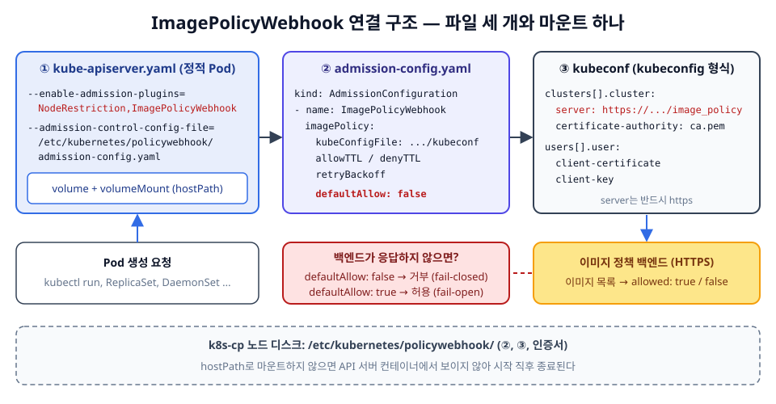
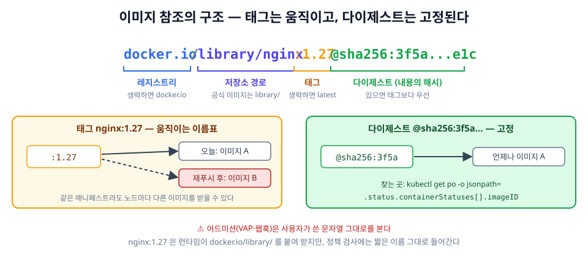

> **자격증 준비 · CKS** | 난이도 ★★★★☆ | 예상 소요 4 ~ 5시간 (과제 8개 포함)

> ⚠️ 이 편의 모든 연습 과제는 CNCF가 공개한 **CKS 커리큘럼(github.com/cncf/curriculum의 `CKS_Curriculum v1.37.pdf`)을 바탕으로 직접 창작한** 시험 스타일 과제입니다. 실제 시험 문제(덤프)가 아니며, 실제 출제 내용과 무관합니다. 과제 6은 kube-apiserver 정적 Pod를 고치므로 반드시 실습 클러스터에서, 스냅샷 `cks-clean`을 확인한 뒤 진행하세요.

## 🎯 오늘의 목표

- Dockerfile을 **베이스 이미지·불필요 패키지·실행 사용자·비밀 값** 네 가지 기준으로 빠르게 줄일 수 있다
- `trivy image --severity ... --exit-code 1`로 **취약한 이미지를 쓰는 Pod를 찾아 지우는** 과제를 5분 안에 끝낸다
- 허용 문서에 들어 있는 **`bom`** 으로 SPDX SBOM을 만들고, `trivy sbom`으로 SBOM을 스캔할 수 있다
- `kubesec scan`으로 매니페스트를 정적 분석해 critical 항목을 고칠 수 있다
- **ImagePolicyWebhook**(admission-config, kubeconfig, `defaultAllow`)을 kube-apiserver 정적 Pod에 연결하고, 같은 목표를 **ValidatingAdmissionPolicy**로도 구현할 수 있다
- 실행 중인 Pod의 이미지 **다이제스트**를 찾아 태그 대신 고정할 수 있다

---

## 1. 커리큘럼 항목 요약 — Supply Chain Security (20%)

2026-11-15에 확인한 공개 커리큘럼(v1.37)에서 이 도메인은 **20%** 이고, 항목은 네 개입니다. 시험 버전·시간·합격선 같은 공통 정보는 [S00](./s00-exam-overview-lab.md)에 있습니다.

| 커리큘럼 항목 (원문) | 이 편의 섹션 | 연습 과제 |
|---|---|---|
| Minimize base image footprint | 4-1 | 1 |
| Understand your supply chain (e.g. SBOM, CI/CD, artifact repositories) | 4-2, 4-3 | 2, 3, 4 |
| Secure your supply chain (permitted registries, sign and validate artifacts, etc.) | 4-5, 4-6, 4-7 | 6, 7, 8 |
| Perform static analysis of user workloads and container images (e.g. Kubesec, KubeLinter) | 4-4 | 5 |

이론은 본편에 있습니다. 여기서는 반복하지 않고 **시험 과제 형태**만 다룹니다.

| 주제 | 본편 |
|---|---|
| 레이어·멀티 스테이지·slim/distroless | [Day 03](../../01-docker/day03-dockerfile.md) 5-4절 |
| Trivy 스캔, SBOM, cosign 서명, Kyverno 정책, 공급망 공격 사례 | [Day 57](../../07-gitops/day57-supply-chain-security.md) |
| 정적 Pod 매니페스트 편집과 kube-apiserver 복구 | [CKA K06](../cka/k06-troubleshooting.md) 5장 |
| securityContext, PSA | [S04](./s04-microservice-vulnerabilities.md) |



### 1-1. 실습 환경

[CKA K00](../cka/k00-exam-overview-lab.md)의 고정값을 그대로 씁니다. context `cka-main`(kubeadm v1.37.1, `k8s-cp` 192.168.56.10 / `k8s-w1` .11 / `k8s-w2` .12, Cilium), 보조 context `cka-aux`(kind). 노드 작업은 base(WSL2)에서 `ssh <노드>` 후 `sudo -i`. 작업 폴더는 base의 `~/cks/`, 노드에서는 root의 `~/cks/`(= `/root/cks/`)입니다.

| 도구 | 위치 | 비고 |
|---|---|---|
| `trivy` v0.76.2 | base | Day 57과 같은 버전. 첫 실행 때 취약점 DB를 내려받아 1~2분 걸림 |
| `bom` v0.8.0 | base | kubernetes-sigs/bom. **CKS 허용 문서에 CLI 레퍼런스가 있는 SBOM 도구** |
| `kubesec` v2 | base | 컨테이너 이미지 `kubesec/kubesec:v2`로 실행 |
| `docker` | base | Dockerfile 과제용 (K00의 Docker Desktop WSL integration) |

S00에서 설치했다면 건너뛰고, 아니면 base에서 다음을 실행합니다.

```bash
# trivy — 버전 고정 (Day 57의 2026년 3월 사고 이후 latest 금지)
curl -LO https://github.com/aquasecurity/trivy/releases/download/v0.76.2/trivy_0.76.2_Linux-64bit.tar.gz
tar xzf trivy_0.76.2_Linux-64bit.tar.gz trivy && sudo install -m 0755 trivy /usr/local/bin/ && rm trivy*
# bom
curl -Lo bom https://github.com/kubernetes-sigs/bom/releases/download/v0.8.0/bom-amd64-linux
sudo install -m 0755 bom /usr/local/bin/ && rm bom
# kubesec — 바이너리 대신 이미지로 쓰는 함수
echo 'kubesec() { docker run -i --rm kubesec/kubesec:v2 "$@"; }' >> ~/.bashrc && source ~/.bashrc

trivy --version; bom version | head -3; kubesec version
```

> 💡 이 함수 정의 덕분에 `kubesec scan /dev/stdin < pod.yaml` 형태로 쓸 수 있습니다. 컨테이너에는 base의 파일이 보이지 않으므로 **파일 이름 대신 표준 입력**으로 넘기는 것이 요령입니다.

공용 준비:

```bash
kubectl config use-context cka-main
mkdir -p ~/cks/s05
```

---

## 2. 출제 유형 — 어떻게 채점되는가

| 과제 형태 | 예시 문장(창작) | 채점 포인트 |
|---|---|---|
| **Dockerfile 수정형** | "`/root/xxx/Dockerfile`의 보안 문제 N개를 고쳐라. 빌드는 하지 않아도 된다" | 파일 내용: 베이스 태그, `USER`, 불필요 패키지, 비밀 값 줄. **지시하지 않은 줄을 바꾸지 않았는가** |
| **스캔 후 조치형** | "네임스페이스 `xxx`의 Pod 중 HIGH·CRITICAL 취약점이 있는 이미지를 쓰는 Pod를 삭제하라" | 지워야 할 Pod가 **없고**, 남겨야 할 Pod가 **남아 있는가** |
| **SBOM 생성형** | "이미지 `yyy`의 SBOM을 SPDX JSON으로 `/opt/...`에 저장하라" | 파일 존재, 형식(SPDX/CycloneDX), 대상 이미지 |
| **정적 분석형** | "kubesec로 두 매니페스트를 검사하고 critical을 없애라" | 매니페스트의 해당 필드, 적용된 리소스 |
| **어드미션 연결형** | "ImagePolicyWebhook을 켜고 백엔드 장애 시 거부되게 하라" | kube-apiserver 플래그, 설정 파일 값, **API 서버가 다시 떴는가**, 테스트 Pod가 거부되는가 |
| **고정형** | "Deployment의 이미지를 태그 대신 다이제스트로 고정하라" | `spec.containers[].image`가 `@sha256:`로 끝나는가, 롤아웃 성공 |

> 💡 공급망 과제는 **답이 파일이거나, 클러스터 상태(남은 Pod 목록, API 서버 플래그)** 입니다. 출력 파일 경로·형식은 한 글자도 틀리면 안 되고, 어드미션 과제는 API 서버가 다시 살아나지 않으면 그 뒤 모든 과제가 막힙니다.

---

## 3. 핵심 명령·파일 위치 표

| 하려는 일 | 명령 / 파일 | 기억할 점 |
|---|---|---|
| 이미지 취약점 (심각도 필터) | `trivy image -q --severity HIGH,CRITICAL <이미지>` | `-q`로 진행 로그 제거. 대문자, 쉼표, 공백 없음 |
| 취약점 있으면 실패 코드 | `trivy image -q --severity CRITICAL --exit-code 1 <이미지>` | `$?`가 1이면 해당 심각도 존재 → 반복문에 쓰기 좋음 |
| 고칠 수 있는 것만 | `--ignore-unfixed` | 과제 문장에 "fix available"이 있을 때만 |
| SBOM 생성 (bom) | `bom generate --image <이미지> --format json --output x.spdx.json` | 기본 `--format`은 `tag-value`. 출력 기본은 표준 출력 |
| SBOM 내용 훑기 | `bom document outline x.spdx` | 패키지 트리 |
| SBOM 생성 (trivy) | `trivy image --format spdx-json -o x.spdx.json <이미지>` / `--format cyclonedx` | 과제가 형식을 지정하면 그대로 |
| SBOM 스캔 | `trivy sbom x.spdx.json` | 이미지를 다시 받지 않고 목록만으로 취약점 대조 |
| 정적 분석 | `kubesec scan pod.yaml` | 결과 JSON의 `score`, `scoring.critical` |
| Pod별 이미지 목록 | `k get po -o custom-columns=N:.metadata.name,I:.spec.containers[*].image` | initContainers도 있는지 확인 |
| 실행 중 이미지 다이제스트 | `k get po x -o jsonpath='{.status.containerStatuses[*].imageID}'` | `docker.io/library/nginx@sha256:...` |
| 노드에서 이미지 다이제스트 | `crictl images --digests` / `crictl inspecti <이미지>` | 노드 작업일 때 |
| kube-apiserver 매니페스트 | `/etc/kubernetes/manifests/kube-apiserver.yaml` | 백업은 **manifests 밖**에 |
| 어드미션 플러그인 켜기 | `--enable-admission-plugins=NodeRestriction,ImagePolicyWebhook` | 기존 값에 **추가**. 덮어쓰지 않기 |
| 어드미션 설정 파일 | `--admission-control-config-file=<경로>` | 경로를 **volume/hostPath로 마운트**해야 컨테이너가 봄 |
| VAP / 바인딩 | `admissionregistration.k8s.io/v1` `ValidatingAdmissionPolicy` + `...Binding` | 바인딩 없으면 아무것도 안 막음. `validationActions: [Deny]` |
| API 서버 복구 확인 | `crictl ps -a \| grep kube-apiserver`, `crictl logs <id>` | `kubectl`이 안 될 때 |

---

## 4. 영역별 핵심

### 4-1. Dockerfile 최소화 — 네 가지만 본다

Day 03에서 레이어와 멀티 스테이지를 배웠습니다. 시험에서는 "이미지를 빌드해 보라"보다 **파일을 읽고 고치는** 형태가 많습니다. 다음 네 가지를 위에서부터 훑습니다.

| 점검 | 나쁜 예 | 고친 예 |
|---|---|---|
| 베이스 이미지 | `FROM ubuntu:latest` | `FROM python:3.13-slim` (작은 베이스 + **고정된 태그**, 가능하면 다이제스트) |
| 불필요 패키지 | `apt-get install -y python3 curl vim netcat-openbsd` | 실행에 필요한 것만. 셸·디버그 도구는 공격자 도구가 됨 |
| 실행 사용자 | `USER root` 또는 `USER` 없음 | `USER 65532` 같은 **숫자 UID** (PSA `runAsNonRoot`가 숫자를 검사) |
| 비밀 값 | `ENV DB_PASSWORD=...`, `COPY .env` | 줄 삭제. 런타임에 Secret으로 주입 |

> ⚠️ "레이어 수를 줄여라"는 과제라면 `RUN` 여러 줄을 `&&`로 합치고 같은 줄에서 `rm -rf /var/lib/apt/lists/*`까지 합니다. 그러나 문장이 요구하지 않은 구조 변경(예: 멀티 스테이지로 전면 재작성)은 채점 스크립트가 기대하는 줄을 지워 버릴 수 있습니다. **요구한 것만** 바꾸세요.

### 4-2. Trivy로 "취약한 이미지를 쓰는 Pod" 찾기

시험의 전형적인 흐름은 **Pod → 이미지 목록 → 이미지별 스캔 → 해당 Pod 삭제**입니다. 이미지 하나당 Trivy 출력이 수백 줄일 수 있으니 눈으로 읽지 말고 `--exit-code`로 판정합니다.

```bash
k -n <ns> get po -o custom-columns=POD:.metadata.name,IMAGE:.spec.containers[*].image --no-headers > /tmp/pods.txt
while read pod img; do
  if trivy image -q --severity HIGH,CRITICAL --exit-code 1 "$img" > /dev/null 2>&1; then
    echo "OK    $pod $img"
  else
    echo "VULN  $pod $img"
  fi
done < /tmp/pods.txt
```

> ⚠️ `--exit-code 1`은 "취약점이 있으면 1"이지만 **이미지 pull 실패 같은 오류도 1**입니다. VULN으로 나온 이미지는 `trivy image -q --severity HIGH,CRITICAL <이미지> | tail -5`로 표가 실제로 나오는지 한 번 확인하세요.

### 4-3. SBOM — 왜 `bom`인가

SBOM은 "이 이미지에 무엇이 들었나"의 목록입니다(Day 57 1장). CKS 허용 자료 목록에는 **bom의 CLI 레퍼런스(`kubernetes-sigs.github.io/bom/cli-reference/`)** 가 들어 있습니다. 즉 시험장에서 문서를 펼쳐 놓고 쓸 수 있는 SBOM 도구는 `bom`입니다. Trivy도 SBOM을 만들 수 있지만 Trivy 문서는 허용 목록에 없으므로 `trivy image --help`로 옵션을 찾아야 합니다.

| | `bom generate` | `trivy image --format` |
|---|---|---|
| 형식 | **SPDX만** — `tag-value`(기본) 또는 `json` | `spdx`, `spdx-json`, `cyclonedx` |
| 대상 | `--image`, `--image-archive`, `--dirs`, `--file` | 이미지, 파일시스템, 레포 |
| 출력 | `--output`(`-o`). 없으면 표준 출력 | `--output`(`-o`) |
| 문서 | 시험 허용 문서 | `--help` |

> 💡 과제가 "CycloneDX"를 요구하면 bom으로는 안 됩니다(bom은 SPDX 전용). Trivy의 `--format cyclonedx`를 쓰세요. 형식 이름을 보고 도구를 고르는 것까지가 과제입니다.

### 4-4. kubesec — 매니페스트 점수표

kubesec는 Pod·Deployment 매니페스트를 읽고 보안 설정에 **점수**를 매깁니다. 결과 JSON의 `scoring.critical`에 든 항목이 점수를 크게 깎는 것들(`privileged`, `hostPID`, `hostNetwork` 등)이고, `scoring.advise`는 더하면 점수가 오르는 권장 항목(`runAsNonRoot`, `readOnlyRootFilesystem`, `resources.limits` 등)입니다.

```bash
kubesec scan /dev/stdin < pod.yaml | jq '.[0] | {score, critical: [.scoring.critical[]?.selector]}'
```

KubeLinter도 커리큘럼에 예시로 나오지만 사용법은 같습니다. "파일 검사 → 지적 항목 수정 → 다시 검사"입니다.

### 4-5. ImagePolicyWebhook — 파일 세 개와 마운트 하나



ImagePolicyWebhook은 Pod가 만들어질 때 이미지 목록을 **외부 백엔드(HTTPS)** 에 물어 허용/거부를 받는 어드미션 플러그인입니다. 백엔드 자체는 보통 과제에서 주어지고, 우리가 하는 일은 **연결**입니다.

| 파일 | 내용 | 자주 나오는 지시 |
|---|---|---|
| ① `kube-apiserver.yaml` | `--enable-admission-plugins`에 `ImagePolicyWebhook` 추가, `--admission-control-config-file` 지정, **volume + volumeMount** | "플러그인을 켜라" |
| ② admission-config (`AdmissionConfiguration`) | `plugins[].name: ImagePolicyWebhook`, `configuration.imagePolicy.kubeConfigFile`, `allowTTL`, `denyTTL`, `retryBackoff`, **`defaultAllow`** | "백엔드에 연결할 수 없으면 거부하라" → `defaultAllow: false` |
| ③ kubeconfig | `clusters[].cluster.server`(백엔드 URL, **https 필수**), `certificate-authority`, `users[].user.client-certificate/client-key` | "server를 `https://...`로 맞춰라" |

kubernetes.io 문서(Admission Control in Kubernetes → ImagePolicyWebhook)의 예시 그대로 쓰면 됩니다.

```yaml
apiVersion: apiserver.config.k8s.io/v1
kind: AdmissionConfiguration
plugins:
  - name: ImagePolicyWebhook
    configuration:
      imagePolicy:
        kubeConfigFile: /etc/kubernetes/policywebhook/kubeconf
        allowTTL: 50
        denyTTL: 50
        retryBackoff: 500
        defaultAllow: false
```

> ⚠️ **`defaultAllow: false`는 fail-closed입니다.** 백엔드가 응답하지 않으면 **모든 새 Pod 생성이 거부**됩니다. 이미 떠 있는 Pod는 그대로지만, 롤아웃·재시작·DaemonSet 교체가 전부 멈춥니다. 실습이 끝나면 반드시 되돌리세요(과제 6의 정리 단계).

> ⚠️ 설정 파일 안의 경로(kubeconfig, 인증서)는 **컨테이너 안에서 보이는 경로**입니다. 노드에 파일을 만들어도 kube-apiserver 정적 Pod에 hostPath로 마운트하지 않으면 API 서버는 `no such file or directory`로 죽습니다. 가장 흔한 실패 원인입니다.

### 4-6. ValidatingAdmissionPolicy — 백엔드 없이 CEL로

v1.30부터 GA인 ValidatingAdmissionPolicy(VAP)는 **외부 서버 없이** API 서버 안에서 CEL 식으로 검사합니다. kubeadm 클러스터에는 기본으로 켜져 있어 API 서버 매니페스트를 고칠 필요도 없습니다. "허용 레지스트리" 과제를 VAP로 내면 정책 + 바인딩 두 리소스만 만들면 됩니다.

| 리소스 | 핵심 필드 |
|---|---|
| `ValidatingAdmissionPolicy` | `matchConstraints.resourceRules`(pods, CREATE/UPDATE), `validations[].expression`, `message`, `failurePolicy` |
| `ValidatingAdmissionPolicyBinding` | `policyName`, **`validationActions: [Deny]`**, `matchResources.namespaceSelector` |

> 💡 서명 검증(cosign)은 커리큘럼의 "sign and validate artifacts"에 해당하지만, cosign·Kyverno 문서는 허용 목록에 없습니다. 개념과 실습은 Day 57 5~6장으로 충분하고, 시험장에서는 과제의 Quick Reference가 주는 명령을 그대로 따르면 됩니다.

### 4-7. 다이제스트 고정



태그(`nginx:1.27`)는 **움직이는 이름표**입니다. 같은 태그가 내일은 다른 이미지를 가리킬 수 있습니다. 다이제스트(`@sha256:...`)는 내용의 해시라서 바뀌지 않습니다. kubernetes.io의 Images 문서에도 "다이제스트로 지정하면 항상 같은 이미지"라고 나옵니다.

```bash
# 지금 실제로 돌고 있는 이미지의 다이제스트
k get po <pod> -o jsonpath='{.status.containerStatuses[0].imageID}{"\n"}'
# docker.io/library/nginx@sha256:3f5a...e1c

k set image deploy/<이름> <컨테이너>=docker.io/library/nginx@sha256:3f5a...e1c
```

> 💡 `nginx:1.27@sha256:...`처럼 태그와 다이제스트를 함께 써도 됩니다. 이 경우 **다이제스트가 우선**하고 태그는 사람이 읽기 위한 표시일 뿐입니다.

---

## 5. 시간 절약 팁

| 팁 | 효과 |
|---|---|
| Trivy는 `-q --exit-code 1`로 **판정만** 받기 | 이미지당 출력 수백 줄을 읽지 않음 |
| 같은 이미지는 한 번만 스캔 | `sort -u`로 이미지 목록 중복 제거 |
| kube-apiserver 수정 전 `cp ... ~/cks/kube-apiserver.yaml.bak` | 망가지면 10초 안에 원상 복구 |
| 매니페스트 수정 후 `watch crictl ps` 대신 `crictl ps \| grep apiserver`를 몇 번 | 재시작은 30~90초. 그동안 다음 과제 문장을 읽기 |
| admission-config·kubeconfig는 **문서 예시를 복사** | `imagePolicy` 같은 키 이름 오타 방지 |
| VAP는 문서의 예시를 복사하고 `expression`만 바꾸기 | `matchConstraints` 들여쓰기 실수 방지 |
| 다이제스트는 `kubectl`의 `imageID`에서 복사 | 레지스트리에 접속하는 도구가 없어도 됨 |

---

## 6. 자주 하는 실수

| 실수 | 결과 | 예방 |
|---|---|---|
| `--enable-admission-plugins=ImagePolicyWebhook`으로 **덮어쓰기** | `NodeRestriction`이 빠짐 → 다른 채점 항목 실패 | 쉼표로 **추가** |
| 설정 디렉터리를 hostPath로 **마운트하지 않음** | API 서버가 시작 직후 종료, `kubectl` 전부 불가 | volume과 volumeMount를 짝으로 |
| 백업을 `/etc/kubernetes/manifests/` 안에 둠 | kubelet이 백업 파일도 정적 Pod로 띄우려 함 | 백업은 `~/cks/`에 |
| kubeconfig `server`를 `http://`로 | 플러그인이 거부 → API 서버 기동 실패 | 문서: **https 필수** |
| `defaultAllow`를 문장과 반대로 | "백엔드 장애 시 거부"인데 `true` | fail-closed = `false` |
| Trivy 심각도를 `high,critical`·`HIGH, CRITICAL`로 | 필터가 안 먹거나 오류 | `HIGH,CRITICAL` |
| Pod는 지웠는데 **Deployment가 다시 만듦** | 채점 시점에 취약 Pod가 다시 있음 | 소유자(`ownerReferences`) 확인 → 과제 문장에 맞게 Pod만 또는 상위 리소스까지 |
| VAP만 만들고 **Binding을 안 만듦** | 아무것도 막지 않음 | 정책 = 규칙, 바인딩 = 어디에 적용 |
| VAP에서 `nginx:1.27` 같은 **짧은 이름**을 고려 안 함 | `docker.io/library/` 접두사 검사에 걸려 거부 | 문장이 허용하는 형식을 확인 |
| bom으로 CycloneDX를 만들려 함 | 옵션이 없음 | bom은 SPDX 전용 → Trivy |

---

## 7. 창작 연습 과제

> 아래 과제는 모두 공식 커리큘럼을 바탕으로 **직접 창작한** 시험 스타일 과제입니다. 각 과제의 첫 줄에 작업 위치를 적었습니다. 시작 전 초기화가 필요하면 Windows에서 `cd C:\lab\k8s; vagrant halt; vagrant snapshot restore cks-clean --no-provision; vagrant up`.

공용 준비(과제 2·7·8에서 씀):

```bash
# base 에서
k create ns s05-scan
k -n s05-scan run web-a --image=nginx:1.19.0
k -n s05-scan run web-b --image=registry.k8s.io/pause:3.10
k -n s05-scan run web-c --image=httpd:2.4.39
k -n s05-scan run web-d --image=busybox:1.37 -- sleep 1d
k create ns s05
k -n s05 create deploy web --image=nginx:1.27 --replicas=2
k -n s05-scan get po; k -n s05 rollout status deploy/web
```

### 과제 1. Dockerfile 최소화 (목표 6분)

작업 위치: base. 아래 준비 명령으로 `~/cks/s05/app/`을 만든 뒤, `Dockerfile`을 다음 조건으로 고쳐라.
- 베이스 이미지는 `python:3.13-slim`으로 (태그 고정)
- 앱 실행에 필요 없는 패키지 설치를 없앨 것 (`app.py`는 표준 라이브러리만 씀)
- 비밀 값을 담은 줄을 지울 것
- 컨테이너는 UID **65532**로 실행
- 이미지를 `cks-app:s05`로 빌드해 `docker run`으로 UID를 확인

```bash
mkdir -p ~/cks/s05/app && cd ~/cks/s05/app
cat > app.py <<'EOF'
from http.server import BaseHTTPRequestHandler, HTTPServer
class H(BaseHTTPRequestHandler):
    def do_GET(self):
        self.send_response(200); self.end_headers(); self.wfile.write(b"ok\n")
HTTPServer(("", 8080), H).serve_forever()
EOF
cat > Dockerfile <<'EOF'
FROM ubuntu:latest
RUN apt-get update
RUN apt-get install -y python3 python3-pip curl vim netcat-openbsd
ENV DB_PASSWORD=Sup3rS3cret
COPY app.py /app/app.py
WORKDIR /app
USER root
EXPOSE 8080
CMD ["python3", "/app/app.py"]
EOF
```

📖 참고 문서: 허용 목록에 Dockerfile 문서는 없습니다. `FROM`·`USER`·`RUN` 문법은 외워 두세요(Day 03 2장).

<details>
<summary>풀이·검증</summary>

```dockerfile
FROM python:3.13-slim
COPY app.py /app/app.py
WORKDIR /app
USER 65532
EXPOSE 8080
CMD ["python3", "/app/app.py"]
```

- `python:3.13-slim`에는 이미 `python3`가 있으므로 `RUN apt-get ...` 두 줄이 통째로 필요 없습니다.
- `ENV DB_PASSWORD`는 이미지 메타데이터에 영구히 남습니다(`docker history`, `docker inspect`로 보임).
- `USER 65532`는 `/etc/passwd`에 없는 UID여도 실행됩니다. 이름(`nobody`)보다 **숫자**가 PSA의 `runAsNonRoot` 검사와 잘 맞습니다.

```bash
docker build -t cks-app:s05 .
docker run --rm cks-app:s05 id -u                       # 65532
docker image inspect cks-app:s05 --format '{{.Config.Env}}' | grep -c DB_PASSWORD   # 0
docker run --rm cks-app:s05 sh -c 'command -v curl vim nc' ; echo "exit=$?"         # exit=1 (아무것도 없음)
docker images cks-app:s05                                # 크기가 ubuntu+apt 버전보다 훨씬 작음
```
</details>

### 과제 2. 심각도 필터로 취약 이미지 Pod 정리 (목표 7분)

작업 위치: base, context `cka-main`. 네임스페이스 `s05-scan`의 Pod 중 **CRITICAL 취약점이 하나라도 있는** 이미지를 쓰는 Pod를 모두 삭제하라. 삭제한 Pod 이름을 한 줄에 하나씩, 이름순으로 `~/cks/s05/deleted-pods.txt`에 저장하라. 다른 Pod는 남겨야 한다.

📖 참고 문서: Trivy 문서는 허용 목록에 없음 → `trivy image --help`(`--severity`, `--exit-code`). Pod 목록은 kubernetes.io "kubectl Quick Reference"(custom-columns).

<details>
<summary>풀이·검증</summary>

```bash
k -n s05-scan get po -o custom-columns=POD:.metadata.name,IMAGE:.spec.containers[*].image --no-headers > /tmp/pods.txt
cat /tmp/pods.txt

: > ~/cks/s05/deleted-pods.txt
while read pod img; do
  if ! trivy image -q --severity CRITICAL --exit-code 1 "$img" > /dev/null 2>&1; then
    echo "$pod" >> ~/cks/s05/deleted-pods.txt
  fi
done < /tmp/pods.txt
sort -o ~/cks/s05/deleted-pods.txt ~/cks/s05/deleted-pods.txt
cat ~/cks/s05/deleted-pods.txt

# 표가 실제로 나오는지 눈으로 한 번 확인한 뒤 삭제
for p in $(cat ~/cks/s05/deleted-pods.txt); do
  img=$(k -n s05-scan get po $p -o jsonpath='{.spec.containers[0].image}')
  trivy image -q --severity CRITICAL "$img" | grep -m1 "Total:"
done
xargs -r kubectl -n s05-scan delete po < ~/cks/s05/deleted-pods.txt
```

```bash
k -n s05-scan get po                 # 남은 Pod 확인
cat ~/cks/s05/deleted-pods.txt
```

2026-11 기준 실행하면 대개 `web-a`(nginx 1.19.0, 2020년), `web-c`(httpd 2.4.39, 2019년)가 걸리고, `web-b`(pause, OS 패키지 없음)와 `web-d`(busybox)는 남습니다. **취약점 DB는 매일 바뀌므로 결과가 다르면 Trivy의 판정을 따르세요.** 과제의 정답도 "그날의 스캔 결과"입니다.

이 Pod들은 `kubectl run`으로 만든 단독 Pod라 지우면 끝입니다. Deployment 소유라면 Pod를 지워도 다시 생기므로, 과제가 "Pod를 삭제"인지 "워크로드를 제거"인지 문장을 다시 읽어야 합니다.
</details>

### 과제 3. bom으로 SPDX SBOM 만들기 (목표 5분)

작업 위치: base. 이미지 `registry.k8s.io/kube-apiserver:v1.37.1`의 SBOM을 bom으로 두 형식으로 만들어라.
- SPDX **tag-value** 형식 → `~/cks/s05/kube-apiserver.spdx`
- SPDX **JSON** 형식 → `~/cks/s05/kube-apiserver.spdx.json`

📖 참고 문서: kubernetes-sigs.github.io/bom/cli-reference/ → `bom generate`

<details>
<summary>풀이·검증</summary>

```bash
cd ~/cks/s05
bom generate --image registry.k8s.io/kube-apiserver:v1.37.1 --output kube-apiserver.spdx
bom generate --image registry.k8s.io/kube-apiserver:v1.37.1 --format json --output kube-apiserver.spdx.json
```

```bash
head -5 kube-apiserver.spdx                     # SPDXVersion: SPDX-2.3 ...
jq -r '.spdxVersion, (.packages | length)' kube-apiserver.spdx.json
bom document outline kube-apiserver.spdx | head -20     # 이미지 → 레이어 → 패키지 트리
```

`--format`을 빼면 기본값 `tag-value`입니다. 확장자는 bom이 정하지 않으니 과제가 준 파일 이름을 그대로 쓰면 됩니다.
</details>

### 과제 4. 주어진 SBOM으로 취약점 찾기 (목표 5분)

작업 위치: base. 준비 명령이 만든 `~/cks/s05/legacy.cdx.json`은 어떤 이미지의 CycloneDX SBOM이다. **이미지를 다시 받지 말고** 이 SBOM만으로 HIGH·CRITICAL 취약점을 스캔해, 결과를 JSON 형식으로 `~/cks/s05/legacy-vulns.json`에 저장하라.

```bash
trivy image -q --format cyclonedx -o ~/cks/s05/legacy.cdx.json nginx:1.19.0
```

📖 참고 문서: `trivy sbom --help`

<details>
<summary>풀이·검증</summary>

```bash
trivy sbom -q --severity HIGH,CRITICAL --format json -o ~/cks/s05/legacy-vulns.json ~/cks/s05/legacy.cdx.json
```

```bash
jq '[.Results[].Vulnerabilities // [] | .[]] | length' ~/cks/s05/legacy-vulns.json          # 0보다 큼
jq -r '[.Results[].Vulnerabilities // [] | .[].Severity] | unique[]' ~/cks/s05/legacy-vulns.json   # CRITICAL, HIGH 만
```

SBOM 스캔은 "새 CVE가 나왔을 때 우리 이미지 중 어디에 그 패키지가 있나"를 **이미지 없이** 답하는 방법입니다(Day 57의 Log4Shell 사례). 이미지 생성 시점에 SBOM을 저장해 두는 이유입니다.
</details>

### 과제 5. kubesec로 정적 분석과 수정 (목표 7분)

작업 위치: base, context `cka-main`. 아래 매니페스트 `~/cks/s05/tool.yaml`을 kubesec로 검사해 점수를 `~/cks/s05/kubesec-before.txt`에 숫자만 저장하라. 그다음 **critical 항목이 0개**가 되도록 고치되 이미지·이름·명령은 그대로 두고, 네임스페이스 `s05`에 적용하라. 고친 뒤의 점수를 `~/cks/s05/kubesec-after.txt`에 숫자만 저장하라.

```bash
cat > ~/cks/s05/tool.yaml <<'EOF'
apiVersion: v1
kind: Pod
metadata:
  name: tool
  namespace: s05
spec:
  hostPID: true
  hostNetwork: true
  containers:
  - name: tool
    image: busybox:1.37
    command: ["sleep", "1d"]
    securityContext:
      privileged: true
EOF
```

📖 참고 문서: kubesec는 허용 목록에 없음 → `kubesec scan --help`. securityContext 필드는 kubernetes.io "Configure a Security Context for a Pod or Container".

<details>
<summary>풀이·검증</summary>

```bash
cd ~/cks/s05
kubesec scan /dev/stdin < tool.yaml | jq '.[0].score' > kubesec-before.txt
kubesec scan /dev/stdin < tool.yaml | jq -r '.[0].scoring.critical[]?.selector'
# containers[] .securityContext .privileged == true
# .spec .hostPID
# .spec .hostNetwork   ... (출력은 버전에 따라 조금 다를 수 있음)
```

critical에 나온 세 줄을 지우고, 권장 항목을 몇 개 더합니다.

```yaml
apiVersion: v1
kind: Pod
metadata:
  name: tool
  namespace: s05
spec:
  containers:
  - name: tool
    image: busybox:1.37
    command: ["sleep", "1d"]
    securityContext:
      runAsNonRoot: true
      runAsUser: 65532
      readOnlyRootFilesystem: true
      allowPrivilegeEscalation: false
      capabilities:
        drop: ["ALL"]
    resources:
      limits: {cpu: 100m, memory: 64Mi}
      requests: {cpu: 10m, memory: 16Mi}
```

```bash
kubesec scan /dev/stdin < tool.yaml | jq '.[0].score' > kubesec-after.txt
kubesec scan /dev/stdin < tool.yaml | jq '(.[0].scoring.critical // []) | length'   # 0
k apply -f tool.yaml && k -n s05 get po tool                                       # Running
cat kubesec-before.txt kubesec-after.txt                                           # 음수 → 양수
```
</details>

### 과제 6. ImagePolicyWebhook — 백엔드 장애 시 거부 (목표 12분)

작업 위치: `ssh k8s-cp` 후 `sudo -i`. 이미지 정책 백엔드 `https://image-bouncer.cks.test:8443/image_policy`가 준비 중이다(아직 응답하지 않음). 준비 명령이 만든 `/etc/kubernetes/policywebhook/` 의 파일을 이용해 다음을 하라.
- `admission-config.yaml`의 ImagePolicyWebhook이 `kubeconf`를 사용하고, **백엔드에 연결할 수 없으면 Pod 생성을 거부**하도록
- `kubeconf`의 server를 위 백엔드 주소로
- kube-apiserver에서 ImagePolicyWebhook 플러그인을 켜고 설정 파일을 연결
- 확인: 새 Pod 생성이 거부되고, 기존 Pod는 그대로

준비(k8s-cp, root):

```bash
mkdir -p /etc/kubernetes/policywebhook ~/cks && cd /etc/kubernetes/policywebhook
openssl req -x509 -newkey rsa:2048 -nodes -days 30 -subj "/CN=image-bouncer-ca" \
  -keyout ca-key.pem -out ca.pem 2>/dev/null
openssl req -x509 -newkey rsa:2048 -nodes -days 30 -subj "/CN=kube-apiserver-imagepolicy" \
  -keyout apiserver-client-key.pem -out apiserver-client.pem 2>/dev/null
cat > admission-config.yaml <<'EOF'
apiVersion: apiserver.config.k8s.io/v1
kind: AdmissionConfiguration
plugins:
  - name: ImagePolicyWebhook
    configuration:
      imagePolicy:
        kubeConfigFile: TODO
        allowTTL: 50
        denyTTL: 50
        retryBackoff: 500
        defaultAllow: true
EOF
cat > kubeconf <<'EOF'
apiVersion: v1
kind: Config
clusters:
- name: image-bouncer
  cluster:
    certificate-authority: /etc/kubernetes/policywebhook/ca.pem
    server: TODO
users:
- name: kube-apiserver
  user:
    client-certificate: /etc/kubernetes/policywebhook/apiserver-client.pem
    client-key: /etc/kubernetes/policywebhook/apiserver-client-key.pem
contexts:
- name: default
  context:
    cluster: image-bouncer
    user: kube-apiserver
current-context: default
EOF
ls /etc/kubernetes/policywebhook
```

📖 참고 문서: kubernetes.io → "Admission Control in Kubernetes" → **ImagePolicyWebhook** 절(설정 파일 형식, kubeconfig 형식). API 서버 플래그는 "kube-apiserver" 레퍼런스.

<details>
<summary>풀이·검증</summary>

**① 설정 파일 두 개**

```bash
cd /etc/kubernetes/policywebhook
sed -i 's#kubeConfigFile: TODO#kubeConfigFile: /etc/kubernetes/policywebhook/kubeconf#; s#defaultAllow: true#defaultAllow: false#' admission-config.yaml
sed -i 's#server: TODO#server: https://image-bouncer.cks.test:8443/image_policy#' kubeconf
grep -nE 'kubeConfigFile|defaultAllow' admission-config.yaml; grep -n server kubeconf
```

**② kube-apiserver 매니페스트** — 백업부터.

```bash
cp /etc/kubernetes/manifests/kube-apiserver.yaml ~/cks/kube-apiserver.yaml.s05bak
vim /etc/kubernetes/manifests/kube-apiserver.yaml
```

```yaml
spec:
  containers:
  - command:
    - kube-apiserver
    - --admission-control-config-file=/etc/kubernetes/policywebhook/admission-config.yaml   # 추가
    - --enable-admission-plugins=NodeRestriction,ImagePolicyWebhook                         # 기존 줄 수정
    # ... 나머지 그대로
    volumeMounts:
    # ... 기존 항목 그대로
    - mountPath: /etc/kubernetes/policywebhook          # 추가
      name: policywebhook
      readOnly: true
  volumes:
  # ... 기존 항목 그대로
  - hostPath:                                           # 추가
      path: /etc/kubernetes/policywebhook
      type: DirectoryOrCreate
    name: policywebhook
```

**③ 재시작 확인** — 저장하면 kubelet이 API 서버를 다시 띄웁니다. 30~90초.

```bash
crictl ps -a --name kube-apiserver          # 새 컨테이너가 Running인지 (Exited만 계속 늘면 실패)
kubectl --kubeconfig /etc/kubernetes/admin.conf get nodes
```

안 뜨면:

```bash
crictl logs $(crictl ps -a --name kube-apiserver -q | head -1) 2>&1 | tail -5
ls /var/log/pods/ | grep apiserver          # 컨테이너가 바로 죽을 때는 여기 로그
journalctl -u kubelet --since "5 min ago" | grep -i apiserver | tail -5
```

**④ 검증** (base 또는 k8s-cp)

```bash
kubectl -n s05 run probe --image=nginx:1.27
# Error from server (Forbidden): pods "probe" is forbidden: ... image-bouncer.cks.test ... (백엔드 연결 실패 내용)
kubectl -n s05 get deploy web             # 기존 Pod는 2/2 그대로
ps -ef | grep [k]ube-apiserver | tr ' ' '\n' | grep -E 'admission'
```

`defaultAllow: true`였다면 같은 상황에서 Pod가 **만들어집니다**(fail-open). 문장의 "연결할 수 없으면 거부" = `false`.

**⑤ 정리 — 꼭 하세요.** fail-closed 상태로 두면 다음 과제의 Pod가 모두 거부됩니다.

```bash
cp ~/cks/kube-apiserver.yaml.s05bak /etc/kubernetes/manifests/kube-apiserver.yaml
# 1~2분 후
kubectl --kubeconfig /etc/kubernetes/admin.conf -n s05 run probe --image=nginx:1.27 && \
kubectl --kubeconfig /etc/kubernetes/admin.conf -n s05 delete po probe
```
</details>

### 과제 7. ValidatingAdmissionPolicy로 허용 레지스트리 (목표 8분)

작업 위치: base, context `cka-main`. 라벨 `cks-registry=enforced`가 붙은 네임스페이스에서는 Pod의 **모든 컨테이너와 initContainer** 이미지가 `registry.k8s.io/` 또는 `docker.io/library/`로 시작할 때만 생성·수정을 허용하라. 정책 이름은 `allowed-registries`, 바인딩 이름은 `allowed-registries-binding`. 네임스페이스 `s05`에 라벨을 붙이고 동작을 확인하라.

📖 참고 문서: kubernetes.io → "Validating Admission Policy"(정책·바인딩 예시, `validationActions`), CEL 함수는 "Common Expression Language in Kubernetes"

<details>
<summary>풀이·검증</summary>

```yaml
# ~/cks/s05/vap.yaml
apiVersion: admissionregistration.k8s.io/v1
kind: ValidatingAdmissionPolicy
metadata:
  name: allowed-registries
spec:
  failurePolicy: Fail
  matchConstraints:
    resourceRules:
    - apiGroups: [""]
      apiVersions: ["v1"]
      operations: ["CREATE", "UPDATE"]
      resources: ["pods"]
  validations:
  - expression: >-
      object.spec.containers.all(c,
        c.image.startsWith('registry.k8s.io/') || c.image.startsWith('docker.io/library/'))
      && (!has(object.spec.initContainers) || object.spec.initContainers.all(c,
        c.image.startsWith('registry.k8s.io/') || c.image.startsWith('docker.io/library/')))
    message: "images must come from registry.k8s.io/ or docker.io/library/"
---
apiVersion: admissionregistration.k8s.io/v1
kind: ValidatingAdmissionPolicyBinding
metadata:
  name: allowed-registries-binding
spec:
  policyName: allowed-registries
  validationActions: [Deny]
  matchResources:
    namespaceSelector:
      matchLabels:
        cks-registry: enforced
```

```bash
k apply -f ~/cks/s05/vap.yaml
k label ns s05 cks-registry=enforced
```

```bash
k -n s05 run ok  --image=docker.io/library/nginx:1.27           # created
k -n s05 run ok2 --image=registry.k8s.io/pause:3.10             # created
k -n s05 run bad --image=nginx:1.27
# ... denied request: images must come from registry.k8s.io/ or docker.io/library/
k -n s05 run bad2 --image=quay.io/prometheus/busybox:latest     # denied
k -n s05-scan run other --image=nginx:1.27                      # 라벨 없는 NS → created
k -n s05 delete po ok ok2; k -n s05-scan delete po other
```

`nginx:1.27`이 거부되는 이유는 정책이 **문자열**만 보기 때문입니다. 런타임은 짧은 이름을 `docker.io/library/nginx`로 풀지만, 어드미션 시점의 `image` 필드는 사용자가 쓴 그대로입니다.

> ⚠️ 라벨을 붙이기 전에 만들어진 `s05/web` Deployment는 그대로 돌지만, 재시작하면 새 Pod가 `nginx:1.27`(짧은 이름)이라 **거부됩니다.** 과제 8이 바로 이 상황입니다.
</details>

### 과제 8. 다이제스트 고정 (목표 6분)

작업 위치: base, context `cka-main`. 네임스페이스 `s05`의 Deployment `web`이 **지금 실제로 실행 중인 것과 같은 이미지**를 태그 대신 다이제스트로 쓰도록 고쳐라. 이미지 문자열은 `docker.io/library/nginx@sha256:<다이제스트>` 형식이어야 하고(과제 7의 정책을 통과해야 함), 롤아웃이 성공해야 한다. 쓴 이미지 문자열을 `~/cks/s05/web-image.txt`에 저장하라.

📖 참고 문서: kubernetes.io → "Images"(Image names — digest), "kubectl Quick Reference"(jsonpath)

<details>
<summary>풀이·검증</summary>

```bash
k -n s05 get po -l app=web -o jsonpath='{range .items[*]}{.status.containerStatuses[0].imageID}{"\n"}{end}' | sort -u
# docker.io/library/nginx@sha256:....   (한 줄이어야 함. 두 줄이면 Pod마다 다른 이미지)

IMG=$(k -n s05 get po -l app=web -o jsonpath='{.items[0].status.containerStatuses[0].imageID}')
echo "$IMG" > ~/cks/s05/web-image.txt
k -n s05 set image deploy/web nginx="$IMG"
k -n s05 rollout status deploy/web
```

```bash
k -n s05 get deploy web -o jsonpath='{.spec.template.spec.containers[0].image}{"\n"}'   # ...@sha256:...
k -n s05 get po -l app=web          # 새 Pod 2/2 Running (VAP 통과)
cat ~/cks/s05/web-image.txt
```

`kubectl create deploy`가 만든 컨테이너 이름은 이미지 이름(`nginx`)입니다. `set image`의 왼쪽은 **컨테이너 이름**이니 모르겠으면 `k -n s05 get deploy web -o jsonpath='{.spec.template.spec.containers[*].name}'`.

`imageID`는 kubelet이 보고한 **매니페스트 리스트(멀티 아키텍처 인덱스)의 다이제스트**일 수 있습니다. 어느 쪽이든 같은 다이제스트로 다시 받으면 같은 이미지가 나오므로 고정 목적에는 문제없습니다.
</details>

### 정리

```bash
k delete ns s05 s05-scan
k delete validatingadmissionpolicybinding allowed-registries-binding
k delete validatingadmissionpolicy allowed-registries
ssh k8s-cp 'sudo grep -c ImagePolicyWebhook /etc/kubernetes/manifests/kube-apiserver.yaml'   # 0 이어야 함
```

---

## 8. 핵심 정리

- 도메인 20%, 네 항목: **베이스 이미지 최소화 / SBOM·공급망 이해 / 허용 레지스트리·서명 / 정적 분석**
- Dockerfile은 **베이스 태그 고정·불필요 패키지·숫자 UID `USER`·비밀 값** 네 가지만. 요구하지 않은 줄은 건드리지 않기
- Trivy: `-q --severity HIGH,CRITICAL --exit-code 1`로 판정 → Pod 삭제. 소유자가 있으면 다시 생김
- SBOM: 허용 문서가 있는 도구는 **bom**(SPDX tag-value/json 전용). CycloneDX는 Trivy. `trivy sbom`으로 이미지 없이 스캔
- kubesec: `scoring.critical`을 0으로 → privileged·hostPID·hostNetwork 제거, 권장 항목 추가
- ImagePolicyWebhook: **플러그인 추가 + `--admission-control-config-file` + hostPath 마운트**, kubeconfig `server`는 https, `defaultAllow: false` = 백엔드 장애 시 거부. 백업은 manifests 밖
- VAP: 정책 + **바인딩(`validationActions: [Deny]`)**. 이미지 문자열은 사용자가 쓴 그대로 검사됨
- 다이제스트: `status.containerStatuses[].imageID` → `kubectl set image ...@sha256:`

---

## ⏭️ 다음 예고 — S06. 모니터링·로깅·런타임 보안

공급망에서 막지 못한 위협은 **실행 중에** 잡아야 합니다. 다음 편에서는 kube-apiserver에 **감사 정책을 넣고 감사 로그를 켜는**(플래그, hostPath 볼륨, `maxage`·`maxbackup`) 과제, 노드에 설치된 **Falco 규칙의 출력 형식을 바꾸고 새 탐지 규칙을 추가해 파일로 저장**하는 과제, Falco 경보로 **문제 Pod를 찾아 조치**하는 과제를 풉니다. 마지막으로 `readOnlyRootFilesystem`으로 **불변 컨테이너**를 만들고, 노드에서 `crictl`로 의심 프로세스의 주인 Pod를 거꾸로 추적합니다.
