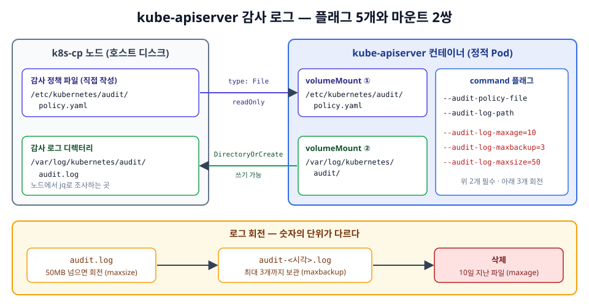
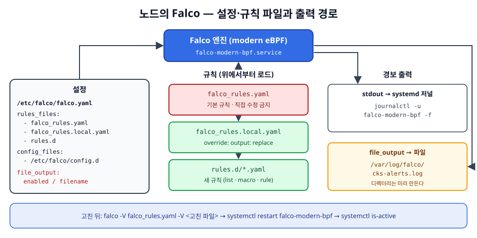
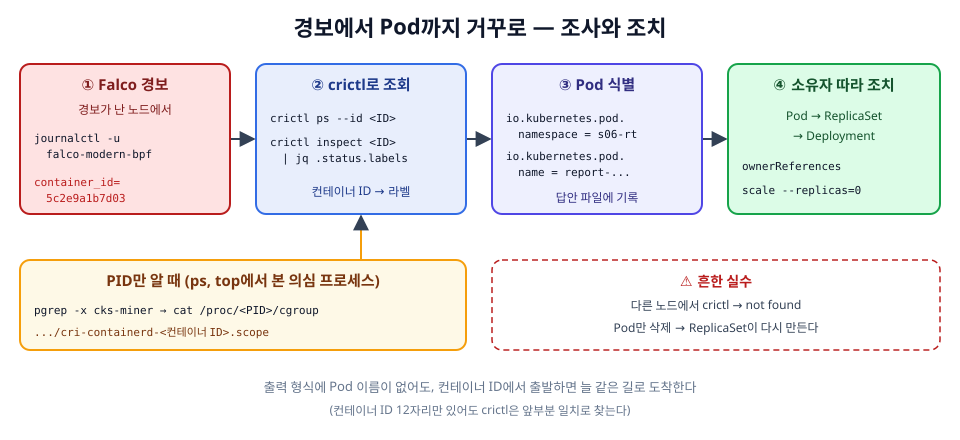

> **자격증 준비 · CKS** | 난이도 ★★★★★ | 예상 소요 4 ~ 5시간 (과제 8개 포함)

> ⚠️ 이 편의 모든 연습 과제는 CNCF가 공개한 **CKS 커리큘럼(github.com/cncf/curriculum의 `CKS_Curriculum v1.37.pdf`)을 바탕으로 직접 창작한** 시험 스타일 과제입니다. 실제 시험 문제(덤프)가 아니며, 실제 출제 내용과 무관합니다. 과제에 나오는 "수상한 Pod"는 `/etc/shadow`를 읽거나 이름만 바꾼 `sleep`을 돌리는 **무해한 연습용 흉내**이고, 실습 클러스터에서만 실행하세요.

## 🎯 오늘의 목표

- 문장으로 주어진 요구를 **감사 정책(Policy)** 규칙으로 옮기고, 규칙 **순서**가 결과를 바꾸는 이유를 설명할 수 있다
- kube-apiserver 정적 Pod에 감사 로그를 켜는 **플래그 5개와 volume/hostPath 2쌍**을 실수 없이 넣는다
- 감사 로그를 `jq`로 걸러 **누가·언제·무엇을** 했는지(대리 실행 포함) 찾아낸다
- 노드에 설치된 Falco의 **규칙 출력 형식을 바꾸고, 새 탐지 규칙을 추가하고, 경보를 파일로 저장**할 수 있다
- Falco 경보의 컨테이너 ID에서 `crictl`로 **Pod를 거꾸로 찾아 조치**하고, `readOnlyRootFilesystem`으로 **불변 컨테이너**를 만든다

---

## 1. 커리큘럼 항목 요약 — Monitoring, Logging and Runtime Security (20%)

2026-11-15에 확인한 공개 커리큘럼(v1.37)에서 이 도메인은 **20%** 입니다. 시험 공통 정보는 [S00](./s00-exam-overview-lab.md)에 있습니다.

| 커리큘럼 항목 (원문) | 이 편의 섹션 | 연습 과제 |
|---|---|---|
| Perform behavioral analytics to detect malicious activities | 4-3, 4-4 | 3, 4 |
| Detect threats within physical infrastructure, apps, networks, data, users and workloads | 4-4 | 4, 5 |
| Investigate and identify phases of attack and bad actors within the environment | 4-2, 4-5 | 2, 5, 8 |
| Ensure immutability of containers at runtime | 4-6 | 6, 7 |
| Use Kubernetes audit logs to monitor access | 4-1, 4-2 | 1, 2 |

이론은 본편에 있고, 여기서는 시험 과제 형식만 다룹니다.

| 주제 | 본편·탭 |
|---|---|
| Falco 구조, 드라이버, list/macro/rule 문법, 기본 룰셋, `override` | [Day 72](../../09-security/day72-falco.md) 2~6장 |
| 감사 레벨 4단계, 정책 예시, kind에 감사 로그 켜기, 로그 읽기 | [Day 73](../../09-security/day73-keycloak-sso-audit.md) 7-2, 7-3, 10장 |
| 정적 Pod 매니페스트 편집, API 서버가 안 뜰 때 | [CKA K06](../cka/k06-troubleshooting.md) 5장 |
| `crictl` 기본 | [CKA K06](../cka/k06-troubleshooting.md) 4장 |
| securityContext, PSA | [S04](./s04-microservice-vulnerabilities.md) |

### 1-1. 실습 환경

[CKA K00](../cka/k00-exam-overview-lab.md) 고정값을 그대로 씁니다. context `cka-main`(kubeadm v1.37.1, `k8s-cp` 192.168.56.10 / `k8s-w1` .11 / `k8s-w2` .12, Cilium). 노드 작업은 base(WSL2)에서 `ssh <노드>` 후 `sudo -i`, 작업 폴더는 base의 `~/cks/`와 노드 root의 `~/cks/`(= `/root/cks/`). 초기화 지점은 스냅샷 `cks-clean`입니다.

**Falco는 워커 두 대(`k8s-w1`, `k8s-w2`)에 패키지로 설치되어 `falco-modern-bpf` 서비스로 돌고 있다고 가정합니다.** 시험에서도 Falco가 노드에 서비스로 설치된 형태가 흔하고, 그래야 `/etc/falco/` 파일을 직접 고치는 연습이 됩니다. Day 72에서는 Helm으로 kind에 올렸으니 방식이 다릅니다. S00에서 설치하지 않았다면 두 워커에서 각각 실행하세요(Falco 공식 패키지 설치 문서 기준).

```bash
# k8s-w1, k8s-w2 각각 (root)
curl -fsSL https://falco.org/repo/falcosecurity-packages.asc | gpg --dearmor -o /usr/share/keyrings/falco-archive-keyring.gpg
echo "deb [signed-by=/usr/share/keyrings/falco-archive-keyring.gpg] https://download.falco.org/packages/deb stable main" \
  > /etc/apt/sources.list.d/falcosecurity.list
apt-get update -y
FALCO_FRONTEND=noninteractive FALCO_DRIVER_CHOICE=modern_ebpf FALCOCTL_ENABLED=no apt-get install -y falco jq
systemctl enable --now falco-modern-bpf.service
systemctl is-active falco-modern-bpf; falco --version | head -1
```

> 💡 `FALCOCTL_ENABLED=no`는 규칙 자동 업데이트(`falcoctl-artifact-follow`)를 끕니다. 연습 중에 기본 규칙 파일이 바뀌지 않게 하려는 것입니다. 시험 환경도 보통 고정된 규칙으로 주어집니다.

공용 준비:

```bash
# base 에서
kubectl config use-context cka-main
mkdir -p ~/cks/s06
ssh k8s-cp 'sudo apt-get install -y jq >/dev/null && sudo mkdir -p /root/cks'
```

---

## 2. 출제 유형 — 어떻게 채점되는가

| 과제 형태 | 예시 문장(창작) | 채점 포인트 |
|---|---|---|
| **감사 활성화형** | "주어진 정책 파일을 쓰도록 감사 로그를 켜라. 로그는 `/var/log/...`, 보존 N일, 백업 M개" | 플래그 값, 마운트, **API 서버 재기동**, 로그 파일에 이벤트가 쌓이는가 |
| **감사 정책 작성형** | "Secret은 Metadata, 네임스페이스 X의 Pod 변경은 RequestResponse, 나머지는 …" | 정책 파일 규칙의 레벨·대상·**순서** |
| **감사 조사형** | "ConfigMap `x`를 지운 사용자를 파일에 써라" | 파일 내용 정확성 |
| **Falco 규칙 수정형** | "규칙 Y의 출력을 `%evt.time,%user.uid,...` 형식으로 바꾸고 경보를 `/var/log/...`에 저장하라" | 경보 파일에 **지정 형식 그대로** 찍히는가 |
| **Falco 조사·조치형** | "Falco가 경보를 내는 Pod를 찾아 0으로 줄여라/삭제하라" | 대상 워크로드 상태, 다른 워크로드는 그대로인가 |
| **불변 컨테이너형** | "Deployment를 루트 파일시스템 읽기 전용으로, 쓰기는 지정 경로만" / "불변이 아닌 Pod를 지워라" | securityContext 필드, Pod Running, 쓰기 시도가 실패하는가 |
| **런타임 조사형** | "노드의 의심 프로세스를 실행하는 Pod를 찾아라" | 기록 파일, 조치 결과 |

> 💡 이 도메인의 과제는 **한 과제 안에 여러 단계**가 있어 오래 걸립니다(감사 활성화 10분 이상, Falco 10분 안팎). 1회차에 표시만 하고 넘어갔다가 2회차에 몰아서 푸는 전략도 생각해 두세요.

---

## 3. 핵심 명령·파일 위치 표

| 하려는 일 | 명령 / 파일 | 기억할 점 |
|---|---|---|
| 감사 정책 파일 | `apiVersion: audit.k8s.io/v1`, `kind: Policy`, `rules:` | **첫 번째로 일치하는 규칙**만 적용 |
| 감사 켜기 (필수 2개) | `--audit-policy-file=`, `--audit-log-path=` | 둘 다 있어야 로그가 남음 |
| 로그 회전 (3개) | `--audit-log-maxage=`(일), `--audit-log-maxbackup=`(파일 수), `--audit-log-maxsize=`(MB) | 과제 숫자를 그대로 |
| 마운트 | 정책 파일: hostPath `type: File`, readOnly / 로그 디렉터리: hostPath `type: DirectoryOrCreate` | **2쌍**(volume + volumeMount) |
| 감사 로그 읽기 | `jq -c 'select(.objectRef.resource=="secrets")' audit.log` | 한 줄 = 이벤트 하나(JSON Lines) |
| 대리 실행자 | 이벤트의 `.impersonatedUser.username` | `.user`는 실제 인증된 주체 |
| Falco 기본 규칙 | `/etc/falco/falco_rules.yaml` | **직접 고치지 말 것**(업데이트로 덮어씀) |
| Falco 사용자 규칙 | `/etc/falco/falco_rules.local.yaml`, `/etc/falco/rules.d/` | `falco.yaml`의 `rules_files` 순서대로 로드 → 기본 규칙 **다음** |
| 출력만 바꾸기 | 같은 `rule:` 이름 + `output:` + `override: {output: replace}` | 조건 덧붙이기는 `condition: append` |
| 파일 출력 | `falco.yaml`의 `file_output: {enabled: true, filename: ...}` 또는 `/etc/falco/config.d/*.yaml` | 디렉터리는 미리 만들기 |
| 규칙 검증 | `falco -V /etc/falco/falco_rules.yaml -V /etc/falco/falco_rules.local.yaml` | 기본 규칙과 **같이** 넘겨야 매크로를 찾음 |
| Falco 재시작·로그 | `systemctl restart falco-modern-bpf`, `journalctl -u falco-modern-bpf -f` | 서비스 이름은 `systemctl list-units \| grep falco`로 확인 |
| 컨테이너 → Pod | `crictl ps --id <id>`, `crictl inspect <id> \| jq '.status.labels'` | 라벨 `io.kubernetes.pod.name/namespace` |
| PID → 컨테이너 | `cat /proc/<pid>/cgroup` → `cri-containerd-<id>.scope` | cgroup 경로에 컨테이너 ID |
| 불변 컨테이너 | `securityContext.readOnlyRootFilesystem: true` + 필요한 경로만 `emptyDir` | `privileged: true`는 불변이 아님 |

---

## 4. 영역별 핵심

### 4-1. 감사 로그 켜기 — 플래그 5개, 마운트 2쌍



Day 73에서는 kind 설정으로 켰습니다. kubeadm 클러스터에서는 **`/etc/kubernetes/manifests/kube-apiserver.yaml`을 직접 고칩니다.** kubernetes.io의 "Auditing" 문서에 플래그와 마운트 예시가 그대로 있습니다.

```yaml
    - --audit-policy-file=/etc/kubernetes/audit/policy.yaml
    - --audit-log-path=/var/log/kubernetes/audit/audit.log
    - --audit-log-maxage=7          # 오래된 로그 파일 보존 일수
    - --audit-log-maxbackup=2       # 회전된 옛 파일 최대 개수
    - --audit-log-maxsize=50        # 파일 하나의 최대 크기(MB) → 넘으면 회전
```

| 놓치기 쉬운 것 | 왜 |
|---|---|
| 정책 파일 마운트 | API 서버는 **컨테이너**입니다. 노드에 파일만 있으면 `no such file`로 즉시 종료 |
| 로그 디렉터리 마운트 | 마운트하지 않으면 로그가 **컨테이너 안**에 쌓여 노드에서는 안 보이고, 재시작 때 사라짐 |
| 로그 마운트를 readOnly로 | 쓰기 실패 → API 서버가 시작하지 못함 |
| 정책 파일 문법 오류 | API 서버가 시작하지 못함. `crictl logs`에 YAML 오류 |

### 4-2. 감사 정책 — "첫 일치"가 전부

레벨(`None` / `Metadata` / `Request` / `RequestResponse`)의 의미는 Day 73 7-2에 있습니다. 시험에서 중요한 것은 **순서**입니다. 이벤트 하나는 위에서부터 내려가며 **처음 일치한 규칙 하나**의 레벨로 기록되고, 아래 규칙은 보지 않습니다.

| 문장 | 규칙으로 |
|---|---|
| "Secret은 본문 없이" | `level: Metadata` + `resources: [{group: "", resources: ["secrets"]}]` |
| "네임스페이스 X의 Pod 변경은 요청·응답 본문까지" | `level: RequestResponse` + `resources: [{group: "", resources: ["pods"]}]` + `namespaces: ["X"]` + `verbs: [create, update, patch, delete]` |
| "헬스 체크는 기록하지 마라" | `level: None` + `nonResourceURLs: ["/healthz*", "/livez*", "/readyz*"]` |
| "나머지는 메타데이터" | 맨 끝에 `- level: Metadata` (조건 없음) |
| "RequestReceived 단계 생략" | 최상위 `omitStages: ["RequestReceived"]` |

> ⚠️ "core 그룹"은 `group: ""`(빈 문자열)입니다. `group: "core"`나 `group: v1`로 쓰면 아무것도 일치하지 않아 조용히 아래 규칙으로 떨어집니다. 오류도 나지 않아 찾기 어렵습니다.

조사할 때는 `jq`를 씁니다. 로그 한 줄이 JSON 이벤트 하나입니다.

```bash
LOG=/var/log/kubernetes/audit/audit.log
jq -c 'select(.verb=="delete") | {t:.requestReceivedTimestamp, user:.user.username, as:.impersonatedUser.username, res:.objectRef.resource, ns:.objectRef.namespace, name:.objectRef.name}' $LOG | tail
```

| 필드 | 뜻 |
|---|---|
| `.user.username` | 인증된 주체 (예: `kubernetes-admin`) |
| `.impersonatedUser.username` | `--as`로 **대신 실행한** 주체. 권한 검사는 이쪽 기준 |
| `.objectRef.{resource,namespace,name}` | 대상 |
| `.responseStatus.code` | 결과 (200, 403 …) |
| `.sourceIPs` | 요청 출발지 |

### 4-3. Falco 파일 구조 — 어디를 고치나



Day 72의 문법(list, macro, rule, `override`)을 그대로 쓰되, 시험에서는 **노드의 파일**을 고칩니다.

| 파일 | 역할 | 고치나? |
|---|---|---|
| `/etc/falco/falco.yaml` | 메인 설정. `rules_files`(로드 순서), `file_output`, `stdout_output`, `json_output` | 출력 설정은 여기 또는 `config.d` |
| `/etc/falco/config.d/` | `config_files`로 추가 로드되는 설정 조각 | 원본을 안 건드리고 덮어쓰기 좋음 |
| `/etc/falco/falco_rules.yaml` | 기본 규칙(stable) | ❌ 직접 수정 금지 |
| `/etc/falco/falco_rules.local.yaml` | 사용자 규칙·덮어쓰기 | ✅ 여기 |
| `/etc/falco/rules.d/` | 사용자 규칙 파일 묶음 | ✅ 여기도 가능 |

`falco.yaml`의 기본 `rules_files`는 `falco_rules.yaml` → `falco_rules.local.yaml` → `rules.d` 순서입니다. 그래서 local 파일에서 **같은 이름의 규칙을 `override`로 덮으면** 기본 규칙 파일을 건드리지 않고 출력이나 조건을 바꿀 수 있습니다.

```yaml
# /etc/falco/falco_rules.local.yaml — 출력만 교체
- rule: Terminal shell in container
  output: "%evt.time,%user.uid,%container.id,%k8s.pod.name"
  override:
    output: replace
```

> 💡 규칙 전체를 복사해서 local 파일에 붙여 넣고 고쳐도 같은 결과가 나옵니다(같은 이름이면 나중 것이 이김). 시험 문서(falco.org/docs)의 "Overriding Rules" 예시가 `override` 방식이라 이쪽을 권합니다. 예전 문서의 `append: true`는 deprecated입니다.

### 4-4. 새 규칙 추가

새 규칙은 **기본 규칙에 정의된 매크로**(`spawned_process`, `container`, `open_read`)를 재사용하면 짧습니다. 시험에서 자주 쓰는 필드는 Day 72 3장 표에 있습니다.

| 의도 | 조건 조각 |
|---|---|
| 컨테이너에서 프로세스 실행 | `spawned_process and container and proc.name in (...)` |
| 특정 파일 열기(읽기) | `open_read and container and fd.name = /etc/shadow` |
| 특정 디렉터리 아래 쓰기 | `open_write and container and fd.name startswith /etc/` |
| 특정 네임스페이스만 | `and k8s.ns.name = "prod"` |

> ⚠️ 규칙 YAML이 틀리면 Falco가 **시작하지 못합니다.** 재시작 전에 `falco -V`로 검증하고, 재시작 후 `systemctl is-active falco-modern-bpf`를 꼭 확인하세요. 서비스가 죽어 있으면 경보 관련 채점이 모두 실패합니다.

### 4-5. 경보에서 Pod까지 — 거꾸로 추적



Falco 경보에는 늘 **컨테이너 ID(12자리)** 가 있고, Pod 이름은 설정·규칙에 따라 있을 수도 없을 수도 있습니다. 컨테이너 ID에서 출발하는 방법을 익혀 두면 어떤 출력 형식에서도 통합니다.

```bash
# 경보가 난 노드에서
journalctl -u falco-modern-bpf --since "10 min ago" | grep -i "sensitive file" | tail -3
crictl ps --id <컨테이너ID>                             # POD 열에 Pod 이름
crictl inspect <컨테이너ID> | jq -r '.status.labels["io.kubernetes.pod.namespace"], .status.labels["io.kubernetes.pod.name"]'
```

프로세스 ID(PID)만 있을 때는 `/proc/<pid>/cgroup`에 컨테이너 ID가 들어 있습니다(cgroup v2 + systemd 드라이버 기준 `.../cri-containerd-<64자리 ID>.scope`).

그다음은 **소유자를 따라 올라가** 조치합니다. Pod만 지우면 ReplicaSet이 다시 만들기 때문입니다.

```bash
k -n <ns> get po <pod> -o jsonpath='{.metadata.ownerReferences[0].kind}/{.metadata.ownerReferences[0].name}{"\n"}'
# ReplicaSet/report-7d9c6b5f4d → Deployment report
k -n <ns> scale deploy report --replicas=0
```

### 4-6. 불변 컨테이너

"실행 중에 바뀌지 않는 컨테이너"는 커리큘럼 표현으로 **immutability at runtime**입니다. 시험에서는 대개 다음 셋으로 판정합니다.

| 조건 | 필드 |
|---|---|
| 루트 파일시스템 읽기 전용 | `containers[].securityContext.readOnlyRootFilesystem: true` |
| 쓰기가 꼭 필요한 경로만 열기 | 그 경로에 `emptyDir` 마운트 (nginx: `/var/cache/nginx`, `/var/run`) |
| 특권 없음 | `privileged: true` 금지 (특권 컨테이너는 호스트를 바꿀 수 있어 불변이 아님) |

> 💡 `allowPrivilegeEscalation: false`, `capabilities.drop: [ALL]`, `runAsNonRoot`까지 더하면 S04의 Restricted 수준이 됩니다. 과제가 "불변"만 요구하면 위 표의 세 가지가 채점 기준입니다.

---

## 5. 시간 절약 팁

| 팁 | 효과 |
|---|---|
| kube-apiserver 수정 전 `cp ... ~/cks/kube-apiserver.yaml.s06bak` | 망가지면 바로 복구 |
| 감사 플래그·마운트는 kubernetes.io "Auditing" 문서의 **Log backend** 절에서 복사 | hostPath `type`과 경로 오타 방지 |
| 정책 파일도 문서의 `audit-policy.yaml` 예시를 복사해 **줄이기** | 처음부터 쓰는 것보다 빠름 |
| Falco는 `journalctl -u falco-modern-bpf -f`를 **다른 탭**에 띄워 두기 | 재현 즉시 경보 확인 (`Ctrl+Alt+W` 대신 터미널 탭 하나 더) |
| 규칙 고친 뒤 `falco -V ...` → `systemctl restart` → `is-active` 3단 | 죽은 Falco로 시간 날리지 않기 |
| 컨테이너 ID → `crictl ps --id` | Pod 이름까지 한 줄 |
| 불변 Pod 찾기는 custom-columns 한 번 | 하나씩 `describe` 하지 않기 |

---

## 6. 자주 하는 실수

| 실수 | 결과 | 예방 |
|---|---|---|
| 감사 로그 디렉터리를 마운트하지 않음 | 노드에 로그 파일이 안 생김 | volume/volumeMount 2쌍 |
| `--audit-log-maxbackup`과 `maxage` 혼동 | 채점 실패 | backup = **개수**, age = **일** |
| 정책에 넓은 규칙을 위에 둠 | Secret이 `Request`로 찍혀 **값이 로그에 남음** | 구체적인 규칙을 위로 |
| `group: "core"` | 규칙이 아무것도 일치 안 함 | core = `""` |
| 정책 수정 후 API 서버가 정책을 다시 읽지 않음 | 예전 규칙으로 계속 기록 | 정책 파일은 **시작할 때만** 읽음 → 매니페스트를 살짝 바꾸거나 kube-apiserver 컨테이너 재시작 |
| `falco_rules.yaml`을 직접 수정 | 업데이트 때 덮어씀, 채점이 local 파일을 볼 수 있음 | local 파일 또는 `rules.d` |
| Falco 출력 형식에 따옴표 누락 | `%`로 시작하는 값이 YAML 파싱 오류 | `output: "..."`처럼 따옴표 |
| 파일 출력 경로의 디렉터리가 없음 | 경보가 파일에 안 쌓임 | `mkdir -p` |
| 경보가 난 노드와 다른 노드에서 `crictl` | "not found" | 경보를 본 노드에서 조사 |
| 문제 Pod만 삭제 | Deployment가 다시 만듦 | `ownerReferences` 따라 올라가기 |
| `readOnlyRootFilesystem`을 Pod 수준 `securityContext`에 씀 | 필드가 없어 무시/거부 | **컨테이너** 수준 필드 |

---

## 7. 창작 연습 과제

> 아래 과제는 모두 공식 커리큘럼을 바탕으로 **직접 창작한** 시험 스타일 과제입니다. 과제 1을 먼저 풀어야 과제 2가 동작합니다. 초기화: Windows에서 `cd C:\lab\k8s; vagrant halt; vagrant snapshot restore cks-clean --no-provision; vagrant up`.

### 과제 1. 감사 정책 작성과 감사 로그 켜기 (목표 12분)

작업 위치: `ssh k8s-cp` 후 `sudo -i`. 다음 요구를 만족하는 감사 정책을 `/etc/kubernetes/audit/policy.yaml`에 만들고, kube-apiserver가 이 정책으로 감사 로그를 남기게 하라.
- `RequestReceived` 단계는 기록하지 않는다
- `/healthz*`, `/livez*`, `/readyz*` 요청은 기록하지 않는다
- 모든 네임스페이스의 `secrets`, `configmaps`는 `Metadata` 수준으로만
- 네임스페이스 `s06`의 `pods`에 대한 `create`, `update`, `patch`, `delete`는 `RequestResponse`
- 그 밖의 모든 요청은 `Metadata`
- 로그 경로 `/var/log/kubernetes/audit/audit.log`, 보존 **10일**, 회전된 파일 최대 **3개**, 파일당 **50MB**

📖 참고 문서: kubernetes.io → "Auditing"(Audit policy, Log backend 절의 플래그와 volume/volumeMount 예시)

<details>
<summary>풀이·검증</summary>

**① 정책 파일**

```bash
mkdir -p /etc/kubernetes/audit /root/cks
cat > /etc/kubernetes/audit/policy.yaml <<'EOF'
apiVersion: audit.k8s.io/v1
kind: Policy
omitStages:
  - "RequestReceived"
rules:
  - level: None
    nonResourceURLs: ["/healthz*", "/livez*", "/readyz*"]
  - level: Metadata
    resources:
    - group: ""
      resources: ["secrets", "configmaps"]
  - level: RequestResponse
    namespaces: ["s06"]
    verbs: ["create", "update", "patch", "delete"]
    resources:
    - group: ""
      resources: ["pods"]
  - level: Metadata
EOF
```

**② 매니페스트** — 백업 후 편집.

```bash
cp /etc/kubernetes/manifests/kube-apiserver.yaml ~/cks/kube-apiserver.yaml.s06bak
vim /etc/kubernetes/manifests/kube-apiserver.yaml
```

```yaml
spec:
  containers:
  - command:
    - kube-apiserver
    - --audit-policy-file=/etc/kubernetes/audit/policy.yaml
    - --audit-log-path=/var/log/kubernetes/audit/audit.log
    - --audit-log-maxage=10
    - --audit-log-maxbackup=3
    - --audit-log-maxsize=50
    # ... 기존 플래그 그대로
    volumeMounts:
    # ... 기존 항목 그대로
    - mountPath: /etc/kubernetes/audit/policy.yaml
      name: audit-policy
      readOnly: true
    - mountPath: /var/log/kubernetes/audit/
      name: audit-log
      readOnly: false
  volumes:
  # ... 기존 항목 그대로
  - hostPath:
      path: /etc/kubernetes/audit/policy.yaml
      type: File
    name: audit-policy
  - hostPath:
      path: /var/log/kubernetes/audit/
      type: DirectoryOrCreate
    name: audit-log
```

**③ 재시작과 검증**

```bash
crictl ps -a --name kube-apiserver               # 새 컨테이너 Running까지 30~90초
export KUBECONFIG=/etc/kubernetes/admin.conf
kubectl get nodes

kubectl create ns s06
kubectl -n s06 create secret generic db --from-literal=pw=s3cr3t
kubectl -n s06 run probe --image=nginx:1.27

LOG=/var/log/kubernetes/audit/audit.log
jq -c 'select(.objectRef.resource=="secrets" and .objectRef.name=="db") | {level, stage, verb}' $LOG
# {"level":"Metadata","stage":"ResponseComplete","verb":"create"}
jq -c 'select(.objectRef.resource=="pods" and .objectRef.namespace=="s06" and .verb=="create") | {level, hasBody:(.requestObject!=null)}' $LOG
# {"level":"RequestResponse","hasBody":true}
grep -c '"stage":"RequestReceived"' $LOG         # 0
grep -c 's3cr3t' $LOG                            # 0 — Secret 값이 남지 않음
ps -ef | grep [k]ube-apiserver | tr ' ' '\n' | grep audit
```

`jq`의 `.level`이 기대와 다르면 규칙 **순서**부터 보세요. 예를 들어 `RequestResponse` 규칙에 `namespaces`를 빼먹으면 모든 네임스페이스의 Pod 변경이 본문까지 찍힙니다.
</details>

### 과제 2. 감사 로그로 행위자 찾기 (목표 6분)

작업 위치: base에서 준비 명령 실행, 조사는 `ssh k8s-cp` 후 `sudo -i`. 누군가 네임스페이스 `s06`의 ConfigMap `app-config`를 삭제했다. 감사 로그에서 **삭제 권한 검사의 대상이 된 주체**(대리 실행이라면 대리된 주체)의 사용자 이름과 요청 시각을 `사용자이름,시각` 한 줄로 `/root/cks/s06-cm-deleter.txt`에 저장하라.

```bash
# base — 준비 (과제 1 완료 후)
k -n s06 create cm app-config --from-literal=mode=prod
k -n s06 create sa intruder
k -n s06 create role cm-editor --verb=get,list,delete --resource=configmaps
k -n s06 create rolebinding intruder-cm --role=cm-editor --serviceaccount=s06:intruder
k -n s06 delete cm app-config --as=system:serviceaccount:s06:intruder
```

📖 참고 문서: kubernetes.io → "Auditing"(이벤트 필드), "Authenticating"(User impersonation)

<details>
<summary>풀이·검증</summary>

```bash
LOG=/var/log/kubernetes/audit/audit.log
jq -c 'select(.verb=="delete" and .objectRef.resource=="configmaps" and .objectRef.name=="app-config")
       | {user:.user.username, as:.impersonatedUser.username, t:.requestReceivedTimestamp, code:.responseStatus.code}' $LOG
# {"user":"kubernetes-admin","as":"system:serviceaccount:s06:intruder","t":"2026-11-15T05:12:31.402118Z","code":200}

jq -r 'select(.verb=="delete" and .objectRef.resource=="configmaps" and .objectRef.name=="app-config")
       | "\(.impersonatedUser.username // .user.username),\(.requestReceivedTimestamp)"' $LOG > /root/cks/s06-cm-deleter.txt
cat /root/cks/s06-cm-deleter.txt
```

`--as`로 실행하면 감사 이벤트의 `.user`는 **실제로 인증한 관리자**, `.impersonatedUser`는 **권한 검사를 받은 ServiceAccount**입니다. 과제 문장이 "권한 검사의 대상"이므로 `impersonatedUser`가 답이고, 대리 실행이 아니었다면 `// .user.username`이 대신 쓰입니다. 실제 조사에서는 두 값을 모두 기록해야 "누가 누구 행세를 했는지"가 남습니다.
</details>

### 과제 3. Falco 출력 형식 바꾸고 파일로 저장 (목표 10분)

작업 위치: `ssh k8s-w1` 후 `sudo -i`. 이 노드의 Falco에서 기본 규칙 **`Terminal shell in container`** 의 출력을 다음 형식으로 바꿔라. 기본 규칙 파일은 수정하지 마라.

```
%evt.time,%user.uid,%container.id,%container.image.repository
```

또한 Falco 경보가 `/var/log/falco/cks-alerts.log` 파일에도 기록되게 하라. 확인을 위해 아래 Pod에서 대화형 셸을 열었다 닫아라.

```bash
# base — 준비
k create ns s06-rt
k -n s06-rt run shell-target --image=nginx:1.27 --overrides='{"spec":{"nodeName":"k8s-w1"}}'
```

📖 참고 문서: falco.org/docs → "Overriding Rules"(`override: output: replace`), "Falco Outputs"(File output), Falco 설정 파일 레퍼런스(`file_output`, `config_files`)

<details>
<summary>풀이·검증</summary>

**① 규칙 출력 덮어쓰기**

```bash
cat >> /etc/falco/falco_rules.local.yaml <<'EOF'

- rule: Terminal shell in container
  output: "%evt.time,%user.uid,%container.id,%container.image.repository"
  override:
    output: replace
EOF
```

**② 파일 출력** — 원본 `falco.yaml`을 두고 `config.d`에 조각을 둡니다(직접 `falco.yaml`의 `file_output`을 고쳐도 정답).

```bash
mkdir -p /var/log/falco
cat > /etc/falco/config.d/cks-file-output.yaml <<'EOF'
file_output:
  enabled: true
  keep_alive: false
  filename: /var/log/falco/cks-alerts.log
EOF
```

**③ 검증 후 재시작**

```bash
falco -V /etc/falco/falco_rules.yaml -V /etc/falco/falco_rules.local.yaml
systemctl restart falco-modern-bpf && sleep 5 && systemctl is-active falco-modern-bpf   # active
```

**④ 재현** (base에서, `-t`가 있어야 "터미널" 셸)

```bash
k -n s06-rt exec -it shell-target -- sh
# exit
```

```bash
# k8s-w1
tail -2 /var/log/falco/cks-alerts.log
# 07:21:44.118374672: Notice 07:21:44.118374672,0,3b9c1f2e8a4d,docker.io/library/nginx
journalctl -u falco-modern-bpf --since "2 min ago" | tail -2     # 같은 줄이 저널에도 찍힘
```

경보 줄의 앞부분(시각, 우선순위)은 Falco가 붙이는 공통 접두사이고, 그 뒤가 바꾼 출력입니다. 설정에 따라 맨 뒤에 컨테이너·K8s 정보가 자동으로 덧붙을 수도 있습니다. **지정한 네 필드가 쉼표로 이어져 나오면** 성공입니다.
</details>

### 과제 4. 새 탐지 규칙 추가 (목표 8분)

작업 위치: `ssh k8s-w1` 후 `sudo -i`. 컨테이너 안에서 네트워크 도구 `nc`, `ncat`, `netcat`, `socat` 중 하나가 **실행되면** 경보를 내는 규칙을 `/etc/falco/rules.d/cks-net-tools.yaml`에 추가하라.
- 규칙 이름 `CKS network tool in container`, 우선순위 `WARNING`
- 출력에 프로세스 명령줄, 네임스페이스, Pod 이름, 컨테이너 ID 포함
- 과제 3의 파일 출력으로도 기록되어야 함

```bash
# base — 준비
k -n s06-rt run nettool --image=busybox:1.37 --overrides='{"spec":{"nodeName":"k8s-w1"}}' -- sleep 1d
```

📖 참고 문서: falco.org/docs → "Rules"(Basic elements, Supported fields), "Default Macros"(`spawned_process`, `container`)

<details>
<summary>풀이·검증</summary>

```bash
cat > /etc/falco/rules.d/cks-net-tools.yaml <<'EOF'
- list: cks_net_tools
  items: [nc, ncat, netcat, socat]

- rule: CKS network tool in container
  desc: Network utility executed inside a container
  condition: spawned_process and container and proc.name in (cks_net_tools)
  output: "Network tool in container (cmd=%proc.cmdline ns=%k8s.ns.name pod=%k8s.pod.name container=%container.id)"
  priority: WARNING
  tags: [cks, network]
EOF

falco -V /etc/falco/falco_rules.yaml -V /etc/falco/falco_rules.local.yaml -V /etc/falco/rules.d/cks-net-tools.yaml
systemctl restart falco-modern-bpf && sleep 5 && systemctl is-active falco-modern-bpf
```

```bash
# base — 재현 (busybox의 nc 애플릿: 프로세스 이름이 nc)
k -n s06-rt exec nettool -- nc -h 2>/dev/null; true
```

```bash
# k8s-w1
grep "CKS network tool\|Network tool in container" /var/log/falco/cks-alerts.log | tail -1
# ... Warning Network tool in container (cmd=nc -h ns=s06-rt pod=nettool container=8e1d0c7b2f4a)
```

`pod=<NA>`로 찍히면 컨테이너 메타데이터를 붙이는 플러그인이 아직 정보를 못 받은 것입니다(Pod 생성 직후). 몇 초 뒤 다시 재현하거나, 컨테이너 ID로 4-5의 방법을 쓰면 됩니다. `spawned_process`, `container` 매크로는 기본 규칙에 있으므로 **`-V`에 기본 규칙 파일을 함께** 넘겨야 검증이 통과합니다.
</details>

### 과제 5. Falco 경보로 문제 Pod 찾아 조치 (목표 8분)

작업 위치: base, 조사는 `ssh k8s-w1`. 네임스페이스 `s06-rt`의 Deployment 셋 중 하나가 컨테이너 안에서 **민감한 파일을 반복해서 읽고 있다**. Falco 경보로 해당 Pod를 찾아 **그 Pod를 소유한 Deployment의 레플리카를 0으로** 줄여라. 다른 Deployment는 건드리지 마라. Pod 이름을 `~/cks/s06/falco-culprit.txt`(base)에 `네임스페이스/Pod이름` 형식으로 저장하라.

```bash
# base — 준비 (어느 것이 문제인지 드러나지 않게 출력은 숨김)
for d in api report worker; do
  k -n s06-rt create deploy $d --image=docker.io/library/alpine:3.22 --dry-run=client -o yaml -- sleep 1d \
  | sed 's/^    spec:/    spec:\n      nodeName: k8s-w1/' | k apply -f - >/dev/null
done
k -n s06-rt patch deploy report --type=json -p '[{"op":"replace","path":"/spec/template/spec/containers/0/command","value":["sh","-c","while true; do cat /etc/shadow >/dev/null; sleep 15; done"]}]' >/dev/null
k -n s06-rt rollout status deploy/report >/dev/null && echo ready
```

📖 참고 문서: falco.org/docs(기본 규칙 *Read sensitive file untrusted*), kubernetes.io → "Debugging Kubernetes nodes with crictl", "Owners and Dependents"

<details>
<summary>풀이·검증</summary>

```bash
# k8s-w1 (root)
journalctl -u falco-modern-bpf --since "5 min ago" | grep -i "sensitive file" | tail -2
# ... Warning Sensitive file opened for reading by non-trusted program (file=/etc/shadow ... container_id=5c2e9a1b7d03 ...)
CID=5c2e9a1b7d03                       # 경보에서 복사
crictl ps --id $CID
crictl inspect $CID | jq -r '"\(.status.labels["io.kubernetes.pod.namespace"])/\(.status.labels["io.kubernetes.pod.name"])"'
# s06-rt/report-6b8f7c9d5-x2k4p
```

```bash
# base
echo "s06-rt/report-6b8f7c9d5-x2k4p" > ~/cks/s06/falco-culprit.txt     # 위에서 나온 실제 이름
k -n s06-rt get po report-6b8f7c9d5-x2k4p -o jsonpath='{.metadata.ownerReferences[0].name}{"\n"}'   # report-6b8f7c9d5 (ReplicaSet)
k -n s06-rt get rs report-6b8f7c9d5 -o jsonpath='{.metadata.ownerReferences[0].name}{"\n"}'         # report
k -n s06-rt scale deploy report --replicas=0
```

```bash
k -n s06-rt get deploy                 # report 0/0, api·worker 1/1
cat ~/cks/s06/falco-culprit.txt
# k8s-w1: 1~2분 뒤 새 경보가 더 이상 나오지 않음
journalctl -u falco-modern-bpf --since "1 min ago" | grep -ci "sensitive file"
```

출력 형식에 Pod 이름이 있다면 바로 쓸 수 있지만, **컨테이너 ID → `crictl`** 경로는 출력 형식과 관계없이 늘 통합니다. 과제가 "삭제"를 요구했다면 Deployment 자체를 지우고, "격리"를 요구했다면 S01의 NetworkPolicy 과제처럼 라벨로 트래픽을 막는 식으로 문장에 맞춥니다.
</details>

### 과제 6. 불변 컨테이너로 바꾸기 (목표 7분)

작업 위치: base, context `cka-main`. 네임스페이스 `s06`의 Deployment `cache`(이미지 `nginx:1.27`)를 수정해 컨테이너 루트 파일시스템을 **읽기 전용**으로 만들어라. nginx가 정상 동작하도록 쓰기가 필요한 `/var/cache/nginx`, `/var/run`에만 `emptyDir`를 마운트하라. 이미지와 레플리카 수는 바꾸지 마라.

```bash
# base — 준비
k get ns s06 >/dev/null 2>&1 || k create ns s06
k -n s06 create deploy cache --image=nginx:1.27 --replicas=2
```

📖 참고 문서: kubernetes.io → "Configure a Security Context for a Pod or Container"(`readOnlyRootFilesystem`), "Volumes"(emptyDir)

<details>
<summary>풀이·검증</summary>

```bash
k -n s06 edit deploy cache
```

```yaml
    spec:
      containers:
      - name: nginx
        image: nginx:1.27
        securityContext:
          readOnlyRootFilesystem: true
        volumeMounts:
        - name: cache
          mountPath: /var/cache/nginx
        - name: run
          mountPath: /var/run
      volumes:
      - name: cache
        emptyDir: {}
      - name: run
        emptyDir: {}
```

```bash
k -n s06 rollout status deploy/cache
k -n s06 exec deploy/cache -- touch /usr/share/nginx/html/hack.html
# touch: cannot touch '/usr/share/nginx/html/hack.html': Read-only file system
k -n s06 exec deploy/cache -- touch /var/cache/nginx/ok && echo "emptyDir writable"
k -n s06 exec deploy/cache -- sh -c 'curl -s -o /dev/null -w "%{http_code}\n" localhost'   # 200
```

`/var/run`을 빼먹으면 nginx가 pid 파일을 못 써서 `CrashLoopBackOff`가 됩니다. `k -n s06 logs deploy/cache`에 `Read-only file system` 문구와 함께 어느 경로인지 나오므로, **로그가 알려 주는 경로만** emptyDir로 엽니다.
</details>

### 과제 7. 불변이 아닌 Pod 정리 (목표 6분)

작업 위치: base, context `cka-main`. 네임스페이스 `s06-immut`의 Pod 중 **불변이 아닌 것**(컨테이너 중 하나라도 `readOnlyRootFilesystem: true`가 아니거나, `privileged: true`인 것)을 모두 삭제하라. 삭제한 Pod 이름을 이름순으로 `~/cks/s06/mutable-pods.txt`에 저장하라.

```bash
# base — 준비
k create ns s06-immut
k -n s06-immut run p-plain --image=busybox:1.37 -- sleep 1d
k -n s06-immut run p-ro    --image=busybox:1.37 --overrides='{"spec":{"containers":[{"name":"p-ro","image":"busybox:1.37","command":["sleep","1d"],"securityContext":{"readOnlyRootFilesystem":true}}]}}'
k -n s06-immut run p-priv  --image=busybox:1.37 --overrides='{"spec":{"containers":[{"name":"p-priv","image":"busybox:1.37","command":["sleep","1d"],"securityContext":{"readOnlyRootFilesystem":true,"privileged":true}}]}}'
k -n s06-immut run p-side  --image=busybox:1.37 --overrides='{"spec":{"containers":[{"name":"a","image":"busybox:1.37","command":["sleep","1d"],"securityContext":{"readOnlyRootFilesystem":true}},{"name":"b","image":"busybox:1.37","command":["sleep","1d"]}]}}'
k -n s06-immut get po
```

📖 참고 문서: kubernetes.io → "kubectl Quick Reference"(custom-columns, jsonpath), "Configure a Security Context for a Pod or Container"

<details>
<summary>풀이·검증</summary>

```bash
k -n s06-immut get po -o custom-columns='POD:.metadata.name,RO:.spec.containers[*].securityContext.readOnlyRootFilesystem,PRIV:.spec.containers[*].securityContext.privileged'
# POD       RO          PRIV
# p-plain   <none>      <none>
# p-priv    true        true
# p-ro      true        <none>
# p-side    true        <none>      ← 컨테이너 2개인데 값이 하나뿐 = b에는 설정 없음
```

`p-side`가 함정입니다. custom-columns는 **값이 없는 컨테이너를 건너뛰고** 있는 값만 쉼표로 이어 보여 주므로, 컨테이너 수와 값 개수를 비교해야 합니다. 확실하게 하려면 컨테이너 단위로 펼칩니다.

```bash
k -n s06-immut get po -o json | jq -r '.items[] | select(any(.spec.containers[];
    (.securityContext.readOnlyRootFilesystem != true) or (.securityContext.privileged == true))) | .metadata.name' \
  | sort > ~/cks/s06/mutable-pods.txt
cat ~/cks/s06/mutable-pods.txt
# p-plain
# p-priv
# p-side
xargs -r kubectl -n s06-immut delete po --grace-period=0 --force < ~/cks/s06/mutable-pods.txt
```

```bash
k -n s06-immut get po          # p-ro 만 남음
```
</details>

### 과제 8. `crictl`로 의심 프로세스의 주인 찾기 (목표 7분)

작업 위치: `ssh k8s-w2` 후 `sudo -i`. 노드 `k8s-w2`에서 `cks-miner`라는 이름의 프로세스가 CPU를 쓰고 있다는 보고가 들어왔다. 이 프로세스를 실행하는 **컨테이너 ID(앞 13자리)와 네임스페이스/Pod 이름**을 `/root/cks/s06-miner.txt`에 `컨테이너ID 네임스페이스/Pod` 한 줄로 저장하고, 그 Pod를 삭제하라.

```bash
# base — 준비 (이름만 바꾼 sleep. 실제로는 아무 일도 하지 않음)
k create ns s06-batch 2>/dev/null
for p in batch-1 batch-3; do
  k -n s06-batch run $p --image=docker.io/library/debian:12-slim --overrides='{"spec":{"nodeName":"k8s-w2"}}' -- sleep 1d
done
k -n s06-batch run batch-2 --image=docker.io/library/debian:12-slim --overrides='{"spec":{"nodeName":"k8s-w2"}}' \
  -- sh -c 'cp /bin/sleep /tmp/cks-miner && exec /tmp/cks-miner 1d'
k -n s06-batch wait --for=condition=Ready po --all --timeout=90s
```

📖 참고 문서: kubernetes.io → "Debugging Kubernetes nodes with crictl"

<details>
<summary>풀이·검증</summary>

```bash
PID=$(pgrep -x cks-miner); echo $PID
cat /proc/$PID/cgroup
# 0::/kubepods.slice/kubepods-besteffort.slice/kubepods-besteffort-pod<uid>.slice/cri-containerd-a41f0c...e9.scope
CID=$(grep -o 'cri-containerd-[0-9a-f]*' /proc/$PID/cgroup | cut -d- -f3 | cut -c1-13)
crictl ps --id $CID
POD=$(crictl inspect $CID | jq -r '"\(.status.labels["io.kubernetes.pod.namespace"])/\(.status.labels["io.kubernetes.pod.name"])"')
echo "$CID $POD" | tee /root/cks/s06-miner.txt
# a41f0c7d9e2b1 s06-batch/batch-2
```

`/proc/<pid>/cgroup`을 쓸 수 없는 상황이라면, 컨테이너마다 대표 PID를 뽑아 프로세스 트리와 대조하는 방법도 있습니다.

```bash
for c in $(crictl ps -q); do echo "$c $(crictl inspect $c | jq .info.pid)"; done
ps -o pid,ppid,comm -p $PID          # PPID가 위 목록의 PID 중 하나이거나 그 자체
```

삭제(base 또는 k8s-cp):

```bash
k -n s06-batch delete po batch-2
k -n s06-batch get po                 # batch-1, batch-3 만
ssh k8s-w2 'pgrep -x cks-miner || echo gone'
```

이 Pod는 단독 Pod라 지우면 끝입니다. 소유자가 있었다면 과제 5처럼 위로 올라가야 합니다.
</details>

### 정리

```bash
k delete ns s06 s06-rt s06-immut s06-batch
# 감사 로그·Falco 설정은 S07 모의고사 전에 cks-clean 으로 되돌리거나, 아래처럼 직접 원복
ssh k8s-cp 'sudo cp /root/cks/kube-apiserver.yaml.s06bak /etc/kubernetes/manifests/kube-apiserver.yaml'
for n in k8s-w1; do ssh $n 'sudo rm -f /etc/falco/rules.d/cks-net-tools.yaml /etc/falco/config.d/cks-file-output.yaml && sudo systemctl restart falco-modern-bpf'; done
```

`falco_rules.local.yaml`에 넣은 `override`는 직접 지우세요(파일 끝 블록).

---

## 8. 핵심 정리

- 도메인 20%: **행위 분석·위협 탐지(Falco) / 공격 조사 / 불변 컨테이너 / 감사 로그**
- 감사 활성화 = 플래그 5개(`policy-file`, `log-path`, `maxage`(일), `maxbackup`(개수), `maxsize`(MB)) + **정책 파일·로그 디렉터리 hostPath 2쌍**. 백업은 manifests 밖
- 감사 정책은 **첫 일치 규칙**만 적용. 구체적인 규칙을 위로, 조건 없는 `Metadata`를 맨 끝에. core 그룹은 `""`
- 감사 조사: `jq select(...)`로 `.user`, **`.impersonatedUser`**, `.objectRef`, `.requestReceivedTimestamp`
- Falco: 기본 규칙 파일은 그대로, **`falco_rules.local.yaml` / `rules.d`** 에서 `override: output: replace`나 새 규칙. 파일 출력은 `file_output`(또는 `config.d`). `falco -V` → restart → `is-active`
- 경보 → **컨테이너 ID → `crictl ps --id` / `crictl inspect` 라벨** → `ownerReferences` 따라 Deployment 조치. PID만 있으면 `/proc/<pid>/cgroup`
- 불변 컨테이너 = 컨테이너 수준 `readOnlyRootFilesystem: true` + 필요한 경로만 emptyDir, `privileged` 금지. 다중 컨테이너 Pod를 놓치지 않기

---

## ⏭️ 다음 예고 — S07. 모의고사 1

이제 여섯 편의 과제를 **한 번에, 시간 안에** 풀어 봅니다. S07은 CKS 커리큘럼 여섯 도메인의 비중(Cluster Setup 15 / Cluster Hardening 15 / System Hardening 10 / Minimize Microservice Vulnerabilities 20 / Supply Chain Security 20 / Monitoring, Logging and Runtime Security 20)에 맞춰 창작한 모의고사입니다. `cks-clean`에서 시작해 2시간 타이머를 켜고, 과제마다 배점과 채점 체크리스트로 스스로 점수를 매깁니다. 오늘 연습한 kube-apiserver 수정·Falco 규칙·`crictl` 추적이 시간을 가장 많이 잡아먹으니, 어느 과제를 2회차로 미룰지도 함께 연습합니다.
